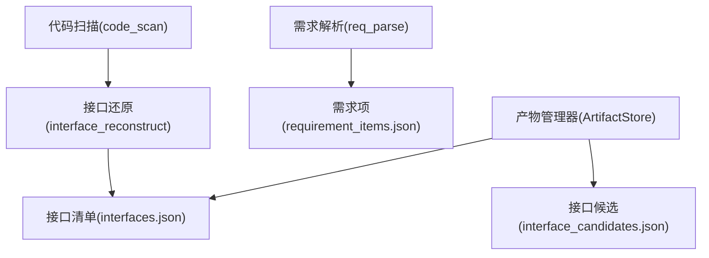
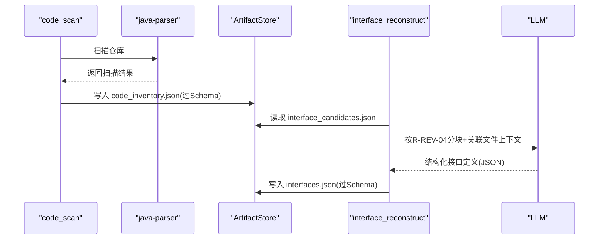
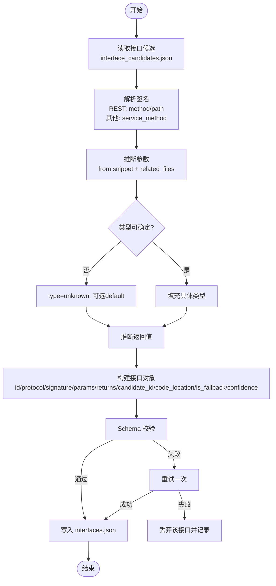
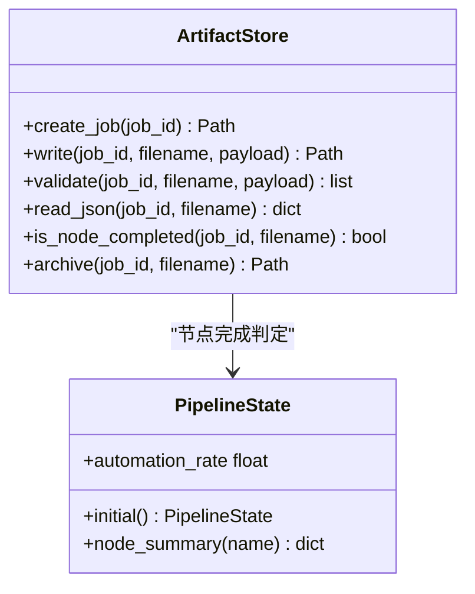

# 接口数据模型

<cite>
**本文引用的文件**
- [schemas/interface_candidates.json](file://schemas/interface_candidates.json)
- [schemas/interfaces.json](file://schemas/interfaces.json)
- [schemas/samples/interface_candidates.sample.json](file://schemas/samples/interface_candidates.sample.json)
- [schemas/samples/interfaces.sample.json](file://schemas/samples/interfaces.sample.json)
- [services/orchestrator/src/orchestrator/artifacts.py](file://services/orchestrator/src/orchestrator/artifacts.py)
- [services/orchestrator/src/orchestrator/pipeline.py](file://services/orchestrator/src/orchestrator/pipeline.py)
- [services/orchestrator/src/orchestrator/nodes/code_scan.py](file://services/orchestrator/src/orchestrator/nodes/code_scan.py)
- [services/orchestrator/src/orchestrator/nodes/req_parse.py](file://services/orchestrator/src/orchestrator/nodes/req_parse.py)
- [MumuSpec/10-数据模型与存储规格.md](file://MumuSpec/10-数据模型与存储规格.md)
- [docs/04_功能规格说明.md](file://docs/04_功能规格说明.md)
- [schemas/contracts/java-parser.openapi.yaml](file://schemas/contracts/java-parser.openapi.yaml)
</cite>

## 目录
1. [简介](#简介)
2. [项目结构](#项目结构)
3. [核心组件](#核心组件)
4. [架构总览](#架构总览)
5. [详细组件分析](#详细组件分析)
6. [依赖关系分析](#依赖关系分析)
7. [性能考量](#性能考量)
8. [故障排查指南](#故障排查指南)
9. [结论](#结论)
10. [附录](#附录)

## 简介
本文件聚焦 LLM-AutoTest 的“接口数据模型”，围绕接口候选（InterfaceCandidate）与接口还原（Interface）的数据结构差异、转换关系、协议支持、签名定义、参数类型映射与返回值处理进行系统化说明。同时，结合流水线节点与产物校验机制，解释接口还原算法的核心逻辑、置信度评估与人工确认流程，并给出从接口候选到接口的完整 JSON 示例与字段映射。最后，说明接口版本管理与向后兼容性保证机制。

## 项目结构
与接口数据模型直接相关的资产包括：
- Schema 定义：interface_candidates.json、interfaces.json
- 示例数据：samples/interface_candidates.sample.json、samples/interfaces.sample.json
- 流水线与产物管理：artifacts.py、pipeline.py、code_scan.py、req_parse.py
- 规范文档：MumuSpec/10-数据模型与存储规格.md、docs/04_功能规格说明.md
- 契约约束：java-parser.openapi.yaml（协议枚举等）

图表来源
- [services/orchestrator/src/orchestrator/pipeline.py:23-34](file://services/orchestrator/src/orchestrator/pipeline.py#L23-L34)
- [services/orchestrator/src/orchestrator/artifacts.py:24-35](file://services/orchestrator/src/orchestrator/artifacts.py#L24-L35)

章节来源
- [services/orchestrator/src/orchestrator/pipeline.py:23-34](file://services/orchestrator/src/orchestrator/pipeline.py#L23-L34)
- [services/orchestrator/src/orchestrator/artifacts.py:24-35](file://services/orchestrator/src/orchestrator/artifacts.py#L24-L35)

## 核心组件
- 接口候选（InterfaceCandidate）：静态特征定位产物，描述可识别的接口入口、协议、签名、源码位置、关联文件、兜底标记与静态定位置信度。
- 接口还原（Interface）：LLM 补全后的结构化接口定义，包含更丰富的签名对象、入参数组、返回值对象、溯源至候选 ID、代码位置、兜底标记与综合置信度。

关键差异概览
- 签名表达：候选为字符串；还原为对象（REST 含 method/path，其他协议含 service_method），且必须包含 summary。
- 参数与返回：候选无此字段；还原提供 params 数组与 returns 对象，支持 unknown 类型与默认值。
- 溯源：还原通过 candidate_id 回指静态候选，便于人工复核与回溯。
- 置信度：两者均提供 confidence，但语义不同——候选为静态定位置信度，还原为 LLM 补全后的综合置信度。

章节来源
- [schemas/interface_candidates.json:10-48](file://schemas/interface_candidates.json#L10-L48)
- [schemas/interfaces.json:10-65](file://schemas/interfaces.json#L10-L65)

## 架构总览
接口还原在流水线中的位置与职责：
- code_scan：调用 java-parser 扫描多仓库，产出 code_inventory.json。
- interface_reconstruct：基于静态候选（interface_candidates.json）与 LLM 语义解析，产出 interfaces.json。
- ArtifactStore：负责产物落盘、Schema 校验、写权排他与归档，确保产物合规与可追溯。

图表来源
- [services/orchestrator/src/orchestrator/nodes/code_scan.py:26-49](file://services/orchestrator/src/orchestrator/nodes/code_scan.py#L26-L49)
- [services/orchestrator/src/orchestrator/artifacts.py:75-96](file://services/orchestrator/src/orchestrator/artifacts.py#L75-L96)
- [docs/04_功能规格说明.md:103-115](file://docs/04_功能规格说明.md#L103-L115)

章节来源
- [services/orchestrator/src/orchestrator/nodes/code_scan.py:26-49](file://services/orchestrator/src/orchestrator/nodes/code_scan.py#L26-L49)
- [services/orchestrator/src/orchestrator/artifacts.py:75-96](file://services/orchestrator/src/orchestrator/artifacts.py#L75-L96)
- [docs/04_功能规格说明.md:103-115](file://docs/04_功能规格说明.md#L103-L115)

## 详细组件分析

### 接口候选（InterfaceCandidate）数据结构
- 标识与协议：candidate_id、protocol（rest/grpc/graphql/soap/mq）。
- 签名：signature 为静态可确定签名（HTTP 方法+路径或 service/method）。
- 源码位置：code_location（repo/file/start_line/end_line）。
- 上下文：snippet（源码片段）、related_files（Controller→Service→DTO 等角色关联）。
- 质量指标：is_fallback（兜底标记）、confidence（静态定位置信度 0~1）。
- 告警：warnings（单文件解析失败、候选数不足等提示）。

章节来源
- [schemas/interface_candidates.json:10-55](file://schemas/interface_candidates.json#L10-L55)
- [schemas/contracts/java-parser.openapi.yaml:286-333](file://schemas/contracts/java-parser.openapi.yaml#L286-L333)

### 接口还原（Interface）数据结构
- 标识与协议：id（IF-REST/GRPC/GRAPHQL/SOAP/MQ-xxx）、protocol。
- 签名：signature 对象，REST 含 method/path，其他协议含 service_method；summary 必填。
- 参数：params 数组，name/type/required/in/default；type 可为 unknown。
- 返回：returns 对象，type/description。
- 溯源与位置：candidate_id、code_location。
- 质量指标：is_fallback、confidence。

章节来源
- [schemas/interfaces.json:10-65](file://schemas/interfaces.json#L10-L65)

### 协议支持与签名约定
- 支持的协议枚举：rest、grpc、graphql、soap、mq。
- REST 签名：method（GET/POST/PUT/DELETE/PATCH）+ path。
- 非 REST 签名：service_method（gRPC/SOAP/MQ 的服务方法名）。
- 统一要求：每个接口必须有 summary。

章节来源
- [schemas/interfaces.json:18-28](file://schemas/interfaces.json#L18-L28)
- [schemas/contracts/java-parser.openapi.yaml:286-289](file://schemas/contracts/java-parser.openapi.yaml#L286-L289)

### 参数类型映射与返回值处理
- 参数类型：优先使用具体类型名；无法确定时标记为 unknown，并可附带 default 边界默认值。
- 参数位置：REST 场景下 in 支持 path/query/body/header。
- 返回值：以 type 描述返回类型，description 补充语义。

章节来源
- [schemas/interfaces.json:30-50](file://schemas/interfaces.json#L30-L50)

### 接口还原算法核心逻辑
- 先静态特征定位（注解/proto/WSDL 等），再 LLM 语义解析，减少全文盲扫。
- 上下文管理：单次调用仅送入接口定义文件及其直接关联文件（Controller → Service 接口签名 → DTO 定义），由静态调用链确定。
- 跨文件信息传递：以中间产物（接口候选清单）落盘，二次调用合并去重。
- 异常分支：
  - 单个文件解析失败：记录跳过原因，不中断整体。
  - 无法确定参数类型：标记 unknown，下游按边界默认值处理。
  - LLM 输出不符合 Schema：重试一次；仍失败则丢弃该接口并记录。
  - 识别接口数 < 5：输出告警，提示换用兜底演示仓库；兜底结果单独标注、不计入达成指标。

章节来源
- [docs/04_功能规格说明.md:103-115](file://docs/04_功能规格说明.md#L103-L115)

### 置信度评估与人工确认流程
- 候选阶段：confidence 表示静态定位的可信程度（0~1）。
- 还原阶段：confidence 表示 LLM 补全后的综合可信度（0~1）。
- 人工确认：
  - 通过 code_location 与 related_files 快速定位源码，进行抽样核对。
  - 对 unknown 类型或缺失字段的接口进行修正与回填。
  - is_fallback 标记的接口需重点复核，避免误判。

章节来源
- [schemas/interface_candidates.json:46-47](file://schemas/interface_candidates.json#L46-L47)
- [schemas/interfaces.json:63-64](file://schemas/interfaces.json#L63-L64)

### 从接口候选到接口的转换与字段映射
- 标识映射：candidate_id → 保留用于溯源。
- 协议与签名：protocol 透传；signature 字符串 → signature 对象（REST 拆分 method/path，其他协议提取 service_method），并生成 summary。
- 参数与返回：基于 snippet 与 related_files（如 DTO/Proto/WSDL/Li stener）推断 params 与 returns；无法确定时 type=unknown，必要时设置 default。
- 代码位置：code_location 透传。
- 质量指标：is_fallback 透传；confidence 重新评估。

图表来源
- [schemas/interface_candidates.json:10-48](file://schemas/interface_candidates.json#L10-L48)
- [schemas/interfaces.json:10-65](file://schemas/interfaces.json#L10-L65)
- [docs/04_功能规格说明.md:103-115](file://docs/04_功能规格说明.md#L103-L115)

### JSON 示例与字段映射
- 接口候选示例：见 samples/interface_candidates.sample.json，展示 REST/gRPC 候选、相关文件和静态置信度。
- 接口还原示例：见 samples/interfaces.sample.json，展示 REST/gRPC 接口、参数与返回、溯源 candidate_id 与置信度。

章节来源
- [schemas/samples/interface_candidates.sample.json:1-62](file://schemas/samples/interface_candidates.sample.json#L1-L62)
- [schemas/samples/interfaces.sample.json:1-75](file://schemas/samples/interfaces.sample.json#L1-L75)

## 依赖关系分析
- 产物写权与校验：
  - artifacts.py 维护 ARTIFACT_FILES 与 _WRITE_OWNERS，确保 orchestrator/test-executor 的写权限隔离。
  - write() 先执行 Schema 校验，再通过临时文件原子替换，避免部分写入。
  - is_node_completed() 以“存在且通过校验”作为节点完成判据。
- 流水线节点顺序：pipeline.py 固定 9 个节点顺序，其中 interface_reconstruct 位于 code_scan 之后、code_review 之前。

图表来源
- [services/orchestrator/src/orchestrator/artifacts.py:55-157](file://services/orchestrator/src/orchestrator/artifacts.py#L55-L157)
- [services/orchestrator/src/orchestrator/pipeline.py:45-70](file://services/orchestrator/src/orchestrator/pipeline.py#L45-L70)

章节来源
- [services/orchestrator/src/orchestrator/artifacts.py:75-131](file://services/orchestrator/src/orchestrator/artifacts.py#L75-L131)
- [services/orchestrator/src/orchestrator/pipeline.py:23-34](file://services/orchestrator/src/orchestrator/pipeline.py#L23-L34)

## 性能考量
- 上下文控制：R-REV-04 强调“分块+关联文件”策略，避免大上下文导致的 token 消耗与超时风险。
- 静态优先：先静态特征定位，再 LLM 解析，降低无效调用。
- 产物校验前置：写入前 Schema 校验，尽早暴露结构问题，减少后续链路成本。
- 原子写入：tmp + replace 避免并发竞争导致的不一致。

章节来源
- [docs/04_功能规格说明.md:103-115](file://docs/04_功能规格说明.md#L103-L115)
- [services/orchestrator/src/orchestrator/artifacts.py:75-96](file://services/orchestrator/src/orchestrator/artifacts.py#L75-L96)

## 故障排查指南
- 产物校验失败：检查对应 Schema 的 required 字段与枚举值；参考 artifacts.validate 的错误列表定位具体字段。
- LLM 输出不合规：遵循 X-REV-03 重试一次；若仍失败，丢弃该接口并记录，检查 prompt 与上下文是否足够。
- 解析失败不中断：X-REV-01 允许单文件解析失败继续运行，关注 warnings 与跳过原因。
- 接口数量不足：X-REV-04 触发告警，考虑切换兜底仓库或扩大扫描范围。

章节来源
- [services/orchestrator/src/orchestrator/artifacts.py:98-112](file://services/orchestrator/src/orchestrator/artifacts.py#L98-L112)
- [docs/04_功能规格说明.md:110-115](file://docs/04_功能规格说明.md#L110-L115)

## 结论
本数据模型通过“静态候选 + LLM 补全”的两段式设计，在保证可追溯性的同时提升接口还原的准确性与可用性。Schema 严格约束了字段与枚举，配合 ArtifactStore 的写权与校验机制，确保产物的一致性与可靠性。通过 confidence、is_fallback、code_location 与 candidate_id，形成完整的置信度评估与人工确认闭环。版本化 schema_version 与升版规则保障向后兼容，支撑长期演进。

## 附录

### 版本管理与向后兼容性保证
- 所有产物 Schema 包含 schema_version 字段，结构变更必须升版本，禁止原地改语义。
- 产物文件名与 Schema 一一对应，禁止自造别名，确保解析器稳定。
- 升级策略：新增字段保持可选，废弃字段保留兼容期；消费端按 schema_version 选择解析逻辑。

章节来源
- [schemas/interface_candidates.json:6-8](file://schemas/interface_candidates.json#L6-L8)
- [schemas/interfaces.json:6-8](file://schemas/interfaces.json#L6-L8)
- [schemas/README.md:7-7](file://schemas/README.md#L7-L7)
- [MumuSpec/10-数据模型与存储规格.md:72-187](file://MumuSpec/10-数据模型与存储规格.md#L72-L187)