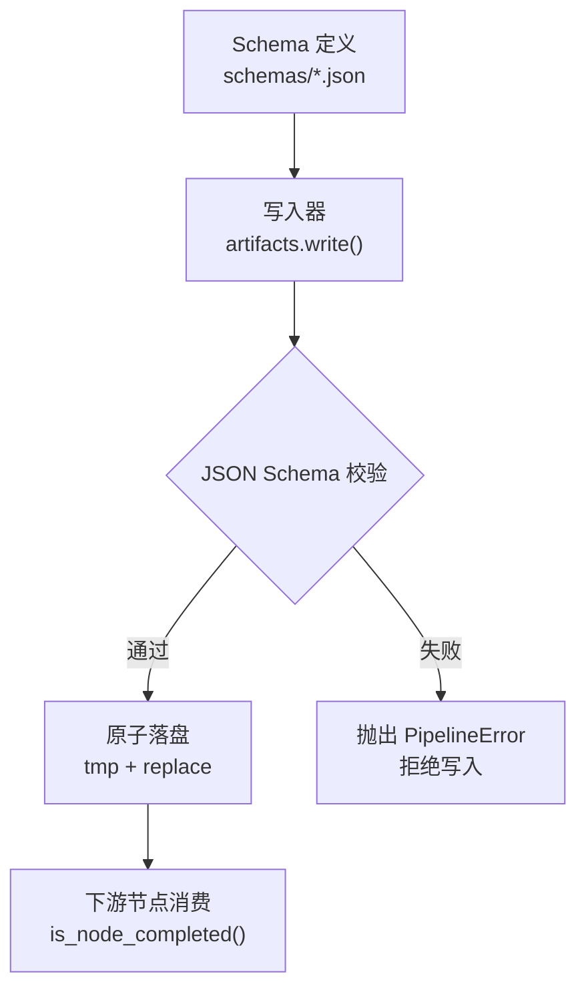
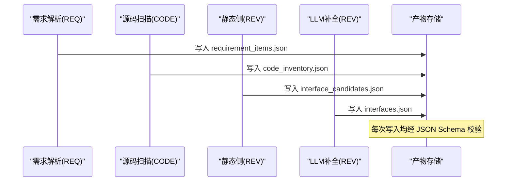
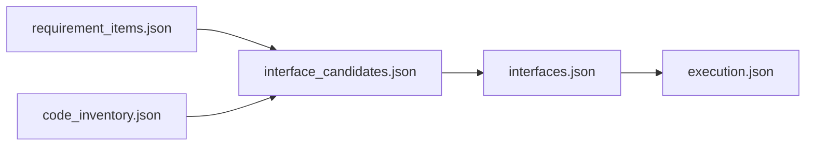

# 核心数据模型

<cite>
**本文引用的文件**
- [schemas/requirement_items.json](file://schemas/requirement_items.json)
- [schemas/code_inventory.json](file://schemas/code_inventory.json)
- [schemas/interface_candidates.json](file://schemas/interface_candidates.json)
- [schemas/interfaces.json](file://schemas/interfaces.json)
- [schemas/samples/interface_candidates.sample.json](file://schemas/samples/interface_candidates.sample.json)
- [schemas/samples/interfaces.sample.json](file://schemas/samples/interfaces.sample.json)
- [schemas/README.md](file://schemas/README.md)
- [services/orchestrator/src/orchestrator/artifacts.py](file://services/orchestrator/src/orchestrator/artifacts.py)
- [MumuSpec/10-数据模型与存储规格.md](file://MumuSpec/10-数据模型与存储规格.md)
</cite>

## 目录
1. [简介](#简介)
2. [项目结构](#项目结构)
3. [核心组件](#核心组件)
4. [架构总览](#架构总览)
5. [详细组件分析](#详细组件分析)
6. [依赖关系分析](#依赖关系分析)
7. [性能考虑](#性能考虑)
8. [故障排查指南](#故障排查指南)
9. [结论](#结论)
10. [附录](#附录)

## 简介
本文件聚焦 LLM-AutoTest 的核心数据模型，围绕需求条目、代码清单、接口候选和接口还原四大实体进行系统化说明。文档覆盖字段定义、数据类型、约束条件、业务含义、ID 命名规范、时间戳格式、协议枚举、验证规则与 Schema 版本管理机制，并提供 JSON 示例路径以便快速对照。

## 项目结构
- schemas/：存放所有结构化产物的 JSON Schema 定义，作为“单一事实来源”。每个 Schema 包含 schema_version 字段，用于版本控制；结构变更必须升版本，禁止原地改语义。
- samples/：跨角色假数据样例（标注 _fake: true），用于演示与联调，生产禁用。
- orchestrator/artifacts.py：产物落盘与校验入口，强制按文件名匹配对应 Schema 校验，确保只有合规数据进入下游。

图表来源
- [schemas/README.md:5-10](file://schemas/README.md#L5-L10)
- [services/orchestrator/src/orchestrator/artifacts.py:75-112](file://services/orchestrator/src/orchestrator/artifacts.py#L75-L112)

章节来源
- [schemas/README.md:5-10](file://schemas/README.md#L5-L10)
- [services/orchestrator/src/orchestrator/artifacts.py:75-112](file://services/orchestrator/src/orchestrator/artifacts.py#L75-L112)

## 核心组件
- 需求条目（requirement_items）：模块 1（REQ）产出，描述从需求文档解析出的功能点，含优先级、溯源位置、Golden 比对结果等。
- 代码清单（code_inventory）：模块 2（CODE）产出，记录仓库扫描状态、文件清单、截断范围、异常编码跳过等。
- 接口候选（interface_candidates）：模块 3（REV 静态侧）产出，基于静态特征定位的接口候选，供 LLM 语义解析消费。
- 接口还原（interfaces）：模块 3（REV）LLM 补全后产出，标准化接口签名、参数、返回类型及源码定位。

章节来源
- [schemas/requirement_items.json:1-44](file://schemas/requirement_items.json#L1-L44)
- [schemas/code_inventory.json:1-57](file://schemas/code_inventory.json#L1-L57)
- [schemas/interface_candidates.json:1-58](file://schemas/interface_candidates.json#L1-L58)
- [schemas/interfaces.json:1-70](file://schemas/interfaces.json#L1-L70)

## 架构总览
四个核心实体在流水线中的流转如下：
- 需求解析（REQ）产出 requirement_items.json
- 源码扫描（CODE）产出 code_inventory.json
- 静态侧（REV）产出 interface_candidates.json
- LLM 补全（REV）产出 interfaces.json

图表来源
- [services/orchestrator/src/orchestrator/artifacts.py:75-112](file://services/orchestrator/src/orchestrator/artifacts.py#L75-L112)
- [schemas/requirement_items.json:1-44](file://schemas/requirement_items.json#L1-L44)
- [schemas/code_inventory.json:1-57](file://schemas/code_inventory.json#L1-L57)
- [schemas/interface_candidates.json:1-58](file://schemas/interface_candidates.json#L1-L58)
- [schemas/interfaces.json:1-70](file://schemas/interfaces.json#L1-L70)

## 详细组件分析

### 需求条目（requirement_items）
- 顶层字段
  - schema_version: 字符串常量，固定为 "1.0"，用于 Schema 版本管理。
  - job_id: 字符串，必须以 "job-" 开头，标识一次任务执行。
  - source_file: 可选，来源文档路径与格式（docx/md/xlsx）。
  - items: 数组，至少一项，每项为一个需求条目对象。
- 需求条目对象字段
  - id: 字符串，遵循 REQ-三位数字 的命名规范（如 REQ-001）。
  - title: 非空字符串。
  - description: 功能点结构化描述。
  - priority: 枚举 ["P0","P1","P2"]，表示优先级。
  - source_location: 可选，文档内溯源对象，包含 section（字符串）与 line（≥1 的整数）。
  - golden_match: 可选，G2 比对结果对象，包含 matched（布尔）与 golden_id（REQ-三位数字）。
- 业务含义
  - 将需求文档中可测试的功能点抽取为结构化条目，便于后续映射到代码与接口。
  - 通过 source_location 实现需求溯源；golden_match 支持离线基准比对。
- 示例参考
  - 见 [schemas/requirement_items.json:1-44](file://schemas/requirement_items.json#L1-L44)

章节来源
- [schemas/requirement_items.json:1-44](file://schemas/requirement_items.json#L1-L44)

### 代码清单（code_inventory）
- 顶层字段
  - schema_version: 字符串常量 "1.0"。
  - job_id: 字符串，以 "job-" 开头。
  - repositories: 数组，至少两项，表示多仓库扫描场景。
- 仓库对象字段
  - name: 仓库名。
  - path: 已检出正确分支的本地路径。
  - branch: 分支名。
  - is_fallback: 是否兜底仓库。
  - status: 枚举 ["ok","empty","truncated","error"]，表示扫描四态。
  - file_count: ≥0 的整数，文件数量。
  - truncated_scope: 可选，截断后实际扫描目录列表（X-CODE-03）。
  - encoding_skipped: 可选，异常编码跳过文件列表（R-CODE-03）。
  - error: 可选，错误对象，包含 code、message、details。
  - files: 可选，源码清单数组，每项包含 repo、module、path。
- 业务含义
  - 统一记录各仓库的扫描状态与文件清单，支撑后续接口候选定位与 LLM 上下文构建。
  - 四态 status 明确流程继续或中断策略。
- 示例参考
  - 见 [schemas/code_inventory.json:1-57](file://schemas/code_inventory.json#L1-L57)

章节来源
- [schemas/code_inventory.json:1-57](file://schemas/code_inventory.json#L1-L57)

### 接口候选（interface_candidates）
- 顶层字段
  - schema_version: 字符串常量 "1.0"。
  - job_id: 字符串，以 "job-" 开头。
  - candidates: 数组，静态特征定位产物，供甲的 LLM 语义解析消费。
  - warnings: 可选，警告信息数组（单文件解析失败或候选数不足提示）。
- 候选对象字段
  - candidate_id: 字符串，遵循 CAND-三位数字 的命名规范（如 CAND-001）。
  - protocol: 枚举 ["rest","grpc","graphql","soap","mq"]。
  - signature: 静态可确定签名（HTTP 方法+路径或服务方法名）。
  - code_location: 必需对象，包含 repo、file、start_line（≥1）、end_line。
  - snippet: 可选，接口定义源码片段（LLM 上下文）。
  - related_files: 可选，直接关联文件数组（controller/service/dto/proto/wsdl/listener/other），每项包含 repo、file、role、start_line、end_line。
  - is_fallback: 是否兜底仓库标记。
  - confidence: 0~1 的数字，静态定位置信度。
- 业务含义
  - 基于静态分析定位潜在接口，提供足够上下文给 LLM 进行语义补全。
  - related_files 建立调用链线索，提升补全准确性。
- 示例参考
  - 见 [schemas/interface_candidates.json:1-58](file://schemas/interface_candidates.json#L1-L58)
  - 样例数据见 [schemas/samples/interface_candidates.sample.json:1-62](file://schemas/samples/interface_candidates.sample.json#L1-L62)

章节来源
- [schemas/interface_candidates.json:1-58](file://schemas/interface_candidates.json#L1-L58)
- [schemas/samples/interface_candidates.sample.json:1-62](file://schemas/samples/interface_candidates.sample.json#L1-L62)

### 接口还原（interfaces）
- 顶层字段
  - schema_version: 字符串常量 "1.0"。
  - job_id: 字符串，以 "job-" 开头。
  - interfaces: 数组，至少一项，LLM 补全后的接口清单。
- 接口对象字段
  - id: 字符串，遵循 IF-<协议>-三位数字 的命名规范（协议大写枚举，如 IF-REST-001、IF-GRPC-001）。
  - protocol: 枚举 ["rest","grpc","graphql","soap","mq"]（小写）。
  - signature: 对象，包含 summary（必填，非空字符串），以及协议相关字段：
    - method: REST 时枚举 ["GET","POST","PUT","DELETE","PATCH"]。
    - path: REST 路径（如 /api/v1/users）。
    - service_method: gRPC/SOAP/MQ 的服务方法名。
  - params: 可选，入参数组，每项包含 name（非空）、type（类型名或字面量 unknown）、required（布尔）、in（REST 参数位置：path/query/body/header）、default（unknown 参数的边界默认值）。
  - returns: 可选，返回对象，包含 type 与 description。
  - candidate_id: 可选，溯源到乙的静态候选（CAND-三位数字）。
  - code_location: 必需对象，包含 repo、file、start_line（≥1）、end_line。
  - is_fallback: 布尔，兜底仓库标记，全链路透传。
  - confidence: 0~1 的数字，置信度。
- 业务含义
  - 将静态候选转化为标准化的接口契约，便于用例生成与执行。
  - 对未知类型使用 unknown 并给出 default 边界，保证鲁棒性。
- 示例参考
  - 见 [schemas/interfaces.json:1-70](file://schemas/interfaces.json#L1-L70)
  - 样例数据见 [schemas/samples/interfaces.sample.json:1-75](file://schemas/samples/interfaces.sample.json#L1-L75)

章节来源
- [schemas/interfaces.json:1-70](file://schemas/interfaces.json#L1-L70)
- [schemas/samples/interfaces.sample.json:1-75](file://schemas/samples/interfaces.sample.json#L1-L75)

### ID 命名规范与协议枚举
- ID 命名
  - 需求条目：REQ-三位数字（如 REQ-001）。
  - 接口候选：CAND-三位数字（如 CAND-001）。
  - 接口还原：IF-<协议>-三位数字（协议为大写枚举：REST、GRPC、GRAPHQL、SOAP、MQ）。
- 协议枚举
  - 小写枚举：rest/grpc/graphql/soap/mq，用于 protocol 字段。
- 时间戳格式
  - UTC ISO-8601（横切约定），用于需要时间戳的场景（例如归档时间戳）。
- 兜底标记
  - is_fallback 全链路透传，贯穿 code_inventory → interface_candidates → interfaces。

章节来源
- [schemas/README.md:5-10](file://schemas/README.md#L5-L10)
- [services/orchestrator/src/orchestrator/artifacts.py:133-142](file://services/orchestrator/src/orchestrator/artifacts.py#L133-L142)

### 数据验证规则与 Schema 版本管理
- 验证规则
  - 所有产物写入前必须通过对应 JSON Schema 校验，失败则拒绝写入并抛出 PipelineError。
  - 节点完成判据：产物存在且通过 Schema 校验（Markdown 报告仅检查存在性与非空）。
- 版本管理
  - 每个 Schema 包含 schema_version 字段，当前为 "1.0"。
  - 结构变更必须升版本，禁止原地改语义；下游 pydantic 模型与 Schema 一一对应。
- 写权排他
  - 每个产物有唯一写方（orchestrator 或 test-executor），防止并发冲突。

章节来源
- [services/orchestrator/src/orchestrator/artifacts.py:75-112](file://services/orchestrator/src/orchestrator/artifacts.py#L75-L112)
- [services/orchestrator/src/orchestrator/artifacts.py:120-131](file://services/orchestrator/src/orchestrator/artifacts.py#L120-L131)
- [schemas/README.md:5-10](file://schemas/README.md#L5-L10)

## 依赖关系分析
- 产物与 Schema 的强绑定：文件名即 Schema 名，写入时自动加载对应 Schema 校验。
- 上下游依赖：
  - requirement_items 为需求溯源基础。
  - code_inventory 为接口候选定位提供仓库与文件清单。
  - interface_candidates 为 LLM 补全提供静态上下文。
  - interfaces 为用例生成与执行提供契约。
- 横切约定：ID 命名、协议枚举、is_fallback 透传、错误结构 {code, message, node_id?, details}。

图表来源
- [services/orchestrator/src/orchestrator/artifacts.py:24-35](file://services/orchestrator/src/orchestrator/artifacts.py#L24-L35)
- [schemas/requirement_items.json:1-44](file://schemas/requirement_items.json#L1-L44)
- [schemas/code_inventory.json:1-57](file://schemas/code_inventory.json#L1-L57)
- [schemas/interface_candidates.json:1-58](file://schemas/interface_candidates.json#L1-L58)
- [schemas/interfaces.json:1-70](file://schemas/interfaces.json#L1-L70)

章节来源
- [services/orchestrator/src/orchestrator/artifacts.py:24-35](file://services/orchestrator/src/orchestrator/artifacts.py#L24-L35)

## 性能考虑
- 批量写入与原子替换：写入采用 tmp + replace，避免部分写入导致的读取不一致。
- 校验前置：先校验再落盘，减少无效 I/O。
- 只读读取：read_json 不触发校验，降低读取开销。
- 归档机制：重跑前归档旧产物，避免覆盖导致的数据丢失。

章节来源
- [services/orchestrator/src/orchestrator/artifacts.py:75-96](file://services/orchestrator/src/orchestrator/artifacts.py#L75-L96)
- [services/orchestrator/src/orchestrator/artifacts.py:114-118](file://services/orchestrator/src/orchestrator/artifacts.py#L114-L118)
- [services/orchestrator/src/orchestrator/artifacts.py:133-142](file://services/orchestrator/src/orchestrator/artifacts.py#L133-L142)

## 故障排查指南
- 常见错误
  - 产物校验失败：payload 不符合对应 Schema，查看 errors 详情定位字段问题。
  - 写权冲突：当前服务无权写入该产物，确认写方归属。
  - 未知产物文件名：不在清单内的文件名将被拒绝。
- 处理建议
  - 根据错误消息修正字段类型、枚举值或必填项。
  - 检查 job_id 是否符合 "job-" 前缀要求。
  - 核对 protocol 是否为小写枚举，id 是否符合命名规范。
  - 若为 Markdown 报告，仅需确保文件存在且非空。

章节来源
- [services/orchestrator/src/orchestrator/artifacts.py:75-112](file://services/orchestrator/src/orchestrator/artifacts.py#L75-L112)
- [services/orchestrator/src/orchestrator/artifacts.py:144-157](file://services/orchestrator/src/orchestrator/artifacts.py#L144-L157)

## 结论
本项目的核心数据模型以 JSON Schema 为单一事实来源，严格约束需求条目、代码清单、接口候选与接口还原的结构与语义。通过统一的 ID 命名、协议枚举、时间戳格式与 is_fallback 透传，保障了跨模块协作的一致性与可追溯性。写入前的 Schema 校验与原子落盘确保了数据的可靠性与完整性，为后续用例生成与执行提供了高质量契约基础。

## 附录
- 存储布局参考：按任务 ID 分目录，产物文件与 Schema 一一对应。
- 样例数据：samples/ 下的假数据可用于演示与联调，生产环境禁用。

章节来源
- [MumuSpec/10-数据模型与存储规格.md:35-64](file://MumuSpec/10-数据模型与存储规格.md#L35-L64)
- [schemas/README.md:12-29](file://schemas/README.md#L12-L29)