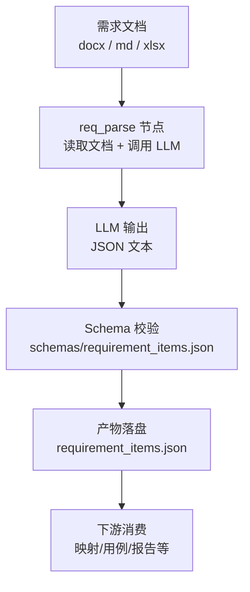
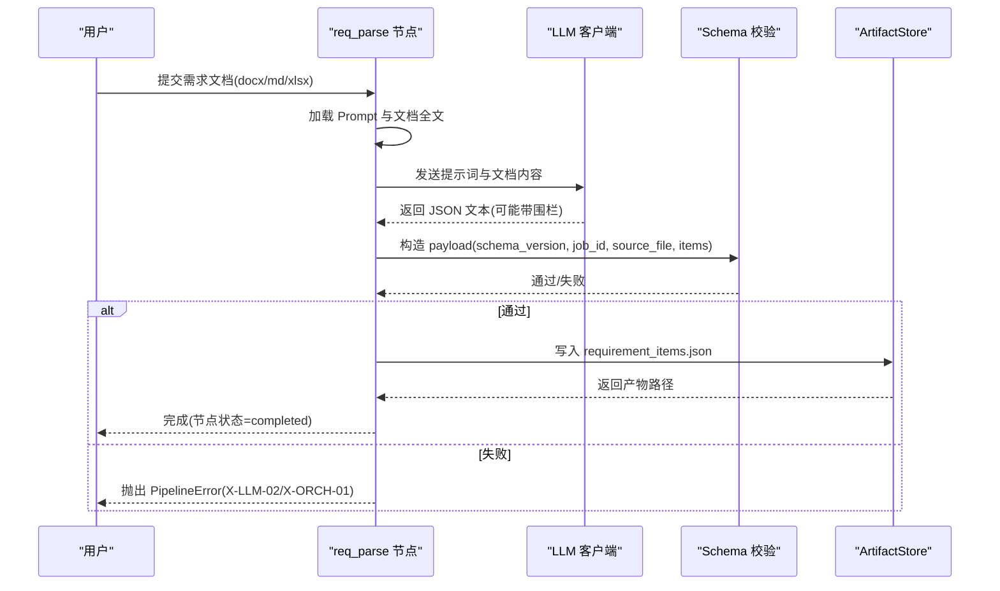
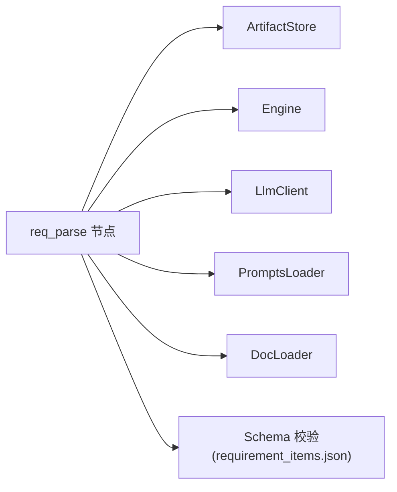

# 需求数据模型

<cite>
**本文引用的文件**
- [schemas/requirement_items.json](file://schemas/requirement_items.json)
- [services/orchestrator/src/orchestrator/nodes/req_parse.py](file://services/orchestrator/src/orchestrator/nodes/req_parse.py)
- [services/orchestrator/tests/test_req_parse.py](file://services/orchestrator/tests/test_req_parse.py)
- [MumuSpec/02-需求来源与采集记录.md](file://MumuSpec/02-需求来源与采集记录.md)
- [MumuSpec/14-需求追踪矩阵.md](file://MumuSpec/14-需求追踪矩阵.md)
- [MumuSpec/04-产品需求说明.md](file://MumuSpec/04-产品需求说明.md)
- [schemas/README.md](file://schemas/README.md)
- [prompts/README.md](file://prompts/README.md)
</cite>

## 目录
1. [简介](#简介)
2. [项目结构](#项目结构)
3. [核心组件](#核心组件)
4. [架构总览](#架构总览)
5. [详细组件分析](#详细组件分析)
6. [依赖关系分析](#依赖关系分析)
7. [性能考量](#性能考量)
8. [故障排查指南](#故障排查指南)
9. [结论](#结论)
10. [附录](#附录)

## 简介
本文件面向 LLM-AutoTest 的需求解析产物——“需求条目（RequirementItem）”的数据模型，给出字段定义、约束规则、业务含义与实现要点。重点覆盖：
- 需求条目 ID 命名规范（REQ-001 格式）
- 优先级枚举（P0/P1/P2）
- 来源文档支持格式（docx/md/xlsx）
- 需求溯源机制（source_location）
- 黄金匹配功能（golden_match）
- 验证规则与版本管理机制
- 完整的 JSON 示例与字段用法说明

## 项目结构
需求数据模型以 JSON Schema 形式在 schemas/ 中集中管理，运行时由编排器 orchestrator 的 req_parse 节点将 LLM 输出解析并落盘为 requirement_items.json；测试用例对解析流程进行端到端校验。



图表来源
- [services/orchestrator/src/orchestrator/nodes/req_parse.py:33-78](file://services/orchestrator/src/orchestrator/nodes/req_parse.py#L33-L78)
- [schemas/requirement_items.json:1-44](file://schemas/requirement_items.json#L1-L44)

章节来源
- [MumuSpec/04-产品需求说明.md:29-40](file://MumuSpec/04-产品需求说明.md#L29-L40)
- [MumuSpec/02-需求来源与采集记录.md:55-63](file://MumuSpec/02-需求来源与采集记录.md#L55-L63)

## 核心组件
- 数据模型定义：schemas/requirement_items.json
- 解析与落盘：services/orchestrator/src/orchestrator/nodes/req_parse.py
- 行为与边界验证：services/orchestrator/tests/test_req_parse.py
- 业务背景与范围：MumuSpec/04-产品需求说明.md、MumuSpec/02-需求来源与采集记录.md
- 版本与契约约定：schemas/README.md、prompts/README.md

章节来源
- [schemas/requirement_items.json:1-44](file://schemas/requirement_items.json#L1-L44)
- [services/orchestrator/src/orchestrator/nodes/req_parse.py:33-78](file://services/orchestrator/src/orchestrator/nodes/req_parse.py#L33-L78)
- [services/orchestrator/tests/test_req_parse.py:63-156](file://services/orchestrator/tests/test_req_parse.py#L63-L156)
- [schemas/README.md:1-10](file://schemas/README.md#L1-L10)
- [prompts/README.md:1-15](file://prompts/README.md#L1-L15)

## 架构总览
下图展示从需求文档到结构化需求条目的完整链路，包括 Schema 校验与错误处理路径。



图表来源
- [services/orchestrator/src/orchestrator/nodes/req_parse.py:33-78](file://services/orchestrator/src/orchestrator/nodes/req_parse.py#L33-L78)
- [services/orchestrator/src/orchestrator/nodes/req_parse.py:81-125](file://services/orchestrator/src/orchestrator/nodes/req_parse.py#L81-L125)
- [schemas/requirement_items.json:1-44](file://schemas/requirement_items.json#L1-L44)

## 详细组件分析

### RequirementItem 数据结构与字段定义
- 顶层对象
  - schema_version: 字符串，固定值，用于标识 Schema 版本（当前为 1.0）。变更需升版，禁止原地改语义。
  - job_id: 字符串，必须以 “job-” 开头，用于关联一次运行任务。
  - source_file: 字符串，来源文档路径与格式，支持 docx/md/xlsx。
  - items: 数组，至少包含 1 个元素，每个元素为一个需求条目对象。

- 需求条目对象（items[i]）
  - id: 字符串，必须匹配正则 ^REQ-\d{3}$，即 REQ-001 至 REQ-999。
  - title: 字符串，长度至少为 1。
  - description: 字符串，功能点结构化描述。
  - priority: 枚举，取值 P0/P1/P2，表示需求优先级。
  - source_location: 可选对象，用于文档内溯源，包含：
    - section: 字符串，章节号或表格坐标等定位信息。
    - line: 整数，最小值为 1，表示行号。
  - golden_match: 可选对象，用于黄金匹配结果，包含：
    - matched: 布尔值，是否匹配到预置 golden 基准。
    - golden_id: 字符串，匹配到的 golden 需求编号，同样遵循 REQ-001 格式。

章节来源
- [schemas/requirement_items.json:1-44](file://schemas/requirement_items.json#L1-L44)

### 需求溯源机制（source_location）
- 作用：将每条需求条目追溯到原始需求文档的具体位置（章节/行号），便于人工复核与问题定位。
- 字段说明：
  - section: 自由文本，可填写章节名、表格名或坐标。
  - line: 正整数，表示文档中的行号。
- 使用建议：
  - 对于 Markdown 文档，line 可直接对应行号；section 可为标题层级与标题名。
  - 对于 Word/Excel，建议结合页码/表名/单元格坐标作为 section，line 可保留为空或使用近似行号。
- 下游用途：
  - 生成需求-代码映射表时，可将 source_location 与代码位置联合展示，提升可追溯性。
  - 审计与验收时，可按 source_location 快速定位原文依据。

章节来源
- [schemas/requirement_items.json:22-29](file://schemas/requirement_items.json#L22-L29)
- [MumuSpec/14-需求追踪矩阵.md:29-50](file://MumuSpec/14-需求追踪矩阵.md#L29-L50)

### 黄金匹配功能（golden_match）
- 作用：提供“预置 golden 基准”的比对结果，避免现场人工判断，提高一致性。
- 字段说明：
  - matched: 布尔值，表示是否匹配成功。
  - golden_id: 字符串，若匹配成功，应指向一个符合 REQ-001 格式的 golden 需求编号。
- 使用场景：
  - 当存在历史需求基线或参考集时，可通过 golden_match 自动判定新解析条目是否与基准一致。
  - 在回归或增量场景中，golden_match 可用于快速识别新增/变更/删除项。
- 注意事项：
  - golden_id 必须满足与 id 相同的命名规范（REQ-001 格式）。
  - 未匹配时可省略 golden_id，仅保留 matched=false。

章节来源
- [schemas/requirement_items.json:30-38](file://schemas/requirement_items.json#L30-L38)

### 验证规则与错误处理
- 必填字段：
  - 顶层：schema_version、job_id、items
  - 每个条目：id、title、description
- 格式约束：
  - id/golden_id：^REQ-\d{3}$
  - priority：P0/P1/P2
  - source_location.line：≥1
  - job_id：^job-
- 解析容错：
  - LLM 输出允许包裹 ```json 围栏，系统会剥离后再解析。
  - 非合法 JSON、缺少 items、items 含非对象条目均视为失败。
- 错误码：
  - X-LLM-02：LLM 输出不可解析或未通过 Schema 校验。
  - X-ORCH-01：上游资源缺失（如需求文档不存在）。
  - X-ORCH-02：跳序保护（非首节点提前执行被拒绝）。

章节来源
- [services/orchestrator/src/orchestrator/nodes/req_parse.py:81-125](file://services/orchestrator/src/orchestrator/nodes/req_parse.py#L81-L125)
- [services/orchestrator/tests/test_req_parse.py:93-156](file://services/orchestrator/tests/test_req_parse.py#L93-L156)

### 版本管理机制
- Schema 版本：
  - 每个 Schema 定义包含 schema_version 字段，结构变更必须升版本，禁止原地改语义。
  - 当前 requirement_items.json 的 schema_version 为 1.0。
- Prompt 版本：
  - prompts/ 目录按节点-用途-v<版本>.md 命名，Prompt 变更需升版本并在文件内追加变更记录。
- 工件与契约：
  - orchestrator/test-executor 中的 pydantic 模型与 Schema 一一对应；java-parser 返回结构与 contracts/ 契约对齐。
  - 横切约定：ID 命名统一为 REQ-001/CAND-001/IF-<协议>-001/TC-001/DEF-001；时间戳 UTC ISO-8601；协议枚举小写；is_fallback 全链路透传；错误结构 {code, message, node_id?, details}。

章节来源
- [schemas/README.md:1-10](file://schemas/README.md#L1-L10)
- [prompts/README.md:1-15](file://prompts/README.md#L1-L15)
- [schemas/requirement_items.json:1-10](file://schemas/requirement_items.json#L1-L10)

## 依赖关系分析
- req_parse 节点依赖：
  - ArtifactStore：产物存储（写入 requirement_items.json）
  - Engine：作业状态管理与节点生命周期控制
  - LlmClient：调用 LLM 获取结构化输出
  - PromptsLoader：加载 Prompt 模板
  - DocLoader：读取需求文档文本
- 外部依赖：
  - JSON Schema 校验器（基于 schemas/requirement_items.json）
  - 文件系统（存储产物）



图表来源
- [services/orchestrator/src/orchestrator/nodes/req_parse.py:11-21](file://services/orchestrator/src/orchestrator/nodes/req_parse.py#L11-L21)
- [schemas/requirement_items.json:1-44](file://schemas/requirement_items.json#L1-L44)

章节来源
- [services/orchestrator/src/orchestrator/nodes/req_parse.py:11-21](file://services/orchestrator/src/orchestrator/nodes/req_parse.py#L11-L21)

## 性能考量
- 文档大小：大文档会增加 LLM 输入长度与解析耗时，建议在 Prompt 中限定关键段落或分段处理。
- Schema 校验：在写入前进行严格校验，避免下游重复校验成本。
- 产物落盘：仅在校验通过后落盘，减少无效 I/O。
- 重试策略：网络/超时类错误可在客户端层重试；Schema 不合规直接失败，避免循环重试。

[本节为通用指导，无需特定文件引用]

## 故障排查指南
- 现象：X-LLM-02（LLM 输出不是合法 JSON 或缺少 items）
  - 检查 LLM 输出是否包裹了 ```json 围栏且内容完整。
  - 确认 items 数组存在且每个元素为对象。
  - 核对 id/priority/source_location.line 等字段是否符合 Schema。
- 现象：X-ORCH-01（需求文档不存在）
  - 确认传入的 doc_path 有效且可读。
- 现象：X-ORCH-02（跳序保护）
  - 确保首节点已完成后再执行后续节点。

章节来源
- [services/orchestrator/tests/test_req_parse.py:93-156](file://services/orchestrator/tests/test_req_parse.py#L93-L156)

## 结论
RequirementItem 数据模型通过严格的 JSON Schema 定义了需求条目的结构与约束，配合 req_parse 节点的解析与校验流程，实现了从多格式需求文档到标准化结构化数据的可靠转换。source_location 提供了细粒度的溯源能力，golden_match 则引入预置基准比对，提升一致性。版本化与契约化管理确保了模型演进的可控性与跨模块一致性。

[本节为总结性内容，无需特定文件引用]

## 附录

### 完整 JSON 示例（字段用法示意）
以下为 requirement_items.json 的结构示例（不含具体敏感内容），展示各字段的典型用法：
- schema_version: "1.0"
- job_id: "job-xxxxxx"
- source_file: "docs/需求文档.docx"（或 .md/.xlsx）
- items:
  - id: "REQ-001"
  - title: "用户查询"
  - description: "按 ID 查询用户信息"
  - priority: "P0"
  - source_location:
    - section: "第2章 用户管理"
    - line: 15
  - golden_match:
    - matched: true
    - golden_id: "REQ-001"

注意：
- id 与 golden_id 必须匹配 ^REQ-\d{3}$。
- priority 只能取 P0/P1/P2。
- source_location.line ≥ 1。
- items 至少包含 1 个元素。

章节来源
- [schemas/requirement_items.json:1-44](file://schemas/requirement_items.json#L1-L44)
- [services/orchestrator/tests/test_req_parse.py:40-46](file://services/orchestrator/tests/test_req_parse.py#L40-L46)