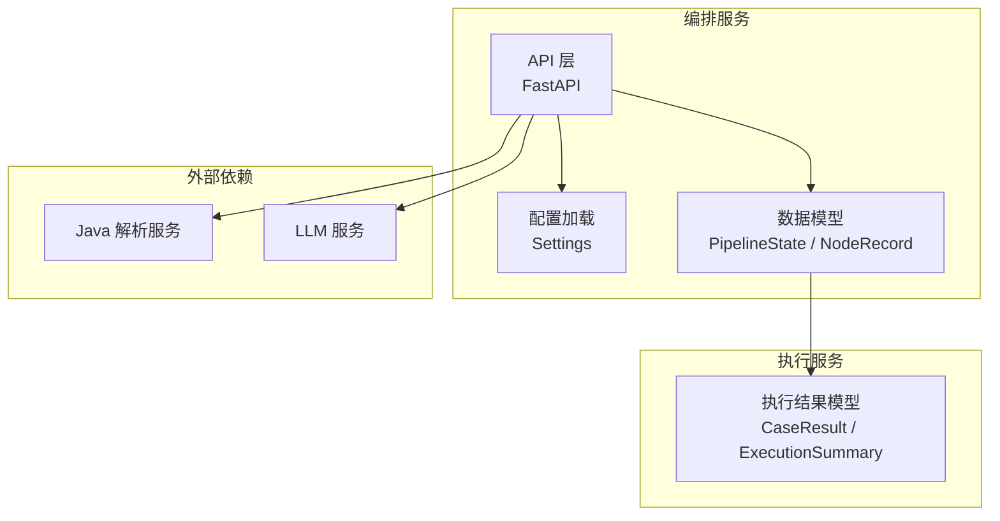
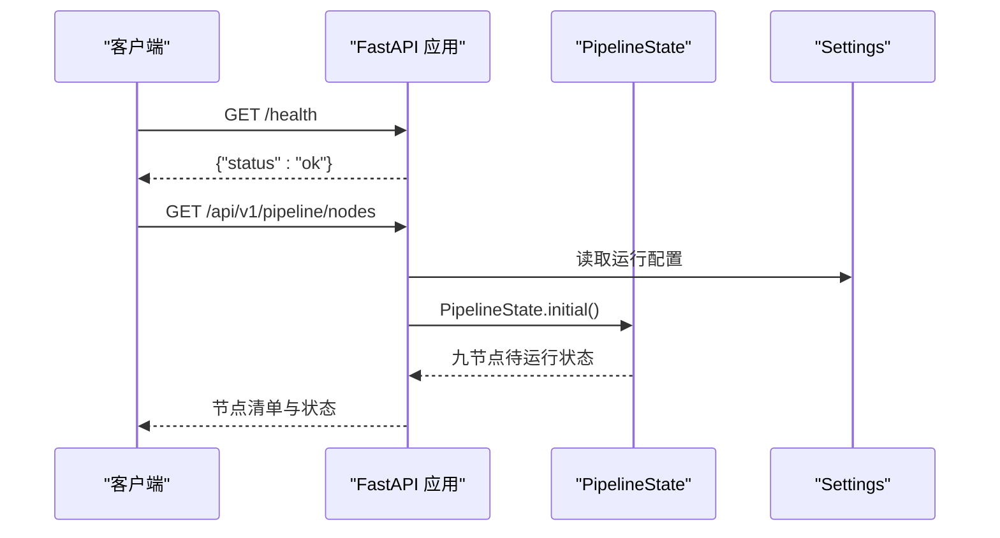
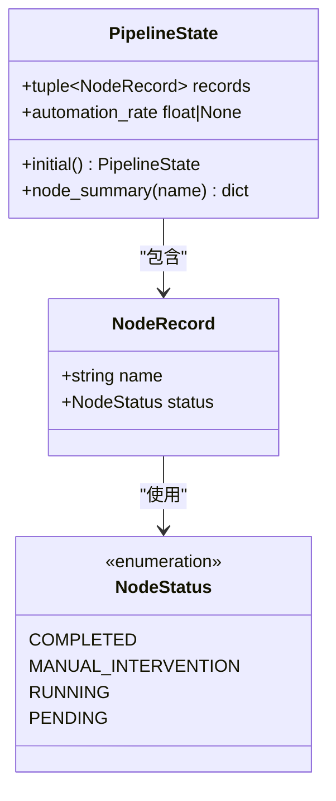
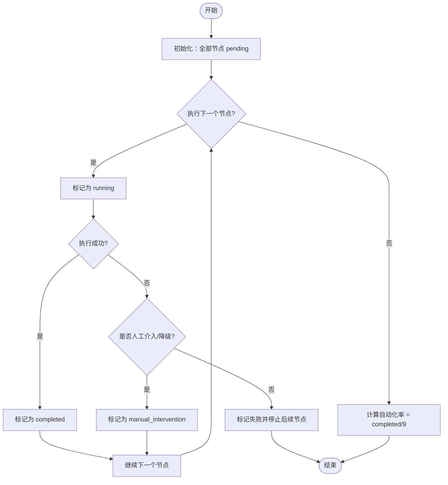
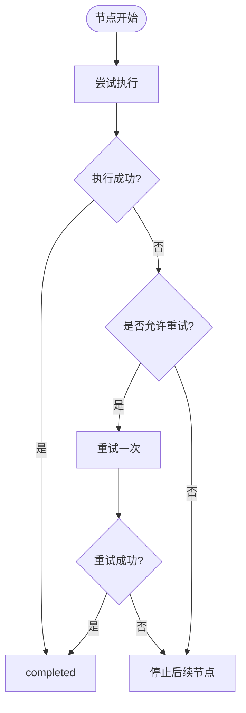
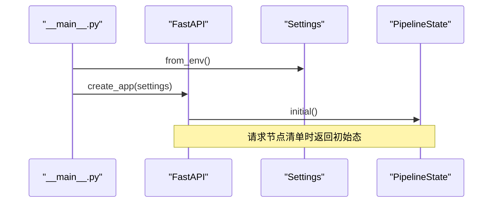
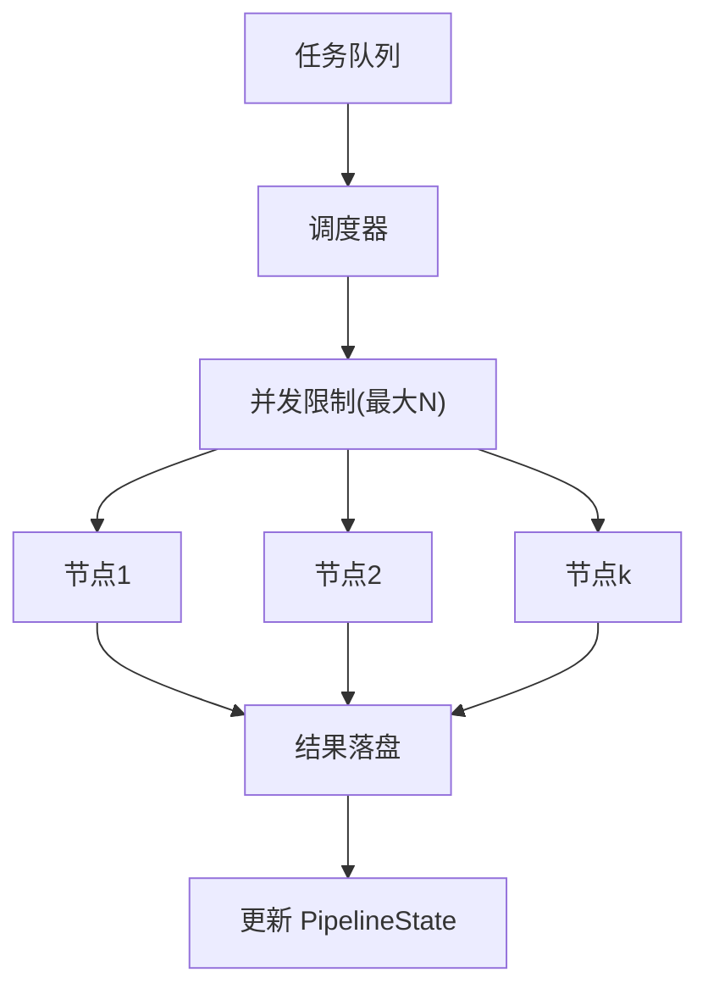
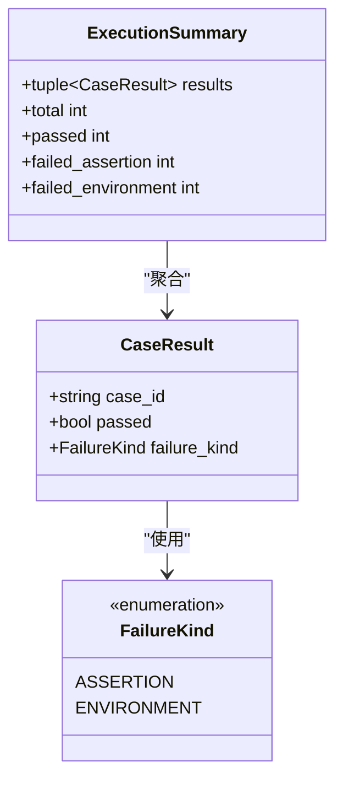
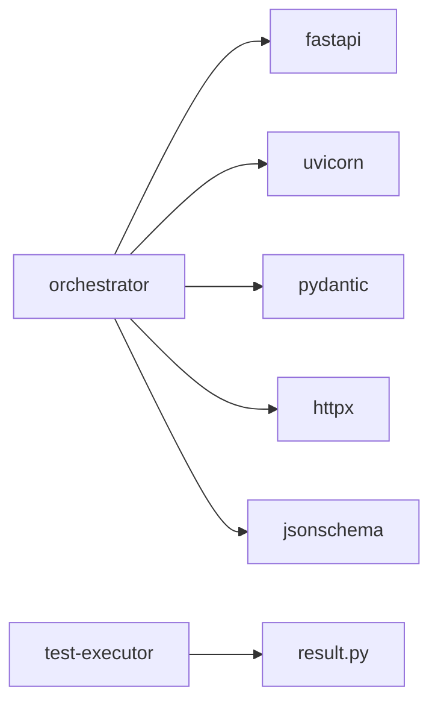

# 流水线数据模型

<cite>
**本文引用的文件**
- [pipeline.py](file://services/orchestrator/src/orchestrator/pipeline.py)
- [api.py](file://services/orchestrator/src/orchestrator/api.py)
- [config.py](file://services/orchestrator/src/orchestrator/config.py)
- [__main__.py](file://services/orchestrator/src/orchestrator/__main__.py)
- [result.py](file://services/test-executor/src/executor/result.py)
- [test_pipeline.py](file://services/orchestrator/tests/test_pipeline.py)
- [04_功能规格说明.md](file://docs/04_功能规格说明.md)
- [06_需求定稿冻结.md](file://docs/06_需求定稿冻结.md)
</cite>

## 目录
1. [简介](#简介)
2. [项目结构](#项目结构)
3. [核心组件](#核心组件)
4. [架构总览](#架构总览)
5. [详细组件分析](#详细组件分析)
6. [依赖关系分析](#依赖关系分析)
7. [性能与并发考虑](#性能与并发考虑)
8. [故障排查指南](#故障排查指南)
9. [结论](#结论)
10. [附录：使用示例与最佳实践](#附录使用示例与最佳实践)

## 简介
本文件聚焦于“流水线数据模型”的设计与实现，围绕以下目标展开：
- 明确 PipelineState 类与 NodeRecord 结构的职责、字段与约束。
- 解释九节点流水线的状态定义、流转规则与自动化率计算口径。
- 梳理错误处理与重试策略在骨架阶段的现状与扩展点。
- 给出流水线实例生命周期管理、并发控制策略与性能优化建议。
- 提供基于现有 API 的编排与监控示例路径（以代码片段路径引用为主）。

该模型服务于 LLM-AutoTest 编排服务（orchestrator），并与其他模块（如测试执行器）通过结构化产物进行协作。

## 项目结构
当前仓库采用多服务拆分：
- orchestrator：流水线编排服务，提供 REST API 与数据模型。
- test-executor：测试执行结果模型，用于区分断言失败与环境失败。
- frontend：前端展示（与本数据模型文档关联度较低）。
- docs：需求与规格文档，定义了九节点口径、人工介入采集、断点续跑等关键规则。

图表来源
- [api.py:11-27](file://services/orchestrator/src/orchestrator/api.py#L11-L27)
- [config.py:9-50](file://services/orchestrator/src/orchestrator/config.py#L9-L50)
- [pipeline.py:11-84](file://services/orchestrator/src/orchestrator/pipeline.py#L11-L84)
- [result.py:10-61](file://services/test-executor/src/executor/result.py#L10-L61)

章节来源
- [api.py:11-27](file://services/orchestrator/src/orchestrator/api.py#L11-L27)
- [config.py:9-50](file://services/orchestrator/src/orchestrator/config.py#L9-L50)
- [pipeline.py:11-84](file://services/orchestrator/src/orchestrator/pipeline.py#L11-L84)
- [result.py:10-61](file://services/test-executor/src/executor/result.py#L10-L61)

## 核心组件
- NodeStatus：节点四态枚举，包含 completed、manual_intervention、running、pending。
- NODE_ORDER：固定九节点顺序，禁止增删，作为度量分母与编排顺序依据。
- NodeRecord：单节点的状态记录，包含 name 与 status。
- PipelineState：整条流水线的状态集合，提供初始态构造、节点摘要查询、自动化率计算。
- Settings：编排服务运行配置，全部来自环境变量，支持安全摘要输出。
- CaseResult / ExecutionSummary：执行结果模型，区分断言失败与环境失败，支撑通过率统计口径。

章节来源
- [pipeline.py:11-84](file://services/orchestrator/src/orchestrator/pipeline.py#L11-L84)
- [config.py:9-50](file://services/orchestrator/src/orchestrator/config.py#L9-L50)
- [result.py:10-61](file://services/test-executor/src/executor/result.py#L10-L61)

## 架构总览
编排服务通过 FastAPI 暴露健康检查与节点清单接口；数据模型集中在 pipeline.py，配置集中由 config.py 管理；执行结果模型在 test-executor 中定义，供后续报告与度量使用。

图表来源
- [api.py:11-27](file://services/orchestrator/src/orchestrator/api.py#L11-L27)
- [config.py:32-50](file://services/orchestrator/src/orchestrator/config.py#L32-L50)
- [pipeline.py:51-70](file://services/orchestrator/src/orchestrator/pipeline.py#L51-L70)

章节来源
- [api.py:11-27](file://services/orchestrator/src/orchestrator/api.py#L11-L27)
- [config.py:32-50](file://services/orchestrator/src/orchestrator/config.py#L32-L50)
- [pipeline.py:51-70](file://services/orchestrator/src/orchestrator/pipeline.py#L51-L70)

## 详细组件分析

### PipelineState 与 NodeRecord 设计
- NodeStatus 四态：
  - pending：待运行
  - running：运行中
  - completed：已完成
  - manual_intervention：人工介入（含降级节点按人工介入计入）
- NODE_ORDER 固定九节点：
  - req_parse、code_scan、interface_reconstruct、code_review、testcase_generate、auto_execute、test_report、defect_list、retest_regression
- NodeRecord：
  - name：节点名（严格取自 NODE_ORDER）
  - status：节点状态（NodeStatus）
- PipelineState：
  - records：不可变元组，保存各节点记录
  - initial()：构建全 pending 初始态
  - node_summary(name)：返回单个节点的摘要（name、status.value）
  - automation_rate：自动化率 = completed 数 / 9；若无 completed 则返回 None（诚实口径）

图表来源
- [pipeline.py:11-84](file://services/orchestrator/src/orchestrator/pipeline.py#L11-L84)

章节来源
- [pipeline.py:11-84](file://services/orchestrator/src/orchestrator/pipeline.py#L11-L84)

### 九节点状态流转与自动化率
- 初始态：所有节点为 pending。
- 流转：
  - pending → running：节点开始执行
  - running → completed：执行成功
  - running → manual_intervention：人工介入或降级
  - 任一节点失败：停止后续节点（规格要求），已产出产物保留
- 自动化率：
  - 程序化汇总，不经过 LLM
  - 当 completed 数为 0 时返回 None，避免误导
  - 分母固定为 9，不因降级缩减

图表来源
- [pipeline.py:23-70](file://services/orchestrator/src/orchestrator/pipeline.py#L23-L70)
- [04_功能规格说明.md:21-31](file://docs/04_功能规格说明.md#L21-L31)
- [06_需求定稿冻结.md:41-48](file://docs/06_需求定稿冻结.md#L41-L48)

章节来源
- [pipeline.py:23-70](file://services/orchestrator/src/orchestrator/pipeline.py#L23-L70)
- [04_功能规格说明.md:21-31](file://docs/04_功能规格说明.md#L21-L31)
- [06_需求定稿冻结.md:41-48](file://docs/06_需求定稿冻结.md#L41-L48)

### 错误处理与重试机制
- 骨架阶段：
  - 节点失败即停止后续节点，保留已产出产物
  - 未实现具体重试逻辑，但预留扩展点（例如在编排器中对特定节点增加重试策略）
- 规范参考：
  - 需求解析模块允许 LLM 超时重试 1 次（仅作为参考，非当前骨架实现）
  - 断点续跑：产物存在可跳过该节点（骨架阶段尚未持久化产物）

图表来源
- [04_功能规格说明.md:55-60](file://docs/04_功能规格说明.md#L55-L60)
- [04_功能规格说明.md:27-31](file://docs/04_功能规格说明.md#L27-L31)

章节来源
- [04_功能规格说明.md:55-60](file://docs/04_功能规格说明.md#L55-L60)
- [04_功能规格说明.md:27-31](file://docs/04_功能规格说明.md#L27-L31)

### 流水线实例生命周期管理
- 启动：
  - 通过 __main__.py 加载 Settings，启动 uvicorn 服务
  - 创建 FastAPI 应用，挂载健康检查与节点清单接口
- 运行期：
  - 节点清单接口返回当前状态（骨架阶段为初始态）
  - 真实运行时需将 PipelineState 持久化到产物卷，并在节点完成后更新状态
- 终止：
  - 服务关闭时保留产物，便于断点续跑

图表来源
- [__main__.py:15-25](file://services/orchestrator/src/orchestrator/__main__.py#L15-L25)
- [api.py:11-27](file://services/orchestrator/src/orchestrator/api.py#L11-L27)
- [pipeline.py:51-59](file://services/orchestrator/src/orchestrator/pipeline.py#L51-L59)

章节来源
- [__main__.py:15-25](file://services/orchestrator/src/orchestrator/__main__.py#L15-L25)
- [api.py:11-27](file://services/orchestrator/src/orchestrator/api.py#L11-L27)
- [pipeline.py:51-59](file://services/orchestrator/src/orchestrator/pipeline.py#L51-L59)

### 并发控制策略与性能优化
- 骨架阶段：
  - 未实现并发执行与锁机制
  - 建议在编排器层引入任务队列与并发限制（如线程池/进程池）
- 性能考量：
  - 节点间以文件为接口，减少内存传递开销
  - 产物 Schema 校验失败拒绝复用，避免脏数据传播
  - 自动化率计算为 O(n)，n=9，开销可忽略

[此图为概念性流程，不直接映射具体源码]

### 执行结果模型与度量口径
- FailureKind：
  - assertion：断言失败（计入通过率分母）
  - environment：环境失败（隔离至待环境确认，不计入通过率分母）
- CaseResult：
  - case_id、passed、failure_kind（通过后不得携带失败类型）
- ExecutionSummary：
  - total、passed、failed_assertion、failed_environment

图表来源
- [result.py:10-61](file://services/test-executor/src/executor/result.py#L10-L61)

章节来源
- [result.py:10-61](file://services/test-executor/src/executor/result.py#L10-L61)

## 依赖关系分析
- 编排服务依赖：
  - FastAPI、uvicorn、pydantic、httpx、jsonschema
- 数据模型依赖：
  - dataclasses、enum.StrEnum、typing.Literal
- 执行结果模型：
  - 独立模块，供报告与度量使用

图表来源
- [pyproject.toml:1-12](file://services/orchestrator/pyproject.toml#L1-L12)
- [pipeline.py:1-8](file://services/orchestrator/src/orchestrator/pipeline.py#L1-L8)
- [result.py:1-8](file://services/test-executor/src/executor/result.py#L1-L8)

章节来源
- [pyproject.toml:1-12](file://services/orchestrator/pyproject.toml#L1-L12)
- [pipeline.py:1-8](file://services/orchestrator/src/orchestrator/pipeline.py#L1-L8)
- [result.py:1-8](file://services/test-executor/src/executor/result.py#L1-L8)

## 性能与并发考虑
- 骨架阶段未实现并发与持久化，建议：
  - 引入任务队列（如 Redis/RabbitMQ）与并发限制
  - 对长耗时节点（LLM 调用、解析）设置超时与重试上限
  - 产物落盘后做 Schema 校验，避免无效复用
- 指标计算：
  - 自动化率计算简单高效，无需额外缓存
  - 执行结果汇总为 O(n)，适合批量处理

[本节为通用指导，不直接分析具体文件]

## 故障排查指南
- 健康检查：
  - /health 返回 ok，用于容器编排健康探测
- 节点清单：
  - /api/v1/pipeline/nodes 应返回 9 个节点且均为 pending（骨架阶段）
- 配置缺失：
  - Settings.from_env 缺少必填项会抛出 RuntimeError，需检查环境变量
- 执行结果不一致：
  - CaseResult.__post_init__ 校验通过用例不得携带失败类型，否则抛错

章节来源
- [api.py:16-25](file://services/orchestrator/src/orchestrator/api.py#L16-L25)
- [config.py:32-50](file://services/orchestrator/src/orchestrator/config.py#L32-L50)
- [result.py:25-30](file://services/test-executor/src/executor/result.py#L25-L30)
- [test_pipeline.py:21-47](file://services/orchestrator/tests/test_pipeline.py#L21-L47)

## 结论
- 数据模型清晰、简洁，满足骨架阶段的最小可用需求。
- 九节点口径固定，自动化率计算诚实可靠。
- 错误处理与重试机制在骨架阶段未完全实现，但已预留扩展点。
- 建议后续完善：
  - 状态持久化与断点续跑
  - 并发执行与资源限流
  - 更丰富的监控与告警能力

[本节为总结性内容，不直接分析具体文件]

## 附录：使用示例与最佳实践
- 获取节点清单：
  - 调用 /api/v1/pipeline/nodes，返回九节点及其状态
  - 参考路径：[api.py:21-25](file://services/orchestrator/src/orchestrator/api.py#L21-L25)
- 验证九节点固定口径：
  - 测试断言 NODE_ORDER 长度为 9
  - 参考路径：[test_pipeline.py:21-23](file://services/orchestrator/tests/test_pipeline.py#L21-L23)
- 验证初始态与自动化率：
  - 初始态全部 pending，automation_rate 为 None
  - 参考路径：[test_pipeline.py:26-30](file://services/orchestrator/tests/test_pipeline.py#L26-L30)
- 健康检查：
  - /health 返回 {"status": "ok"}
  - 参考路径：[test_pipeline.py:33-38](file://services/orchestrator/tests/test_pipeline.py#L33-L38)
- 配置加载与安全摘要：
  - 从环境变量加载配置，输出不含密钥的摘要
  - 参考路径：[config.py:23-30](file://services/orchestrator/src/orchestrator/config.py#L23-L30)

[本节提供使用指引，不直接展示代码内容]