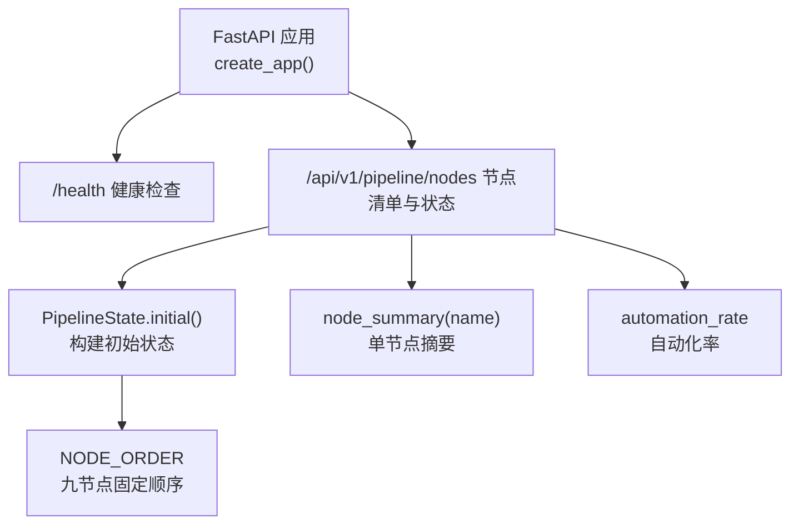
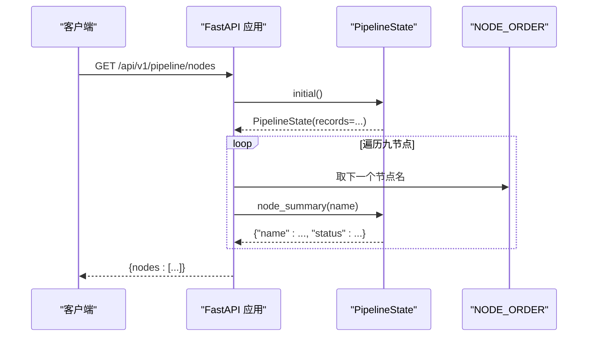
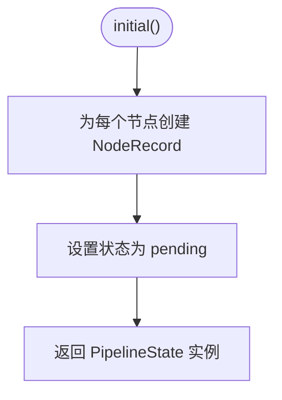
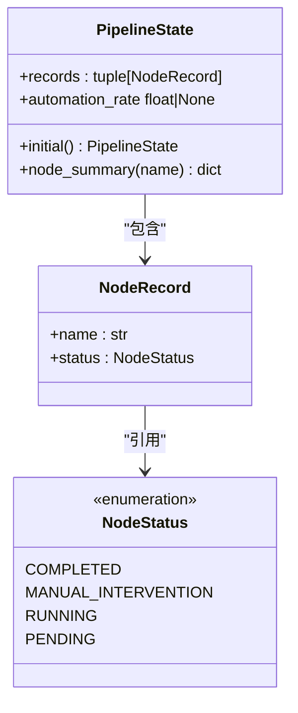
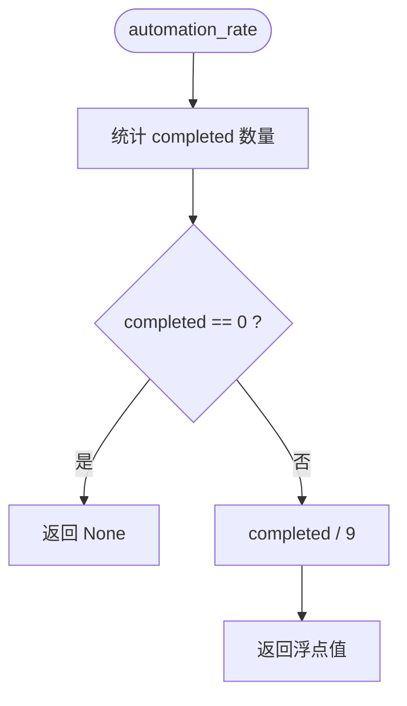
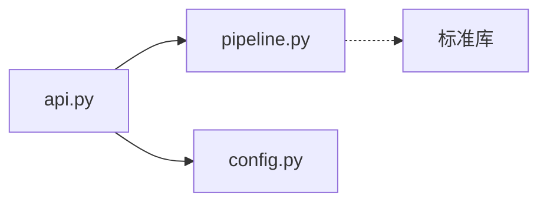

# 流水线状态管理

<cite>
**本文引用的文件**
- [pipeline.py](file://services/orchestrator/src/orchestrator/pipeline.py)
- [api.py](file://services/orchestrator/src/orchestrator/api.py)
- [config.py](file://services/orchestrator/src/orchestrator/config.py)
- [test_pipeline.py](file://services/orchestrator/tests/test_pipeline.py)
- [test_config.py](file://services/orchestrator/tests/test_config.py)
</cite>

## 目录
1. [简介](#简介)
2. [项目结构](#项目结构)
3. [核心组件](#核心组件)
4. [架构总览](#架构总览)
5. [详细组件分析](#详细组件分析)
6. [依赖关系分析](#依赖关系分析)
7. [性能考量](#性能考量)
8. [故障排查指南](#故障排查指南)
9. [结论](#结论)
10. [附录：使用示例与最佳实践](#附录使用示例与最佳实践)

## 简介
本文件聚焦于编排服务中的“流水线状态管理”，围绕 PipelineState 类的设计与实现，系统阐述四态标注体系（completed、manual_intervention、running、pending）的业务含义与转换规则，解释自动化率计算逻辑与节点摘要生成机制，并提供创建流水线实例、查询节点状态、计算自动化指标的具体用法指引。该能力支撑了“九节点固定口径”的度量方案，确保在验收与演示中可量化地评估自动化水平。

## 项目结构
与流水线状态管理直接相关的代码位于 orchestrator 服务中：
- 状态模型与算法：services/orchestrator/src/orchestrator/pipeline.py
- API 暴露层：services/orchestrator/src/orchestrator/api.py
- 配置加载：services/orchestrator/src/orchestrator/config.py
- 单元测试：services/orchestrator/tests/test_pipeline.py、services/orchestrator/tests/test_config.py

图表来源
- [api.py:11-27](file://services/orchestrator/src/orchestrator/api.py#L11-L27)
- [pipeline.py:23-70](file://services/orchestrator/src/orchestrator/pipeline.py#L23-L70)

章节来源
- [api.py:1-27](file://services/orchestrator/src/orchestrator/api.py#L1-L27)
- [pipeline.py:1-84](file://services/orchestrator/src/orchestrator/pipeline.py#L1-L84)

## 核心组件
- NodeStatus：四态枚举，定义节点的运行状态语义。
- NODE_ORDER：九节点固定顺序常量，作为度量分母与执行顺序依据。
- NodeRecord：单个节点的状态记录（名称 + 状态）。
- PipelineState：整条流水线的状态集合，提供初始化、节点摘要查询、自动化率计算等能力。
- create_app：FastAPI 应用工厂，将状态能力通过 REST API 暴露。

章节来源
- [pipeline.py:11-70](file://services/orchestrator/src/orchestrator/pipeline.py#L11-L70)
- [api.py:11-27](file://services/orchestrator/src/orchestrator/api.py#L11-L27)

## 架构总览
从请求到状态读取的数据流如下：
- 客户端调用 /api/v1/pipeline/nodes
- API 层构造 PipelineState 初始状态
- 遍历 NODE_ORDER 获取每个节点的摘要
- 返回包含九个节点及其状态的 JSON

图表来源
- [api.py:21-25](file://services/orchestrator/src/orchestrator/api.py#L21-L25)
- [pipeline.py:51-59](file://services/orchestrator/src/orchestrator/pipeline.py#L51-L59)
- [pipeline.py:23-34](file://services/orchestrator/src/orchestrator/pipeline.py#L23-L34)

## 详细组件分析

### 四态标注系统与业务含义
- completed：节点已完成且无需人工干预。
- manual_intervention：需要人工介入或降级为人工处理（含降级节点按人工介入计入）。
- running：节点正在执行中。
- pending：尚未开始执行。

这些状态用于统一度量口径，保证自动化率计算的可比性与可追溯性。

章节来源
- [pipeline.py:11-20](file://services/orchestrator/src/orchestrator/pipeline.py#L11-L20)

### 状态初始化
- PipelineState.initial() 会为 NODE_ORDER 中的每个节点创建 NodeRecord，并全部置为 PENDING。
- 骨架阶段所有节点均为待运行；真实环境应从产物卷读取持久化状态。

图表来源
- [pipeline.py:51-54](file://services/orchestrator/src/orchestrator/pipeline.py#L51-L54)

章节来源
- [pipeline.py:51-54](file://services/orchestrator/src/orchestrator/pipeline.py#L51-L54)

### 状态更新（设计要点）
当前骨架未提供原地修改方法。建议后续扩展：
- 增加 update_node_status(name, status) 方法，校验 name 属于 NODE_ORDER，并更新对应 NodeRecord。
- 为保证不可变性，可在内部维护可变副本后返回新的 PipelineState。
- 结合产物卷进行持久化，避免内存状态丢失。

说明：本节为演进建议，当前仓库未实现该方法。

### 状态查询
- node_summary(name) 根据节点名查找对应记录，返回包含 name 与 status.value 的字典。
- API 层通过遍历 NODE_ORDER 批量获取各节点摘要。

图表来源
- [pipeline.py:37-70](file://services/orchestrator/src/orchestrator/pipeline.py#L37-L70)

章节来源
- [pipeline.py:56-59](file://services/orchestrator/src/orchestrator/pipeline.py#L56-L59)

### 自动化率计算逻辑
- 公式：自动化率 = 已完成节点数 / 9（分母固定为 9，禁止缩减）。
- 若没有完成任何节点，返回 None，表示尚未实测，避免误导。
- 计算过程为程序化汇总，不经过 LLM。

图表来源
- [pipeline.py:61-70](file://services/orchestrator/src/orchestrator/pipeline.py#L61-L70)

章节来源
- [pipeline.py:61-70](file://services/orchestrator/src/orchestrator/pipeline.py#L61-L70)

### 节点摘要生成机制
- 对给定节点名，定位其记录并返回结构化摘要。
- API 层以 NODE_ORDER 的顺序输出，保证结果稳定有序。

章节来源
- [pipeline.py:56-59](file://services/orchestrator/src/orchestrator/pipeline.py#L56-L59)
- [api.py:21-25](file://services/orchestrator/src/orchestrator/api.py#L21-L25)

## 依赖关系分析
- api.py 依赖 pipeline.py 的 NODE_ORDER 与 PipelineState。
- pipeline.py 仅依赖标准库（dataclasses、enum、typing），无外部耦合。
- config.py 提供 Settings，用于 FastAPI 应用启动时的配置注入（当前 API 未直接使用，但为后续扩展预留）。

图表来源
- [api.py:7-8](file://services/orchestrator/src/orchestrator/api.py#L7-L8)
- [pipeline.py:4-8](file://services/orchestrator/src/orchestrator/pipeline.py#L4-L8)
- [config.py:1-22](file://services/orchestrator/src/orchestrator/config.py#L1-L22)

章节来源
- [api.py:1-27](file://services/orchestrator/src/orchestrator/api.py#L1-L27)
- [pipeline.py:1-84](file://services/orchestrator/src/orchestrator/pipeline.py#L1-L84)
- [config.py:1-50](file://services/orchestrator/src/orchestrator/config.py#L1-L50)

## 性能考量
- 九节点规模较小，状态查询与自动化率计算的时间复杂度近似 O(9)，开销可忽略。
- 建议在后续实现中将 PipelineState 持久化到产物卷，避免频繁重建。
- 如需并发访问，应引入线程安全或进程间共享状态（如基于文件或数据库）。

## 故障排查指南
- 环境变量缺失：Settings.from_env 会显式抛出异常，需补齐 JAVA_PARSER_URL、LLM_BASE_URL、LLM_SEED 等必填项。
- 节点清单长度校验：测试断言 NODE_ORDER 长度为 9，防止误改导致度量口径不一致。
- 健康检查：/health 必须返回 ok，供编排器健康探测使用。

章节来源
- [config.py:32-49](file://services/orchestrator/src/orchestrator/config.py#L32-L49)
- [test_config.py:10-29](file://services/orchestrator/tests/test_config.py#L10-L29)
- [test_pipeline.py:21-30](file://services/orchestrator/tests/test_pipeline.py#L21-L30)
- [test_pipeline.py:33-38](file://services/orchestrator/tests/test_pipeline.py#L33-L38)

## 结论
PipelineState 以不可变数据类为核心，配合四态枚举与固定九节点口径，提供了清晰的状态建模与度量基础。当前骨架实现了状态初始化、节点摘要查询与自动化率计算，并通过 API 暴露节点清单。后续可扩展状态更新与持久化能力，以满足生产环境的稳定性与可观测性需求。

## 附录：使用示例与最佳实践
以下示例展示如何创建流水线实例、查询节点状态与计算自动化指标。为避免泄露实现细节，仅提供调用路径与预期行为说明。

- 创建流水线实例
  - 调用位置：PipelineState.initial()
  - 行为：返回一个所有节点均为 pending 的 PipelineState 实例
  - 参考路径：[pipeline.py:51-54](file://services/orchestrator/src/orchestrator/pipeline.py#L51-L54)

- 查询节点状态
  - 调用位置：PipelineState.node_summary(name)
  - 输入：节点名（来自 NODE_ORDER）
  - 输出：包含 name 与 status 的结构化摘要
  - 参考路径：[pipeline.py:56-59](file://services/orchestrator/src/orchestrator/pipeline.py#L56-L59)

- 计算自动化指标
  - 调用位置：PipelineState.automation_rate
  - 行为：若无完成节点返回 None；否则返回 completed/9 的浮点数
  - 参考路径：[pipeline.py:61-70](file://services/orchestrator/src/orchestrator/pipeline.py#L61-L70)

- 通过 API 获取九节点清单与状态
  - 端点：GET /api/v1/pipeline/nodes
  - 行为：返回 nodes 数组，每项为节点摘要
  - 参考路径：[api.py:21-25](file://services/orchestrator/src/orchestrator/api.py#L21-L25)

- 验证与测试
  - 九节点固定口径：断言 NODE_ORDER 长度为 9
  - 初始态全 pending 且自动化率为 None
  - 健康检查返回 ok
  - 参考路径：[test_pipeline.py:21-47](file://services/orchestrator/tests/test_pipeline.py#L21-L47)

最佳实践
- 保持 NODE_ORDER 不变，确保度量口径一致。
- 在正式环境中将 PipelineState 持久化至产物卷，避免重启丢失。
- 对外暴露的自动化率应保持诚实口径：未实测时返回 None。