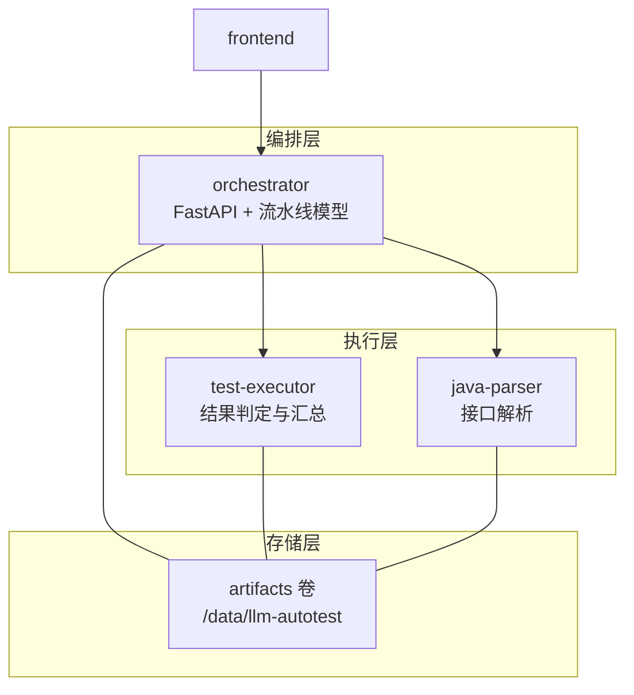
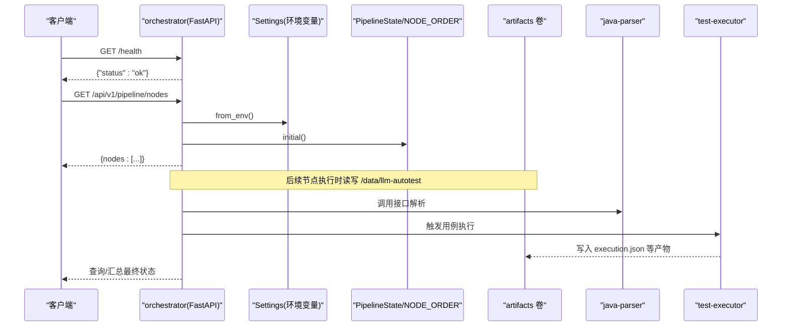
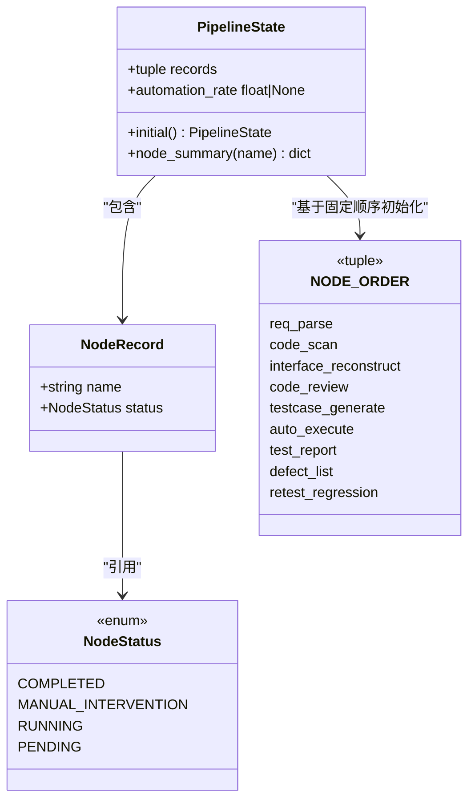
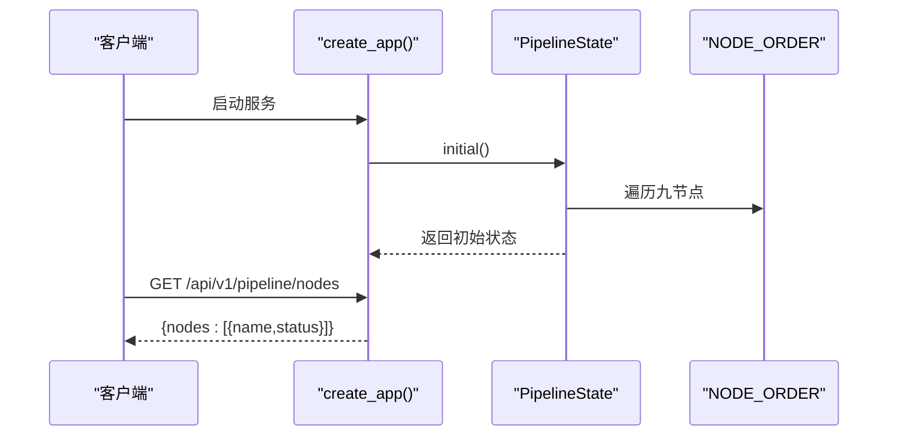
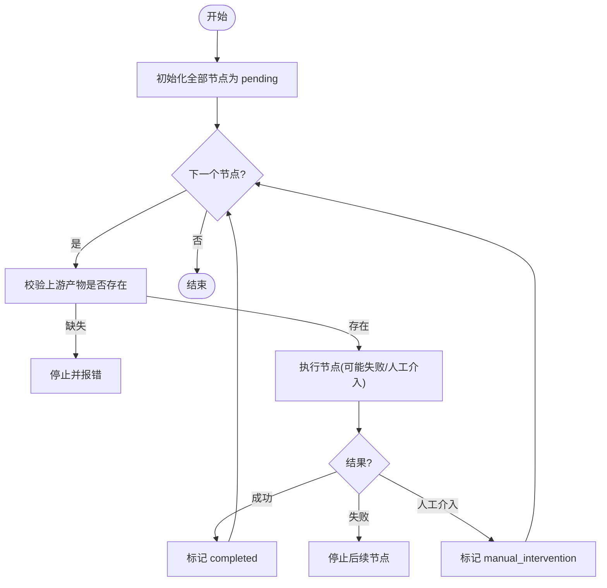
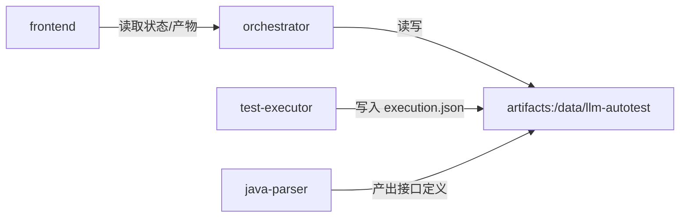
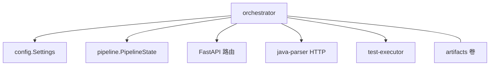

# 流水线生命周期

<cite>
**本文引用的文件**
- [pipeline.py](file://services/orchestrator/src/orchestrator/pipeline.py)
- [api.py](file://services/orchestrator/src/orchestrator/api.py)
- [config.py](file://services/orchestrator/src/orchestrator/config.py)
- [__main__.py](file://services/orchestrator/src/orchestrator/__main__.py)
- [result.py](file://services/test-executor/src/executor/result.py)
- [docker-compose.yml](file://deploy/docker-compose.yml)
- [04_功能规格说明.md](file://docs/04_功能规格说明.md)
- [README.md](file://schemas/README.md)
</cite>

## 目录
1. [简介](#简介)
2. [项目结构](#项目结构)
3. [核心组件](#核心组件)
4. [架构总览](#架构总览)
5. [详细组件分析](#详细组件分析)
6. [依赖关系分析](#依赖关系分析)
7. [性能考量](#性能考量)
8. [故障排查指南](#故障排查指南)
9. [结论](#结论)
10. [附录](#附录)

## 简介
本文件聚焦“流水线生命周期”的完整管理：从创建、初始状态设置，到节点执行顺序控制与最终状态汇总；并解释九节点固定口径设计与不可变性保证。同时说明流水线实例的持久化策略与产物卷管理机制，并通过具体代码路径展示流水线的创建、状态监控与结果获取过程。

## 项目结构
本项目采用多服务编排：
- orchestrator：负责 REST API、配置加载、流水线模型定义（九节点固定顺序与四态）以及健康检查等。
- test-executor：提供用例执行结果的判定与汇总（断言失败与环境失败分离）。
- java-parser：Java 接口解析服务（由编排器调用）。
- frontend：前端界面（依赖 orchestrator）。
- docker-compose：统一编排与共享产物卷 artifacts。

图表来源
- [docker-compose.yml:18-32](file://deploy/docker-compose.yml#L18-L32)
- [docker-compose.yml:4-16](file://deploy/docker-compose.yml#L4-L16)
- [docker-compose.yml:57-62](file://deploy/docker-compose.yml#L57-L62)

章节来源
- [docker-compose.yml:1-62](file://deploy/docker-compose.yml#L1-L62)
- [__main__.py:15-25](file://services/orchestrator/src/orchestrator/__main__.py#L15-L25)

## 核心组件
- 流水线模型与状态
  - 九节点固定顺序与四态枚举：确保口径冻结与不可变。
  - 初始状态构造：全部节点为待运行。
  - 自动化率计算：已完成节点数 / 9（程序化汇总，不经 LLM）。
- REST API
  - 健康检查与节点清单查询：返回九节点及当前状态摘要。
- 配置
  - 环境变量驱动：端口、LLM 参数、产物根目录、Schema 目录等。
- 执行结果
  - 断言失败与环境失败二态分离，用于缺陷闭环与报告生成。

章节来源
- [pipeline.py:11-84](file://services/orchestrator/src/orchestrator/pipeline.py#L11-L84)
- [api.py:11-27](file://services/orchestrator/src/orchestrator/api.py#L11-L27)
- [config.py:9-56](file://services/orchestrator/src/orchestrator/config.py#L9-L56)
- [result.py:10-61](file://services/test-executor/src/executor/result.py#L10-L61)

## 架构总览
下图展示了 orchestrator 启动、暴露 API、读取配置、访问共享产物卷并与下游服务交互的整体流程。

图表来源
- [__main__.py:15-25](file://services/orchestrator/src/orchestrator/__main__.py#L15-L25)
- [api.py:11-27](file://services/orchestrator/src/orchestrator/api.py#L11-L27)
- [config.py:35-56](file://services/orchestrator/src/orchestrator/config.py#L35-L56)
- [docker-compose.yml:23-32](file://deploy/docker-compose.yml#L23-L32)
- [docker-compose.yml:4-16](file://deploy/docker-compose.yml#L4-L16)

## 详细组件分析

### 九节点固定口径与不可变性
- 固定顺序：NODE_ORDER 定义了九个节点的严格顺序，禁止增删改，确保口径一致。
- 四态标注：每个节点处于 pending/running/completed/manual_intervention 之一。
- 不可变性：NodeRecord 与 PipelineState 使用不可变数据类，避免运行时意外修改。
- 自动化率：completed 数量除以 9，分母固定，不随降级或跳过而缩减。

图表来源
- [pipeline.py:11-84](file://services/orchestrator/src/orchestrator/pipeline.py#L11-L84)

章节来源
- [pipeline.py:23-84](file://services/orchestrator/src/orchestrator/pipeline.py#L23-L84)
- [04_功能规格说明.md:288-313](file://docs/04_功能规格说明.md#L288-L313)

### 流水线实例的创建与初始状态
- 入口：通过 FastAPI 应用构建函数 create_app 注册路由。
- 初始状态：调用 PipelineState.initial() 将全部节点置为 pending。
- 节点清单：GET /api/v1/pipeline/nodes 返回九节点及其摘要。

图表来源
- [api.py:11-27](file://services/orchestrator/src/orchestrator/api.py#L11-L27)
- [pipeline.py:51-59](file://services/orchestrator/src/orchestrator/pipeline.py#L51-L59)

章节来源
- [api.py:11-27](file://services/orchestrator/src/orchestrator/api.py#L11-L27)
- [pipeline.py:51-59](file://services/orchestrator/src/orchestrator/pipeline.py#L51-L59)

### 节点执行顺序控制与状态流转
- 顺序控制：按 NODE_ORDER 依次推进，上游产物缺失则拒绝启动下游（规范约束）。
- 状态流转：pending → running → completed/manual_intervention；任一节点失败停止后续节点（规范约束）。
- 人工介入：节点日志自动记录，运行后人工复核标记，计入自动化率口径。

图表来源
- [04_功能规格说明.md:21-31](file://docs/04_功能规格说明.md#L21-L31)
- [pipeline.py:23-84](file://services/orchestrator/src/orchestrator/pipeline.py#L23-L84)

章节来源
- [04_功能规格说明.md:21-31](file://docs/04_功能规格说明.md#L21-L31)
- [pipeline.py:23-84](file://services/orchestrator/src/orchestrator/pipeline.py#L23-L84)

### 最终状态汇总与自动化率
- 自动化率：completed 节点数 / 9，分母固定，不因降级或跳过而改变。
- 汇总方式：纯程序化计算，不经过 LLM，确保可审计与一致性。
- 报告与度量：结合执行结果与节点状态，输出度量指标与降级说明。

章节来源
- [pipeline.py:61-70](file://services/orchestrator/src/orchestrator/pipeline.py#L61-L70)
- [04_功能规格说明.md:288-313](file://docs/04_功能规格说明.md#L288-L313)

### 产物卷与持久化策略
- 共享卷：所有服务挂载同一 artifacts 卷，统一路径 /data/llm-autotest。
- 节点间契约：以结构化 JSON 落盘，作为节点输入/输出，避免内存耦合。
- Schema 治理：所有产物遵循 schemas 目录下的 JSON Schema，变更需升版本。
- 断点续跑：若某节点产物已存在且 Schema 校验通过，可跳过该节点重跑。

图表来源
- [docker-compose.yml:9-16](file://deploy/docker-compose.yml#L9-L16)
- [docker-compose.yml:27-32](file://deploy/docker-compose.yml#L27-L32)
- [docker-compose.yml:49-51](file://deploy/docker-compose.yml#L49-L51)
- [README.md:5-10](file://schemas/README.md#L5-L10)

章节来源
- [docker-compose.yml:57-62](file://deploy/docker-compose.yml#L57-L62)
- [README.md:5-10](file://schemas/README.md#L5-L10)
- [04_功能规格说明.md:21-31](file://docs/04_功能规格说明.md#L21-L31)

### 执行结果与缺陷闭环
- 结果二态：断言失败与环境失败分离，环境失败不计入通过率分母。
- 汇总：ExecutionSummary 提供总数、通过数、两类失败数的程序化统计。
- 缺陷闭环：仅断言失败进入缺陷清单，支持复测与状态流转。

章节来源
- [result.py:10-61](file://services/test-executor/src/executor/result.py#L10-L61)
- [04_功能规格说明.md:179-208](file://docs/04_功能规格说明.md#L179-L208)
- [04_功能规格说明.md:235-257](file://docs/04_功能规格说明.md#L235-L257)

## 依赖关系分析
- orchestrator 依赖：
  - FastAPI 框架与 uvicorn 服务器。
  - Settings 配置模块（环境变量）。
  - pipeline 模块（NODE_ORDER、PipelineState）。
- 外部依赖：
  - java-parser（HTTP 接口）。
  - test-executor（执行与结果产出）。
- 存储依赖：
  - Docker 卷 artifacts，跨服务共享。

图表来源
- [__main__.py:15-25](file://services/orchestrator/src/orchestrator/__main__.py#L15-L25)
- [api.py:11-27](file://services/orchestrator/src/orchestrator/api.py#L11-L27)
- [config.py:35-56](file://services/orchestrator/src/orchestrator/config.py#L35-L56)
- [docker-compose.yml:18-32](file://deploy/docker-compose.yml#L18-L32)

章节来源
- [__main__.py:15-25](file://services/orchestrator/src/orchestrator/__main__.py#L15-L25)
- [api.py:11-27](file://services/orchestrator/src/orchestrator/api.py#L11-L27)
- [config.py:35-56](file://services/orchestrator/src/orchestrator/config.py#L35-L56)

## 性能考量
- 固定口径与不可变数据结构减少运行时分支与锁竞争，提升稳定性。
- 产物落盘避免大对象在进程间传递，降低内存压力。
- 节点级断点续跑减少重复工作，提高迭代效率。
- 报告与度量纯程序化计算，避免 LLM 调用带来的不确定延迟。

## 故障排查指南
- 启动失败
  - 检查环境变量是否齐全（如 JAVA_PARSER_URL、LLM_BASE_URL、LLM_SEED 等），缺失将抛出运行时错误。
  - 确认端口未被占用，uvicorn 正常绑定。
- 健康检查失败
  - 验证 java-parser 健康端点可达，编排器依赖其健康状态启动。
- 节点无法继续
  - 上游产物缺失或 Schema 校验失败会导致下游拒绝启动；检查 artifacts 目录中对应 JSON 文件是否存在且结构正确。
- 执行结果异常
  - 区分断言失败与环境失败；环境失败需优先排查被测服务连通性与前置数据准备。
- 自动化率异常
  - 确认分母固定为 9；若出现降级或跳过，仍按人工介入计入，报告中应注明原因。

章节来源
- [config.py:35-56](file://services/orchestrator/src/orchestrator/config.py#L35-L56)
- [docker-compose.yml:11-16](file://deploy/docker-compose.yml#L11-L16)
- [04_功能规格说明.md:21-31](file://docs/04_功能规格说明.md#L21-L31)
- [04_功能规格说明.md:288-313](file://docs/04_功能规格说明.md#L288-L313)

## 结论
本项目的流水线生命周期围绕“九节点固定口径 + 不可变状态 + 产物卷契约”展开：通过严格的顺序控制、四态标注与程序化汇总，确保流程可观测、可审计、可复用。编排器提供统一的 REST 入口与状态查询，test-executor 提供结果判定与汇总，java-parser 提供接口还原能力，三者通过共享 artifacts 卷协作。未来可在现有骨架上逐步实现节点执行、断点续跑与产物校验，完善端到端的自动化闭环。

## 附录

### 代码示例路径（创建、监控、获取结果）
- 创建流水线实例与初始状态
  - 参考：[pipeline.py:51-59](file://services/orchestrator/src/orchestrator/pipeline.py#L51-L59)
- 查询九节点清单与当前状态
  - 参考：[api.py:21-25](file://services/orchestrator/src/orchestrator/api.py#L21-L25)
- 启动 orchestrator 服务
  - 参考：[__main__.py:15-25](file://services/orchestrator/src/orchestrator/__main__.py#L15-L25)
- 读取配置（环境变量）
  - 参考：[config.py:35-56](file://services/orchestrator/src/orchestrator/config.py#L35-L56)
- 执行结果汇总（断言/环境失败分离）
  - 参考：[result.py:32-61](file://services/test-executor/src/executor/result.py#L32-L61)
- 产物卷挂载与共享路径
  - 参考：[docker-compose.yml:9-16](file://deploy/docker-compose.yml#L9-L16), [docker-compose.yml:27-32](file://deploy/docker-compose.yml#L27-L32), [docker-compose.yml:49-51](file://deploy/docker-compose.yml#L49-L51)