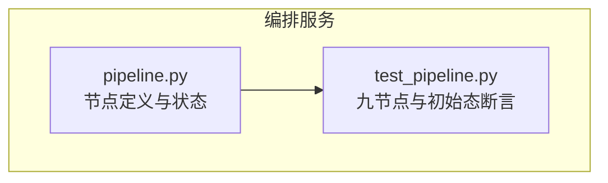
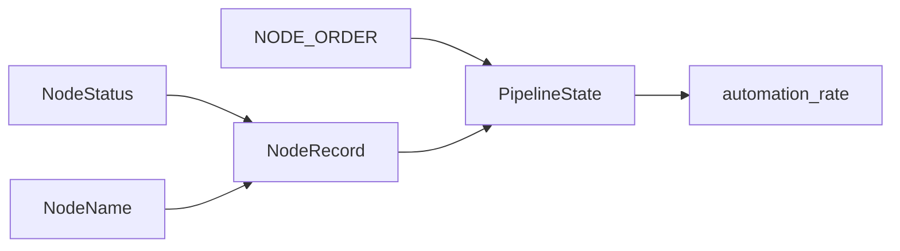

# 节点记录模型

<cite>
**本文引用的文件**
- [pipeline.py](file://services/orchestrator/src/orchestrator/pipeline.py)
- [test_pipeline.py](file://services/orchestrator/tests/test_pipeline.py)
</cite>

## 目录
1. [简介](#简介)
2. [项目结构](#项目结构)
3. [核心组件](#核心组件)
4. [架构总览](#架构总览)
5. [详细组件分析](#详细组件分析)
6. [依赖关系分析](#依赖关系分析)
7. [性能考虑](#性能考虑)
8. [故障排查指南](#故障排查指南)
9. [结论](#结论)
10. [附录：使用示例与最佳实践](#附录使用示例与最佳实践)

## 简介
本文件聚焦于“节点记录模型”，围绕 NodeRecord 数据类、NodeName 类型别名、NodeStatus 状态枚举以及九节点固定顺序的约束进行系统化说明。文档旨在帮助读者理解节点名称与状态的关联关系、九节点口径的冻结原则，以及如何通过代码创建节点记录、设置节点状态并验证节点名称合法性。

## 项目结构
该模型位于编排服务 orchestrator 中，核心定义集中在 pipeline 模块；测试用例覆盖九节点数量与初始态等关键约束。



图表来源
- [pipeline.py:1-84](file://services/orchestrator/src/orchestrator/pipeline.py#L1-L84)
- [test_pipeline.py:1-47](file://services/orchestrator/tests/test_pipeline.py#L1-L47)

章节来源
- [pipeline.py:1-84](file://services/orchestrator/src/orchestrator/pipeline.py#L1-L84)
- [test_pipeline.py:1-47](file://services/orchestrator/tests/test_pipeline.py#L1-L47)

## 核心组件
- NodeStatus：节点四态枚举，用于表达节点在流水线中的运行阶段。
- NODE_ORDER：九节点固定顺序常量，作为流水线口径的分母（固定为 9）。
- NodeRecord：不可变的数据类，表示单个节点的当前状态记录，包含 name 与 status 两个字段。
- PipelineState：整条流水线的节点状态集合，提供初始化、单节点摘要查询与自动化率计算。
- NodeName：基于 Literal 的类型别名，限定节点名称必须来自九节点集合。

章节来源
- [pipeline.py:11-21](file://services/orchestrator/src/orchestrator/pipeline.py#L11-L21)
- [pipeline.py:23-34](file://services/orchestrator/src/orchestrator/pipeline.py#L23-L34)
- [pipeline.py:37-43](file://services/orchestrator/src/orchestrator/pipeline.py#L37-L43)
- [pipeline.py:45-70](file://services/orchestrator/src/orchestrator/pipeline.py#L45-L70)
- [pipeline.py:73-83](file://services/orchestrator/src/orchestrator/pipeline.py#L73-L83)

## 架构总览
下图展示了节点记录模型在流水线中的角色与交互：PipelineState 维护一组 NodeRecord，每个 NodeRecord 绑定一个受 NodeName 约束的节点名与 NodeStatus 状态。NODE_ORDER 定义了九节点固定顺序，作为自动化率计算的分母。

```mermaid
classDiagram
class NodeStatus {
+COMPLETED
+MANUAL_INTERVENTION
+RUNNING
+PENDING
}
class NodeRecord {
+name : str
+status : NodeStatus
}
class PipelineState {
+records : tuple[NodeRecord, ...]
+initial() PipelineState
+node_summary(name) dict
+automation_rate float|None
}
class NodeName {
<<Literal>>
"req_parse"|"code_scan"|"interface_reconstruct"|"code_review"|"testcase_generate"|"auto_execute"|"test_report"|"defect_list"|"retest_regression"
}
NodeRecord --> NodeStatus : "使用"
PipelineState --> NodeRecord : "聚合"
NodeRecord --> NodeName : "name 受其约束"
```

图表来源
- [pipeline.py:11-21](file://services/orchestrator/src/orchestrator/pipeline.py#L11-L21)
- [pipeline.py:37-43](file://services/orchestrator/src/orchestrator/pipeline.py#L37-L43)
- [pipeline.py:45-70](file://services/orchestrator/src/orchestrator/pipeline.py#L45-L70)
- [pipeline.py:73-83](file://services/orchestrator/src/orchestrator/pipeline.py#L73-L83)

## 详细组件分析

### NodeStatus 状态枚举
- 四种状态及其业务含义：
  - COMPLETED：已完成，表示节点已顺利完成处理。
  - MANUAL_INTERVENTION：人工介入，表示需要人工干预或降级处理；根据规则，降级节点按人工介入计入。
  - RUNNING：运行中，表示节点正在执行。
  - PENDING：待运行，表示尚未开始执行。
- 设计要点：
  - 使用 StrEnum，便于序列化/反序列化为字符串值。
  - 与自动化率计算联动：仅 COMPLETED 计入分子。

章节来源
- [pipeline.py:11-21](file://services/orchestrator/src/orchestrator/pipeline.py#L11-L21)

### 九节点固定顺序与约束
- NODE_ORDER 定义了九个节点的固定顺序，作为流水线口径的分母（固定为 9），禁止增删。
- 约束保障：
  - 单元测试断言长度为 9，确保口径冻结。
  - PipelineState.initial 基于 NODE_ORDER 生成初始记录，保证所有节点起始为 PENDING。
  - automation_rate 以 len(NODE_ORDER) 为分母，确保口径一致。

章节来源
- [pipeline.py:23-34](file://services/orchestrator/src/orchestrator/pipeline.py#L23-L34)
- [pipeline.py:51-54](file://services/orchestrator/src/orchestrator/pipeline.py#L51-L54)
- [pipeline.py:61-70](file://services/orchestrator/src/orchestrator/pipeline.py#L61-L70)
- [test_pipeline.py:21-23](file://services/orchestrator/tests/test_pipeline.py#L21-L23)

### NodeRecord 数据类
- 作用：表示单个节点的当前状态记录，包含：
  - name：节点名称，需符合 NodeName 类型别名约束。
  - status：节点状态，类型为 NodeStatus。
- 特性：
  - 使用 frozen=True 的 dataclass，语义上强调不可变性，避免运行时意外修改。
  - 与 PipelineState.records 组合，形成整条流水线的状态快照。

章节来源
- [pipeline.py:37-43](file://services/orchestrator/src/orchestrator/pipeline.py#L37-L43)

### PipelineState 与自动化率
- records：由多个 NodeRecord 组成的元组，代表整条流水线的节点状态集合。
- initial：工厂方法，依据 NODE_ORDER 创建全部为 PENDING 的初始态。
- node_summary：按 name 查找对应记录，返回包含 name 与 status.value 的字典，供 API 使用。
- automation_rate：
  - 计算公式：已完成节点数 / 9。
  - 当无完成节点时返回 None，表示尚未实测，避免误导性的 0 值。

章节来源
- [pipeline.py:45-70](file://services/orchestrator/src/orchestrator/pipeline.py#L45-L70)
- [test_pipeline.py:26-30](file://services/orchestrator/tests/test_pipeline.py#L26-L30)

### NodeName 类型别名
- 基于 Literal 的严格类型别名，限定节点名称只能为九节点之一。
- 用途：
  - 在类型检查阶段防止非法节点名传入。
  - 与 NODE_ORDER 保持口径一致，增强可维护性。

章节来源
- [pipeline.py:73-83](file://services/orchestrator/src/orchestrator/pipeline.py#L73-L83)

## 依赖关系分析
- NodeRecord 依赖 NodeStatus 与 NodeName（通过类型注解约束）。
- PipelineState 依赖 NodeRecord 与 NODE_ORDER。
- 测试依赖 pipeline 模块以验证九节点数量与初始态。



图表来源
- [pipeline.py:11-21](file://services/orchestrator/src/orchestrator/pipeline.py#L11-L21)
- [pipeline.py:23-34](file://services/orchestrator/src/orchestrator/pipeline.py#L23-L34)
- [pipeline.py:37-43](file://services/orchestrator/src/orchestrator/pipeline.py#L37-L43)
- [pipeline.py:45-70](file://services/orchestrator/src/orchestrator/pipeline.py#L45-L70)
- [pipeline.py:73-83](file://services/orchestrator/src/orchestrator/pipeline.py#L73-L83)

章节来源
- [pipeline.py:11-83](file://services/orchestrator/src/orchestrator/pipeline.py#L11-L83)
- [test_pipeline.py:1-47](file://services/orchestrator/tests/test_pipeline.py#L1-L47)

## 性能考虑
- 自动化率计算采用一次遍历统计已完成节点数，时间复杂度 O(9)，常数级开销。
- 使用元组与不可变 dataclass 提升内存与并发安全性。
- 若后续扩展为持久化读取，建议缓存 records 以减少 IO 次数。

## 故障排查指南
- 九节点数量异常：
  - 现象：NODE_ORDER 长度不为 9。
  - 排查：查看 test_pipeline 中的断言，确认是否误改 NODE_ORDER。
- 初始态非全 PENDING：
  - 现象：PipelineState.initial 生成的记录状态不是 pending。
  - 排查：检查 initial 实现与 NODE_ORDER 的一致性。
- 自动化率为 0 而非 None：
  - 现象：无完成节点时返回 0。
  - 排查：确认 automation_rate 在无完成节点时返回 None，避免误导。

章节来源
- [test_pipeline.py:21-30](file://services/orchestrator/tests/test_pipeline.py#L21-L30)
- [pipeline.py:51-70](file://services/orchestrator/src/orchestrator/pipeline.py#L51-L70)

## 结论
NodeRecord 模型通过不可变数据类与严格的类型约束，确保了节点名称与状态的一致性与可追溯性。九节点固定顺序与 NodeName 类型别名共同锁定了流水线口径，使自动化率计算具备稳定基准。配合 PipelineState 的工厂方法与查询接口，可在不引入额外复杂度的前提下，支撑编排服务的状态管理与度量需求。

## 附录：使用示例与最佳实践
以下示例展示如何创建节点记录、设置节点状态与验证节点名称合法性。为避免泄露实现细节，此处仅提供调用路径与行为说明，具体代码片段请参考对应源码位置。

- 创建节点记录
  - 使用 NodeRecord 构造器，传入合法的节点名与初始状态。
  - 参考路径：[pipeline.py:37-43](file://services/orchestrator/src/orchestrator/pipeline.py#L37-L43)

- 设置节点状态
  - 将 NodeRecord.status 更新为 NodeStatus 的某个成员（如 RUNNING、COMPLETED 等）。
  - 注意：NodeRecord 为不可变对象，实际使用中应创建新实例替换旧记录。
  - 参考路径：[pipeline.py:11-21](file://services/orchestrator/src/orchestrator/pipeline.py#L11-L21)

- 验证节点名称合法性
  - 使用 NodeName 类型别名进行静态类型检查，确保节点名属于九节点集合。
  - 参考路径：[pipeline.py:73-83](file://services/orchestrator/src/orchestrator/pipeline.py#L73-L83)

- 初始化整条流水线
  - 调用 PipelineState.initial 获取全部节点为 PENDING 的初始态。
  - 参考路径：[pipeline.py:51-54](file://services/orchestrator/src/orchestrator/pipeline.py#L51-L54)

- 查询单节点摘要
  - 使用 PipelineState.node_summary(name) 获取指定节点的 name 与 status.value。
  - 参考路径：[pipeline.py:56-59](file://services/orchestrator/src/orchestrator/pipeline.py#L56-L59)

- 计算自动化率
  - 使用 PipelineState.automation_rate 获取已完成比例；若无完成节点则返回 None。
  - 参考路径：[pipeline.py:61-70](file://services/orchestrator/src/orchestrator/pipeline.py#L61-L70)