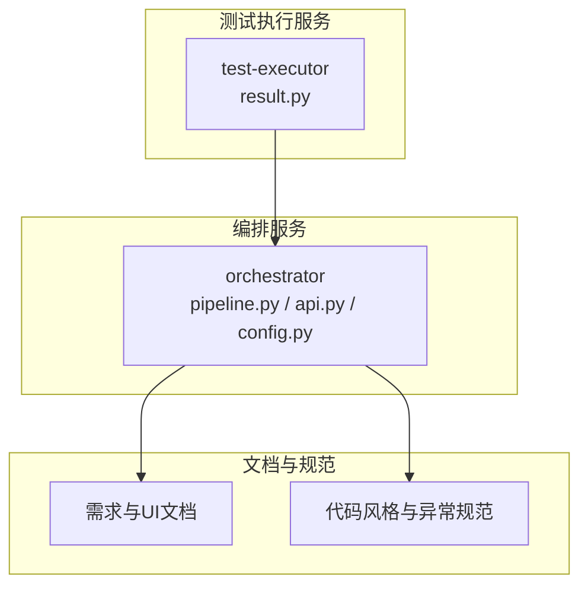
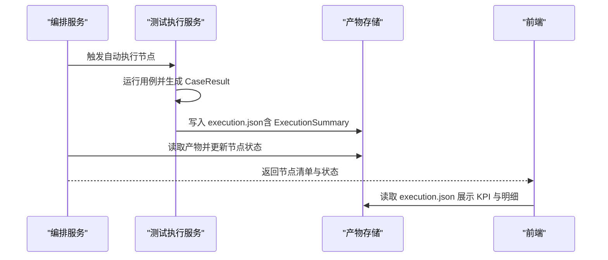
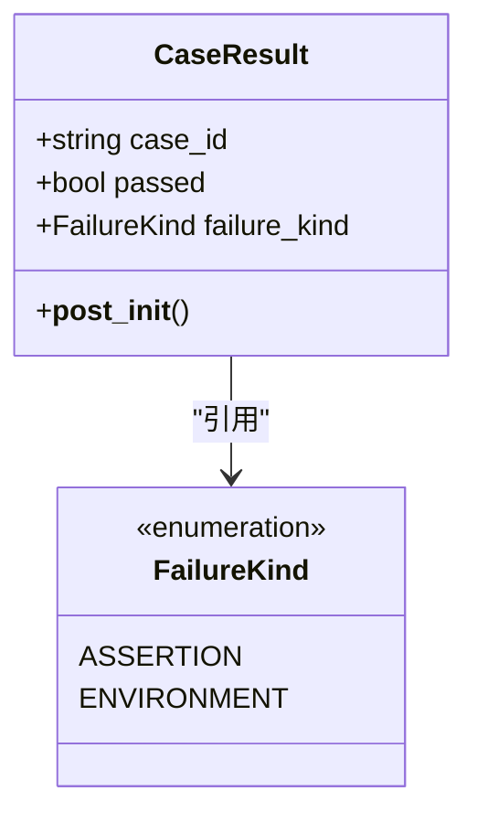
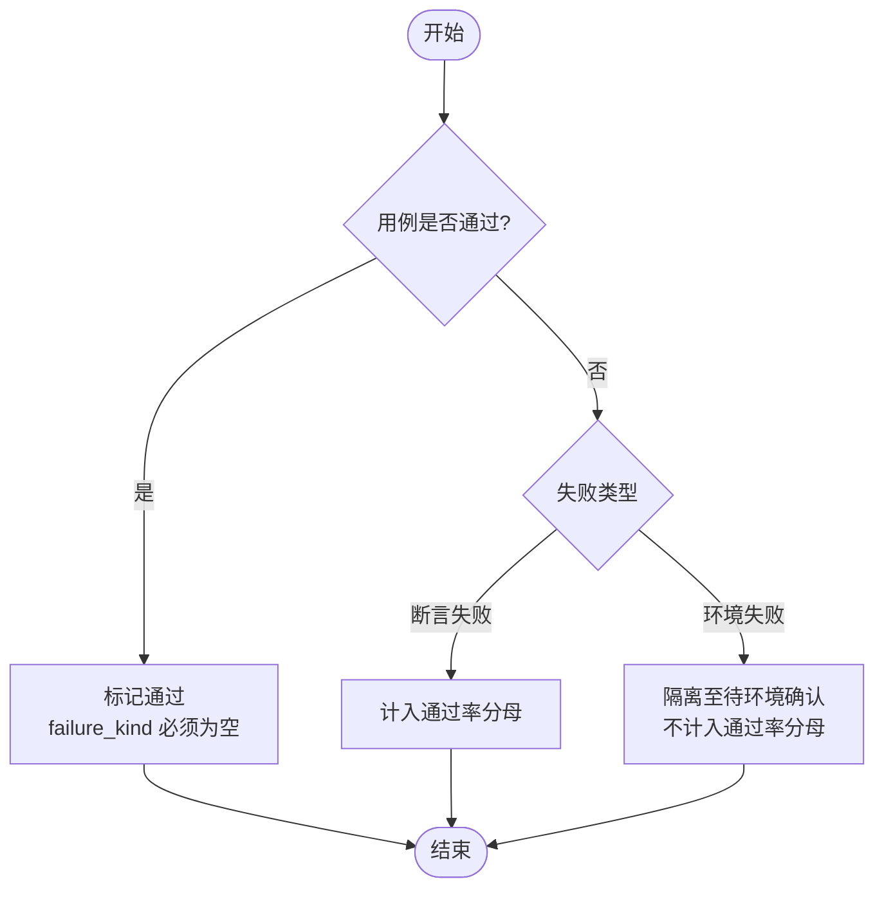
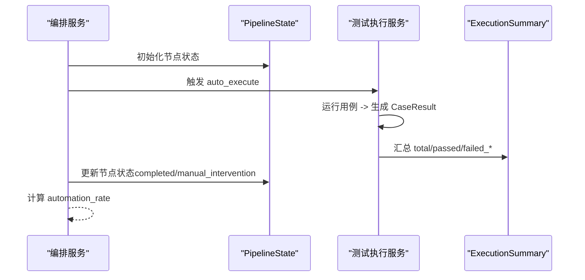
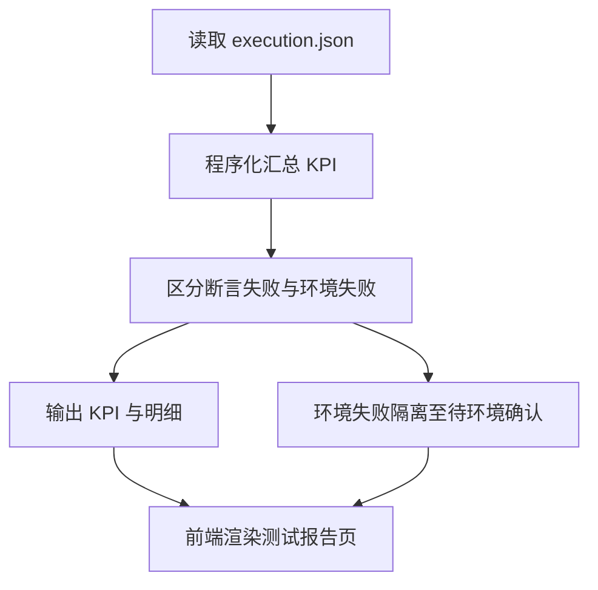
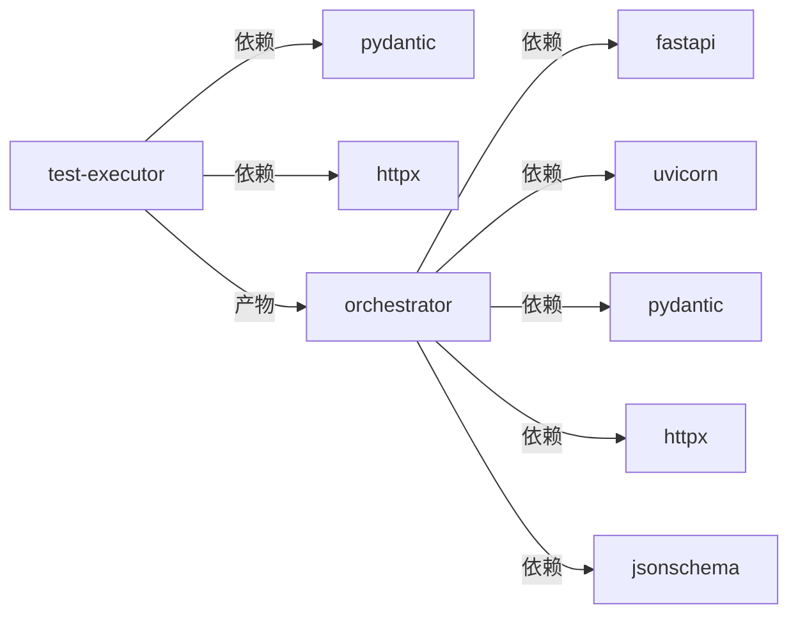

# 测试执行数据模型

<cite>
**本文引用的文件**
- [services/test-executor/src/executor/result.py](file://services/test-executor/src/executor/result.py)
- [services/test-executor/tests/test_result.py](file://services/test-executor/tests/test_result.py)
- [services/orchestrator/src/orchestrator/pipeline.py](file://services/orchestrator/src/orchestrator/pipeline.py)
- [services/orchestrator/src/orchestrator/api.py](file://services/orchestrator/src/orchestrator/api.py)
- [services/orchestrator/src/orchestrator/config.py](file://services/orchestrator/src/orchestrator/config.py)
- [services/test-executor/pyproject.toml](file://services/test-executor/pyproject.toml)
- [services/orchestrator/pyproject.toml](file://services/orchestrator/pyproject.toml)
- [docs/07_UI演示设计.md](file://docs/07_UI演示设计.md)
- [docs/06_需求定稿冻结.md](file://docs/06_需求定稿冻结.md)
- [docs/04_功能规格说明.md](file://docs/04_功能规格说明.md)
- [.rules/python-code-style.md](file://.rules/python-code-style.md)
</cite>

## 目录
1. [简介](#简介)
2. [项目结构](#项目结构)
3. [核心组件](#核心组件)
4. [架构总览](#架构总览)
5. [详细组件分析](#详细组件分析)
6. [依赖关系分析](#依赖关系分析)
7. [性能与可扩展性](#性能与可扩展性)
8. [故障排查指南](#故障排查指南)
9. [结论](#结论)
10. [附录：序列化与反序列化最佳实践](#附录序列化与反序列化最佳实践)

## 简介
本文件聚焦“测试执行数据模型”，围绕 CaseResult 类的结构设计、测试结果分类机制（断言失败与环境失败二态分离）、执行状态与结果收集方式、失败分析与报告生成、以及元数据记录、性能指标与调试信息捕获进行系统化说明。同时给出测试结果序列化和反序列化的最佳实践，确保产物可被流水线编排服务消费并用于前端展示与度量统计。

## 项目结构
本项目采用多服务拆分：
- test-executor：负责测试脚本加载、无人值守执行、断言判定与结果产出（CaseResult、ExecutionSummary）。
- orchestrator：负责 9 节点流水线编排、状态管理、REST API 暴露与产物管理。
- 文档与规则：定义口径、UI 展示、异常与日志规范等。

图表来源
- [services/test-executor/src/executor/result.py:1-61](file://services/test-executor/src/executor/result.py#L1-L61)
- [services/orchestrator/src/orchestrator/pipeline.py:1-84](file://services/orchestrator/src/orchestrator/pipeline.py#L1-L84)
- [services/orchestrator/src/orchestrator/api.py:1-28](file://services/orchestrator/src/orchestrator/api.py#L1-L28)
- [services/orchestrator/src/orchestrator/config.py:1-50](file://services/orchestrator/src/orchestrator/config.py#L1-L50)

章节来源
- [services/test-executor/src/executor/result.py:1-61](file://services/test-executor/src/executor/result.py#L1-L61)
- [services/orchestrator/src/orchestrator/pipeline.py:1-84](file://services/orchestrator/src/orchestrator/pipeline.py#L1-L84)
- [services/orchestrator/src/orchestrator/api.py:1-28](file://services/orchestrator/src/orchestrator/api.py#L1-L28)
- [services/orchestrator/src/orchestrator/config.py:1-50](file://services/orchestrator/src/orchestrator/config.py#L1-L50)

## 核心组件
- FailureKind：失败二态枚举，区分“断言失败”和“环境失败”。
- CaseResult：单条用例的执行结果，包含用例标识、是否通过、失败类型（可选），并在构造时做一致性校验。
- ExecutionSummary：一次执行的汇总对象，提供总数、通过数、断言失败数、环境失败数的程序化统计。

这些组件共同构成测试执行数据模型的骨架，支撑后续的报告生成与度量计算。

章节来源
- [services/test-executor/src/executor/result.py:10-61](file://services/test-executor/src/executor/result.py#L10-L61)
- [services/test-executor/tests/test_result.py:10-29](file://services/test-executor/tests/test_result.py#L10-L29)

## 架构总览
测试执行与编排的整体流程如下：
- 编排服务启动后，按 9 节点顺序推进；其中 auto_execute 节点触发测试执行服务。
- 测试执行服务运行用例，产出 CaseResult 列表，并汇总为 ExecutionSummary。
- 编排服务读取执行产物，更新流水线状态，并通过 REST API 暴露节点清单与当前状态。
- 前端基于 execution.json 等产物进行可视化与度量统计。

图表来源
- [services/orchestrator/src/orchestrator/pipeline.py:23-70](file://services/orchestrator/src/orchestrator/pipeline.py#L23-L70)
- [services/orchestrator/src/orchestrator/api.py:21-25](file://services/orchestrator/src/orchestrator/api.py#L21-L25)
- [services/test-executor/src/executor/result.py:17-61](file://services/test-executor/src/executor/result.py#L17-L61)

## 详细组件分析

### CaseResult 数据结构与一致性约束
- 字段
  - case_id：用例唯一标识。
  - passed：布尔值，表示用例是否通过。
  - failure_kind：失败类型枚举，仅在未通过时有意义。
- 一致性校验
  - 若 passed 为真且携带 failure_kind，则抛出错误，保证结果自洽。
- 设计意图
  - 将“通过”的语义与“失败原因”解耦，避免歧义；失败类型明确区分业务断言失败与环境问题。

图表来源
- [services/test-executor/src/executor/result.py:10-29](file://services/test-executor/src/executor/result.py#L10-L29)

章节来源
- [services/test-executor/src/executor/result.py:17-29](file://services/test-executor/src/executor/result.py#L17-L29)
- [services/test-executor/tests/test_result.py:10-13](file://services/test-executor/tests/test_result.py#L10-L13)

### 测试结果分类机制：断言失败与环境失败
- 分类依据
  - 断言失败：用例逻辑或期望不满足，计入通过率分母。
  - 环境失败：运行环境不可用或前置条件缺失，隔离至“待环境确认”，不计入通过率分母。
- 实现要点
  - FailureKind 枚举明确两种失败类型。
  - ExecutionSummary 分别统计 failed_assertion 与 failed_environment，确保度量口径清晰。

图表来源
- [services/test-executor/src/executor/result.py:10-61](file://services/test-executor/src/executor/result.py#L10-L61)

章节来源
- [services/test-executor/src/executor/result.py:10-61](file://services/test-executor/src/executor/result.py#L10-L61)
- [services/test-executor/tests/test_result.py:16-29](file://services/test-executor/tests/test_result.py#L16-L29)

### 执行状态与结果收集
- 执行状态
  - 编排服务维护 9 个固定节点的状态（待运行、运行中、已完成、人工介入）。
  - 自动化率 = 已完成节点数 / 9，骨架阶段全部为待运行，返回 None 表示尚未实测。
- 结果收集
  - 测试执行服务产出 CaseResult 列表，并汇总为 ExecutionSummary。
  - 编排服务读取产物并更新节点状态，对外暴露节点清单与状态。

图表来源
- [services/orchestrator/src/orchestrator/pipeline.py:23-70](file://services/orchestrator/src/orchestrator/pipeline.py#L23-L70)
- [services/test-executor/src/executor/result.py:32-61](file://services/test-executor/src/executor/result.py#L32-L61)

章节来源
- [services/orchestrator/src/orchestrator/pipeline.py:23-70](file://services/orchestrator/src/orchestrator/pipeline.py#L23-L70)
- [services/test-executor/src/executor/result.py:32-61](file://services/test-executor/src/executor/result.py#L32-L61)

### 失败分析与报告生成
- 报告口径
  - 顶部 KPI：总数/通过/失败/通过率，数值由 execution.json 程序化汇总，不经 LLM。
  - 失败明细表区分“断言失败”与“环境失败”，环境失败隔离至“待环境确认”。
- 降级与边界
  - 某节点降级跳过按“人工介入”计入，分母固定为 9 不缩减；报告中注明降级节点清单与原因。
  - 兜底演示仓库结果单独标注，不计入跑通口径。

图表来源
- [docs/07_UI演示设计.md:61-68](file://docs/07_UI演示设计.md#L61-L68)
- [docs/06_需求定稿冻结.md:43-47](file://docs/06_需求定稿冻结.md#L43-L47)
- [services/test-executor/src/executor/result.py:32-61](file://services/test-executor/src/executor/result.py#L32-L61)

章节来源
- [docs/07_UI演示设计.md:61-68](file://docs/07_UI演示设计.md#L61-L68)
- [docs/06_需求定稿冻结.md:43-47](file://docs/06_需求定稿冻结.md#L43-L47)
- [docs/04_功能规格说明.md:308-313](file://docs/04_功能规格说明.md#L308-L313)

### 元数据记录、性能指标与调试信息
- 元数据记录
  - 节点失败需显式落盘（状态 + 原因 + 时间戳），作为断点续跑依据。
  - 配置项（端口、制品根路径、LLM 参数）来自环境变量，构建公开摘要用于日志安全。
- 性能指标
  - 自动化率以 9 节点为分母，程序化汇总，骨架阶段返回 None。
- 调试信息
  - 统一使用模块级 logger，JSON 行格式；禁止裸 except 与 print。

章节来源
- [.rules/python-code-style.md:44-48](file://.rules/python-code-style.md#L44-L48)
- [services/orchestrator/src/orchestrator/config.py:9-50](file://services/orchestrator/src/orchestrator/config.py#L9-L50)
- [services/orchestrator/src/orchestrator/pipeline.py:61-70](file://services/orchestrator/src/orchestrator/pipeline.py#L61-L70)

## 依赖关系分析
- test-executor 依赖 pydantic、httpx，用于数据建模与 HTTP 调用。
- orchestrator 依赖 fastapi、uvicorn、pydantic、httpx、jsonschema，用于 API、配置校验与产物验证。
- 两者通过产物文件（如 execution.json）交互，编排服务读取并更新状态。

图表来源
- [services/test-executor/pyproject.toml:1-45](file://services/test-executor/pyproject.toml#L1-L45)
- [services/orchestrator/pyproject.toml:1-53](file://services/orchestrator/pyproject.toml#L1-L53)

章节来源
- [services/test-executor/pyproject.toml:1-45](file://services/test-executor/pyproject.toml#L1-L45)
- [services/orchestrator/pyproject.toml:1-53](file://services/orchestrator/pyproject.toml#L1-L53)

## 性能与可扩展性
- 数据模型轻量：dataclass + StrEnum，内存占用低，适合大批量用例结果聚合。
- 统计属性惰性计算：ExecutionSummary 的属性按需遍历 results，复杂度 O(n)，n 为用例数。
- 可扩展点
  - 在 CaseResult 中扩展元数据字段（如耗时、协议、请求/响应摘要、堆栈跟踪）时，保持 frozen 不变性，新增字段不影响既有统计。
  - 在 ExecutionSummary 中增加新的统计维度（如按协议分布、按优先级分布），避免破坏现有口径。

[本节为通用指导，不直接分析具体文件]

## 故障排查指南
- 常见错误
  - 通过用例携带失败类型：构造 CaseResult 时会抛出 ValueError，检查用例判定逻辑与失败类型赋值。
  - 环境变量缺失：orchestrator 启动时报错提示缺少必填环境变量，检查 PORT、JAVA_PARSER_URL、LLM_BASE_URL、LLM_SEED 等。
  - 节点状态异常：检查 pipeline 节点状态更新逻辑与产物文件是否完整。
- 定位方法
  - 查看节点失败落盘文件（状态 + 原因 + 时间戳）。
  - 检查 execution.json 中的 ExecutionSummary 字段是否与预期一致。
  - 使用 orchestrator 的 /health 与健康检查确认服务可用。

章节来源
- [services/test-executor/src/executor/result.py:25-29](file://services/test-executor/src/executor/result.py#L25-L29)
- [services/orchestrator/src/orchestrator/config.py:32-50](file://services/orchestrator/src/orchestrator/config.py#L32-L50)
- [services/orchestrator/src/orchestrator/api.py:16-19](file://services/orchestrator/src/orchestrator/api.py#L16-L19)

## 结论
本数据模型以极简但严谨的结构实现了测试执行结果的二态分离与程序化汇总，确保度量口径稳定、报告可信、可追溯。配合编排服务的 9 节点固定口径与产物管理，形成从执行到报告的闭环。后续可在不破坏既有契约的前提下扩展元数据与统计维度，以满足更丰富的分析与可视化需求。

[本节为总结性内容，不直接分析具体文件]

## 附录：序列化与反序列化最佳实践
- 推荐策略
  - 使用 Pydantic v2 对 CaseResult 与 ExecutionSummary 进行序列化/反序列化，确保类型校验与默认值处理。
  - 产物文件命名建议为 execution.json，顶层包含 results 数组与汇总字段（total、passed、failed_assertion、failed_environment）。
  - 对每个 CaseResult 可追加元数据字段（如 protocol、duration_ms、traceback、timestamp），在反序列化时进行严格校验。
- 版本兼容
  - 在 schema 中保留向后兼容字段，废弃字段标记 deprecated 而非删除。
  - 升级时先发布只读版本，再逐步迁移消费者。
- 校验与容错
  - 使用 jsonschema 对产物进行二次校验，防止脏数据进入报告层。
  - 对缺失关键字段提供默认值或明确报错，避免静默失败。
- 性能考虑
  - 批量写入时使用流式 JSON 或分片文件，避免单次大对象 I/O 瓶颈。
  - 对 ExecutionSummary 的统计属性进行缓存，减少重复遍历。

[本节为通用指导，不直接分析具体文件]