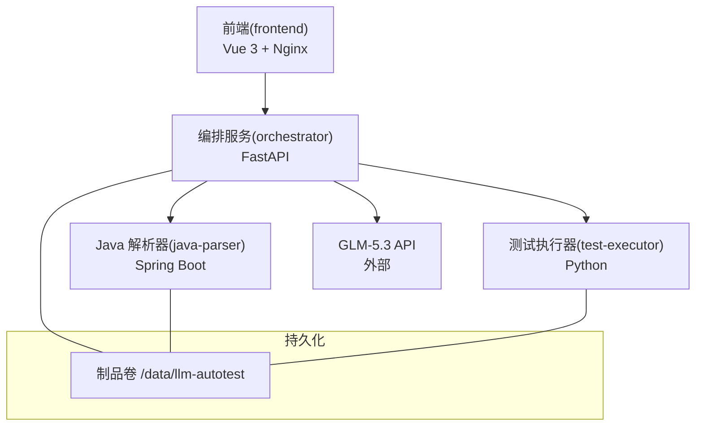
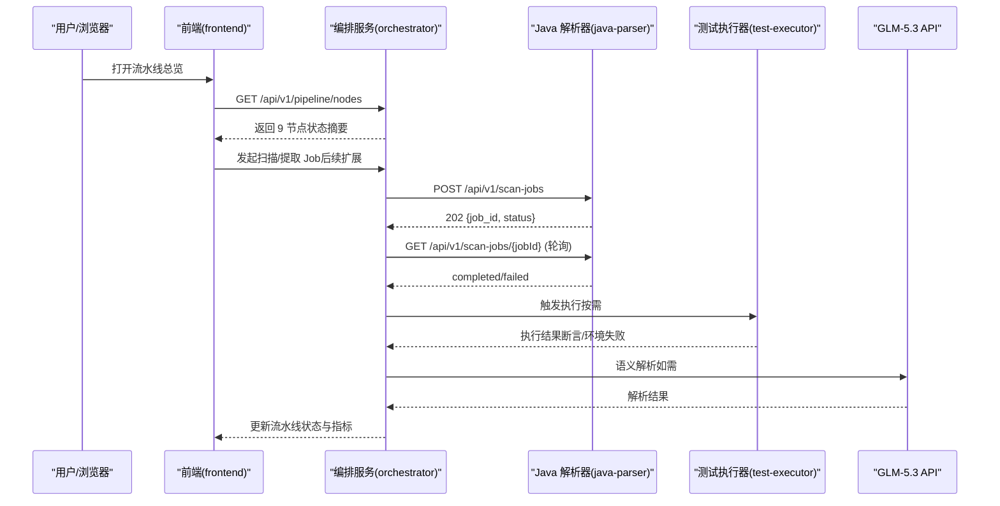
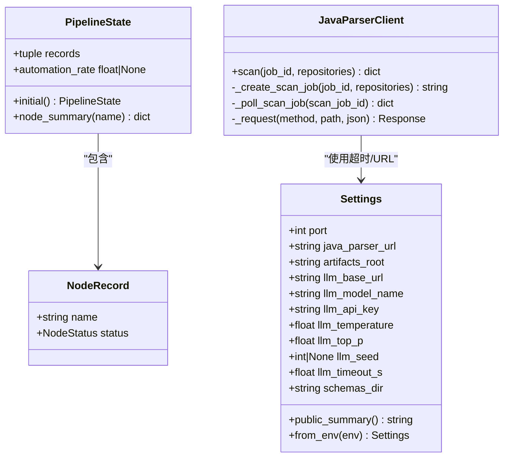
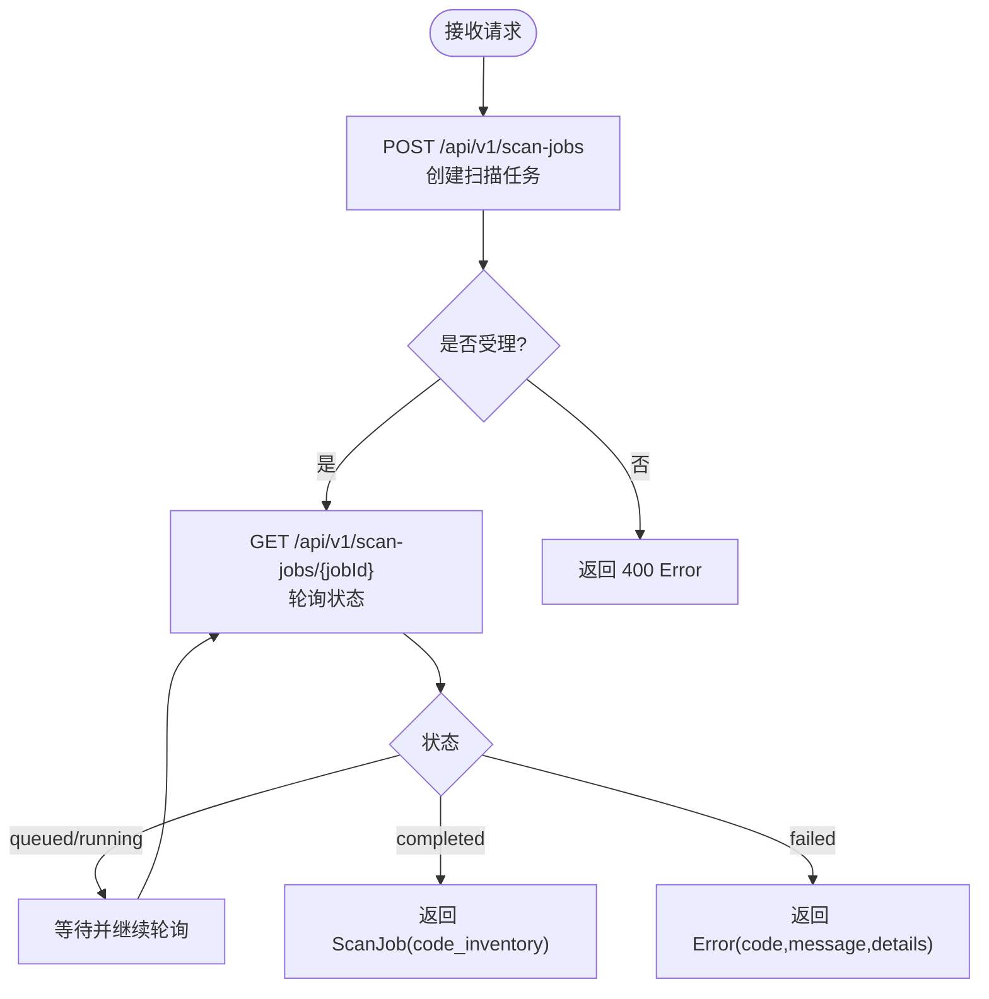
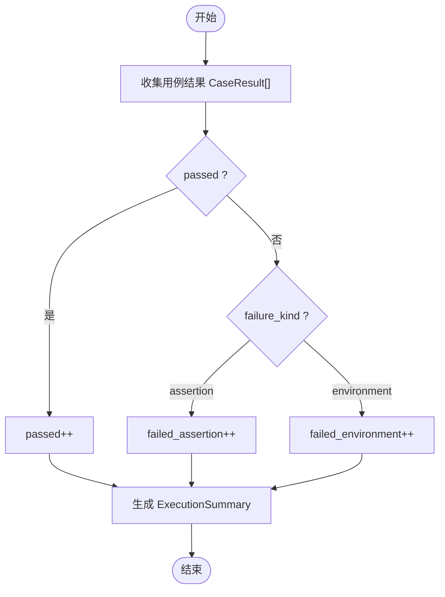
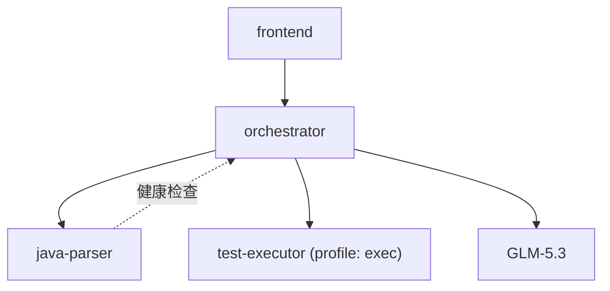

# 微服务设计

<cite>
**本文引用的文件**
- [services/orchestrator/src/orchestrator/api.py](file://services/orchestrator/src/orchestrator/api.py)
- [services/orchestrator/src/orchestrator/pipeline.py](file://services/orchestrator/src/orchestrator/pipeline.py)
- [services/orchestrator/src/orchestrator/config.py](file://services/orchestrator/src/orchestrator/config.py)
- [services/orchestrator/src/orchestrator/javaparser_client.py](file://services/orchestrator/src/orchestrator/javaparser_client.py)
- [services/java-parser/src/main/java/com/llmautotest/parser/ParserApplication.java](file://services/java-parser/src/main/java/com/llmautotest/parser/ParserApplication.java)
- [services/java-parser/src/main/java/com/llmautotest/parser/HealthController.java](file://services/java-parser/src/main/java/com/llmautotest/parser/HealthController.java)
- [services/java-parser/src/main/resources/application.yml](file://services/java-parser/src/main/resources/application.yml)
- [services/frontend/src/App.vue](file://services/frontend/src/App.vue)
- [services/frontend/src/views/PipelineOverviewView.vue](file://services/frontend/src/views/PipelineOverviewView.vue)
- [services/frontend/src/mock/jobs.ts](file://services/frontend/src/mock/jobs.ts)
- [services/test-executor/src/executor/result.py](file://services/test-executor/src/executor/result.py)
- [schemas/contracts/java-parser.openapi.yaml](file://schemas/contracts/java-parser.openapi.yaml)
- [schemas/execution.json](file://schemas/execution.json)
- [deploy/docker-compose.yml](file://deploy/docker-compose.yml)
- [MumuSpec/08-系统架构与技术选型.md](file://MumuSpec/08-系统架构与技术选型.md)
</cite>

## 目录
1. [引言](#引言)
2. [项目结构](#项目结构)
3. [核心组件](#核心组件)
4. [架构总览](#架构总览)
5. [详细组件分析](#详细组件分析)
6. [依赖关系分析](#依赖关系分析)
7. [性能考虑](#性能考虑)
8. [故障排查指南](#故障排查指南)
9. [结论](#结论)
10. [附录](#附录)

## 引言
本设计文档面向 LLM-AutoTest 微服务，围绕编排服务（FastAPI）、Java 解析器（Spring Boot）、前端应用（Vue.js）与测试执行器（结果处理机制）展开，明确各服务的独立职责、内部架构、服务间通信协议与接口规范、错误处理与重试策略、配置管理、日志与监控、部署拓扑与资源分配、调用时序与状态同步、健康检查、故障隔离与容错实现。

## 项目结构
仓库采用多服务容器化组织：
- orchestrator：Python + FastAPI，负责 9 节点流水线编排、产物管理与对外 REST API。
- java-parser：Java + Spring Boot，提供多仓库扫描与接口候选提取的异步 Job 能力。
- frontend：Vue 3 + Vite，提供任务配置、流水线总览等页面（当前使用 Mock 数据）。
- test-executor：Python，负责测试结果判定与汇总（断言失败与环境失败二态分离）。
- 共享契约与产物 Schema：OpenAPI 与 JSON Schema 定义跨服务数据结构。
- 部署：docker-compose 编排服务、端口映射、卷挂载与健康检查。

图表来源
- [deploy/docker-compose.yml:1-62](file://deploy/docker-compose.yml#L1-L62)
- [MumuSpec/08-系统架构与技术选型.md:29-97](file://MumuSpec/08-系统架构与技术选型.md#L29-L97)

章节来源
- [deploy/docker-compose.yml:1-62](file://deploy/docker-compose.yml#L1-L62)
- [MumuSpec/08-系统架构与技术选型.md:29-97](file://MumuSpec/08-系统架构与技术选型.md#L29-L97)

## 核心组件
- 编排服务（orchestrator）
  - FastAPI 应用：暴露健康检查与流水线节点清单接口；承载配置注入与状态展示。
  - 流水线模型：固定 9 节点顺序与四态标注（已完成/人工介入/运行中/待运行），自动化率按“已完成/9”程序化计算。
  - Java 解析客户端：异步创建 scan job 并轮询至终态，统一错误归位到 code_scan 节点。
  - 配置管理：全部来自环境变量，包含 LLM 参数、超时、制品根路径等。
- Java 解析器（java-parser）
  - Spring Boot 入口与健康端点；通过 OpenAPI 契约暴露扫描与提取 Job 的异步接口。
  - 并发度可配置，支持多仓库扫描与接口候选提取。
- 前端（frontend）
  - 应用外壳与导航；流水线总览页展示 job 列表、9 节点状态、自动化率（数值来自后端，Mock 阶段直供）。
- 测试执行器（test-executor）
  - 结果判定：CaseResult 与 ExecutionSummary 实现“断言失败”和“环境失败”的二态分离，汇总指标不经 LLM。

章节来源
- [services/orchestrator/src/orchestrator/api.py:1-28](file://services/orchestrator/src/orchestrator/api.py#L1-L28)
- [services/orchestrator/src/orchestrator/pipeline.py:1-84](file://services/orchestrator/src/orchestrator/pipeline.py#L1-L84)
- [services/orchestrator/src/orchestrator/javaparser_client.py:1-162](file://services/orchestrator/src/orchestrator/javaparser_client.py#L1-L162)
- [services/orchestrator/src/orchestrator/config.py:1-56](file://services/orchestrator/src/orchestrator/config.py#L1-L56)
- [services/java-parser/src/main/java/com/llmautotest/parser/ParserApplication.java:1-17](file://services/java-parser/src/main/java/com/llmautotest/parser/ParserApplication.java#L1-L17)
- [services/java-parser/src/main/java/com/llmautotest/parser/HealthController.java:1-18](file://services/java-parser/src/main/java/com/llmautotest/parser/HealthController.java#L1-L18)
- [services/frontend/src/App.vue:1-232](file://services/frontend/src/App.vue#L1-L232)
- [services/frontend/src/views/PipelineOverviewView.vue:1-313](file://services/frontend/src/views/PipelineOverviewView.vue#L1-L313)
- [services/test-executor/src/executor/result.py:1-61](file://services/test-executor/src/executor/result.py#L1-L61)

## 架构总览
系统以 Python 为流水线主体，Java 解析作为独立服务嵌入，前后端通过 REST 交互，测试执行器按需启用。制品与状态通过共享卷持久化，LLM 仅用于语义解析环节。

图表来源
- [services/orchestrator/src/orchestrator/api.py:11-27](file://services/orchestrator/src/orchestrator/api.py#L11-L27)
- [services/orchestrator/src/orchestrator/javaparser_client.py:70-121](file://services/orchestrator/src/orchestrator/javaparser_client.py#L70-L121)
- [schemas/contracts/java-parser.openapi.yaml:24-115](file://schemas/contracts/java-parser.openapi.yaml#L24-L115)
- [MumuSpec/08-系统架构与技术选型.md:29-97](file://MumuSpec/08-系统架构与技术选型.md#L29-L97)

## 详细组件分析

### 编排服务（FastAPI 应用）
- 应用构建与路由
  - 创建 FastAPI 实例，挂载 Settings 到 app.state。
  - 健康检查 /health 用于编排依赖检测。
  - /api/v1/pipeline/nodes 返回 9 节点清单与当前状态。
- 流水线状态
  - NODE_ORDER 冻结为 9 个节点名称，禁止增删。
  - NodeStatus 四态：completed、manual_intervention、running、pending。
  - PipelineState.initial() 初始化全 pending；node_summary(name) 返回单节点摘要；automation_rate = completed/9。
- 配置管理
  - Settings 从环境变量读取，包含端口、java_parser_url、制品根、LLM 参数（基线 GLM-5.3）、超时、Schema 目录等。
  - public_summary 输出不含密钥的配置摘要，用于安全日志。
- Java 解析客户端
  - 封装 scan job 创建与轮询：POST /api/v1/scan-jobs → GET /api/v1/scan-jobs/{id} 直至 completed/failed。
  - 错误处理：契约错误体透传 code/message/details，并归位 node_id=code_scan；通信异常统一为 X-ORCH-03。
  - 轮询参数：默认间隔 2s、最大等待 600s、单次 HTTP 超时 30s，可通过构造器注入（便于测试加速）。

图表来源
- [services/orchestrator/src/orchestrator/config.py:9-56](file://services/orchestrator/src/orchestrator/config.py#L9-L56)
- [services/orchestrator/src/orchestrator/pipeline.py:11-70](file://services/orchestrator/src/orchestrator/pipeline.py#L11-L70)
- [services/orchestrator/src/orchestrator/javaparser_client.py:28-162](file://services/orchestrator/src/orchestrator/javaparser_client.py#L28-L162)

章节来源
- [services/orchestrator/src/orchestrator/api.py:11-27](file://services/orchestrator/src/orchestrator/api.py#L11-L27)
- [services/orchestrator/src/orchestrator/pipeline.py:11-84](file://services/orchestrator/src/orchestrator/pipeline.py#L11-L84)
- [services/orchestrator/src/orchestrator/config.py:9-56](file://services/orchestrator/src/orchestrator/config.py#L9-L56)
- [services/orchestrator/src/orchestrator/javaparser_client.py:28-162](file://services/orchestrator/src/orchestrator/javaparser_client.py#L28-L162)

### Java 解析器（Spring Boot 服务）
- 服务入口与健康检查
  - ParserApplication 启动 Spring Boot 应用并扫描配置属性。
  - HealthController 提供 /health 返回服务标识与健康状态，供 docker-compose 健康检查。
- 接口契约
  - OpenAPI 定义扫描与提取 Job 的异步流程：POST 创建 → GET 轮询；统一错误结构 {code, message, node_id?, details}。
  - RepositoryInput 支持 is_fallback 标记与 include_paths 截断范围；ScanJob/ExtractJob 分别产出 code_inventory 与 candidates。
- 配置
  - application.yml 定义 server.port 与 parser.scan-concurrency（可配置并发度）。

图表来源
- [schemas/contracts/java-parser.openapi.yaml:24-115](file://schemas/contracts/java-parser.openapi.yaml#L24-L115)
- [services/java-parser/src/main/java/com/llmautotest/parser/HealthController.java:9-17](file://services/java-parser/src/main/java/com/llmautotest/parser/HealthController.java#L9-L17)
- [services/java-parser/src/main/resources/application.yml:1-8](file://services/java-parser/src/main/resources/application.yml#L1-L8)

章节来源
- [services/java-parser/src/main/java/com/llmautotest/parser/ParserApplication.java:1-17](file://services/java-parser/src/main/java/com/llmautotest/parser/ParserApplication.java#L1-L17)
- [services/java-parser/src/main/java/com/llmautotest/parser/HealthController.java:1-18](file://services/java-parser/src/main/java/com/llmautotest/parser/HealthController.java#L1-L18)
- [schemas/contracts/java-parser.openapi.yaml:1-369](file://schemas/contracts/java-parser.openapi.yaml#L1-L369)
- [services/java-parser/src/main/resources/application.yml:1-8](file://services/java-parser/src/main/resources/application.yml#L1-L8)

### 前端应用（Vue.js 组件架构）
- 应用外壳 App.vue
  - 左侧六页导航（任务配置、流水线总览、Code Review、测试报告、缺陷闭环、回归沉淀与度量），动态渲染视图组件。
  - 顶部栏显示当前标题与环境标识（dev）。
- 流水线总览 PipelineOverviewView.vue
  - 左列 job 列表，右列详情：自动化率（数值来自后端，Mock 直供）、降级清单、兜底仓库提示、9 节点状态可视化。
  - 状态标签映射：completed/running/manual_intervention/pending。
- Mock 数据 jobs.ts
  - 定义 NodeStatus、PipelineNode、DegradedRecord、JobSummary 等类型与示例数据，模拟后端返回结构。

图表来源
- [services/frontend/src/App.vue:1-232](file://services/frontend/src/App.vue#L1-L232)
- [services/frontend/src/views/PipelineOverviewView.vue:1-313](file://services/frontend/src/views/PipelineOverviewView.vue#L1-L313)
- [services/frontend/src/mock/jobs.ts:1-110](file://services/frontend/src/mock/jobs.ts#L1-L110)

章节来源
- [services/frontend/src/App.vue:1-232](file://services/frontend/src/App.vue#L1-L232)
- [services/frontend/src/views/PipelineOverviewView.vue:1-313](file://services/frontend/src/views/PipelineOverviewView.vue#L1-L313)
- [services/frontend/src/mock/jobs.ts:1-110](file://services/frontend/src/mock/jobs.ts#L1-L110)

### 测试执行器（结果处理机制）
- 失败二态
  - FailureKind：assertion（断言失败）与 environment（环境失败）。
  - CaseResult：case_id、passed、failure_kind；通过后不得携带 failure_kind（一致性校验）。
- 汇总指标
  - ExecutionSummary：results 元组；total、passed、failed_assertion、failed_environment 均为程序化汇总，不经过 LLM。
- 产物 Schema
  - execution.json 定义执行结果结构，包括 schema_version、job_id、results、summary、degraded_protocols 等字段约束。

图表来源
- [services/test-executor/src/executor/result.py:10-61](file://services/test-executor/src/executor/result.py#L10-L61)
- [schemas/execution.json:1-59](file://schemas/execution.json#L1-L59)

章节来源
- [services/test-executor/src/executor/result.py:1-61](file://services/test-executor/src/executor/result.py#L1-L61)
- [schemas/execution.json:1-59](file://schemas/execution.json#L1-L59)

## 依赖关系分析
- 服务间依赖
  - frontend → orchestrator（REST API）
  - orchestrator → java-parser（REST API，异步 Job 模式）
  - orchestrator → test-executor（按需触发，profiles 控制）
  - orchestrator → GLM-5.3（外部 LLM）
- 健康检查与启动顺序
  - java-parser 提供 /health；orchestrator depends_on java-parser 且 condition=service_healthy；frontend depends_on orchestrator。
- 配置与环境
  - orchestrator 通过环境变量 JAVA_PARSER_URL、LLM_* 等注入；java-parser 通过 application.yml 配置端口与并发度。

图表来源
- [deploy/docker-compose.yml:1-62](file://deploy/docker-compose.yml#L1-L62)
- [services/orchestrator/src/orchestrator/config.py:9-56](file://services/orchestrator/src/orchestrator/config.py#L9-L56)
- [services/java-parser/src/main/resources/application.yml:1-8](file://services/java-parser/src/main/resources/application.yml#L1-L8)

章节来源
- [deploy/docker-compose.yml:1-62](file://deploy/docker-compose.yml#L1-L62)
- [services/orchestrator/src/orchestrator/config.py:9-56](file://services/orchestrator/src/orchestrator/config.py#L9-L56)
- [services/java-parser/src/main/resources/application.yml:1-8](file://services/java-parser/src/main/resources/application.yml#L1-L8)

## 性能考虑
- 轮询与超时
  - java-parser 客户端默认轮询间隔 2s、最大等待 600s、单次 HTTP 超时 30s；可根据负载调优。
- 并发度
  - java-parser 支持 scan-concurrency 配置，避免大仓库扫描时资源争用。
- 制品与 I/O
  - 共享卷 /data/llm-autotest 集中存放产物，减少网络开销；注意磁盘 I/O 与备份策略。
- 前端展示
  - 自动化率与节点状态由后端汇总，前端只做格式化与展示，避免重复计算。

[本节为通用指导，无需特定文件引用]

## 故障排查指南
- 健康检查失败
  - 检查 java-parser /health 响应；确认 docker-compose healthcheck 配置与端口映射。
- 编排依赖未就绪
  - orchestrator depends_on java-parser 条件为 service_healthy；若启动失败，优先排查 java-parser 健康端点。
- 轮询超时或未知状态
  - 客户端在达到 max_wait_s 后抛出 X-ORCH-03；若收到未知 job 状态，记录并告警。
- 契约错误透传
  - java-parser 返回 400/404 携带 {code, message, details}；客户端将其包装为 PipelineError，node_id 归位 code_scan。
- 执行结果不一致
  - CaseResult 通过后不得携带 failure_kind；若出现，抛出 ValueError 定位数据源问题。

章节来源
- [services/java-parser/src/main/java/com/llmautotest/parser/HealthController.java:9-17](file://services/java-parser/src/main/java/com/llmautotest/parser/HealthController.java#L9-L17)
- [deploy/docker-compose.yml:11-32](file://deploy/docker-compose.yml#L11-L32)
- [services/orchestrator/src/orchestrator/javaparser_client.py:98-162](file://services/orchestrator/src/orchestrator/javaparser_client.py#L98-L162)
- [services/test-executor/src/executor/result.py:25-30](file://services/test-executor/src/executor/result.py#L25-L30)

## 结论
LLM-AutoTest 通过清晰的微服务边界与契约驱动设计，实现了流水线编排、静态解析、前端展示与测试执行的解耦。编排服务承担状态管理与协调职责，Java 解析器专注源码分析与候选提取，前端聚焦交互与可视化，测试执行器保障结果判定的准确性与可观测性。通过健康检查、错误归位、轮询与超时控制、制品卷持久化等手段，系统在可用性、可维护性与可扩展性方面具备良好基础。

[本节为总结性内容，无需特定文件引用]

## 附录

### 服务间通信协议与接口规范
- 协议
  - REST/JSON：orchestrator ↔ java-parser；前端 ↔ orchestrator。
- 关键接口
  - orchestrator：/health、/api/v1/pipeline/nodes。
  - java-parser：/health、/api/v1/scan-jobs（POST/GET）、/api/v1/extract-jobs（POST/GET）。
- 错误结构
  - 统一 {code, message, node_id?, details}；客户端对契约错误原样透传，通信异常归为 X-ORCH-03。
- 重试机制
  - 客户端轮询至终态；建议在上层增加幂等与退避策略（如指数退避），避免风暴式重试。

章节来源
- [services/orchestrator/src/orchestrator/api.py:11-27](file://services/orchestrator/src/orchestrator/api.py#L11-L27)
- [schemas/contracts/java-parser.openapi.yaml:12-115](file://schemas/contracts/java-parser.openapi.yaml#L12-L115)
- [services/orchestrator/src/orchestrator/javaparser_client.py:70-162](file://services/orchestrator/src/orchestrator/javaparser_client.py#L70-L162)

### 配置管理、日志与监控
- 配置
  - orchestrator：环境变量注入（PORT、JAVA_PARSER_URL、LLM_*、ARTIFACTS_ROOT、SCHEMAS_DIR）。
  - java-parser：application.yml（server.port、parser.scan-concurrency）。
- 日志
  - 使用 Settings.public_summary 输出不含密钥的配置摘要；避免记录敏感信息。
- 监控
  - 健康检查：/health 端点；docker-compose healthcheck 定期探测。
  - 指标：可在 orchestrator 与 java-parser 中扩展 Prometheus 指标（如请求耗时、错误率、队列长度）。

章节来源
- [services/orchestrator/src/orchestrator/config.py:9-56](file://services/orchestrator/src/orchestrator/config.py#L9-L56)
- [services/java-parser/src/main/resources/application.yml:1-8](file://services/java-parser/src/main/resources/application.yml#L1-L8)
- [services/java-parser/src/main/java/com/llmautotest/parser/HealthController.java:9-17](file://services/java-parser/src/main/java/com/llmautotest/parser/HealthController.java#L9-L17)

### 部署拓扑与资源分配
- 容器编排
  - docker-compose 定义 java-parser、orchestrator、frontend、test-executor（profile: exec）、mock-services（profile: mock）。
  - 端口映射：java-parser 8081→8080，orchestrator 8000→8000，frontend 8080→80。
  - 卷挂载：artifacts:/data/llm-autotest 共享制品目录。
- 资源建议
  - java-parser：根据 scan-concurrency 调整 CPU 与内存，避免 OOM。
  - orchestrator：合理设置 LLM_TIMEOUT_S，避免长尾阻塞。
  - frontend：静态资源由 Nginx 托管，关注带宽与缓存策略。

章节来源
- [deploy/docker-compose.yml:1-62](file://deploy/docker-compose.yml#L1-L62)

### 调用时序与状态同步
- 调用时序
  - 前端请求 orchestrator 获取节点状态；编排服务调用 java-parser 创建并轮询 Job；完成后更新流水线状态。
- 状态同步
  - 节点状态四态；自动化率按 completed/9 计算；降级节点按人工介入计入分母。
  - 前端展示 null 表示数据不完整，避免误导。

章节来源
- [services/orchestrator/src/orchestrator/pipeline.py:11-70](file://services/orchestrator/src/orchestrator/pipeline.py#L11-L70)
- [services/frontend/src/views/PipelineOverviewView.vue:12-26](file://services/frontend/src/views/PipelineOverviewView.vue#L12-L26)

### 健康检查、故障隔离与容错
- 健康检查
  - java-parser 与 orchestrator 均提供 /health；docker-compose 基于健康检查编排启动顺序。
- 故障隔离
  - 服务间通过 REST 解耦；java-parser 错误以契约结构返回，不影响 orchestrator 其他功能。
- 容错设计
  - 轮询超时与未知状态保护；契约错误透传并归位节点；执行结果二态分离，环境失败不计入通过率分母。

章节来源
- [deploy/docker-compose.yml:11-32](file://deploy/docker-compose.yml#L11-L32)
- [services/orchestrator/src/orchestrator/javaparser_client.py:98-162](file://services/orchestrator/src/orchestrator/javaparser_client.py#L98-L162)
- [services/test-executor/src/executor/result.py:10-61](file://services/test-executor/src/executor/result.py#L10-L61)