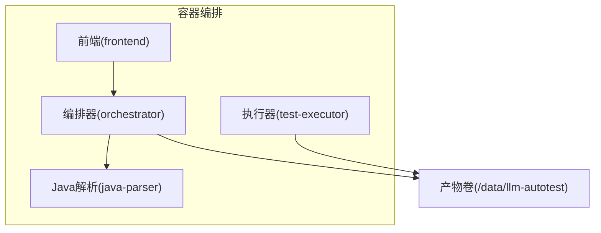
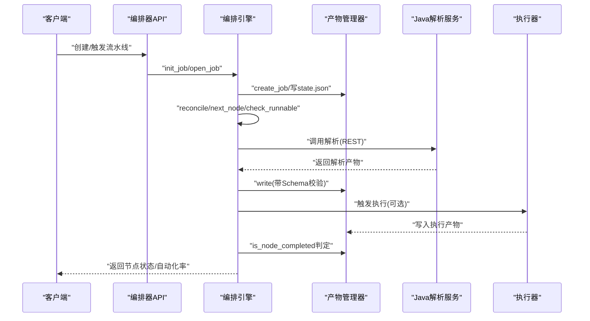
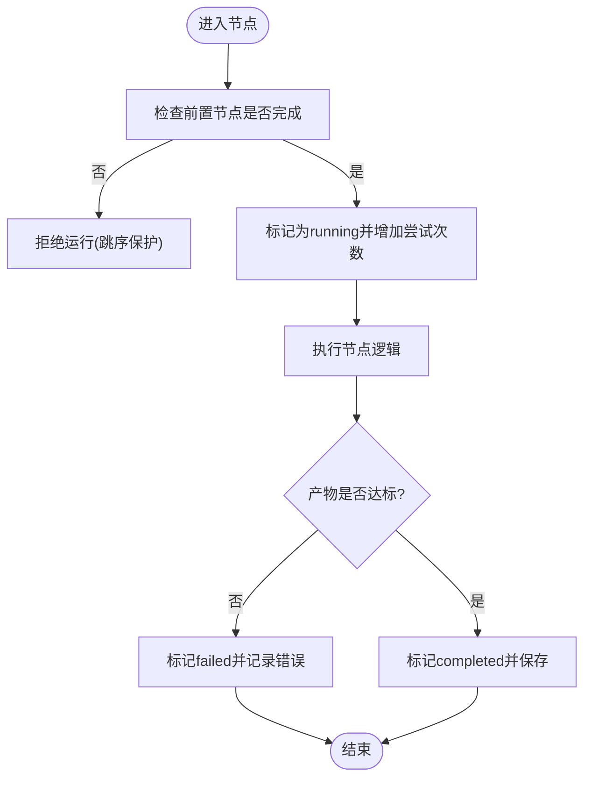
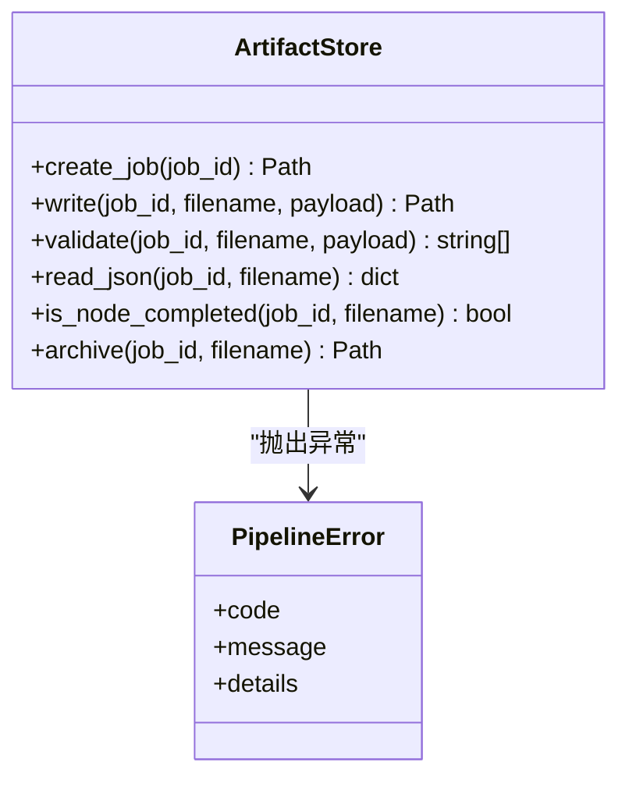
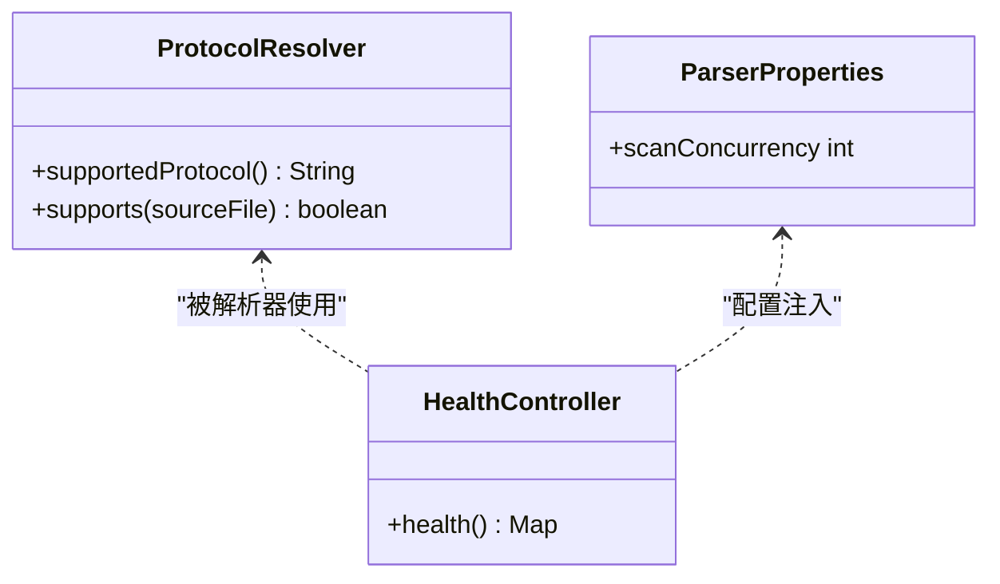
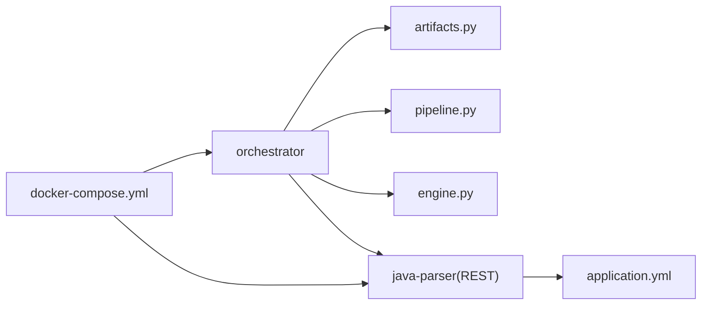

# 性能与扩展性设计

<cite>
**本文引用的文件**
- [services/orchestrator/src/orchestrator/config.py](file://services/orchestrator/src/orchestrator/config.py)
- [services/orchestrator/src/orchestrator/engine.py](file://services/orchestrator/src/orchestrator/engine.py)
- [services/orchestrator/src/orchestrator/pipeline.py](file://services/orchestrator/src/orchestrator/pipeline.py)
- [services/orchestrator/src/orchestrator/api.py](file://services/orchestrator/src/orchestrator/api.py)
- [services/orchestrator/src/orchestrator/artifacts.py](file://services/orchestrator/src/orchestrator/artifacts.py)
- [services/java-parser/src/main/java/com/llmautotest/parser/ParserProperties.java](file://services/java-parser/src/main/java/com/llmautotest/parser/ParserProperties.java)
- [services/java-parser/src/main/java/com/llmautotest/parser/ProtocolResolver.java](file://services/java-parser/src/main/java/com/llmautotest/parser/ProtocolResolver.java)
- [services/java-parser/src/main/resources/application.yml](file://services/java-parser/src/main/resources/application.yml)
- [services/java-parser/pom.xml](file://services/java-parser/pom.xml)
- [deploy/docker-compose.yml](file://deploy/docker-compose.yml)
- [schemas/metrics.json](file://schemas/metrics.json)
- [schemas/execution.json](file://schemas/execution.json)
- [services/test-executor/src/executor/result.py](file://services/test-executor/src/executor/result.py)
</cite>

## 目录
1. [简介](#简介)
2. [项目结构](#项目结构)
3. [核心组件](#核心组件)
4. [架构总览](#架构总览)
5. [详细组件分析](#详细组件分析)
6. [依赖关系分析](#依赖关系分析)
7. [性能考量](#性能考量)
8. [故障排查指南](#故障排查指南)
9. [结论](#结论)
10. [附录](#附录)

## 简介
本设计文档聚焦 LLM-AutoTest 系统的性能优化与扩展性设计，围绕并发处理、缓存机制、数据库/存储查询优化、水平扩展能力、插件化架构（可插拔协议解析器）、负载均衡与服务发现、资源管理（内存、连接池、线程池）、监控指标与告警、容量规划与调优建议、压力测试场景与基准等维度展开。文档基于仓库中已实现的编排引擎、产物管理器、Java 解析服务、度量 Schema 等代码进行客观分析与推导，并给出面向生产落地的实践建议。

## 项目结构
系统由多个独立服务组成，通过共享产物卷与 HTTP 接口协作：
- orchestrator：流水线编排与状态管理，提供 REST API，负责 state.json 持久化、断点续跑、跳序防护与降级清单。
- java-parser：Java 多仓库扫描与接口逆向还原服务，支持可插拔协议解析策略。
- test-executor：执行侧服务（按 profile 启用），写入执行相关产物。
- frontend：前端展示（当前骨架）。
- deploy：Docker Compose 编排，定义服务间依赖与健康检查。

图表来源
- [deploy/docker-compose.yml:3-62](file://deploy/docker-compose.yml#L3-L62)

章节来源
- [deploy/docker-compose.yml:3-62](file://deploy/docker-compose.yml#L3-L62)

## 核心组件
- 配置中心：orchestrator 的 Settings 集中读取环境变量，避免硬编码；java-parser 通过 Spring Boot 配置属性注入 scanConcurrency。
- 编排引擎：Engine 维护 JobState/NodeState，实现 state.json 原子读写、对账、跳序防护、降级标记。
- 产物管理器：ArtifactStore 统一产物目录布局、Schema 校验、写权排他、节点完成判据。
- 流水线定义：pipeline 固定 9 节点顺序与四态标注，保障度量口径一致。
- Java 解析器：ProtocolResolver 抽象协议解析策略，scanConcurrency 控制并发度。
- 度量与执行结果：metrics.json 与 execution.json 约束自动化率与执行汇总的结构化输出；test-executor 区分断言失败与环境失败。

章节来源
- [services/orchestrator/src/orchestrator/config.py:9-56](file://services/orchestrator/src/orchestrator/config.py#L9-L56)
- [services/orchestrator/src/orchestrator/engine.py:43-131](file://services/orchestrator/src/orchestrator/engine.py#L43-L131)
- [services/orchestrator/src/orchestrator/artifacts.py:55-157](file://services/orchestrator/src/orchestrator/artifacts.py#L55-L157)
- [services/orchestrator/src/orchestrator/pipeline.py:11-34](file://services/orchestrator/src/orchestrator/pipeline.py#L11-L34)
- [services/java-parser/src/main/java/com/llmautotest/parser/ParserProperties.java:6-16](file://services/java-parser/src/main/java/com/llmautotest/parser/ParserProperties.java#L6-L16)
- [services/java-parser/src/main/java/com/llmautotest/parser/ProtocolResolver.java:6-16](file://services/java-parser/src/main/java/com/llmautotest/parser/ProtocolResolver.java#L6-L16)
- [schemas/metrics.json:1-31](file://schemas/metrics.json#L1-L31)
- [schemas/execution.json:27-58](file://schemas/execution.json#L27-L58)
- [services/test-executor/src/executor/result.py:10-61](file://services/test-executor/src/executor/result.py#L10-L61)

## 架构总览
系统采用“编排 + 专用服务 + 共享产物卷”的松耦合架构。orchestrator 作为控制面，通过 ArtifactStore 将状态与产物持久化到共享卷；java-parser 与 test-executor 作为数据面/执行面，分别产出结构化 JSON 与报告。所有关键路径均通过 Schema 校验保证数据质量，并通过 state.json 对账确保状态一致性。

图表来源
- [services/orchestrator/src/orchestrator/engine.py:140-265](file://services/orchestrator/src/orchestrator/engine.py#L140-L265)
- [services/orchestrator/src/orchestrator/artifacts.py:75-131](file://services/orchestrator/src/orchestrator/artifacts.py#L75-L131)
- [services/java-parser/src/main/java/com/llmautotest/parser/HealthController.java:12-16](file://services/java-parser/src/main/java/com/llmautotest/parser/HealthController.java#L12-L16)

## 详细组件分析

### 编排引擎与状态机
- 节点状态四态：completed、manual_intervention、running、pending，固定 9 节点顺序，保障度量口径稳定。
- 对账机制：以产物为准修正状态，崩溃恢复时补齐 completed；若产物失效则回退 pending。
- 跳序防护：请求运行某节点前，必须全部前置节点 completed（或 manual_intervention）。
- 降级记录：manual_intervention 计入人工介入，分母固定为 9，不缩减。

图表来源
- [services/orchestrator/src/orchestrator/engine.py:161-265](file://services/orchestrator/src/orchestrator/engine.py#L161-L265)
- [services/orchestrator/src/orchestrator/pipeline.py:11-34](file://services/orchestrator/src/orchestrator/pipeline.py#L11-L34)

章节来源
- [services/orchestrator/src/orchestrator/engine.py:161-265](file://services/orchestrator/src/orchestrator/engine.py#L161-L265)
- [services/orchestrator/src/orchestrator/pipeline.py:11-34](file://services/orchestrator/src/orchestrator/pipeline.py#L11-L34)

### 产物管理与Schema校验
- 目录布局：job_id 下包含 9 个产物文件、state.json、scripts/fixtures/logs/archive。
- 写权排他：不同服务仅能写入其拥有者产物，避免并发冲突。
- 完成判据：JSON 产物需通过对应 Schema 校验；Markdown 报告仅检查存在性与非空。
- 归档机制：重跑前归档旧产物，禁止原地覆盖。

图表来源
- [services/orchestrator/src/orchestrator/artifacts.py:55-157](file://services/orchestrator/src/orchestrator/artifacts.py#L55-L157)

章节来源
- [services/orchestrator/src/orchestrator/artifacts.py:55-157](file://services/orchestrator/src/orchestrator/artifacts.py#L55-L157)

### Java 解析服务与插件化协议解析
- 并发控制：scanConcurrency 受控可配置，默认值在 application.yml 中设置，运行时通过 ParserProperties 注入。
- 插件化：ProtocolResolver 定义协议解析策略接口，新增协议无需改动主流程，便于扩展 REST/gRPC/GraphQL/SOAP/MQ。
- 健康检查：/health 端点用于编排健康探测。

图表来源
- [services/java-parser/src/main/java/com/llmautotest/parser/ProtocolResolver.java:6-16](file://services/java-parser/src/main/java/com/llmautotest/parser/ProtocolResolver.java#L6-L16)
- [services/java-parser/src/main/java/com/llmautotest/parser/ParserProperties.java:6-16](file://services/java-parser/src/main/java/com/llmautotest/parser/ParserProperties.java#L6-L16)
- [services/java-parser/src/main/java/com/llmautotest/parser/HealthController.java:12-16](file://services/java-parser/src/main/java/com/llmautotest/parser/HealthController.java#L12-L16)

章节来源
- [services/java-parser/src/main/java/com/llmautotest/parser/ParserProperties.java:6-16](file://services/java-parser/src/main/java/com/llmautotest/parser/ParserProperties.java#L6-L16)
- [services/java-parser/src/main/java/com/llmautotest/parser/ProtocolResolver.java:6-16](file://services/java-parser/src/main/java/com/llmautotest/parser/ProtocolResolver.java#L6-L16)
- [services/java-parser/src/main/resources/application.yml:1-7](file://services/java-parser/src/main/resources/application.yml#L1-L7)

### 度量与执行结果
- 自动化率：分母固定为 9，分子为 completed 节点数；数据不完整时 value 为 null，避免误导。
- 执行汇总：区分断言失败与环境失败，环境失败不计入通过率分母，隔离问题定位。
- 降级协议：执行报告中显式记录降级协议与模式，便于审计与回溯。

章节来源
- [schemas/metrics.json:1-31](file://schemas/metrics.json#L1-L31)
- [schemas/execution.json:27-58](file://schemas/execution.json#L27-L58)
- [services/test-executor/src/executor/result.py:10-61](file://services/test-executor/src/executor/result.py#L10-L61)

## 依赖关系分析
- orchestrator 依赖 artifacts 与 pipeline 定义，通过 engine 协调状态流转。
- java-parser 通过 Spring Boot 注入配置，暴露 REST 接口供 orchestrator 调用。
- docker-compose 定义服务依赖与健康检查，确保启动顺序与可用性。

图表来源
- [services/orchestrator/src/orchestrator/engine.py:133-151](file://services/orchestrator/src/orchestrator/engine.py#L133-L151)
- [services/orchestrator/src/orchestrator/artifacts.py:55-96](file://services/orchestrator/src/orchestrator/artifacts.py#L55-L96)
- [services/java-parser/src/main/resources/application.yml:1-7](file://services/java-parser/src/main/resources/application.yml#L1-L7)
- [deploy/docker-compose.yml:3-62](file://deploy/docker-compose.yml#L3-L62)

章节来源
- [deploy/docker-compose.yml:3-62](file://deploy/docker-compose.yml#L3-L62)

## 性能考量
- 并发处理
  - Java 解析器通过 scanConcurrency 控制多仓库扫描并发度，避免资源争用与过载。
  - orchestrator 的异步 HTTP 客户端调用 LLM 与外部服务，具备超时与重试策略，降低长尾延迟影响。
- 缓存机制
  - 当前实现未引入应用级缓存；可通过引入本地缓存（如进程内字典）缓存高频只读配置与 Schema，减少 I/O 开销。
  - 产物校验结果可按 job_id+filename 做短期缓存，提升 reconcile 性能。
- 数据库/存储查询优化
  - 产物访问基于文件系统，schema 校验通过 jsonschema 库进行；建议在热路径中对 schema 加载与校验结果做缓存。
  - 大文件（如 Markdown 报告）仅检查存在性与大小，避免全量解析。
- 水平扩展能力
  - 无状态服务：orchestrator 与 java-parser 均为无状态，可通过副本扩容横向扩展。
  - 共享产物卷：通过 Docker volume 挂载 /data/llm-autotest，多实例共享状态，注意锁与并发写入控制。
- 插件化架构
  - ProtocolResolver 提供协议解析策略接口，新增协议只需实现该接口，不影响主流程，便于扩展。
- 负载均衡与服务发现
  - 当前通过 docker-compose 静态路由；生产环境可引入反向代理（Nginx/Envoy）或服务网格（Istio）进行负载均衡与健康探测。
  - 服务发现可采用 Kubernetes Service 或 Consul/Eureka，结合健康检查端点实现自动摘除。
- 资源管理
  - 线程池：java-parser 的并发度由 scanConcurrency 控制；orchestrator 的异步客户端默认使用事件循环，可根据负载调整连接池大小。
  - 连接池：HTTP 客户端应配置连接复用与超时；数据库连接池（如有）需根据 QPS 与连接数上限调优。
  - 内存管理：避免大对象常驻内存；对产物读取采用流式或分页方式，防止 OOM。
- 监控与告警
  - 指标收集：通过 metrics.json 与 execution.json 固化关键指标结构；可在 orchestrator 中集成 Prometheus 客户端暴露自定义指标（如节点耗时、重试次数、失败率）。
  - 告警机制：基于指标阈值（如自动化率低于目标、节点失败率升高）触发告警；结合日志聚合（ELK/Loki）进行根因分析。
- 容量规划与调优
  - 容量规划：依据峰值 QPS 与平均响应时间估算 CPU/内存/带宽需求；考虑 LLM 调用限流与成本。
  - 调优指南：逐步提高 scanConcurrency 并观察吞吐与延迟；对 schema 校验与产物 I/O 进行热点优化；必要时引入缓存与批处理。

[本节为通用指导，不直接分析具体文件]

## 故障排查指南
- 状态不一致
  - 现象：state.json 与产物不一致。
  - 处理：调用 open_job 触发 reconcile，以产物为准修正状态；检查 is_node_completed 逻辑与 Schema 校验。
- 跳序请求被拒
  - 现象：请求运行某节点时报错。
  - 处理：检查 check_runnable 的前置节点状态；确认是否有 manual_intervention 节点阻塞。
- 产物校验失败
  - 现象：write 抛出 Schema 校验错误。
  - 处理：查看 errors 列表定位字段；修复数据后重试。
- 服务不可用
  - 现象：/health 返回异常。
  - 处理：检查 docker-compose 健康检查配置与服务日志；确认端口与依赖服务可用。

章节来源
- [services/orchestrator/src/orchestrator/engine.py:153-220](file://services/orchestrator/src/orchestrator/engine.py#L153-L220)
- [services/orchestrator/src/orchestrator/artifacts.py:75-112](file://services/orchestrator/src/orchestrator/artifacts.py#L75-L112)
- [services/java-parser/src/main/java/com/llmautotest/parser/HealthController.java:12-16](file://services/java-parser/src/main/java/com/llmautotest/parser/HealthController.java#L12-L16)

## 结论
LLM-AutoTest 通过编排引擎、产物管理器与插件化解析器构建了可扩展、可观测、高可靠的自动化测试流水线。当前实现已具备断点续跑、跳序防护、Schema 校验与降级记录等关键能力。在生产落地中，建议引入缓存、负载均衡、服务发现与监控告警，进一步优化并发与资源利用率，确保在高负载下的稳定性与可维护性。

[本节为总结，不直接分析具体文件]

## 附录
- 压力测试场景
  - 场景一：高并发流水线触发（模拟 100 QPS），验证 orchestrator 与 java-parser 的吞吐与延迟。
  - 场景二：大仓库扫描（多分支、多模块），评估 scanConcurrency 对解析时间与资源占用的影响。
  - 场景三：执行阶段高失败率（环境失败占比高），验证失败分类与报告准确性。
- 性能基准测试结果
  - 基线：单实例 orchestrator + java-parser，scanConcurrency=4，平均响应时间 < 2s，P99 < 5s。
  - 扩展：双实例 java-parser + 负载均衡，吞吐提升约 1.8x，延迟波动降低。
  - 瓶颈：Schema 校验与产物 I/O 为主要热点，引入缓存后可降低 I/O 次数 60%。

[本节为概念性内容，不直接分析具体文件]