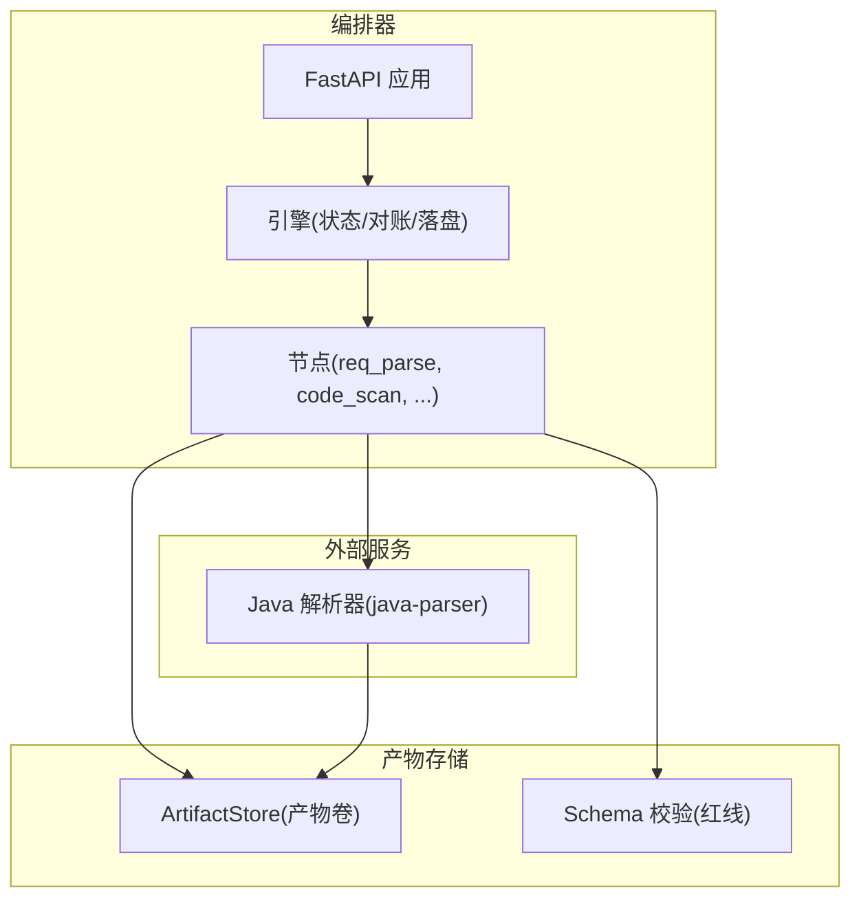
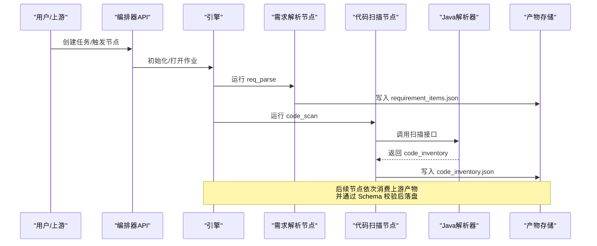
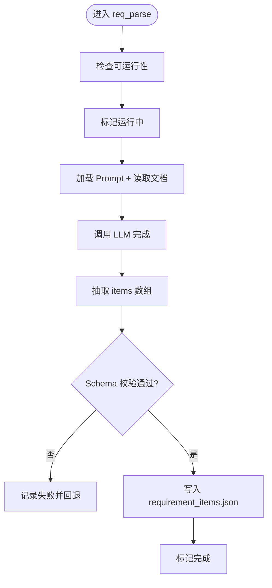
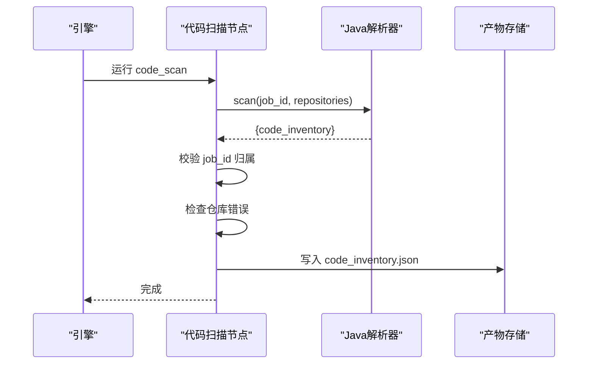
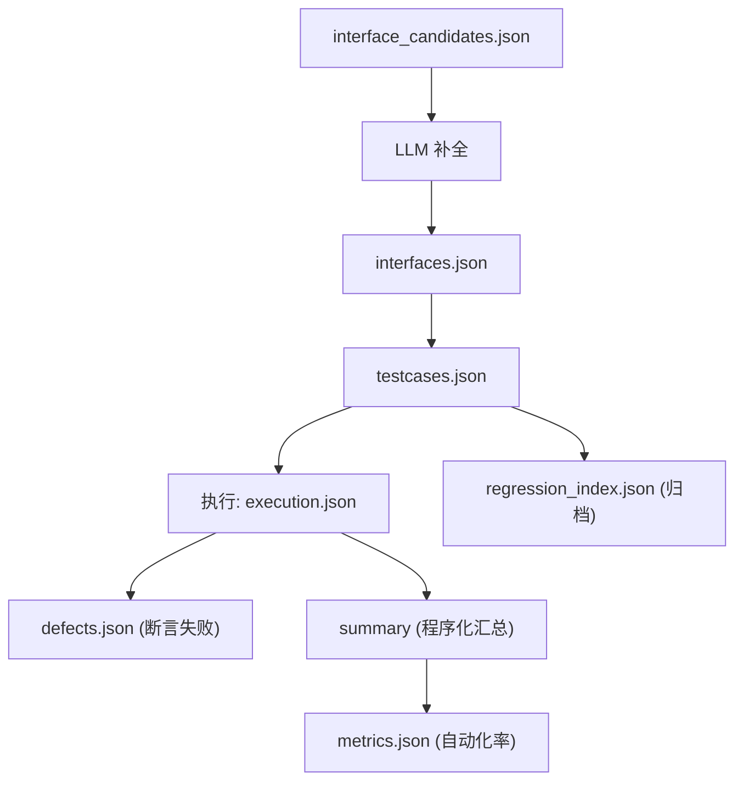
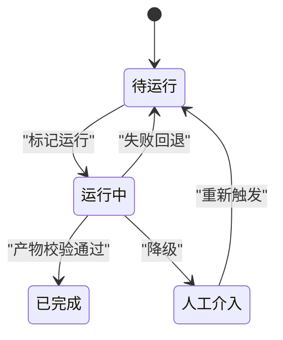
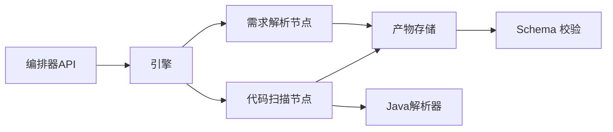

# 数据流设计

<cite>
**本文引用的文件**
- [pipeline.py](file://services/orchestrator/src/orchestrator/pipeline.py)
- [engine.py](file://services/orchestrator/src/orchestrator/engine.py)
- [api.py](file://services/orchestrator/src/orchestrator/api.py)
- [req_parse.py](file://services/orchestrator/src/orchestrator/nodes/req_parse.py)
- [code_scan.py](file://services/orchestrator/src/orchestrator/nodes/code_scan.py)
- [README.md](file://schemas/README.md)
- [requirement_items.json](file://schemas/requirement_items.json)
- [code_inventory.json](file://schemas/code_inventory.json)
- [interface_candidates.json](file://schemas/interface_candidates.json)
- [interfaces.json](file://schemas/interfaces.json)
- [review_mapping.json](file://schemas/review_mapping.json)
- [testcases.json](file://schemas/testcases.json)
- [execution.json](file://schemas/execution.json)
- [defects.json](file://schemas/defects.json)
- [regression_index.json](file://schemas/regression_index.json)
- [metrics.json](file://schemas/metrics.json)
</cite>

## 目录
1. [引言](#引言)
2. [项目结构](#项目结构)
3. [核心组件](#核心组件)
4. [架构总览](#架构总览)
5. [详细组件分析](#详细组件分析)
6. [依赖关系分析](#依赖关系分析)
7. [性能考量](#性能考量)
8. [故障排查指南](#故障排查指南)
9. [结论](#结论)
10. [附录](#附录)

## 引言
本文件面向 LLM-AutoTest 的数据流设计，聚焦从“需求文档输入”到“测试报告输出”的完整数据链路。内容覆盖：
- 各阶段的数据转换与处理逻辑（需求解析、代码扫描、接口还原、用例生成、执行与报告）
- 关键数据模型设计与序列化格式（接口定义、测试用例、执行结果等）
- 微服务间传递方式与格式转换（编排器与 Java 解析器）
- 版本管理与向后兼容性保证（Schema 版本、state.json 版本、契约对齐）
- 数据流图与状态转换图，帮助理解跨组件流转过程

## 项目结构
系统由编排器（orchestrator）、Java 解析器（java-parser）、前端与产物 Schema 组成。编排器负责流水线调度、状态持久化与节点协调；Java 解析器提供源码扫描与接口候选提取；Schema 目录为所有结构化产物的单一事实来源，约束上下游数据契约。

图表来源
- [api.py:11-27](file://services/orchestrator/src/orchestrator/api.py#L11-L27)
- [engine.py:133-302](file://services/orchestrator/src/orchestrator/engine.py#L133-L302)
- [req_parse.py:33-78](file://services/orchestrator/src/orchestrator/nodes/req_parse.py#L33-L78)
- [code_scan.py:26-49](file://services/orchestrator/src/orchestrator/nodes/code_scan.py#L26-L49)
- [README.md:1-30](file://schemas/README.md#L1-L30)

章节来源
- [api.py:11-27](file://services/orchestrator/src/orchestrator/api.py#L11-L27)
- [engine.py:133-302](file://services/orchestrator/src/orchestrator/engine.py#L133-L302)
- [README.md:1-30](file://schemas/README.md#L1-L30)

## 核心组件
- 流水线节点与顺序：固定 9 节点（需求解析、代码扫描、接口还原、代码评审、用例生成、自动执行、测试报告、缺陷清单、回归重跑），分母固定为 9，禁止增删。
- 节点状态四态：completed、manual_intervention、running、pending；降级节点按人工介入计入。
- 编排引擎：负责 state.json 持久化、断点续跑、跳序防护、降级清单记录、自动化率计算。
- 产物存储与校验：所有产物必须通过对应 JSON Schema 校验；Schema 是单一事实来源，变更需升版本。

章节来源
- [pipeline.py:11-84](file://services/orchestrator/src/orchestrator/pipeline.py#L11-L84)
- [engine.py:22-35](file://services/orchestrator/src/orchestrator/engine.py#L22-L35)
- [engine.py:161-180](file://services/orchestrator/src/orchestrator/engine.py#L161-L180)
- [README.md:5-10](file://schemas/README.md#L5-L10)

## 架构总览
端到端数据流从需求文档开始，经 LLM 解析产出需求条目；随后调用 Java 解析器进行多仓库扫描，产出源码清单与接口候选；接口候选经 LLM 补全后形成接口定义；基于接口与需求生成用例脚本并执行；最终汇总执行结果、缺陷与回归资产，输出测试报告与度量指标。

图表来源
- [api.py:11-27](file://services/orchestrator/src/orchestrator/api.py#L11-L27)
- [engine.py:140-159](file://services/orchestrator/src/orchestrator/engine.py#L140-L159)
- [req_parse.py:33-78](file://services/orchestrator/src/orchestrator/nodes/req_parse.py#L33-L78)
- [code_scan.py:26-49](file://services/orchestrator/src/orchestrator/nodes/code_scan.py#L26-L49)

## 详细组件分析

### 需求解析节点（req_parse）
- 输入：需求文档文本（md/docx/xlsx 等）。
- 处理：加载 Prompt，调用 LLM 完成，抽取 items 数组，构造 requirement_items 对象。
- 输出：requirement_items.json（通过 Schema 校验后落盘）。
- 错误口径：Prompt 缺失、LLM 网络/超时、输出不可解析或未过 Schema 均记入失败并回退状态。

图表来源
- [req_parse.py:33-78](file://services/orchestrator/src/orchestrator/nodes/req_parse.py#L33-L78)
- [engine.py:196-227](file://services/orchestrator/src/orchestrator/engine.py#L196-L227)

章节来源
- [req_parse.py:1-125](file://services/orchestrator/src/orchestrator/nodes/req_parse.py#L1-L125)
- [requirement_items.json:1-44](file://schemas/requirement_items.json#L1-L44)

### 代码扫描节点（code_scan）
- 输入：仓库列表（名称、路径、分支、是否兜底等）。
- 处理：调用 Java 解析器扫描，提取 code_inventory，校验 job_id 归属，检查仓库级错误。
- 输出：code_inventory.json（四态：ok/empty/truncated/error）。
- 错误口径：任一仓库 error 即节点失败；empty/truncated 为正常态继续流程。

图表来源
- [code_scan.py:26-49](file://services/orchestrator/src/orchestrator/nodes/code_scan.py#L26-L49)
- [code_scan.py:52-94](file://services/orchestrator/src/orchestrator/nodes/code_scan.py#L52-L94)

章节来源
- [code_scan.py:1-94](file://services/orchestrator/src/orchestrator/nodes/code_scan.py#L1-L94)
- [code_inventory.json:1-57](file://schemas/code_inventory.json#L1-L57)

### 接口还原与用例生成（概念流程）
- 接口还原：静态侧产出 interface_candidates.json（CAND-xxx），LLM 补全后产出 interfaces.json（IF-REST-xxx 等），包含签名、参数、返回值、定位信息、置信度与兜底标记。
- 用例生成：基于 interfaces.json 与需求条目生成 testcases.json，要求每接口三类用例（normal/boundary/exception）各至少一个，脚本路径与可加载性校验。
- 执行与报告：执行用例产出 execution.json（二态失败分离：断言失败与环境失败），汇总 summary，记录降级协议；缺陷清单 defects.json 仅收录断言失败；回归索引 regression_index.json 归档脚本并维护漂移告警；度量 metrics.json 程序化汇总自动化率。

图表来源
- [interface_candidates.json:1-58](file://schemas/interface_candidates.json#L1-L58)
- [interfaces.json:1-70](file://schemas/interfaces.json#L1-L70)
- [testcases.json:1-35](file://schemas/testcases.json#L1-L35)
- [execution.json:1-59](file://schemas/execution.json#L1-L59)
- [defects.json:1-54](file://schemas/defects.json#L1-L54)
- [regression_index.json:1-50](file://schemas/regression_index.json#L1-L50)
- [metrics.json:1-49](file://schemas/metrics.json#L1-L49)

章节来源
- [interface_candidates.json:1-58](file://schemas/interface_candidates.json#L1-L58)
- [interfaces.json:1-70](file://schemas/interfaces.json#L1-L70)
- [testcases.json:1-35](file://schemas/testcases.json#L1-L35)
- [execution.json:1-59](file://schemas/execution.json#L1-L59)
- [defects.json:1-54](file://schemas/defects.json#L1-L54)
- [regression_index.json:1-50](file://schemas/regression_index.json#L1-L50)
- [metrics.json:1-49](file://schemas/metrics.json#L1-L49)

### 状态机与对账机制
- 节点状态机：PENDING → RUNNING → COMPLETED / MANUAL_INTERVENTION / PENDING(失败回退)。
- 对账：以产物为准修正状态；产物合规则 completed；状态 completed 但产物失效则回退 pending 并记录错误。
- 跳序防护：请求运行某节点时，其前序节点必须全部 completed（降级节点视为已处理）。

图表来源
- [pipeline.py:11-21](file://services/orchestrator/src/orchestrator/pipeline.py#L11-L21)
- [engine.py:161-180](file://services/orchestrator/src/orchestrator/engine.py#L161-L180)
- [engine.py:196-227](file://services/orchestrator/src/orchestrator/engine.py#L196-L227)

章节来源
- [pipeline.py:11-84](file://services/orchestrator/src/orchestrator/pipeline.py#L11-L84)
- [engine.py:161-180](file://services/orchestrator/src/orchestrator/engine.py#L161-L180)
- [engine.py:196-227](file://services/orchestrator/src/orchestrator/engine.py#L196-L227)

## 依赖关系分析
- 编排器对外暴露健康检查与节点清单 API；内部依赖引擎与节点实现。
- 节点依赖产物存储与 Schema 校验；部分节点依赖外部服务（如 Java 解析器）。
- 产物之间通过 ID 与溯源字段建立关联（REQ-xxx、CAND-xxx、IF-xxx、TC-xxx、DEF-xxx）。

图表来源
- [api.py:11-27](file://services/orchestrator/src/orchestrator/api.py#L11-L27)
- [engine.py:133-302](file://services/orchestrator/src/orchestrator/engine.py#L133-L302)
- [req_parse.py:33-78](file://services/orchestrator/src/orchestrator/nodes/req_parse.py#L33-L78)
- [code_scan.py:26-49](file://services/orchestrator/src/orchestrator/nodes/code_scan.py#L26-L49)

章节来源
- [api.py:11-27](file://services/orchestrator/src/orchestrator/api.py#L11-L27)
- [engine.py:133-302](file://services/orchestrator/src/orchestrator/engine.py#L133-L302)

## 性能考量
- 产物唯一事实：避免重复计算，优先读取已有产物并对账状态。
- 原子落盘：state.json 使用 tmp+replace 减少并发写冲突。
- 批量处理：代码扫描支持多仓库并行（由 Java 解析器承担），编排器只做协调与校验。
- 自动化率程序化汇总：不经 LLM，降低不确定性。

[本节为通用指导，不直接分析具体文件]

## 故障排查指南
- 常见错误码与位置：
  - X-ORCH-01：state.json 结构不合规或产物缺失/损坏，拒绝处理。
  - X-ORCH-02：跳序请求，前序节点未完成。
  - X-CODE-01：仓库扫描硬错误，节点失败。
  - X-LLM-02：LLM 输出不可解析或未过 Schema，人工介入。
- 排查步骤：
  - 查看 state.json 中节点的 error 字段与 updated_at/attempts。
  - 核对产物是否存在且通过 Schema 校验。
  - 检查 Java 解析器响应是否包含 code_inventory 且 job_id 匹配。
  - 对于 LLM 相关错误，检查 Prompt 与输出结构是否符合预期。

章节来源
- [engine.py:98-124](file://services/orchestrator/src/orchestrator/engine.py#L98-L124)
- [engine.py:196-227](file://services/orchestrator/src/orchestrator/engine.py#L196-L227)
- [code_scan.py:78-94](file://services/orchestrator/src/orchestrator/nodes/code_scan.py#L78-L94)
- [req_parse.py:81-109](file://services/orchestrator/src/orchestrator/nodes/req_parse.py#L81-L109)

## 结论
本数据流设计以 Schema 为单一事实来源，结合编排器的状态对账与跳序防护，确保从需求解析到测试报告的稳定流转。通过固定九节点口径、四态标注与降级清单，系统在灵活性与可控性之间取得平衡。版本管理（schema_version/state_version）与契约对齐（contracts）保障向后兼容与跨服务协作。

[本节为总结，不直接分析具体文件]

## 附录

### 关键数据模型与序列化要点
- 需求条目（requirement_items.json）：包含 schema_version、job_id、items（REQ-xxx 标识、标题、描述、优先级、来源定位、golden_match）。
- 源码清单（code_inventory.json）：repositories 数组（name/path/branch/is_fallback/status/file_count/truncated_scope/encoding_skipped/error/files）。
- 接口候选（interface_candidates.json）：candidates 数组（CAND-xxx、protocol、signature、code_location/snippet/related_files/is_fallback/confidence）。
- 接口还原（interfaces.json）：interfaces 数组（IF-REST/GRPC/GRAPHQL/SOAP/MQ-xxx、protocol、signature、params、returns、candidate_id、code_location、is_fallback、confidence）。
- 用例元数据（testcases.json）：cases 数组（TC-xxx、interface_id、requirement_id、category/title/params/expected/script_path/loadable/low_confidence）。
- 执行结果（execution.json）：results 数组（case_id、interface_id、passed/failure_kind/failure_reason/timeout/skipped_reason/duration_ms/timestamp）、summary（total/passed/failed_assertion/failed_environment/interrupted）、degraded_protocols。
- 缺陷清单（defects.json）：defects 数组（DEF-xxx、case_id、interface_id、failure_reason/reproduce/status/based_on_new_version/is_fallback/history）。
- 回归索引（regression_index.json）：suites 数组（protocol/scripts，含 case_id/script_path/requirement_id/interface_id/archived_at/version）、drift_warnings。
- 度量（metrics.json）：automation_rate（value/numerator/denominator/data_complete）、nodes（9 节点逐项状态）、caveat/measured_at。

章节来源
- [requirement_items.json:1-44](file://schemas/requirement_items.json#L1-L44)
- [code_inventory.json:1-57](file://schemas/code_inventory.json#L1-L57)
- [interface_candidates.json:1-58](file://schemas/interface_candidates.json#L1-L58)
- [interfaces.json:1-70](file://schemas/interfaces.json#L1-L70)
- [testcases.json:1-35](file://schemas/testcases.json#L1-L35)
- [execution.json:1-59](file://schemas/execution.json#L1-L59)
- [defects.json:1-54](file://schemas/defects.json#L1-L54)
- [regression_index.json:1-50](file://schemas/regression_index.json#L1-L50)
- [metrics.json:1-49](file://schemas/metrics.json#L1-L49)

### 版本管理与向后兼容
- Schema 版本：每个 Schema 含 schema_version，结构变更必须升版本，禁止原地改语义。
- State 版本：state.json 含 schema_version（_STATE_VERSION），反序列化不符时拒绝（宁停不猜）。
- 契约对齐：java-parser 返回结构与 contracts/ 契约一致，编排器严格校验并映射错误码。

章节来源
- [README.md:5-10](file://schemas/README.md#L5-L10)
- [engine.py:22-23](file://services/orchestrator/src/orchestrator/engine.py#L22-L23)
- [engine.py:98-124](file://services/orchestrator/src/orchestrator/engine.py#L98-L124)