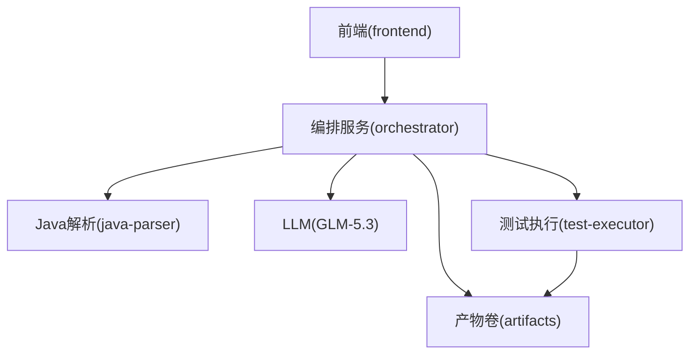
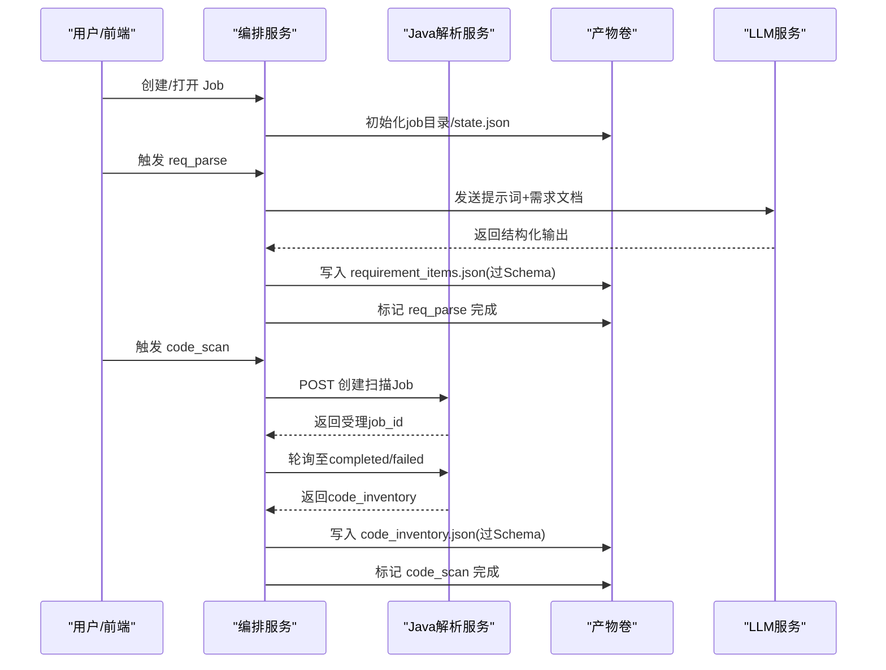
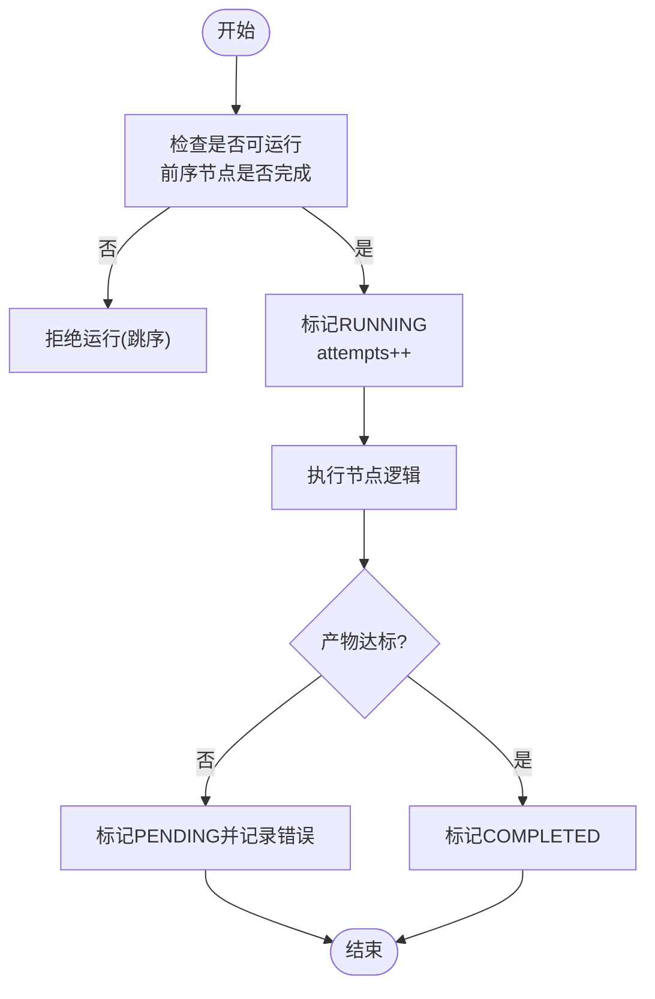
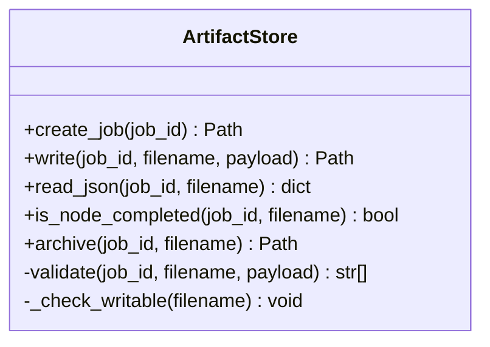
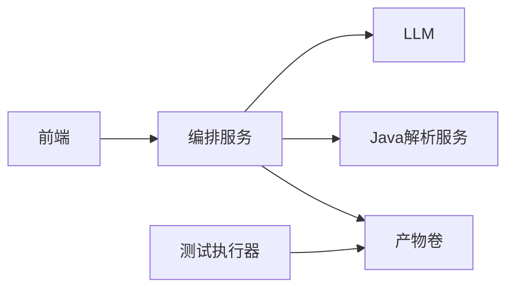

# 架构设计

<cite>
**本文引用的文件**
- [services/orchestrator/src/orchestrator/__main__.py](file://services/orchestrator/src/orchestrator/__main__.py)
- [services/orchestrator/src/orchestrator/api.py](file://services/orchestrator/src/orchestrator/api.py)
- [services/orchestrator/src/orchestrator/pipeline.py](file://services/orchestrator/src/orchestrator/pipeline.py)
- [services/orchestrator/src/orchestrator/engine.py](file://services/orchestrator/src/orchestrator/engine.py)
- [services/orchestrator/src/orchestrator/artifacts.py](file://services/orchestrator/src/orchestrator/artifacts.py)
- [services/orchestrator/src/orchestrator/nodes/req_parse.py](file://services/orchestrator/src/orchestrator/nodes/req_parse.py)
- [services/orchestrator/src/orchestrator/nodes/code_scan.py](file://services/orchestrator/src/orchestrator/nodes/code_scan.py)
- [services/orchestrator/src/orchestrator/javaparser_client.py](file://services/orchestrator/src/orchestrator/javaparser_client.py)
- [services/java-parser/src/main/java/com/llmautotest/parser/ParserApplication.java](file://services/java-parser/src/main/java/com/llmautotest/parser/ParserApplication.java)
- [services/java-parser/src/main/java/com/llmautotest/parser/ProtocolResolver.java](file://services/java-parser/src/main/java/com/llmautotest/parser/ProtocolResolver.java)
- [services/frontend/src/App.vue](file://services/frontend/src/App.vue)
- [services/test-executor/src/executor/result.py](file://services/test-executor/src/executor/result.py)
- [schemas/README.md](file://schemas/README.md)
- [deploy/docker-compose.yml](file://deploy/docker-compose.yml)
- [MumuSpec/08-系统架构与技术选型.md](file://MumuSpec/08-系统架构与技术选型.md)
</cite>

## 目录
1. [简介](#简介)
2. [项目结构](#项目结构)
3. [核心组件](#核心组件)
4. [架构总览](#架构总览)
5. [详细组件分析](#详细组件分析)
6. [依赖关系分析](#依赖关系分析)
7. [性能与高可用](#性能与高可用)
8. [故障排查指南](#故障排查指南)
9. [结论](#结论)
10. [附录](#附录)

## 简介
本架构设计文档面向 LLM-AutoTest 系统，围绕微服务化流水线编排、Java 源码解析、前端可视化与测试执行等核心能力，给出整体架构、组件职责、数据流、状态管理与扩展策略的系统性说明。重点覆盖：
- 9 节点固定口径流水线（需求解析→代码扫描→接口还原→代码评审→用例生成→自动执行→测试报告→缺陷清单→回归重测）
- 以“产物即事实”的状态对账机制与断点续跑
- 跨服务契约与 Schema 校验保障数据一致性
- 容器化部署与可扩展的高可用设计

## 项目结构
仓库采用多服务、多容器的模块化组织方式：
- orchestrator：Python FastAPI 编排服务，负责 9 节点流水线编排、状态持久化、产物管理、REST API
- java-parser：Java Spring Boot 服务，提供 Java 多仓库扫描与接口逆向还原
- frontend：Vue 3 前端应用，提供任务配置、流水线总览、报告与度量等页面
- test-executor：Python 测试执行器，承载用例执行与结果判定（按 profile 启用）
- schemas：结构化产物的 JSON Schema 与契约定义，作为数据模型单一事实来源
- deploy：docker-compose 编排，统一挂载产物卷 artifacts

图表来源
- [deploy/docker-compose.yml:1-62](file://deploy/docker-compose.yml#L1-L62)
- [MumuSpec/08-系统架构与技术选型.md:29-65](file://MumuSpec/08-系统架构与技术选型.md#L29-L65)

章节来源
- [deploy/docker-compose.yml:1-62](file://deploy/docker-compose.yml#L1-L62)
- [MumuSpec/08-系统架构与技术选型.md:29-65](file://MumuSpec/08-系统架构与技术选型.md#L29-L65)

## 核心组件
- 编排服务（orchestrator）
  - 职责：启动 REST API、创建/打开 job、维护 9 节点顺序与状态、对账产物、跳序防护、降级处理、调用下游服务（LLM、java-parser）、落盘 state.json
  - 关键入口：CLI/进程入口、FastAPI 应用构建与健康检查
- Java 解析器服务（java-parser）
  - 职责：接收扫描请求，基于 Java 生态进行多仓库源码扫描与接口逆向；支持协议解析策略可插拔
- 前端应用（frontend）
  - 职责：展示流水线总览、任务配置、报告与度量等页面；当前阶段使用 mock 数据
- 测试执行器（test-executor）
  - 职责：加载并执行测试脚本，产出 execution.json，区分断言失败与环境失败，沉淀缺陷与回归索引

章节来源
- [services/orchestrator/src/orchestrator/__main__.py:1-26](file://services/orchestrator/src/orchestrator/__main__.py#L1-L26)
- [services/orchestrator/src/orchestrator/api.py:1-28](file://services/orchestrator/src/orchestrator/api.py#L1-L28)
- [services/java-parser/src/main/java/com/llmautotest/parser/ParserApplication.java:1-17](file://services/java-parser/src/main/java/com/llmautotest/parser/ParserApplication.java#L1-L17)
- [services/java-parser/src/main/java/com/llmautotest/parser/ProtocolResolver.java:1-17](file://services/java-parser/src/main/java/com/llmautotest/parser/ProtocolResolver.java#L1-L17)
- [services/frontend/src/App.vue:1-232](file://services/frontend/src/App.vue#L1-L232)
- [services/test-executor/src/executor/result.py:1-61](file://services/test-executor/src/executor/result.py#L1-L61)

## 架构总览
系统采用“编排中心 + 专用解析服务 + 前端 + 执行侧”的混合微服务架构。编排服务通过 REST 与 java-parser 交互，通过异步客户端轮询完成态；所有结构化产物经 JSON Schema 校验后落盘，state.json 作为运行态快照，二者共同构成“唯一事实”。

图表来源
- [services/orchestrator/src/orchestrator/nodes/req_parse.py:33-78](file://services/orchestrator/src/orchestrator/nodes/req_parse.py#L33-L78)
- [services/orchestrator/src/orchestrator/nodes/code_scan.py:26-49](file://services/orchestrator/src/orchestrator/nodes/code_scan.py#L26-L49)
- [services/orchestrator/src/orchestrator/javaparser_client.py:70-121](file://services/orchestrator/src/orchestrator/javaparser_client.py#L70-L121)
- [services/orchestrator/src/orchestrator/artifacts.py:75-96](file://services/orchestrator/src/orchestrator/artifacts.py#L75-L96)

## 详细组件分析

### 编排引擎与状态机
- 9 节点固定顺序与四态标注：PENDING/RUNNING/COMPLETED/MANUAL_INTERVENTION
- 状态持久化：state.json 原子写入，open_job 时进行“产物对账”，以产物为准修正状态
- 跳序防护：请求运行某节点前，必须保证前序节点全部 completed（降级节点视为已处理）
- 完成判据：严格依据 NODE_ARTIFACTS 映射的产物文件名集合判断节点完成
- 降级与错误：mark_failed 回退为 pending 并记录错误；mark_degraded 置为人工介入并记录原因

图表来源
- [services/orchestrator/src/orchestrator/pipeline.py:11-34](file://services/orchestrator/src/orchestrator/pipeline.py#L11-L34)
- [services/orchestrator/src/orchestrator/engine.py:133-265](file://services/orchestrator/src/orchestrator/engine.py#L133-L265)

章节来源
- [services/orchestrator/src/orchestrator/pipeline.py:11-84](file://services/orchestrator/src/orchestrator/pipeline.py#L11-L84)
- [services/orchestrator/src/orchestrator/engine.py:1-302](file://services/orchestrator/src/orchestrator/engine.py#L1-L302)

### 产物管理与Schema校验
- 产物清单与写权：每个产物文件明确归属服务（orchestrator/test-executor），防止并发写冲突
- 校验与落盘：write 先走 Schema 校验，再原子写入 tmp+replace；is_node_completed 以存在性与校验结果为准
- Markdown 产物：仅做存在性与非空判定
- 归档：重跑前归档旧产物，禁止原地覆盖

图表来源
- [services/orchestrator/src/orchestrator/artifacts.py:55-157](file://services/orchestrator/src/orchestrator/artifacts.py#L55-L157)

章节来源
- [services/orchestrator/src/orchestrator/artifacts.py:1-157](file://services/orchestrator/src/orchestrator/artifacts.py#L1-L157)
- [schemas/README.md:1-30](file://schemas/README.md#L1-L30)

### 需求解析节点（req_parse）
- 流程：读取需求文档 → 加载提示词 → 调用 LLM → 提取 items → 写入 requirement_items.json → 标记完成
- 错误口径：网络/超时归 LLM 通信类错误；输出不可解析或未过 Schema 归 LLM 输出错误；均会记录到 state.json 并抛出
- 健壮性：容忍 Markdown 围栏包裹的 JSON 输出

章节来源
- [services/orchestrator/src/orchestrator/nodes/req_parse.py:1-125](file://services/orchestrator/src/orchestrator/nodes/req_parse.py#L1-L125)

### 代码扫描节点（code_scan）
- 流程：调用 java-parser 创建扫描 Job → 轮询至终态 → 提取 code_inventory → 校验 job_id 归属 → 写入 code_inventory.json → 标记完成
- 仓库四态：error 为硬错误；empty/truncated 为正常态；ok 为成功
- 通信失败：统一归为 X-ORCH-03

章节来源
- [services/orchestrator/src/orchestrator/nodes/code_scan.py:1-94](file://services/orchestrator/src/orchestrator/nodes/code_scan.py#L1-L94)
- [services/orchestrator/src/orchestrator/javaparser_client.py:1-162](file://services/orchestrator/src/orchestrator/javaparser_client.py#L1-L162)

### Java 解析服务
- 入口：Spring Boot 应用启动
- 协议解析策略：ProtocolResolver 接口支持 rest/dubbo/grpc/graphql/soap/mq 等多协议，扫描阶段可按文件过滤
- 契约：与 orchestrator 通过 REST 契约交互（scan-jobs 生命周期）

章节来源
- [services/java-parser/src/main/java/com/llmautotest/parser/ParserApplication.java:1-17](file://services/java-parser/src/main/java/com/llmautotest/parser/ParserApplication.java#L1-L17)
- [services/java-parser/src/main/java/com/llmautotest/parser/ProtocolResolver.java:1-17](file://services/java-parser/src/main/java/com/llmautotest/parser/ProtocolResolver.java#L1-L17)

### 前端应用
- 导航：左侧六页（任务配置、流水线总览、Code Review 三视图、测试报告、缺陷闭环、回归沉淀与度量）
- 当前阶段：使用 mock 数据，后续接入正式路由与后端 API

章节来源
- [services/frontend/src/App.vue:1-232](file://services/frontend/src/App.vue#L1-L232)

### 测试执行器
- 结果二态：断言失败计入通过率分母；环境失败隔离待确认
- 汇总：ExecutionSummary 程序化汇总，不经 LLM

章节来源
- [services/test-executor/src/executor/result.py:1-61](file://services/test-executor/src/executor/result.py#L1-L61)

## 依赖关系分析
- orchestrator 依赖：
  - 外部：GLM-5.3（LLM）、java-parser（REST）
  - 内部：ArtifactStore（产物卷）、PipelineState/Engine（状态机）
- java-parser 独立对外暴露 REST 接口，供 orchestrator 调用
- frontend 依赖 orchestrator 的 REST API（当前为 mock）
- test-executor 与 orchestrator 共享产物卷，按写权约定分别写入不同产物

图表来源
- [deploy/docker-compose.yml:1-62](file://deploy/docker-compose.yml#L1-L62)
- [MumuSpec/08-系统架构与技术选型.md:29-65](file://MumuSpec/08-系统架构与技术选型.md#L29-L65)

章节来源
- [deploy/docker-compose.yml:1-62](file://deploy/docker-compose.yml#L1-L62)
- [MumuSpec/08-系统架构与技术选型.md:29-65](file://MumuSpec/08-系统架构与技术选型.md#L29-L65)

## 性能与高可用
- 性能优化
  - 异步 I/O：编排与 java-parser 交互采用异步客户端与轮询，避免阻塞
  - 原子落盘：state.json 与产物均采用 tmp+replace 原子写入，降低竞争与损坏风险
  - Schema 前置校验：在写入阶段即拦截不合规数据，减少下游处理成本
  - 轮询参数可调：poll_interval_s、max_wait_s 等作为运维调优项
- 高可用与扩展性
  - 容器化与解耦：各服务独立镜像与端口，便于水平扩展与滚动升级
  - 健康检查：java-parser 与 orchestrator 提供 /health 端点，编排层可据此探测
  - 产物卷共享：通过 Docker volume 实现多服务共享持久化存储，支持断点续跑
  - 降级与重试：engine.mark_failed/mark_degraded 将异常显式化，支持人工介入与后续重跑
  - 契约约束：服务间通过 OpenAPI/JSON Schema 约束，降低耦合度，利于独立演进

[本节为通用指导，无需特定文件引用]

## 故障排查指南
- 常见错误分类
  - 状态/结构错误（X-ORCH-01）：state.json 结构不符、job 不存在或重复、产物 Schema 校验失败、未知产物名
  - 通信错误（X-ORCH-03）：java-parser 连接/超时/HTTP 异常、轮询耗尽
  - LLM 错误（X-LLM-01/02）：网络/超时、输出不可解析或未过 Schema
  - 代码扫描错误（X-CODE-01~03）：仓库硬错误、空仓库、截断范围
- 定位步骤
  - 查看 state.json 中对应节点的 error 字段与 updated_at/attempts
  - 核对产物是否存在且通过 Schema 校验（is_node_completed）
  - 检查 java-parser 响应结构与契约错误体（code/message/details）
  - 对于 LLM 相关错误，检查提示词与输出格式是否符合预期
- 恢复策略
  - 修复输入或提示词后重新触发节点
  - 对降级节点进行人工干预后显式重跑
  - 归档旧产物后强制重跑指定节点

章节来源
- [services/orchestrator/src/orchestrator/engine.py:196-265](file://services/orchestrator/src/orchestrator/engine.py#L196-L265)
- [services/orchestrator/src/orchestrator/artifacts.py:75-131](file://services/orchestrator/src/orchestrator/artifacts.py#L75-L131)
- [services/orchestrator/src/orchestrator/nodes/req_parse.py:49-78](file://services/orchestrator/src/orchestrator/nodes/req_parse.py#L49-L78)
- [services/orchestrator/src/orchestrator/nodes/code_scan.py:38-49](file://services/orchestrator/src/orchestrator/nodes/code_scan.py#L38-L49)
- [services/orchestrator/src/orchestrator/javaparser_client.py:123-161](file://services/orchestrator/src/orchestrator/javaparser_client.py#L123-L161)

## 结论
LLM-AutoTest 以编排服务为核心，结合独立的 Java 解析服务与前端/执行侧，形成职责清晰、边界明确的微服务架构。通过“产物即事实”的状态对账、严格的 Schema 校验与契约约束，系统在可靠性、可观测性与可维护性方面具备良好基础。未来可在以下方向持续增强：
- 增加更多节点的可观测指标与告警
- 提升 java-parser 与 LLM 的弹性伸缩能力
- 完善前端与后端 API 的联调与真实数据接入
- 强化测试执行环境的稳定性与隔离性

[本节为总结性内容，无需特定文件引用]

## 附录
- 9 节点固定顺序与产物映射
  - req_parse → requirement_items.json
  - code_scan → code_inventory.json
  - interface_reconstruct → interface_candidates.json, interfaces.json
  - code_review → review_mapping.json
  - testcase_generate → testcases.json
  - auto_execute → execution.json
  - test_report → test_report.md
  - defect_list → defects.json
  - retest_regression → regression_index.json

章节来源
- [services/orchestrator/src/orchestrator/engine.py:24-35](file://services/orchestrator/src/orchestrator/engine.py#L24-L35)
- [services/orchestrator/src/orchestrator/artifacts.py:24-50](file://services/orchestrator/src/orchestrator/artifacts.py#L24-L50)