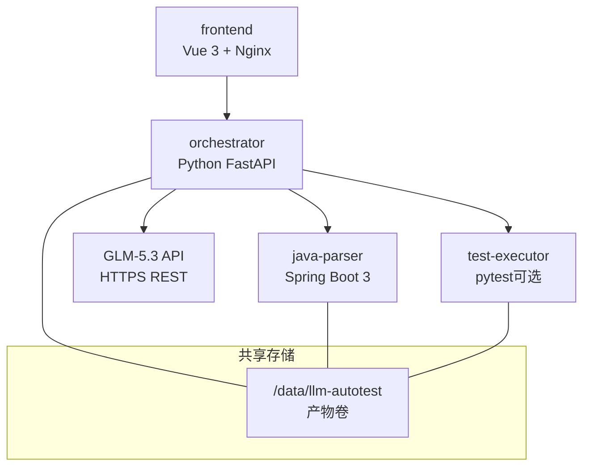
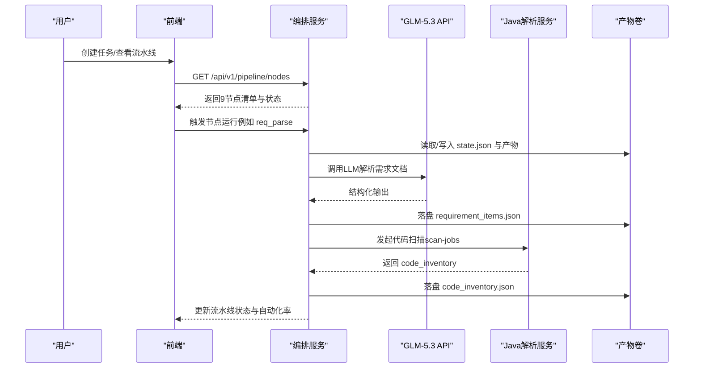
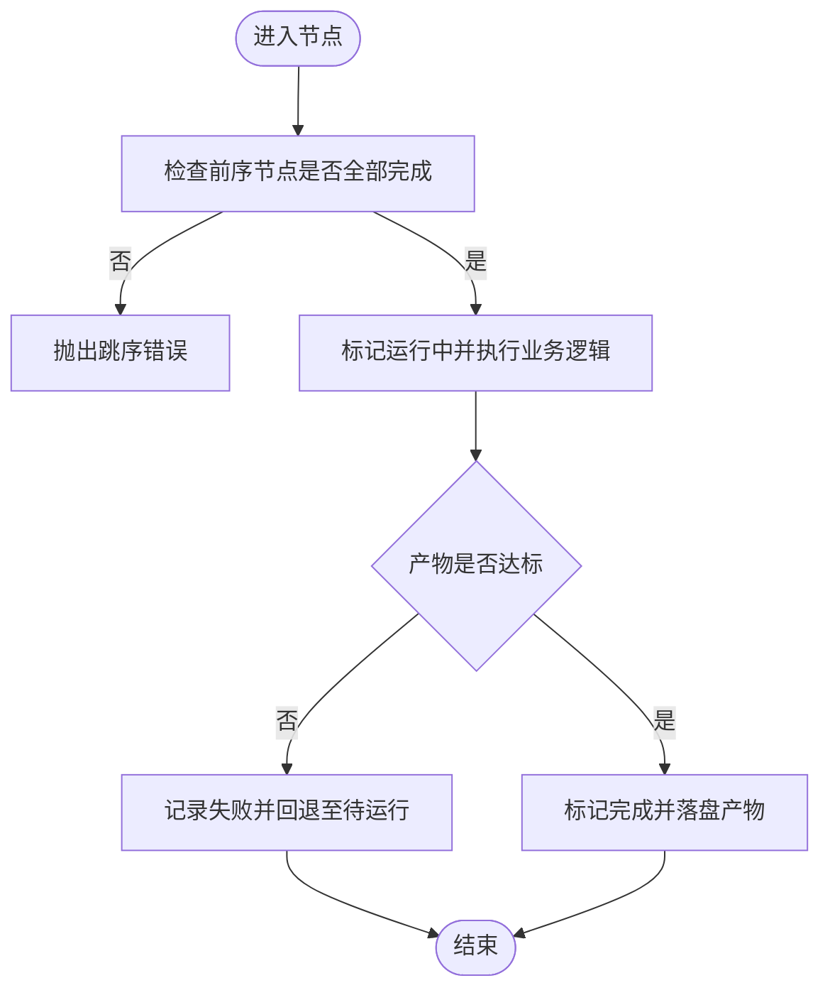
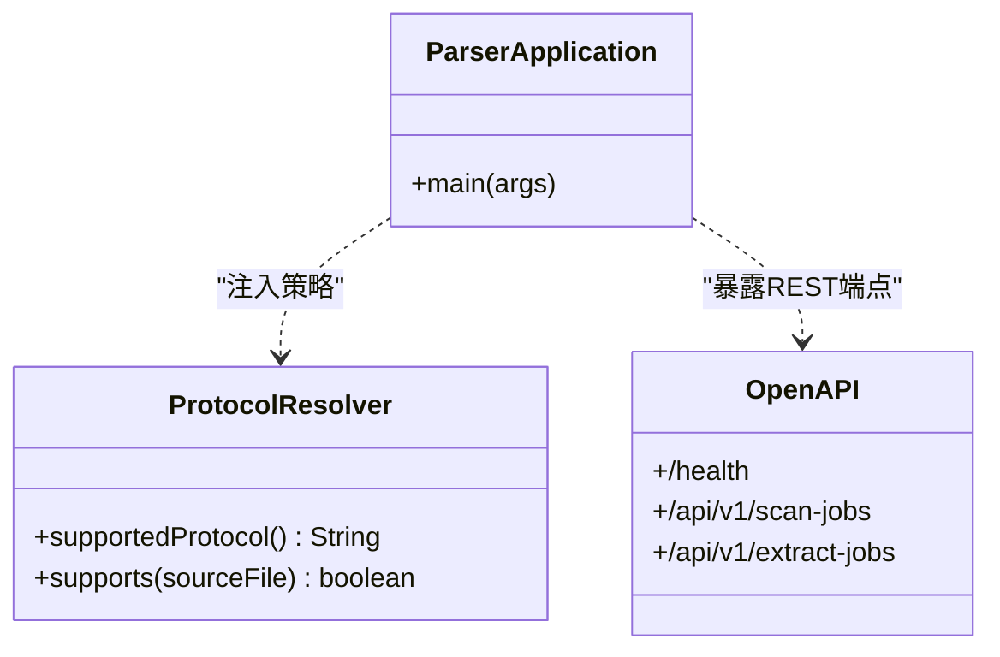
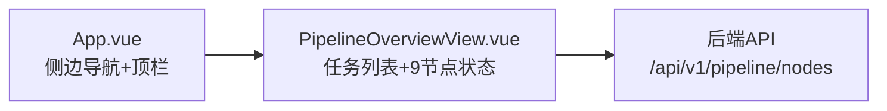
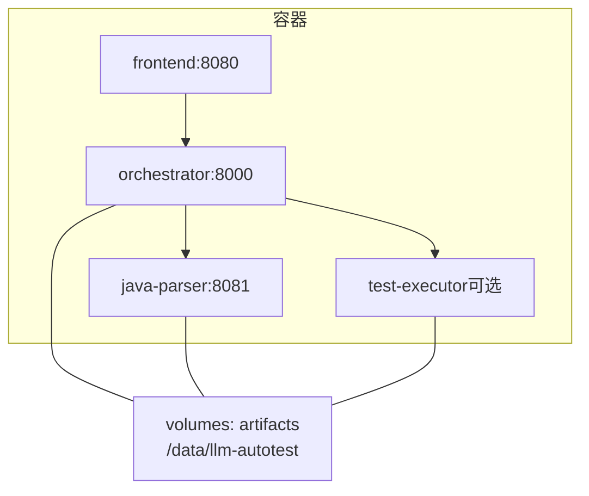

# 系统架构概览

<cite>
**本文引用的文件**
- [MumuSpec/08-系统架构与技术选型.md](file://MumuSpec/08-系统架构与技术选型.md)
- [deploy/docker-compose.yml](file://deploy/docker-compose.yml)
- [services/orchestrator/src/orchestrator/pipeline.py](file://services/orchestrator/src/orchestrator/pipeline.py)
- [services/orchestrator/src/orchestrator/engine.py](file://services/orchestrator/src/orchestrator/engine.py)
- [services/orchestrator/src/orchestrator/api.py](file://services/orchestrator/src/orchestrator/api.py)
- [services/orchestrator/src/orchestrator/nodes/req_parse.py](file://services/orchestrator/src/orchestrator/nodes/req_parse.py)
- [services/orchestrator/src/orchestrator/nodes/code_scan.py](file://services/orchestrator/src/orchestrator/nodes/code_scan.py)
- [services/java-parser/src/main/java/com/llmautotest/parser/ParserApplication.java](file://services/java-parser/src/main/java/com/llmautotest/parser/ParserApplication.java)
- [services/java-parser/src/main/java/com/llmautotest/parser/ProtocolResolver.java](file://services/java-parser/src/main/java/com/llmautotest/parser/ProtocolResolver.java)
- [schemas/contracts/java-parser.openapi.yaml](file://schemas/contracts/java-parser.openapi.yaml)
- [services/frontend/src/App.vue](file://services/frontend/src/App.vue)
- [services/frontend/src/views/PipelineOverviewView.vue](file://services/frontend/src/views/PipelineOverviewView.vue)
</cite>

## 目录
1. [引言](#引言)
2. [项目结构](#项目结构)
3. [核心组件](#核心组件)
4. [架构总览](#架构总览)
5. [详细组件分析](#详细组件分析)
6. [依赖关系分析](#依赖关系分析)
7. [性能与可扩展性](#性能与可扩展性)
8. [故障排查指南](#故障排查指南)
9. [结论](#结论)

## 引言
本文件面向LLM-AutoTest系统的整体架构，聚焦微服务化设计、9节点流水线、组件职责边界、技术栈决策以及容器化部署方式。系统以编排服务为中心协调者，结合Java解析服务进行代码分析，前端提供可视化界面，测试执行器负责测试运行（按profile启用），并通过外部GLM-5.3 API完成大模型推理。

## 项目结构
仓库采用多服务分层组织：
- services/orchestrator：Python FastAPI实现的编排服务，定义并驱动9节点流水线，管理产物与状态。
- services/java-parser：Spring Boot服务，提供Java多仓库扫描与接口候选提取能力。
- services/frontend：Vue 3 + Vite前端应用，提供任务配置、流水线监控、报告与度量等页面。
- services/test-executor：Python pytest执行器（通过docker profile按需启用）。
- deploy/docker-compose.yml：容器编排入口，统一挂载产物卷 /data/llm-autotest。
- schemas/contracts：契约先行，定义java-parser的REST API结构与错误规范。
- MumuSpec/08-系统架构与技术选型.md：总体架构、容器清单、技术栈选型与部署方案说明。

图表来源
- [deploy/docker-compose.yml:1-62](file://deploy/docker-compose.yml#L1-L62)
- [MumuSpec/08-系统架构与技术选型.md:29-79](file://MumuSpec/08-系统架构与技术选型.md#L29-L79)

章节来源
- [deploy/docker-compose.yml:1-62](file://deploy/docker-compose.yml#L1-L62)
- [MumuSpec/08-系统架构与技术选型.md:29-79](file://MumuSpec/08-系统架构与技术选型.md#L29-L79)

## 核心组件
- 编排服务（orchestrator）
  - 职责：定义9节点固定顺序、状态机与产物判据；实现断点续跑、跳序防护、降级记录；对外暴露REST API。
  - 关键文件：pipeline.py、engine.py、api.py、nodes/*。
- Java解析服务（java-parser）
  - 职责：对Java多仓库进行静态扫描与接口候选提取；支持协议策略可插拔。
  - 关键文件：ParserApplication.java、ProtocolResolver.java；契约见openapi。
- 前端应用（frontend）
  - 职责：任务配置、流水线总览、报告与度量展示；当前使用mock数据，后续对接后端API。
  - 关键文件：App.vue、PipelineOverviewView.vue。
- 测试执行器（test-executor）
  - 职责：加载测试脚本并无人值守执行，产出执行结果（按profile启用）。
  - 关键文件：executor/result.py（待契约完善后接入）。

章节来源
- [services/orchestrator/src/orchestrator/pipeline.py:1-84](file://services/orchestrator/src/orchestrator/pipeline.py#L1-L84)
- [services/orchestrator/src/orchestrator/engine.py:1-302](file://services/orchestrator/src/orchestrator/engine.py#L1-L302)
- [services/orchestrator/src/orchestrator/api.py:1-28](file://services/orchestrator/src/orchestrator/api.py#L1-L28)
- [services/java-parser/src/main/java/com/llmautotest/parser/ParserApplication.java:1-17](file://services/java-parser/src/main/java/com/llmautotest/parser/ParserApplication.java#L1-L17)
- [services/java-parser/src/main/java/com/llmautotest/parser/ProtocolResolver.java:1-17](file://services/java-parser/src/main/java/com/llmautotest/parser/ProtocolResolver.java#L1-L17)
- [services/frontend/src/App.vue:1-232](file://services/frontend/src/App.vue#L1-L232)
- [services/frontend/src/views/PipelineOverviewView.vue:1-313](file://services/frontend/src/views/PipelineOverviewView.vue#L1-L313)

## 架构总览
系统采用“Python主体 + Java解析服务”的混合微服务模式：
- Python orchestrator作为中心协调者，串联需求解析、代码扫描、接口还原、代码评审、用例生成、自动执行、测试报告、缺陷列表、回归重测共9个节点。
- Java parser作为独立服务，通过REST API被orchestrator调用，专注静态分析与候选提取。
- 前端通过HTTP访问orchestrator，呈现流水线状态与指标。
- 产物与状态持久化在共享卷/data/llm-autotest，保证容器重启后可恢复。

图表来源
- [services/orchestrator/src/orchestrator/api.py:11-27](file://services/orchestrator/src/orchestrator/api.py#L11-L27)
- [services/orchestrator/src/orchestrator/nodes/req_parse.py:33-78](file://services/orchestrator/src/orchestrator/nodes/req_parse.py#L33-L78)
- [services/orchestrator/src/orchestrator/nodes/code_scan.py:26-49](file://services/orchestrator/src/orchestrator/nodes/code_scan.py#L26-L49)
- [schemas/contracts/java-parser.openapi.yaml:24-115](file://schemas/contracts/java-parser.openapi.yaml#L24-L115)
- [deploy/docker-compose.yml:18-41](file://deploy/docker-compose.yml#L18-L41)

## 详细组件分析

### 编排服务（orchestrator）
- 9节点固定口径与四态标注
  - 节点顺序与名称由pipeline.py固化，禁止随意增删，确保口径一致。
  - 节点状态包括completed、manual_intervention、running、pending，用于进度与度量计算。
- 引擎与状态机
  - engine.py维护state.json，实现断点续跑、对账（reconcile）、跳序防护、降级记录。
  - 每个节点完成需满足产物判据（NODE_ARTIFACTS），否则拒绝标记为完成。
- API层
  - api.py仅做协议转换与校验，健康检查与节点清单查询。
- 节点实现示例
  - req_parse：读取需求文档，调用LLM，校验输出Schema，落盘requirement_items.json。
  - code_scan：调用java-parser扫描多仓库，校验响应与job_id归属，落盘code_inventory.json。

图表来源
- [services/orchestrator/src/orchestrator/engine.py:161-242](file://services/orchestrator/src/orchestrator/engine.py#L161-L242)
- [services/orchestrator/src/orchestrator/nodes/req_parse.py:33-78](file://services/orchestrator/src/orchestrator/nodes/req_parse.py#L33-L78)
- [services/orchestrator/src/orchestrator/nodes/code_scan.py:26-49](file://services/orchestrator/src/orchestrator/nodes/code_scan.py#L26-L49)

章节来源
- [services/orchestrator/src/orchestrator/pipeline.py:1-84](file://services/orchestrator/src/orchestrator/pipeline.py#L1-L84)
- [services/orchestrator/src/orchestrator/engine.py:1-302](file://services/orchestrator/src/orchestrator/engine.py#L1-L302)
- [services/orchestrator/src/orchestrator/api.py:1-28](file://services/orchestrator/src/orchestrator/api.py#L1-L28)
- [services/orchestrator/src/orchestrator/nodes/req_parse.py:1-125](file://services/orchestrator/src/orchestrator/nodes/req_parse.py#L1-L125)
- [services/orchestrator/src/orchestrator/nodes/code_scan.py:1-94](file://services/orchestrator/src/orchestrator/nodes/code_scan.py#L1-L94)

### Java解析服务（java-parser）
- 服务入口与扩展点
  - ParserApplication.java启动Spring Boot服务。
  - ProtocolResolver.java定义协议解析策略接口，支持rest/grpc/graphql/soap/mq等多协议，便于扩展。
- 契约与交互
  - openapi.yaml定义了扫描与提取任务的异步Job模式（POST创建，GET轮询），统一错误结构，明确仓库输入与产物字段。
  - orchestrator通过HTTP调用该服务，获取code_inventory与接口候选。

图表来源
- [services/java-parser/src/main/java/com/llmautotest/parser/ParserApplication.java:1-17](file://services/java-parser/src/main/java/com/llmautotest/parser/ParserApplication.java#L1-L17)
- [services/java-parser/src/main/java/com/llmautotest/parser/ProtocolResolver.java:1-17](file://services/java-parser/src/main/java/com/llmautotest/parser/ProtocolResolver.java#L1-L17)
- [schemas/contracts/java-parser.openapi.yaml:1-115](file://schemas/contracts/java-parser.openapi.yaml#L1-L115)

章节来源
- [services/java-parser/src/main/java/com/llmautotest/parser/ParserApplication.java:1-17](file://services/java-parser/src/main/java/com/llmautotest/parser/ParserApplication.java#L1-L17)
- [services/java-parser/src/main/java/com/llmautotest/parser/ProtocolResolver.java:1-17](file://services/java-parser/src/main/java/com/llmautotest/parser/ProtocolResolver.java#L1-L17)
- [schemas/contracts/java-parser.openapi.yaml:1-369](file://schemas/contracts/java-parser.openapi.yaml#L1-L369)

### 前端应用（frontend）
- 应用外壳与导航
  - App.vue定义左侧六页导航与顶栏，当前包含任务配置、流水线总览、Code Review三视图、测试报告、缺陷闭环、回归沉淀与度量。
- 流水线总览
  - PipelineOverviewView.vue展示job列表、9节点状态、自动化率与降级提示；数值来自后端（当前mock），严格遵循分母固定9与如实分列原则。

图表来源
- [services/frontend/src/App.vue:1-232](file://services/frontend/src/App.vue#L1-L232)
- [services/frontend/src/views/PipelineOverviewView.vue:1-313](file://services/frontend/src/views/PipelineOverviewView.vue#L1-L313)
- [services/orchestrator/src/orchestrator/api.py:21-25](file://services/orchestrator/src/orchestrator/api.py#L21-L25)

章节来源
- [services/frontend/src/App.vue:1-232](file://services/frontend/src/App.vue#L1-L232)
- [services/frontend/src/views/PipelineOverviewView.vue:1-313](file://services/frontend/src/views/PipelineOverviewView.vue#L1-L313)

### 测试执行器（test-executor）
- 职责：加载测试脚本并无人值守执行，产出execution.json等产物（当前按profile暂缓启用，待契约定稿后接入）。
- 与编排集成：由orchestrator在auto_execute节点触发，依据契约与产物判据推进流程。

章节来源
- [deploy/docker-compose.yml:43-51](file://deploy/docker-compose.yml#L43-L51)

## 依赖关系分析
- 容器编排依赖
  - docker-compose.yml定义java-parser、orchestrator、frontend的构建、端口映射、健康检查与依赖顺序；test-executor与mock-services按profile启用。
  - 共享卷artifacts:/data/llm-autotest用于持久化产物与状态。
- 服务间通信
  - orchestrator通过HTTP调用java-parser的REST API（基于openapi契约）。
  - orchestrator调用外部GLM-5.3 API进行需求解析。
- 前端依赖
  - 前端依赖orchestrator提供的API（当前使用mock数据，后续替换为真实接口）。

图表来源
- [deploy/docker-compose.yml:1-62](file://deploy/docker-compose.yml#L1-L62)

章节来源
- [deploy/docker-compose.yml:1-62](file://deploy/docker-compose.yml#L1-L62)

## 性能与可扩展性
- 微服务拆分优势
  - 独立扩缩容：java-parser可针对扫描负载扩容；orchestrator可横向扩展处理并发任务。
  - 故障隔离：各服务独立健康检查与重启策略，降低单点影响。
- 流水线吞吐
  - 9节点串行但具备断点续跑与降级机制，避免重复工作；产物判据确保质量门控。
- 存储与I/O
  - 共享卷集中管理产物，减少跨服务传输开销；原子写state.json提升一致性。
- 扩展点
  - java-parser的ProtocolResolver支持新增协议解析策略；orchestrator节点可按需扩展（保持9节点口径不变）。

[本节为通用指导，不直接分析具体文件]

## 故障排查指南
- 常见错误与定位
  - 跳序请求：当尝试运行未满足前序条件的节点时，会抛出X-ORCH-02错误；检查前序节点状态。
  - 产物缺失或不合规：mark_completed会校验NODE_ARTIFACTS，若缺失则拒绝完成；检查对应节点产物文件。
  - LLM输出不可解析：req_parse节点在解析LLM输出失败时会抛出X-LLM-02；检查prompt与输出格式。
  - Java解析服务通信失败：code_scan节点在调用java-parser失败时抛出X-ORCH-03；检查服务健康与网络连通性。
- 日志与状态
  - state.json记录节点状态、错误信息与降级原因；可通过挂载卷查看。
  - 前端PipelineOverviewView.vue展示自动化率与降级提示，辅助快速定位问题。

章节来源
- [services/orchestrator/src/orchestrator/engine.py:196-261](file://services/orchestrator/src/orchestrator/engine.py#L196-L261)
- [services/orchestrator/src/orchestrator/nodes/req_parse.py:51-78](file://services/orchestrator/src/orchestrator/nodes/req_parse.py#L51-L78)
- [services/orchestrator/src/orchestrator/nodes/code_scan.py:38-49](file://services/orchestrator/src/orchestrator/nodes/code_scan.py#L38-L49)
- [services/frontend/src/views/PipelineOverviewView.vue:55-73](file://services/frontend/src/views/PipelineOverviewView.vue#L55-L73)

## 结论
LLM-AutoTest采用清晰的微服务架构与9节点固定流水线，将需求解析、代码分析、测试执行与报告度量解耦，借助容器化部署实现独立升级与故障隔离。Python orchestrator作为中心协调者，结合Java解析服务的静态分析能力，形成高效可靠的自动化测试流水线。前端提供直观的操作界面与监控视图，便于团队日常使用与问题定位。未来可在契约完善后进一步扩展测试执行与Mock服务能力，持续提升自动化率与质量门禁效果。