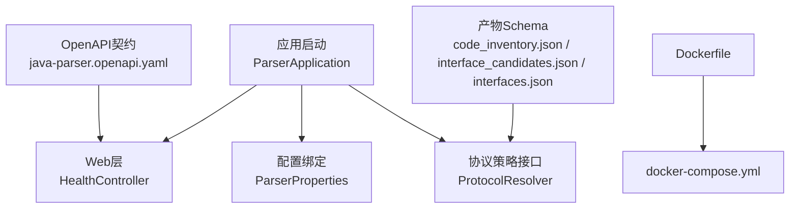
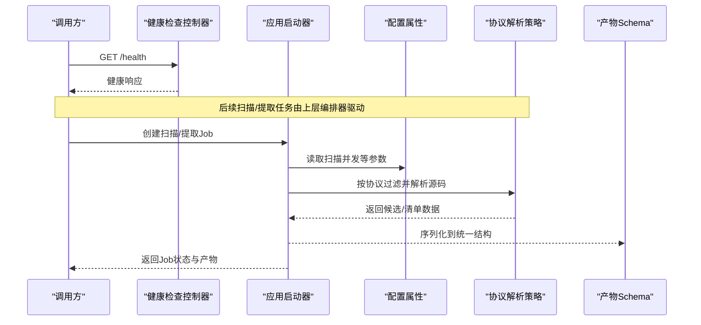
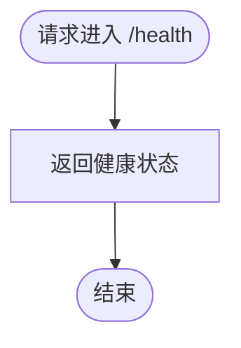
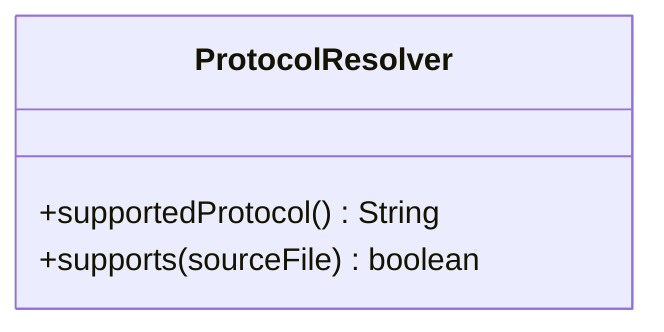
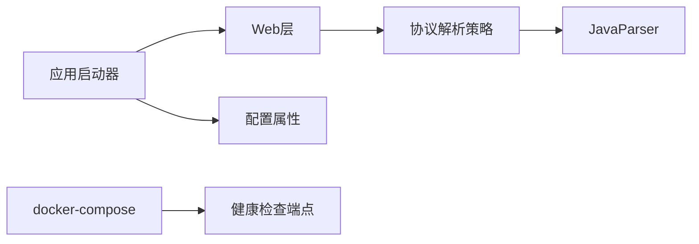
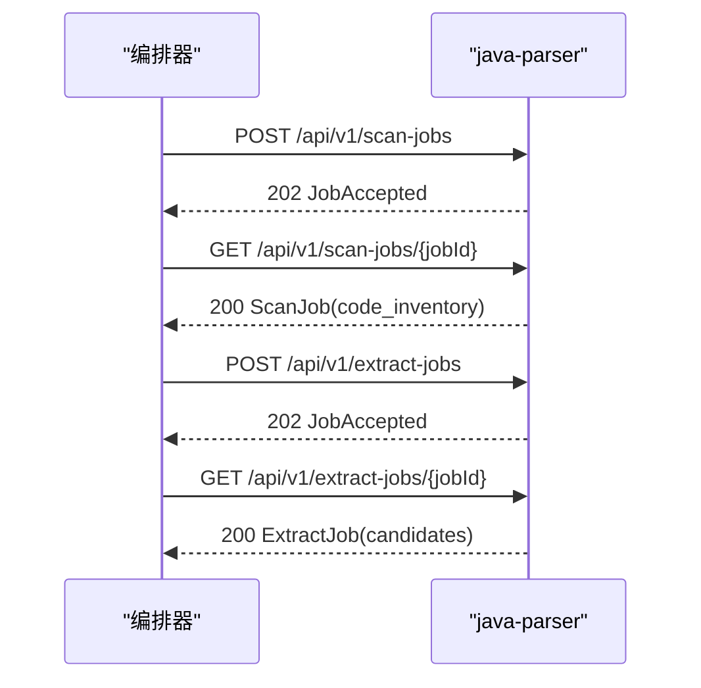
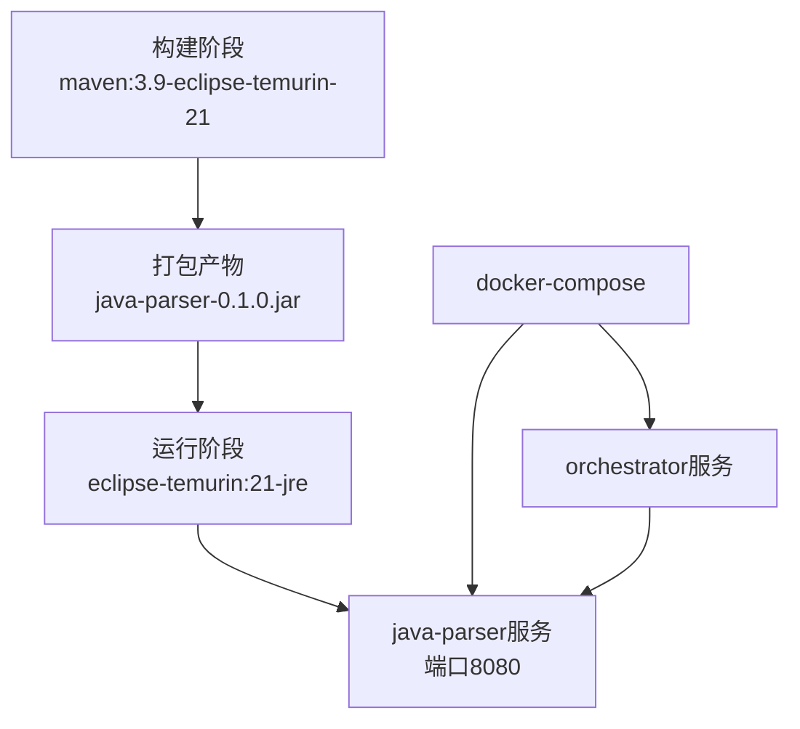

# Java解析器服务

<cite>
**本文引用的文件**
- [ParserApplication.java](file://services/java-parser/src/main/java/com/llmautotest/parser/ParserApplication.java)
- [HealthController.java](file://services/java-parser/src/main/java/com/llmautotest/parser/HealthController.java)
- [ProtocolResolver.java](file://services/java-parser/src/main/java/com/llmautotest/parser/ProtocolResolver.java)
- [ParserProperties.java](file://services/java-parser/src/main/java/com/llmautotest/parser/ParserProperties.java)
- [application.yml](file://services/java-parser/src/main/resources/application.yml)
- [pom.xml](file://services/java-parser/pom.xml)
- [Dockerfile](file://services/java-parser/Dockerfile)
- [docker-compose.yml](file://deploy/docker-compose.yml)
- [java-parser.openapi.yaml](file://schemas/contracts/java-parser.openapi.yaml)
- [code_inventory.json](file://schemas/code_inventory.json)
- [interface_candidates.json](file://schemas/interface_candidates.json)
- [interfaces.json](file://schemas/interfaces.json)
- [HealthControllerTest.java](file://services/java-parser/src/test/java/com/llmautotest/parser/HealthControllerTest.java)
</cite>

## 目录
1. [简介](#简介)
2. [项目结构](#项目结构)
3. [核心组件](#核心组件)
4. [架构总览](#架构总览)
5. [详细组件分析](#详细组件分析)
6. [依赖关系分析](#依赖关系分析)
7. [性能与资源管理](#性能与资源管理)
8. [API文档](#apidoc)
9. [配置参数说明](#配置参数说明)
10. [扩展开发指南](#扩展开发指南)
11. [容器化部署](#容器化部署)
12. [日志收集与监控](#日志收集与监控)
13. [故障诊断指南](#故障诊断指南)
14. [结论](#结论)

## 简介
本服务是一个基于Spring Boot的Java解析器服务，面向多仓库扫描与接口逆向还原场景。服务提供RESTful API，支持对多种协议（REST、gRPC、GraphQL、SOAP、MQ）进行静态特征定位与候选提取，并通过可插拔的协议策略接口实现协议无关的解析流程。服务以异步Job模式对外暴露能力，产出代码库存清单与接口候选清单，供上层编排器（orchestrator）进行LLM语义补全与后续测试执行。

## 项目结构
- 服务入口与Web层：
  - 应用启动类负责装配Spring上下文并启用配置属性扫描。
  - 健康检查控制器对外暴露健康端点，供编排系统探测服务可用性。
- 解析策略抽象：
  - 定义协议解析策略接口，用于按协议类型过滤源码并解析接口特征。
- 配置与构建：
  - 通过配置文件注入运行参数；构建脚本集成代码规范检查与打包插件。
- 契约与产物Schema：
  - OpenAPI契约定义API行为与数据结构；JSON Schema定义扫描清单、候选清单与最终接口清单的结构。
- 容器化：
  - Dockerfile采用多阶段构建；docker-compose编排服务间依赖与健康检查。

**图表来源**
- [ParserApplication.java:1-17](file://services/java-parser/src/main/java/com/llmautotest/parser/ParserApplication.java#L1-L17)
- [HealthController.java:1-18](file://services/java-parser/src/main/java/com/llmautotest/parser/HealthController.java#L1-L18)
- [ProtocolResolver.java:1-17](file://services/java-parser/src/main/java/com/llmautotest/parser/ProtocolResolver.java#L1-L17)
- [ParserProperties.java:1-17](file://services/java-parser/src/main/java/com/llmautotest/parser/ParserProperties.java#L1-L17)
- [java-parser.openapi.yaml:1-369](file://schemas/contracts/java-parser.openapi.yaml#L1-L369)
- [code_inventory.json:1-57](file://schemas/code_inventory.json#L1-L57)
- [interface_candidates.json:1-58](file://schemas/interface_candidates.json#L1-L58)
- [interfaces.json:1-70](file://schemas/interfaces.json#L1-L70)
- [Dockerfile:1-21](file://services/java-parser/Dockerfile#L1-L21)
- [docker-compose.yml:1-62](file://deploy/docker-compose.yml#L1-L62)

**章节来源**
- [ParserApplication.java:1-17](file://services/java-parser/src/main/java/com/llmautotest/parser/ParserApplication.java#L1-L17)
- [HealthController.java:1-18](file://services/java-parser/src/main/java/com/llmautotest/parser/HealthController.java#L1-L18)
- [ProtocolResolver.java:1-17](file://services/java-parser/src/main/java/com/llmautotest/parser/ProtocolResolver.java#L1-L17)
- [ParserProperties.java:1-17](file://services/java-parser/src/main/java/com/llmautotest/parser/ParserProperties.java#L1-L17)
- [application.yml:1-8](file://services/java-parser/src/main/resources/application.yml#L1-L8)
- [pom.xml:1-83](file://services/java-parser/pom.xml#L1-L83)
- [Dockerfile:1-21](file://services/java-parser/Dockerfile#L1-L21)
- [docker-compose.yml:1-62](file://deploy/docker-compose.yml#L1-L62)
- [java-parser.openapi.yaml:1-369](file://schemas/contracts/java-parser.openapi.yaml#L1-L369)
- [code_inventory.json:1-57](file://schemas/code_inventory.json#L1-L57)
- [interface_candidates.json:1-58](file://schemas/interface_candidates.json#L1-L58)
- [interfaces.json:1-70](file://schemas/interfaces.json#L1-L70)

## 核心组件
- 应用启动器：装配Spring Boot应用并启用配置属性扫描，为后续组件提供运行时环境。
- 健康检查控制器：提供轻量级健康端点，便于编排系统探测服务存活状态。
- 协议解析策略接口：定义协议识别与源码过滤的抽象，支持REST、Dubbo、gRPC、GraphQL、SOAP、MQ等协议的扩展。
- 配置属性：集中管理服务运行参数（如扫描并发度），避免硬编码，支持环境变量覆盖。

**章节来源**
- [ParserApplication.java:1-17](file://services/java-parser/src/main/java/com/llmautotest/parser/ParserApplication.java#L1-L17)
- [HealthController.java:1-18](file://services/java-parser/src/main/java/com/llmautotest/parser/HealthController.java#L1-L18)
- [ProtocolResolver.java:1-17](file://services/java-parser/src/main/java/com/llmautotest/parser/ProtocolResolver.java#L1-L17)
- [ParserProperties.java:1-17](file://services/java-parser/src/main/java/com/llmautotest/parser/ParserProperties.java#L1-L17)

## 架构总览
服务采用“控制器 + 策略接口 + 配置”的分层设计：
- Web层暴露REST接口，接收扫描与提取任务请求。
- 策略层通过协议解析接口对不同协议源码进行过滤与解析。
- 配置层通过外部化配置控制扫描并发等关键参数。
- 产物层遵循统一Schema输出代码库存与接口候选，供上层消费。

**图表来源**
- [HealthController.java:1-18](file://services/java-parser/src/main/java/com/llmautotest/parser/HealthController.java#L1-L18)
- [ParserApplication.java:1-17](file://services/java-parser/src/main/java/com/llmautotest/parser/ParserApplication.java#L1-L17)
- [ParserProperties.java:1-17](file://services/java-parser/src/main/java/com/llmautotest/parser/ParserProperties.java#L1-L17)
- [ProtocolResolver.java:1-17](file://services/java-parser/src/main/java/com/llmautotest/parser/ProtocolResolver.java#L1-L17)
- [java-parser.openapi.yaml:1-369](file://schemas/contracts/java-parser.openapi.yaml#L1-L369)

## 详细组件分析

### 应用启动器（ParserApplication）
- 职责：启动Spring Boot应用，启用配置属性扫描，为其他组件提供运行上下文。
- 关键点：使用注解启用自动装配与配置扫描，确保配置项可被注入到服务中。

**章节来源**
- [ParserApplication.java:1-17](file://services/java-parser/src/main/java/com/llmautotest/parser/ParserApplication.java#L1-L17)

### 健康检查控制器（HealthController）
- 职责：提供健康检查端点，返回服务状态信息。
- 关键点：端点路径与返回结构在编排系统中被用作健康探针；单元测试验证端点可用性与响应字段。

**图表来源**
- [HealthController.java:1-18](file://services/java-parser/src/main/java/com/llmautotest/parser/HealthController.java#L1-L18)
- [HealthControllerTest.java:1-27](file://services/java-parser/src/test/java/com/llmautotest/parser/HealthControllerTest.java#L1-L27)

**章节来源**
- [HealthController.java:1-18](file://services/java-parser/src/main/java/com/llmautotest/parser/HealthController.java#L1-L18)
- [HealthControllerTest.java:1-27](file://services/java-parser/src/test/java/com/llmautotest/parser/HealthControllerTest.java#L1-L27)

### 协议解析策略（ProtocolResolver）
- 职责：定义协议识别与源码过滤的抽象，支持新增协议时不改动主流程。
- 关键点：
  - supportedProtocol：声明支持的协议标识（rest/dubbo/grpc/graphql/soap/mq）。
  - supports：判断给定源码文件是否属于本协议，作为扫描阶段的过滤器。
  - 解析结果与调用约定将在契约定稿后接入，当前保留扩展点。

**图表来源**
- [ProtocolResolver.java:1-17](file://services/java-parser/src/main/java/com/llmautotest/parser/ProtocolResolver.java#L1-L17)

**章节来源**
- [ProtocolResolver.java:1-17](file://services/java-parser/src/main/java/com/llmautotest/parser/ProtocolResolver.java#L1-L17)

### 配置属性（ParserProperties）
- 职责：集中管理服务运行参数，如多仓库扫描并发度。
- 关键点：
  - 通过前缀绑定配置项，支持环境变量覆盖。
  - 对关键参数进行校验，防止非法值导致运行时异常。

**章节来源**
- [ParserProperties.java:1-17](file://services/java-parser/src/main/java/com/llmautotest/parser/ParserProperties.java#L1-L17)
- [application.yml:1-8](file://services/java-parser/src/main/resources/application.yml#L1-L8)

### 构建与依赖（pom.xml）
- 基线：Spring Boot 3.4.0，Java 21 LTS。
- 核心依赖：
  - spring-boot-starter-web：提供Web能力。
  - javaparser-symbol-solver-core：源码解析与符号求解能力，支撑协议策略实现。
- 质量保障：集成Checkstyle，在verify阶段执行代码风格检查。

**章节来源**
- [pom.xml:1-83](file://services/java-parser/pom.xml#L1-L83)

## 依赖关系分析
- 内部依赖：
  - 启动器依赖配置属性与Web层。
  - 协议策略接口为可扩展点，具体实现依赖JavaParser进行源码解析。
- 外部依赖：
  - Spring Boot Web框架。
  - JavaParser符号求解库。
- 编排依赖：
  - docker-compose编排orchestrator依赖java-parser的健康检查。

**图表来源**
- [ParserApplication.java:1-17](file://services/java-parser/src/main/java/com/llmautotest/parser/ParserApplication.java#L1-L17)
- [HealthController.java:1-18](file://services/java-parser/src/main/java/com/llmautotest/parser/HealthController.java#L1-L18)
- [ProtocolResolver.java:1-17](file://services/java-parser/src/main/java/com/llmautotest/parser/ProtocolResolver.java#L1-L17)
- [pom.xml:31-47](file://services/java-parser/pom.xml#L31-L47)
- [docker-compose.yml:1-62](file://deploy/docker-compose.yml#L1-L62)

**章节来源**
- [pom.xml:31-47](file://services/java-parser/pom.xml#L31-L47)
- [docker-compose.yml:1-62](file://deploy/docker-compose.yml#L1-L62)

## 性能与资源管理
- 扫描并发度：通过配置项控制多仓库扫描的并行度，避免资源争用与内存压力。
- 大仓库处理：支持截断扫描范围（include_paths），仅对核心模块目录进行深度分析。
- 错误容忍：单文件解析失败记录告警并跳过，不影响整体流程。
- 建议：
  - 根据宿主机资源调整scan-concurrency。
  - 对超大仓库合理设置include_paths，减少I/O与解析开销。
  - 结合监控指标观察GC与线程池使用情况，必要时扩容或限流。

[本节为通用指导，无需特定文件引用]

## API文档
- 健康检查：
  - GET /health：返回服务存活状态。
- 扫描任务：
  - POST /api/v1/scan-jobs：创建多仓库扫描任务，输入包含仓库列表与分支信息。
  - GET /api/v1/scan-jobs/{jobId}：查询扫描任务状态与产物（code_inventory）。
- 提取任务：
  - POST /api/v1/extract-jobs：创建接口候选提取任务，支持指定协议集合。
  - GET /api/v1/extract-jobs/{jobId}：查询提取任务状态与产物（candidates）。
- 错误结构：
  - 统一错误对象包含code、message、可选node_id与details。

**图表来源**
- [java-parser.openapi.yaml:11-116](file://schemas/contracts/java-parser.openapi.yaml#L11-L116)

**章节来源**
- [java-parser.openapi.yaml:11-116](file://schemas/contracts/java-parser.openapi.yaml#L11-L116)

## 配置参数说明
- server.port：服务监听端口（默认8080）。
- parser.scan-concurrency：多仓库扫描并发度（必须为正数，默认4）。
- 环境变量覆盖：可通过环境变量覆盖上述配置项，便于不同环境差异化部署。

**章节来源**
- [application.yml:1-8](file://services/java-parser/src/main/resources/application.yml#L1-L8)
- [ParserProperties.java:1-17](file://services/java-parser/src/main/java/com/llmautotest/parser/ParserProperties.java#L1-L17)

## 扩展开发指南
- 新增协议解析实现：
  - 实现ProtocolResolver接口，声明supportedProtocol与supports逻辑。
  - 在策略注册处注入新实现（当前为预留扩展点，待契约定稿后接入）。
- 静态分析与接口还原：
  - 使用JavaParser进行AST遍历，识别注解、方法签名、DTO字段等。
  - 关联Controller→Service→DTO的直接调用链，生成related_files。
- 产物结构：
  - 严格遵循code_inventory.json、interface_candidates.json、interfaces.json的Schema。
  - 保持candidate_id与最终接口id的可追溯性。

**章节来源**
- [ProtocolResolver.java:1-17](file://services/java-parser/src/main/java/com/llmautotest/parser/ProtocolResolver.java#L1-L17)
- [code_inventory.json:1-57](file://schemas/code_inventory.json#L1-L57)
- [interface_candidates.json:1-58](file://schemas/interface_candidates.json#L1-L58)
- [interfaces.json:1-70](file://schemas/interfaces.json#L1-L70)

## 容器化部署
- 镜像构建：
  - 多阶段构建：第一阶段使用Maven+JDK编译打包；第二阶段仅包含JRE与JAR包。
  - 安装wget以支持健康检查。
- 编排与服务发现：
  - docker-compose定义java-parser、orchestrator、frontend等服务。
  - orchestrator通过环境变量JAVA_PARSER_URL访问java-parser。
  - 健康检查：编排系统定期调用/health确认服务可用。

**图表来源**
- [Dockerfile:1-21](file://services/java-parser/Dockerfile#L1-L21)
- [docker-compose.yml:1-62](file://deploy/docker-compose.yml#L1-L62)

**章节来源**
- [Dockerfile:1-21](file://services/java-parser/Dockerfile#L1-L21)
- [docker-compose.yml:1-62](file://deploy/docker-compose.yml#L1-L62)

## 日志收集与监控
- 日志：
  - 建议将Spring Boot标准输出重定向至容器日志系统（如stdout/stderr），由编排平台统一收集。
  - 在生产环境开启结构化日志，便于检索与分析。
- 监控：
  - 暴露Actuator端点（如需）以获取JVM与HTTP指标。
  - 结合Prometheus/Grafana采集CPU、内存、GC与请求耗时等指标。
- 健康检查：
  - 编排系统通过/health探测服务存活；失败则触发重启或流量切换。

[本节为通用指导，无需特定文件引用]

## 故障诊断指南
- 健康检查失败：
  - 检查容器内wget与/health端点可达性；确认端口映射正确。
- 扫描任务失败：
  - 检查repositories路径在容器内是否可见；确认分支已检出。
  - 查看任务状态中的error字段与encoding_skipped列表，定位异常编码或无效路径。
- 提取任务告警：
  - warnings中包含单文件解析失败原因；检查相关文件的编码与格式。
  - 若候选数低于阈值，考虑引入兜底仓库或扩大include_paths。
- 性能问题：
  - 调整parser.scan-concurrency；监控线程池与内存使用。
  - 对超大仓库限制扫描范围，减少I/O与解析开销。

**章节来源**
- [java-parser.openapi.yaml:130-148](file://schemas/contracts/java-parser.openapi.yaml#L130-L148)
- [code_inventory.json:17-39](file://schemas/code_inventory.json#L17-L39)
- [interface_candidates.json:51-55](file://schemas/interface_candidates.json#L51-L55)

## 结论
该Java解析器服务以Spring Boot为基础，提供健壮的RESTful API与可插拔的协议解析策略，支持多仓库扫描与接口候选提取。通过统一的Schema与契约，服务与上层编排器形成清晰的数据边界与协作流程。建议在扩展协议与优化性能时，严格遵循现有接口与配置约定，并结合容器化与监控手段保障稳定性与可观测性。