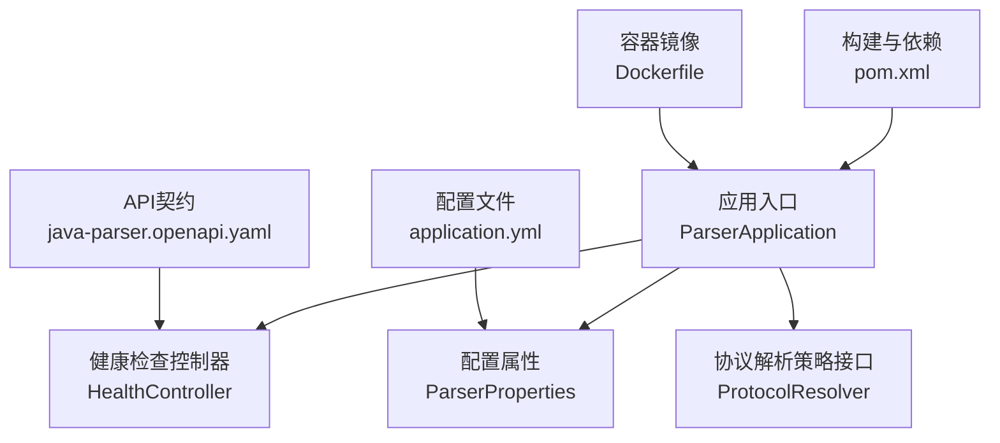
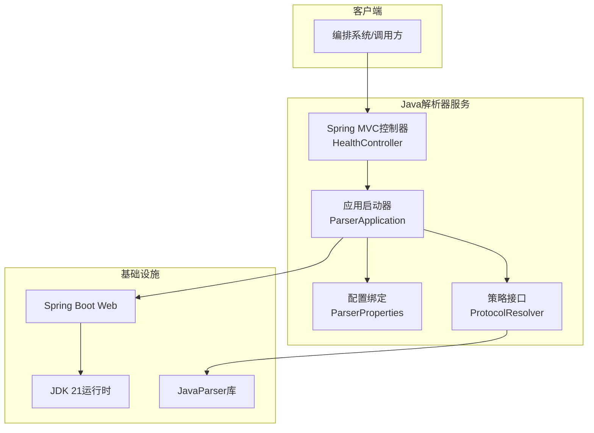
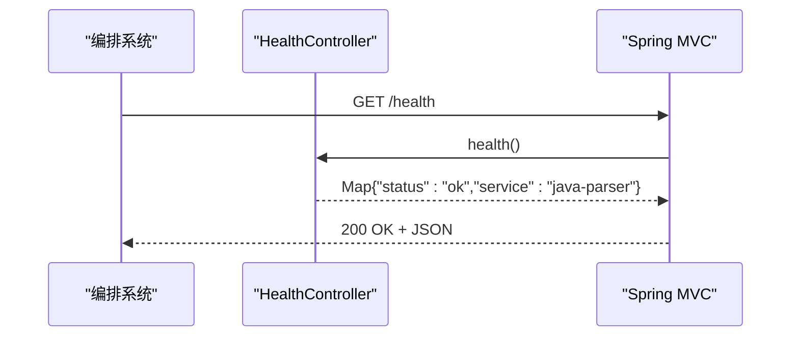
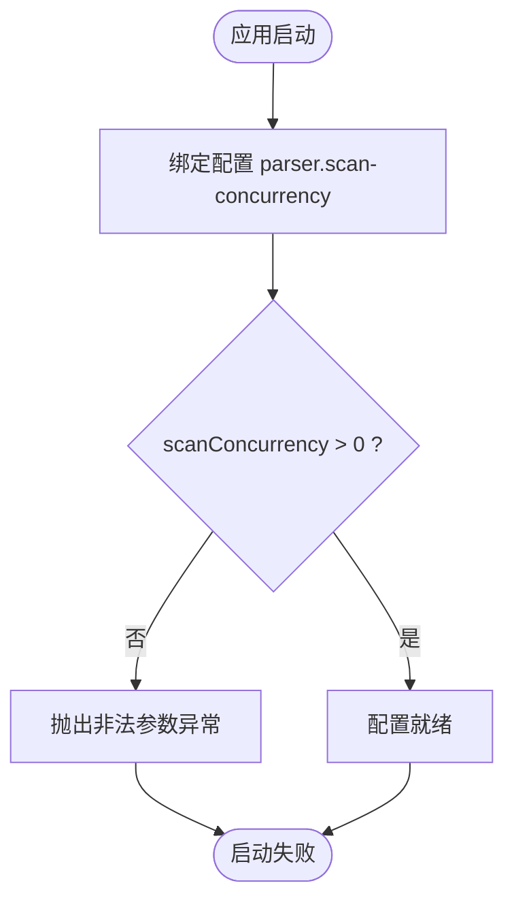
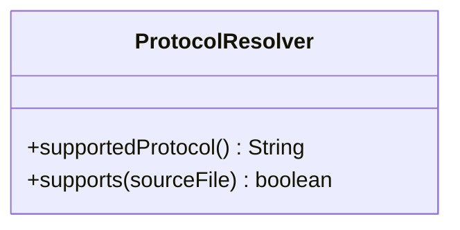
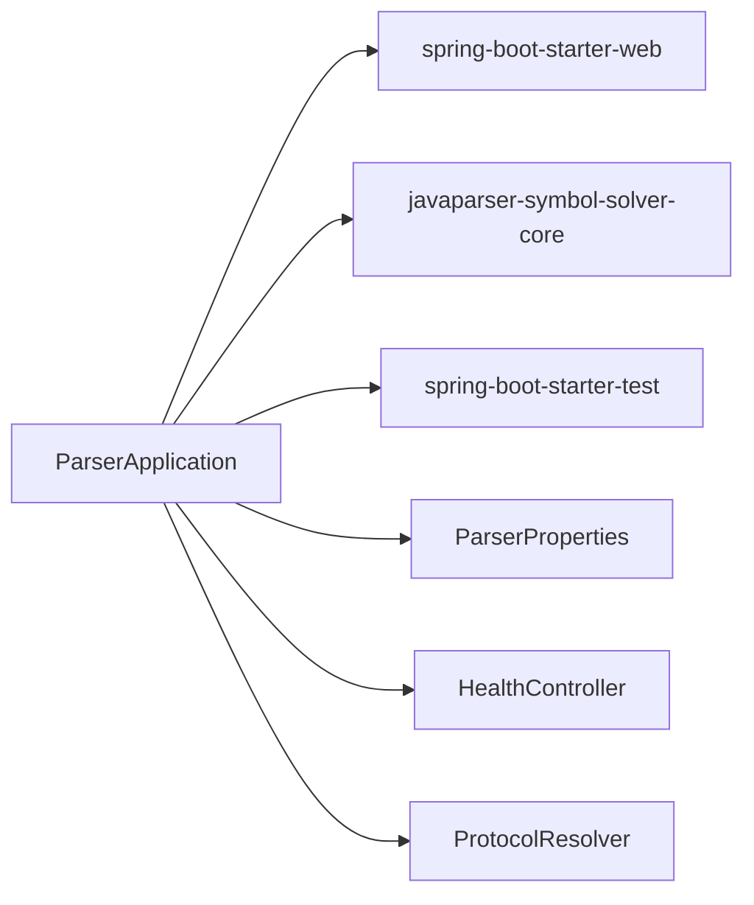

# Java解析器服务

<cite>
**本文引用的文件**
- [ParserApplication.java](file://services/java-parser/src/main/java/com/llmautotest/parser/ParserApplication.java)
- [ProtocolResolver.java](file://services/java-parser/src/main/java/com/llmautotest/parser/ProtocolResolver.java)
- [HealthController.java](file://services/java-parser/src/main/java/com/llmautotest/parser/HealthController.java)
- [ParserProperties.java](file://services/java-parser/src/main/java/com/llmautotest/parser/ParserProperties.java)
- [application.yml](file://services/java-parser/src/main/resources/application.yml)
- [pom.xml](file://services/java-parser/pom.xml)
- [Dockerfile](file://services/java-parser/Dockerfile)
- [java-parser.openapi.yaml](file://schemas/contracts/java-parser.openapi.yaml)
- [HealthControllerTest.java](file://services/java-parser/src/test/java/com/llmautotest/parser/HealthControllerTest.java)
</cite>

## 目录
1. [简介](#简介)
2. [项目结构](#项目结构)
3. [核心组件](#核心组件)
4. [架构总览](#架构总览)
5. [详细组件分析](#详细组件分析)
6. [依赖关系分析](#依赖关系分析)
7. [性能考虑](#性能考虑)
8. [故障诊断指南](#故障诊断指南)
9. [结论](#结论)
10. [附录：API契约与扩展指南](#附录api契约与扩展指南)

## 简介
Java解析器服务是一个基于Spring Boot的轻量级后端服务，负责多仓库Java源码扫描与接口逆向还原的静态侧能力。其核心设计围绕“协议解析策略可插拔”展开，通过统一的ProtocolResolver接口抽象不同协议（REST、Dubbo、gRPC、GraphQL、SOAP、MQ）的识别与提取逻辑，便于后续扩展新协议而不改动主流程。服务提供健康检查端点用于容器编排与健康探测，并通过配置属性管理扫描并发度等运行参数。

该服务遵循“契约先行”原则，对外暴露的API以OpenAPI规范定义，确保前后端与编排系统对输入输出的一致性理解。

## 项目结构
服务采用标准的Spring Boot工程组织方式，入口类、控制器、配置类与资源文件分层清晰；测试用例覆盖关键HTTP端点；构建与部署通过Maven与Docker完成。

**图表来源**
- [ParserApplication.java:1-17](file://services/java-parser/src/main/java/com/llmautotest/parser/ParserApplication.java#L1-L17)
- [HealthController.java:1-18](file://services/java-parser/src/main/java/com/llmautotest/parser/HealthController.java#L1-L18)
- [ParserProperties.java:1-17](file://services/java-parser/src/main/java/com/llmautotest/parser/ParserProperties.java#L1-L17)
- [ProtocolResolver.java:1-17](file://services/java-parser/src/main/java/com/llmautotest/parser/ProtocolResolver.java#L1-L17)
- [application.yml:1-8](file://services/java-parser/src/main/resources/application.yml#L1-L8)
- [pom.xml:1-83](file://services/java-parser/pom.xml#L1-L83)
- [Dockerfile:1-21](file://services/java-parser/Dockerfile#L1-L21)
- [java-parser.openapi.yaml:1-369](file://schemas/contracts/java-parser.openapi.yaml#L1-L369)

**章节来源**
- [ParserApplication.java:1-17](file://services/java-parser/src/main/java/com/llmautotest/parser/ParserApplication.java#L1-L17)
- [application.yml:1-8](file://services/java-parser/src/main/resources/application.yml#L1-L8)
- [pom.xml:1-83](file://services/java-parser/pom.xml#L1-L83)

## 核心组件
- 应用入口：启动Spring Boot应用并启用配置属性扫描。
- 健康检查：提供/health端点，返回服务状态与服务名，供编排系统探测。
- 配置属性：集中管理扫描并发度等运行参数，支持环境变量覆盖。
- 协议解析策略：定义统一接口，用于识别与解析不同协议的接口定义，支持插件化扩展。

**章节来源**
- [ParserApplication.java:1-17](file://services/java-parser/src/main/java/com/llmautotest/parser/ParserApplication.java#L1-L17)
- [HealthController.java:1-18](file://services/java-parser/src/main/java/com/llmautotest/parser/HealthController.java#L1-L18)
- [ParserProperties.java:1-17](file://services/java-parser/src/main/java/com/llmautotest/parser/ParserProperties.java#L1-L17)
- [ProtocolResolver.java:1-17](file://services/java-parser/src/main/java/com/llmautotest/parser/ProtocolResolver.java#L1-L17)

## 架构总览
服务采用Spring MVC作为Web层，结合Spring Boot自动装配与配置绑定机制，形成“入口—控制器—配置—策略接口”的清晰分层。外部调用通过REST API进入，健康检查由控制器直接处理；协议解析策略通过接口抽象，便于未来实现多种协议的具体解析器。

**图表来源**
- [HealthController.java:1-18](file://services/java-parser/src/main/java/com/llmautotest/parser/HealthController.java#L1-L18)
- [ParserApplication.java:1-17](file://services/java-parser/src/main/java/com/llmautotest/parser/ParserApplication.java#L1-L17)
- [ParserProperties.java:1-17](file://services/java-parser/src/main/java/com/llmautotest/parser/ParserProperties.java#L1-L17)
- [ProtocolResolver.java:1-17](file://services/java-parser/src/main/java/com/llmautotest/parser/ProtocolResolver.java#L1-L17)
- [pom.xml:31-47](file://services/java-parser/pom.xml#L31-L47)

## 详细组件分析

### 应用入口 ParserApplication
- 职责：启动Spring Boot应用，启用配置属性扫描，为后续组件注入与配置绑定提供基础。
- 关键点：使用@SpringBootApplication与@ConfigurationPropertiesScan注解，确保配置类被自动发现与绑定。

**章节来源**
- [ParserApplication.java:1-17](file://services/java-parser/src/main/java/com/llmautotest/parser/ParserApplication.java#L1-L17)

### 健康检查 HealthController
- 职责：提供/health端点，返回JSON格式的健康信息，供docker-compose或Kubernetes探针检测。
- 行为：GET /health返回包含status与service字段的Map，状态固定为ok，服务名为java-parser。
- 测试：单元测试验证/health响应状态码与字段值，确保编排健康检查稳定可用。

**图表来源**
- [HealthController.java:1-18](file://services/java-parser/src/main/java/com/llmautotest/parser/HealthController.java#L1-L18)
- [HealthControllerTest.java:1-27](file://services/java-parser/src/test/java/com/llmautotest/parser/HealthControllerTest.java#L1-L27)

**章节来源**
- [HealthController.java:1-18](file://services/java-parser/src/main/java/com/llmautotest/parser/HealthController.java#L1-L18)
- [HealthControllerTest.java:1-27](file://services/java-parser/src/test/java/com/llmautotest/parser/HealthControllerTest.java#L1-L27)

### 配置属性 ParserProperties
- 职责：集中管理服务运行配置，当前包含scanConcurrency（扫描并发度）。
- 校验：构造时强制scanConcurrency为正数，避免非法配置导致资源耗尽。
- 绑定：通过@ConfigurationProperties(prefix = "parser")与application.yml中的parser.scan-concurrency进行绑定，支持环境变量覆盖。

**图表来源**
- [ParserProperties.java:1-17](file://services/java-parser/src/main/java/com/llmautotest/parser/ParserProperties.java#L1-L17)
- [application.yml:5-8](file://services/java-parser/src/main/resources/application.yml#L5-L8)

**章节来源**
- [ParserProperties.java:1-17](file://services/java-parser/src/main/java/com/llmautotest/parser/ParserProperties.java#L1-L17)
- [application.yml:1-8](file://services/java-parser/src/main/resources/application.yml#L1-L8)

### 协议解析策略 ProtocolResolver
- 职责：定义协议解析的统一抽象，支持REST、Dubbo、gRPC、GraphQL、SOAP、MQ等多种协议。
- 方法：
  - supportedProtocol：声明本策略支持的协议标识。
  - supports：在扫描阶段过滤出属于本协议的源码文件路径。
  - 解析结果与调用约定：待M0契约定稿后接入，保持主流程稳定。
- 设计优势：新增协议只需实现该接口，无需修改主流程，符合开闭原则。

**图表来源**
- [ProtocolResolver.java:1-17](file://services/java-parser/src/main/java/com/llmautotest/parser/ProtocolResolver.java#L1-L17)

**章节来源**
- [ProtocolResolver.java:1-17](file://services/java-parser/src/main/java/com/llmautotest/parser/ProtocolResolver.java#L1-L17)

### 构建与部署
- 依赖：Spring Boot Starter Web、JavaParser Symbol Solver Core、Spring Boot Test。
- 构建：Maven打包，Checkstyle代码质量检查在verify阶段执行。
- 容器：多阶段构建，最终镜像仅包含JRE与可执行JAR，暴露8080端口，安装wget用于健康检查。

**章节来源**
- [pom.xml:1-83](file://services/java-parser/pom.xml#L1-L83)
- [Dockerfile:1-21](file://services/java-parser/Dockerfile#L1-L21)

## 依赖关系分析
服务依赖Spring Boot生态与JavaParser库，形成松耦合的模块化结构。控制器与配置类由Spring容器管理，策略接口解耦具体实现，便于扩展与维护。

**图表来源**
- [pom.xml:31-47](file://services/java-parser/pom.xml#L31-L47)
- [ParserApplication.java:1-17](file://services/java-parser/src/main/java/com/llmautotest/parser/ParserApplication.java#L1-L17)
- [HealthController.java:1-18](file://services/java-parser/src/main/java/com/llmautotest/parser/HealthController.java#L1-L18)
- [ParserProperties.java:1-17](file://services/java-parser/src/main/java/com/llmautotest/parser/ParserProperties.java#L1-L17)
- [ProtocolResolver.java:1-17](file://services/java-parser/src/main/java/com/llmautotest/parser/ProtocolResolver.java#L1-L17)

**章节来源**
- [pom.xml:1-83](file://services/java-parser/pom.xml#L1-L83)

## 性能考虑
- 扫描并发度控制：通过parser.scan-concurrency限制多仓库扫描的并行度，避免I/O与CPU过载。建议根据宿主机资源与仓库规模调优，默认值为4。
- 大仓库截断：当仓库过大时，可通过include_paths限定核心模块目录，减少扫描范围与内存占用。
- 编码异常跳过：对异常编码的文件记录但跳过解析，保证整体流程不中断。
- 异步任务模式：长任务采用job模式（创建任务→轮询状态），降低请求超时风险并提升吞吐。

[本节为通用性能指导，不直接分析具体文件]

## 故障诊断指南
- 健康检查失败：确认/health端点可达且返回{status:"ok", service:"java-parser"}；检查容器是否安装wget以及端口映射是否正确。
- 配置错误：若scanConcurrency非正数，启动时会抛出非法参数异常；检查application.yml或环境变量是否设置正确。
- 协议解析未生效：确认已实现ProtocolResolver并在容器中注册；检查supportedProtocol与supports方法的匹配逻辑是否符合预期。
- 构建失败：检查Maven版本与Java版本（JDK 21）是否匹配；确认checkstyle规则未阻止构建。

**章节来源**
- [HealthController.java:1-18](file://services/java-parser/src/main/java/com/llmautotest/parser/HealthController.java#L1-L18)
- [ParserProperties.java:1-17](file://services/java-parser/src/main/java/com/llmautotest/parser/ParserProperties.java#L1-L17)
- [Dockerfile:1-21](file://services/java-parser/Dockerfile#L1-L21)

## 结论
Java解析器服务以Spring Boot为基础，提供了健康检查、配置管理与协议解析策略接口，具备良好的可扩展性与可维护性。通过契约化的API设计与容器化部署，服务能够稳定融入自动化测试与接口逆向还原流水线。后续可在ProtocolResolver基础上实现多种协议的具体解析器，逐步完善静态分析与候选提取能力。

[本节为总结性内容，不直接分析具体文件]

## 附录：API契约与扩展指南

### API概览
- 健康检查：GET /health，返回服务存活信息与名称。
- 扫描任务：POST /api/v1/scan-jobs 创建多仓库扫描任务；GET /api/v1/scan-jobs/{jobId} 查询任务状态与产物。
- 提取任务：POST /api/v1/extract-jobs 创建接口候选提取任务；GET /api/v1/extract-jobs/{jobId} 查询任务状态与候选清单。
- 错误结构：统一Error对象包含code、message、node_id、details等字段，便于上层系统统一处理。

**章节来源**
- [java-parser.openapi.yaml:11-116](file://schemas/contracts/java-parser.openapi.yaml#L11-L116)
- [java-parser.openapi.yaml:130-148](file://schemas/contracts/java-parser.openapi.yaml#L130-L148)

### 扩展开发指南
- 新增协议解析器：
  - 实现ProtocolResolver接口，声明supportedProtocol与supports逻辑。
  - 在Spring容器中注册为Bean，以便主流程按协议分发。
  - 遵循契约中InterfaceCandidate与CodeLocation等数据结构，产出标准化结果。
- 配置扩展：
  - 在ParserProperties中添加新字段，并在application.yml中提供默认值。
  - 通过环境变量覆盖配置，便于不同环境差异化部署。
- 测试与验证：
  - 为新增协议解析器编写单元测试，覆盖supports与解析逻辑。
  - 使用MockMvc验证新增API端点的请求与响应结构。

**章节来源**
- [ProtocolResolver.java:1-17](file://services/java-parser/src/main/java/com/llmautotest/parser/ProtocolResolver.java#L1-L17)
- [ParserProperties.java:1-17](file://services/java-parser/src/main/java/com/llmautotest/parser/ParserProperties.java#L1-L17)
- [application.yml:1-8](file://services/java-parser/src/main/resources/application.yml#L1-L8)
- [HealthControllerTest.java:1-27](file://services/java-parser/src/test/java/com/llmautotest/parser/HealthControllerTest.java#L1-L27)