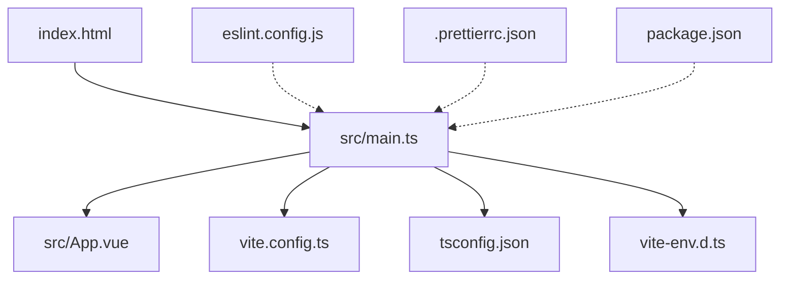
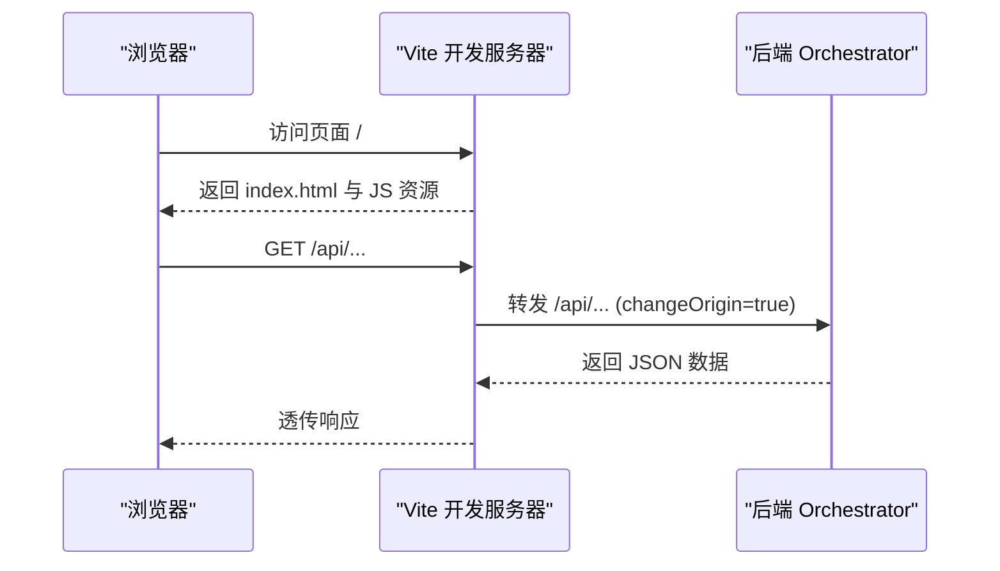
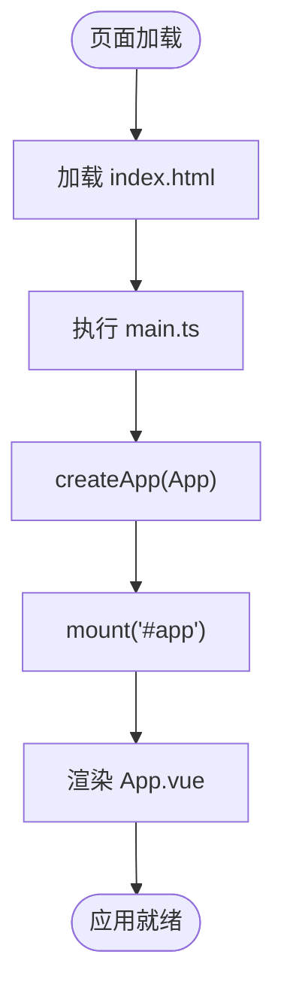
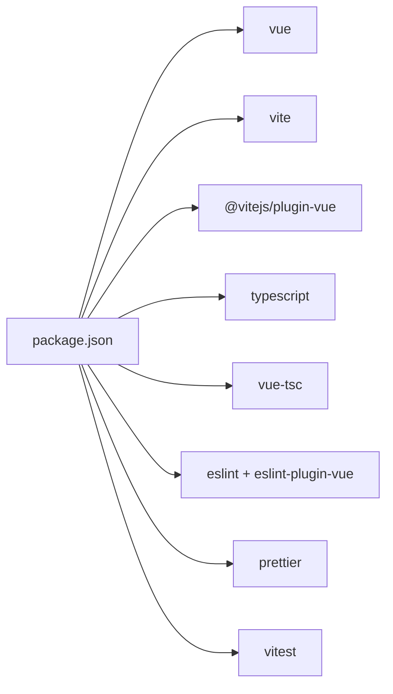

# 前端应用

<cite>
**本文引用的文件**
- [package.json](file://services/frontend/package.json)
- [vite.config.ts](file://services/frontend/vite.config.ts)
- [main.ts](file://services/frontend/src/main.ts)
- [App.vue](file://services/frontend/src/App.vue)
- [tsconfig.json](file://services/frontend/tsconfig.json)
- [vite-env.d.ts](file://services/frontend/src/vite-env.d.ts)
- [index.html](file://services/frontend/index.html)
- [eslint.config.js](file://services/frontend/eslint.config.js)
- [.prettierrc.json](file://services/frontend/.prettierrc.json)
- [frontend-code-style.md](file://.rules/frontend-code-style.md)
- [07_UI演示设计.md](file://docs/07_UI演示设计.md)
- [09_开发规范说明.md](file://docs/09_开发规范说明.md)
</cite>

## 目录
1. [简介](#简介)
2. [项目结构](#项目结构)
3. [核心组件](#核心组件)
4. [架构总览](#架构总览)
5. [详细组件分析](#详细组件分析)
6. [依赖分析](#依赖分析)
7. [性能考虑](#性能考虑)
8. [故障排查指南](#故障排查指南)
9. [结论](#结论)
10. [附录](#附录)

## 简介
本仓库的前端位于 services/frontend，采用 Vue 3 + TypeScript + Vite 构建。当前阶段为占位实现：入口挂载根组件并显示提示文案；开发服务器通过 Vite 代理将 /api 请求转发至后端 orchestrator（默认 http://localhost:8000）。后续将按“六页方向”逐步接入任务配置、流水线监控、Code Review 三视图、测试报告、缺陷闭环与回归度量等页面。

## 项目结构
前端工程以单页应用组织，核心文件职责如下：
- index.html：应用 HTML 壳，挂载 #app 并引入 main.ts
- src/main.ts：创建 Vue 应用实例并挂载到 DOM
- src/App.vue：根组件（当前为占位展示）
- vite.config.ts：Vite 插件与开发代理配置
- tsconfig.json：TypeScript 编译选项
- vite-env.d.ts：Vite 与 .vue 模块类型声明
- eslint.config.js 与 .prettierrc.json：代码风格与格式化规则
- package.json：脚本命令、依赖与包管理器版本锁定

图表来源
- [index.html:1-13](file://services/frontend/index.html#L1-L13)
- [main.ts:1-6](file://services/frontend/src/main.ts#L1-L6)
- [App.vue:1-12](file://services/frontend/src/App.vue#L1-L12)
- [vite.config.ts:1-16](file://services/frontend/vite.config.ts#L1-L16)
- [tsconfig.json:1-15](file://services/frontend/tsconfig.json#L1-L15)
- [vite-env.d.ts:1-9](file://services/frontend/src/vite-env.d.ts#L1-L9)
- [eslint.config.js:1-17](file://services/frontend/eslint.config.js#L1-L17)
- [.prettierrc.json:1-6](file://services/frontend/.prettierrc.json#L1-L6)
- [package.json:1-29](file://services/frontend/package.json#L1-L29)

章节来源
- [index.html:1-13](file://services/frontend/index.html#L1-L13)
- [main.ts:1-6](file://services/frontend/src/main.ts#L1-L6)
- [App.vue:1-12](file://services/frontend/src/App.vue#L1-L12)
- [vite.config.ts:1-16](file://services/frontend/vite.config.ts#L1-L16)
- [tsconfig.json:1-15](file://services/frontend/tsconfig.json#L1-L15)
- [vite-env.d.ts:1-9](file://services/frontend/src/vite-env.d.ts#L1-L9)
- [eslint.config.js:1-17](file://services/frontend/eslint.config.js#L1-L17)
- [.prettierrc.json:1-6](file://services/frontend/.prettierrc.json#L1-L6)
- [package.json:1-29](file://services/frontend/package.json#L1-L29)

## 核心组件
- 根组件 App.vue：当前仅输出占位文案，遵循“数值来自后端 API，前端不做计算”的口径红线。
- 入口 main.ts：使用 createApp 挂载根组件，业务页面待排期接入。
- 类型与环境：vite-env.d.ts 提供 .vue 模块类型声明，确保 IDE 解析与 TS 检查正常。

章节来源
- [App.vue:1-12](file://services/frontend/src/App.vue#L1-L12)
- [main.ts:1-6](file://services/frontend/src/main.ts#L1-L6)
- [vite-env.d.ts:1-9](file://services/frontend/src/vite-env.d.ts#L1-L9)

## 架构总览
前端在开发模式下通过 Vite 代理将 /api 请求转发到后端 orchestrator，便于联调。生产环境由部署编排统一暴露后端服务，前端静态资源由 Web 服务器或容器托管。

图表来源
- [vite.config.ts:4-15](file://services/frontend/vite.config.ts#L4-L15)
- [index.html:1-13](file://services/frontend/index.html#L1-L13)

章节来源
- [vite.config.ts:1-16](file://services/frontend/vite.config.ts#L1-L16)

## 详细组件分析

### 应用启动流程
- index.html 定义页面标题与挂载点，并引入 main.ts。
- main.ts 创建 Vue 应用并挂载到 #app。
- App.vue 作为根组件渲染占位内容。

图表来源
- [index.html:1-13](file://services/frontend/index.html#L1-L13)
- [main.ts:1-6](file://services/frontend/src/main.ts#L1-L6)
- [App.vue:1-12](file://services/frontend/src/App.vue#L1-L12)

章节来源
- [index.html:1-13](file://services/frontend/index.html#L1-L13)
- [main.ts:1-6](file://services/frontend/src/main.ts#L1-L6)
- [App.vue:1-12](file://services/frontend/src/App.vue#L1-L12)

### 路由与状态管理（规划）
- 路由：当前未集成路由库。建议后续引入 Vue Router，按“六页方向”划分页面路由，并在路由守卫中处理鉴权与错误跳转。
- 状态：当前无全局状态。建议引入 Pinia，按页面域拆分 store，避免单一巨型 store。所有度量数值必须来自后端 API，前端不计算。

章节来源
- [09_开发规范说明.md:64-71](file://docs/09_开发规范说明.md#L64-L71)
- [frontend-code-style.md:14-20](file://.rules/frontend-code-style.md#L14-L20)

### API 集成方式（规划）
- 统一层：建议在 src/api/ 下集中封装 fetch/axios 调用，统一处理认证头、错误结构与重试策略。
- 契约对齐：类型定义置于 src/types/，与 schemas/contracts/ 保持一致；错误结构统一为 {code, message, node_id?, details}。
- 代理：开发时通过 Vite 代理将 /api 转发至 orchestrator。

章节来源
- [vite.config.ts:4-15](file://services/frontend/vite.config.ts#L4-L15)
- [frontend-code-style.md:35-42](file://.rules/frontend-code-style.md#L35-L42)
- [09_开发规范说明.md:89-94](file://docs/09_开发规范说明.md#L89-L94)

### 样式定制与响应式（规范）
- 类名与变量：使用 kebab-case 类名，优先复用设计令牌（颜色、间距、圆角、阴影、字体），避免 !important 和深层选择器。
- 响应式：至少覆盖窄屏与桌面宽度；避免固定高度截断内容；动画尊重 prefers-reduced-motion。
- 可访问性：语义化标签、正确标题层级、键盘可达、ARIA 状态、alt 文本、外链 rel="noopener"。

章节来源
- [frontend-code-style.md:28-49](file://.rules/frontend-code-style.md#L28-L49)

### 组件设计模式（规范）
- 组合式 API：<script setup> + TypeScript，组件 PascalCase 命名。
- 职责分离：页面组件放 views，公共组件放 components，API 收敛于 api，状态按页面域拆 store。
- 禁止内联事件处理器与重复 DOM ID；不直接写入 v-html/innerHTML，富文本需安全过滤。

章节来源
- [frontend-code-style.md:14-20](file://.rules/frontend-code-style.md#L14-L20)
- [frontend-code-style.md:35-42](file://.rules/frontend-code-style.md#L35-L42)

### 页面蓝图（基于 UI 设计文档）
根据 UI 演示设计，未来六页方向包括：
- 任务配置
- 流水线总览
- Code Review 三视图
- 测试报告
- 缺陷闭环
- 回归沉淀与度量

这些页面将对应前端路由与视图组件，并在后续迭代中逐步落地。

章节来源
- [07_UI演示设计.md:19-30](file://docs/07_UI演示设计.md#L19-L30)

## 依赖分析
- 运行时依赖：Vue 3
- 构建与工具链：Vite、@vitejs/plugin-vue、vue-tsc、TypeScript
- 质量保障：ESLint（含 Vue 插件）、Prettier、Vitest
- 包管理器：pnpm（锁定版本）

图表来源
- [package.json:14-27](file://services/frontend/package.json#L14-L27)

章节来源
- [package.json:1-29](file://services/frontend/package.json#L1-L29)

## 性能考虑
- 构建优化
  - 使用 Vite 原生 ES 模块与按需编译，开发体验快。
  - 生产构建前运行 vue-tsc 进行类型检查，避免类型错误进入产物。
- 运行时优化
  - 合理拆分组件与路由懒加载（后续引入路由后启用）。
  - 列表渲染使用稳定 key，避免不必要的重渲染。
  - 轮询逻辑需在页面离开时停止，防止内存泄漏。
- 网络优化
  - 统一 API 层缓存与去抖节流，减少重复请求。
  - 对大体积资源启用压缩与 CDN（部署阶段）。

[本节为通用指导，不直接分析具体文件]

## 故障排查指南
- 开发服务器无法访问后端接口
  - 检查 Vite 代理 target 是否指向正确的 orchestrator 地址与端口。
  - 确认 changeOrigin 已开启，避免跨域问题。
- 构建失败
  - 先运行 lint 与 prettier 检查，修复格式与语法问题。
  - 使用 vue-tsc 定位类型错误并修正。
- 运行时白屏
  - 检查 index.html 是否正确挂载 #app。
  - 查看控制台是否有模块加载错误或类型声明缺失。
- 样式异常
  - 遵循 kebab-case 与变量复用，避免污染其他页面。
  - 检查是否使用了 !important 或过深选择器导致优先级冲突。

章节来源
- [vite.config.ts:4-15](file://services/frontend/vite.config.ts#L4-L15)
- [eslint.config.js:1-17](file://services/frontend/eslint.config.js#L1-L17)
- [.prettierrc.json:1-6](file://services/frontend/.prettierrc.json#L1-L6)
- [frontend-code-style.md:44-49](file://.rules/frontend-code-style.md#L44-L49)

## 结论
当前前端处于占位阶段，具备完整的构建、类型检查与代码风格基础设施，并通过 Vite 代理对接后端 orchestrator。下一步将按“六页方向”逐步接入路由、状态管理与 API 层，严格遵循“数值来自后端、前端不计算”的口径红线，确保演示与验收的一致性。

[本节为总结性内容，不直接分析具体文件]

## 附录

### 开发环境搭建
- 安装 Node 20 LTS 与 pnpm
- 进入 services/frontend 目录
- 安装依赖：pnpm install
- 启动开发服务器：pnpm dev
- 构建产物：pnpm build
- 代码检查：pnpm lint
- 单元测试：pnpm test

章节来源
- [package.json:8-12](file://services/frontend/package.json#L8-L12)
- [package.json:1-7](file://services/frontend/package.json#L1-L7)

### 构建与部署要点
- 构建产物：vite build 生成静态资源，供 Web 服务器或容器托管。
- 环境变量：如需切换代理目标或后端地址，可在 vite.config.ts 中调整或通过环境变量注入。
- 容器化：参考 deploy/docker-compose.yml 编排各服务，确保启动顺序与健康检查。

章节来源
- [vite.config.ts:4-15](file://services/frontend/vite.config.ts#L4-L15)
- [09_开发规范说明.md:123-128](file://docs/09_开发规范说明.md#L123-L128)

### 代码风格与规范
- 框架与语言：Vue 3 组合式 API + <script setup> + TypeScript
- 风格工具：ESLint（含 Vue 插件）+ Prettier
- 目录约定：api/stores/components/views/types
- 展示口径：度量数值一律来自后端 API，前端不做计算或估算

章节来源
- [frontend-code-style.md:12-26](file://.rules/frontend-code-style.md#L12-L26)
- [09_开发规范说明.md:64-71](file://docs/09_开发规范说明.md#L64-L71)