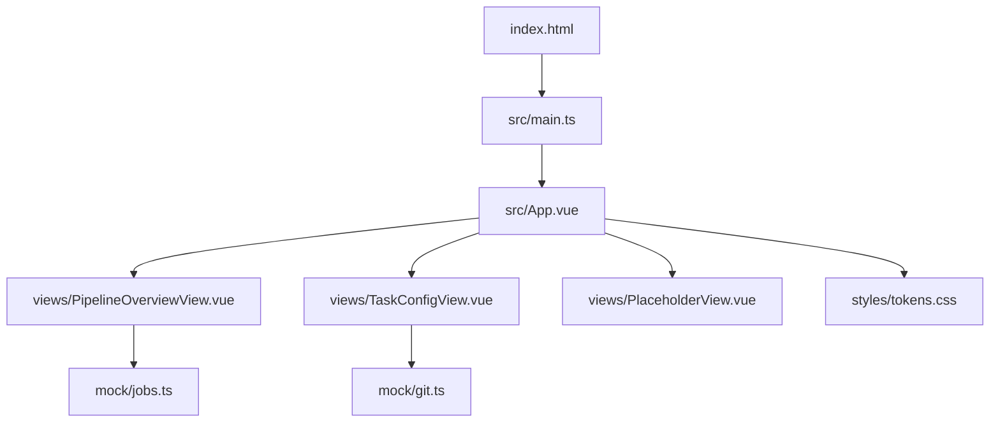
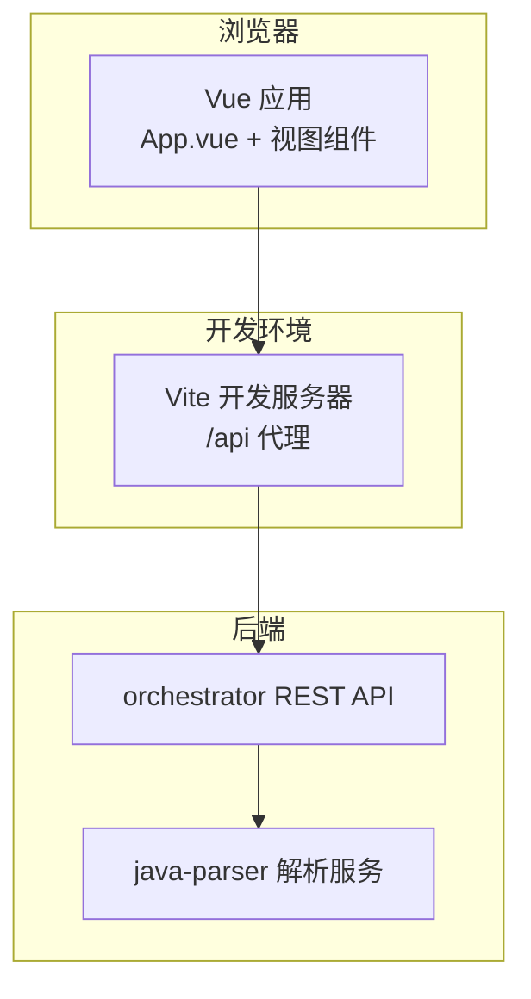
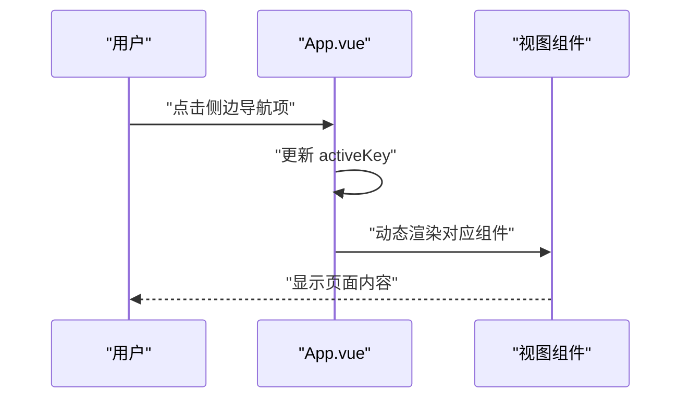
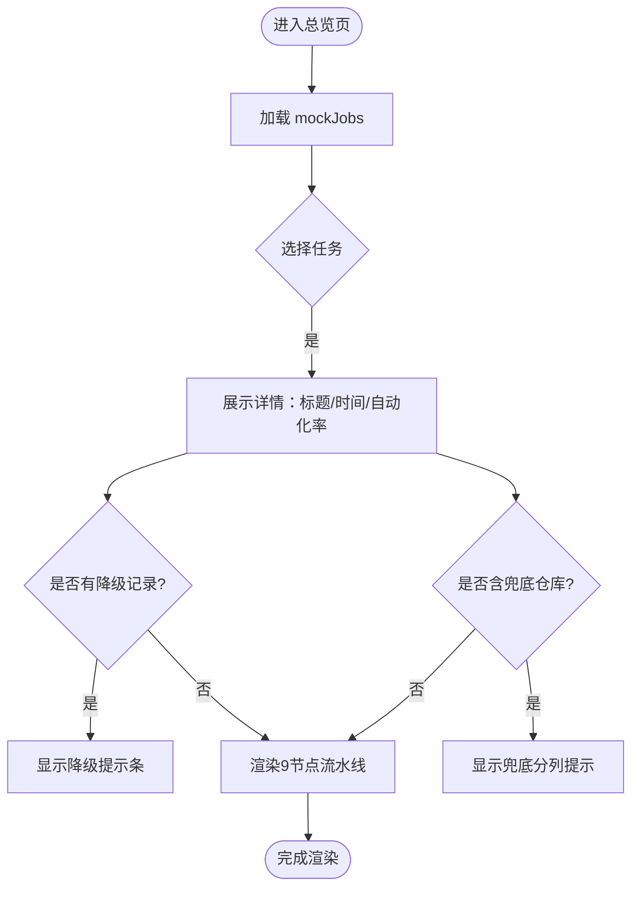
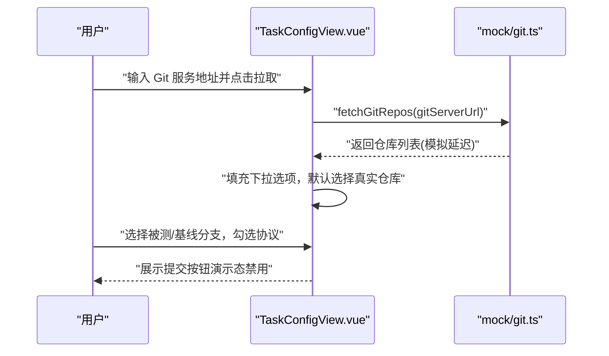
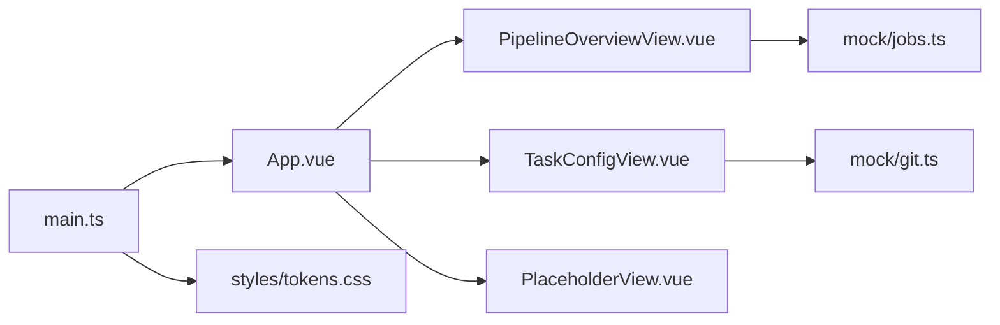

# 前端应用

<cite>
**本文引用的文件**
- [package.json](file://services/frontend/package.json)
- [vite.config.ts](file://services/frontend/vite.config.ts)
- [index.html](file://services/frontend/index.html)
- [main.ts](file://services/frontend/src/main.ts)
- [App.vue](file://services/frontend/src/App.vue)
- [PipelineOverviewView.vue](file://services/frontend/src/views/PipelineOverviewView.vue)
- [TaskConfigView.vue](file://services/frontend/src/views/TaskConfigView.vue)
- [PlaceholderView.vue](file://services/frontend/src/views/PlaceholderView.vue)
- [tokens.css](file://services/frontend/src/styles/tokens.css)
- [jobs.ts](file://services/frontend/src/mock/jobs.ts)
- [git.ts](file://services/frontend/src/mock/git.ts)
- [tsconfig.json](file://services/frontend/tsconfig.json)
- [eslint.config.js](file://services/frontend/eslint.config.js)
- [07-非功能需求与约束.md](file://MumuSpec/07-非功能需求与约束.md)
- [08-系统架构与技术选型.md](file://MumuSpec/08-系统架构与技术选型.md)
- [07_UI演示设计.md](file://docs/07_UI演示设计.md)
</cite>

## 目录
1. [简介](#简介)
2. [项目结构](#项目结构)
3. [核心组件](#核心组件)
4. [架构总览](#架构总览)
5. [详细组件分析](#详细组件分析)
6. [依赖关系分析](#依赖关系分析)
7. [性能考虑](#性能考虑)
8. [故障排查指南](#故障排查指南)
9. [结论](#结论)
10. [附录](#附录)

## 简介
本项目是基于 Vue 3 与 Vite 构建的前端应用，提供可视化的流水线监控与管理界面。当前已实现“任务配置”和“流水线总览”两个页面，其余四页以占位视图预留，后续按排期接入 orchestrator REST API。应用采用轻量状态管理（Vue 响应式），通过 Mock 数据完成开发期联调，样式系统基于 CSS 变量令牌，支持主题定制与响应式布局。

## 项目结构
前端工程位于 services/frontend，采用单页应用结构：入口 HTML 引入 main.ts，挂载 App.vue；App.vue 作为外壳承载左侧导航与主内容区，动态渲染各视图组件；样式集中在 styles/tokens.css；Mock 数据在 mock 目录下；构建与开发工具链由 vite.config.ts、tsconfig.json、eslint.config.js 等配置。

图表来源
- [index.html:1-17](file://services/frontend/index.html#L1-L17)
- [main.ts:1-7](file://services/frontend/src/main.ts#L1-L7)
- [App.vue:1-86](file://services/frontend/src/App.vue#L1-L86)
- [PipelineOverviewView.vue:1-88](file://services/frontend/src/views/PipelineOverviewView.vue#L1-L88)
- [TaskConfigView.vue:1-88](file://services/frontend/src/views/TaskConfigView.vue#L1-L88)
- [PlaceholderView.vue:1-18](file://services/frontend/src/views/PlaceholderView.vue#L1-L18)
- [tokens.css:1-106](file://services/frontend/src/styles/tokens.css#L1-L106)
- [jobs.ts:1-110](file://services/frontend/src/mock/jobs.ts#L1-L110)
- [git.ts:1-58](file://services/frontend/src/mock/git.ts#L1-L58)

章节来源
- [package.json:1-30](file://services/frontend/package.json#L1-L30)
- [vite.config.ts:1-16](file://services/frontend/vite.config.ts#L1-L16)
- [index.html:1-17](file://services/frontend/index.html#L1-L17)
- [main.ts:1-7](file://services/frontend/src/main.ts#L1-L7)
- [App.vue:1-86](file://services/frontend/src/App.vue#L1-L86)

## 核心组件
- 应用外壳 App.vue：左侧六页导航 + 顶栏，使用 Vue 动态组件切换视图，无路由依赖（M1 阶段）。
- 流水线总览 PipelineOverviewView.vue：展示 job 列表与选中任务的 9 节点流水线状态、自动化率、降级与兜底提示。
- 任务配置 TaskConfigView.vue：表单化配置任务，支持从 Git 服务拉取仓库列表并选择被测分支与基线分支，协议范围勾选，前置数据说明。
- 占位视图 PlaceholderView.vue：为未实现页面提供方向锚点与规格编号标注。

章节来源
- [App.vue:1-86](file://services/frontend/src/App.vue#L1-L86)
- [PipelineOverviewView.vue:1-88](file://services/frontend/src/views/PipelineOverviewView.vue#L1-L88)
- [TaskConfigView.vue:1-88](file://services/frontend/src/views/TaskConfigView.vue#L1-L88)
- [PlaceholderView.vue:1-18](file://services/frontend/src/views/PlaceholderView.vue#L1-L18)

## 架构总览
前端通过 Vite 开发服务器代理 /api 到后端 orchestrator（本地 8000 端口），开发期使用 Mock 数据模拟接口返回。整体交互遵循“配置 → 监控 → Review → 报告 → 复测 → 沉淀与度量”的六页方向。

图表来源
- [vite.config.ts:4-15](file://services/frontend/vite.config.ts#L4-L15)
- [08-系统架构与技术选型.md:29-54](file://MumuSpec/08-系统架构与技术选型.md#L29-L54)

章节来源
- [vite.config.ts:1-16](file://services/frontend/vite.config.ts#L1-L16)
- [08-系统架构与技术选型.md:29-54](file://MumuSpec/08-系统架构与技术选型.md#L29-L54)

## 详细组件分析

### 应用外壳与视图切换（App.vue）
- 使用 views 数组声明六页导航，activeKey 控制当前激活视图。
- 通过 <component :is="..."> 动态渲染对应组件，并透传 props。
- 侧边栏品牌区、导航列表、版本与环境标识；主区域包含顶栏与内容区。

图表来源
- [App.vue:15-86](file://services/frontend/src/App.vue#L15-L86)

章节来源
- [App.vue:1-86](file://services/frontend/src/App.vue#L1-L86)

### 流水线总览（PipelineOverviewView.vue）
- 数据来源：mock/jobs.ts 中的 JobSummary 与 NodeStatus。
- 展示要点：
  - 左侧 job 列表，选中高亮。
  - 右侧详情：标题、创建时间、自动化率（后端汇总值）、降级清单、兜底仓库提示。
  - 9 节点流水线可视化：节点序号、标签、状态映射，运行中节点呼吸动画。
- 数值口径：自动化率分母固定为 9，null 表示数据不完整，不输出误导数值。

图表来源
- [PipelineOverviewView.vue:1-88](file://services/frontend/src/views/PipelineOverviewView.vue#L1-L88)
- [jobs.ts:1-110](file://services/frontend/src/mock/jobs.ts#L1-L110)

章节来源
- [PipelineOverviewView.vue:1-88](file://services/frontend/src/views/PipelineOverviewView.vue#L1-L88)
- [jobs.ts:1-110](file://services/frontend/src/mock/jobs.ts#L1-L110)

### 任务配置（TaskConfigView.vue）
- 表单字段：任务名称、需求文档路径与格式、协议范围多选、前置数据说明。
- Git 仓库拉取：调用 mock/git.ts 的 fetchGitRepos，模拟网络延迟后返回仓库列表；支持选择被测分支与基线分支，自动识别兜底仓库。
- 提交按钮：演示态禁用，待 orchestrator REST API 冻结后启用。

图表来源
- [TaskConfigView.vue:25-86](file://services/frontend/src/views/TaskConfigView.vue#L25-L86)
- [git.ts:1-58](file://services/frontend/src/mock/git.ts#L1-L58)

章节来源
- [TaskConfigView.vue:1-220](file://services/frontend/src/views/TaskConfigView.vue#L1-L220)
- [git.ts:1-58](file://services/frontend/src/mock/git.ts#L1-L58)

### 占位视图（PlaceholderView.vue）
- 接收 title 与 spec 属性，用于标注页面方向与规格编号。
- 作为未来实现的占位容器，保持视觉一致性与可维护性。

章节来源
- [PlaceholderView.vue:1-18](file://services/frontend/src/views/PlaceholderView.vue#L1-L18)

## 依赖关系分析
- 运行时依赖：vue 3.x。
- 开发依赖：@vitejs/plugin-vue、vite、typescript、vitest、eslint、prettier、vue-tsc。
- 模块依赖：
  - App.vue 依赖 PipelineOverviewView、TaskConfigView、PlaceholderView。
  - PipelineOverviewView 依赖 mock/jobs.ts。
  - TaskConfigView 依赖 mock/git.ts。
  - main.ts 引入 App.vue 与 tokens.css。

图表来源
- [main.ts:1-7](file://services/frontend/src/main.ts#L1-L7)
- [App.vue:1-86](file://services/frontend/src/App.vue#L1-L86)
- [PipelineOverviewView.vue:1-88](file://services/frontend/src/views/PipelineOverviewView.vue#L1-L88)
- [TaskConfigView.vue:1-88](file://services/frontend/src/views/TaskConfigView.vue#L1-L88)
- [PlaceholderView.vue:1-18](file://services/frontend/src/views/PlaceholderView.vue#L1-L18)
- [jobs.ts:1-110](file://services/frontend/src/mock/jobs.ts#L1-L110)
- [git.ts:1-58](file://services/frontend/src/mock/git.ts#L1-L58)
- [tokens.css:1-106](file://services/frontend/src/styles/tokens.css#L1-L106)

章节来源
- [package.json:1-30](file://services/frontend/package.json#L1-L30)
- [tsconfig.json:1-16](file://services/frontend/tsconfig.json#L1-L16)
- [eslint.config.js:1-31](file://services/frontend/eslint.config.js#L1-L31)

## 性能考虑
- 构建与开发：
  - Vite 插件 @vitejs/plugin-vue 提供快速热更新与按需编译。
  - TypeScript 严格模式与 noUnusedLocals/noUnusedParameters 提升代码质量，减少冗余。
- 运行时优化：
  - 使用 CSS 变量令牌集中管理样式，减少重复计算与重绘。
  - 列表渲染采用 key 绑定，避免不必要的 DOM 重建。
  - 动画仅对运行中节点启用呼吸效果，降低全局开销。
- 网络与 Mock：
  - 开发期 Mock 增加模拟延迟，便于观察加载态与错误态。
  - 正式对接 API 后可引入请求去抖、分页与缓存策略。

[本节为通用指导，不直接分析具体文件]

## 故障排查指南
- 开发服务器代理问题：
  - 检查 vite.config.ts 的 server.proxy 配置是否正确指向 orchestrator 地址。
  - 确认后端服务已在指定端口启动。
- Mock 数据异常：
  - 核对 jobs.ts 与 git.ts 的数据结构与字段命名是否与组件期望一致。
  - 若需调整演示数据，确保自动化率 null 场景正确触发“数据不完整”提示。
- 样式与主题：
  - 若颜色或间距异常，检查 tokens.css 的变量定义是否被覆盖。
  - 使用浏览器开发者工具检查 computed styles 与 CSS 变量生效情况。
- 类型与 ESLint：
  - 运行 lint 命令定位语法与风格问题。
  - 使用 vue-tsc 校验类型错误。

章节来源
- [vite.config.ts:4-15](file://services/frontend/vite.config.ts#L4-L15)
- [jobs.ts:1-110](file://services/frontend/src/mock/jobs.ts#L1-L110)
- [git.ts:1-58](file://services/frontend/src/mock/git.ts#L1-L58)
- [tokens.css:1-106](file://services/frontend/src/styles/tokens.css#L1-L106)
- [eslint.config.js:1-31](file://services/frontend/eslint.config.js#L1-L31)

## 结论
本前端应用以 Vue 3 + Vite 为基础，实现了任务配置与流水线总览的核心能力，并通过 Mock 数据完成开发期联调。样式系统基于令牌化 CSS 变量，具备良好的主题扩展性。后续将按排期逐步接入 orchestrator REST API，完善 Code Review、测试报告、缺陷闭环与回归度量页面，形成完整的六页方向产品形态。

[本节为总结性内容，不直接分析具体文件]

## 附录

### 开发环境搭建
- 安装依赖：使用 pnpm 安装依赖（见 package.json scripts）。
- 启动开发服务器：执行 dev 脚本，访问浏览器查看界面。
- 代理配置：vite.config.ts 已将 /api 代理至 http://localhost:8000，需确保 orchestrator 在该端口运行。

章节来源
- [package.json:8-12](file://services/frontend/package.json#L8-L12)
- [vite.config.ts:4-15](file://services/frontend/vite.config.ts#L4-L15)

### 构建与部署
- 构建产物：执行 build 脚本，生成静态资源供 Nginx 托管。
- 部署建议：结合 docker-compose 编排 frontend、orchestrator、java-parser 等服务，统一对外暴露 Web 入口。

章节来源
- [package.json:8-12](file://services/frontend/package.json#L8-L12)
- [08-系统架构与技术选型.md:71-79](file://MumuSpec/08-系统架构与技术选型.md#L71-L79)

### 用户体验优化
- 明确的状态反馈：运行中节点呼吸动画、降级与兜底提示条、数据不完整占位。
- 一致的视觉语言：白底低噪声背景、单一强调色、细线分隔、等宽数字。
- 操作引导：任务配置页提供 Git 拉取与分支选择流程，降低上手成本。

章节来源
- [PipelineOverviewView.vue:75-88](file://services/frontend/src/views/PipelineOverviewView.vue#L75-L88)
- [tokens.css:1-60](file://services/frontend/src/styles/tokens.css#L1-L60)
- [07_UI演示设计.md:32-41](file://docs/07_UI演示设计.md#L32-L41)

### 性能调优与兼容性
- 构建期：TypeScript 严格模式与 ESLint 规则保障代码质量，减少运行时错误。
- 运行期：CSS 变量与局部样式作用域减少全局污染；动画仅在必要时启用。
- 兼容性：现代浏览器支持 CSS 变量与 Flex/Grid；如需旧版兼容，可增加 polyfill 与降级样式。

章节来源
- [tsconfig.json:1-16](file://services/frontend/tsconfig.json#L1-L16)
- [eslint.config.js:1-31](file://services/frontend/eslint.config.js#L1-L31)
- [tokens.css:62-106](file://services/frontend/src/styles/tokens.css#L62-L106)

### API 集成与错误处理
- 开发期：Mock 数据模拟接口返回，便于独立开发与联调。
- 正式对接：替换 Mock 为真实 API 调用，增加错误捕获与用户提示。
- 非功能要求：错误提示明确、断点续跑、降级策略与可审计日志需在后端配合实现。

章节来源
- [jobs.ts:1-110](file://services/frontend/src/mock/jobs.ts#L1-L110)
- [git.ts:1-58](file://services/frontend/src/mock/git.ts#L1-L58)
- [07-非功能需求与约束.md:29-70](file://MumuSpec/07-非功能需求与约束.md#L29-L70)