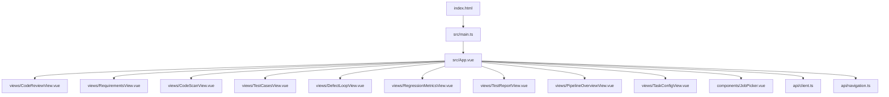
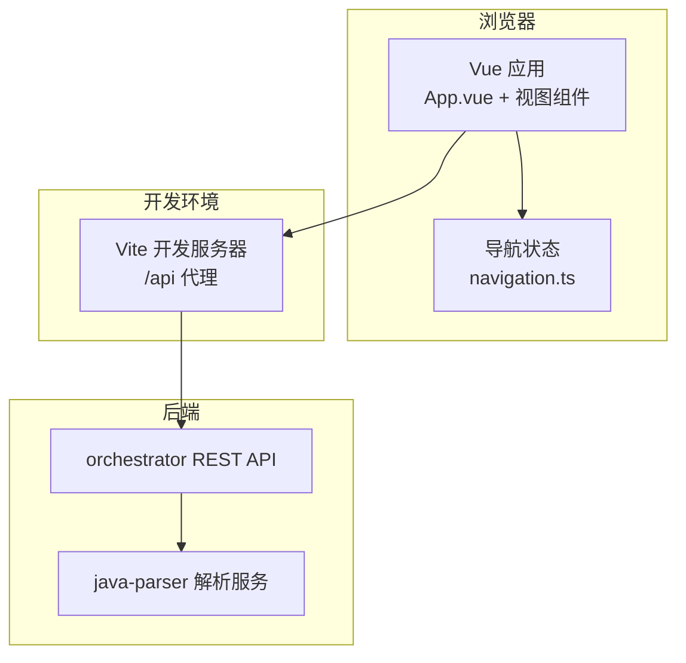
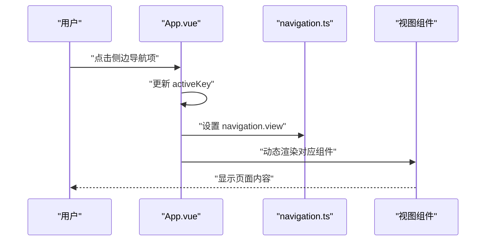
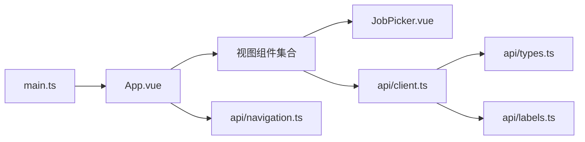

# 前端应用

<cite>
**本文引用的文件**
- [package.json](file://services/frontend/package.json)
- [vite.config.ts](file://services/frontend/vite.config.ts)
- [index.html](file://services/frontend/index.html)
- [main.ts](file://services/frontend/src/main.ts)
- [App.vue](file://services/frontend/src/App.vue)
- [CodeReviewView.vue](file://services/frontend/src/views/CodeReviewView.vue)
- [RequirementsView.vue](file://services/frontend/src/views/RequirementsView.vue)
- [CodeScanView.vue](file://services/frontend/src/views/CodeScanView.vue)
- [TestCasesView.vue](file://services/frontend/src/views/TestCasesView.vue)
- [DefectLoopView.vue](file://services/frontend/src/views/DefectLoopView.vue)
- [RegressionMetricsView.vue](file://services/frontend/src/views/RegressionMetricsView.vue)
- [TestReportView.vue](file://services/frontend/src/views/TestReportView.vue)
- [PipelineOverviewView.vue](file://services/frontend/src/views/PipelineOverviewView.vue)
- [TaskConfigView.vue](file://services/frontend/src/views/TaskConfigView.vue)
- [JobPicker.vue](file://services/frontend/src/components/JobPicker.vue)
- [client.ts](file://services/frontend/src/api/client.ts)
- [navigation.ts](file://services/frontend/src/api/navigation.ts)
- [labels.ts](file://services/frontend/src/api/labels.ts)
- [types.ts](file://services/frontend/src/api/types.ts)
- [tokens.css](file://services/frontend/src/styles/tokens.css)
- [tsconfig.json](file://services/frontend/tsconfig.json)
- [eslint.config.js](file://services/frontend/eslint.config.js)
</cite>

## 更新摘要
**变更内容**
- 从占位视图完全重建为九屏界面，包含工作台、分析与设计、验证与交付三个主要部分
- 新增 CodeReviewView、RequirementsView、CodeScanView、TestCasesView、DefectLoopView、RegressionMetricsView 和 TestReportView 等视图组件
- 所有视图组件已连接到真实的编排器 API，替代了之前的 Mock 数据
- 实现了跨页导航共享状态，支持从总览页节点卡跳转到目标页面并携带 jobId
- 完善了任务配置功能，支持真实 Git 仓库拉取和分支选择
- **新增认证配置验证功能**：TaskConfigView组件增加了"测试鉴权并保存会话"功能和"仅保存配置"按钮，提供更友好的认证配置验证体验和配置管理控制

## 目录
1. [简介](#简介)
2. [项目结构](#项目结构)
3. [核心组件](#核心组件)
4. [架构总览](#架构总览)
5. [详细组件分析](#详细组件分析)
6. [依赖关系分析](#依赖关系分析)
7. [性能考虑](#性能考虑)
8. [故障排查指南](#故障排查指南)
9. [结论](#结论)
10. [附录](#附录)

## 简介
本项目是基于 Vue 3 与 Vite 构建的前端应用，提供可视化的流水线监控与管理界面。现已实现完整的九屏界面，包含"工作台"（任务配置、流水线总览）、"分析与设计"（需求解析、源码扫描与接口还原、Code Review、测试用例）和"验证与交付"（测试报告、缺陷闭环、回归资产与度量）三个主要部分。应用采用轻量状态管理（Vue 响应式），通过 orchestrator REST API 获取真实数据，样式系统基于 CSS 变量令牌，支持主题定制与响应式布局。

## 项目结构
前端工程位于 services/frontend，采用单页应用结构：入口 HTML 引入 main.ts，挂载 App.vue；App.vue 作为外壳承载左侧九页导航与主内容区，动态渲染各视图组件；样式集中在 styles/tokens.css；API 客户端在 api 目录下；共享组件在 components 目录下；构建与开发工具链由 vite.config.ts、tsconfig.json、eslint.config.js 等配置。

**图表来源**
- [index.html:1-17](file://services/frontend/index.html#L1-L17)
- [main.ts:1-7](file://services/frontend/src/main.ts#L1-L7)
- [App.vue:1-304](file://services/frontend/src/App.vue#L1-L304)

**章节来源**
- [package.json:1-30](file://services/frontend/package.json#L1-L30)
- [vite.config.ts:1-16](file://services/frontend/vite.config.ts#L1-L16)
- [index.html:1-17](file://services/frontend/index.html#L1-L17)
- [main.ts:1-7](file://services/frontend/src/main.ts#L1-L7)
- [App.vue:1-304](file://services/frontend/src/App.vue#L1-L304)

## 核心组件
- **应用外壳 App.vue**：左侧九页导航（工作台、分析与设计、验证与交付三组）+ 顶栏，使用 Vue 动态组件切换视图，支持跨页导航共享状态。
- **任务配置 TaskConfigView.vue**：表单化配置任务，支持从 Git 服务拉取仓库列表并选择被测分支与基线分支，协议范围勾选，前置数据说明。**新增认证配置验证功能**，支持测试鉴权并保存会话，以及仅保存配置而不启动运行。
- **流水线总览 PipelineOverviewView.vue**：展示 job 列表与选中任务的 9 节点流水线状态、自动化率、降级与兜底提示。
- **需求解析 RequirementsView.vue**：展示 requirement_review 质量结论与澄清风险，以及 requirement_items 可执行条目。
- **源码扫描与接口还原 CodeScanView.vue**：展示 code_inventory 仓库四态、interface_candidates 静态候选、interfaces 还原结果。
- **Code Review CodeReviewView.vue**：需求-代码映射表、风险清单、遗漏功能清单、变更范围，支持人工审核面板。
- **测试用例 TestCasesView.vue**：testcases.json 全量用例，三类分列（正常、边界、异常），接口/需求双溯源。
- **缺陷闭环 DefectLoopView.vue**：缺陷清单、生命周期时间线、单条复测与一键全量复测。
- **回归资产与度量 RegressionMetricsView.vue**：回归资产树、回归套件重跑、度量报告。
- **测试报告 TestReportView.vue**：KPI、失败明细、降级说明、报告 Markdown 原文。
- **共享 JobPicker.vue**：下拉列出产物目录中的 job，支持运行中标注。

**章节来源**
- [App.vue:1-304](file://services/frontend/src/App.vue#L1-L304)
- [TaskConfigView.vue:1-1126](file://services/frontend/src/views/TaskConfigView.vue#L1-L1126)
- [PipelineOverviewView.vue:1-88](file://services/frontend/src/views/PipelineOverviewView.vue#L1-L88)
- [RequirementsView.vue:1-553](file://services/frontend/src/views/RequirementsView.vue#L1-L553)
- [CodeScanView.vue:1-345](file://services/frontend/src/views/CodeScanView.vue#L1-L345)
- [CodeReviewView.vue:1-684](file://services/frontend/src/views/CodeReviewView.vue#L1-L684)
- [TestCasesView.vue:1-319](file://services/frontend/src/views/TestCasesView.vue#L1-L319)
- [DefectLoopView.vue:1-540](file://services/frontend/src/views/DefectLoopView.vue#L1-L540)
- [RegressionMetricsView.vue:1-458](file://services/frontend/src/views/RegressionMetricsView.vue#L1-L458)
- [TestReportView.vue:1-418](file://services/frontend/src/views/TestReportView.vue#L1-L418)
- [JobPicker.vue:1-114](file://services/frontend/src/components/JobPicker.vue#L1-L114)

## 架构总览
前端通过 Vite 开发服务器代理 /api 到后端 orchestrator（本地 8000 端口），所有视图组件直接调用 orchestrator REST API 获取真实数据。整体交互遵循"配置 → 监控 → Review → 报告 → 复测 → 沉淀与度量"的完整流程，支持跨页导航和状态共享。

**图表来源**
- [vite.config.ts:4-15](file://services/frontend/vite.config.ts#L4-L15)
- [navigation.ts:1-16](file://services/frontend/src/api/navigation.ts#L1-L16)

**章节来源**
- [vite.config.ts:1-16](file://services/frontend/vite.config.ts#L1-L16)
- [navigation.ts:1-16](file://services/frontend/src/api/navigation.ts#L1-L16)

## 详细组件分析

### 应用外壳与视图切换（App.vue）
- 使用 views 数组声明九页导航，分为"工作台"、"分析与设计"、"验证与交付"三个分组。
- 通过 <component :is="..."> 动态渲染对应组件，并透传 props（initial-job-id、view-key）。
- 侧边栏品牌区、导航列表、版本与环境标识；主区域包含顶栏与内容区。
- 支持 E2E 可选子流程的动态导航项添加。

**图表来源**
- [App.vue:15-88](file://services/frontend/src/App.vue#L15-L88)
- [navigation.ts:11-16](file://services/frontend/src/api/navigation.ts#L11-L16)

**章节来源**
- [App.vue:1-304](file://services/frontend/src/App.vue#L1-L304)

### 任务配置（TaskConfigView.vue）
- 表单字段：任务名称、需求文档路径与格式、协议范围多选、前置数据说明。
- Git 仓库拉取：调用 mock/git.ts 的 fetchGitRepos，模拟网络延迟后返回仓库列表；支持选择被测分支与基线分支，自动识别兜底仓库。
- 提交按钮：演示态禁用，待 orchestrator REST API 冻结后启用。
- **新增认证配置验证功能**：
  - 提供"测试鉴权并保存会话"按钮，在执行前验证登录凭据
  - 支持 Token 和 Cookie 两种认证方式，自动检测并建立会话
  - 验证成功后显示会话类型和状态反馈
  - 新增"仅保存配置"按钮，允许用户只保存配置而不立即启动运行
  - 支持编辑模式下保留现有密码和 API Key

**更新** 新增了完整的认证配置验证流程和配置管理控制功能

**章节来源**
- [TaskConfigView.vue:1-1126](file://services/frontend/src/views/TaskConfigView.vue#L1-L1126)

### 需求解析（RequirementsView.vue）
- 先展示 requirement_review 的质量结论与澄清风险，再展示 requirement_items 的可执行条目。
- 所有内容均来自后端产物，前端不计算。
- 支持多文档来源展示和质量评分可视化。

**章节来源**
- [RequirementsView.vue:1-553](file://services/frontend/src/views/RequirementsView.vue#L1-L553)

### 源码扫描与接口还原（CodeScanView.vue）
- 展示 code_inventory.json 仓库四态 + interface_candidates.json 静态候选 + interfaces.json 还原结果。
- 兜底候选如实标注，候选与最终接口分列。
- 支持置信度标注和代码位置溯源。

**章节来源**
- [CodeScanView.vue:1-345](file://services/frontend/src/views/CodeScanView.vue#L1-L345)

### Code Review（CodeReviewView.vue）
- 视图一：需求-代码映射表（四态+置信度）
- 视图二：风险清单（部分实现/证据不足）
- 视图三：遗漏功能清单（程序化派生）
- 视图四：变更范围（双分支 diff，仅配基线分支的 job 展示）
- 人工审核面板：approved/rejected 决策，不计入 9 节点自动化率口径

**章节来源**
- [CodeReviewView.vue:1-684](file://services/frontend/src/views/CodeReviewView.vue#L1-L684)

### 测试用例（TestCasesView.vue）
- testcases.json 全量用例，三类分列（正常、边界、异常）
- 接口/需求双溯源，参数/预期 + 脚本可加载性
- low_confidence（unknown 参数）与 warnings 如实标注

**章节来源**
- [TestCasesView.vue:1-319](file://services/frontend/src/views/TestCasesView.vue#L1-L319)

### 缺陷闭环（DefectLoopView.vue）
- 缺陷清单（双向关联 + 复现脚本引用）
- 生命周期时间线（可审计流转）
- 单条复测与一键全量复测
- 边界提示如实分列

**章节来源**
- [DefectLoopView.vue:1-540](file://services/frontend/src/views/DefectLoopView.vue#L1-L540)

### 回归资产与度量（RegressionMetricsView.vue）
- 左栏：回归资产树（按协议分组 + 溯源）
- 右栏：回归套件重跑 + 度量报告
- 自动化率大数 + 分节点分解 + 瓶颈分析
- 数值全部来自后端 metrics 程序化汇总

**章节来源**
- [RegressionMetricsView.vue:1-458](file://services/frontend/src/views/RegressionMetricsView.vue#L1-L458)

### 测试报告（TestReportView.vue）
- KPI（execution.json summary 后端汇总）
- 失败二态明细（断言失败 vs 环境失败）
- 降级说明（degraded_protocols）
- 报告 Markdown 原文（后端唯一事实源）

**章节来源**
- [TestReportView.vue:1-418](file://services/frontend/src/views/TestReportView.vue#L1-L418)

### 共享 JobPicker 组件
- 下拉列出产物目录中的 job（后端 list_jobs）
- v-model 双向绑定 job_id
- 运行中的 job 如实标注

**章节来源**
- [JobPicker.vue:1-114](file://services/frontend/src/components/JobPicker.vue#L1-L114)

## 依赖关系分析
- **运行时依赖**：vue 3.x。
- **开发依赖**：@vitejs/plugin-vue、vite、typescript、vitest、eslint、prettier、vue-tsc。
- **模块依赖**：
  - App.vue 依赖所有视图组件和 navigation 状态管理。
  - 各视图组件依赖 JobPicker 组件和 API 客户端。
  - API 客户端统一封装 orchestrator REST API 调用。
  - 类型定义集中管理，确保前后端契约一致。

**图表来源**
- [main.ts:1-7](file://services/frontend/src/main.ts#L1-L7)
- [App.vue:1-304](file://services/frontend/src/App.vue#L1-L304)
- [client.ts:1-223](file://services/frontend/src/api/client.ts#L1-L223)

**章节来源**
- [package.json:1-30](file://services/frontend/package.json#L1-L30)
- [tsconfig.json:1-16](file://services/frontend/tsconfig.json#L1-L16)
- [eslint.config.js:1-31](file://services/frontend/eslint.config.js#L1-L31)

## 性能考虑
- **构建与开发**：
  - Vite 插件 @vitejs/plugin-vue 提供快速热更新与按需编译。
  - TypeScript 严格模式与 noUnusedLocals/noUnusedParameters 提升代码质量，减少冗余。
- **运行时优化**：
  - 使用 CSS 变量令牌集中管理样式，减少重复计算与重绘。
  - 列表渲染采用 key 绑定，避免不必要的 DOM 重建。
  - 动画仅对运行中节点启用呼吸效果，降低全局开销。
- **网络与 API**：
  - 所有视图组件直接调用 orchestrator REST API，无中间层。
  - 错误处理统一封装，提供友好的用户反馈。
  - 支持并发请求优化（如 Promise.allSettled 用于独立产物加载）。

## 故障排查指南
- **开发服务器代理问题**：
  - 检查 vite.config.ts 的 server.proxy 配置是否正确指向 orchestrator 地址。
  - 确认后端服务已在指定端口启动。
- **API 调用失败**：
  - 核对 client.ts 中的 API 路径是否与后端路由匹配。
  - 检查 types.ts 中的类型定义是否与后端响应结构一致。
  - 查看 labels.ts 中的中文标签映射是否完整。
- **视图组件加载问题**：
  - 确认 App.vue 中的视图注册是否正确。
  - 检查 navigation.ts 中的跨页导航状态是否正确传递。
  - 验证 JobPicker 组件是否能正确加载 job 列表。
- **样式与主题**：
  - 若颜色或间距异常，检查 tokens.css 的变量定义是否被覆盖。
  - 使用浏览器开发者工具检查 computed styles 与 CSS 变量生效情况。
- **类型与 ESLint**：
  - 运行 lint 命令定位语法与风格问题。
  - 使用 vue-tsc 校验类型错误。
- **认证配置问题**：
  - 检查 verifyAuthentication API 调用是否正确传递认证参数。
  - 确认鉴权配置表单验证逻辑正常工作。
  - 验证会话建立后的凭据头注入机制。

**章节来源**
- [vite.config.ts:4-15](file://services/frontend/vite.config.ts#L4-L15)
- [client.ts:38-82](file://services/frontend/src/api/client.ts#L38-L82)
- [types.ts:123-135](file://services/frontend/src/api/types.ts#L123-L135)
- [labels.ts:1-61](file://services/frontend/src/api/labels.ts#L1-L61)
- [App.vue:25-61](file://services/frontend/src/App.vue#L25-L61)
- [JobPicker.vue:14-35](file://services/frontend/src/components/JobPicker.vue#L14-L35)

## 结论
本前端应用以 Vue 3 + Vite 为基础，已从占位视图完全重建为完整的九屏界面，涵盖任务配置、流水线总览、需求解析、源码扫描与接口还原、Code Review、测试用例、测试报告、缺陷闭环和回归资产与度量等核心功能。所有视图组件已连接到真实的 orchestrator REST API，替代了之前的 Mock 数据。应用采用轻量状态管理，通过 CSS 变量令牌实现主题定制，具备良好的可扩展性和维护性。**最新更新的认证配置验证功能进一步提升了用户体验，提供了更友好的认证配置验证体验和配置管理控制**。后续可根据业务需求继续扩展新的视图组件和功能模块。

## 附录

### 开发环境搭建
- **安装依赖**：使用 pnpm 安装依赖（见 package.json scripts）。
- **启动开发服务器**：执行 dev 脚本，访问浏览器查看界面。
- **代理配置**：vite.config.ts 已将 /api 代理至 http://localhost:8000，需确保 orchestrator 在该端口运行。

**章节来源**
- [package.json:8-12](file://services/frontend/package.json#L8-L12)
- [vite.config.ts:4-15](file://services/frontend/vite.config.ts#L4-L15)

### 构建与部署
- **构建产物**：执行 build 脚本，生成静态资源供 Nginx 托管。
- **部署建议**：结合 docker-compose 编排 frontend、orchestrator、java-parser 等服务，统一对外暴露 Web 入口。

**章节来源**
- [package.json:8-12](file://services/frontend/package.json#L8-L12)

### 用户体验优化
- **明确的状态反馈**：运行中节点呼吸动画、降级与兜底提示、数据不完整占位。
- **一致的视觉语言**：白底低噪声背景、单一强调色、细线分隔、等宽数字。
- **操作引导**：任务配置页提供 Git 拉取与分支选择流程，降低上手成本。
- **跨页导航**：支持从总览页节点卡直接跳转到相关视图，携带 jobId 参数。
- **认证配置优化**：新增"测试鉴权并保存会话"功能，提供实时验证反馈；"仅保存配置"按钮支持配置管理而不立即运行。

**更新** 新增了认证配置相关的用户体验优化功能

**章节来源**
- [App.vue:90-133](file://services/frontend/src/App.vue#L90-L133)
- [tokens.css:1-60](file://services/frontend/src/styles/tokens.css#L1-L60)
- [TaskConfigView.vue:662-722](file://services/frontend/src/views/TaskConfigView.vue#L662-L722)

### 性能调优与兼容性
- **构建期**：TypeScript 严格模式与 ESLint 规则保障代码质量，减少运行时错误。
- **运行期**：CSS 变量与局部样式作用域减少全局污染；动画仅在必要时启用。
- **兼容性**：现代浏览器支持 CSS 变量与 Flex/Grid；如需旧版兼容，可增加 polyfill 与降级样式。

**章节来源**
- [tsconfig.json:1-16](file://services/frontend/tsconfig.json#L1-L16)
- [eslint.config.js:1-31](file://services/frontend/eslint.config.js#L1-L31)
- [tokens.css:62-106](file://services/frontend/src/styles/tokens.css#L62-L106)

### API 集成与错误处理
- **统一 API 客户端**：client.ts 封装所有 orchestrator REST API 调用，提供统一的错误处理。
- **类型安全**：types.ts 定义前后端契约，确保类型一致性。
- **错误反馈**：所有视图组件提供友好的错误提示和加载状态。
- **非功能要求**：错误提示明确、断点续跑、降级策略与可审计日志需在后端配合实现。
- **认证 API 集成**：verifyAuthentication API 支持配置阶段登录验证，返回会话ID和凭据类型。

**更新** 新增了认证相关的API集成和错误处理机制

**章节来源**
- [client.ts:1-223](file://services/frontend/src/api/client.ts#L1-L223)
- [types.ts:1-447](file://services/frontend/src/api/types.ts#L1-L447)

### 认证配置功能详解
- **认证验证流程**：
  - 用户输入登录URL、用户名和密码
  - 点击"测试鉴权并保存会话"按钮进行验证
  - 调用 `/api/v1/auth/verify` 接口进行认证测试
  - 根据响应判断认证类型（Token或Cookie）
  - 建立会话并保存会话ID用于后续任务提交
- **配置管理控制**：
  - "仅保存配置"按钮允许用户只保存配置而不启动运行
  - 支持编辑模式下保留现有密码和API Key
  - 提供详细的验证状态反馈和错误提示
- **安全性考虑**：
  - 凭据仅在内存中存储，不写入任务文件或LLM
  - 支持跳过HTTPS证书校验（测试环境自签名证书场景）
  - 密码字段使用安全输入模式，不会回显

**新增** 完整的认证配置验证和配置管理控制功能

**章节来源**
- [TaskConfigView.vue:165-187](file://services/frontend/src/views/TaskConfigView.vue#L165-L187)
- [TaskConfigView.vue:662-722](file://services/frontend/src/views/TaskConfigView.vue#L662-L722)
- [client.ts:73-82](file://services/frontend/src/api/client.ts#L73-L82)
- [types.ts:123-135](file://services/frontend/src/api/types.ts#L123-L135)