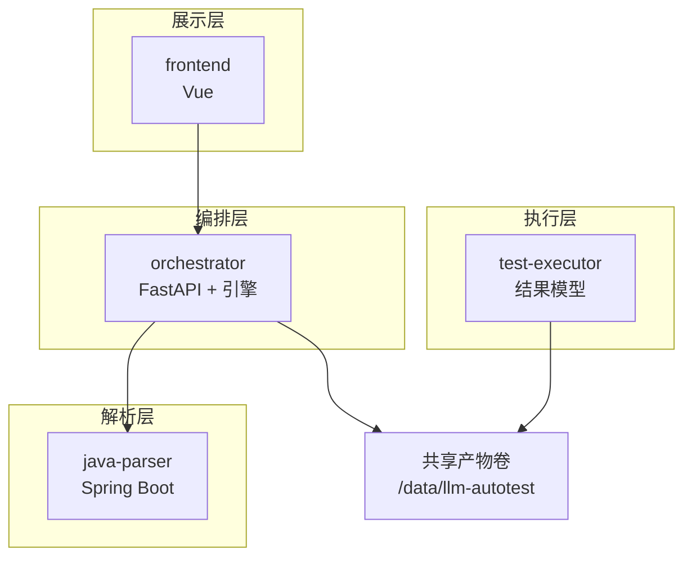
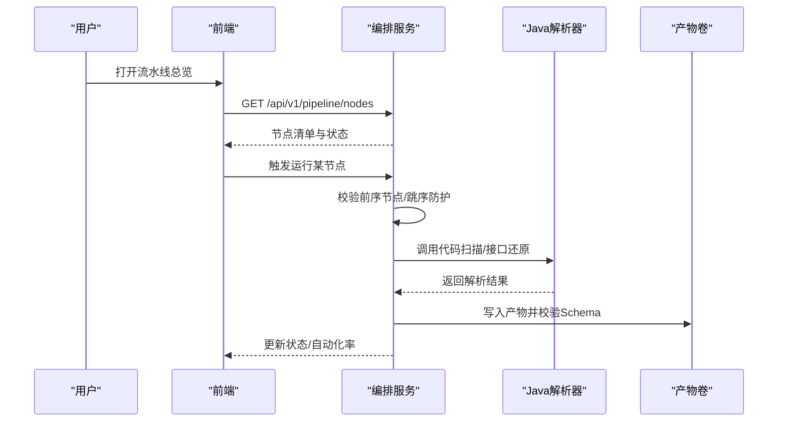
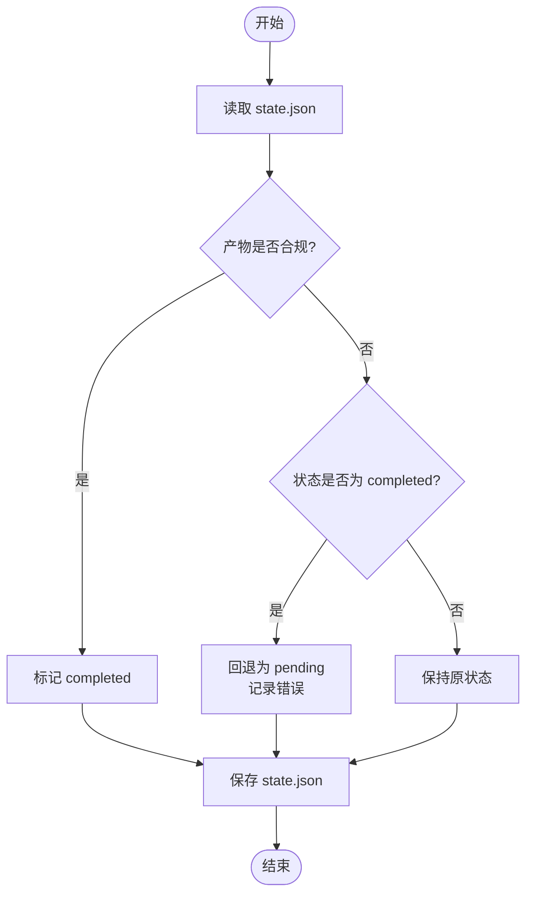
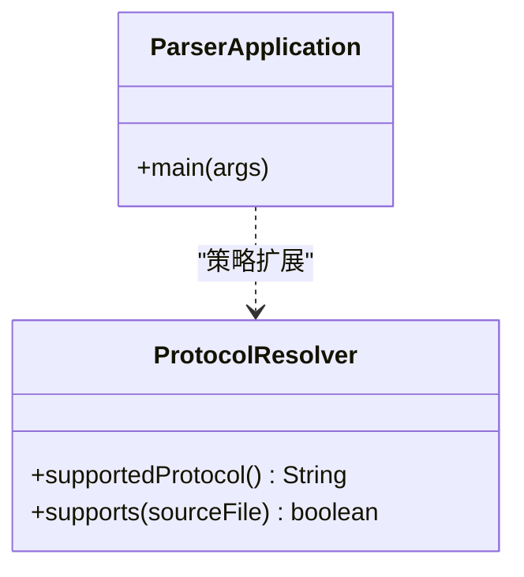
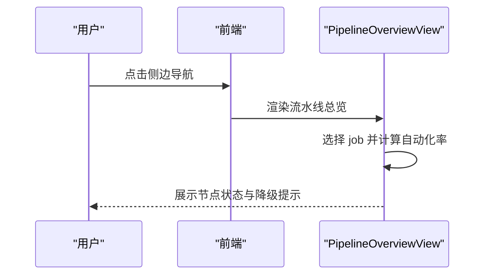
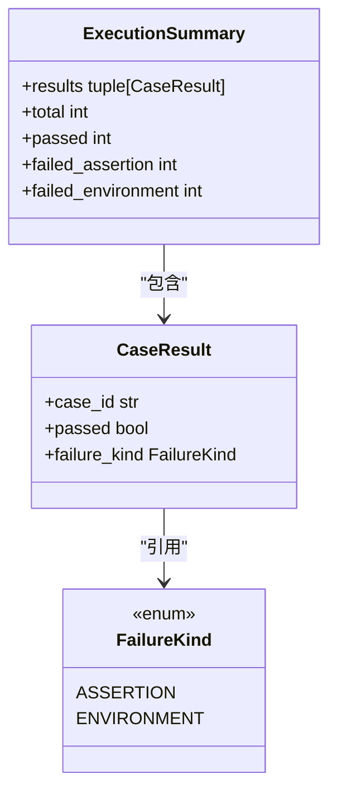
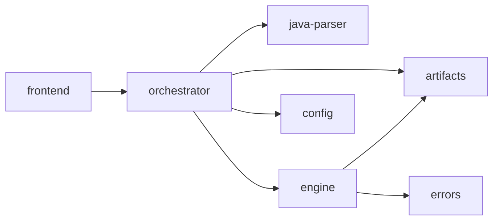

# 核心服务

<cite>
**本文引用的文件**
- [services/orchestrator/src/orchestrator/__main__.py](file://services/orchestrator/src/orchestrator/__main__.py)
- [services/orchestrator/src/orchestrator/api.py](file://services/orchestrator/src/orchestrator/api.py)
- [services/orchestrator/src/orchestrator/engine.py](file://services/orchestrator/src/orchestrator/engine.py)
- [services/orchestrator/src/orchestrator/pipeline.py](file://services/orchestrator/src/orchestrator/pipeline.py)
- [services/orchestrator/src/orchestrator/config.py](file://services/orchestrator/src/orchestrator/config.py)
- [services/orchestrator/src/orchestrator/artifacts.py](file://services/orchestrator/src/orchestrator/artifacts.py)
- [services/orchestrator/src/orchestrator/errors.py](file://services/orchestrator/src/orchestrator/errors.py)
- [services/java-parser/src/main/java/com/llmautotest/parser/ParserApplication.java](file://services/java-parser/src/main/java/com/llmautotest/parser/ParserApplication.java)
- [services/java-parser/src/main/java/com/llmautotest/parser/ProtocolResolver.java](file://services/java-parser/src/main/java/com/llmautotest/parser/ProtocolResolver.java)
- [services/java-parser/src/main/resources/application.yml](file://services/java-parser/src/main/resources/application.yml)
- [services/frontend/src/App.vue](file://services/frontend/src/App.vue)
- [services/frontend/src/views/PipelineOverviewView.vue](file://services/frontend/src/views/PipelineOverviewView.vue)
- [services/test-executor/src/executor/result.py](file://services/test-executor/src/executor/result.py)
- [deploy/docker-compose.yml](file://deploy/docker-compose.yml)
</cite>

## 目录
1. [简介](#简介)
2. [项目结构](#项目结构)
3. [核心组件](#核心组件)
4. [架构总览](#架构总览)
5. [详细组件分析](#详细组件分析)
6. [依赖关系分析](#依赖关系分析)
7. [性能与可观测性](#性能与可观测性)
8. [故障排查指南](#故障排查指南)
9. [结论](#结论)
10. [附录：部署与配置](#附录部署与配置)

## 简介
本文件面向 LLM-AutoTest 的核心服务，系统性说明编排服务（Orchestrator）、Java 解析器服务、前端应用与测试执行器的架构设计、API 接口、配置管理、错误处理机制、服务间通信协议与数据格式、部署配置、监控指标与故障排查要点。文档以“产物即事实”的编排原则为核心，强调状态对账、跳序防护、降级清单与自动化率口径的一致性。

## 项目结构
仓库按服务划分：
- orchestrator：Python FastAPI 编排服务，负责流水线状态、节点调度、产物校验与对外 API。
- java-parser：Spring Boot Java 服务，提供代码扫描与接口还原能力，支持多协议策略扩展。
- frontend：Vue 前端应用，提供任务配置、流水线总览等页面。
- test-executor：Python 测试执行结果模型与汇总逻辑骨架。
- deploy：Docker Compose 编排，统一端口、卷挂载与服务依赖。

图表来源
- [services/orchestrator/src/orchestrator/__main__.py:15-21](file://services/orchestrator/src/orchestrator/__main__.py#L15-L21)
- [services/java-parser/src/main/java/com/llmautotest/parser/ParserApplication.java:9-15](file://services/java-parser/src/main/java/com/llmautotest/parser/ParserApplication.java#L9-L15)
- [deploy/docker-compose.yml:3-41](file://deploy/docker-compose.yml#L3-L41)

章节来源
- [services/orchestrator/src/orchestrator/__main__.py:15-21](file://services/orchestrator/src/orchestrator/__main__.py#L15-L21)
- [deploy/docker-compose.yml:3-41](file://deploy/docker-compose.yml#L3-L41)

## 核心组件
- 编排服务（Orchestrator）
  - REST API：健康检查、节点清单查询。
  - 引擎：state.json 持久化、断点续跑、跳序防护、降级标记、完成判据。
  - 配置：环境变量驱动，含 LLM 调用参数与产物 Schema 目录。
  - 产物管理：写权排他、Schema 校验、原子落盘、归档。
- Java 解析器服务
  - 启动入口与配置；协议解析策略接口可扩展。
- 前端应用
  - 侧边导航与页面切换；流水线总览展示九节点状态与自动化率。
- 测试执行器
  - 用例结果二态区分（断言失败 vs 环境失败），程序化汇总。

章节来源
- [services/orchestrator/src/orchestrator/api.py:11-27](file://services/orchestrator/src/orchestrator/api.py#L11-L27)
- [services/orchestrator/src/orchestrator/engine.py:133-301](file://services/orchestrator/src/orchestrator/engine.py#L133-L301)
- [services/orchestrator/src/orchestrator/config.py:9-56](file://services/orchestrator/src/orchestrator/config.py#L9-L56)
- [services/orchestrator/src/orchestrator/artifacts.py:55-157](file://services/orchestrator/src/orchestrator/artifacts.py#L55-L157)
- [services/java-parser/src/main/java/com/llmautotest/parser/ParserApplication.java:9-15](file://services/java-parser/src/main/java/com/llmautotest/parser/ParserApplication.java#L9-L15)
- [services/java-parser/src/main/java/com/llmautotest/parser/ProtocolResolver.java:7-16](file://services/java-parser/src/main/java/com/llmautotest/parser/ProtocolResolver.java#L7-L16)
- [services/frontend/src/App.vue:15-45](file://services/frontend/src/App.vue#L15-L45)
- [services/test-executor/src/executor/result.py:17-61](file://services/test-executor/src/executor/result.py#L17-L61)

## 架构总览
系统采用分层与解耦设计：
- 前端通过 HTTP 访问编排服务的 REST API。
- 编排服务通过内部网络调用 Java 解析器服务进行代码扫描与接口还原。
- 所有中间产物与报告统一写入共享产物卷，由 Orchestrator 与 Test-Executor 按写权分工协作。
- 状态以 state.json 为中心，结合产物存在性与 Schema 校验作为“完成”的唯一依据。

图表来源
- [services/orchestrator/src/orchestrator/api.py:16-25](file://services/orchestrator/src/orchestrator/api.py#L16-L25)
- [services/orchestrator/src/orchestrator/engine.py:196-219](file://services/orchestrator/src/orchestrator/engine.py#L196-L219)
- [services/orchestrator/src/orchestrator/artifacts.py:75-96](file://services/orchestrator/src/orchestrator/artifacts.py#L75-L96)

## 详细组件分析

### 编排服务（Orchestrator）
- 启动与配置
  - CLI 入口加载 Settings，使用 uvicorn 启动 FastAPI 应用，监听 0.0.0.0:port。
  - 配置全部来自环境变量，包含端口、Java 解析器地址、产物根目录、LLM 调用参数与超时、Schema 目录等。
- REST API
  - /health：健康检查。
  - /api/v1/pipeline/nodes：返回固定九节点清单与当前状态摘要。
- 引擎与状态
  - JobState/NodeState：序列化到 state.json，记录节点状态、尝试次数、错误信息、降级清单与恢复计数。
  - 对账 reconcile：以产物为准修正状态；缺失或损坏则回退为待运行。
  - 跳序防护 check_runnable：请求运行某节点时，其前序节点必须已完成或人工介入。
  - 完成判定 mark_completed：仅当对应产物存在且通过 Schema 校验才置完成。
  - 降级标记 mark_degraded：将节点置为人工介入并记录原因，用于报告分列与自动化率口径。
- 产物管理
  - 写权排他：orchestrator 与 test-executor 各自有明确的可写产物集合。
  - Schema 校验：写入前校验 JSON 产物，Markdown 报告仅校验存在性与非空。
  - 原子落盘：tmp + replace 避免部分写入。
  - 归档 archive：重跑前归档旧产物，禁止原地覆盖。

图表来源
- [services/orchestrator/src/orchestrator/engine.py:153-179](file://services/orchestrator/src/orchestrator/engine.py#L153-L179)
- [services/orchestrator/src/orchestrator/engine.py:229-242](file://services/orchestrator/src/orchestrator/engine.py#L229-L242)
- [services/orchestrator/src/orchestrator/artifacts.py:120-131](file://services/orchestrator/src/orchestrator/artifacts.py#L120-L131)

章节来源
- [services/orchestrator/src/orchestrator/__main__.py:15-21](file://services/orchestrator/src/orchestrator/__main__.py#L15-L21)
- [services/orchestrator/src/orchestrator/config.py:9-56](file://services/orchestrator/src/orchestrator/config.py#L9-L56)
- [services/orchestrator/src/orchestrator/api.py:11-27](file://services/orchestrator/src/orchestrator/api.py#L11-L27)
- [services/orchestrator/src/orchestrator/engine.py:133-301](file://services/orchestrator/src/orchestrator/engine.py#L133-L301)
- [services/orchestrator/src/orchestrator/artifacts.py:55-157](file://services/orchestrator/src/orchestrator/artifacts.py#L55-L157)

### Java 解析器服务
- 启动与配置
  - Spring Boot 应用入口，启用配置属性扫描。
  - application.yml 定义服务端口与扫描并发度。
- 代码扫描与接口还原
  - 通过 ProtocolResolver 接口实现多协议策略（rest/dubbo/grpc/graphql/soap/mq）。
  - supports(Path) 用于过滤源码文件属于本协议；具体解析结果与调用约定在契约定稿后接入。
- 集成模式
  - 被编排服务通过内部网络调用；健康检查由编排服务依赖保证。

图表来源
- [services/java-parser/src/main/java/com/llmautotest/parser/ParserApplication.java:9-15](file://services/java-parser/src/main/java/com/llmautotest/parser/ParserApplication.java#L9-L15)
- [services/java-parser/src/main/java/com/llmautotest/parser/ProtocolResolver.java:7-16](file://services/java-parser/src/main/java/com/llmautotest/parser/ProtocolResolver.java#L7-L16)

章节来源
- [services/java-parser/src/main/java/com/llmautotest/parser/ParserApplication.java:9-15](file://services/java-parser/src/main/java/com/llmautotest/parser/ParserApplication.java#L9-L15)
- [services/java-parser/src/main/java/com/llmautotest/parser/ProtocolResolver.java:7-16](file://services/java-parser/src/main/java/com/llmautotest/parser/ProtocolResolver.java#L7-L16)
- [services/java-parser/src/main/resources/application.yml:1-8](file://services/java-parser/src/main/resources/application.yml#L1-L8)

### 前端应用
- 组件架构
  - App.vue：左侧六页导航（任务配置、流水线总览、Code Review 三视图、测试报告、缺陷闭环、回归沉淀与度量），右侧主内容区动态渲染。
  - PipelineOverviewView.vue：展示 job 列表、选中 job 详情、自动化率、降级清单与九节点状态。
- 页面功能与交互
  - 选择 job 后显示创建时间、自动化率（后端数值格式化）、降级提示与兜底仓库提示。
  - 九节点以序号、标签、状态呈现，运行中节点带呼吸动画。
- 数据来源
  - 当前使用 mock 数据直供展示值；正式版本将对接后端 API。

图表来源
- [services/frontend/src/App.vue:15-45](file://services/frontend/src/App.vue#L15-L45)
- [services/frontend/src/views/PipelineOverviewView.vue:1-27](file://services/frontend/src/views/PipelineOverviewView.vue#L1-L27)

章节来源
- [services/frontend/src/App.vue:15-45](file://services/frontend/src/App.vue#L15-L45)
- [services/frontend/src/views/PipelineOverviewView.vue:1-27](file://services/frontend/src/views/PipelineOverviewView.vue#L1-L27)

### 测试执行器
- 执行引擎与结果处理
  - CaseResult：单条用例结果，包含 case_id、passed、failure_kind。
  - ExecutionSummary：一次执行的汇总，提供 total、passed、failed_assertion、failed_environment。
  - FailureKind：区分断言失败与环境失败，前者计入通过率分母，后者隔离至待环境确认。
- 报告生成功能
  - 当前为骨架实现；后续由 Orchestrator 聚合产物生成 Markdown 报告。

图表来源
- [services/test-executor/src/executor/result.py:10-61](file://services/test-executor/src/executor/result.py#L10-L61)

章节来源
- [services/test-executor/src/executor/result.py:10-61](file://services/test-executor/src/executor/result.py#L10-L61)

## 依赖关系分析
- 服务间依赖
  - orchestrator 依赖 java-parser 的健康状态（compose depends_on + healthcheck）。
  - frontend 依赖 orchestrator 暴露的 REST API。
  - test-executor 与 orchestrator 通过共享产物卷协作，按写权分工。
- 内部模块依赖
  - api 依赖 pipeline 与 config。
  - engine 依赖 artifacts、pipeline、errors。
  - artifacts 依赖 jsonschema 与 errors。

图表来源
- [deploy/docker-compose.yml:18-32](file://deploy/docker-compose.yml#L18-L32)
- [services/orchestrator/src/orchestrator/api.py:7-8](file://services/orchestrator/src/orchestrator/api.py#L7-L8)
- [services/orchestrator/src/orchestrator/engine.py:18-20](file://services/orchestrator/src/orchestrator/engine.py#L18-L20)
- [services/orchestrator/src/orchestrator/artifacts.py:18-20](file://services/orchestrator/src/orchestrator/artifacts.py#L18-L20)

章节来源
- [deploy/docker-compose.yml:18-32](file://deploy/docker-compose.yml#L18-L32)
- [services/orchestrator/src/orchestrator/api.py:7-8](file://services/orchestrator/src/orchestrator/api.py#L7-L8)
- [services/orchestrator/src/orchestrator/engine.py:18-20](file://services/orchestrator/src/orchestrator/engine.py#L18-L20)
- [services/orchestrator/src/orchestrator/artifacts.py:18-20](file://services/orchestrator/src/orchestrator/artifacts.py#L18-L20)

## 性能与可观测性
- 性能特性
  - 原子落盘：tmp + replace 避免部分写入导致的读不一致。
  - 对账机制：以产物为准修正状态，降低崩溃恢复成本。
  - 跳序防护：避免乱序执行导致的状态不一致。
  - 并发扫描：java-parser 支持 scan-concurrency 配置，控制多仓库扫描并发度。
- 监控指标
  - 健康检查：/health 端点用于容器健康探测。
  - 自动化率：completed / 9（分母固定为 9），null 表示数据不完整。
  - 降级清单：记录每个节点的降级原因与时间戳，便于报告分列与问题定位。
  - 重试与尝试次数：attempts 字段记录真实尝试次数。
- 日志与可观测性
  - 启动日志输出公开配置摘要（不含密钥）。
  - 错误统一结构 {code, message, node_id?, details}，便于集中采集与分析。

章节来源
- [services/orchestrator/src/orchestrator/engine.py:221-265](file://services/orchestrator/src/orchestrator/engine.py#L221-L265)
- [services/orchestrator/src/orchestrator/config.py:26-33](file://services/orchestrator/src/orchestrator/config.py#L26-L33)
- [services/java-parser/src/main/resources/application.yml:5-8](file://services/java-parser/src/main/resources/application.yml#L5-L8)
- [services/orchestrator/src/orchestrator/errors.py:17-39](file://services/orchestrator/src/orchestrator/errors.py#L17-L39)

## 故障排查指南
- 常见错误码与含义
  - X-ORCH-01：产物校验失败或 state.json 不可读/损坏/不匹配。
  - X-ORCH-02：跳序请求（前序节点未完成）。
  - X-LLM-01/02/03：LLM 调用超时/输出未过 Schema/Prompt 缺失。
- 排查步骤
  - 健康检查：确认 /health 返回 ok。
  - 状态对账：若节点状态异常，检查 state.json 与产物是否存在且通过 Schema 校验。
  - 跳序保护：若报 X-ORCH-02，检查前序节点是否 completed 或 manual_intervention。
  - 写权冲突：若报写权冲突，确认当前服务是否有权写入该产物。
  - LLM 调用：检查超时、模型名称、温度、top_p、seed 与 API Key 配置。
- 日志与产物
  - 查看 orchestrator 启动日志中的公开配置摘要。
  - 检查 artifacts_root 下的 job 目录与 archive 子目录，确认旧产物已归档。

章节来源
- [services/orchestrator/src/orchestrator/errors.py:8-15](file://services/orchestrator/src/orchestrator/errors.py#L8-L15)
- [services/orchestrator/src/orchestrator/engine.py:196-219](file://services/orchestrator/src/orchestrator/engine.py#L196-L219)
- [services/orchestrator/src/orchestrator/artifacts.py:144-157](file://services/orchestrator/src/orchestrator/artifacts.py#L144-L157)
- [services/orchestrator/src/orchestrator/config.py:35-56](file://services/orchestrator/src/orchestrator/config.py#L35-L56)

## 结论
本系统以“产物即事实”的编排原则为核心，通过 state.json 与 Schema 校验确保状态一致性与可靠性；通过跳序防护与降级清单保障流程稳健性；通过写权排他与原子落盘避免并发冲突；通过健康检查与统一错误结构提升可观测性与可维护性。前端与执行器分别聚焦展示与结果处理，形成清晰的职责边界。

## 附录：部署与配置
- Docker Compose
  - 服务端口：java-parser 8081:8080，orchestrator 8000:8000，frontend 8080:80。
  - 共享卷：artifacts:/data/llm-autotest。
  - 健康检查：java-parser 通过 wget 探测 /health。
  - 依赖：orchestrator 依赖 java-parser 健康；frontend 依赖 orchestrator。
- 环境变量（示例）
  - PORT：编排服务端口。
  - JAVA_PARSER_URL：Java 解析器服务地址。
  - ARTIFACTS_ROOT：产物根目录。
  - LLM_BASE_URL、LLM_MODEL_NAME、LLM_API_KEY、LLM_TEMPERATURE、LLM_TOP_P、LLM_SEED、LLM_TIMEOUT_S：LLM 调用参数。
  - SCHEMAS_DIR：Schema 目录路径。
- 监控与健康
  - /health 端点用于容器健康探测。
  - 自动化率与降级清单用于业务指标与问题定位。

章节来源
- [deploy/docker-compose.yml:3-62](file://deploy/docker-compose.yml#L3-L62)
- [services/orchestrator/src/orchestrator/config.py:35-56](file://services/orchestrator/src/orchestrator/config.py#L35-L56)
- [services/orchestrator/src/orchestrator/api.py:16-19](file://services/orchestrator/src/orchestrator/api.py#L16-L19)