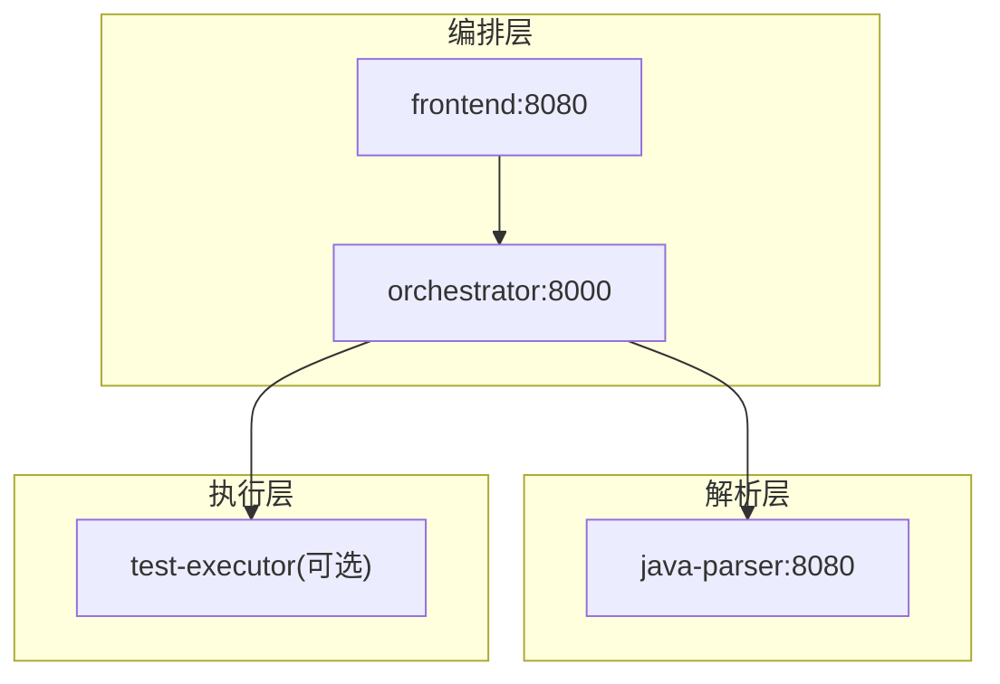
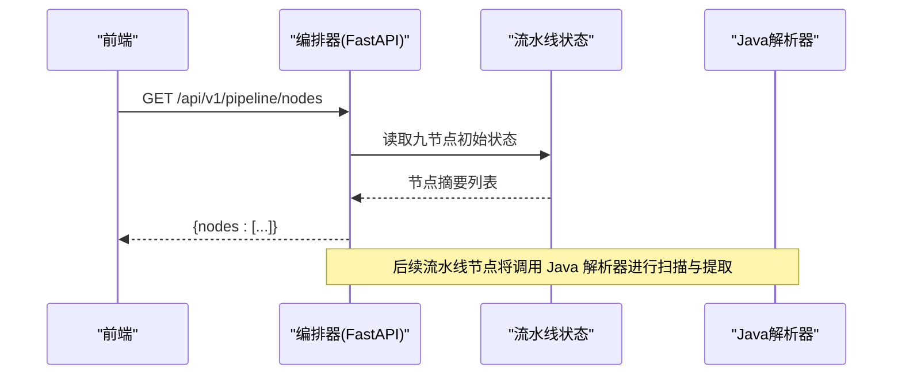
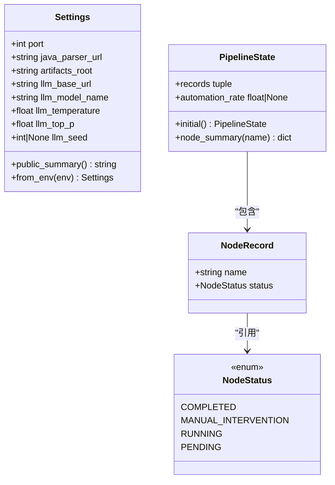
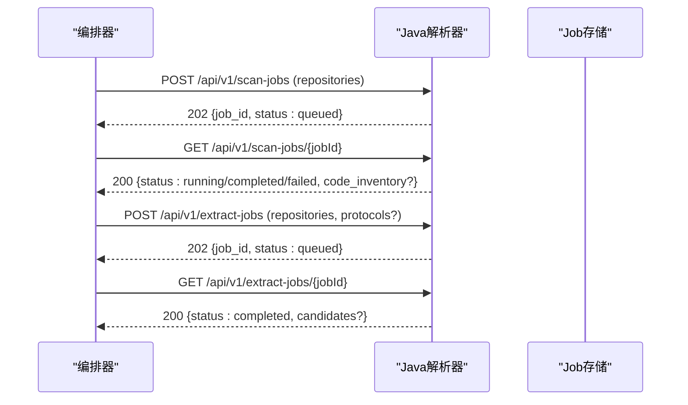
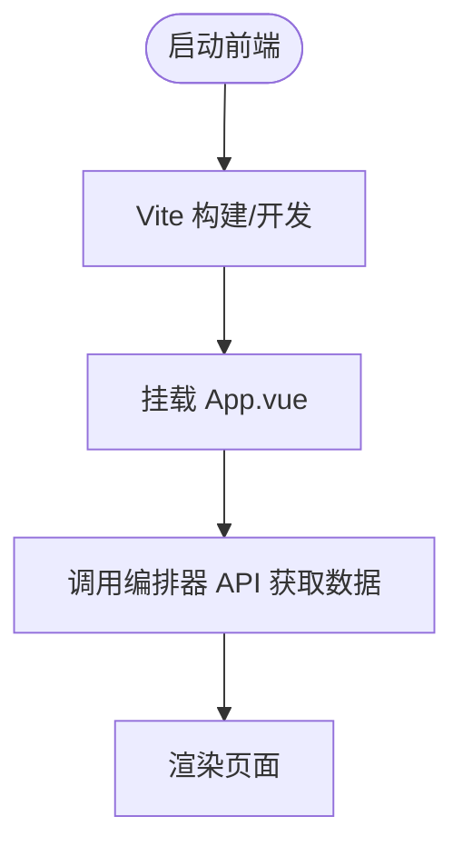
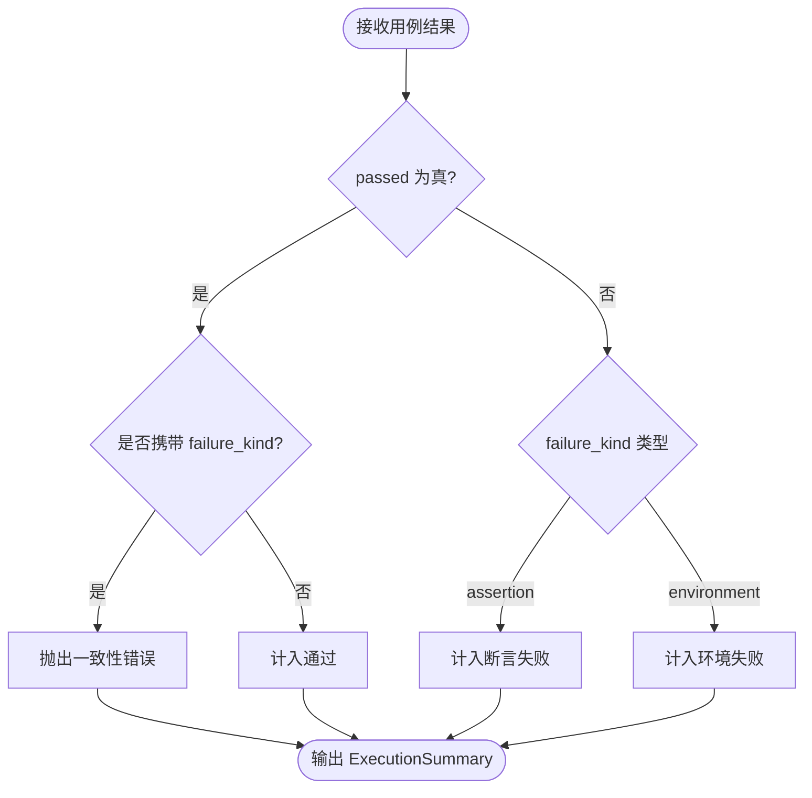
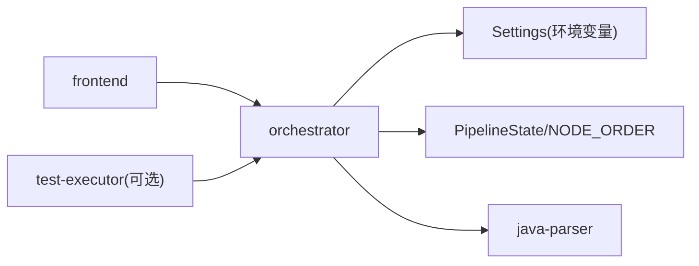

# 核心服务

<cite>
**本文引用的文件**
- [services/orchestrator/src/orchestrator/__main__.py](file://services/orchestrator/src/orchestrator/__main__.py)
- [services/orchestrator/src/orchestrator/api.py](file://services/orchestrator/src/orchestrator/api.py)
- [services/orchestrator/src/orchestrator/pipeline.py](file://services/orchestrator/src/orchestrator/pipeline.py)
- [services/orchestrator/src/orchestrator/config.py](file://services/orchestrator/src/orchestrator/config.py)
- [services/java-parser/src/main/java/com/llmautotest/parser/ProtocolResolver.java](file://services/java-parser/src/main/java/com/llmautotest/parser/ProtocolResolver.java)
- [services/java-parser/src/main/java/com/llmautotest/parser/ParserApplication.java](file://services/java-parser/src/main/java/com/llmautotest/parser/ParserApplication.java)
- [services/java-parser/src/main/java/com/llmautotest/parser/HealthController.java](file://services/java-parser/src/main/java/com/llmautotest/parser/HealthController.java)
- [services/java-parser/src/main/java/com/llmautotest/parser/ParserProperties.java](file://services/java-parser/src/main/java/com/llmautotest/parser/ParserProperties.java)
- [schemas/contracts/java-parser.openapi.yaml](file://schemas/contracts/java-parser.openapi.yaml)
- [services/test-executor/src/executor/result.py](file://services/test-executor/src/executor/result.py)
- [services/frontend/src/App.vue](file://services/frontend/src/App.vue)
- [services/frontend/src/main.ts](file://services/frontend/src/main.ts)
- [services/frontend/package.json](file://services/frontend/package.json)
- [deploy/docker-compose.yml](file://deploy/docker-compose.yml)
</cite>

## 目录
1. [简介](#简介)
2. [项目结构](#项目结构)
3. [核心组件](#核心组件)
4. [架构总览](#架构总览)
5. [详细组件分析](#详细组件分析)
6. [依赖关系分析](#依赖关系分析)
7. [性能考虑](#性能考虑)
8. [故障排查指南](#故障排查指南)
9. [结论](#结论)
10. [附录](#附录)

## 简介
本文件面向 LLM-AutoTest 的核心服务，聚焦以下目标：
- 编排器服务的流水线管理：九节点固定口径、状态四态、自动化率计算与 API 暴露。
- Java 解析器的协议解析策略：可插拔的 ProtocolResolver 接口、多仓库扫描与接口候选提取的异步 Job 模式。
- 前端应用的 Vue.js 架构：占位页面、构建脚本与后续六页业务接入规划。
- 测试执行器的结果处理逻辑：断言失败与环境失败的二态区分、汇总口径与一致性校验。
- 每个服务的 API 接口、配置选项、扩展点与最佳实践，并附调用关系图与排障建议。

## 项目结构
LLM-AutoTest 采用多服务微服务架构，通过 Docker Compose 编排：
- orchestrator（Python/FastAPI）：提供健康检查与流水线节点清单 API，承载流水线状态骨架。
- java-parser（Spring Boot/Java）：提供多仓库静态扫描与接口候选提取的异步 Job API，支持可插拔协议解析。
- frontend（Vue 3 + Vite）：前端占位应用，后续按“六页”方向实现完整 Web 界面。
- test-executor（Python）：测试结果判定与汇总骨架，区分断言失败与环境失败。
- schemas/contracts：契约先行，定义 java-parser 的 OpenAPI 规范。
- deploy/docker-compose.yml：统一编排入口，共享 artifacts 卷。

图表来源
- [deploy/docker-compose.yml:1-62](file://deploy/docker-compose.yml#L1-L62)

章节来源
- [deploy/docker-compose.yml:1-62](file://deploy/docker-compose.yml#L1-L62)

## 核心组件
- 编排器（Orchestrator）
  - 启动与配置：从环境变量加载 Settings，使用 uvicorn 启动 FastAPI 应用。
  - API：/health 健康检查；/api/v1/pipeline/nodes 返回九节点清单与当前状态。
  - 流水线：固定九节点顺序、四态标注、自动化率计算（已完成数/9）。
- Java 解析器（Java Parser）
  - 入口：Spring Boot 应用，提供 /health。
  - 配置：ParserProperties 控制扫描并发度等。
  - 协议解析：ProtocolResolver 接口支持 rest/dubbo/grpc/graphql/soap/mq 等协议的可插拔实现。
  - 契约：OpenAPI 定义扫描与提取的异步 Job 流程及数据结构。
- 前端（Frontend）
  - Vue 3 + Vite，占位页面，数值一律来自后端 API，不做本地计算。
- 测试执行器（Test Executor）
  - CaseResult/ExecutionSummary：断言失败与环境失败分离，程序化汇总，不经过 LLM。

章节来源
- [services/orchestrator/src/orchestrator/__main__.py:1-26](file://services/orchestrator/src/orchestrator/__main__.py#L1-L26)
- [services/orchestrator/src/orchestrator/api.py:1-28](file://services/orchestrator/src/orchestrator/api.py#L1-L28)
- [services/orchestrator/src/orchestrator/pipeline.py:1-84](file://services/orchestrator/src/orchestrator/pipeline.py#L1-L84)
- [services/orchestrator/src/orchestrator/config.py:1-50](file://services/orchestrator/src/orchestrator/config.py#L1-L50)
- [services/java-parser/src/main/java/com/llmautotest/parser/ParserApplication.java:1-17](file://services/java-parser/src/main/java/com/llmautotest/parser/ParserApplication.java#L1-L17)
- [services/java-parser/src/main/java/com/llmautotest/parser/HealthController.java:1-18](file://services/java-parser/src/main/java/com/llmautotest/parser/HealthController.java#L1-L18)
- [services/java-parser/src/main/java/com/llmautotest/parser/ParserProperties.java:1-17](file://services/java-parser/src/main/java/com/llmautotest/parser/ParserProperties.java#L1-L17)
- [services/java-parser/src/main/java/com/llmautotest/parser/ProtocolResolver.java:1-17](file://services/java-parser/src/main/java/com/llmautotest/parser/ProtocolResolver.java#L1-L17)
- [schemas/contracts/java-parser.openapi.yaml:1-369](file://schemas/contracts/java-parser.openapi.yaml#L1-L369)
- [services/test-executor/src/executor/result.py:1-61](file://services/test-executor/src/executor/result.py#L1-L61)
- [services/frontend/src/App.vue:1-12](file://services/frontend/src/App.vue#L1-L12)
- [services/frontend/src/main.ts:1-6](file://services/frontend/src/main.ts#L1-L6)
- [services/frontend/package.json:1-29](file://services/frontend/package.json#L1-L29)

## 架构总览
编排器作为统一入口，对外暴露健康检查与流水线节点状态；Java 解析器负责多仓库静态分析与接口候选提取，采用异步 Job 模式；前端通过编排器获取数据；测试执行器在需要时参与执行与结果汇总。

图表来源
- [services/orchestrator/src/orchestrator/api.py:11-27](file://services/orchestrator/src/orchestrator/api.py#L11-L27)
- [services/orchestrator/src/orchestrator/pipeline.py:23-70](file://services/orchestrator/src/orchestrator/pipeline.py#L23-L70)

章节来源
- [services/orchestrator/src/orchestrator/api.py:11-27](file://services/orchestrator/src/orchestrator/api.py#L11-L27)
- [services/orchestrator/src/orchestrator/pipeline.py:23-70](file://services/orchestrator/src/orchestrator/pipeline.py#L23-L70)

## 详细组件分析

### 编排器服务（Orchestrator）
- 启动流程
  - 从环境变量加载 Settings，记录公开摘要日志，使用 uvicorn 启动 FastAPI。
- API 接口
  - GET /health：健康检查，供编排器依赖检测。
  - GET /api/v1/pipeline/nodes：返回九节点清单与当前状态（初始均为待运行）。
- 流水线管理
  - 固定九节点顺序：req_parse、code_scan、interface_reconstruct、code_review、testcase_generate、auto_execute、test_report、defect_list、retest_regression。
  - 节点四态：completed、manual_intervention、running、pending。
  - 自动化率：已完成节点数/9；骨架阶段未实测返回 None。
- 配置选项
  - 端口、Java 解析器地址、产物根路径、LLM 基址、模型名、温度、top_p、seed。
  - 必填项缺失会抛出运行时错误。
- 扩展点
  - 未来可在 pipeline 模块中接入各节点的具体执行逻辑，持久化于产物卷。
- 最佳实践
  - 所有数值口径程序化汇总，避免经 LLM 计算。
  - 配置全部来自环境变量，禁止硬编码。

图表来源
- [services/orchestrator/src/orchestrator/config.py:9-50](file://services/orchestrator/src/orchestrator/config.py#L9-L50)
- [services/orchestrator/src/orchestrator/pipeline.py:11-70](file://services/orchestrator/src/orchestrator/pipeline.py#L11-L70)

章节来源
- [services/orchestrator/src/orchestrator/__main__.py:15-25](file://services/orchestrator/src/orchestrator/__main__.py#L15-L25)
- [services/orchestrator/src/orchestrator/api.py:11-27](file://services/orchestrator/src/orchestrator/api.py#L11-L27)
- [services/orchestrator/src/orchestrator/pipeline.py:23-70](file://services/orchestrator/src/orchestrator/pipeline.py#L23-L70)
- [services/orchestrator/src/orchestrator/config.py:9-50](file://services/orchestrator/src/orchestrator/config.py#L9-L50)

### Java 解析器服务（Java Parser）
- 入口与健康检查
  - Spring Boot 应用入口；/health 返回服务存活信息。
- 配置
  - ParserProperties：scanConcurrency 必须为正数，默认值受控可配置。
- 协议解析策略
  - ProtocolResolver 接口：定义 supportedProtocol、supports、解析方法（契约待 M0 定稿后接入）。
  - 支持协议标识：rest、dubbo、grpc、graphql、soap、mq。
  - 新增协议无需改动主流程，遵循开闭原则。
- API 契约（OpenAPI）
  - 异步 Job 模式：POST 创建任务 → GET 轮询状态与结果。
  - 主要端点：/health、/api/v1/scan-jobs、/api/v1/scan-jobs/{jobId}、/api/v1/extract-jobs、/api/v1/extract-jobs/{jobId}。
  - 关键数据结构：RepositoryInput、ScanRequest、RepoInventory、SourceFile、ScanJob、ExtractRequest、InterfaceCandidate、ExtractJob、Error、JobAccepted、JobStatus。
- 最佳实践
  - 长任务采用异步 Job 模式，便于编排器调度与重试。
  - 超大仓库支持 include_paths 截断，记录 truncated_scope。
  - 异常编码文件跳过并记录 encoding_skipped，不中断整体流程。
  - 统一错误结构（code、message、node_id、details），避免泄露堆栈或路径细节。

图表来源
- [schemas/contracts/java-parser.openapi.yaml:11-116](file://schemas/contracts/java-parser.openapi.yaml#L11-L116)
- [schemas/contracts/java-parser.openapi.yaml:185-369](file://schemas/contracts/java-parser.openapi.yaml#L185-L369)

章节来源
- [services/java-parser/src/main/java/com/llmautotest/parser/ParserApplication.java:8-15](file://services/java-parser/src/main/java/com/llmautotest/parser/ParserApplication.java#L8-L15)
- [services/java-parser/src/main/java/com/llmautotest/parser/HealthController.java:9-16](file://services/java-parser/src/main/java/com/llmautotest/parser/HealthController.java#L9-L16)
- [services/java-parser/src/main/java/com/llmautotest/parser/ParserProperties.java:7-15](file://services/java-parser/src/main/java/com/llmautotest/parser/ParserProperties.java#L7-L15)
- [services/java-parser/src/main/java/com/llmautotest/parser/ProtocolResolver.java:6-16](file://services/java-parser/src/main/java/com/llmautotest/parser/ProtocolResolver.java#L6-L16)
- [schemas/contracts/java-parser.openapi.yaml:11-116](file://schemas/contracts/java-parser.openapi.yaml#L11-L116)
- [schemas/contracts/java-parser.openapi.yaml:185-369](file://schemas/contracts/java-parser.openapi.yaml#L185-L369)

### 前端应用（Frontend）
- 技术栈：Vue 3 + Vite + TypeScript，pnpm 包管理器。
- 入口：main.ts 挂载 App.vue。
- 页面：App.vue 为占位页面，数值一律来自后端 API，前端不做计算。
- 开发脚本：dev/build/lint/test。
- 扩展点：后续按“六页”业务方向接入完整 Web 界面。

图表来源
- [services/frontend/src/main.ts:1-6](file://services/frontend/src/main.ts#L1-L6)
- [services/frontend/src/App.vue:1-12](file://services/frontend/src/App.vue#L1-L12)
- [services/frontend/package.json:8-12](file://services/frontend/package.json#L8-L12)

章节来源
- [services/frontend/src/main.ts:1-6](file://services/frontend/src/main.ts#L1-L6)
- [services/frontend/src/App.vue:1-12](file://services/frontend/src/App.vue#L1-L12)
- [services/frontend/package.json:1-29](file://services/frontend/package.json#L1-L29)

### 测试执行器（Test Executor）
- 结果模型
  - FailureKind：assertion（断言失败）、environment（环境失败）。
  - CaseResult：用例级结果，通过时不得携带失败类型（构造时校验）。
  - ExecutionSummary：汇总 total、passed、failed_assertion、failed_environment。
- 口径规则
  - 断言失败计入通过率分母；环境失败隔离至待环境确认，不计入通过率分母。
  - 汇总仅程序化计算，不经过 LLM。
- 最佳实践
  - 严格区分两类失败，便于定位与统计。
  - 对不一致结果（通过但带失败类型）抛错，保障数据自洽。

图表来源
- [services/test-executor/src/executor/result.py:10-61](file://services/test-executor/src/executor/result.py#L10-L61)

章节来源
- [services/test-executor/src/executor/result.py:10-61](file://services/test-executor/src/executor/result.py#L10-L61)

## 依赖关系分析
- 编排器依赖
  - 配置：Settings 从环境变量加载。
  - 流水线：NODE_ORDER 与 PipelineState 提供节点清单与状态。
  - 外部服务：java-parser 地址由 JAVA_PARSER_URL 指定。
- Java 解析器依赖
  - Spring Boot 框架；配置类 ParserProperties；健康检查控制器 HealthController。
  - 协议解析策略通过 ProtocolResolver 接口解耦。
- 前端依赖
  - Vue 3；构建工具 Vite；TypeScript；ESLint/Prettier/Vitest。
- 编排部署
  - docker-compose 编排三个服务，共享 artifacts 卷；test-executor 与 mock-services 按 profile 启用。

图表来源
- [services/orchestrator/src/orchestrator/config.py:9-50](file://services/orchestrator/src/orchestrator/config.py#L9-L50)
- [services/orchestrator/src/orchestrator/pipeline.py:23-70](file://services/orchestrator/src/orchestrator/pipeline.py#L23-L70)
- [deploy/docker-compose.yml:1-62](file://deploy/docker-compose.yml#L1-L62)

章节来源
- [services/orchestrator/src/orchestrator/config.py:9-50](file://services/orchestrator/src/orchestrator/config.py#L9-L50)
- [services/orchestrator/src/orchestrator/pipeline.py:23-70](file://services/orchestrator/src/orchestrator/pipeline.py#L23-L70)
- [deploy/docker-compose.yml:1-62](file://deploy/docker-compose.yml#L1-L62)

## 性能考虑
- 编排器
  - 轻量 API，无阻塞 I/O；可通过增加实例水平扩展。
  - 流水线状态最终应持久化到产物卷，避免内存丢失。
- Java 解析器
  - scanConcurrency 控制多仓库扫描并发度，需根据资源调优。
  - 超大仓库使用 include_paths 截断，减少 IO 与解析开销。
  - 异步 Job 模式提升吞吐与可恢复性。
- 前端
  - 按需拉取数据，避免一次性加载过多；缓存策略由后端决定。
- 测试执行器
  - 断言失败与环境失败分离，有助于快速定位瓶颈；批量执行时可并行化。

[本节为通用指导，不直接分析具体文件]

## 故障排查指南
- 编排器
  - 健康检查：GET /health 返回 {"status":"ok"}。
  - 配置缺失：缺少必填环境变量会抛出运行时错误，检查 PORT/JAVA_PARSER_URL/LLM_* 等。
  - 节点状态：GET /api/v1/pipeline/nodes 返回九节点清单，若全为 pending 表示尚未执行。
- Java 解析器
  - 健康检查：GET /health 返回服务名与状态。
  - 扫描任务：POST /api/v1/scan-jobs 返回 202；轮询 GET /api/v1/scan-jobs/{jobId} 查看状态与产物。
  - 提取任务：POST /api/v1/extract-jobs 返回 202；轮询 GET /api/v1/extract-jobs/{jobId} 查看候选清单。
  - 错误结构：统一返回 code/message/node_id/details，避免泄露敏感信息。
- 前端
  - 若页面空白，检查浏览器控制台网络请求是否成功；确认编排器 API 可达。
- 测试执行器
  - 若出现一致性错误（通过但携带失败类型），检查上游结果生成逻辑。
  - 环境失败较多时，优先排查运行环境与依赖。

章节来源
- [services/orchestrator/src/orchestrator/api.py:16-25](file://services/orchestrator/src/orchestrator/api.py#L16-L25)
- [services/orchestrator/src/orchestrator/config.py:32-50](file://services/orchestrator/src/orchestrator/config.py#L32-L50)
- [services/java-parser/src/main/java/com/llmautotest/parser/HealthController.java:12-16](file://services/java-parser/src/main/java/com/llmautotest/parser/HealthController.java#L12-L16)
- [schemas/contracts/java-parser.openapi.yaml:11-116](file://schemas/contracts/java-parser.openapi.yaml#L11-L116)
- [services/test-executor/src/executor/result.py:25-29](file://services/test-executor/src/executor/result.py#L25-L29)

## 结论
本仓库实现了 LLM-AutoTest 的核心骨架：编排器提供统一的流水线管理与 API；Java 解析器以可插拔协议策略与异步 Job 模式支撑静态分析与接口候选提取；前端占位并预留扩展空间；测试执行器明确失败分类与汇总口径。后续可按契约逐步完善各节点实现与前端页面，确保数据口径一致与系统可扩展。

[本节为总结，不直接分析具体文件]

## 附录
- 环境变量参考（编排器）
  - PORT：服务端口（默认 8000）。
  - JAVA_PARSER_URL：Java 解析器地址。
  - ARTIFACTS_ROOT：产物根路径（默认 /data/llm-autotest）。
  - LLM_BASE_URL、LLM_MODEL_NAME、LLM_TEMPERATURE、LLM_TOP_P、LLM_SEED：LLM 调用参数。
- 编排命令
  - docker compose -f deploy/docker-compose.yml --env-file deploy/.env up -d
- 前端脚本
  - pnpm dev/build/lint/test

章节来源
- [services/orchestrator/src/orchestrator/config.py:32-50](file://services/orchestrator/src/orchestrator/config.py#L32-L50)
- [deploy/docker-compose.yml:1-62](file://deploy/docker-compose.yml#L1-L62)
- [services/frontend/package.json:8-12](file://services/frontend/package.json#L8-L12)