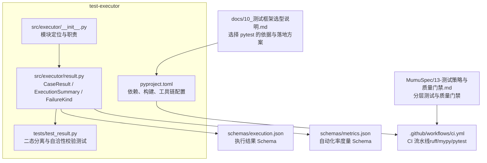
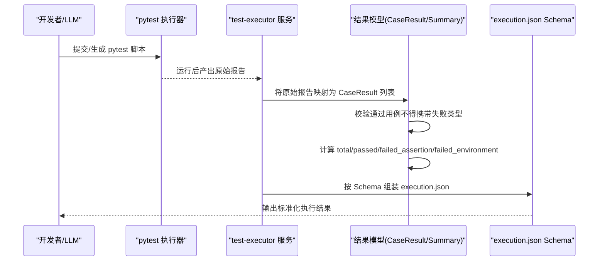
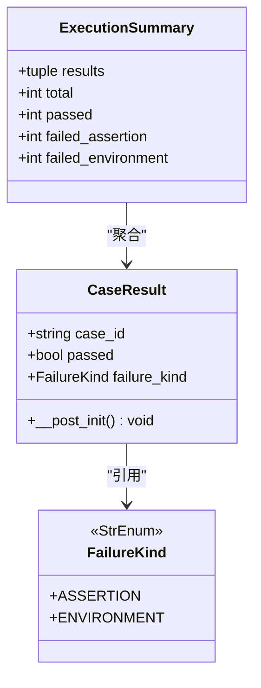
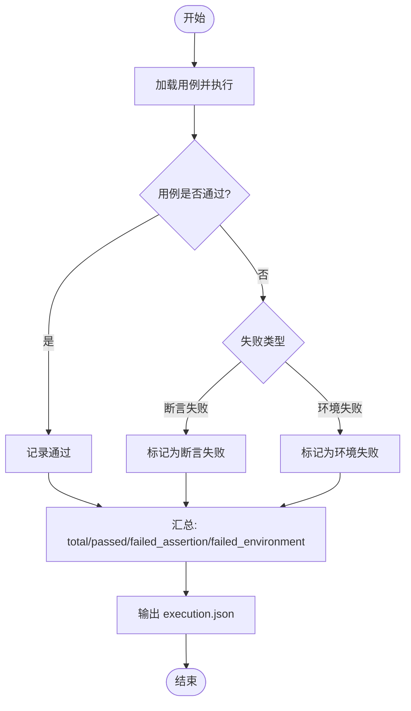
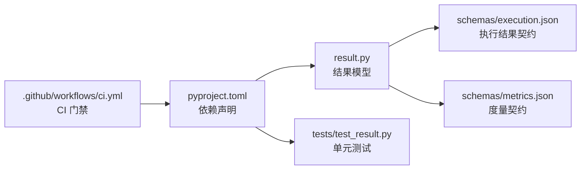

# 测试执行器

<cite>
**本文引用的文件**
- [services/test-executor/src/executor/__init__.py](file://services/test-executor/src/executor/__init__.py)
- [services/test-executor/src/executor/result.py](file://services/test-executor/src/executor/result.py)
- [services/test-executor/tests/test_result.py](file://services/test-executor/tests/test_result.py)
- [services/test-executor/pyproject.toml](file://services/test-executor/pyproject.toml)
- [schemas/execution.json](file://schemas/execution.json)
- [schemas/metrics.json](file://schemas/metrics.json)
- [.github/workflows/ci.yml](file://.github/workflows/ci.yml)
- [docs/10_测试框架选型说明.md](file://docs/10_测试框架选型说明.md)
- [MumuSpec/13-测试策略与质量门禁.md](file://MumuSpec/13-测试策略与质量门禁.md)
</cite>

## 目录
1. [简介](#简介)
2. [项目结构](#项目结构)
3. [核心组件](#核心组件)
4. [架构总览](#架构总览)
5. [详细组件分析](#详细组件分析)
6. [依赖关系分析](#依赖关系分析)
7. [性能考虑](#性能考虑)
8. [故障排查指南](#故障排查指南)
9. [结论](#结论)
10. [附录](#附录)

## 简介
本服务是 LLM-AutoTest 的“测试执行器”（模块 6 EXEC），负责自动化测试脚本的加载、无人值守执行、结果收集与程序化汇总，并输出符合规范的 execution.json。其关键设计要点包括：
- 断言失败与环境失败的“二态”区分，环境失败不计入通过率分母，隔离至待环境确认。
- 以 pytest 为执行引擎，结合 JSON 报告进行结构化结果导出。
- 通过数据模型与 JSON Schema 约束结果格式，确保下游报告与度量计算可稳定消费。
- 在 CI 中集成静态检查、类型检查与单元测试门禁，保障执行器自身质量。

## 项目结构
test-executor 采用最小可用骨架，聚焦“结果判定与汇总”的核心职责，便于后续扩展用例加载、执行调度与报告生成等能力。

**图表来源**
- [services/test-executor/src/executor/__init__.py:1-3](file://services/test-executor/src/executor/__init__.py#L1-L3)
- [services/test-executor/src/executor/result.py:1-61](file://services/test-executor/src/executor/result.py#L1-L61)
- [services/test-executor/tests/test_result.py:1-30](file://services/test-executor/tests/test_result.py#L1-L30)
- [services/test-executor/pyproject.toml:1-45](file://services/test-executor/pyproject.toml#L1-L45)
- [schemas/execution.json:1-59](file://schemas/execution.json#L1-L59)
- [schemas/metrics.json:1-49](file://schemas/metrics.json#L1-L49)
- [.github/workflows/ci.yml:1-75](file://.github/workflows/ci.yml#L1-L75)
- [docs/10_测试框架选型说明.md:1-64](file://docs/10_测试框架选型说明.md#L1-L64)
- [MumuSpec/13-测试策略与质量门禁.md:1-89](file://MumuSpec/13-测试策略与质量门禁.md#L1-L89)

**章节来源**
- [services/test-executor/src/executor/__init__.py:1-3](file://services/test-executor/src/executor/__init__.py#L1-L3)
- [services/test-executor/pyproject.toml:1-45](file://services/test-executor/pyproject.toml#L1-L45)

## 核心组件
- 失败二态枚举：FailureKind，定义“断言失败”和“环境失败”，用于区分失败原因与统计口径。
- 单条用例结果：CaseResult，包含用例 ID、是否通过、失败类型；构造时强制“通过用例不得携带失败类型”的一致性校验。
- 执行汇总：ExecutionSummary，基于 CaseResult 元组提供 total、passed、failed_assertion、failed_environment 等只读属性，作为程序化汇总的唯一入口（F-RPT-02）。

这些组件共同构成“结果数据结构”的最小实现，支撑 execution.json 的数值汇总与报告消费。

**章节来源**
- [services/test-executor/src/executor/result.py:10-61](file://services/test-executor/src/executor/result.py#L10-L61)
- [services/test-executor/tests/test_result.py:10-30](file://services/test-executor/tests/test_result.py#L10-L30)

## 架构总览
从“用例加载 → 执行 → 结果收集 → 汇总 → 输出”的角度，当前骨架已具备“结果建模与汇总”的能力，并与外部规范对齐：
- 执行引擎：pytest（由选型文档明确），支持无人值守、JSON 报告导出。
- 结果模型：CaseResult / ExecutionSummary 提供强类型与一致性约束。
- 输出契约：execution.json Schema 规定字段、格式与枚举值，保证下游报告与度量系统稳定消费。
- 质量门禁：CI 对 test-executor 执行 ruff、mypy、pytest，保障代码质量与行为正确性。

**图表来源**
- [docs/10_测试框架选型说明.md:45-53](file://docs/10_测试框架选型说明.md#L45-L53)
- [services/test-executor/src/executor/result.py:17-61](file://services/test-executor/src/executor/result.py#L17-L61)
- [schemas/execution.json:1-59](file://schemas/execution.json#L1-L59)

## 详细组件分析

### 失败二态与结果模型
- FailureKind：限定失败类型为 assertion 或 environment，避免自由文本导致的歧义。
- CaseResult：不可变数据类，__post_init__ 强制“通过用例不得携带失败类型”，防止状态不一致。
- ExecutionSummary：以 tuple[CaseResult, ...] 为输入，提供只读统计属性，确保“数值只经此处汇总，不经 LLM”。

**图表来源**
- [services/test-executor/src/executor/result.py:10-61](file://services/test-executor/src/executor/result.py#L10-L61)

**章节来源**
- [services/test-executor/src/executor/result.py:10-61](file://services/test-executor/src/executor/result.py#L10-L61)
- [services/test-executor/tests/test_result.py:10-30](file://services/test-executor/tests/test_result.py#L10-L30)

### 执行流程与二态判定
下图展示从用例执行到汇总输出的关键分支逻辑，体现“断言失败计入通过率分母，环境失败隔离”的策略。

**图表来源**
- [services/test-executor/src/executor/result.py:10-61](file://services/test-executor/src/executor/result.py#L10-L61)
- [schemas/execution.json:19-23](file://schemas/execution.json#L19-L23)

**章节来源**
- [services/test-executor/src/executor/result.py:10-61](file://services/test-executor/src/executor/result.py#L10-L61)
- [schemas/execution.json:19-23](file://schemas/execution.json#L19-L23)

### 结果格式规范（execution.json）
- 顶层字段：schema_version、job_id、results、summary。
- results 数组：每条用例包含 case_id、interface_id、passed、failure_kind、failure_reason、timeout、skipped_reason、duration_ms、timestamp。
- summary：total、passed、failed_assertion、failed_environment，以及可选 interrupted。
- degraded_protocols：降级协议清单，记录协议类型与模式、原因。

该 Schema 与 ExecutionSummary 的属性一一对应，确保“数值程序化汇总，不经 LLM”。

**章节来源**
- [schemas/execution.json:1-59](file://schemas/execution.json#L1-L59)
- [services/test-executor/src/executor/result.py:32-61](file://services/test-executor/src/executor/result.py#L32-L61)

### 测试用例加载机制与执行环境
- 加载机制：基于 pytest 的收集阶段，要求 LLM 生成的脚本语法合法且可被框架加载（R-GEN-03）。
- 执行环境：headless 无人值守执行，使用 pytest 原生能力与插件体系输出 JSON 报告。
- 资源管理：当前骨架未内置资源管理，建议后续在 executor 层封装用例生命周期（如网络连接、临时文件）的上下文管理。

**章节来源**
- [docs/10_测试框架选型说明.md:14-53](file://docs/10_测试框架选型说明.md#L14-L53)

### 报告模板与数据分析
- 报告载体：execution.json，由 test-executor 从原始报告程序化汇总得到。
- 数据分析：下游可按 schema 解析 results 与 summary，计算通过率、失败分布、超时比例、跳过原因等指标。
- 度量关联：metrics.json 定义自动化率度量，节点状态与降级信息可与 execution.json 联动分析瓶颈。

**章节来源**
- [schemas/execution.json:1-59](file://schemas/execution.json#L1-L59)
- [schemas/metrics.json:1-49](file://schemas/metrics.json#L1-L49)

### 扩展接口设计与插件机制
- 可扩展点：
  - 用例加载器：实现自定义收集器，支持多协议脚本目录扫描与过滤。
  - 执行器适配器：封装不同协议的客户端调用，统一异常分类为 assertion/environment。
  - 报告转换器：将 pytest JSON 报告转换为 execution.json，填充 timeout/skipped_reason/duration_ms 等字段。
- 插件机制建议：
  - 基于 pytest hook（如 pytest_runtest_logreport）注入二态标注。
  - 通过 pyproject 的 entry_points 注册插件，实现“断言失败默认 assertion，网络/连接异常映射 environment”的统一策略。

**章节来源**
- [docs/10_测试框架选型说明.md:45-53](file://docs/10_测试框架选型说明.md#L45-L53)
- [services/test-executor/src/executor/result.py:10-61](file://services/test-executor/src/executor/result.py#L10-L61)

### 自定义执行器开发指南
- 目标：在不破坏现有结果模型的前提下，接入新的协议或执行后端。
- 步骤：
  1. 定义用例描述对象（case_id、interface_id、参数、预期等）。
  2. 编写执行适配器，捕获异常并映射为 FailureKind。
  3. 生成 CaseResult 列表，传入 ExecutionSummary 计算汇总。
  4. 按 execution.json Schema 组装最终输出。
- 验证：新增单元测试覆盖异常映射与汇总边界条件。

**章节来源**
- [services/test-executor/src/executor/result.py:17-61](file://services/test-executor/src/executor/result.py#L17-L61)
- [schemas/execution.json:10-42](file://schemas/execution.json#L10-L42)

### 配置管理、日志记录与性能监控
- 配置管理：建议在 pyproject 或独立配置文件集中管理执行参数（如超时、并发度、重试次数），并在执行器启动时加载。
- 日志记录：在执行各阶段（加载、执行、汇总、输出）记录结构化日志，便于问题定位。
- 性能监控：采集用例耗时、失败率、环境失败占比等指标，写入 metrics.json 或监控系统，辅助瓶颈分析与回归评估。

[本节为通用实践建议，不直接分析具体文件]

### 单元测试、集成测试与持续集成
- 单元测试：针对 result.py 的二态分离与自洽性校验已有测试覆盖。
- 集成测试：建议补充端到端场景，验证 pytest 执行、JSON 报告转换、execution.json 校验。
- 持续集成：CI 对 test-executor 执行 ruff、mypy、pytest，确保代码风格、类型安全与用例通过。

**章节来源**
- [services/test-executor/tests/test_result.py:10-30](file://services/test-executor/tests/test_result.py#L10-L30)
- [.github/workflows/ci.yml:9-28](file://.github/workflows/ci.yml#L9-L28)
- [MumuSpec/13-测试策略与质量门禁.md:29-45](file://MumuSpec/13-测试策略与质量门禁.md#L29-L45)

## 依赖关系分析
- 运行时依赖：pydantic（数据校验）、httpx（HTTP 客户端，便于未来扩展 HTTP 协议用例）。
- 开发依赖：pytest、ruff、mypy，配合 CI 形成质量闭环。
- 外部契约：execution.json 与 metrics.json 作为跨服务共享的数据契约。

**图表来源**
- [services/test-executor/pyproject.toml:1-45](file://services/test-executor/pyproject.toml#L1-L45)
- [services/test-executor/src/executor/result.py:10-61](file://services/test-executor/src/executor/result.py#L10-L61)
- [schemas/execution.json:1-59](file://schemas/execution.json#L1-L59)
- [schemas/metrics.json:1-49](file://schemas/metrics.json#L1-L49)
- [.github/workflows/ci.yml:9-28](file://.github/workflows/ci.yml#L9-L28)

**章节来源**
- [services/test-executor/pyproject.toml:1-45](file://services/test-executor/pyproject.toml#L1-L45)
- [.github/workflows/ci.yml:9-28](file://.github/workflows/ci.yml#L9-L28)

## 性能考虑
- 用例收集与执行：合理划分用例目录与并行度，避免单用例阻塞整体执行。
- 结果汇总：ExecutionSummary 基于元组遍历，时间复杂度 O(n)，适合中等规模用例集；若用例量极大，可考虑流式汇总或增量统计。
- 超时与重试：在适配器层设置超时与重试策略，减少环境抖动对通过率的影响。
- 资源隔离：为每个用例创建独立执行上下文，避免共享状态污染。

[本节为通用优化建议，不直接分析具体文件]

## 故障排查指南
- 通过用例携带失败类型：CaseResult.__post_init__ 会抛出 ValueError，需检查失败分类逻辑。
- 二态计数异常：核对失败类型映射是否正确，确保网络/连接异常归类为 environment。
- execution.json 校验失败：对照 Schema 检查必填字段、枚举值与格式（如 timestamp 的 ISO-8601）。
- CI 失败：依次检查 ruff 风格、mypy 类型错误、pytest 用例失败，定位具体用例与堆栈。

**章节来源**
- [services/test-executor/src/executor/result.py:25-29](file://services/test-executor/src/executor/result.py#L25-L29)
- [schemas/execution.json:10-42](file://schemas/execution.json#L10-L42)
- [.github/workflows/ci.yml:20-28](file://.github/workflows/ci.yml#L20-L28)

## 结论
test-executor 当前以最小可行骨架实现了“结果建模与程序化汇总”的核心能力，并通过 pytest 与 JSON Schema 对齐了执行与报告的契约。后续可在用例加载、执行适配、报告转换与资源管理方面逐步扩展，同时保持二态分离与数据契约不变，确保下游报告与度量系统的稳定性。

[本节为总结性内容，不直接分析具体文件]

## 附录
- 测试分层与质量门禁：L1-L4 分层与 G-LINT/G-UNIT/G-INT/G-E2E 门禁，指导不同阶段的执行与验收标准。
- 框架选型依据：pytest 在可加载性、五协议集成、结构化结果、无人值守、失败二态区分等方面满足需求，且上手成本低。

**章节来源**
- [MumuSpec/13-测试策略与质量门禁.md:29-45](file://MumuSpec/13-测试策略与质量门禁.md#L29-L45)
- [docs/10_测试框架选型说明.md:14-53](file://docs/10_测试框架选型说明.md#L14-L53)