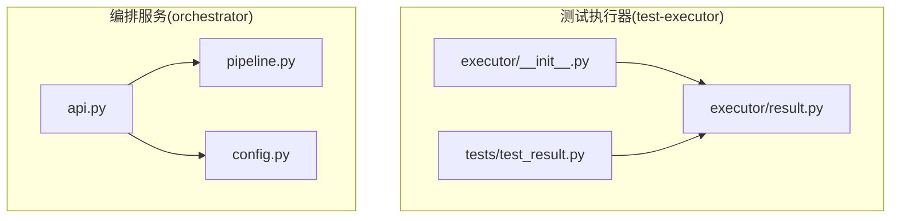
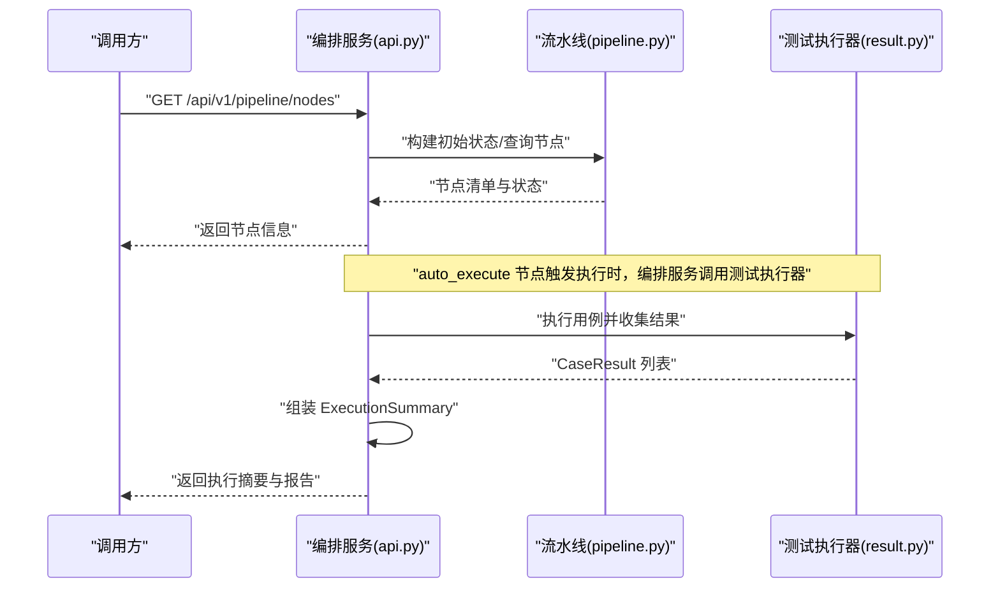
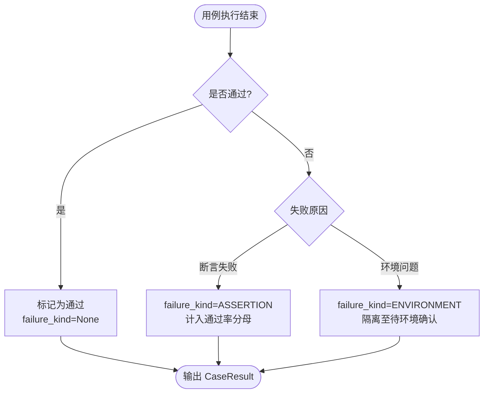
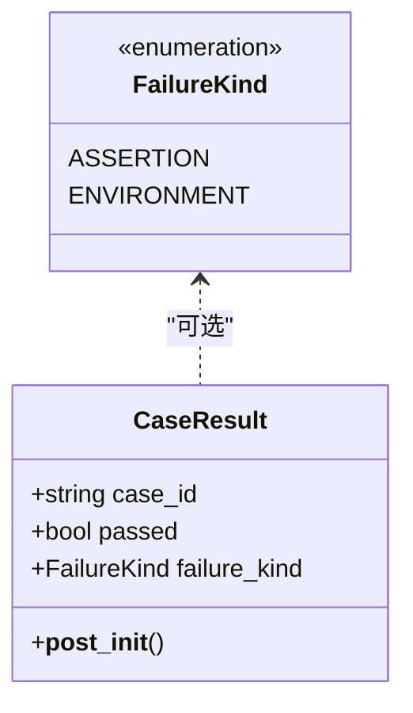
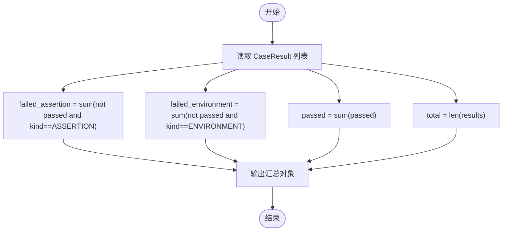
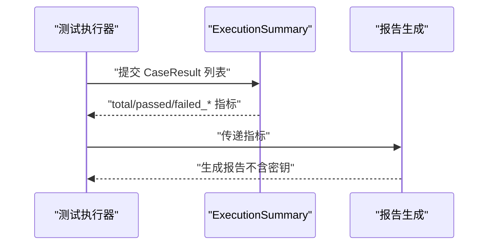
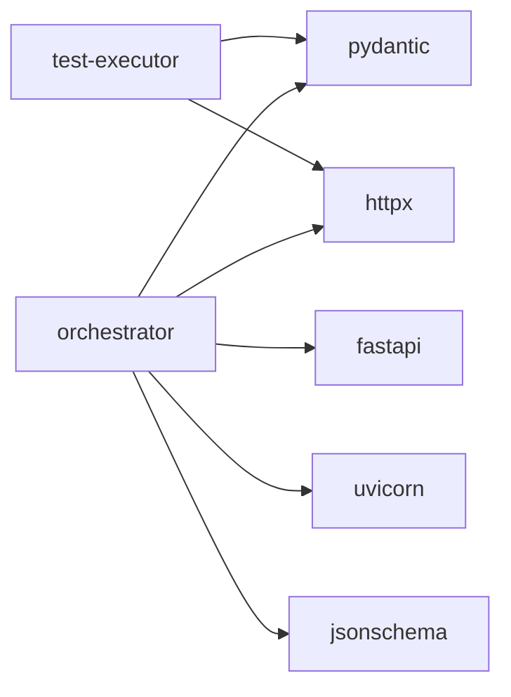

# 测试执行器

<cite>
**本文引用的文件**
- [services/test-executor/src/executor/__init__.py](file://services/test-executor/src/executor/__init__.py)
- [services/test-executor/src/executor/result.py](file://services/test-executor/src/executor/result.py)
- [services/test-executor/tests/test_result.py](file://services/test-executor/tests/test_result.py)
- [services/orchestrator/src/orchestrator/pipeline.py](file://services/orchestrator/src/orchestrator/pipeline.py)
- [services/orchestrator/src/orchestrator/api.py](file://services/orchestrator/src/orchestrator/api.py)
- [services/orchestrator/src/orchestrator/config.py](file://services/orchestrator/src/orchestrator/config.py)
- [services/test-executor/pyproject.toml](file://services/test-executor/pyproject.toml)
- [services/orchestrator/pyproject.toml](file://services/orchestrator/pyproject.toml)
</cite>

## 目录
1. [简介](#简介)
2. [项目结构](#项目结构)
3. [核心组件](#核心组件)
4. [架构总览](#架构总览)
5. [详细组件分析](#详细组件分析)
6. [依赖关系分析](#依赖关系分析)
7. [性能考量](#性能考量)
8. [故障排查指南](#故障排查指南)
9. [结论](#结论)
10. [附录](#附录)

## 简介
本文件面向“测试执行器”模块，聚焦以下目标：
- 解释测试用例执行引擎的职责边界与扩展点（骨架阶段）
- 说明结果处理逻辑与失败分类机制（断言失败 vs 环境失败）
- 定义 CaseResult 数据模型、ExecutionSummary 汇总口径
- 描述测试结果收集与报告生成的流程（含编排服务协作）
- 提供使用示例、结果格式定义与扩展开发指南
- 给出性能监控与调试方法建议

该实现遵循“程序化汇总、不经过 LLM”的原则，确保指标可审计、可校验。

## 项目结构
测试执行器位于 services/test-executor，核心代码在 src/executor；编排服务位于 services/orchestrator，负责流水线节点编排与对外 API。

图表来源
- [services/test-executor/src/executor/__init__.py:1-3](file://services/test-executor/src/executor/__init__.py#L1-L3)
- [services/test-executor/src/executor/result.py:1-61](file://services/test-executor/src/executor/result.py#L1-L61)
- [services/test-executor/tests/test_result.py:1-30](file://services/test-executor/tests/test_result.py#L1-L30)
- [services/orchestrator/src/orchestrator/pipeline.py:1-84](file://services/orchestrator/src/orchestrator/pipeline.py#L1-L84)
- [services/orchestrator/src/orchestrator/api.py:1-28](file://services/orchestrator/src/orchestrator/api.py#L1-L28)
- [services/orchestrator/src/orchestrator/config.py:1-50](file://services/orchestrator/src/orchestrator/config.py#L1-L50)

章节来源
- [services/test-executor/src/executor/__init__.py:1-3](file://services/test-executor/src/executor/__init__.py#L1-L3)
- [services/test-executor/src/executor/result.py:1-61](file://services/test-executor/src/executor/result.py#L1-L61)
- [services/orchestrator/src/orchestrator/pipeline.py:1-84](file://services/orchestrator/src/orchestrator/pipeline.py#L1-L84)
- [services/orchestrator/src/orchestrator/api.py:1-28](file://services/orchestrator/src/orchestrator/api.py#L1-L28)
- [services/orchestrator/src/orchestrator/config.py:1-50](file://services/orchestrator/src/orchestrator/config.py#L1-L50)

## 核心组件
- 失败类型枚举 FailureKind：区分“断言失败”和“环境失败”，用于后续通过率计算与报告呈现。
- 用例结果 CaseResult：单条用例的执行结果，包含用例 ID、是否通过、失败类型（可选）。构造时进行一致性校验，避免“通过但携带失败类型”的自相矛盾状态。
- 执行汇总 ExecutionSummary：对一组 CaseResult 进行程序化汇总，提供 total、passed、failed_assertion、failed_environment 等指标。其中 failed_environment 不计入通过率分母，体现“环境失败隔离”的策略。

章节来源
- [services/test-executor/src/executor/result.py:10-61](file://services/test-executor/src/executor/result.py#L10-L61)
- [services/test-executor/tests/test_result.py:10-30](file://services/test-executor/tests/test_result.py#L10-L30)

## 架构总览
测试执行器与编排服务的协作关系如下：
- 编排服务 orchestrator 暴露 REST API，维护 9 个固定节点的流水线状态，并在 auto_execute 节点触发测试执行。
- 测试执行器 test-executor 提供执行能力（骨架阶段），产出结构化结果（CaseResult），由上层聚合为 ExecutionSummary。
- 报告生成基于 ExecutionSummary 的数值进行程序化汇总，不经过 LLM，保证指标一致性与可审计性。

图表来源
- [services/orchestrator/src/orchestrator/api.py:11-27](file://services/orchestrator/src/orchestrator/api.py#L11-L27)
- [services/orchestrator/src/orchestrator/pipeline.py:23-70](file://services/orchestrator/src/orchestrator/pipeline.py#L23-L70)
- [services/test-executor/src/executor/result.py:17-61](file://services/test-executor/src/executor/result.py#L17-L61)

## 详细组件分析

### 失败分类机制（FailureKind）
- 断言失败（ASSERTION）：计入跑通口径的分母，影响通过率。
- 环境失败（ENVIRONMENT）：隔离至“待环境确认”，不计入通过率分母，便于区分业务问题与环境问题。

图表来源
- [services/test-executor/src/executor/result.py:10-30](file://services/test-executor/src/executor/result.py#L10-L30)

章节来源
- [services/test-executor/src/executor/result.py:10-30](file://services/test-executor/src/executor/result.py#L10-L30)

### CaseResult 数据模型
- 字段：case_id（字符串）、passed（布尔）、failure_kind（可选枚举）。
- 约束：当 passed=True 时，failure_kind 必须为 None，否则抛出 ValueError，确保结果自洽。

图表来源
- [services/test-executor/src/executor/result.py:10-30](file://services/test-executor/src/executor/result.py#L10-L30)

章节来源
- [services/test-executor/src/executor/result.py:17-30](file://services/test-executor/src/executor/result.py#L17-L30)
- [services/test-executor/tests/test_result.py:10-14](file://services/test-executor/tests/test_result.py#L10-L14)

### ExecutionSummary 汇总逻辑
- 输入：CaseResult 元组。
- 指标：
  - total：用例总数
  - passed：通过数
  - failed_assertion：断言失败数（计入通过率分母）
  - failed_environment：环境失败数（不计入通过率分母）
- 设计原则：数值仅经此处汇总，不经过 LLM，保证可审计与可校验。

图表来源
- [services/test-executor/src/executor/result.py:32-61](file://services/test-executor/src/executor/result.py#L32-L61)

章节来源
- [services/test-executor/src/executor/result.py:32-61](file://services/test-executor/src/executor/result.py#L32-L61)
- [services/test-executor/tests/test_result.py:16-30](file://services/test-executor/tests/test_result.py#L16-L30)

### 执行器使用示例
- 基本用法：创建多个 CaseResult，传入 ExecutionSummary，获取 total、passed、failed_assertion、failed_environment 等指标。
- 异常场景：构造通过用例却设置 failure_kind 将抛出 ValueError，用于捕获不一致状态。

参考路径
- [services/test-executor/tests/test_result.py:10-30](file://services/test-executor/tests/test_result.py#L10-L30)

章节来源
- [services/test-executor/tests/test_result.py:10-30](file://services/test-executor/tests/test_result.py#L10-L30)

### 结果格式定义
- 单条用例结果（CaseResult）：
  - case_id：字符串
  - passed：布尔
  - failure_kind：枚举（ASSERTION 或 ENVIRONMENT），通过时为 None
- 执行汇总（ExecutionSummary）：
  - total：整数
  - passed：整数
  - failed_assertion：整数
  - failed_environment：整数

参考路径
- [services/test-executor/src/executor/result.py:17-61](file://services/test-executor/src/executor/result.py#L17-L61)

章节来源
- [services/test-executor/src/executor/result.py:17-61](file://services/test-executor/src/executor/result.py#L17-L61)

### 报告生成流程
- 数据来源：ExecutionSummary 的数值属性。
- 生成策略：程序化汇总，不经过 LLM，确保报告数值与原始执行结果一致。
- 集成点：编排服务 orchestrator 在 auto_execute 节点完成后，读取执行结果并生成报告。

图表来源
- [services/test-executor/src/executor/result.py:32-61](file://services/test-executor/src/executor/result.py#L32-L61)

章节来源
- [services/test-executor/src/executor/result.py:32-61](file://services/test-executor/src/executor/result.py#L32-L61)

### 扩展开发指南
- 新增失败类型：扩展 FailureKind 枚举，并在 ExecutionSummary 中增加对应计数逻辑。
- 增强 CaseResult：如需附加错误消息、耗时、堆栈等信息，可在 dataclass 中新增字段，同时更新 __post_init__ 的一致性校验。
- 集成到编排服务：在 orchestrator 的 auto_execute 节点中调用测试执行器，并将 CaseResult 列表转换为 ExecutionSummary，再写入产物卷供报告节点消费。

参考路径
- [services/test-executor/src/executor/result.py:10-61](file://services/test-executor/src/executor/result.py#L10-L61)
- [services/orchestrator/src/orchestrator/pipeline.py:23-70](file://services/orchestrator/src/orchestrator/pipeline.py#L23-L70)

章节来源
- [services/test-executor/src/executor/result.py:10-61](file://services/test-executor/src/executor/result.py#L10-L61)
- [services/orchestrator/src/orchestrator/pipeline.py:23-70](file://services/orchestrator/src/orchestrator/pipeline.py#L23-L70)

## 依赖关系分析
- 测试执行器依赖：
  - pydantic、httpx（用于数据建模与 HTTP 客户端）
  - pytest、ruff、mypy（开发与质量工具）
- 编排服务依赖：
  - fastapi、uvicorn（Web 框架与服务器）
  - pydantic、httpx、jsonschema（配置、HTTP、校验）
  - pytest、pytest-asyncio、ruff、mypy（开发与质量工具）

图表来源
- [services/test-executor/pyproject.toml:1-45](file://services/test-executor/pyproject.toml#L1-L45)
- [services/orchestrator/pyproject.toml:1-53](file://services/orchestrator/pyproject.toml#L1-L53)

章节来源
- [services/test-executor/pyproject.toml:1-45](file://services/test-executor/pyproject.toml#L1-L45)
- [services/orchestrator/pyproject.toml:1-53](file://services/orchestrator/pyproject.toml#L1-L53)

## 性能考量
- 结果汇总复杂度：ExecutionSummary 的属性均为线性扫描，时间复杂度 O(n)，n 为用例数量。对于大规模用例集，建议在批量处理时缓存中间结果或采用流式聚合。
- 内存占用：CaseResult 与 ExecutionSummary 使用 frozen dataclass，不可变且轻量，适合大量实例。
- I/O 优化：在执行器与编排服务之间传输结果时，建议使用高效序列化（如 JSON/MessagePack）与分页/批处理，减少网络开销。
- 并发执行：若需并行执行用例，注意结果收集的线程安全与顺序稳定性，必要时引入队列或锁。

[本节为通用指导，不直接分析具体文件]

## 故障排查指南
- 常见错误：
  - 构造通过用例却设置 failure_kind：会抛出 ValueError，检查用例判定逻辑与失败分类是否正确。
  - 环境变量缺失：编排服务启动时报错，检查 PORT、JAVA_PARSER_URL、LLM_BASE_URL、LLM_SEED 等必填项。
- 定位步骤：
  - 查看健康检查接口 /health 确认服务可用性。
  - 通过 /api/v1/pipeline/nodes 检查各节点状态，确认 auto_execute 节点是否成功完成。
  - 核对 ExecutionSummary 的指标是否与预期一致，特别是 failed_environment 是否被正确隔离。

参考路径
- [services/orchestrator/src/orchestrator/api.py:16-25](file://services/orchestrator/src/orchestrator/api.py#L16-L25)
- [services/orchestrator/src/orchestrator/config.py:32-50](file://services/orchestrator/src/orchestrator/config.py#L32-L50)
- [services/test-executor/src/executor/result.py:25-30](file://services/test-executor/src/executor/result.py#L25-L30)

章节来源
- [services/orchestrator/src/orchestrator/api.py:16-25](file://services/orchestrator/src/orchestrator/api.py#L16-L25)
- [services/orchestrator/src/orchestrator/config.py:32-50](file://services/orchestrator/src/orchestrator/config.py#L32-L50)
- [services/test-executor/src/executor/result.py:25-30](file://services/test-executor/src/executor/result.py#L25-L30)

## 结论
本测试执行器以简洁的数据模型与明确的失败分类机制为核心，配合编排服务的流水线节点，实现了“无人值守执行 + 程序化汇总”的能力。通过严格的一致性校验与可审计的汇总逻辑，确保了测试结果的可信度与可追溯性。后续可扩展失败类型、增强结果字段，并与更多协议执行器集成，以满足多协议覆盖需求。

[本节为总结，不直接分析具体文件]

## 附录
- 关键路径参考：
  - 失败分类与结果模型：[services/test-executor/src/executor/result.py:10-61](file://services/test-executor/src/executor/result.py#L10-L61)
  - 单元测试验证：[services/test-executor/tests/test_result.py:10-30](file://services/test-executor/tests/test_result.py#L10-L30)
  - 编排服务 API：[services/orchestrator/src/orchestrator/api.py:11-27](file://services/orchestrator/src/orchestrator/api.py#L11-L27)
  - 流水线节点定义：[services/orchestrator/src/orchestrator/pipeline.py:23-70](file://services/orchestrator/src/orchestrator/pipeline.py#L23-L70)
  - 配置与环境变量：[services/orchestrator/src/orchestrator/config.py:9-50](file://services/orchestrator/src/orchestrator/config.py#L9-L50)

[本节为索引，不直接分析具体文件]