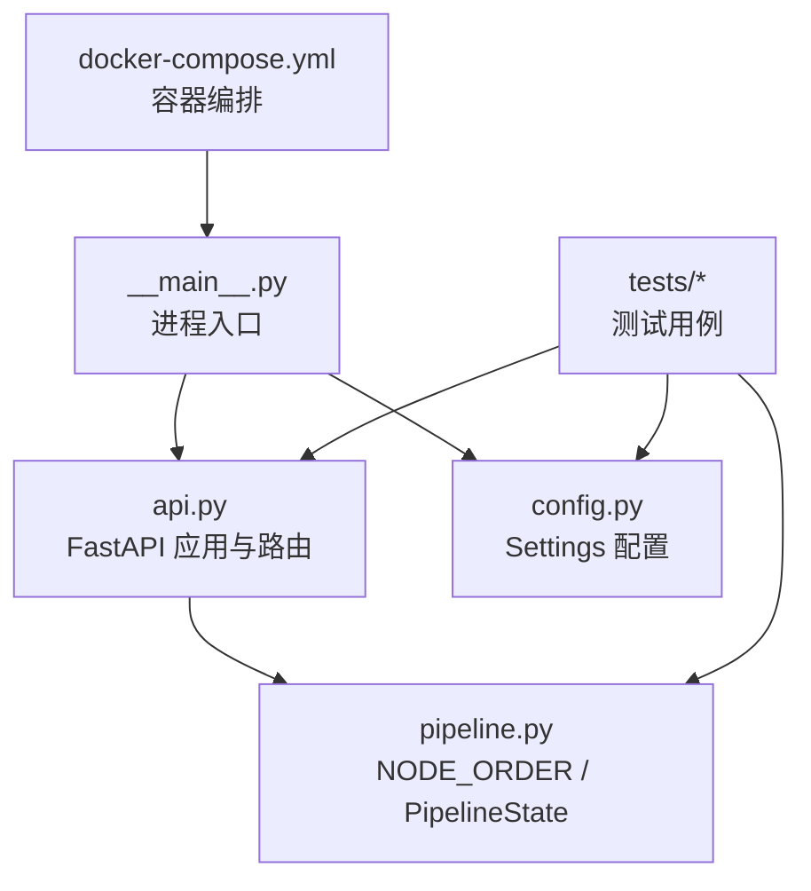
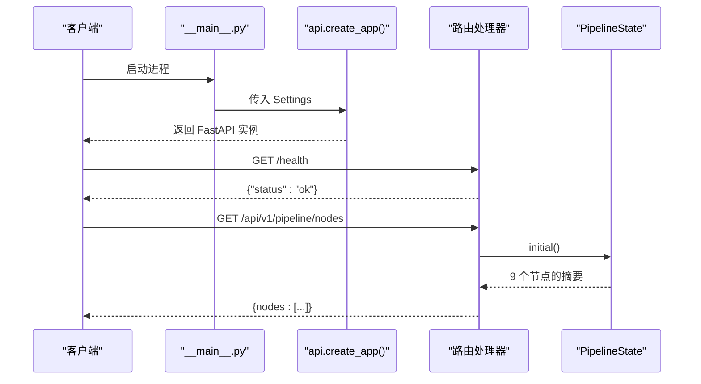
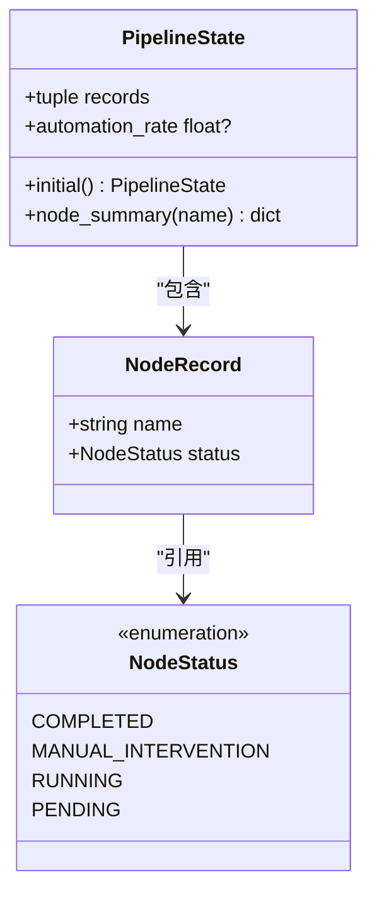
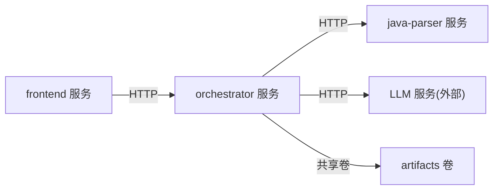

# 编排器服务

<cite>
**本文引用的文件**
- [services/orchestrator/src/orchestrator/__main__.py](file://services/orchestrator/src/orchestrator/__main__.py)
- [services/orchestrator/src/orchestrator/api.py](file://services/orchestrator/src/orchestrator/api.py)
- [services/orchestrator/src/orchestrator/config.py](file://services/orchestrator/src/orchestrator/config.py)
- [services/orchestrator/src/orchestrator/pipeline.py](file://services/orchestrator/src/orchestrator/pipeline.py)
- [services/orchestrator/pyproject.toml](file://services/orchestrator/pyproject.toml)
- [services/orchestrator/tests/test_config.py](file://services/orchestrator/tests/test_config.py)
- [services/orchestrator/tests/test_pipeline.py](file://services/orchestrator/tests/test_pipeline.py)
- [deploy/docker-compose.yml](file://deploy/docker-compose.yml)
</cite>

## 目录
1. [简介](#简介)
2. [项目结构](#项目结构)
3. [核心组件](#核心组件)
4. [架构总览](#架构总览)
5. [详细组件分析](#详细组件分析)
6. [依赖关系分析](#依赖关系分析)
7. [性能考虑](#性能考虑)
8. [故障排查指南](#故障排查指南)
9. [结论](#结论)
10. [附录：API 与配置参考](#附录api-与配置参考)

## 简介
本文件为“编排器服务”（orchestrator）的技术文档，聚焦以下目标：
- FastAPI 应用启动流程
- REST API 接口设计
- 九节点流水线管理逻辑与状态管理
- 配置管理机制与环境变量契约
- 错误处理与重试机制现状与扩展建议
- 具体 API 调用示例、配置参数说明与扩展点
- 性能优化建议与故障排查指南

该服务以 FastAPI + Uvicorn 提供轻量级 REST API，当前阶段实现健康检查与九节点清单查询；流水线节点顺序固定为 9 个，状态采用四态模型（待运行、运行中、已完成、人工介入），自动化率按已完成节点数/9 计算。

## 项目结构
服务位于 services/orchestrator，采用分层组织：
- __main__.py：进程入口，加载配置并启动 Uvicorn
- api.py：FastAPI 应用构建与路由定义
- config.py：基于数据类的配置读取与校验
- pipeline.py：九节点顺序、节点状态枚举、流水线状态骨架
- tests：单元测试覆盖配置与流水线行为
- pyproject.toml：依赖、构建与工具链配置
- deploy/docker-compose.yml：容器编排与服务间依赖

图表来源
- [services/orchestrator/src/orchestrator/__main__.py:1-26](file://services/orchestrator/src/orchestrator/__main__.py#L1-L26)
- [services/orchestrator/src/orchestrator/api.py:1-28](file://services/orchestrator/src/orchestrator/api.py#L1-L28)
- [services/orchestrator/src/orchestrator/config.py:1-50](file://services/orchestrator/src/orchestrator/config.py#L1-L50)
- [services/orchestrator/src/orchestrator/pipeline.py:1-84](file://services/orchestrator/src/orchestrator/pipeline.py#L1-L84)
- [deploy/docker-compose.yml:1-62](file://deploy/docker-compose.yml#L1-L62)

章节来源
- [services/orchestrator/src/orchestrator/__main__.py:1-26](file://services/orchestrator/src/orchestrator/__main__.py#L1-L26)
- [services/orchestrator/src/orchestrator/api.py:1-28](file://services/orchestrator/src/orchestrator/api.py#L1-L28)
- [services/orchestrator/src/orchestrator/config.py:1-50](file://services/orchestrator/src/orchestrator/config.py#L1-L50)
- [services/orchestrator/src/orchestrator/pipeline.py:1-84](file://services/orchestrator/src/orchestrator/pipeline.py#L1-L84)
- [deploy/docker-compose.yml:1-62](file://deploy/docker-compose.yml#L1-L62)

## 核心组件
- 配置模块 Settings：从环境变量读取端口、Java Parser 地址、产物根路径、LLM 调用参数；提供不含密钥的公开摘要用于日志安全。
- 流水线模块 pipeline：定义 9 个固定节点顺序、节点状态枚举、单节点记录与整条流水线状态；提供初始状态构造、节点摘要查询与自动化率计算。
- API 模块 api：创建 FastAPI 实例，挂载健康检查与九节点清单接口；将配置注入 app.state。
- 进程入口 __main__：初始化日志、加载配置、启动 Uvicorn 监听指定端口。

章节来源
- [services/orchestrator/src/orchestrator/config.py:1-50](file://services/orchestrator/src/orchestrator/config.py#L1-L50)
- [services/orchestrator/src/orchestrator/pipeline.py:1-84](file://services/orchestrator/src/orchestrator/pipeline.py#L1-L84)
- [services/orchestrator/src/orchestrator/api.py:1-28](file://services/orchestrator/src/orchestrator/api.py#L1-L28)
- [services/orchestrator/src/orchestrator/__main__.py:1-26](file://services/orchestrator/src/orchestrator/__main__.py#L1-L26)

## 架构总览
编排器服务作为协调层，对外暴露 REST API；当前阶段通过内存中的 PipelineState 维护九节点状态，后续可对接持久化存储与下游执行器。

图表来源
- [services/orchestrator/src/orchestrator/__main__.py:15-21](file://services/orchestrator/src/orchestrator/__main__.py#L15-L21)
- [services/orchestrator/src/orchestrator/api.py:11-27](file://services/orchestrator/src/orchestrator/api.py#L11-L27)
- [services/orchestrator/src/orchestrator/pipeline.py:45-70](file://services/orchestrator/src/orchestrator/pipeline.py#L45-L70)

## 详细组件分析

### 启动流程与进程入口
- 日志初始化：设置 INFO 级别与统一格式。
- 配置加载：通过 Settings.from_env() 读取环境变量，缺失必填项时抛出异常。
- 应用构建：调用 create_app(settings) 生成 FastAPI 实例。
- 服务启动：使用 Uvicorn 绑定 0.0.0.0 与配置端口。

图表来源
- [services/orchestrator/src/orchestrator/__main__.py:11-21](file://services/orchestrator/src/orchestrator/__main__.py#L11-L21)
- [services/orchestrator/src/orchestrator/config.py:32-49](file://services/orchestrator/src/orchestrator/config.py#L32-L49)

章节来源
- [services/orchestrator/src/orchestrator/__main__.py:1-26](file://services/orchestrator/src/orchestrator/__main__.py#L1-L26)
- [services/orchestrator/src/orchestrator/config.py:1-50](file://services/orchestrator/src/orchestrator/config.py#L1-L50)

### REST API 接口设计
- GET /health：健康检查，返回 {"status": "ok"}，供容器编排与健康探针使用。
- GET /api/v1/pipeline/nodes：返回九节点清单与当前状态，节点顺序固定，状态来自 PipelineState.initial()。

请求/响应约定：
- 无认证头要求（当前阶段）
- 响应体为 JSON
- 状态码：成功 200

章节来源
- [services/orchestrator/src/orchestrator/api.py:11-27](file://services/orchestrator/src/orchestrator/api.py#L11-L27)

### 九节点流水线管理与状态
- 节点顺序：固定为 9 个，禁止增删，确保口径一致。
- 节点状态：四态枚举（completed、manual_intervention、running、pending）。
- 流水线状态：由 NodeRecord 元组构成，支持初始态构造、节点摘要查询、自动化率计算。
- 自动化率：已完成节点数/9；当无完成节点时返回 None，表示尚未实测。

图表来源
- [services/orchestrator/src/orchestrator/pipeline.py:11-84](file://services/orchestrator/src/orchestrator/pipeline.py#L11-L84)

章节来源
- [services/orchestrator/src/orchestrator/pipeline.py:1-84](file://services/orchestrator/src/orchestrator/pipeline.py#L1-L84)

### 配置管理机制
- 环境变量契约：
  - 必填：JAVA_PARSER_URL、LLM_BASE_URL、LLM_SEED（可选为空）
  - 可选：PORT（默认 8000）、ARTIFACTS_ROOT（默认 /data/llm-autotest）、LLM_MODEL_NAME（默认 glm-5.3）、LLM_TEMPERATURE（默认 0.2）、LLM_TOP_P（默认 0.8）
- 安全摘要：public_summary 不包含敏感字段，用于日志输出。
- 错误处理：缺失必填项时抛出 RuntimeError，便于快速定位配置问题。

章节来源
- [services/orchestrator/src/orchestrator/config.py:1-50](file://services/orchestrator/src/orchestrator/config.py#L1-L50)
- [services/orchestrator/tests/test_config.py:10-43](file://services/orchestrator/tests/test_config.py#L10-L43)

### 错误处理与重试机制
- 当前实现：
  - 配置加载失败会直接抛出异常，阻止服务启动。
  - API 层未实现显式业务异常与重试逻辑。
- 建议扩展：
  - 在 API 层增加输入校验与领域异常类型，统一错误响应格式。
  - 对下游调用（如 Java Parser、LLM 调用）引入指数退避重试与熔断策略。
  - 对流水线节点执行增加幂等性与补偿逻辑，支持断点续跑。

章节来源
- [services/orchestrator/src/orchestrator/config.py:32-49](file://services/orchestrator/src/orchestrator/config.py#L32-L49)
- [services/orchestrator/src/orchestrator/api.py:11-27](file://services/orchestrator/src/orchestrator/api.py#L11-L27)

### 扩展点介绍
- 流水线执行器：可在 PipelineState 基础上接入异步任务队列（如 Celery/RQ），实现节点调度与状态更新。
- 持久化：将 PipelineState.records 落盘至共享卷或数据库，支持跨进程/容器状态共享。
- 外部集成：通过 Settings.java_parser_url 调用 Java Parser；通过 LLM_* 配置调用大模型服务。
- 监控与指标：在路由层埋点，暴露 Prometheus 指标（请求量、延迟、错误率）。

[本节为概念性内容，不直接分析具体文件]

## 依赖关系分析
- 运行时依赖：FastAPI、Uvicorn、Pydantic、httpx、jsonschema
- 开发依赖：pytest、pytest-asyncio、ruff、mypy
- 容器编排：docker-compose 定义 orchestrator、java-parser、frontend 等服务及共享卷 artifacts

图表来源
- [deploy/docker-compose.yml:1-62](file://deploy/docker-compose.yml#L1-L62)
- [services/orchestrator/pyproject.toml:1-53](file://services/orchestrator/pyproject.toml#L1-L53)

章节来源
- [services/orchestrator/pyproject.toml:1-53](file://services/orchestrator/pyproject.toml#L1-L53)
- [deploy/docker-compose.yml:1-62](file://deploy/docker-compose.yml#L1-L62)

## 性能考虑
- 启动与冷启动：
  - 最小化导入与初始化开销，避免在模块顶层进行重 IO 操作。
  - 合理设置 Uvicorn worker 数量与线程数，根据 CPU 核数调整。
- API 层：
  - 健康检查保持极简，避免额外 IO。
  - 节点清单接口当前为内存计算，注意后续状态持久化后的查询性能。
- 并发与阻塞：
  - 对下游 HTTP 调用使用 httpx 异步客户端，避免阻塞事件循环。
  - 对长耗时任务使用后台任务或消息队列，避免同步等待。
- 资源与缓存：
  - 对频繁访问的配置或常量进行内存缓存。
  - 产物读写走共享卷，注意 I/O 锁与并发写入冲突。

[本节提供通用指导，不直接分析具体文件]

## 故障排查指南
- 启动失败：
  - 检查必填环境变量是否齐全（JAVA_PARSER_URL、LLM_BASE_URL、LLM_SEED）。
  - 查看日志输出，确认 Settings.public_summary 是否正确打印。
- 健康检查失败：
  - 确认 /health 路由可用且返回 {"status":"ok"}。
  - 检查容器端口映射与防火墙规则。
- 节点清单异常：
  - 确认 NODE_ORDER 长度为 9，PipelineState.initial() 能正确构造。
  - 验证 API 路由注册顺序与命名空间。
- 下游调用失败：
  - 检查 JAVA_PARSER_URL 可达性与网络连通性。
  - 对 LLM 调用增加超时与重试策略，观察错误码与重试次数。
- 日志与调试：
  - 提升日志级别到 DEBUG，捕获更详细的上下文信息。
  - 在关键路径添加结构化日志，便于追踪请求链路。

章节来源
- [services/orchestrator/src/orchestrator/config.py:32-49](file://services/orchestrator/src/orchestrator/config.py#L32-L49)
- [services/orchestrator/src/orchestrator/api.py:16-25](file://services/orchestrator/src/orchestrator/api.py#L16-L25)
- [services/orchestrator/tests/test_pipeline.py:33-46](file://services/orchestrator/tests/test_pipeline.py#L33-L46)

## 结论
编排器服务在当前阶段提供了稳定的健康检查与九节点清单能力，具备清晰的配置管理与状态模型。后续应重点完善：
- 流水线执行与状态持久化
- 下游服务调用的健壮性（重试、熔断、超时）
- 监控与可观测性（指标、链路追踪）
- 安全与权限控制（鉴权、审计）

[本节为总结性内容，不直接分析具体文件]

## 附录：API 与配置参考

### API 调用示例
- 健康检查
  - 方法：GET
  - 路径：/health
  - 响应：{"status": "ok"}
- 九节点清单
  - 方法：GET
  - 路径：/api/v1/pipeline/nodes
  - 响应：{nodes: [{name, status}, ...]}，共 9 个节点

章节来源
- [services/orchestrator/src/orchestrator/api.py:16-25](file://services/orchestrator/src/orchestrator/api.py#L16-L25)
- [services/orchestrator/tests/test_pipeline.py:33-46](file://services/orchestrator/tests/test_pipeline.py#L33-L46)

### 配置参数说明
- PORT：服务监听端口，默认 8000
- JAVA_PARSER_URL：Java 解析服务地址（必填）
- ARTIFACTS_ROOT：产物根路径，默认 /data/llm-autotest
- LLM_BASE_URL：LLM 服务基址（必填）
- LLM_MODEL_NAME：模型名称，默认 glm-5.3
- LLM_TEMPERATURE：采样温度，默认 0.2
- LLM_TOP_P：Top-P 采样，默认 0.8
- LLM_SEED：随机种子，可为空

章节来源
- [services/orchestrator/src/orchestrator/config.py:9-49](file://services/orchestrator/src/orchestrator/config.py#L9-L49)
- [services/orchestrator/tests/test_config.py:10-43](file://services/orchestrator/tests/test_config.py#L10-L43)