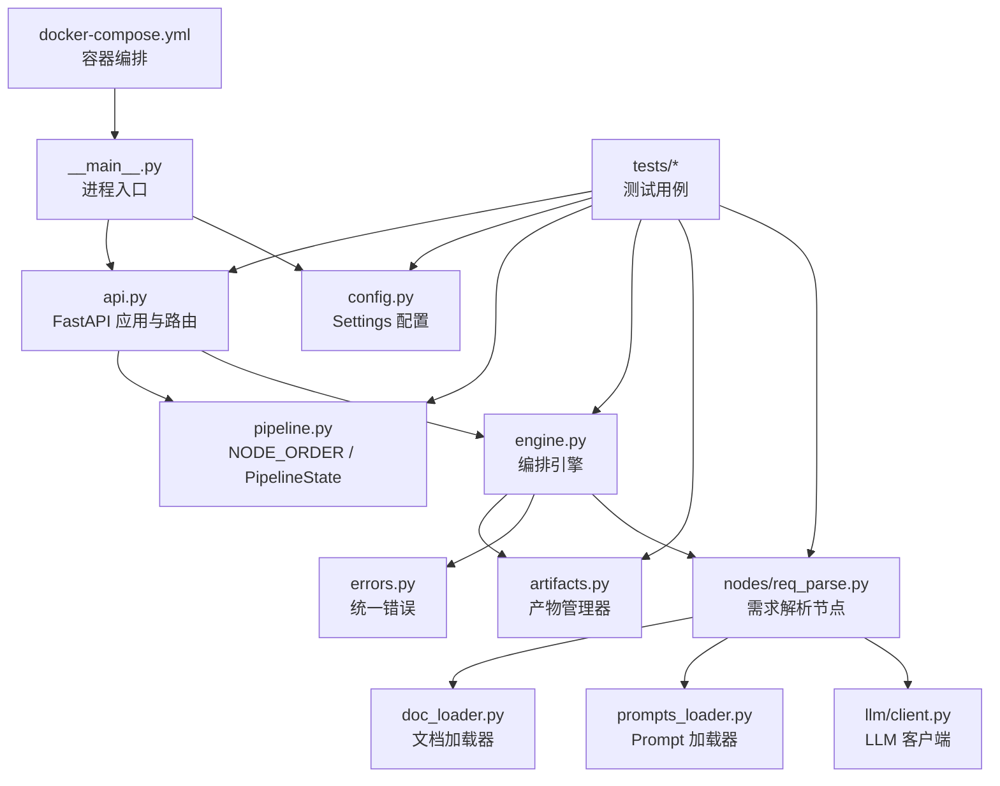
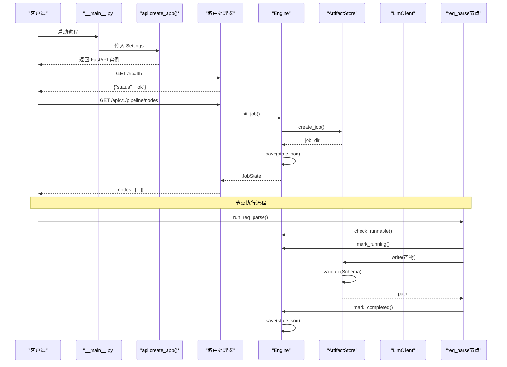
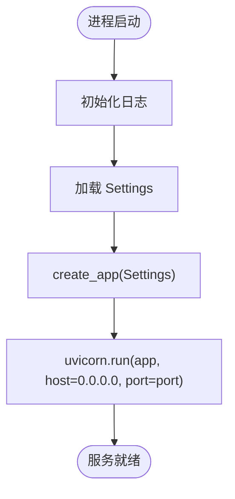
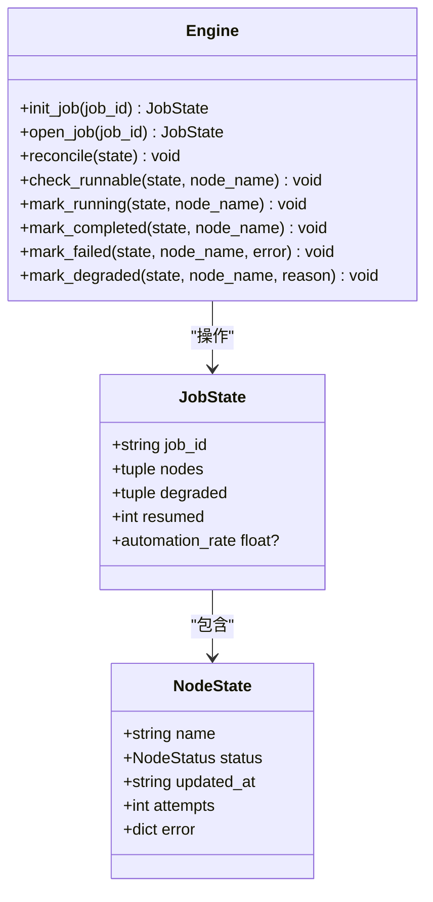
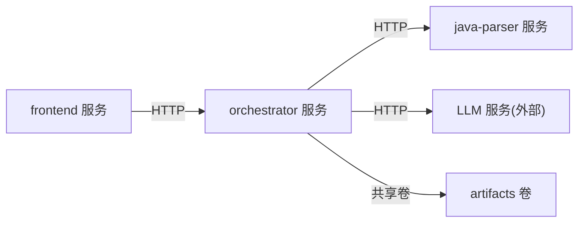

# 编排器服务

<cite>
**本文引用的文件**
- [services/orchestrator/src/orchestrator/__main__.py](file://services/orchestrator/src/orchestrator/__main__.py)
- [services/orchestrator/src/orchestrator/api.py](file://services/orchestrator/src/orchestrator/api.py)
- [services/orchestrator/src/orchestrator/config.py](file://services/orchestrator/src/orchestrator/config.py)
- [services/orchestrator/src/orchestrator/pipeline.py](file://services/orchestrator/src/orchestrator/pipeline.py)
- [services/orchestrator/src/orchestrator/engine.py](file://services/orchestrator/src/orchestrator/engine.py)
- [services/orchestrator/src/orchestrator/artifacts.py](file://services/orchestrator/src/orchestrator/artifacts.py)
- [services/orchestrator/src/orchestrator/errors.py](file://services/orchestrator/src/orchestrator/errors.py)
- [services/orchestrator/src/orchestrator/doc_loader.py](file://services/orchestrator/src/orchestrator/doc_loader.py)
- [services/orchestrator/src/orchestrator/prompts_loader.py](file://services/orchestrator/src/orchestrator/prompts_loader.py)
- [services/orchestrator/src/orchestrator/nodes/req_parse.py](file://services/orchestrator/src/orchestrator/nodes/req_parse.py)
- [services/orchestrator/src/orchestrator/llm/client.py](file://services/orchestrator/src/orchestrator/llm/client.py)
- [services/orchestrator/tests/test_engine.py](file://services/orchestrator/tests/test_engine.py)
- [services/orchestrator/tests/test_req_parse.py](file://services/orchestrator/tests/test_req_parse.py)
- [services/orchestrator/tests/test_artifacts.py](file://services/orchestrator/tests/test_artifacts.py)
- [services/orchestrator/tests/test_doc_loader.py](file://services/orchestrator/tests/test_doc_loader.py)
- [deploy/docker-compose.yml](file://deploy/docker-compose.yml)
</cite>

## 更新摘要
**变更内容**
- 新增引擎模块（engine.py）：实现 state.json 持久化、断点续跑、跳序防护与降级清单
- 新增状态持久化机制：基于 ArtifactStore 的产物校验与原子落盘
- 新增错误处理机制：统一 PipelineError 与错误码体系（X-ORCH-*、X-LLM-*）
- 新增需求解析节点（nodes/req_parse.py）：文档加载 → LLM 解析 → Schema 校验 → 产物落盘
- 新增文档加载器（doc_loader.py）：支持 md/txt/docx/xlsx 格式文本化
- 新增 Prompt 加载器（prompts_loader.py）：解析带元信息块的 Markdown Prompt
- 新增 LLM 客户端（llm/client.py）：OpenAI 兼容调用、重试退避、调用留痕
- 完善测试套件：覆盖引擎对账、节点执行、产物管理、文档加载等核心路径

## 目录
1. [简介](#简介)
2. [项目结构](#项目结构)
3. [核心组件](#核心组件)
4. [架构总览](#架构总览)
5. [详细组件分析](#详细组件分析)
6. [依赖关系分析](#依赖关系分析)
7. [性能考虑](#性能考虑)
8. [故障排查指南](#故障排查指南)
9. [结论](#结论)
10. [附录：API 与配置参考](#附录api-与配置参考)

## 简介
本文件为"编排器服务"（orchestrator）的技术文档，聚焦以下目标：
- FastAPI 应用启动流程
- REST API 接口设计
- 九节点流水线管理逻辑与状态管理
- 配置管理机制与环境变量契约
- 错误处理与重试机制现状与扩展建议
- 具体 API 调用示例、配置参数说明与扩展点
- 性能优化建议与故障排查指南

该服务以 FastAPI + Uvicorn 提供轻量级 REST API，当前阶段实现健康检查与九节点清单查询；流水线节点顺序固定为 9 个，状态采用四态模型（待运行、运行中、已完成、人工介入），自动化率按已完成节点数/9 计算。

**更新** 新增引擎模块、状态持久化、错误处理机制、需求解析节点、文档加载器和相关测试套件，实现了完整的流水线编排能力。

## 项目结构
服务位于 services/orchestrator，采用分层组织：
- __main__.py：进程入口，加载配置并启动 Uvicorn
- api.py：FastAPI 应用构建与路由定义
- config.py：基于数据类的配置读取与校验
- pipeline.py：九节点顺序、节点状态枚举、流水线状态骨架
- engine.py：编排引擎，负责状态持久化、断点续跑、跳序防护
- artifacts.py：产物管理器，负责文件写入、Schema 校验、完成判据
- errors.py：统一错误结构与错误码
- doc_loader.py：需求文档加载器，支持多种格式文本化
- prompts_loader.py：Prompt 加载器，解析带元信息块的 Markdown
- nodes/req_parse.py：需求解析节点实现
- llm/client.py：LLM 客户端，封装 OpenAI 兼容调用
- tests：单元测试覆盖所有核心功能
- pyproject.toml：依赖、构建与工具链配置
- deploy/docker-compose.yml：容器编排与服务间依赖

**图表来源**
- [services/orchestrator/src/orchestrator/__main__.py:1-26](file://services/orchestrator/src/orchestrator/__main__.py#L1-L26)
- [services/orchestrator/src/orchestrator/api.py:1-28](file://services/orchestrator/src/orchestrator/api.py#L1-L28)
- [services/orchestrator/src/orchestrator/config.py:1-56](file://services/orchestrator/src/orchestrator/config.py#L1-L56)
- [services/orchestrator/src/orchestrator/pipeline.py:1-84](file://services/orchestrator/src/orchestrator/pipeline.py#L1-L84)
- [services/orchestrator/src/orchestrator/engine.py:1-302](file://services/orchestrator/src/orchestrator/engine.py#L1-L302)
- [services/orchestrator/src/orchestrator/artifacts.py:1-157](file://services/orchestrator/src/orchestrator/artifacts.py#L1-L157)
- [services/orchestrator/src/orchestrator/errors.py:1-38](file://services/orchestrator/src/orchestrator/errors.py#L1-L38)
- [services/orchestrator/src/orchestrator/doc_loader.py:1-65](file://services/orchestrator/src/orchestrator/doc_loader.py#L1-L65)
- [services/orchestrator/src/orchestrator/prompts_loader.py:1-135](file://services/orchestrator/src/orchestrator/prompts_loader.py#L1-L135)
- [services/orchestrator/src/orchestrator/nodes/req_parse.py:1-125](file://services/orchestrator/src/orchestrator/nodes/req_parse.py#L1-L125)
- [services/orchestrator/src/orchestrator/llm/client.py:1-202](file://services/orchestrator/src/orchestrator/llm/client.py#L1-L202)
- [deploy/docker-compose.yml:1-62](file://deploy/docker-compose.yml#L1-L62)

## 核心组件
- 配置模块 Settings：从环境变量读取端口、Java Parser 地址、产物根路径、LLM 调用参数；提供不含密钥的公开摘要用于日志安全。
- 流水线模块 pipeline：定义 9 个固定节点顺序、节点状态枚举、单节点记录与整条流水线状态；提供初始状态构造、节点摘要查询与自动化率计算。
- 引擎模块 Engine：编排引擎，负责 state.json 持久化、断点续跑、跳序防护、降级清单管理。
- 产物管理器 ArtifactStore：产物卷访问器，负责文件写入、Schema 校验、完成判据、写权排他。
- 错误处理模块：统一 PipelineError 与错误码体系，规范错误响应格式。
- 文档加载器：支持 md/txt/docx/xlsx 格式的需求文档文本化。
- Prompt 加载器：解析带元信息块的 Markdown Prompt 文件。
- LLM 客户端：封装 OpenAI 兼容调用，实现重试退避与调用留痕。
- 需求解析节点：完整的需求文档解析流程，从文档加载到产物落盘。
- API 模块 api：创建 FastAPI 实例，挂载健康检查与九节点清单接口；将配置注入 app.state。
- 进程入口 __main__：初始化日志、加载配置、启动 Uvicorn 监听指定端口。

**章节来源**
- [services/orchestrator/src/orchestrator/config.py:1-56](file://services/orchestrator/src/orchestrator/config.py#L1-L56)
- [services/orchestrator/src/orchestrator/pipeline.py:1-84](file://services/orchestrator/src/orchestrator/pipeline.py#L1-L84)
- [services/orchestrator/src/orchestrator/engine.py:133-302](file://services/orchestrator/src/orchestrator/engine.py#L133-L302)
- [services/orchestrator/src/orchestrator/artifacts.py:55-157](file://services/orchestrator/src/orchestrator/artifacts.py#L55-L157)
- [services/orchestrator/src/orchestrator/errors.py:1-38](file://services/orchestrator/src/orchestrator/errors.py#L1-L38)
- [services/orchestrator/src/orchestrator/doc_loader.py:1-65](file://services/orchestrator/src/orchestrator/doc_loader.py#L1-L65)
- [services/orchestrator/src/orchestrator/prompts_loader.py:1-135](file://services/orchestrator/src/orchestrator/prompts_loader.py#L1-L135)
- [services/orchestrator/src/orchestrator/llm/client.py:41-202](file://services/orchestrator/src/orchestrator/llm/client.py#L41-L202)
- [services/orchestrator/src/orchestrator/nodes/req_parse.py:33-79](file://services/orchestrator/src/orchestrator/nodes/req_parse.py#L33-L79)
- [services/orchestrator/src/orchestrator/api.py:11-27](file://services/orchestrator/src/orchestrator/api.py#L11-L27)
- [services/orchestrator/src/orchestrator/__main__.py:1-26](file://services/orchestrator/src/orchestrator/__main__.py#L1-L26)

## 架构总览
编排器服务作为协调层，对外暴露 REST API；通过引擎模块维护 state.json 持久化状态，使用产物管理器确保数据一致性，集成 LLM 客户端进行智能需求解析。

**图表来源**
- [services/orchestrator/src/orchestrator/__main__.py:15-21](file://services/orchestrator/src/orchestrator/__main__.py#L15-L21)
- [services/orchestrator/src/orchestrator/api.py:11-27](file://services/orchestrator/src/orchestrator/api.py#L11-L27)
- [services/orchestrator/src/orchestrator/engine.py:140-151](file://services/orchestrator/src/orchestrator/engine.py#L140-L151)
- [services/orchestrator/src/orchestrator/artifacts.py:75-96](file://services/orchestrator/src/orchestrator/artifacts.py#L75-L96)
- [services/orchestrator/src/orchestrator/nodes/req_parse.py:49-75](file://services/orchestrator/src/orchestrator/nodes/req_parse.py#L49-L75)

## 详细组件分析

### 启动流程与进程入口
- 日志初始化：设置 INFO 级别与统一格式。
- 配置加载：通过 Settings.from_env() 读取环境变量，缺失必填项时抛出异常。
- 应用构建：调用 create_app(settings) 生成 FastAPI 实例。
- 服务启动：使用 Uvicorn 绑定 0.0.0.0 与配置端口。

**图表来源**
- [services/orchestrator/src/orchestrator/__main__.py:11-21](file://services/orchestrator/src/orchestrator/__main__.py#L11-L21)
- [services/orchestrator/src/orchestrator/config.py:35-56](file://services/orchestrator/src/orchestrator/config.py#L35-L56)

**章节来源**
- [services/orchestrator/src/orchestrator/__main__.py:1-26](file://services/orchestrator/src/orchestrator/__main__.py#L1-L26)
- [services/orchestrator/src/orchestrator/config.py:1-56](file://services/orchestrator/src/orchestrator/config.py#L1-L56)

### REST API 接口设计
- GET /health：健康检查，返回 {"status": "ok"}，供容器编排与健康探针使用。
- GET /api/v1/pipeline/nodes：返回九节点清单与当前状态，节点顺序固定，状态来自 PipelineState.initial()。

请求/响应约定：
- 无认证头要求（当前阶段）
- 响应体为 JSON
- 状态码：成功 200

**章节来源**
- [services/orchestrator/src/orchestrator/api.py:11-27](file://services/orchestrator/src/orchestrator/api.py#L11-L27)

### 编排引擎与状态持久化
- 引擎职责：state.json 持久化、断点续跑、跳序防护、降级清单管理。
- 状态模型：JobState 包含节点状态、降级信息、续跑次数；NodeState 表示单个节点运行时状态。
- 对账机制：以产物为准修正状态，产物在而状态未记则补齐 completed，状态 completed 但产物失效则回 pending。
- 跳序防护：请求运行某节点时，其前序节点必须全部 completed。
- 降级机制：失败节点标记为 manual_intervention，计入降级清单，分母保持 9 不变。

**图表来源**
- [services/orchestrator/src/orchestrator/engine.py:43-131](file://services/orchestrator/src/orchestrator/engine.py#L43-L131)
- [services/orchestrator/src/orchestrator/engine.py:133-302](file://services/orchestrator/src/orchestrator/engine.py#L133-L302)

**章节来源**
- [services/orchestrator/src/orchestrator/engine.py:1-302](file://services/orchestrator/src/orchestrator/engine.py#L1-L302)
- [services/orchestrator/tests/test_engine.py:1-181](file://services/orchestrator/tests/test_engine.py#L1-L181)

### 产物管理与Schema校验
- 产物布局：job 目录下包含 9 个产物文件、state.json、scripts/fixtures/logs/archive 子目录。
- 写权排他：orchestrator 和 test-executor 两个服务分别拥有不同产物的写权限。
- Schema 校验：写入前验证产物结构，确保数据完整性。
- 完成判据：JSON 产物需通过 Schema 校验，Markdown 产物仅需存在且非空。
- 归档机制：重跑前自动归档旧产物，禁止原地覆盖。

**章节来源**
- [services/orchestrator/src/orchestrator/artifacts.py:1-157](file://services/orchestrator/src/orchestrator/artifacts.py#L1-L157)
- [services/orchestrator/tests/test_artifacts.py:1-107](file://services/orchestrator/tests/test_artifacts.py#L1-L107)

### 错误处理机制
- 统一错误结构：PipelineError 包含 code、message、node_id、details 字段。
- 错误码体系：X-ORCH-* 用于编排错误，X-LLM-* 用于 LLM 调用错误。
- 错误分类：网络超时（可重试）、Schema 校验失败（不重试）、配置错误（人工介入）。
- 错误传播：各节点失败经 engine.mark_failed 记录到 state.json 后再抛出。

**章节来源**
- [services/orchestrator/src/orchestrator/errors.py:1-38](file://services/orchestrator/src/orchestrator/errors.py#L1-L38)
- [services/orchestrator/src/orchestrator/nodes/req_parse.py:49-79](file://services/orchestrator/src/orchestrator/nodes/req_parse.py#L49-L79)

### 需求解析节点
- 节点流程：跳序检查 → 运行标记 → Prompt 加载 → 文档加载 → LLM 调用 → 结果解析 → Schema 校验 → 产物落盘 → 完成标记。
- 文档支持：md/txt/docx/xlsx 格式，统一文本化处理。
- Prompt 管理：从 prompts/ 目录加载带元信息块的 Markdown 文件。
- LLM 集成：OpenAI 兼容接口，支持重试退避与调用留痕。
- 容错处理：容忍代码围栏包裹的 JSON 输出，严格校验数据结构。

**章节来源**
- [services/orchestrator/src/orchestrator/nodes/req_parse.py:1-125](file://services/orchestrator/src/orchestrator/nodes/req_parse.py#L1-L125)
- [services/orchestrator/src/orchestrator/doc_loader.py:1-65](file://services/orchestrator/src/orchestrator/doc_loader.py#L1-L65)
- [services/orchestrator/src/orchestrator/prompts_loader.py:1-135](file://services/orchestrator/src/orchestrator/prompts_loader.py#L1-L135)
- [services/orchestrator/src/orchestrator/llm/client.py:1-202](file://services/orchestrator/src/orchestrator/llm/client.py#L1-L202)
- [services/orchestrator/tests/test_req_parse.py:1-156](file://services/orchestrator/tests/test_req_parse.py#L1-L156)

### 配置管理机制
- 环境变量契约：
  - 必填：JAVA_PARSER_URL、LLM_BASE_URL、LLM_SEED（可选为空）
  - 可选：PORT（默认 8000）、ARTIFACTS_ROOT（默认 /data/llm-autotest）、LLM_MODEL_NAME（默认 glm-5.3）、LLM_TEMPERATURE（默认 0.2）、LLM_TOP_P（默认 0.8）、LLM_TIMEOUT_S（默认 120）、SCHEMAS_DIR（默认 schemas）
- 安全摘要：public_summary 不包含敏感字段，用于日志输出。
- 错误处理：缺失必填项时抛出 RuntimeError，便于快速定位配置问题。

**章节来源**
- [services/orchestrator/src/orchestrator/config.py:1-56](file://services/orchestrator/src/orchestrator/config.py#L1-L56)
- [services/orchestrator/tests/test_config.py:10-43](file://services/orchestrator/tests/test_config.py#L10-L43)

### 扩展点介绍
- 流水线执行器：可在 PipelineState 基础上接入异步任务队列（如 Celery/RQ），实现节点调度与状态更新。
- 持久化：将 PipelineState.records 落盘至共享卷或数据库，支持跨进程/容器状态共享。
- 外部集成：通过 Settings.java_parser_url 调用 Java Parser；通过 LLM_* 配置调用大模型服务。
- 监控与指标：在路由层埋点，暴露 Prometheus 指标（请求量、延迟、错误率）。
- 节点扩展：遵循 NODE_ORDER 约定，新增节点需在 engine.NODE_ARTIFACTS 中声明产物映射。

## 依赖关系分析
- 运行时依赖：FastAPI、Uvicorn、Pydantic、httpx、jsonschema、python-docx、openpyxl
- 开发依赖：pytest、pytest-asyncio、ruff、mypy
- 容器编排：docker-compose 定义 orchestrator、java-parser、frontend 等服务及共享卷 artifacts

**图表来源**
- [deploy/docker-compose.yml:1-62](file://deploy/docker-compose.yml#L1-L62)
- [services/orchestrator/pyproject.toml:1-53](file://services/orchestrator/pyproject.toml#L1-L53)

**章节来源**
- [services/orchestrator/pyproject.toml:1-53](file://services/orchestrator/pyproject.toml#L1-L53)
- [deploy/docker-compose.yml:1-62](file://deploy/docker-compose.yml#L1-L62)

## 性能考虑
- 启动与冷启动：
  - 最小化导入与初始化开销，避免在模块顶层进行重 IO 操作。
  - 合理设置 Uvicorn worker 数量与线程数，根据 CPU 核数调整。
- API 层：
  - 健康检查保持极简，避免额外 IO。
  - 节点清单接口当前为内存计算，注意后续状态持久化后的查询性能。
- 并发与阻塞：
  - 对下游 HTTP 调用使用 httpx 异步客户端，避免阻塞事件循环。
  - 对长耗时任务使用后台任务或消息队列，避免同步等待。
- 资源与缓存：
  - 对频繁访问的配置或常量进行内存缓存。
  - 产物读写走共享卷，注意 I/O 锁与并发写入冲突。
- LLM 调用优化：
  - 指数退避重试策略（5s/20s），最多 3 次尝试。
  - 调用留痕记录到 JSONL 文件，便于性能分析与问题追踪。

## 故障排查指南
- 启动失败：
  - 检查必填环境变量是否齐全（JAVA_PARSER_URL、LLM_BASE_URL、LLM_SEED）。
  - 查看日志输出，确认 Settings.public_summary 是否正确打印。
- 健康检查失败：
  - 确认 /health 路由可用且返回 {"status":"ok"}。
  - 检查容器端口映射与防火墙规则。
- 节点清单异常：
  - 确认 NODE_ORDER 长度为 9，PipelineState.initial() 能正确构造。
  - 验证 API 路由注册顺序与命名空间。
- 下游调用失败：
  - 检查 JAVA_PARSER_URL 可达性与网络连通性。
  - 对 LLM 调用增加超时与重试策略，观察错误码与重试次数。
- 状态持久化问题：
  - 检查 state.json 文件格式与 schema_version 兼容性。
  - 验证产物文件是否存在且通过 Schema 校验。
  - 确认写权排他机制是否阻止了非法写入。
- 需求解析失败：
  - 检查 Prompt 文件是否存在且包含正确的元信息块。
  - 验证需求文档格式是否受支持（md/txt/docx/xlsx）。
  - 查看 LLM 调用留痕文件，分析调用失败原因。
- 日志与调试：
  - 提升日志级别到 DEBUG，捕获更详细的上下文信息。
  - 在关键路径添加结构化日志，便于追踪请求链路。
  - 检查 artifacts/job-*/logs/ 目录下的详细日志。

**章节来源**
- [services/orchestrator/src/orchestrator/config.py:35-56](file://services/orchestrator/src/orchestrator/config.py#L35-L56)
- [services/orchestrator/src/orchestrator/api.py:16-25](file://services/orchestrator/src/orchestrator/api.py#L16-L25)
- [services/orchestrator/tests/test_pipeline.py:33-46](file://services/orchestrator/tests/test_pipeline.py#L33-L46)
- [services/orchestrator/src/orchestrator/engine.py:271-302](file://services/orchestrator/src/orchestrator/engine.py#L271-L302)
- [services/orchestrator/src/orchestrator/artifacts.py:75-157](file://services/orchestrator/src/orchestrator/artifacts.py#L75-L157)
- [services/orchestrator/src/orchestrator/nodes/req_parse.py:49-79](file://services/orchestrator/src/orchestrator/nodes/req_parse.py#L49-L79)

## 结论
编排器服务在当前阶段提供了稳定的健康检查与九节点清单能力，具备清晰的配置管理与状态模型。新增的引擎模块、状态持久化、错误处理机制、需求解析节点、文档加载器和相关测试套件，显著增强了服务的完整性和可靠性。后续应重点完善：
- 流水线执行与状态持久化
- 下游服务调用的健壮性（重试、熔断、超时）
- 监控与可观测性（指标、链路追踪）
- 安全与权限控制（鉴权、审计）
- 更多节点类型的实现与扩展

## 附录：API 与配置参考

### API 调用示例
- 健康检查
  - 方法：GET
  - 路径：/health
  - 响应：{"status": "ok"}
- 九节点清单
  - 方法：GET
  - 路径：/api/v1/pipeline/nodes
  - 响应：{nodes: [{name, status}, ...]}，共 9 个节点

**章节来源**
- [services/orchestrator/src/orchestrator/api.py:16-25](file://services/orchestrator/src/orchestrator/api.py#L16-L25)
- [services/orchestrator/tests/test_pipeline.py:33-46](file://services/orchestrator/tests/test_pipeline.py#L33-L46)

### 配置参数说明
- PORT：服务监听端口，默认 8000
- JAVA_PARSER_URL：Java 解析服务地址（必填）
- ARTIFACTS_ROOT：产物根路径，默认 /data/llm-autotest
- LLM_BASE_URL：LLM 服务基址（必填）
- LLM_MODEL_NAME：模型名称，默认 glm-5.3
- LLM_API_KEY：API 密钥（可为空）
- LLM_TEMPERATURE：采样温度，默认 0.2
- LLM_TOP_P：Top-P 采样，默认 0.8
- LLM_SEED：随机种子，可为空
- LLM_TIMEOUT_S：调用超时时间，默认 120 秒
- SCHEMAS_DIR：Schema 文件目录，默认 schemas

**章节来源**
- [services/orchestrator/src/orchestrator/config.py:9-56](file://services/orchestrator/src/orchestrator/config.py#L9-L56)
- [services/orchestrator/tests/test_config.py:10-43](file://services/orchestrator/tests/test_config.py#L10-L43)

### 错误码参考
- X-ORCH-01：产物校验失败、状态文件损坏、写权冲突
- X-ORCH-02：断点续跑跳序请求
- X-LLM-01：LLM 调用超时/网络失败（可重试）
- X-LLM-02：LLM 输出未过 Schema 校验（不重试，人工介入）
- X-LLM-03：Prompt 文件缺失/元信息不合规（配置错误，人工介入）

**章节来源**
- [services/orchestrator/src/orchestrator/errors.py:8-14](file://services/orchestrator/src/orchestrator/errors.py#L8-L14)
- [services/orchestrator/src/orchestrator/engine.py:196-219](file://services/orchestrator/src/orchestrator/engine.py#L196-L219)
- [services/orchestrator/src/orchestrator/artifacts.py:75-96](file://services/orchestrator/src/orchestrator/artifacts.py#L75-L96)
- [services/orchestrator/src/orchestrator/prompts_loader.py:31-63](file://services/orchestrator/src/orchestrator/prompts_loader.py#L31-L63)
- [services/orchestrator/src/orchestrator/llm/client.py:108-170](file://services/orchestrator/src/orchestrator/llm/client.py#L108-L170)