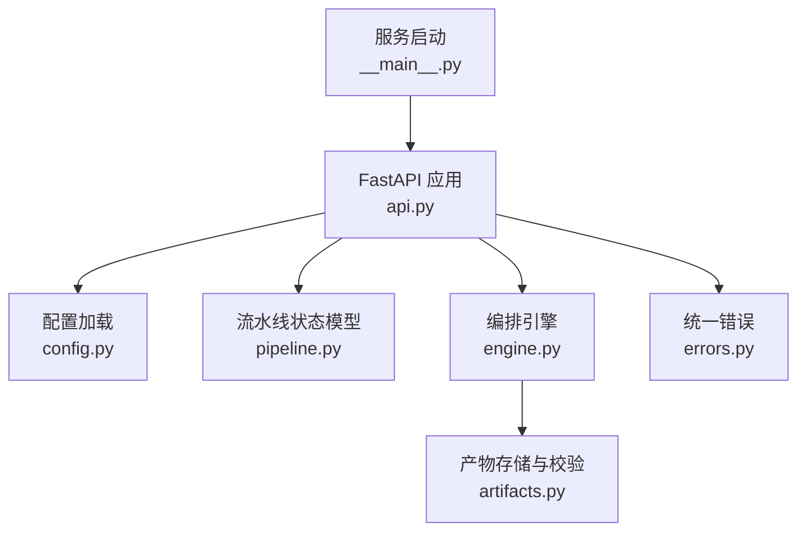
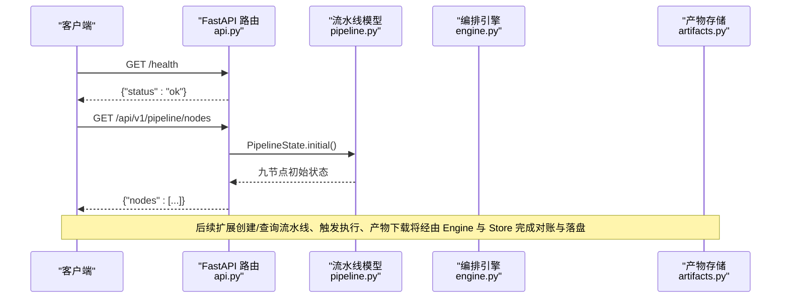
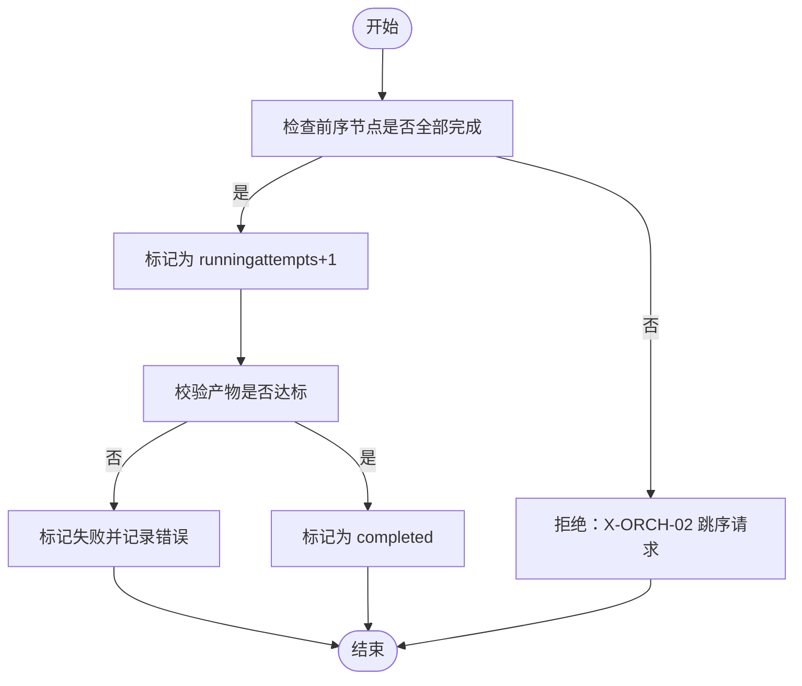
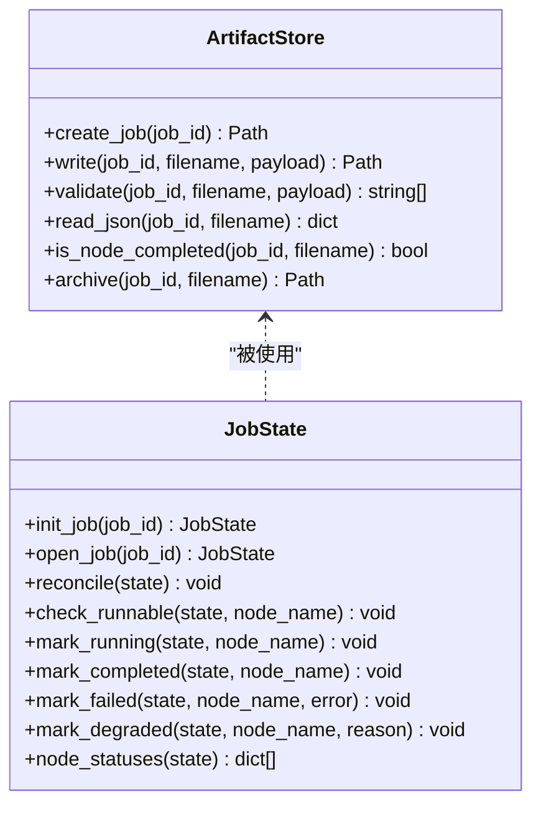
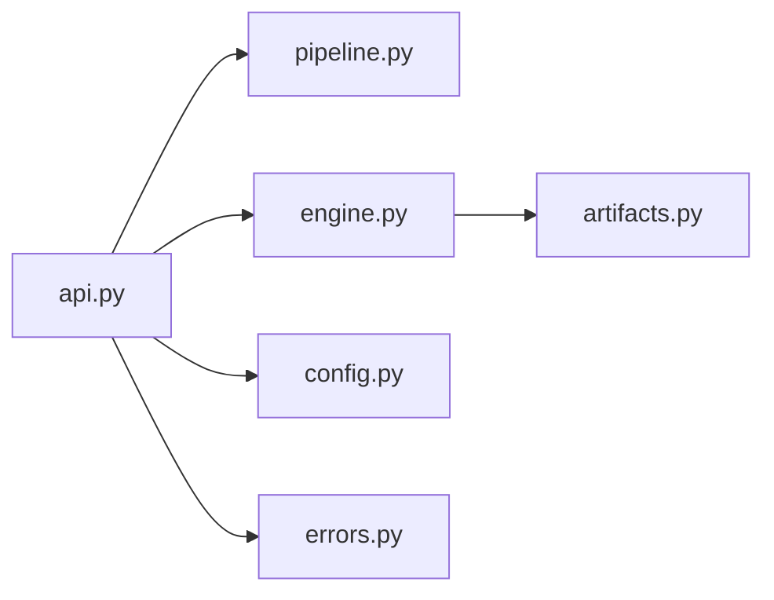

# API接口

<cite>
**本文引用的文件**
- [services/orchestrator/src/orchestrator/api.py](file://services/orchestrator/src/orchestrator/api.py)
- [services/orchestrator/src/orchestrator/config.py](file://services/orchestrator/src/orchestrator/config.py)
- [services/orchestrator/src/orchestrator/pipeline.py](file://services/orchestrator/src/orchestrator/pipeline.py)
- [services/orchestrator/src/orchestrator/engine.py](file://services/orchestrator/src/orchestrator/engine.py)
- [services/orchestrator/src/orchestrator/artifacts.py](file://services/orchestrator/src/orchestrator/artifacts.py)
- [services/orchestrator/src/orchestrator/errors.py](file://services/orchestrator/src/orchestrator/errors.py)
- [services/orchestrator/src/orchestrator/__main__.py](file://services/orchestrator/src/orchestrator/__main__.py)
- [MumuSpec/09-API接口规格.md](file://MumuSpec/09-API接口规格.md)
- [schemas/execution.json](file://schemas/execution.json)
- [schemas/interfaces.json](file://schemas/interfaces.json)
- [schemas/README.md](file://schemas/README.md)
</cite>

## 目录
1. [简介](#简介)
2. [项目结构](#项目结构)
3. [核心组件](#核心组件)
4. [架构总览](#架构总览)
5. [详细组件分析](#详细组件分析)
6. [依赖关系分析](#依赖关系分析)
7. [性能考虑](#性能考虑)
8. [故障排查指南](#故障排查指南)
9. [结论](#结论)
10. [附录](#附录)

## 简介
本文件面向编排服务（orchestrator）的 FastAPI REST API，聚焦流水线管理、状态查询与配置更新等核心能力。文档基于代码实现与接口规格说明，给出端点设计、请求/响应结构、错误码、版本控制策略、认证授权与速率限制现状，以及测试与调试建议。

## 项目结构
当前 orchestrator 服务以 FastAPI 提供 HTTP 接口，核心入口在 api.py；配置通过环境变量注入；流水线节点顺序与状态模型定义在 pipeline.py；引擎与产物校验在 engine.py 与 artifacts.py；统一错误结构在 errors.py；服务启动由 __main__.py 负责。

图示来源
- [services/orchestrator/src/orchestrator/api.py:11-27](file://services/orchestrator/src/orchestrator/api.py#L11-L27)
- [services/orchestrator/src/orchestrator/config.py:9-56](file://services/orchestrator/src/orchestrator/config.py#L9-L56)
- [services/orchestrator/src/orchestrator/pipeline.py:11-84](file://services/orchestrator/src/orchestrator/pipeline.py#L11-L84)
- [services/orchestrator/src/orchestrator/engine.py:133-302](file://services/orchestrator/src/orchestrator/engine.py#L133-L302)
- [services/orchestrator/src/orchestrator/artifacts.py:55-157](file://services/orchestrator/src/orchestrator/artifacts.py#L55-L157)
- [services/orchestrator/src/orchestrator/errors.py:17-39](file://services/orchestrator/src/orchestrator/errors.py#L17-L39)
- [services/orchestrator/src/orchestrator/__main__.py:15-21](file://services/orchestrator/src/orchestrator/__main__.py#L15-L21)

章节来源
- [services/orchestrator/src/orchestrator/api.py:11-27](file://services/orchestrator/src/orchestrator/api.py#L11-L27)
- [services/orchestrator/src/orchestrator/__main__.py:15-21](file://services/orchestrator/src/orchestrator/__main__.py#L15-L21)

## 核心组件
- FastAPI 应用与路由：提供健康检查与节点清单查询。
- 配置：从环境变量读取运行参数，包含 LLM 调用参数、端口、产物根目录等。
- 流水线模型：固定 9 节点顺序与四态标注（completed、manual_intervention、running、pending）。
- 编排引擎：state.json 持久化、断点续跑、跳序防护、降级清单。
- 产物存储：按 Schema 校验产物，维护写权排他与完成判据。
- 错误体系：统一错误码与序列化结构。

章节来源
- [services/orchestrator/src/orchestrator/pipeline.py:11-84](file://services/orchestrator/src/orchestrator/pipeline.py#L11-L84)
- [services/orchestrator/src/orchestrator/engine.py:133-302](file://services/orchestrator/src/orchestrator/engine.py#L133-L302)
- [services/orchestrator/src/orchestrator/artifacts.py:55-157](file://services/orchestrator/src/orchestrator/artifacts.py#L55-L157)
- [services/orchestrator/src/orchestrator/errors.py:17-39](file://services/orchestrator/src/orchestrator/errors.py#L17-L39)

## 架构总览
下图展示 orchestrator 对外暴露的 HTTP 端点与内部组件交互关系。

图示来源
- [services/orchestrator/src/orchestrator/api.py:16-25](file://services/orchestrator/src/orchestrator/api.py#L16-L25)
- [services/orchestrator/src/orchestrator/pipeline.py:45-70](file://services/orchestrator/src/orchestrator/pipeline.py#L45-L70)
- [services/orchestrator/src/orchestrator/engine.py:140-159](file://services/orchestrator/src/orchestrator/engine.py#L140-L159)
- [services/orchestrator/src/orchestrator/artifacts.py:75-131](file://services/orchestrator/src/orchestrator/artifacts.py#L75-L131)

## 详细组件分析

### 健康检查
- 方法/路径：GET /health
- 描述：用于容器编排与健康探针。
- 请求：无
- 响应：包含 status 字段
- 状态码：200
- 错误：若服务异常可能返回 500（框架默认处理）

章节来源
- [services/orchestrator/src/orchestrator/api.py:16-19](file://services/orchestrator/src/orchestrator/api.py#L16-L19)

### 流水线节点清单
- 方法/路径：GET /api/v1/pipeline/nodes
- 描述：返回固定 9 个节点的名称与当前状态摘要（骨架阶段均为 pending）。
- 请求：无
- 响应：{"nodes": [{"name": "...", "status": "..."}, ...]}
- 状态码：200
- 错误：无特殊业务错误

章节来源
- [services/orchestrator/src/orchestrator/api.py:21-25](file://services/orchestrator/src/orchestrator/api.py#L21-L25)
- [services/orchestrator/src/orchestrator/pipeline.py:23-34](file://services/orchestrator/src/orchestrator/pipeline.py#L23-L34)
- [services/orchestrator/src/orchestrator/pipeline.py:51-60](file://services/orchestrator/src/orchestrator/pipeline.py#L51-L60)

### 流水线生命周期（规划接口）
以下接口来自接口规格文档，作为后续实现的契约参考。当前骨架未实现，但应遵循该规范进行扩展。

- 创建并触发流水线
  - 方法/路径：POST /api/v1/pipelines
  - 请求体：包含 config.repo_paths、config.requirement_files、config.protocols
  - 响应：pipeline_id、status、created_at
  - 状态码：201/202（建议），或按规范返回 200
  - 错误：400 无效请求

- 查询流水线状态
  - 方法/路径：GET /api/v1/pipelines/{pipeline_id}
  - 路径参数：pipeline_id
  - 响应：pipeline_id、status、nodes[]、created_at
  - 状态码：200/404

- 节点产物查询
  - 方法/路径：GET /api/v1/pipelines/{pipeline_id}/nodes/{node_id}/artifacts
  - 路径参数：pipeline_id、node_id
  - 响应：node_id、artifacts[]
  - 状态码：200/404

章节来源
- [MumuSpec/09-API接口规格.md:41-176](file://MumuSpec/09-API接口规格.md#L41-L176)

### 配置更新与环境变量
- 配置来源：全部通过环境变量注入（禁止硬编码采样参数）。
- 关键配置项：
  - PORT：服务监听端口
  - JAVA_PARSER_URL：Java 解析服务地址
  - ARTIFACTS_ROOT：产物根目录
  - LLM_BASE_URL、LLM_MODEL_NAME、LLM_API_KEY、LLM_TEMPERATURE、LLM_TOP_P、LLM_SEED、LLM_TIMEOUT_S：LLM 调用参数
  - SCHEMAS_DIR：Schema 目录路径
- 安全注意：密钥类字段不入日志；提供 public_summary 仅输出非敏感摘要。

章节来源
- [services/orchestrator/src/orchestrator/config.py:9-56](file://services/orchestrator/src/orchestrator/config.py#L9-L56)

### 流水线状态与自动化率
- 节点状态：四态 completed、manual_intervention、running、pending。
- 自动化率：completed 节点数 / 9；骨架阶段为 None（尚未实测）。
- 引擎职责：
  - init_job/open_job：新建/打开 job，写入/读取 state.json
  - reconcile：以产物为准对账，补齐或回退状态
  - check_runnable：跳序防护，前序未完成则拒绝
  - mark_running/marked_completed/marked_failed/marked_degraded：节点状态流转
  - node_statuses：API 用节点状态摘要

图示来源
- [services/orchestrator/src/orchestrator/engine.py:181-242](file://services/orchestrator/src/orchestrator/engine.py#L181-L242)
- [services/orchestrator/src/orchestrator/pipeline.py:11-21](file://services/orchestrator/src/orchestrator/pipeline.py#L11-L21)

章节来源
- [services/orchestrator/src/orchestrator/pipeline.py:11-84](file://services/orchestrator/src/orchestrator/pipeline.py#L11-L84)
- [services/orchestrator/src/orchestrator/engine.py:133-302](file://services/orchestrator/src/orchestrator/engine.py#L133-L302)

### 产物管理与 Schema 校验
- 产物目录布局：job_id 下包含 9 个产物文件、state.json 及 scripts/fixtures/logs/archive。
- 写权排他：不同服务对特定产物拥有唯一写权（如 test-executor 写 execution.json）。
- 完成判据：产物存在且通过对应 JSON Schema 校验（test_report.md 仅检查存在性与非空）。
- 归档机制：重跑前归档旧产物，禁止原地覆盖。

图示来源
- [services/orchestrator/src/orchestrator/artifacts.py:55-157](file://services/orchestrator/src/orchestrator/artifacts.py#L55-L157)
- [services/orchestrator/src/orchestrator/engine.py:133-302](file://services/orchestrator/src/orchestrator/engine.py#L133-L302)

章节来源
- [services/orchestrator/src/orchestrator/artifacts.py:55-157](file://services/orchestrator/src/orchestrator/artifacts.py#L55-L157)
- [schemas/README.md:1-30](file://schemas/README.md#L1-L30)

### 错误码与错误结构
- 统一错误结构：{code, message, node_id?, details}
- 已定义错误码（部分）：
  - X-LLM-01：LLM 调用超时/网络失败（可重试）
  - X-LLM-02：LLM 输出未过 Schema 校验（不重试，人工介入）
  - X-LLM-03：Prompt 文件缺失/元信息不合规（配置错误，人工介入）
  - X-ORCH-01：产物校验失败
  - X-ORCH-02：断点续跑跳序请求
  - X-ORCH-03：java-parser 服务不可达/通信失败
- 规范中通用错误码（HTTP 语义）：
  - INTERNAL_ERROR（500）、PIPELINE_NOT_FOUND（404）、INVALID_REQUEST（400）、NODE_NOT_FOUND（404）、ARTIFACT_NOT_FOUND（404）、SCAN_FAILED（500）、PARSE_FAILED（500）、EXECUTION_FAILED（500）

章节来源
- [services/orchestrator/src/orchestrator/errors.py:1-39](file://services/orchestrator/src/orchestrator/errors.py#L1-L39)
- [MumuSpec/09-API接口规格.md:325-337](file://MumuSpec/09-API接口规格.md#L325-L337)

### 数据模型与 Schema 约束
- execution.json：执行结果的结构化定义，包含 results、summary、degraded_protocols 等字段，要求 schema_version、job_id、results、summary 必填。
- interfaces.json：接口还原清单，包含 id、protocol、signature、params、returns、code_location、is_fallback、confidence 等字段。
- schemas/README.md：约定 schema_version 升版本、ID 命名规则、时间戳格式、协议枚举值、is_fallback 透传等横切约定。

章节来源
- [schemas/execution.json:1-59](file://schemas/execution.json#L1-L59)
- [schemas/interfaces.json:1-70](file://schemas/interfaces.json#L1-L70)
- [schemas/README.md:1-30](file://schemas/README.md#L1-L30)

## 依赖关系分析
- 路由层依赖 pipeline 模型获取节点清单。
- 引擎依赖 artifacts 进行产物读写与完成判据。
- 配置模块提供运行时参数，影响 LLM 调用与产物路径。
- 错误模块贯穿各层，保证错误结构一致。

图示来源
- [services/orchestrator/src/orchestrator/api.py:11-27](file://services/orchestrator/src/orchestrator/api.py#L11-L27)
- [services/orchestrator/src/orchestrator/engine.py:133-302](file://services/orchestrator/src/orchestrator/engine.py#L133-L302)
- [services/orchestrator/src/orchestrator/artifacts.py:55-157](file://services/orchestrator/src/orchestrator/artifacts.py#L55-L157)
- [services/orchestrator/src/orchestrator/config.py:9-56](file://services/orchestrator/src/orchestrator/config.py#L9-L56)
- [services/orchestrator/src/orchestrator/errors.py:17-39](file://services/orchestrator/src/orchestrator/errors.py#L17-L39)

章节来源
- [services/orchestrator/src/orchestrator/api.py:11-27](file://services/orchestrator/src/orchestrator/api.py#L11-L27)
- [services/orchestrator/src/orchestrator/engine.py:133-302](file://services/orchestrator/src/orchestrator/engine.py#L133-L302)

## 性能考虑
- 产物落盘采用临时文件 + replace 的原子写入，避免并发写导致的损坏。
- 完成判据基于 Schema 校验，确保下游消费的数据质量，减少脏读。
- 引擎对账逻辑在 open_job 时触发，避免重复计算；next_node 跳过 manual_intervention，提升流程推进效率。
- LLM 调用超时可通过 LLM_TIMEOUT_S 配置，避免长时间阻塞。

[本节为通用指导，不直接分析具体文件]

## 故障排查指南
- 常见错误定位：
  - 跳序请求：检查前序节点是否 completed 或 manual_intervention；查看 X-ORCH-02 错误详情中的 blocked_by。
  - 产物校验失败：核对产物文件是否符合对应 Schema；查看 X-ORCH-01 的 details 中的错误列表。
  - LLM 相关错误：根据 X-LLM-01/02/03 判断是网络/超时、Schema 不合规还是 Prompt 配置问题。
- 调试建议：
  - 使用 /health 确认服务可用。
  - 使用 /api/v1/pipeline/nodes 观察节点状态变化。
  - 检查 artifacts 目录下的 state.json 与产物文件，确认对账结果。
  - 调整 LLM 参数（温度、Top-P、Seed、超时）以稳定输出。

章节来源
- [services/orchestrator/src/orchestrator/engine.py:196-219](file://services/orchestrator/src/orchestrator/engine.py#L196-L219)
- [services/orchestrator/src/orchestrator/artifacts.py:75-112](file://services/orchestrator/src/orchestrator/artifacts.py#L75-L112)
- [services/orchestrator/src/orchestrator/errors.py:1-39](file://services/orchestrator/src/orchestrator/errors.py#L1-L39)

## 结论
当前 orchestrator 已提供健康检查与节点清单查询两个基础端点，配合引擎与产物存储实现了流水线状态与完成的严格对账。后续扩展应严格遵循接口规格文档定义的端点与错误码，并在实现中复用现有引擎与 Schema 校验能力，以保证一致性、可观测性与可维护性。

[本节为总结，不直接分析具体文件]

## 附录

### API 版本控制策略
- 当前 FastAPI 应用版本为 0.1.0（标题与版本在创建时设置）。
- 接口路径采用 /api/v1/ 前缀，便于未来升级至 v2 时保持兼容。
- 产物与 Schema 通过 schema_version 字段管理，禁止原地修改语义，需升版本演进。

章节来源
- [services/orchestrator/src/orchestrator/api.py:11-14](file://services/orchestrator/src/orchestrator/api.py#L11-L14)
- [schemas/README.md:1-30](file://schemas/README.md#L1-L30)

### 认证授权机制
- 当前代码未实现认证与鉴权中间件。
- 建议在网关层或 FastAPI 中间件中接入 Token 校验（如 JWT），并对敏感操作（创建/触发流水线、产物下载）进行权限控制。

[本节为通用建议，不直接分析具体文件]

### 速率限制配置
- 当前代码未实现速率限制。
- 可在网关层或 FastAPI 中间件中使用令牌桶/漏桶算法限制请求频率，保护后端资源。

[本节为通用建议，不直接分析具体文件]

### 测试用例与调试工具
- 健康检查：GET /health
- 节点清单：GET /api/v1/pipeline/nodes
- 后续扩展接口（创建/查询流水线、产物下载）可依据接口规格文档编写单元测试与集成测试，结合 fixtures 与 mock 验证 Schema 校验与错误分支。

章节来源
- [services/orchestrator/src/orchestrator/api.py:16-25](file://services/orchestrator/src/orchestrator/api.py#L16-L25)
- [MumuSpec/09-API接口规格.md:41-176](file://MumuSpec/09-API接口规格.md#L41-L176)