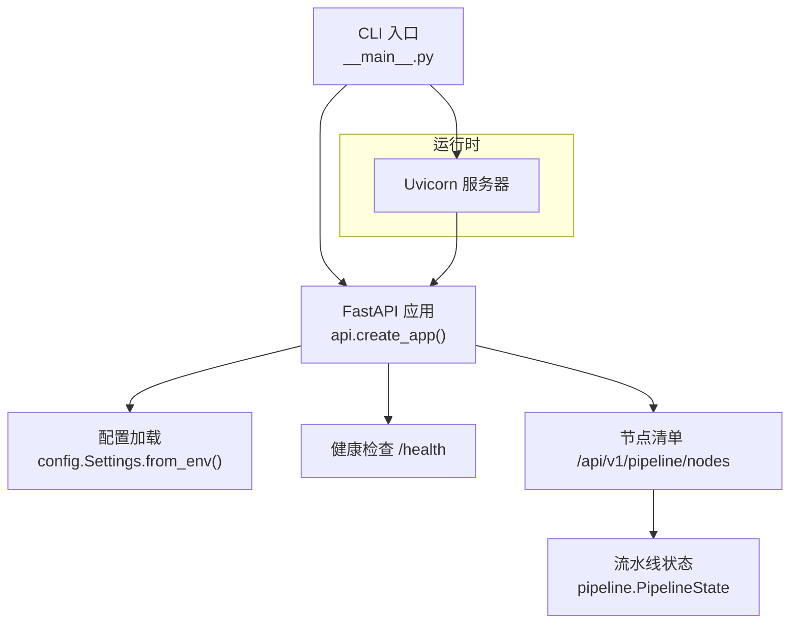
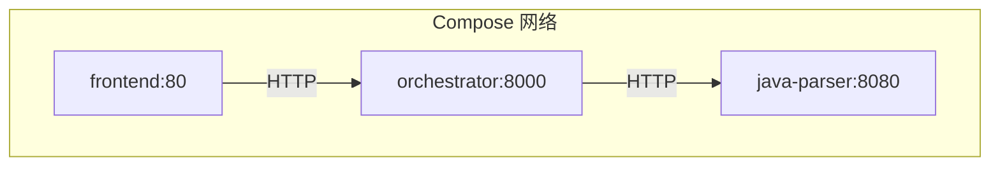
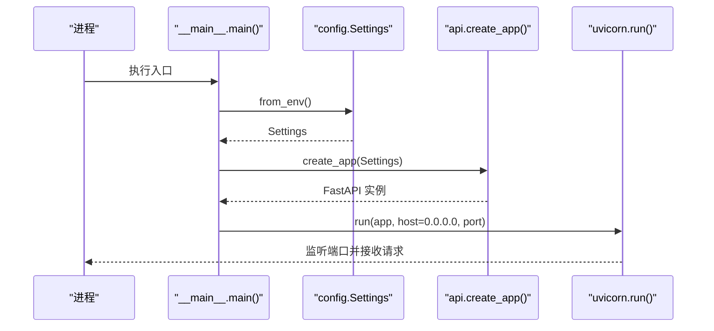
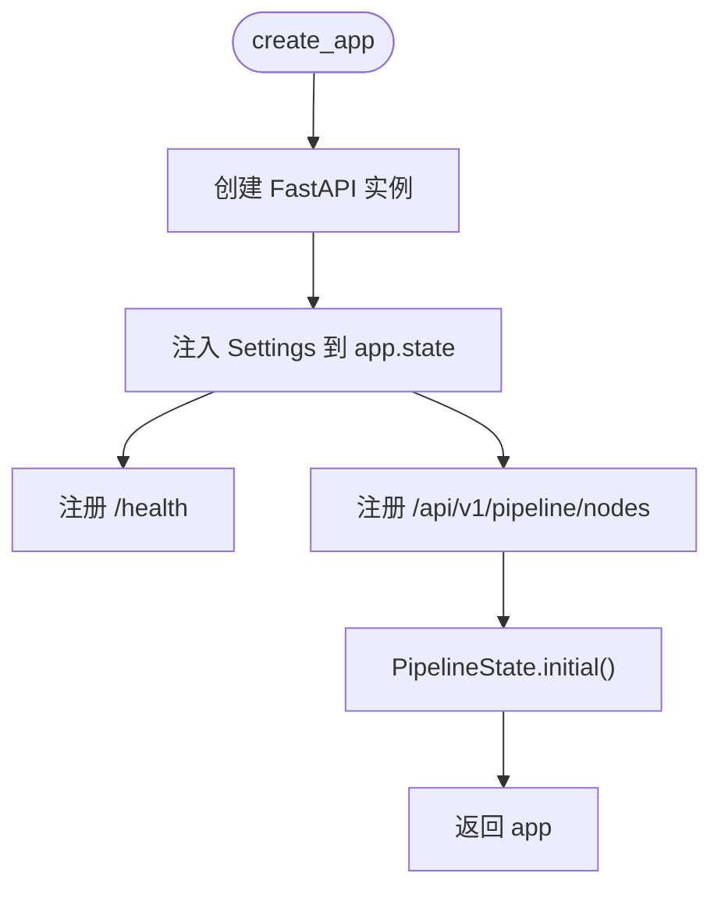
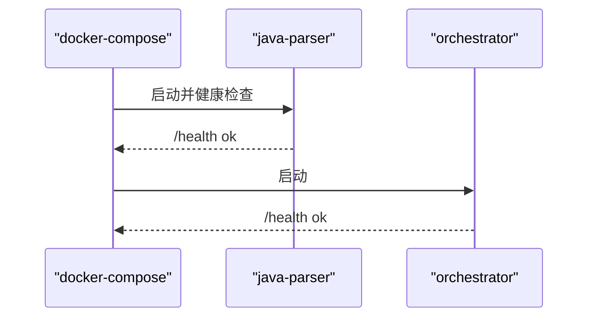
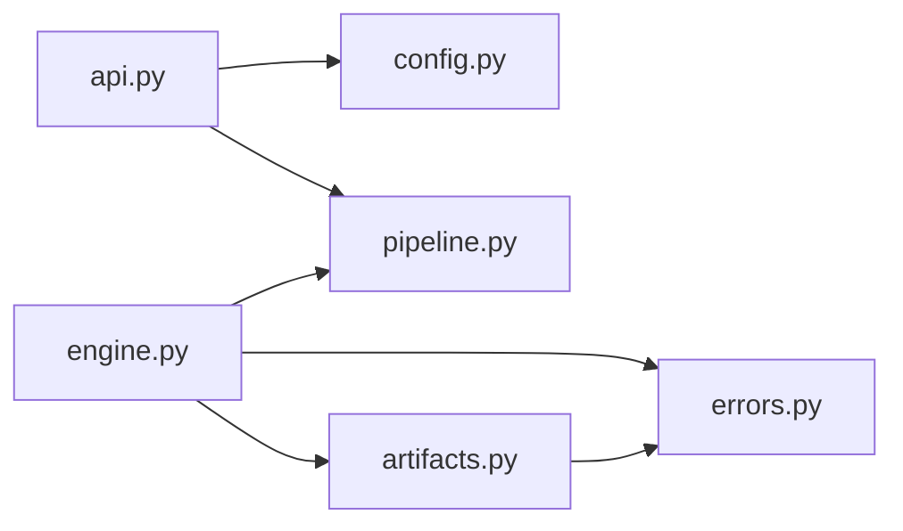
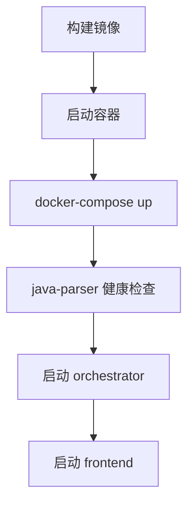

# 服务生命周期

<cite>
**本文引用的文件**
- [services/orchestrator/src/orchestrator/__main__.py](file://services/orchestrator/src/orchestrator/__main__.py)
- [services/orchestrator/src/orchestrator/api.py](file://services/orchestrator/src/orchestrator/api.py)
- [services/orchestrator/src/orchestrator/config.py](file://services/orchestrator/src/orchestrator/config.py)
- [services/orchestrator/pyproject.toml](file://services/orchestrator/pyproject.toml)
- [services/orchestrator/Dockerfile](file://services/orchestrator/Dockerfile)
- [deploy/docker-compose.yml](file://deploy/docker-compose.yml)
- [services/orchestrator/src/orchestrator/pipeline.py](file://services/orchestrator/src/orchestrator/pipeline.py)
- [services/orchestrator/src/orchestrator/errors.py](file://services/orchestrator/src/orchestrator/errors.py)
- [services/orchestrator/src/orchestrator/artifacts.py](file://services/orchestrator/src/orchestrator/artifacts.py)
- [services/orchestrator/src/orchestrator/engine.py](file://services/orchestrator/src/orchestrator/engine.py)
- [schemas/metrics.json](file://schemas/metrics.json)
</cite>

## 目录
1. [简介](#简介)
2. [项目结构](#项目结构)
3. [核心组件](#核心组件)
4. [架构总览](#架构总览)
5. [详细组件分析](#详细组件分析)
6. [依赖关系分析](#依赖关系分析)
7. [性能与可观测性](#性能与可观测性)
8. [部署与容器化](#部署与容器化)
9. [故障排查指南](#故障排查指南)
10. [结论](#结论)

## 简介
本文面向 orchestrator 服务的“服务生命周期”，覆盖从 CLI 入口到应用初始化、服务注册、Uvicorn 服务器配置、中间件与路由绑定、启动期依赖检查与健康检查、监控指标初始化，以及部署配置、容器化启动、进程管理、优雅关闭和资源清理、日志与错误追踪、性能监控集成等全链路内容。当前代码库实现了最小可用版本：通过 FastAPI + Uvicorn 暴露 REST API，提供健康检查与流水线节点清单接口；编排引擎与产物管理以 state.json 和 JSON Schema 校验为核心；容器编排使用 docker-compose，并依赖 java-parser 的健康状态。

## 项目结构
orchestrator 服务采用分层组织：
- 入口与运行：__main__.py 负责加载配置、创建 FastAPI 应用并启动 Uvicorn。
- 应用层：api.py 定义 FastAPI 应用实例、健康检查与节点清单路由。
- 配置：config.py 集中读取环境变量，提供 Settings 数据类。
- 领域模型：pipeline.py 定义 9 节点顺序与状态枚举。
- 编排与持久化：engine.py 维护 state.json，实现断点续跑、跳序防护与降级策略。
- 产物管理：artifacts.py 负责 job 目录、Schema 校验、写权排他与归档。
- 错误模型：errors.py 统一错误码与异常结构。
- 构建与运行：Dockerfile 与 pyproject.toml 描述镜像构建与依赖。
- 编排：deploy/docker-compose.yml 定义 orchestrator、java-parser、frontend 等服务的启动顺序与依赖。

图表来源
- [services/orchestrator/src/orchestrator/__main__.py:15-21](file://services/orchestrator/src/orchestrator/__main__.py#L15-L21)
- [services/orchestrator/src/orchestrator/api.py:11-27](file://services/orchestrator/src/orchestrator/api.py#L11-L27)
- [services/orchestrator/src/orchestrator/config.py:35-55](file://services/orchestrator/src/orchestrator/config.py#L35-L55)
- [services/orchestrator/src/orchestrator/pipeline.py:23-34](file://services/orchestrator/src/orchestrator/pipeline.py#L23-L34)

章节来源
- [services/orchestrator/src/orchestrator/__main__.py:1-26](file://services/orchestrator/src/orchestrator/__main__.py#L1-L26)
- [services/orchestrator/src/orchestrator/api.py:1-28](file://services/orchestrator/src/orchestrator/api.py#L1-L28)
- [services/orchestrator/src/orchestrator/config.py:1-56](file://services/orchestrator/src/orchestrator/config.py#L1-L56)
- [services/orchestrator/src/orchestrator/pipeline.py:1-84](file://services/orchestrator/src/orchestrator/pipeline.py#L1-L84)

## 核心组件
- CLI 入口与进程启动：__main__.py 中 main() 函数加载 Settings，创建 FastAPI 应用，并通过 uvicorn.run 启动 HTTP 服务器，监听 0.0.0.0:port。
- 应用初始化与路由：api.py 的 create_app(settings) 构造 FastAPI 实例，挂载 /health 与 /api/v1/pipeline/nodes 两个路由。
- 配置系统：config.py 的 Settings 从环境变量读取端口、LLM 参数、Java Parser URL、产物根目录、Schema 目录等，并提供不含密钥的配置摘要用于日志安全输出。
- 流水线状态：pipeline.py 定义 NODE_ORDER（固定 9 节点）与 PipelineState，用于返回节点清单与自动化率计算。
- 编排引擎：engine.py 基于 ArtifactStore 读写 state.json，实现断点续跑、对账、跳序防护、降级标记与完成判定。
- 产物管理：artifacts.py 提供 Job 目录创建、JSON Schema 校验、写权排他、归档与完成判据。
- 错误体系：errors.py 定义 PipelineError 及统一错误码，便于 API 层统一返回结构与日志记录。

章节来源
- [services/orchestrator/src/orchestrator/__main__.py:15-21](file://services/orchestrator/src/orchestrator/__main__.py#L15-L21)
- [services/orchestrator/src/orchestrator/api.py:11-27](file://services/orchestrator/src/orchestrator/api.py#L1-L27)
- [services/orchestrator/src/orchestrator/config.py:9-55](file://services/orchestrator/src/orchestrator/config.py#L9-L55)
- [services/orchestrator/src/orchestrator/pipeline.py:11-70](file://services/orchestrator/src/orchestrator/pipeline.py#L11-L70)
- [services/orchestrator/src/orchestrator/engine.py:133-302](file://services/orchestrator/src/orchestrator/engine.py#L133-L302)
- [services/orchestrator/src/orchestrator/artifacts.py:55-157](file://services/orchestrator/src/orchestrator/artifacts.py#L55-L157)
- [services/orchestrator/src/orchestrator/errors.py:17-39](file://services/orchestrator/src/orchestrator/errors.py#L17-L39)

## 架构总览
下图展示 orchestrator 在容器环境中的启动与依赖关系：docker-compose 先启动 java-parser，待其健康后启动 orchestrator；前端依赖 orchestrator。

图表来源
- [deploy/docker-compose.yml:4-41](file://deploy/docker-compose.yml#L4-L41)

章节来源
- [deploy/docker-compose.yml:1-62](file://deploy/docker-compose.yml#L1-L62)

## 详细组件分析

### CLI 入口与服务启动流程
- 入口函数 main() 调用 Settings.from_env() 加载配置，记录公开摘要日志，随后通过 uvicorn.run 启动 FastAPI 应用，绑定 0.0.0.0 与配置的端口。
- 该流程是服务生命周期的起点，后续所有中间件、路由、依赖检查均在此之后生效。

图表来源
- [services/orchestrator/src/orchestrator/__main__.py:15-21](file://services/orchestrator/src/orchestrator/__main__.py#L15-L21)
- [services/orchestrator/src/orchestrator/api.py:11-27](file://services/orchestrator/src/orchestrator/api.py#L11-L27)
- [services/orchestrator/src/orchestrator/config.py:35-55](file://services/orchestrator/src/orchestrator/config.py#L35-L55)

章节来源
- [services/orchestrator/src/orchestrator/__main__.py:1-26](file://services/orchestrator/src/orchestrator/__main__.py#L1-L26)

### 应用初始化与路由绑定机制
- create_app(settings) 创建 FastAPI 应用，将 settings 注入 app.state.settings，供后续模块访问。
- 挂载两个路由：
  - GET /health：返回 {"status": "ok"}，用于 docker-compose 健康检查。
  - GET /api/v1/pipeline/nodes：返回 9 个节点的初始状态摘要。
- 当前未注册全局中间件；如需鉴权、限流、CORS、请求日志等，可在 create_app 中添加 app.add_middleware(...)。

图表来源
- [services/orchestrator/src/orchestrator/api.py:11-27](file://services/orchestrator/src/orchestrator/api.py#L11-L27)
- [services/orchestrator/src/orchestrator/pipeline.py:45-59](file://services/orchestrator/src/orchestrator/pipeline.py#L45-L59)

章节来源
- [services/orchestrator/src/orchestrator/api.py:1-28](file://services/orchestrator/src/orchestrator/api.py#L1-L28)

### Uvicorn 服务器配置
- 通过 uvicorn.run 启动，host 固定为 0.0.0.0，port 来自 Settings.port。
- 生产建议：
  - 使用 gunicorn + uvicorn workers 或 systemd/supervisor 进行进程管理。
  - 通过环境变量控制 worker 数、超时、日志级别等。
  - 结合反向代理（Nginx/Ingress）处理 TLS、限流与静态资源。

章节来源
- [services/orchestrator/src/orchestrator/__main__.py:15-21](file://services/orchestrator/src/orchestrator/__main__.py#L15-L21)
- [services/orchestrator/pyproject.toml:6-14](file://services/orchestrator/pyproject.toml#L6-L14)

### 依赖检查与健康检查
- 启动期依赖检查：
  - docker-compose 通过 depends_on 与 healthcheck 确保 java-parser 就绪后再启动 orchestrator。
  - orchestrator 自身通过 /health 暴露健康端点，供编排器探测。
- 运行时依赖：
  - 若后续扩展需要调用 java-parser 或 LLM，应在调用前进行可达性与超时保护，失败时按 errors.py 的错误码返回。

图表来源
- [deploy/docker-compose.yml:4-32](file://deploy/docker-compose.yml#L4-L32)
- [services/orchestrator/src/orchestrator/api.py:16-19](file://services/orchestrator/src/orchestrator/api.py#L16-L19)

章节来源
- [deploy/docker-compose.yml:1-62](file://deploy/docker-compose.yml#L1-L62)
- [services/orchestrator/src/orchestrator/api.py:16-19](file://services/orchestrator/src/orchestrator/api.py#L16-L19)

### 监控指标初始化
- 当前服务未内置 Prometheus 指标采集；但 pipeline 与 engine 提供了自动化率计算逻辑，最终写入 metrics.json（由 orchestrator 拥有写权）。
- schemas/metrics.json 定义了度量结构，包含 schema_version、job_id、automation_rate（value/numerator/denominator/data_complete）、nodes 数组等。
- 建议在 create_app 中增加 /metrics 端点或通过后台任务定期汇总状态并落盘，再由外部采集器抓取。

章节来源
- [services/orchestrator/src/orchestrator/pipeline.py:61-70](file://services/orchestrator/src/orchestrator/pipeline.py#L61-L70)
- [services/orchestrator/src/orchestrator/engine.py:126-130](file://services/orchestrator/src/orchestrator/engine.py#L126-L130)
- [services/orchestrator/src/orchestrator/artifacts.py:24-50](file://services/orchestrator/src/orchestrator/artifacts.py#L24-L50)
- [schemas/metrics.json:1-31](file://schemas/metrics.json#L1-L31)

### 服务停止、优雅关闭与资源清理
- 当前代码未显式实现 lifespan startup/shutdown 钩子。
- 建议：
  - 在 create_app 中使用 lifespan 上下文管理器，启动时初始化连接池/缓存，关闭时释放资源。
  - 在 __main__ 中捕获 SIGTERM/SIGINT，等待正在处理的请求完成后退出。
  - 对于长耗时任务（如 LLM 调用、文件归档），使用队列与任务取消机制，避免阻塞关闭。

[本节为通用实践建议，不直接分析具体文件]

### 日志配置、错误追踪与性能监控集成
- 日志：__main__.py 使用 logging.basicConfig 设置基础格式与级别；Settings.public_summary 用于安全输出不含密钥的配置摘要。
- 错误追踪：errors.py 定义 PipelineError 及其 to_dict()，便于统一返回结构与日志记录；建议在 API 层捕获异常并转换为标准响应。
- 性能监控：可引入 prometheus-client 暴露 /metrics，或使用 OpenTelemetry 埋点；结合容器日志收集（如 journald/Fluentd）与 APM 工具（如 Sentry）进行错误追踪。

章节来源
- [services/orchestrator/src/orchestrator/__main__.py:11-20](file://services/orchestrator/src/orchestrator/__main__.py#L11-L20)
- [services/orchestrator/src/orchestrator/errors.py:17-39](file://services/orchestrator/src/orchestrator/errors.py#L17-L39)

## 依赖关系分析
- 外部依赖：
  - FastAPI、Uvicorn：Web 框架与 ASGI 服务器。
  - Pydantic：数据校验（通过 FastAPI 间接使用）。
  - httpx：HTTP 客户端（可用于后续调用 java-parser 或 LLM）。
  - jsonschema：产物 Schema 校验。
  - python-docx、openpyxl：文档与表格处理（未来用途）。
- 内部依赖：
  - api.py 依赖 config.py、pipeline.py。
  - engine.py 依赖 artifacts.py、errors.py、pipeline.py。
  - artifacts.py 依赖 errors.py。

图表来源
- [services/orchestrator/src/orchestrator/api.py:1-28](file://services/orchestrator/src/orchestrator/api.py#L1-L28)
- [services/orchestrator/src/orchestrator/engine.py:1-302](file://services/orchestrator/src/orchestrator/engine.py#L1-L302)
- [services/orchestrator/src/orchestrator/artifacts.py:1-157](file://services/orchestrator/src/orchestrator/artifacts.py#L1-L157)
- [services/orchestrator/src/orchestrator/errors.py:1-39](file://services/orchestrator/src/orchestrator/errors.py#L1-L39)
- [services/orchestrator/src/orchestrator/pipeline.py:1-84](file://services/orchestrator/src/orchestrator/pipeline.py#L1-L84)

章节来源
- [services/orchestrator/pyproject.toml:6-14](file://services/orchestrator/pyproject.toml#L6-L14)

## 性能与可观测性
- 性能考虑：
  - 当前为单进程 ASGI 服务，生产建议使用多 worker 模式或横向扩展。
  - 对 LLM 与 java-parser 的调用应设置超时与重试上限，避免雪崩。
  - 产物写入采用原子替换（tmp + replace），减少并发写冲突风险。
- 可观测性：
  - 健康检查：/health 已实现，供编排器探测。
  - 指标：建议增加 /metrics 端点，暴露请求计数、延迟分布、错误率等。
  - 日志：统一结构化日志（JSON），包含 request_id、job_id、node_name 等字段。

[本节为通用指导，不直接分析具体文件]

## 部署与容器化
- 容器镜像：Dockerfile 基于 python:3.11-slim，使用 uv 安装依赖，暴露 8000 端口，CMD 执行 python -m orchestrator。
- 编排：docker-compose.yml 定义 java-parser、orchestrator、frontend 三个服务，共享 artifacts 卷，orchestrator 依赖 java-parser 健康。
- 环境变量：orchestrator 通过 env_file 与 environment 注入 JAVA_PARSER_URL、LLM_*、PORT 等。
- 进程管理：生产建议使用 systemd、supervisor 或 K8s Deployment 管理进程生命周期与重启策略。

图表来源
- [services/orchestrator/Dockerfile:1-16](file://services/orchestrator/Dockerfile#L1-L16)
- [deploy/docker-compose.yml:4-41](file://deploy/docker-compose.yml#L4-L41)

章节来源
- [services/orchestrator/Dockerfile:1-16](file://services/orchestrator/Dockerfile#L1-L16)
- [deploy/docker-compose.yml:1-62](file://deploy/docker-compose.yml#L1-L62)

## 故障排查指南
- 启动失败：
  - 检查必填环境变量是否齐全（JAVA_PARSER_URL、LLM_BASE_URL、LLM_SEED 等），缺失会抛出 RuntimeError。
  - 确认端口未被占用，且防火墙允许 8000 端口。
- 健康检查失败：
  - 验证 /health 是否返回 {"status": "ok"}。
  - 检查 docker-compose 中 java-parser 健康检查是否通过。
- 产物校验失败：
  - 参考 errors.py 的 X_ORCH_01，检查 payload 是否符合 schemas/ 下的对应 JSON Schema。
  - 确认写权归属（orchestrator/test-executor）与文件名是否在清单内。
- 跳序请求：
  - 参考 errors.py 的 X_ORCH_02，确保前序节点全部 completed 或 manual_intervention。

章节来源
- [services/orchestrator/src/orchestrator/config.py:35-55](file://services/orchestrator/src/orchestrator/config.py#L35-L55)
- [services/orchestrator/src/orchestrator/api.py:16-19](file://services/orchestrator/src/orchestrator/api.py#L16-L19)
- [services/orchestrator/src/orchestrator/artifacts.py:75-112](file://services/orchestrator/src/orchestrator/artifacts.py#L75-L112)
- [services/orchestrator/src/orchestrator/engine.py:196-220](file://services/orchestrator/src/orchestrator/engine.py#L196-L220)
- [services/orchestrator/src/orchestrator/errors.py:8-15](file://services/orchestrator/src/orchestrator/errors.py#L8-L15)

## 结论
当前 orchestrator 服务实现了最小可用的生命周期：CLI 入口加载配置、创建 FastAPI 应用、启动 Uvicorn、暴露健康检查与节点清单路由；编排引擎与产物管理以 state.json 与 JSON Schema 为核心，支持断点续跑与跳序防护；容器编排通过 docker-compose 管理依赖与健康检查。下一步可增强中间件、优雅关闭、指标采集与结构化日志，以提升可观测性与生产稳定性。