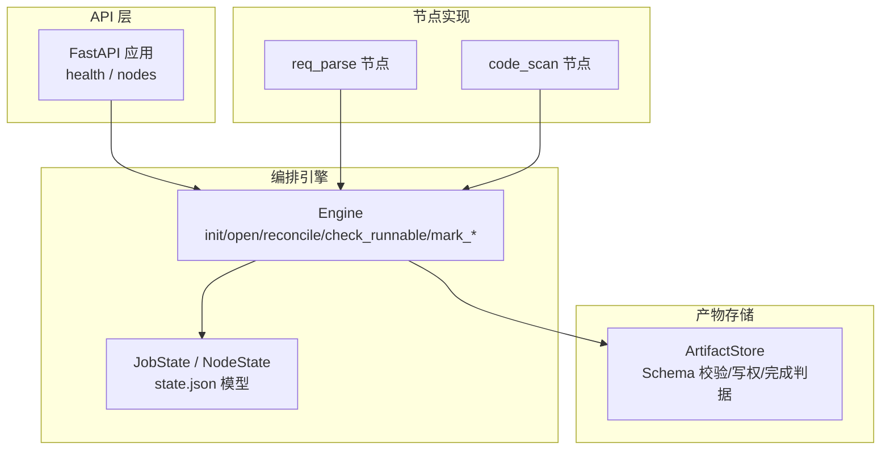
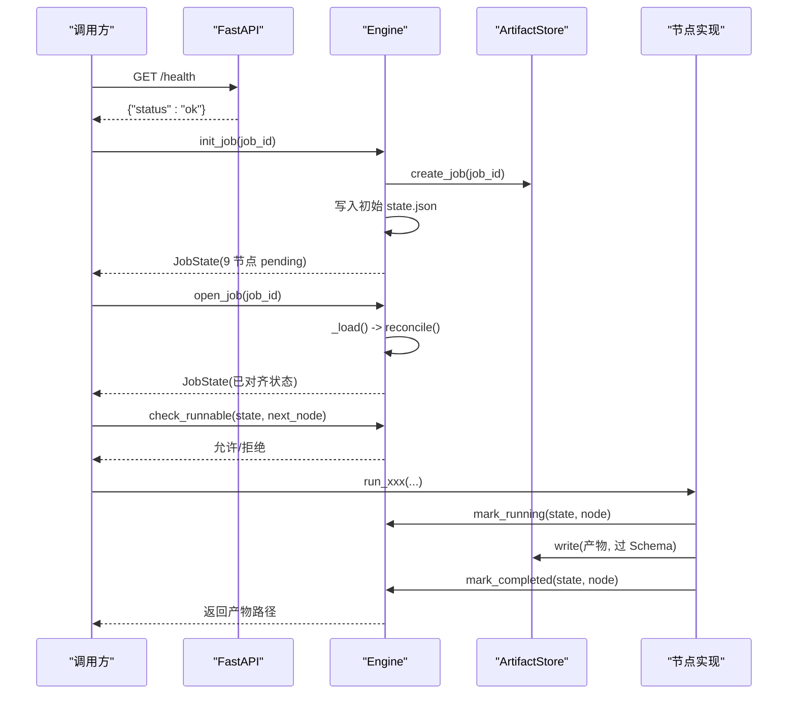
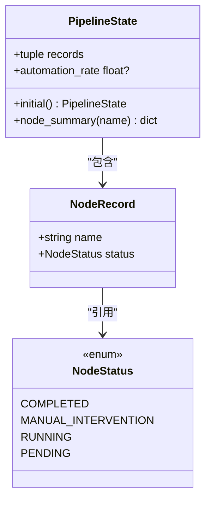
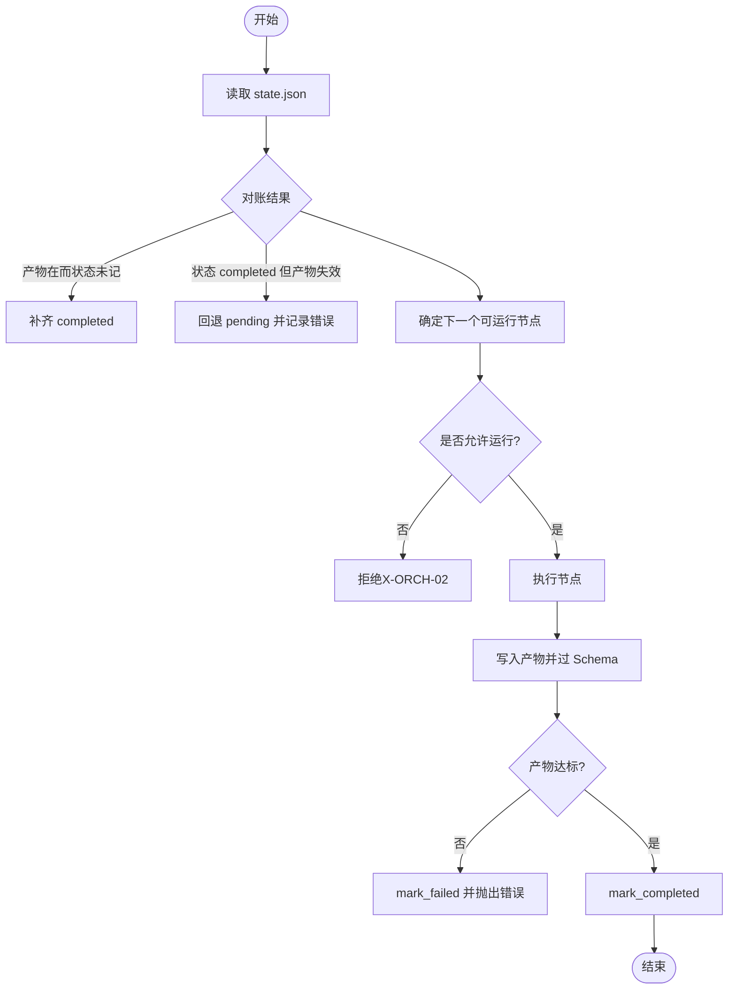
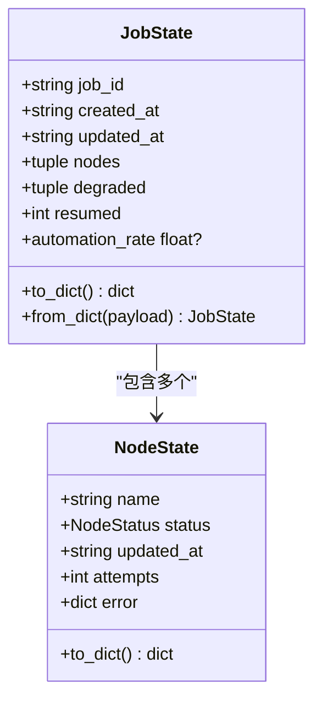
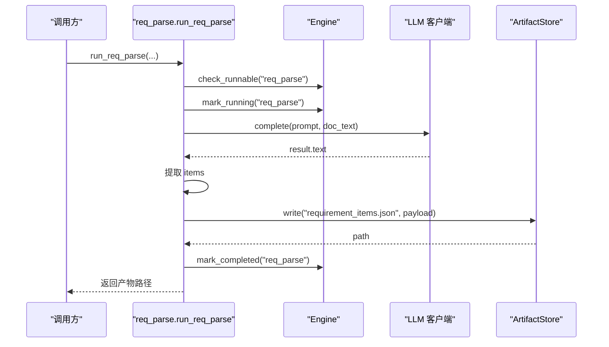
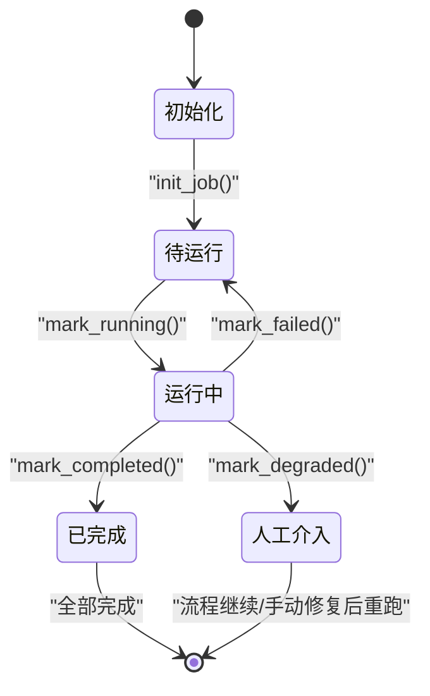
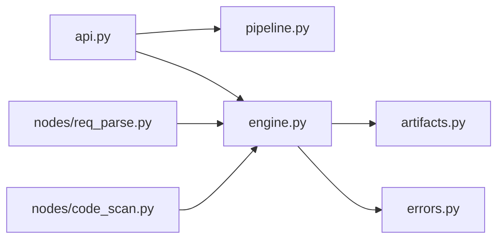

# 流水线引擎

<cite>
**本文引用的文件**
- [pipeline.py](file://services/orchestrator/src/orchestrator/pipeline.py)
- [engine.py](file://services/orchestrator/src/orchestrator/engine.py)
- [artifacts.py](file://services/orchestrator/src/orchestrator/artifacts.py)
- [errors.py](file://services/orchestrator/src/orchestrator/errors.py)
- [api.py](file://services/orchestrator/src/orchestrator/api.py)
- [config.py](file://services/orchestrator/src/orchestrator/config.py)
- [req_parse.py](file://services/orchestrator/src/orchestrator/nodes/req_parse.py)
- [code_scan.py](file://services/orchestrator/src/orchestrator/nodes/code_scan.py)
- [test_engine.py](file://services/orchestrator/tests/test_engine.py)
- [test_pipeline.py](file://services/orchestrator/tests/test_pipeline.py)
</cite>

## 目录
1. [简介](#简介)
2. [项目结构](#项目结构)
3. [核心组件](#核心组件)
4. [架构总览](#架构总览)
5. [详细组件分析](#详细组件分析)
6. [依赖关系分析](#依赖关系分析)
7. [性能考量](#性能考量)
8. [故障排查指南](#故障排查指南)
9. [结论](#结论)
10. [附录](#附录)

## 简介
本文档面向流水线引擎（Orchestrator）的实现与使用，重点阐述：
- PipelineState 状态管理机制：9 个固定节点的状态定义、状态转换规则、断点续跑原理。
- NodeRecord/NodeState 节点记录结构：执行状态、输入输出数据、错误信息的管理方式。
- 流水线执行流程控制：节点间数据传递机制、异常处理策略。
- 生命周期管理：启动、暂停、恢复、终止的语义与实现要点。
- 可视化图示：状态机图、执行流程图、依赖关系图，帮助理解各节点依赖与数据流转。

## 项目结构
Orchestrator 服务采用“编排引擎 + 产物存储 + 节点实现 + API 层”的分层组织：
- 编排引擎：负责 state.json 持久化、对账、跳序防护、降级清单、完成判据校验。
- 产物存储：统一读写产物卷，进行 Schema 校验、写权排他、完成性判定。
- 节点实现：每个节点封装“检查 → 运行 → 落盘 → 置完成/失败/降级”的完整流程。
- API 层：暴露健康检查与节点清单等接口，业务下沉至 service。

图表来源
- [api.py:11-27](file://services/orchestrator/src/orchestrator/api.py#L11-L27)
- [engine.py:133-302](file://services/orchestrator/src/orchestrator/engine.py#L133-L302)
- [artifacts.py:55-157](file://services/orchestrator/src/orchestrator/artifacts.py#L55-L157)
- [req_parse.py:33-78](file://services/orchestrator/src/orchestrator/nodes/req_parse.py#L33-L78)
- [code_scan.py:26-49](file://services/orchestrator/src/orchestrator/nodes/code_scan.py#L26-L49)

章节来源
- [api.py:11-27](file://services/orchestrator/src/orchestrator/api.py#L11-L27)
- [engine.py:133-302](file://services/orchestrator/src/orchestrator/engine.py#L133-L302)
- [artifacts.py:55-157](file://services/orchestrator/src/orchestrator/artifacts.py#L55-L157)

## 核心组件
- 固定九节点顺序与四态标注：
  - 节点顺序：req_parse → code_scan → interface_reconstruct → code_review → testcase_generate → auto_execute → test_report → defect_list → retest_regression。
  - 节点四态：completed、manual_intervention、running、pending。
- 流水线状态对象：
  - PipelineState：用于 API 展示与汇总（骨架），真实状态持久化于 state.json。
  - JobState：state.json 根对象，包含 job_id、时间戳、nodes、degraded、resumed。
  - NodeState：单节点运行时状态，含 name、status、updated_at、attempts、error。
- 产物管理器：
  - ArtifactStore：job 目录管理、Schema 校验、写权排他、完成判据（JSON 需通过 Schema；Markdown 仅存在且非空）。
- 错误体系：
  - PipelineError：统一错误码与消息，支持 node_id 与 details。

章节来源
- [pipeline.py:11-84](file://services/orchestrator/src/orchestrator/pipeline.py#L11-L84)
- [engine.py:43-131](file://services/orchestrator/src/orchestrator/engine.py#L43-L131)
- [artifacts.py:55-157](file://services/orchestrator/src/orchestrator/artifacts.py#L55-L157)
- [errors.py:1-39](file://services/orchestrator/src/orchestrator/errors.py#L1-L39)

## 架构总览
流水线引擎以“产物为唯一事实”为核心原则：state.json 中的 completed 只是缓存，每次加载都会对账（reconcile），确保状态与产物一致。节点执行遵循严格的前序约束（跳序防护），并通过 Engine 提供的 mark_* 方法原子更新状态。

图表来源
- [api.py:11-27](file://services/orchestrator/src/orchestrator/api.py#L11-L27)
- [engine.py:140-159](file://services/orchestrator/src/orchestrator/engine.py#L140-L159)
- [engine.py:161-194](file://services/orchestrator/src/orchestrator/engine.py#L161-L194)
- [engine.py:221-242](file://services/orchestrator/src/orchestrator/engine.py#L221-L242)
- [artifacts.py:75-96](file://services/orchestrator/src/orchestrator/artifacts.py#L75-L96)

## 详细组件分析

### PipelineState 与 NodeRecord：状态管理与自动化率
- 9 节点固定顺序在 NODE_ORDER 中冻结，禁止增删，保证分母恒为 9。
- NodeRecord 表示单个节点的当前状态（骨架阶段），PipelineState 提供节点摘要与自动化率计算。
- 自动化率 = completed 节点数 / 9；无实测时返回 None，避免误导。

图表来源
- [pipeline.py:11-84](file://services/orchestrator/src/orchestrator/pipeline.py#L11-L84)

章节来源
- [pipeline.py:11-84](file://services/orchestrator/src/orchestrator/pipeline.py#L11-L84)

### Engine：编排引擎与断点续跑
- 初始化与打开：
  - init_job：创建 job 目录并写入初始 state.json（若已存在则报错，防覆盖）。
  - open_job：读取 state.json 并对账（reconcile），提升 resumed 计数。
- 对账逻辑（reconcile）：
  - 产物合规 → 标记 completed；状态 completed 但产物失效 → 回退 pending 并记录错误。
- 跳序防护（check_runnable）：
  - 请求运行某节点前，其前序节点必须全部 completed 或 manual_intervention（降级视为已处理）。
- 状态变更：
  - mark_running：置 running，attempts 自增。
  - mark_completed：先验产物判据，未达标拒绝。
  - mark_failed：回 pending，记录最近一次错误。
  - mark_degraded：置 manual_intervention，加入 degraded 清单。
- 完成判据：
  - 每个节点对应一组产物文件名；interface_reconstruct 需要两份产物同时合规。

图表来源
- [engine.py:153-194](file://services/orchestrator/src/orchestrator/engine.py#L153-L194)
- [engine.py:221-261](file://services/orchestrator/src/orchestrator/engine.py#L221-L261)
- [artifacts.py:120-131](file://services/orchestrator/src/orchestrator/artifacts.py#L120-L131)

章节来源
- [engine.py:140-302](file://services/orchestrator/src/orchestrator/engine.py#L140-L302)
- [test_engine.py:39-181](file://services/orchestrator/tests/test_engine.py#L39-L181)

### NodeRecord/NodeState：节点记录结构与错误管理
- NodeRecord（骨架）：name、status，用于 API 摘要。
- NodeState（运行时）：name、status、updated_at、attempts、error（最近一次失败）。
- 序列化/反序列化：
  - to_dict/from_dict：结构化持久化，缺失字段按默认值处理；结构不符抛出 X-ORCH-01。
- 错误信息：
  - error 字段保存最近一次失败的错误详情（code、message、details）。

图表来源
- [engine.py:43-131](file://services/orchestrator/src/orchestrator/engine.py#L43-L131)

章节来源
- [engine.py:43-131](file://services/orchestrator/src/orchestrator/engine.py#L43-L131)

### 节点实现：req_parse 与 code_scan
- req_parse：
  - 流程：检查可运行 → 标记运行 → 加载 Prompt 与文档 → LLM 补全 → 提取 items → 写入 requirement_items.json → 置完成。
  - 错误归位：LLM 输出未过 Schema → X-LLM-02；网络/超时 → X-LLM-01。
- code_scan：
  - 流程：检查可运行 → 标记运行 → 调用 java-parser 扫描 → 提取 inventory → 校验仓库错误 → 写入 code_inventory.json → 置完成。
  - 错误口径：仓库硬错误 → X-CODE-01；通信失败 → X-ORCH-03。

图表来源
- [req_parse.py:33-78](file://services/orchestrator/src/orchestrator/nodes/req_parse.py#L33-L78)
- [engine.py:196-242](file://services/orchestrator/src/orchestrator/engine.py#L196-L242)
- [artifacts.py:75-96](file://services/orchestrator/src/orchestrator/artifacts.py#L75-L96)

章节来源
- [req_parse.py:1-125](file://services/orchestrator/src/orchestrator/nodes/req_parse.py#L1-L125)
- [code_scan.py:1-94](file://services/orchestrator/src/orchestrator/nodes/code_scan.py#L1-L94)

### 流水线生命周期：启动、暂停、恢复、终止
- 启动：
  - init_job：创建 job 目录并写入初始 state.json（9 节点 pending）。
- 暂停：
  - 任意节点执行过程中可通过外部机制中断（如进程信号），state.json 保持最新状态。
- 恢复（断点续跑）：
  - open_job：读取 state.json 并对账，自动补齐/降级不一致状态，resumed 计数增加。
- 终止：
  - 所有节点 completed 或 manual_intervention 时，流水线可视为终止；后续可通过显式重新触发特定节点推进。

图表来源
- [engine.py:140-159](file://services/orchestrator/src/orchestrator/engine.py#L140-L159)
- [engine.py:161-261](file://services/orchestrator/src/orchestrator/engine.py#L161-L261)

章节来源
- [engine.py:140-261](file://services/orchestrator/src/orchestrator/engine.py#L140-L261)

## 依赖关系分析
- 模块耦合：
  - Engine 依赖 ArtifactStore 进行产物读写与完成判据。
  - 节点实现依赖 Engine 进行状态变更与校验。
  - API 层依赖 PipelineState 提供节点清单。
- 外部依赖：
  - jsonschema：用于 JSON 产物 Schema 校验。
  - FastAPI：HTTP 服务框架。
- 潜在循环依赖：
  - 当前设计分层清晰，未见循环导入；节点实现仅单向依赖 Engine。

图表来源
- [api.py:11-27](file://services/orchestrator/src/orchestrator/api.py#L11-L27)
- [engine.py:18-21](file://services/orchestrator/src/orchestrator/engine.py#L18-L21)
- [artifacts.py:18-20](file://services/orchestrator/src/orchestrator/artifacts.py#L18-L20)
- [req_parse.py:15-20](file://services/orchestrator/src/orchestrator/nodes/req_parse.py#L15-L20)
- [code_scan.py:16-19](file://services/orchestrator/src/orchestrator/nodes/code_scan.py#L16-L19)

章节来源
- [api.py:11-27](file://services/orchestrator/src/orchestrator/api.py#L11-L27)
- [engine.py:18-21](file://services/orchestrator/src/orchestrator/engine.py#L18-L21)
- [artifacts.py:18-20](file://services/orchestrator/src/orchestrator/artifacts.py#L18-L20)

## 性能考量
- 原子落盘：state.json 与产物均使用 tmp + replace 模式，避免部分写入导致的不一致。
- 对账开销：open_job 时对每个节点检查产物存在性与 Schema 校验，建议在高频调用场景下缓存结果或批量处理。
- Schema 校验：JSON 产物校验可能成为瓶颈，建议在生产环境预热 Schema 或使用更快的校验库。
- 并发写冲突：通过写权排他（_WRITE_OWNERS）避免多服务同时写入同一产物。

[本节为通用指导，不直接分析具体文件]

## 故障排查指南
- 常见错误码：
  - X-ORCH-01：产物校验失败或 state.json 损坏/不匹配。
  - X-ORCH-02：跳序请求（前序未完成）。
  - X-LLM-01：LLM 调用超时/网络失败（可重试）。
  - X-LLM-02：LLM 输出未过 Schema（不重试，人工介入）。
  - X-ORCH-03：java-parser 服务不可达/通信失败。
- 排查步骤：
  - 检查 state.json 是否可读且 job_id 匹配。
  - 确认产物是否存在且通过 Schema 校验。
  - 查看节点 error 字段获取最近失败详情。
  - 对 degraded 节点进行人工修复后，显式重新触发该节点。

章节来源
- [errors.py:1-39](file://services/orchestrator/src/orchestrator/errors.py#L1-L39)
- [engine.py:196-261](file://services/orchestrator/src/orchestrator/engine.py#L196-L261)
- [test_engine.py:159-181](file://services/orchestrator/tests/test_engine.py#L159-L181)

## 结论
流水线引擎通过“产物为唯一事实”的对账机制，确保了状态的一致性与可靠性；严格的跳序防护与完成判据保障了执行的正确性；统一的错误体系便于问题定位与处理。结合断点续跑与降级清单，系统具备高可用与可运维性。

[本节为总结，不直接分析具体文件]

## 附录
- 配置项（Settings）：
  - 端口、Java Parser URL、产物根目录、LLM 参数、Schema 目录等，全部来自环境变量。
- API 端点：
  - /health：健康检查。
  - /api/v1/pipeline/nodes：返回 9 节点清单与当前状态。

章节来源
- [config.py:9-56](file://services/orchestrator/src/orchestrator/config.py#L9-L56)
- [api.py:11-27](file://services/orchestrator/src/orchestrator/api.py#L11-L27)
- [test_pipeline.py:21-47](file://services/orchestrator/tests/test_pipeline.py#L21-L47)