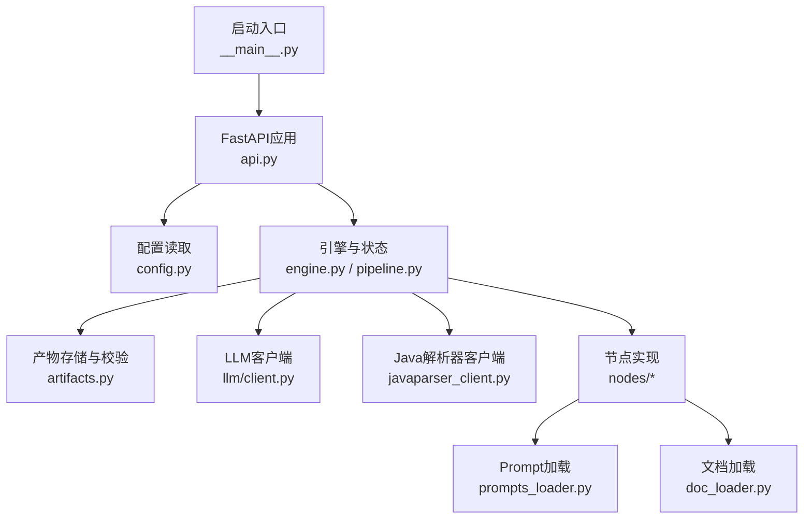
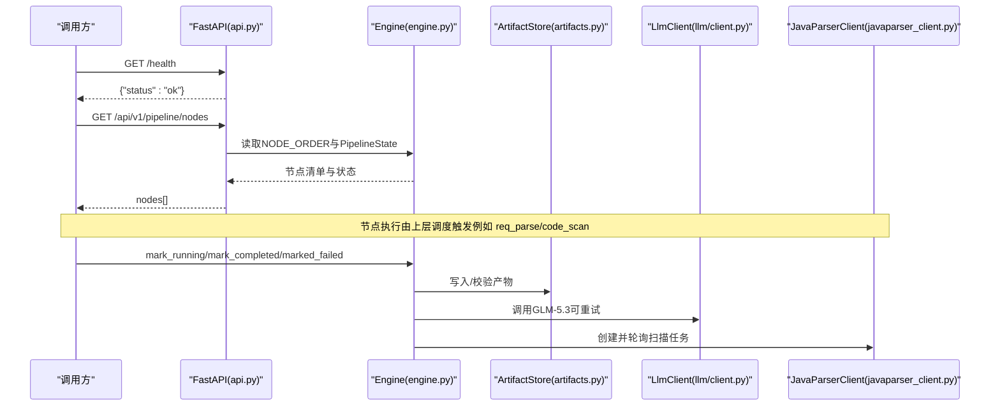
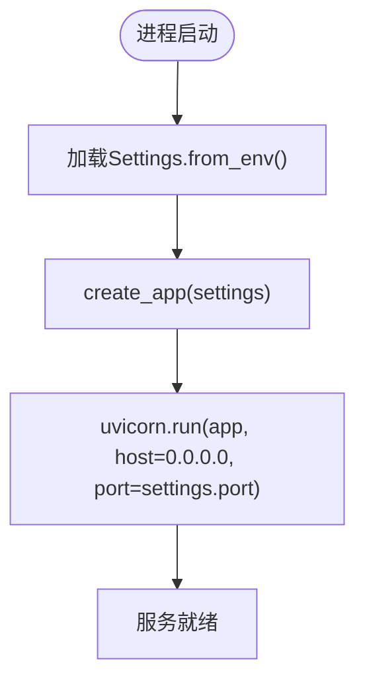
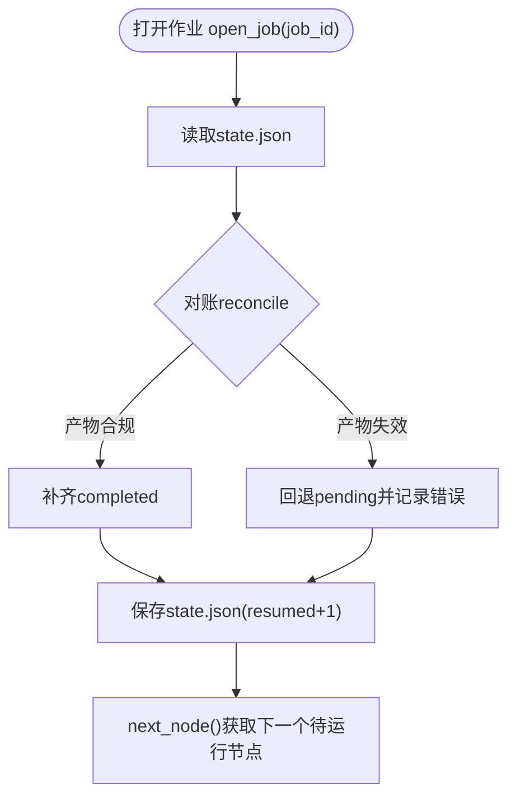
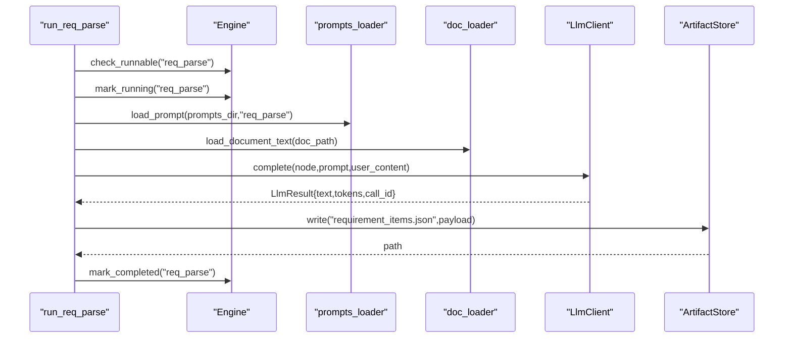
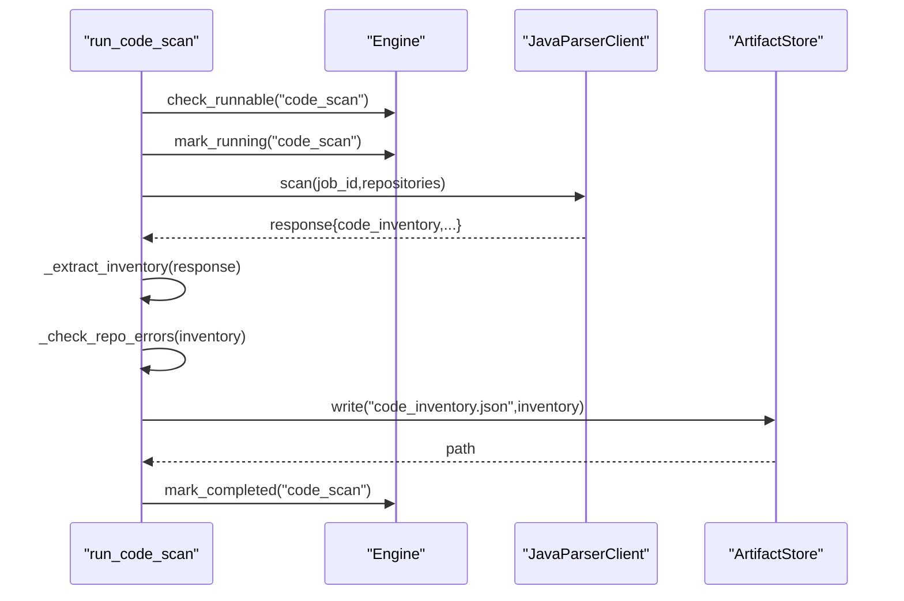
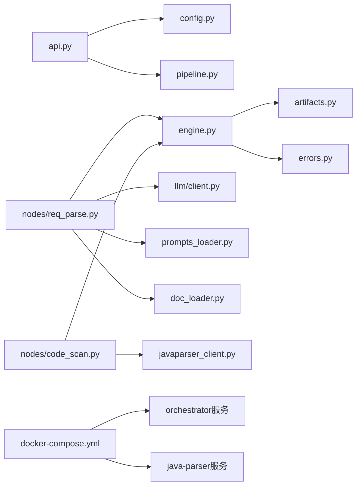

# 编排服务(Orchestrator)

<cite>
**本文引用的文件**
- [__main__.py](file://services/orchestrator/src/orchestrator/__main__.py)
- [api.py](file://services/orchestrator/src/orchestrator/api.py)
- [engine.py](file://services/orchestrator/src/orchestrator/engine.py)
- [pipeline.py](file://services/orchestrator/src/orchestrator/pipeline.py)
- [artifacts.py](file://services/orchestrator/src/orchestrator/artifacts.py)
- [errors.py](file://services/orchestrator/src/orchestrator/errors.py)
- [config.py](file://services/orchestrator/src/orchestrator/config.py)
- [javaparser_client.py](file://services/orchestrator/src/orchestrator/javaparser_client.py)
- [llm/client.py](file://services/orchestrator/src/orchestrator/llm/client.py)
- [nodes/req_parse.py](file://services/orchestrator/src/orchestrator/nodes/req_parse.py)
- [nodes/code_scan.py](file://services/orchestrator/src/orchestrator/nodes/code_scan.py)
- [doc_loader.py](file://services/orchestrator/src/orchestrator/doc_loader.py)
- [prompts_loader.py](file://services/orchestrator/src/orchestrator/prompts_loader.py)
- [docker-compose.yml](file://deploy/docker-compose.yml)
</cite>

## 目录
1. [简介](#简介)
2. [项目结构](#项目结构)
3. [核心组件](#核心组件)
4. [架构总览](#架构总览)
5. [详细组件分析](#详细组件分析)
6. [依赖关系分析](#依赖关系分析)
7. [性能考量](#性能考量)
8. [故障排查指南](#故障排查指南)
9. [结论](#结论)
10. [附录](#附录)

## 简介
本文件为 LLM-AutoTest 系统的编排服务（Orchestrator）技术文档。编排服务是整个系统的核心协调者，负责管理固定 9 个节点的流水线执行流程，提供 REST API、配置管理、状态与产物持久化、断点续跑、跳序防护、降级策略以及跨服务通信协议。本文面向开发与运维读者，既提供高层架构说明，也给出代码级流程图与错误码定义，帮助快速理解与排障。

## 项目结构
编排服务位于 services/orchestrator，采用分层组织：
- 入口与API：__main__.py、api.py
- 引擎与状态：engine.py、pipeline.py
- 产物与校验：artifacts.py
- 外部服务客户端：javaparser_client.py、llm/client.py
- 节点实现：nodes/*（当前包含 req_parse、code_scan）
- 配置与错误：config.py、errors.py
- Prompt 与文档加载：prompts_loader.py、doc_loader.py
- 部署：deploy/docker-compose.yml



图表来源
- [__main__.py:15-21](file://services/orchestrator/src/orchestrator/__main__.py#L15-L21)
- [api.py:11-27](file://services/orchestrator/src/orchestrator/api.py#L11-L27)
- [engine.py:133-160](file://services/orchestrator/src/orchestrator/engine.py#L133-L160)
- [artifacts.py:55-96](file://services/orchestrator/src/orchestrator/artifacts.py#L55-L96)
- [javaparser_client.py:52-80](file://services/orchestrator/src/orchestrator/javaparser_client.py#L52-L80)
- [llm/client.py:41-106](file://services/orchestrator/src/orchestrator/llm/client.py#L41-L106)

章节来源
- [__main__.py:1-26](file://services/orchestrator/src/orchestrator/__main__.py#L1-L26)
- [api.py:1-28](file://services/orchestrator/src/orchestrator/api.py#L1-L28)
- [docker-compose.yml:1-62](file://deploy/docker-compose.yml#L1-L62)

## 核心组件
- 配置系统 Settings：从环境变量加载端口、模型参数、产物根目录、Schema 目录等；提供不含密钥的公开摘要用于日志安全输出。
- 流水线状态 PipelineState：维护 9 节点顺序与四态标注（completed、manual_intervention、running、pending），并提供自动化率计算骨架。
- 引擎 Engine：持有 ArtifactStore，负责 job 生命周期、state.json 读写、对账（reconcile）、跳序检查、运行标记、完成/失败/降级标记。
- 产物存储 ArtifactStore：按 job_id 隔离目录，写权排他（orchestrator/test-executor），JSON Schema 校验，节点完成判据（存在且通过校验）。
- 外部客户端：
  - LlmClient：OpenAI 兼容调用 GLM-5.3，带重试、留痕、超时控制。
  - JavaParserClient：异步创建并轮询扫描任务，契约错误透传，通信异常归 X-ORCH-03。
- 节点实现：
  - req_parse：需求文档文本化 → LLM 解析 → 校验落盘 requirement_items.json。
  - code_scan：调 java-parser 扫描多仓库 → 提取 code_inventory.json → 校验落盘。
- 错误体系 PipelineError：统一 {code, message, node_id?, details}，禁止表外错误码。

章节来源
- [config.py:9-56](file://services/orchestrator/src/orchestrator/config.py#L9-L56)
- [pipeline.py:11-84](file://services/orchestrator/src/orchestrator/pipeline.py#L11-L84)
- [engine.py:43-131](file://services/orchestrator/src/orchestrator/engine.py#L43-L131)
- [artifacts.py:22-50](file://services/orchestrator/src/orchestrator/artifacts.py#L22-L50)
- [errors.py:1-39](file://services/orchestrator/src/orchestrator/errors.py#L1-L39)

## 架构总览
编排服务以 FastAPI 暴露最小接口，业务逻辑下沉至 Engine 与各节点模块。Engine 通过 ArtifactStore 保证“产物即事实”，并以 state.json 作为运行时快照。对外部服务的调用通过专用客户端封装，错误分类清晰：LLM 段、编排段、java-parser 契约段。



图表来源
- [api.py:16-25](file://services/orchestrator/src/orchestrator/api.py#L16-L25)
- [engine.py:140-160](file://services/orchestrator/src/orchestrator/engine.py#L140-L160)
- [artifacts.py:75-96](file://services/orchestrator/src/orchestrator/artifacts.py#L75-L96)
- [llm/client.py:60-106](file://services/orchestrator/src/orchestrator/llm/client.py#L60-L106)
- [javaparser_client.py:70-80](file://services/orchestrator/src/orchestrator/javaparser_client.py#L70-L80)

## 详细组件分析

### 启动机制与REST API
- 启动流程：__main__.py 读取 Settings，构建 FastAPI 应用，使用 uvicorn 在 0.0.0.0:port 启动。
- 健康检查：GET /health 返回 {"status":"ok"}，供 docker-compose 健康检查使用。
- 节点清单：GET /api/v1/pipeline/nodes 返回 NODE_ORDER 中每个节点的 name/status 摘要。



图表来源
- [__main__.py:15-21](file://services/orchestrator/src/orchestrator/__main__.py#L15-L21)
- [api.py:11-27](file://services/orchestrator/src/orchestrator/api.py#L11-L27)

章节来源
- [__main__.py:1-26](file://services/orchestrator/src/orchestrator/__main__.py#L1-L26)
- [api.py:1-28](file://services/orchestrator/src/orchestrator/api.py#L1-L28)

### 配置管理系统
- 环境变量键：PORT、JAVA_PARSER_URL、ARTIFACTS_ROOT、LLM_BASE_URL、LLM_MODEL_NAME、LLM_API_KEY、LLM_TEMPERATURE、LLM_TOP_P、LLM_SEED、LLM_TIMEOUT_S、SCHEMAS_DIR。
- 安全口径：public_summary 不包含密钥，仅记录模型名与采样参数等。
- 缺失必填项时抛出 RuntimeError，便于部署阶段快速发现配置问题。

章节来源
- [config.py:9-56](file://services/orchestrator/src/orchestrator/config.py#L9-L56)

### PipelineState 与 NodeRecord
- 9 节点固定顺序：req_parse、code_scan、interface_reconstruct、code_review、testcase_generate、auto_execute、test_report、defect_list、retest_regression。
- 四态：completed、manual_intervention、running、pending。
- PipelineState.initial() 生成全 pending 初始态；automation_rate 基于 completed/9 计算（骨架阶段可能返回 None）。

章节来源
- [pipeline.py:11-84](file://services/orchestrator/src/orchestrator/pipeline.py#L11-L84)

### Engine：状态管理与断点续跑
- state.json 持久化：JobState 序列化包含 schema_version、job_id、created_at、updated_at、nodes、degraded、resumed。
- 对账 reconcile：以产物为准修正状态——产物合规则 completed；若状态 completed 但产物失效则回退 pending 并记录错误。
- 断点续跑 open_job：加载 state.json 后执行 reconcile，resumed 自增，确保崩溃恢复后状态一致。
- 跳序防护 check_runnable：请求运行某节点前，其前序节点必须全部 completed 或 manual_intervention。
- 运行标记：mark_running 置 running 并 attempts+1；mark_completed 先验产物达标；mark_failed 回 pending 并记录错误；mark_degraded 置 manual_intervention 并加入 degraded 清单。



图表来源
- [engine.py:153-160](file://services/orchestrator/src/orchestrator/engine.py#L153-L160)
- [engine.py:161-180](file://services/orchestrator/src/orchestrator/engine.py#L161-L180)
- [engine.py:181-194](file://services/orchestrator/src/orchestrator/engine.py#L181-L194)

章节来源
- [engine.py:43-131](file://services/orchestrator/src/orchestrator/engine.py#L43-L131)
- [engine.py:140-265](file://services/orchestrator/src/orchestrator/engine.py#L140-L265)

### 产物存储与Schema校验
- 目录布局：<root>/<job_id>/{9 产物 + state.json + scripts/fixtures/logs/archive}。
- 写权排他：_WRITE_OWNERS 规定 orchestrator/test-executor 各自可写的产物集合。
- Schema 校验：write 前用 Draft202012Validator 校验 JSON 产物；Markdown 报告仅检查存在性与非空。
- 完成判据 is_node_completed：文件存在且通过校验（md 仅存在性）。
- 归档 archive：重跑前将旧产物移动到 archive 目录，避免原地覆盖。

章节来源
- [artifacts.py:22-50](file://services/orchestrator/src/orchestrator/artifacts.py#L22-L50)
- [artifacts.py:75-131](file://services/orchestrator/src/orchestrator/artifacts.py#L75-L131)
- [artifacts.py:133-157](file://services/orchestrator/src/orchestrator/artifacts.py#L133-L157)

### 节点实现：req_parse
- 流程：check_runnable → mark_running → 加载 Prompt 与需求文档 → LLM 调用 → 提取 items → 校验并写入 requirement_items.json → mark_completed。
- 错误处理：Prompt 缺失→X-LLM-03；网络/超时→X-LLM-01；LLM 输出未过 Schema→X-LLM-02；其他 PipelineError 经 mark_failed 记录后抛出。
- 容错：支持剥离 ```json 围栏，容忍 Markdown 包裹。



图表来源
- [nodes/req_parse.py:33-78](file://services/orchestrator/src/orchestrator/nodes/req_parse.py#L33-L78)
- [prompts_loader.py:31-63](file://services/orchestrator/src/orchestrator/prompts_loader.py#L31-L63)
- [doc_loader.py:12-33](file://services/orchestrator/src/orchestrator/doc_loader.py#L12-L33)
- [llm/client.py:60-106](file://services/orchestrator/src/orchestrator/llm/client.py#L60-L106)
- [artifacts.py:75-96](file://services/orchestrator/src/orchestrator/artifacts.py#L75-L96)

章节来源
- [nodes/req_parse.py:1-125](file://services/orchestrator/src/orchestrator/nodes/req_parse.py#L1-L125)
- [prompts_loader.py:1-135](file://services/orchestrator/src/orchestrator/prompts_loader.py#L1-L135)
- [doc_loader.py:1-65](file://services/orchestrator/src/orchestrator/doc_loader.py#L1-L65)
- [llm/client.py:1-202](file://services/orchestrator/src/orchestrator/llm/client.py#L1-L202)

### 节点实现：code_scan
- 流程：check_runnable → mark_running → 调用 java-parser 扫描 → 提取 code_inventory → 检查仓库错误 → 校验并写入 code_inventory.json → mark_completed。
- 仓库四态：error→节点失败；empty/truncated→正常态如实落盘；ok→正常。
- 通信失败：java-parser 不可达/超时/HTTP异常/轮询耗尽→X-ORCH-03。



图表来源
- [nodes/code_scan.py:26-49](file://services/orchestrator/src/orchestrator/nodes/code_scan.py#L26-L49)
- [javaparser_client.py:70-80](file://services/orchestrator/src/orchestrator/javaparser_client.py#L70-L80)
- [artifacts.py:75-96](file://services/orchestrator/src/orchestrator/artifacts.py#L75-L96)

章节来源
- [nodes/code_scan.py:1-94](file://services/orchestrator/src/orchestrator/nodes/code_scan.py#L1-L94)
- [javaparser_client.py:1-162](file://services/orchestrator/src/orchestrator/javaparser_client.py#L1-L162)

### 服务间通信协议
- LLM 调用：OpenAI 兼容 /chat/completions，携带 model、messages、temperature、top_p、seed；Authorization 可选；超时来自 Settings.llm_timeout_s；重试策略：最多 3 次（1 首发 + 2 重试），指数退避 5s/20s。
- java-parser 调用：POST /api/v1/scan-jobs 创建任务，GET /api/v1/scan-jobs/{id} 轮询至 completed/failed；契约错误体 {code,message,node_id?,details} 原样透传；通信异常归 X-ORCH-03。

章节来源
- [llm/client.py:108-170](file://services/orchestrator/src/orchestrator/llm/client.py#L108-L170)
- [javaparser_client.py:82-151](file://services/orchestrator/src/orchestrator/javaparser_client.py#L82-L151)

### 监控指标与留痕
- LLM 留痕：每次调用追加 llm_calls.jsonl 一行，包含 call_id、timestamp、node、prompt_file、prompt_version、sampling、input/output 摘要、duration_ms、tokens、ok、error。
- 自动化率：Engine.JobState.automation_rate = completed/9；PipelineState 骨架阶段可能返回 None。
- 降级清单：Engine JobState.degraded 记录 {node, reason, marked_at}，用于报告分列统计。

章节来源
- [llm/client.py:60-106](file://services/orchestrator/src/orchestrator/llm/client.py#L60-L106)
- [engine.py:126-131](file://services/orchestrator/src/orchestrator/engine.py#L126-L131)
- [engine.py:252-261](file://services/orchestrator/src/orchestrator/engine.py#L252-L261)

## 依赖关系分析
- 模块耦合：
  - api.py 依赖 config.py、pipeline.py（只读九节点清单与初始状态）。
  - engine.py 依赖 artifacts.py、pipeline.py、errors.py。
  - 节点模块依赖 engine.py、artifacts.py、对应客户端（llm/client.py、javaparser_client.py）。
  - 客户端依赖 errors.py 与 httpx。
- 外部依赖：
  - java-parser 服务：扫描代码仓库，产出 code_inventory.json。
  - LLM 服务：GLM-5.3 OpenAI 兼容接口。
- 部署依赖：docker-compose.yml 定义 java-parser、orchestrator、frontend 及共享卷 artifacts。



图表来源
- [api.py:11-27](file://services/orchestrator/src/orchestrator/api.py#L11-L27)
- [engine.py:133-160](file://services/orchestrator/src/orchestrator/engine.py#L133-L160)
- [nodes/req_parse.py:33-78](file://services/orchestrator/src/orchestrator/nodes/req_parse.py#L33-L78)
- [nodes/code_scan.py:26-49](file://services/orchestrator/src/orchestrator/nodes/code_scan.py#L26-L49)
- [docker-compose.yml:18-32](file://deploy/docker-compose.yml#L18-L32)

章节来源
- [docker-compose.yml:1-62](file://deploy/docker-compose.yml#L1-L62)

## 性能考量
- LLM 调用：
  - 超时与重试：默认单次超时来自 Settings.llm_timeout_s；重试最多 3 次，退避间隔 5s/20s。
  - 留痕开销：每次调用追加 JSONL 行，建议合理设置日志轮转与磁盘容量。
- java-parser 轮询：
  - 默认轮询间隔 2s，最大等待 600s；可根据仓库规模调整 poll_interval_s 与 max_wait_s。
- 产物校验：
  - JSON Schema 校验在写入时进行，避免无效数据污染；大产物建议分批写入与压缩归档。
- 并发与资源：
  - 使用异步客户端（httpx.AsyncClient），注意连接池与超时配置；在高并发场景下评估 JVM（java-parser）与 Python 进程资源。

[本节为通用指导，不直接分析具体文件]

## 故障排查指南
- 常见错误码与含义：
  - X-LLM-01：LLM 调用超时/网络失败（可重试）。
  - X-LLM-02：LLM 输出未过 Schema 校验（不重试，人工介入）。
  - X-LLM-03：Prompt 文件缺失/元信息不合规（配置错误，人工介入）。
  - X-ORCH-01：产物校验失败（如 Schema 不符、写权冲突、state.json 损坏等）。
  - X-ORCH-02：断点续跑跳序请求（前序未完成）。
  - X-ORCH-03：java-parser 服务不可达/通信失败。
- 定位步骤：
  - 查看 state.json 中 nodes[].error 与 degraded 清单，确认失败节点与原因。
  - 检查 artifacts/<job_id>/ 目录下产物是否存在并通过 Schema 校验。
  - 检查 llm_calls.jsonl 留痕，确认 LLM 调用是否成功、耗时与 tokens。
  - 检查 java-parser 健康端点与日志，确认扫描任务状态。
- 恢复策略：
  - 对账修复：open_job 自动 reconcile，补齐或回退状态。
  - 降级节点：手动修复后显式重新触发该节点。
  - 重跑保护：archive 旧产物后再写入新产物，避免覆盖。

章节来源
- [errors.py:1-39](file://services/orchestrator/src/orchestrator/errors.py#L1-L39)
- [engine.py:161-261](file://services/orchestrator/src/orchestrator/engine.py#L161-L261)
- [artifacts.py:75-131](file://services/orchestrator/src/orchestrator/artifacts.py#L75-L131)
- [llm/client.py:108-170](file://services/orchestrator/src/orchestrator/llm/client.py#L108-L170)
- [javaparser_client.py:98-151](file://services/orchestrator/src/orchestrator/javaparser_client.py#L98-L151)

## 结论
编排服务通过“产物即事实”的设计，结合 state.json 持久化与对账机制，实现了可靠的断点续跑与跳序防护。统一的错误码与留痕体系提升了可观测性与可排障性。配合 docker-compose 部署与清晰的配置管理，可在生产环境中稳定运行。后续可扩展更多节点与监控指标，进一步完善自动化率与质量门禁。

[本节为总结，不直接分析具体文件]

## 附录

### API 端点说明
- GET /health
  - 作用：健康检查
  - 响应：{"status":"ok"}
- GET /api/v1/pipeline/nodes
  - 作用：返回 9 节点清单与当前状态
  - 响应：{"nodes":[{"name":节点名,"status":状态值},...]}

章节来源
- [api.py:16-25](file://services/orchestrator/src/orchestrator/api.py#L16-L25)

### 请求与响应示例（路径引用）
- 健康检查响应示例：参见 [api.py:16-19](file://services/orchestrator/src/orchestrator/api.py#L16-L19)
- 节点清单响应示例：参见 [api.py:21-25](file://services/orchestrator/src/orchestrator/api.py#L21-L25)

### 错误码定义（节选）
- X-LLM-01：LLM 调用超时/网络失败（可重试）
- X-LLM-02：LLM 输出未过 Schema 校验（不重试，人工介入）
- X-LLM-03：Prompt 文件缺失/元信息不合规（配置错误，人工介入）
- X-ORCH-01：产物校验失败
- X-ORCH-02：断点续跑跳序请求
- X-ORCH-03：java-parser 服务不可达/通信失败

章节来源
- [errors.py:1-39](file://services/orchestrator/src/orchestrator/errors.py#L1-L39)

### 部署配置要点
- 环境变量（部分）：
  - PORT：服务端口
  - JAVA_PARSER_URL：java-parser 服务地址
  - ARTIFACTS_ROOT：产物卷根目录
  - LLM_BASE_URL、LLM_MODEL_NAME、LLM_API_KEY、LLM_TEMPERATURE、LLM_TOP_P、LLM_SEED、LLM_TIMEOUT_S：LLM 调用参数
  - SCHEMAS_DIR：Schema 目录
- Docker Compose：
  - 服务：java-parser、orchestrator、frontend
  - 共享卷：artifacts:/data/llm-autotest
  - 健康检查：java-parser 与 orchestrator 均具备健康检查

章节来源
- [config.py:35-56](file://services/orchestrator/src/orchestrator/config.py#L35-L56)
- [docker-compose.yml:1-62](file://deploy/docker-compose.yml#L1-L62)