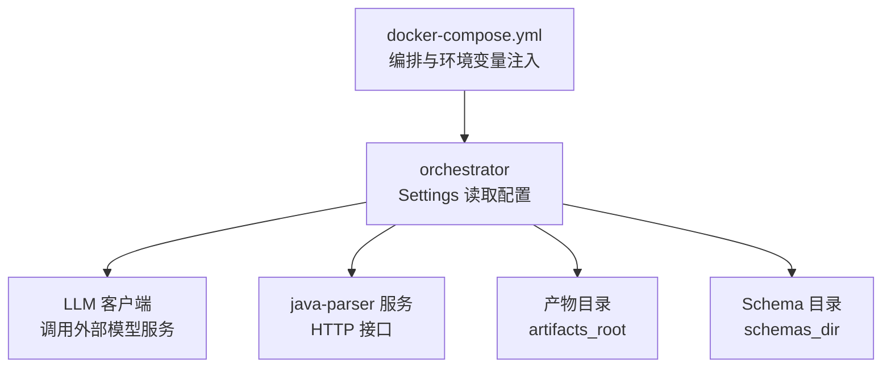
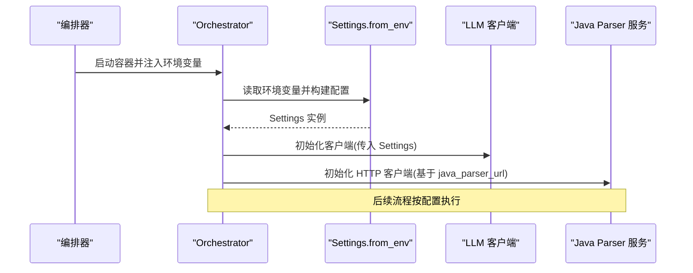
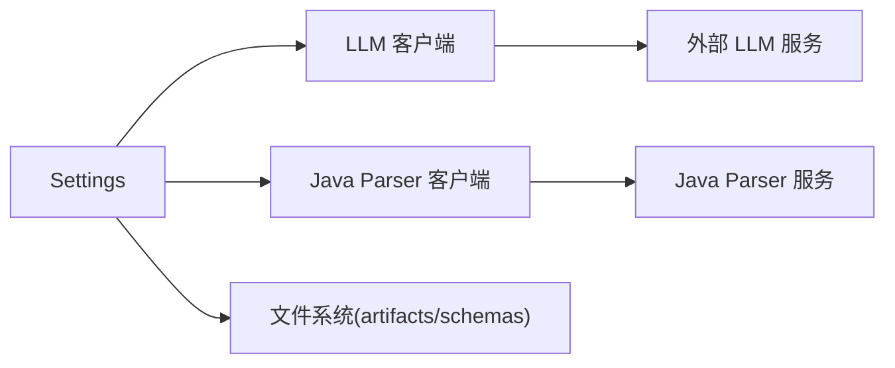

# 配置管理

<cite>
**本文引用的文件**
- [services/orchestrator/src/orchestrator/config.py](file://services/orchestrator/src/orchestrator/config.py)
- [services/orchestrator/tests/test_config.py](file://services/orchestrator/tests/test_config.py)
- [services/orchestrator/src/orchestrator/llm/client.py](file://services/orchestrator/src/orchestrator/llm/client.py)
- [services/orchestrator/src/orchestrator/errors.py](file://services/orchestrator/src/orchestrator/errors.py)
- [deploy/docker-compose.yml](file://deploy/docker-compose.yml)
- [services/java-parser/src/main/resources/application.yml](file://services/java-parser/src/main/resources/application.yml)
</cite>

## 目录
1. [简介](#简介)
2. [项目结构](#项目结构)
3. [核心组件](#核心组件)
4. [架构总览](#架构总览)
5. [详细组件分析](#详细组件分析)
6. [依赖关系分析](#依赖关系分析)
7. [性能考虑](#性能考虑)
8. [故障排查指南](#故障排查指南)
9. [结论](#结论)
10. [附录](#附录)

## 简介
本章节面向配置管理系统，聚焦 orchestrator 服务的 Settings 配置模型与使用方式。内容涵盖：
- 环境变量映射、配置文件加载与默认值管理
- LLM 客户端、Java Parser 服务、产物目录等关键配置项的作用与取值范围
- 配置验证机制、日志安全口径（敏感字段脱敏）
- 热重载能力现状说明与优先级规则
- 完整的环境变量设置示例与最佳实践
- 安全注意事项与性能优化建议
- 配置迁移策略与版本兼容性处理

## 项目结构
本项目采用多服务编排部署，orchestrator 通过环境变量完成运行期配置；java-parser 提供 Java 代码解析能力；前端为独立服务。编排由 docker-compose 统一管理，并通过 env_file 注入环境变量。

图表来源
- [deploy/docker-compose.yml:18-32](file://deploy/docker-compose.yml#L18-L32)
- [services/orchestrator/src/orchestrator/config.py:9-55](file://services/orchestrator/src/orchestrator/config.py#L9-L55)

章节来源
- [deploy/docker-compose.yml:1-62](file://deploy/docker-compose.yml#L1-L62)
- [services/orchestrator/src/orchestrator/config.py:1-56](file://services/orchestrator/src/orchestrator/config.py#L1-L56)

## 核心组件
- Settings 数据类：定义所有运行期配置项，全部来自环境变量，不可变（frozen dataclass），并提供公开摘要属性用于日志输出。
- from_env 工厂方法：从环境变量构建 Settings，缺失必填项时抛出运行时错误；对可选参数提供合理默认值。
- LLM 客户端：消费 Settings 中的 LLM 相关配置进行请求构造、重试与超时控制。
- 统一错误模型：PipelineError 提供统一的错误码与结构化信息，便于上层处理与记录。

章节来源
- [services/orchestrator/src/orchestrator/config.py:9-55](file://services/orchestrator/src/orchestrator/config.py#L9-L55)
- [services/orchestrator/src/orchestrator/llm/client.py:104-154](file://services/orchestrator/src/orchestrator/llm/client.py#L104-L154)
- [services/orchestrator/src/orchestrator/errors.py:1-39](file://services/orchestrator/src/orchestrator/errors.py#L1-L39)

## 架构总览
配置在启动阶段集中读取并固化到 Settings 对象，后续模块通过依赖注入或全局引用获取。LLM 客户端与 Java Parser 客户端均依赖该配置。编排层通过 docker-compose 注入环境变量，确保不同环境可独立配置。

图表来源
- [deploy/docker-compose.yml:18-32](file://deploy/docker-compose.yml#L18-L32)
- [services/orchestrator/src/orchestrator/config.py:35-55](file://services/orchestrator/src/orchestrator/config.py#L35-L55)
- [services/orchestrator/src/orchestrator/llm/client.py:123-154](file://services/orchestrator/src/orchestrator/llm/client.py#L123-L154)

## 详细组件分析

### Settings 配置模型
- 设计要点
  - 不可变数据类：保证运行期配置一致性，避免并发修改。
  - 显式环境变量映射：每个字段对应一个或多个环境变量，缺失必填项时报错。
  - 默认值策略：非必填项提供合理默认值，降低部署复杂度。
  - 日志安全：public_summary 不包含密钥等敏感字段。

- 字段说明与取值范围
  - port: int，服务监听端口，默认 8000。
  - java_parser_url: str，必填，Java Parser 服务地址。
  - artifacts_root: str，产物根目录，默认 /data/llm-autotest。
  - llm_base_url: str，必填，LLM 服务基地址。
  - llm_model_name: str，模型名称，默认 glm-5.3。
  - llm_api_key: str，鉴权令牌，可为空（本地 Mock/内网免鉴权）。
  - llm_temperature: float，采样温度，默认 0.2。
  - llm_top_p: float，核采样阈值，默认 0.8。
  - llm_seed: int|None，随机种子，可选。
  - llm_timeout_s: float，单次调用超时秒数，默认 120。
  - schemas_dir: str，Schema 校验目录，默认 schemas。

- 配置验证机制
  - 必填项缺失：from_env 捕获 KeyError 并抛出 RuntimeError，提示缺失的键名。
  - 类型转换：int/float 转换失败会抛出异常，便于早期发现配置错误。
  - 日志脱敏：public_summary 仅包含非敏感字段，避免泄露密钥。

- 热重载能力
  - 当前实现为进程启动时一次性读取并固化，不支持运行时热重载。如需支持，可在进程内增加配置监听与重建逻辑，但需评估状态一致性与并发安全。

- 配置优先级规则
  - 当前仅支持环境变量覆盖默认值，未实现多源合并（如 .env、配置文件、命令行参数）。若未来引入多源，建议优先级：环境变量 > 配置文件 > 代码默认值。

章节来源
- [services/orchestrator/src/orchestrator/config.py:9-55](file://services/orchestrator/src/orchestrator/config.py#L9-L55)
- [services/orchestrator/tests/test_config.py:10-42](file://services/orchestrator/tests/test_config.py#L10-L42)

### LLM 客户端配置使用
- 使用点
  - 模型名称、温度、Top-P、Seed、超时、API Key、Base URL 均来自 Settings。
  - 网络/超时异常被转换为可重试错误，服务端 5xx 视为暂时性故障触发重试。
  - 非 200 响应按业务语义分类处理。

- 重试与超时
  - 最大尝试次数与退避策略内置于客户端。
  - 超时时间由 llm_timeout_s 控制，避免长时间阻塞。

章节来源
- [services/orchestrator/src/orchestrator/llm/client.py:104-154](file://services/orchestrator/src/orchestrator/llm/client.py#L104-L154)

### Java Parser 服务配置
- 服务端口与扫描并发度
  - application.yml 定义 server.port 与 parser.scan-concurrency。
  - 编排层将端口映射至宿主机，便于访问。

章节来源
- [services/java-parser/src/main/resources/application.yml:1-8](file://services/java-parser/src/main/resources/application.yml#L1-L8)
- [deploy/docker-compose.yml:4-16](file://deploy/docker-compose.yml#L4-L16)

### 编排与环境变量注入
- docker-compose 中 orchestrator 服务通过 environment 与 env_file 注入配置。
- JAVA_PARSER_URL 直接声明，其他 LLM 相关变量可通过 .env 文件集中管理。
- 产物卷挂载到 /data/llm-autotest，与 artifacts_root 默认值保持一致。

章节来源
- [deploy/docker-compose.yml:18-32](file://deploy/docker-compose.yml#L18-L32)

## 依赖关系分析
- orchestrator 依赖
  - LLM 客户端：httpx 异步 HTTP 客户端，受超时与重试策略影响。
  - Java Parser 服务：通过 http 调用，地址由 java_parser_url 指定。
  - 文件系统：artifacts_root 与 schemas_dir 用于读写产物与 Schema。

- 外部依赖
  - LLM 服务：外部模型提供方，需保证可达性与配额。
  - Java Parser：内部服务，健康检查与重启策略由编排层保障。

图表来源
- [services/orchestrator/src/orchestrator/config.py:9-55](file://services/orchestrator/src/orchestrator/config.py#L9-L55)
- [services/orchestrator/src/orchestrator/llm/client.py:123-154](file://services/orchestrator/src/orchestrator/llm/client.py#L123-L154)

章节来源
- [services/orchestrator/src/orchestrator/config.py:9-55](file://services/orchestrator/src/orchestrator/config.py#L9-L55)
- [services/orchestrator/src/orchestrator/llm/client.py:104-154](file://services/orchestrator/src/orchestrator/llm/client.py#L104-L154)

## 性能考虑
- LLM 调用超时与重试
  - 合理设置 llm_timeout_s，避免长尾请求拖慢流水线。
  - 重试策略应结合外部限流与配额，避免雪崩。
- 并发与资源
  - Java Parser 的 scan-concurrency 可根据机器资源调整，避免过度竞争。
- I/O 路径
  - artifacts_root 建议使用高性能存储（如 SSD），减少产物读写延迟。
- 日志与监控
  - 使用 public_summary 输出配置摘要，避免泄露敏感信息。
  - 记录关键指标：调用耗时、重试次数、失败率。

[本节为通用指导，不直接分析具体文件]

## 故障排查指南
- 常见错误与定位
  - 缺少必填环境变量：from_env 抛出 RuntimeError，检查 JAVA_PARSER_URL、LLM_BASE_URL 等是否已设置。
  - LLM 调用失败：检查网络连通性、鉴权头、超时设置；关注可重试错误码 X-LLM-01。
  - Java Parser 不可达：确认服务健康检查与端口映射；参考错误码 X-ORCH-03。
  - 产物校验失败：检查 schemas_dir 是否存在且 Schema 版本匹配；参考错误码 X-ORCH-01。

- 调试步骤
  - 打印 public_summary 确认配置加载情况。
  - 查看编排日志与容器健康检查状态。
  - 逐步缩小问题范围：先验证 LLM 连通性，再验证 Java Parser 连通性。

章节来源
- [services/orchestrator/src/orchestrator/config.py:35-55](file://services/orchestrator/src/orchestrator/config.py#L35-L55)
- [services/orchestrator/src/orchestrator/errors.py:1-39](file://services/orchestrator/src/orchestrator/errors.py#L1-L39)
- [services/orchestrator/tests/test_config.py:26-42](file://services/orchestrator/tests/test_config.py#L26-L42)

## 结论
- Settings 以环境变量为核心配置源，提供强类型与严格校验，确保运行期稳定性。
- 日志安全通过 public_summary 实现，避免敏感信息泄露。
- 当前不支持热重载，建议在需要时引入配置监听与重建机制。
- 编排层集中管理环境变量，便于多环境隔离与版本控制。
- 建议在生产环境中结合监控与告警，持续优化 LLM 调用与 I/O 性能。

[本节为总结性内容，不直接分析具体文件]

## 附录

### 环境变量清单与默认值
- PORT: int，默认 8000
- JAVA_PARSER_URL: str，必填
- ARTIFACTS_ROOT: str，默认 /data/llm-autotest
- LLM_BASE_URL: str，必填
- LLM_MODEL_NAME: str，默认 glm-5.3
- LLM_API_KEY: str，默认空
- LLM_TEMPERATURE: float，默认 0.2
- LLM_TOP_P: float，默认 0.8
- LLM_SEED: int|None，可选
- LLM_TIMEOUT_S: float，默认 120
- SCHEMAS_DIR: str，默认 schemas

章节来源
- [services/orchestrator/src/orchestrator/config.py:35-55](file://services/orchestrator/src/orchestrator/config.py#L35-L55)

### 配置示例（.env 片段）
- JAVA_PARSER_URL=http://java-parser:8080
- LLM_BASE_URL=https://api.example.com
- LLM_MODEL_NAME=glm-5.3
- LLM_API_KEY=sk-secret-value
- LLM_TEMPERATURE=0.3
- LLM_TOP_P=0.8
- LLM_SEED=42
- LLM_TIMEOUT_S=120
- ARTIFACTS_ROOT=/data/llm-autotest
- SCHEMAS_DIR=schemas

章节来源
- [deploy/docker-compose.yml:23-26](file://deploy/docker-compose.yml#L23-L26)
- [services/orchestrator/tests/test_config.py:12-23](file://services/orchestrator/tests/test_config.py#L12-L23)

### 配置最佳实践
- 将敏感信息（如 API Key）放入 .env 或密钥管理服务，不要硬编码到代码或镜像中。
- 使用最小权限原则，限制对外部服务的访问范围。
- 为关键配置添加监控与告警（如 LLM 调用失败率、超时比例）。
- 定期评审默认值与取值范围，确保与业务演进一致。

[本节为通用指导，不直接分析具体文件]

### 安全考虑
- 禁止在日志中输出密钥等敏感字段，使用 public_summary 作为统一口径。
- 对外部服务调用启用超时与重试上限，防止资源耗尽。
- 对输入参数进行校验，避免恶意输入导致系统异常。

章节来源
- [services/orchestrator/src/orchestrator/config.py:26-33](file://services/orchestrator/src/orchestrator/config.py#L26-L33)
- [services/orchestrator/src/orchestrator/llm/client.py:123-154](file://services/orchestrator/src/orchestrator/llm/client.py#L123-L154)

### 性能优化建议
- 根据负载调整 LLM 超时与重试策略，平衡成功率与延迟。
- 合理设置 Java Parser 并发度，避免 CPU/内存瓶颈。
- 使用高效存储与缓存策略，减少 I/O 开销。

[本节为通用指导，不直接分析具体文件]

### 配置迁移策略与版本兼容性
- 新增配置项时应保持向后兼容，提供默认值并标记弃用计划。
- 变更必填项时需评估升级影响，提供迁移脚本或文档。
- 通过 Schema 目录与版本字段（如 schema_version）确保产物格式兼容。

章节来源
- [schemas/samples/execution.sample.json:1-48](file://schemas/samples/execution.sample.json#L1-L48)