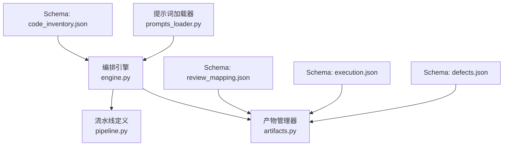
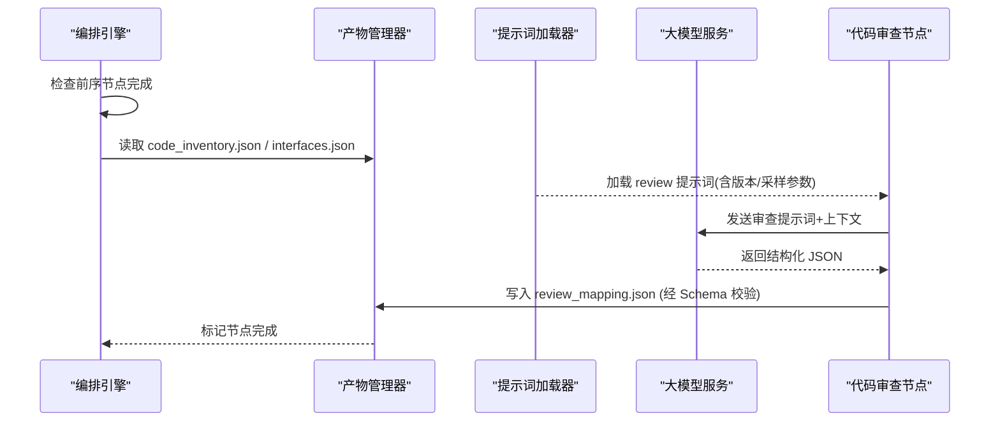
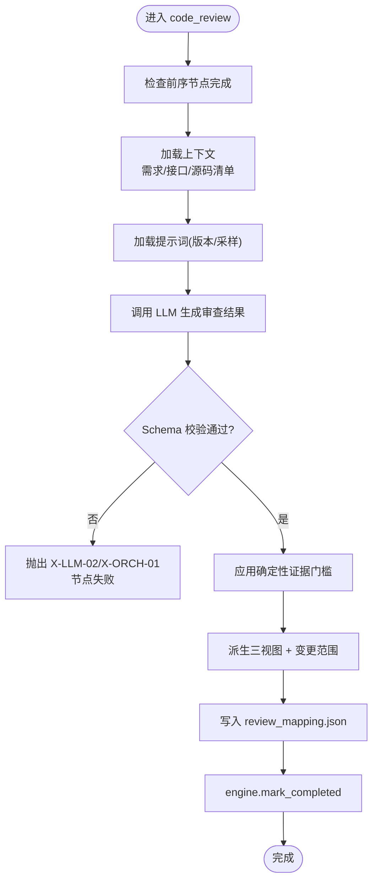
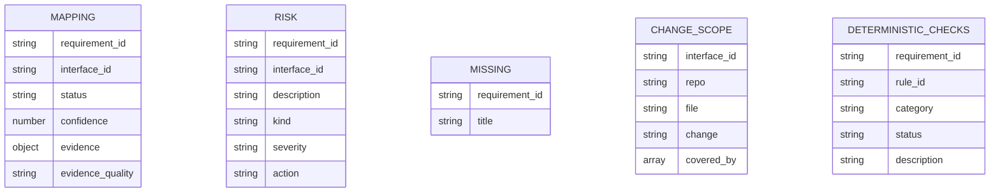
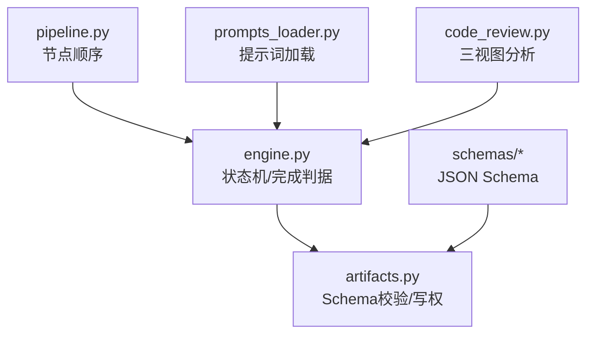

# 代码审查节点

<cite>
**本文引用的文件**
- [services/orchestrator/src/orchestrator/nodes/code_review.py](file://services/orchestrator/src/orchestrator/nodes/code_review.py)
- [services/orchestrator/src/orchestrator/pipeline.py](file://services/orchestrator/src/orchestrator/pipeline.py)
- [services/orchestrator/src/orchestrator/engine.py](file://services/orchestrator/src/orchestrator/engine.py)
- [services/orchestrator/src/orchestrator/artifacts.py](file://services/orchestrator/src/orchestrator/artifacts.py)
- [services/orchestrator/src/orchestrator/errors.py](file://services/orchestrator/src/orchestrator/errors.py)
- [services/orchestrator/src/orchestrator/prompts_loader.py](file://services/orchestrator/src/orchestrator/prompts_loader.py)
- [prompts/skills/code-review-evidence.md](file://prompts/skills/code-review-evidence.md)
- [prompts/memory/server-side-evidence.md](file://prompts/memory/server-side-evidence.md)
- [prompts/README.md](file://prompts/README.md)
- [prompts/_template.md](file://prompts/_template.md)
- [schemas/review_mapping.json](file://schemas/review_mapping.json)
- [schemas/code_inventory.json](file://schemas/code_inventory.json)
- [schemas/execution.json](file://schemas/execution.json)
- [schemas/defects.json](file://schemas/defects.json)
- [services/frontend/src/views/CodeReviewView.vue](file://services/frontend/src/views/CodeReviewView.vue)
- [services/orchestrator/tests/test_code_review.py](file://services/orchestrator/tests/test_code_review.py)
</cite>

## 更新摘要
**变更内容**
- 新增完整的三视图分析能力（已实现/部分实现/缺失需求/未确定）
- 实现确定性证据阈值机制，防止无直接证据时误判为已实现
- 支持行为证据提取，包括认证、授权、密码处理、验证、事务、幂等性、缓存、异步操作的模式匹配
- 新增变更范围分析功能（C-09），支持双分支diff和覆盖度分析
- 增强证据质量评估和增量评审发现机制

## 目录
1. [简介](#简介)
2. [项目结构](#项目结构)
3. [核心组件](#核心组件)
4. [架构总览](#架构总览)
5. [详细组件分析](#详细组件分析)
6. [依赖关系分析](#依赖关系分析)
7. [性能考量](#性能考量)
8. [故障排查指南](#故障排查指南)
9. [结论](#结论)
10. [附录](#附录)

## 简介
本章节面向"代码审查节点（code_review）"，系统性说明基于大模型的智能代码审查机制：如何结合需求、接口与源码扫描结果，进行质量评估、安全漏洞检测与最佳实践检查；如何配置审查规则与提示词模板；如何生成并输出结构化审查报告；以及审查结果与缺陷的映射与关联。文档同时给出输入/输出数据格式约定，重点解释 review_mapping.json 的结构定义，并提供自定义规则开发、标准配置与可视化展示建议。

**更新** 现已实现完整的四态分析（implemented/partial/missing/undetermined），支持确定性证据门槛和行为证据提取，包括安全敏感操作的模式匹配，以及变更范围分析功能。

## 项目结构
围绕 code_review 节点的关键位置与职责如下：
- 流水线编排与节点顺序：固定九节点顺序，其中 code_review 为第4个节点，负责产出 review_mapping.json。
- 产物管理：review_mapping.json 由 orchestrator 写入，受 Schema 校验保护，作为后续测试用例生成与执行的数据源之一。
- 提示词加载：所有 LLM Prompt 以版本化 Markdown 存放，通过 prompts_loader 解析元信息并注入到 LLM 调用中。
- 错误与状态：统一错误码与节点状态流转，确保 code_review 失败可追踪、可重试或降级。

**图表来源**
- [services/orchestrator/src/orchestrator/engine.py:24-35](file://services/orchestrator/src/orchestrator/engine.py#L24-L35)
- [services/orchestrator/src/orchestrator/artifacts.py:24-50](file://services/orchestrator/src/orchestrator/artifacts.py#L24-L50)
- [services/orchestrator/src/orchestrator/pipeline.py:23-34](file://services/orchestrator/src/orchestrator/pipeline.py#L23-L34)

**章节来源**
- [services/orchestrator/src/orchestrator/pipeline.py:23-34](file://services/orchestrator/src/orchestrator/pipeline.py#L23-L34)
- [services/orchestrator/src/orchestrator/engine.py:24-35](file://services/orchestrator/src/orchestrator/engine.py#L24-L35)
- [services/orchestrator/src/orchestrator/artifacts.py:24-50](file://services/orchestrator/src/orchestrator/artifacts.py#L24-L50)

## 核心组件
- 流水线与节点顺序：固定 9 节点，code_review 位于 req_parse → code_scan → interface_reconstruct → code_review → testcase_generate → auto_execute → test_report → defect_list → retest_regression。
- 产物契约：code_review 必须产出 review_mapping.json，并通过 Schema 校验；其完成判据由 engine 在 mark_completed 时强制验证。
- 提示词规范：Prompt 文件需遵循 prompts/_template.md 的元信息块约定，并由 prompts_loader 解析后使用。
- 错误模型：统一 PipelineError 及 X-LLM-*、X-ORCH-* 错误码，便于定位与处理。

**更新** 现在支持四态分析（implemented/partial/missing/undetermined），其中 undetermined 状态用于标记缺乏直接证据的高风险场景。

**章节来源**
- [services/orchestrator/src/orchestrator/pipeline.py:23-34](file://services/orchestrator/src/orchestrator/pipeline.py#L23-L34)
- [services/orchestrator/src/orchestrator/engine.py:229-242](file://services/orchestrator/src/orchestrator/engine.py#L229-L242)
- [services/orchestrator/src/orchestrator/artifacts.py:75-96](file://services/orchestrator/src/orchestrator/artifacts.py#L75-L96)
- [services/orchestrator/src/orchestrator/prompts_loader.py:31-63](file://services/orchestrator/src/orchestrator/prompts_loader.py#L31-L63)
- [services/orchestrator/src/orchestrator/errors.py:1-39](file://services/orchestrator/src/orchestrator/errors.py#L1-L39)

## 架构总览
下图展示了 code_review 节点在整体流水线中的位置与关键交互：上游提供需求、接口与源码清单，code_review 调用 LLM 生成三视图映射与风险/遗漏清单，下游据此生成用例与执行。

**图表来源**
- [services/orchestrator/src/orchestrator/engine.py:196-242](file://services/orchestrator/src/orchestrator/engine.py#L196-L242)
- [services/orchestrator/src/orchestrator/artifacts.py:75-131](file://services/orchestrator/src/orchestrator/artifacts.py#L75-L131)
- [services/orchestrator/src/orchestrator/prompts_loader.py:31-63](file://services/orchestrator/src/orchestrator/prompts_loader.py#L31-L63)

## 详细组件分析

### 代码审查节点工作流
- 前置条件：req_parse、code_scan、interface_reconstruct 已完成，且对应产物存在并通过校验。
- 输入数据：
  - 需求项：requirement_items.json（由上游节点产出）
  - 源码清单：code_inventory.json（由 code_scan 产出）
  - 接口定义：interfaces.json（由 interface_reconstruct 产出）
- 处理逻辑：
  - 加载提示词：从 prompts/ 下按约定名称加载，解析元信息（版本、规格编号、主笔人、变更记录、采样参数）。
  - 构建上下文：将需求、接口、源码清单组织为 LLM 可理解的上下文。
  - 调用 LLM：依据提示词模板生成结构化 JSON，严格符合 schemas/review_mapping.json。
  - 落盘与校验：通过 artifacts.write 写入 review_mapping.json，若 Schema 校验失败则拒绝写入并报错。
  - 完成标记：engine.mark_completed 再次校验产物是否达标，通过后置节点为 completed。
- 输出数据：review_mapping.json（三视图：需求-代码映射、风险清单、遗漏功能清单），并附带人工审核记录。

**更新** 新增了确定性证据门槛检查、行为证据提取、变更范围分析和增量评审发现功能。

**图表来源**
- [services/orchestrator/src/orchestrator/engine.py:196-242](file://services/orchestrator/src/orchestrator/engine.py#L196-L242)
- [services/orchestrator/src/orchestrator/artifacts.py:75-96](file://services/orchestrator/src/orchestrator/artifacts.py#L75-L96)
- [services/orchestrator/src/orchestrator/prompts_loader.py:31-63](file://services/orchestrator/src/orchestrator/prompts_loader.py#L31-L63)

**章节来源**
- [services/orchestrator/src/orchestrator/engine.py:196-242](file://services/orchestrator/src/orchestrator/engine.py#L196-L242)
- [services/orchestrator/src/orchestrator/artifacts.py:75-96](file://services/orchestrator/src/orchestrator/artifacts.py#L75-L96)
- [services/orchestrator/src/orchestrator/prompts_loader.py:31-63](file://services/orchestrator/src/orchestrator/prompts_loader.py#L31-L63)

### 确定性证据门槛与行为证据提取
系统实现了严格的确定性证据门槛机制，防止在没有直接代码证据的情况下误判为已实现。

**证据规则模式匹配：**
- 认证相关：session、jwt、token、expires、expiry、ttl、max_age
- 授权控制：preauthorize、permission、role、authorize、isauthenticated、login_required  
- 密码处理：passwordencoder、bcrypt、argon2、make_password、check_password、hashpw
- 数据验证：@valid、@notnull、@notblank、@size、serializer、validate、validators
- 事务管理：@transactional、transaction.atomic、begin_transaction、commit
- 幂等性保证：idempoten、get_or_create、uniqueconstraint、unique_together、duplicate
- 缓存策略：@cacheable、cache.get、cache.set、redis、expireat
- 异步操作：@async、celery、kafka、rabbitmq、@scheduled、asyncio

**证据提取流程：**
1. 从源码清单中提取服务端行为相关文件
2. 扫描允许的文件类型（.py、.java、.kt、.js、.ts、.yml、.yaml、.properties、.xml）
3. 对每个文件进行模式匹配，提取相关代码片段
4. 自动脱敏敏感信息（密码、密钥、API Key等）
5. 限制证据数量（最多160个文件，72个证据项，每段520字符）

**证据质量评估：**
- behavior_path：有调用链证据的行为路径
- interface_only：仅有接口签名证据
- insufficient：证据不足，需要进一步核查
- none：无任何证据

**章节来源**
- [services/orchestrator/src/orchestrator/nodes/code_review.py:62-90](file://services/orchestrator/src/orchestrator/nodes/code_review.py#L62-L90)
- [services/orchestrator/src/orchestrator/nodes/code_review.py:265-363](file://services/orchestrator/src/orchestrator/nodes/code_review.py#L265-L363)
- [services/orchestrator/src/orchestrator/nodes/code_review.py:436-535](file://services/orchestrator/src/orchestrator/nodes/code_review.py#L436-L535)

### 变更范围分析（C-09）
实现了完整的双分支差异分析功能，支持基线分支与被测分支的代码变更对比。

**变更范围分析流程：**
1. 从 code_inventory.json 中提取 changed_files（added/modified/removed）
2. 将变更文件与接口定义的 code_location 进行匹配
3. 计算 covered_by：变更接口被哪些需求条目覆盖
4. 识别 unmatched_changed_files：业务逻辑层变更但未命中接口定义
5. 生成 removed_files：被测侧删除的文件列表

**增量评审发现：**
- changed_interface_uncovered：变更接口未被任何需求覆盖（P1严重）
- changed_interface_risk：变更接口的需求评审状态为 partial/missing/undetermined
- changed_behavior_file：业务逻辑文件发生变更，需人工核对影响范围
- removed_file：被测分支删除文件，需确认能力回退与调用方影响

**前端可视化支持：**
前端 CodeReviewView.vue 已实现视图四的展示，支持变更范围表格显示，包括接口、仓库/文件、变更类型和需求覆盖情况。

**章节来源**
- [services/orchestrator/src/orchestrator/nodes/code_review.py:557-685](file://services/orchestrator/src/orchestrator/nodes/code_review.py#L557-L685)
- [services/frontend/src/views/CodeReviewView.vue:253-286](file://services/frontend/src/views/CodeReviewView.vue#L253-L286)
- [services/orchestrator/tests/test_code_review.py:337-415](file://services/orchestrator/tests/test_code_review.py#L337-L415)

### 审查规则配置与提示词模板
- 提示词存放：所有 Prompt 置于 prompts/ 目录，禁止内联字符串。
- 命名与版本：采用 <节点>-<用途>-v<版本>.md，并在文件头部包含 version/spec/owner/changelog/sampling 等元信息。
- 加载机制：prompts_loader.load_prompt 解析元信息块，提取 body 与 sampling 参数供上层使用。
- 变更管控：每次修改需升版本号并追加 changelog，禁止原地改语义。

**更新** 新增了 skills/code-review-evidence.md 和 memory/server-side-evidence.md 两个专门的提示词文件，提供更精确的服务端行为审查指导。

**章节来源**
- [prompts/README.md:1-15](file://prompts/README.md#L1-L15)
- [prompts/_template.md:1-22](file://prompts/_template.md#L1-L22)
- [prompts/skills/code-review-evidence.md:1-24](file://prompts/skills/code-review-evidence.md#L1-L24)
- [prompts/memory/server-side-evidence.md:1-13](file://prompts/memory/server-side-evidence.md#L1-L13)
- [services/orchestrator/src/orchestrator/prompts_loader.py:31-63](file://services/orchestrator/src/orchestrator/prompts_loader.py#L31-L63)

### 审查报告结构与映射关系（review_mapping.json）
- 顶层字段：
  - schema_version: 固定为 "1.0"
  - job_id: 以 "job-" 开头
  - mappings: 需求-代码映射表（requirements × interfaces）
  - risks: 风险清单（partial 自动进入，程序化派生）
  - missing_features: 遗漏功能清单（提取 missing 条目）
  - deterministic_checks: 确定性证据门槛检查结果
  - change_scope: 变更范围分析结果
  - call_chains: 接口调用链信息
  - incremental_findings: 增量评审发现
  - removed_files: 删除文件列表
  - unmatched_changed_files: 未匹配的变更文件
  - review_log: 人工审核记录（通过/驳回 + 回流）
- 关键字段约束：
  - requirement_id 匹配 REQ-xxx 模式
  - interface_id 匹配 IF-XXX-xxx 模式
  - status 枚举：implemented/partial/missing/undetermined
  - confidence 取值范围 0~1
  - evidence.code_location 包含 repo/file/start_line/end_line
  - evidence_quality 枚举：behavior_path/interface_only/insufficient/none
  - review_log 包含 decision/approved|rejected、reason、resubmitted、timestamp（UTC ISO-8601）

**更新** 新增了 deterministic_checks、change_scope、call_chains、incremental_findings、removed_files、unmatched_changed_files 等新字段，提供更全面的审查信息。

**图表来源**
- [schemas/review_mapping.json:1-173](file://schemas/review_mapping.json#L1-L173)

**章节来源**
- [schemas/review_mapping.json:1-173](file://schemas/review_mapping.json#L1-L173)

### 输入/输出数据格式与上下游关联
- 输入：
  - code_inventory.json：源码扫描清单，包含仓库列表、状态（ok/empty/truncated/error）、文件清单等。
  - interfaces.json：接口定义（由 interface_reconstruct 产出，文件名在 ARTIFACT_FILES 中）。
  - requirement_items.json：需求项（由 req_parse 产出）。
- 输出：
  - review_mapping.json：三视图映射、风险与遗漏清单、人工审核记录。
- 下游关联：
  - testcase_generate：基于 review_mapping 生成用例（testcases.json）。
  - auto_execute：执行用例（execution.json）。
  - defect_list：根据执行结果生成缺陷（defects.json）。

**更新** 现在还支持变更范围分析所需的 baseline_branch 和 changed_files 字段。

**章节来源**
- [schemas/code_inventory.json:1-57](file://schemas/code_inventory.json#L1-L57)
- [schemas/execution.json:1-59](file://schemas/execution.json#L1-L59)
- [schemas/defects.json:1-54](file://schemas/defects.json#L1-L54)
- [services/orchestrator/src/orchestrator/artifacts.py:24-50](file://services/orchestrator/src/orchestrator/artifacts.py#L24-L50)

### 缺陷关联机制
- 缺陷来源：auto_execute 阶段断言失败的用例进入缺陷清单（defects.json），环境失败隔离待确认。
- 关联键：
  - case_id：TC-xxx，双向关联用例与缺陷。
  - interface_id：IF-XXX-xxx，关联接口。
  - failure_reason：失败原因描述。
  - reproduce：复现步骤（script_path 必填）。
  - history：生命周期事件（discovered/retest_started/retest_passed/retest_failed/close_suggested/retained）。
- 与 review_mapping 的关系：
  - 通过 requirement_id 与 interface_id 将缺陷回溯至需求与接口，形成端到端追溯链。

**更新** 现在可以通过 deterministic_checks 和 evidence_quality 字段更好地关联缺陷根因分析。

**章节来源**
- [schemas/defects.json:1-54](file://schemas/defects.json#L1-L54)
- [schemas/review_mapping.json:1-173](file://schemas/review_mapping.json#L1-L173)

### 自定义审查规则开发与最佳实践
- 规则载体：以 Prompt 形式实现，遵循 prompts/_template.md 的元信息块约定，明确 version/spec/owner/changelog/sampling。
- 规则发布：新增或修改 Prompt 文件后，需在元信息中升版本号并记录变更；加载器会按 name@version 引用。
- 规则校验：LLM 输出必须通过 schemas/review_mapping.json 校验，否则节点失败，禁止截取可用部分。
- 最佳实践：
  - 将质量评估、安全漏洞检测、最佳实践检查拆分为独立 Prompt 片段，组合调用。
  - 在提示词中显式要求证据定位（evidence.code_location），便于可视化与修复。
  - 对 partial/missing 条目强制生成 risks/missing_features，保证下游一致性。

**更新** 建议使用新的 skills/code-review-evidence.md 和 memory/server-side-evidence.md 作为基础模板，利用确定性证据门槛和行为证据提取功能。

**章节来源**
- [prompts/_template.md:1-22](file://prompts/_template.md#L1-L22)
- [prompts/skills/code-review-evidence.md:1-24](file://prompts/skills/code-review-evidence.md#L1-L24)
- [prompts/memory/server-side-evidence.md:1-13](file://prompts/memory/server-side-evidence.md#L1-L13)
- [services/orchestrator/src/orchestrator/prompts_loader.py:31-63](file://services/orchestrator/src/orchestrator/prompts_loader.py#L31-L63)
- [schemas/review_mapping.json:1-173](file://schemas/review_mapping.json#L1-L173)

### 结果可视化展示建议
- 三视图看板：
  - 需求-代码映射：按 requirement_id 聚合 implemented/partial/missing/undetermined，显示置信度与证据定位。
  - 风险清单：按 requirement_id/interface_id 分组，展示风险描述与严重等级。
  - 遗漏功能：列出缺失需求标题与关联接口。
- 时间线：
  - review_log 展示人工审核决策与回流情况，支持审计与闭环。
- 与缺陷联动：
  - 将 defects.json 与 review_mapping 通过 requirement_id/interface_id 关联，展示缺陷分布与修复进度。

**更新** 新增了变更范围分析视图，支持双分支diff展示，包括变更文件、覆盖度和增量评审发现。

[本节为概念性内容，不直接分析具体文件]

## 依赖关系分析
- 编排引擎依赖 pipeline 定义的节点顺序与状态机，确保 code_review 的前序节点完成。
- 产物管理器负责 review_mapping.json 的写权校验与 Schema 校验，保障数据契约。
- 提示词加载器提供版本化 Prompt，支撑 LLM 调用的可追溯性与可回滚。
- 错误模型统一错误码，便于跨模块定位问题。

**更新** 现在还依赖变更范围分析所需的 code_inventory.json 中的 baseline_branch 和 changed_files 字段。

**图表来源**
- [services/orchestrator/src/orchestrator/pipeline.py:23-34](file://services/orchestrator/src/orchestrator/pipeline.py#L23-L34)
- [services/orchestrator/src/orchestrator/engine.py:24-35](file://services/orchestrator/src/orchestrator/engine.py#L24-L35)
- [services/orchestrator/src/orchestrator/artifacts.py:24-50](file://services/orchestrator/src/orchestrator/artifacts.py#L24-L50)
- [services/orchestrator/src/orchestrator/prompts_loader.py:31-63](file://services/orchestrator/src/orchestrator/prompts_loader.py#L31-L63)
- [services/orchestrator/src/orchestrator/nodes/code_review.py:1-913](file://services/orchestrator/src/orchestrator/nodes/code_review.py#L1-L913)

**章节来源**
- [services/orchestrator/src/orchestrator/pipeline.py:23-34](file://services/orchestrator/src/orchestrator/pipeline.py#L23-L34)
- [services/orchestrator/src/orchestrator/engine.py:24-35](file://services/orchestrator/src/orchestrator/engine.py#L24-L35)
- [services/orchestrator/src/orchestrator/artifacts.py:24-50](file://services/orchestrator/src/orchestrator/artifacts.py#L24-L50)
- [services/orchestrator/src/orchestrator/prompts_loader.py:31-63](file://services/orchestrator/src/orchestrator/prompts_loader.py#L31-L63)

## 性能考量
- 提示词与上下文大小：控制 prompt 长度与上下文规模，避免 LLM 超时或响应过大。
- 批量处理：对多仓库/多接口场景，考虑分批调用 LLM 以降低延迟与失败面。
- 缓存策略：对稳定需求的审查结果可缓存，减少重复计算。
- 重试与降级：网络或 LLM 异常时使用 X-LLM-01 重试；Schema 校验失败使用 X-LLM-02 转人工介入。

**更新** 新增了证据提取的性能优化：限制证据文件数量（160个）、证据项数量（72个）、每段证据字符数（520字符），避免过大的上下文。

[本节提供一般性指导，不直接分析具体文件]

## 故障排查指南
- 常见错误码：
  - X-LLM-01：LLM 调用超时/网络失败（可重试）
  - X-LLM-02：LLM 输出未过 Schema 校验（不重试，人工介入）
  - X-LLM-03：Prompt 文件缺失/元信息不合规（配置错误，人工介入）
  - X-ORCH-01：产物校验失败（如 review_mapping.json 不符合 Schema）
  - X-ORCH-02：跳序请求（前序节点未完成）
  - X-ORCH-03：java-parser 服务不可达/通信失败
- 排查步骤：
  - 检查 state.json 中 code_review 节点状态与错误信息。
  - 核对 review_mapping.json 是否存在并通过 Schema 校验。
  - 确认 prompts/ 下提示词文件存在且元信息完整。
  - 查看上游产物（code_inventory.json、interfaces.json、requirement_items.json）是否齐全。
  - 若为 LLM 输出问题，调整提示词或采样参数，并重新运行。

**更新** 新增了确定性证据门槛相关的故障排查：检查是否有足够的行为证据，必要时调整证据提取规则或补充扫描范围。

**章节来源**
- [services/orchestrator/src/orchestrator/errors.py:1-39](file://services/orchestrator/src/orchestrator/errors.py#L1-L39)
- [services/orchestrator/src/orchestrator/engine.py:196-242](file://services/orchestrator/src/orchestrator/engine.py#L196-L242)
- [services/orchestrator/src/orchestrator/artifacts.py:75-96](file://services/orchestrator/src/orchestrator/artifacts.py#L75-L96)
- [services/orchestrator/src/orchestrator/prompts_loader.py:31-63](file://services/orchestrator/src/orchestrator/prompts_loader.py#L31-L63)

## 结论
code_review 节点通过严格的产物契约与 Schema 校验，结合版本化的提示词模板，实现了可追溯、可回滚的智能代码审查流程。其输出的三视图映射、风险与遗漏清单，以及与缺陷的双向关联，为后续用例生成、执行与问题闭环提供了坚实基础。

**更新** 现已实现的完整性四态分析、确定性证据门槛、行为证据提取、变更范围分析等功能，大幅提升了代码审查的准确性和实用性。建议在实践中持续优化提示词与规则，完善可视化与监控，提升审查效率与准确性。

[本节为总结性内容，不直接分析具体文件]

## 附录
- 实际审查示例（概念性流程）：
  - 输入：需求 REQ-001、接口 IF-API-001、源码清单 code_inventory.json。
  - 处理：加载提示词，调用 LLM 生成 mapping/risk/missing。
  - 输出：review_mapping.json，包含 implemented/partial/missing 状态与证据定位。
  - 下游：testcase_generate 基于 mapping 生成用例，auto_execute 执行并产出 execution.json，defect_list 汇总缺陷。
- 缺陷修复建议：
  - 针对 partial/missing 条目，补充实现或更新需求。
  - 对安全风险，增加防护逻辑与单元测试。
  - 对最佳实践违规，重构代码并加入静态检查规则。

**更新** 新增了变更范围分析的示例：
  - 输入：包含 baseline_branch 和 changed_files 的 code_inventory.json。
  - 处理：程序化派生变更接口与需求覆盖关系，生成增量评审发现。
  - 输出：change_scope、removed_files、unmatched_changed_files、incremental_findings。
  - 下游：基于变更范围优先关注高风险的未覆盖变更。

[本节为概念性内容，不直接分析具体文件]