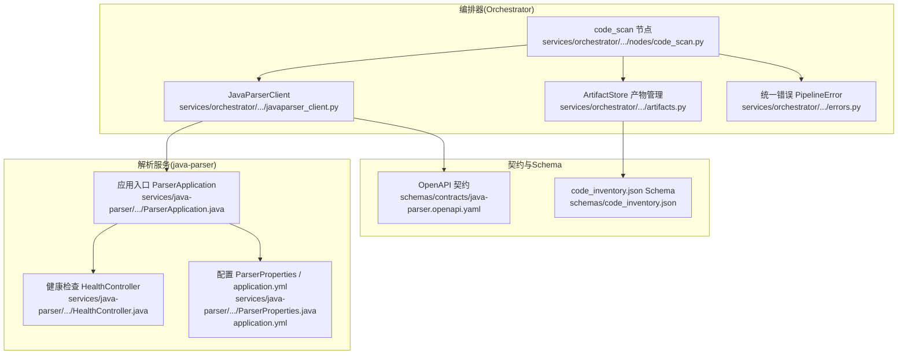
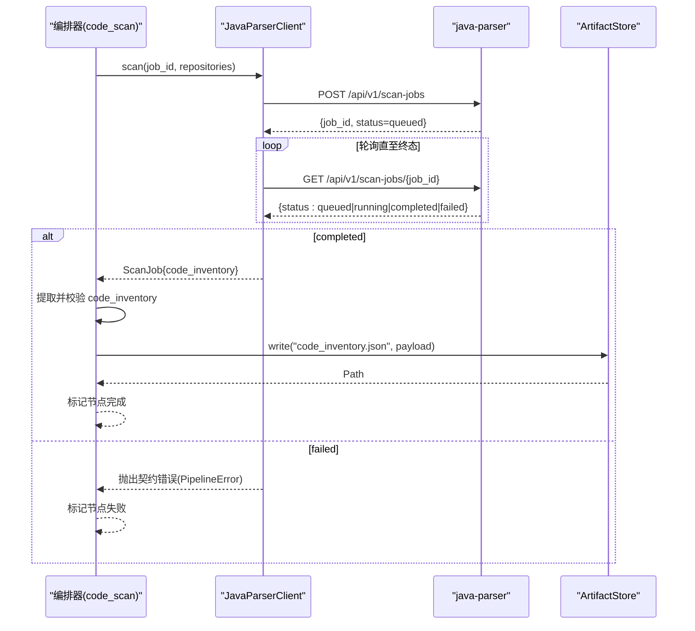
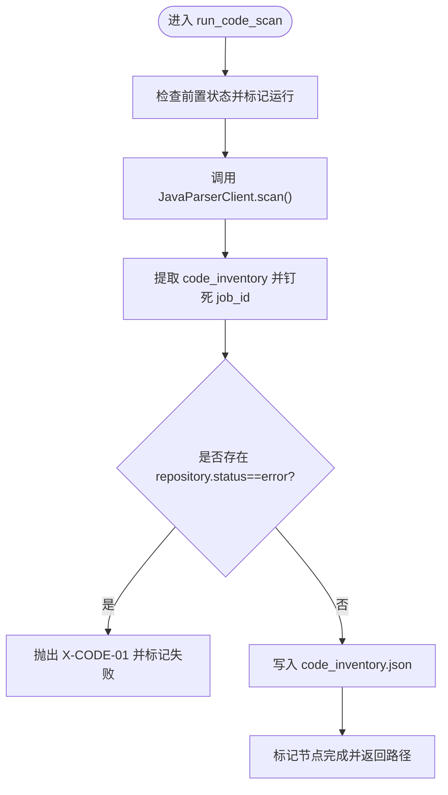
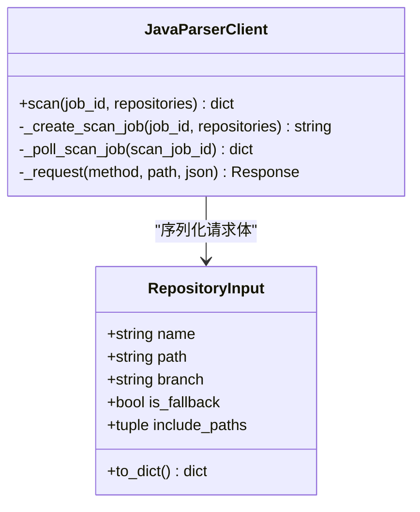
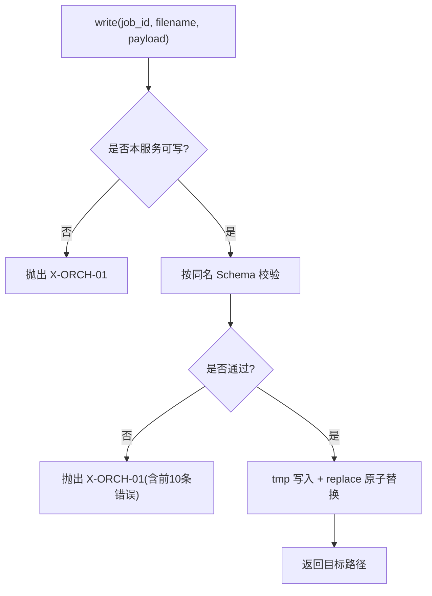
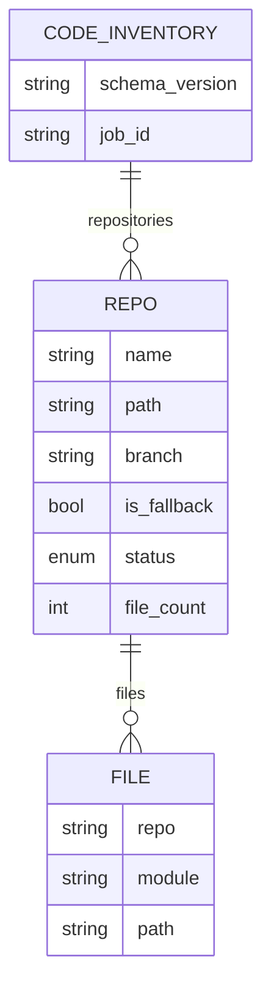
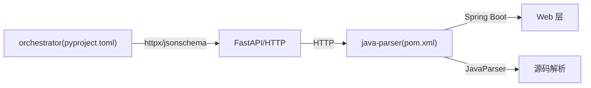

# 代码扫描节点

<cite>
**本文引用的文件**
- [services/orchestrator/src/orchestrator/nodes/code_scan.py](file://services/orchestrator/src/orchestrator/nodes/code_scan.py)
- [services/orchestrator/src/orchestrator/javaparser_client.py](file://services/orchestrator/src/orchestrator/javaparser_client.py)
- [schemas/code_inventory.json](file://schemas/code_inventory.json)
- [schemas/contracts/java-parser.openapi.yaml](file://schemas/contracts/java-parser.openapi.yaml)
- [services/orchestrator/src/orchestrator/artifacts.py](file://services/orchestrator/src/orchestrator/artifacts.py)
- [services/orchestrator/src/orchestrator/errors.py](file://services/orchestrator/src/orchestrator/errors.py)
- [services/java-parser/src/main/resources/application.yml](file://services/java-parser/src/main/resources/application.yml)
- [services/java-parser/pom.xml](file://services/java-parser/pom.xml)
- [services/java-parser/src/main/java/com/llmautotest/parser/ParserApplication.java](file://services/java-parser/src/main/java/com/llmautotest/parser/ParserApplication.java)
- [services/java-parser/src/main/java/com/llmautotest/parser/HealthController.java](file://services/java-parser/src/main/java/com/llmautotest/parser/HealthController.java)
- [services/java-parser/src/main/java/com/llmautotest/parser/ParserProperties.java](file://services/java-parser/src/main/java/com/llmautotest/parser/ParserProperties.java)
- [services/orchestrator/tests/test_code_scan.py](file://services/orchestrator/tests/test_code_scan.py)
</cite>

## 目录
1. [简介](#简介)
2. [项目结构](#项目结构)
3. [核心组件](#核心组件)
4. [架构总览](#架构总览)
5. [详细组件分析](#详细组件分析)
6. [依赖关系分析](#依赖关系分析)
7. [性能考量](#性能考量)
8. [故障排查指南](#故障排查指南)
9. [结论](#结论)
10. [附录：配置与使用示例](#附录配置与使用示例)

## 简介
本文件聚焦“代码扫描节点”，系统性说明 orchestrator 如何通过异步 job 模式调用 java-parser 服务，完成多仓库克隆、代码索引构建与静态分析，并产出 code_inventory.json。文档覆盖接口契约、数据流转、错误处理、重试策略、性能优化及配置使用要点，帮助读者快速理解与排障。

## 项目结构
围绕代码扫描的关键位置如下：
- 编排侧（Python）：code_scan 节点、java-parser 客户端、产物落盘与校验、统一错误定义
- 契约与Schema：OpenAPI 契约、code_inventory.json Schema
- 解析侧（Java）：Spring Boot 应用入口、健康检查、可配置并发度

**图表来源**
- [services/orchestrator/src/orchestrator/nodes/code_scan.py:26-49](file://services/orchestrator/src/orchestrator/nodes/code_scan.py#L26-L49)
- [services/orchestrator/src/orchestrator/javaparser_client.py:70-151](file://services/orchestrator/src/orchestrator/javaparser_client.py#L70-L151)
- [services/orchestrator/src/orchestrator/artifacts.py:75-112](file://services/orchestrator/src/orchestrator/artifacts.py#L75-L112)
- [schemas/contracts/java-parser.openapi.yaml:24-70](file://schemas/contracts/java-parser.openapi.yaml#L24-L70)
- [schemas/code_inventory.json:1-57](file://schemas/code_inventory.json#L1-L57)
- [services/java-parser/src/main/java/com/llmautotest/parser/ParserApplication.java:9-15](file://services/java-parser/src/main/java/com/llmautotest/parser/ParserApplication.java#L9-L15)
- [services/java-parser/src/main/java/com/llmautotest/parser/HealthController.java:12-16](file://services/java-parser/src/main/java/com/llmautotest/parser/HealthController.java#L12-L16)
- [services/java-parser/src/main/resources/application.yml:1-8](file://services/java-parser/src/main/resources/application.yml#L1-L8)
- [services/java-parser/src/main/java/com/llmautotest/parser/ParserProperties.java:7-15](file://services/java-parser/src/main/java/com/llmautotest/parser/ParserProperties.java#L7-L15)

**章节来源**
- [services/orchestrator/src/orchestrator/nodes/code_scan.py:1-94](file://services/orchestrator/src/orchestrator/nodes/code_scan.py#L1-L94)
- [services/orchestrator/src/orchestrator/javaparser_client.py:1-162](file://services/orchestrator/src/orchestrator/javaparser_client.py#L1-L162)
- [schemas/contracts/java-parser.openapi.yaml:1-369](file://schemas/contracts/java-parser.openapi.yaml#L1-L369)
- [schemas/code_inventory.json:1-57](file://schemas/code_inventory.json#L1-L57)
- [services/orchestrator/src/orchestrator/artifacts.py:1-157](file://services/orchestrator/src/orchestrator/artifacts.py#L1-L157)
- [services/orchestrator/src/orchestrator/errors.py:1-39](file://services/orchestrator/src/orchestrator/errors.py#L1-L39)
- [services/java-parser/src/main/resources/application.yml:1-8](file://services/java-parser/src/main/resources/application.yml#L1-L8)
- [services/java-parser/pom.xml:1-83](file://services/java-parser/pom.xml#L1-L83)
- [services/java-parser/src/main/java/com/llmautotest/parser/ParserApplication.java:1-17](file://services/java-parser/src/main/java/com/llmautotest/parser/ParserApplication.java#L1-L17)
- [services/java-parser/src/main/java/com/llmautotest/parser/HealthController.java:1-18](file://services/java-parser/src/main/java/com/llmautotest/parser/HealthController.java#L1-L18)
- [services/java-parser/src/main/java/com/llmautotest/parser/ParserProperties.java:1-17](file://services/java-parser/src/main/java/com/llmautotest/parser/ParserProperties.java#L1-L17)

## 核心组件
- code_scan 节点：编排流程的“代码扫描”步骤，负责前置状态检查、调用远端扫描、提取产物、校验与落盘、节点状态推进。
- JavaParserClient：封装对 java-parser 的异步 HTTP 调用，创建 scan job 并轮询至终态；统一通信异常为 X-ORCH-03；透传契约错误码。
- ArtifactStore：产物卷访问器，提供原子写入、JSON Schema 校验、写权隔离、归档等能力。
- 统一错误：PipelineError 承载稳定错误码、消息、节点归属与详情，便于上层统一处理。
- java-parser 服务：基于 Spring Boot 暴露健康检查与扫描相关接口；通过 ParserProperties 控制扫描并发度；pom 中声明 JavaParser 依赖用于源码解析。

**章节来源**
- [services/orchestrator/src/orchestrator/nodes/code_scan.py:26-94](file://services/orchestrator/src/orchestrator/nodes/code_scan.py#L26-L94)
- [services/orchestrator/src/orchestrator/javaparser_client.py:28-162](file://services/orchestrator/src/orchestrator/javaparser_client.py#L28-L162)
- [services/orchestrator/src/orchestrator/artifacts.py:55-157](file://services/orchestrator/src/orchestrator/artifacts.py#L55-L157)
- [services/orchestrator/src/orchestrator/errors.py:17-39](file://services/orchestrator/src/orchestrator/errors.py#L17-L39)
- [services/java-parser/pom.xml:31-47](file://services/java-parser/pom.xml#L31-L47)
- [services/java-parser/src/main/java/com/llmautotest/parser/ParserProperties.java:7-15](file://services/java-parser/src/main/java/com/llmautotest/parser/ParserProperties.java#L7-L15)

## 架构总览
编排器通过 JavaParserClient 以异步 job 方式与 java-parser 交互：POST 创建任务 → GET 轮询至 completed/failed。完成后 orchestrator 从响应中提取 code_inventory，进行归属校验与 Schema 校验后落盘，并标记节点完成。

**图表来源**
- [services/orchestrator/src/orchestrator/javaparser_client.py:70-121](file://services/orchestrator/src/orchestrator/javaparser_client.py#L70-L121)
- [schemas/contracts/java-parser.openapi.yaml:24-70](file://schemas/contracts/java-parser.openapi.yaml#L24-L70)
- [services/orchestrator/src/orchestrator/nodes/code_scan.py:38-49](file://services/orchestrator/src/orchestrator/nodes/code_scan.py#L38-L49)
- [services/orchestrator/src/orchestrator/artifacts.py:75-96](file://services/orchestrator/src/orchestrator/artifacts.py#L75-L96)

## 详细组件分析

### code_scan 节点
- 职责边界：仅负责编排流程中的“代码扫描”步骤，不直接执行 Git 克隆或解析逻辑，而是委托给 java-parser。
- 关键流程：
  - 前置状态检查与运行标记
  - 调用 client.scan 发起远端扫描
  - 提取 code_inventory，强制绑定 job_id，设置 schema_version
  - 仓库级硬错误检查：任一 repository.status == error 即失败
  - 落盘 code_inventory.json 并标记节点完成
- 四态口径：ok、empty（X-CODE-02）、truncated（X-CODE-03）、error（X-CODE-01）。其中 empty/truncated 视为正常态继续流程。

**图表来源**
- [services/orchestrator/src/orchestrator/nodes/code_scan.py:26-94](file://services/orchestrator/src/orchestrator/nodes/code_scan.py#L26-L94)

**章节来源**
- [services/orchestrator/src/orchestrator/nodes/code_scan.py:1-94](file://services/orchestrator/src/orchestrator/nodes/code_scan.py#L1-L94)

### JavaParserClient 与接口契约
- 请求模型：RepositoryInput 支持 name/path/branch/is_fallback/include_paths，序列化时按需输出可选字段。
- 工作流：
  - _create_scan_job：POST /api/v1/scan-jobs，返回 job_id
  - _poll_scan_job：GET /api/v1/scan-jobs/{id} 轮询至 completed/failed，未知状态或超时归为 X-ORCH-03
  - _request：统一捕获网络异常为 X-ORCH-03；HTTP 4xx/5xx 若携带契约错误体则透传其 code，否则包装为 X-ORCH-03
- 契约对齐：遵循 OpenAPI 定义的 JobStatus、ScanRequest、ScanJob、Error 等结构。

**图表来源**
- [services/orchestrator/src/orchestrator/javaparser_client.py:28-162](file://services/orchestrator/src/orchestrator/javaparser_client.py#L28-L162)
- [schemas/contracts/java-parser.openapi.yaml:162-198](file://schemas/contracts/java-parser.openapi.yaml#L162-L198)

**章节来源**
- [services/orchestrator/src/orchestrator/javaparser_client.py:1-162](file://services/orchestrator/src/orchestrator/javaparser_client.py#L1-L162)
- [schemas/contracts/java-parser.openapi.yaml:1-369](file://schemas/contracts/java-parser.openapi.yaml#L1-L369)

### 产物管理与 Schema 校验
- ArtifactStore.write：先校验写权，再按同名 Schema 校验 payload，通过后以 tmp+replace 原子落盘。
- 完成判据：is_node_completed 要求产物存在且通过校验（Markdown 仅检查非空）。
- 与 code_scan 的关系：节点成功后将 code_inventory.json 写入产物卷，后续节点可据此继续。

**图表来源**
- [services/orchestrator/src/orchestrator/artifacts.py:75-112](file://services/orchestrator/src/orchestrator/artifacts.py#L75-L112)

**章节来源**
- [services/orchestrator/src/orchestrator/artifacts.py:1-157](file://services/orchestrator/src/orchestrator/artifacts.py#L1-L157)

### 错误处理与重试机制
- 统一错误：PipelineError 包含 code/message/node_id/details，便于上层统一呈现与决策。
- 分类口径：
  - 契约错误（X-CODE-*）：由 java-parser 返回，客户端原样透传，node_id 归位到 code_scan
  - 通信失败（X-ORCH-03）：连接/超时/HTTP 异常/轮询耗尽/未知状态
  - 产物校验失败（X-ORCH-01）：缺失 code_inventory、Schema 不匹配、写权冲突
- 重试策略：
  - 轮询重试：_poll_scan_job 内部按 poll_interval_s 循环，直到 max_wait_s 上限
  - 外部重试：由上层编排器根据错误码决定（X-ORCH-03 可重试；X-CODE-01/X-ORCH-01 通常不重试）

**章节来源**
- [services/orchestrator/src/orchestrator/errors.py:1-39](file://services/orchestrator/src/orchestrator/errors.py#L1-L39)
- [services/orchestrator/src/orchestrator/javaparser_client.py:21-23](file://services/orchestrator/src/orchestrator/javaparser_client.py#L21-L23)
- [services/orchestrator/src/orchestrator/javaparser_client.py:98-121](file://services/orchestrator/src/orchestrator/javaparser_client.py#L98-L121)
- [services/orchestrator/src/orchestrator/nodes/code_scan.py:78-94](file://services/orchestrator/src/orchestrator/nodes/code_scan.py#L78-L94)

### 代码清单生成过程（code_inventory.json）
- 触发点：java-parser 完成扫描后在 ScanJob.code_inventory 中返回清单
- 内容构成：
  - schema_version：固定为 "1.0"
  - job_id：由 orchestrator 注入，防止串档
  - repositories：每个仓库的状态、文件计数、截断范围、编码跳过列表、错误信息以及 files 明细
- 文件结构：files 数组每项包含 repo/module/path，module 在无模块结构时取顶层目录名
- 质量评估：仓库级 status 区分 ok/empty/truncated/error；encoding_skipped 记录异常编码跳过文件（R-CODE-03）

**图表来源**
- [schemas/code_inventory.json:1-57](file://schemas/code_inventory.json#L1-L57)
- [schemas/contracts/java-parser.openapi.yaml:207-273](file://schemas/contracts/java-parser.openapi.yaml#L207-L273)

**章节来源**
- [schemas/code_inventory.json:1-57](file://schemas/code_inventory.json#L1-L57)
- [schemas/contracts/java-parser.openapi.yaml:207-273](file://schemas/contracts/java-parser.openapi.yaml#L207-L273)

### 与 JavaParser 服务的集成
- 启动与健康检查：Spring Boot 应用入口 ParserApplication；/health 返回服务存活信息
- 配置项：application.yml 暴露 parser.scan-concurrency；ParserProperties 读取并校验该值
- 依赖：pom.xml 引入 spring-boot-starter-web 与 javaparser-symbol-solver-core 用于源码解析

**章节来源**
- [services/java-parser/src/main/java/com/llmautotest/parser/ParserApplication.java:9-15](file://services/java-parser/src/main/java/com/llmautotest/parser/ParserApplication.java#L9-L15)
- [services/java-parser/src/main/java/com/llmautotest/parser/HealthController.java:12-16](file://services/java-parser/src/main/java/com/llmautotest/parser/HealthController.java#L12-L16)
- [services/java-parser/src/main/resources/application.yml:1-8](file://services/java-parser/src/main/resources/application.yml#L1-L8)
- [services/java-parser/src/main/java/com/llmautotest/parser/ParserProperties.java:7-15](file://services/java-parser/src/main/java/com/llmautotest/parser/ParserProperties.java#L7-L15)
- [services/java-parser/pom.xml:31-47](file://services/java-parser/pom.xml#L31-L47)

## 依赖关系分析
- 编排器依赖：
  - httpx：异步 HTTP 客户端
  - jsonschema：产物 Schema 校验
  - fastapi/uvicorn/pydantic：API 与服务框架
- 解析服务依赖：
  - Spring Boot Web：REST 接口
  - JavaParser Symbol Solver：源码解析与符号求解
- 契约约束：OpenAPI 严格定义了请求/响应结构与错误格式，确保两端一致

**图表来源**
- [services/orchestrator/pyproject.toml:6-14](file://services/orchestrator/pyproject.toml#L6-L14)
- [services/java-parser/pom.xml:31-47](file://services/java-parser/pom.xml#L31-L47)

**章节来源**
- [services/orchestrator/pyproject.toml:1-57](file://services/orchestrator/pyproject.toml#L1-L57)
- [services/java-parser/pom.xml:1-83](file://services/java-parser/pom.xml#L1-L83)

## 性能考量
- 轮询参数可调优：DEFAULT_POLL_INTERVAL_S、DEFAULT_MAX_WAIT_S 作为运维调优项，测试可通过构造器注入小值加速
- 原子落盘：tmp+replace 避免部分写入导致的脏读
- 并发度受控：java-parser 侧 parser.scan-concurrency 限制多仓库扫描并发，避免资源争用
- 传输超时：单次 HTTP 请求默认超时 DEFAULT_TIMEOUT_S，防止长尾阻塞

**章节来源**
- [services/orchestrator/src/orchestrator/javaparser_client.py:21-23](file://services/orchestrator/src/orchestrator/javaparser_client.py#L21-L23)
- [services/orchestrator/src/orchestrator/artifacts.py:91-96](file://services/orchestrator/src/orchestrator/artifacts.py#L91-L96)
- [services/java-parser/src/main/resources/application.yml:5-8](file://services/java-parser/src/main/resources/application.yml#L5-L8)

## 故障排查指南
- 常见错误码与定位：
  - X-CODE-01：仓库扫描硬错误（如路径不存在），节点失败，不落产物
  - X-ORCH-01：产物校验失败（缺 code_inventory、Schema 不匹配、写权冲突）
  - X-ORCH-03：通信失败（连接/超时/HTTP 异常/轮询耗尽/未知状态）
- 排查步骤：
  - 确认 java-parser 健康：GET /health
  - 检查轮询是否超时：增大 max_wait_s 或降低 poll_interval_s
  - 核对 repositories 输入：name/path/branch 是否正确，超大仓库可使用 include_paths 截断
  - 查看 code_inventory 中 repositories[].error 与 encoding_skipped 定位问题文件
- 参考用例：tests/test_code_scan.py 覆盖了成功、仓库错误、job 失败、网络错误、轮询超时、缺产物、跳序保护等场景

**章节来源**
- [services/orchestrator/src/orchestrator/errors.py:8-14](file://services/orchestrator/src/orchestrator/errors.py#L8-L14)
- [services/orchestrator/src/orchestrator/nodes/code_scan.py:78-94](file://services/orchestrator/src/orchestrator/nodes/code_scan.py#L78-L94)
- [services/orchestrator/src/orchestrator/javaparser_client.py:98-151](file://services/orchestrator/src/orchestrator/javaparser_client.py#L98-L151)
- [services/java-parser/src/main/java/com/llmautotest/parser/HealthController.java:12-16](file://services/java-parser/src/main/java/com/llmautotest/parser/HealthController.java#L12-L16)
- [services/orchestrator/tests/test_code_scan.py:136-270](file://services/orchestrator/tests/test_code_scan.py#L136-L270)

## 结论
代码扫描节点通过编排器与 java-parser 的异步 job 协作，实现了多仓库的代码扫描与清单生成。编排侧负责流程控制、错误归一化与产物落盘；解析侧专注静态分析与并发控制。借助严格的契约与 Schema 校验，系统具备高可靠性与可观测性。合理配置轮询与并发参数，可在稳定性与性能之间取得平衡。

## 附录：配置与使用示例
- 基本用法（编排器侧）：
  - 准备至少两个仓库输入（含真实与兜底仓库），调用 run_code_scan
  - 等待 node 完成，读取 code_inventory.json 验证结果
- 关键配置项：
  - orchestrator 侧轮询参数：poll_interval_s、max_wait_s、timeout_s（构造器注入）
  - java-parser 侧并发度：parser.scan-concurrency（环境变量覆盖）
- 典型场景：
  - 超大仓库：通过 include_paths 指定核心模块目录，避免全量扫描
  - 兜底仓库：is_fallback=true 标记，结果单独标注、不计入主指标
- 参考实现与用例：
  - 客户端构造与 MockTransport 注入见 tests/test_code_scan.py
  - 健康检查端点 /health 用于容器编排依赖探测

**章节来源**
- [services/orchestrator/tests/test_code_scan.py:25-80](file://services/orchestrator/tests/test_code_scan.py#L25-L80)
- [services/orchestrator/src/orchestrator/javaparser_client.py:55-68](file://services/orchestrator/src/orchestrator/javaparser_client.py#L55-L68)
- [services/java-parser/src/main/resources/application.yml:5-8](file://services/java-parser/src/main/resources/application.yml#L5-L8)
- [schemas/contracts/java-parser.openapi.yaml:162-184](file://schemas/contracts/java-parser.openapi.yaml#L162-L184)