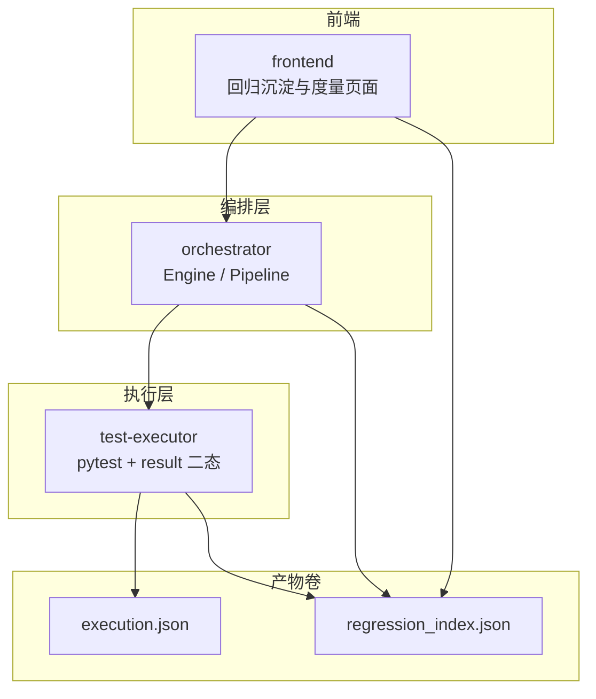
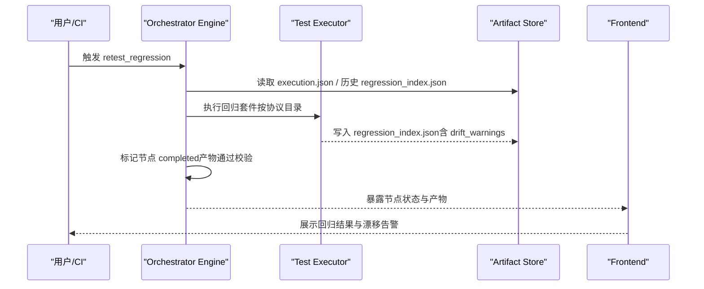
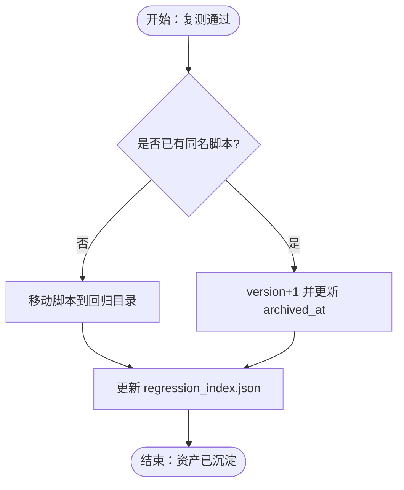
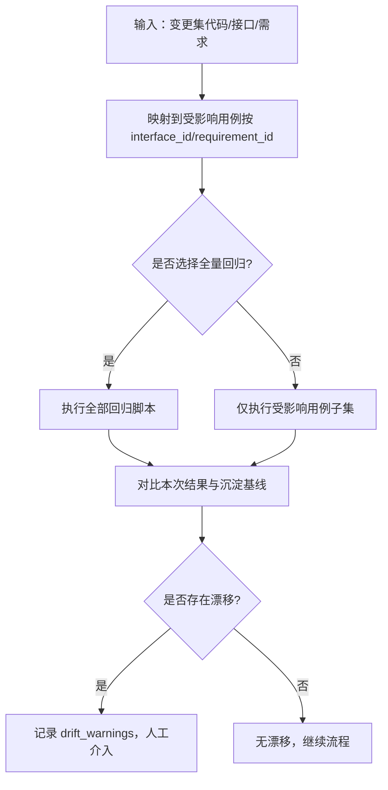
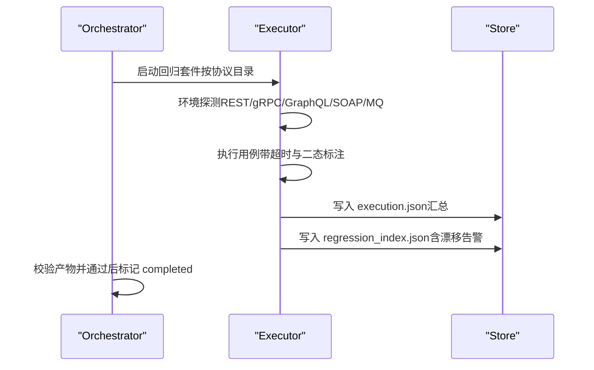
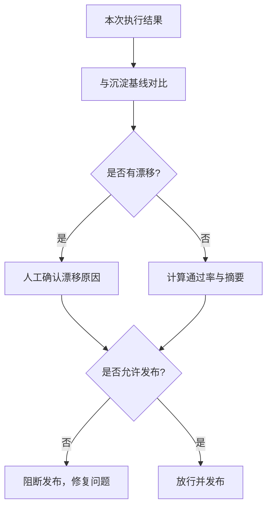
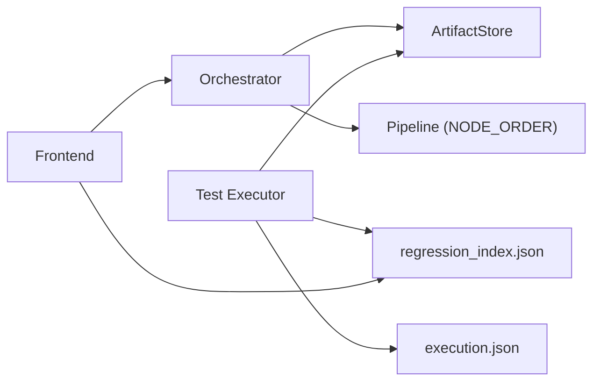

# 回归测试节点

<cite>
**本文引用的文件**
- [engine.py](file://services/orchestrator/src/orchestrator/engine.py)
- [pipeline.py](file://services/orchestrator/src/orchestrator/pipeline.py)
- [artifacts.py](file://services/orchestrator/src/orchestrator/artifacts.py)
- [result.py](file://services/test-executor/src/executor/result.py)
- [regression_index.json](file://schemas/regression_index.json)
- [execution.json](file://schemas/execution.json)
- [04_功能规格说明.md](file://docs/04_功能规格说明.md)
- [10_测试框架选型说明.md](file://docs/10_测试框架选型说明.md)
- [07_UI演示设计.md](file://docs/07_UI演示设计.md)
</cite>

## 目录
1. [引言](#引言)
2. [项目结构](#项目结构)
3. [核心组件](#核心组件)
4. [架构总览](#架构总览)
5. [详细组件分析](#详细组件分析)
6. [依赖关系分析](#依赖关系分析)
7. [性能与优化](#性能与优化)
8. [故障排查指南](#故障排查指南)
9. [结论](#结论)
10. [附录：数据格式与配置示例](#附录数据格式与配置示例)

## 引言
本文件聚焦“回归测试节点”（retest_regression）的完整实现与使用方式，围绕以下目标展开：
- 解释回归测试资产沉淀机制：用例版本管理、变更影响分析与选择性执行策略。
- 说明回归测试集的构建过程、执行优化与结果对比能力。
- 描述效果评估、质量门禁与发布决策支持。
- 明确输入输出数据格式，尤其是 regression_index.json 的结构定义。
- 给出回归测试策略配置、性能基线管理与自动化程度评估方法。
- 提供可操作的配置示例与分析方法。

## 项目结构
回归测试节点位于 orchestrator 编排引擎的第九个固定节点，产物为 regression_index.json；其上游依赖 auto_execute 产出的 execution.json，下游由前端展示与度量汇总。

图表来源
- [engine.py:25-35](file://services/orchestrator/src/orchestrator/engine.py#L25-L35)
- [pipeline.py:24-34](file://services/orchestrator/src/orchestrator/pipeline.py#L24-L34)
- [artifacts.py:24-52](file://services/orchestrator/src/orchestrator/artifacts.py#L24-L52)

章节来源
- [engine.py:25-35](file://services/orchestrator/src/orchestrator/engine.py#L25-L35)
- [pipeline.py:24-34](file://services/orchestrator/src/orchestrator/pipeline.py#L24-L34)
- [artifacts.py:24-52](file://services/orchestrator/src/orchestrator/artifacts.py#L24-L52)

## 核心组件
- 编排引擎（Engine）：维护九节点顺序、断点续跑、对账完成判据、降级清单与跳序防护。回归节点产物为 regression_index.json。
- 产物存储（ArtifactStore）：统一读写产物、Schema 校验、写权排他、归档旧产物。
- 执行结果模型（result.py）：失败二态（断言失败 vs 环境失败），用于 execution.json 的程序化汇总。
- 回归索引 Schema（regression_index.json）：定义回归资产索引结构，包含协议维度脚本集合、漂移告警等。
- 执行结果 Schema（execution.json）：定义执行结果结构与汇总字段，作为回归重跑的输入依据之一。

章节来源
- [engine.py:133-265](file://services/orchestrator/src/orchestrator/engine.py#L133-L265)
- [artifacts.py:55-157](file://services/orchestrator/src/orchestrator/artifacts.py#L55-L157)
- [result.py:10-61](file://services/test-executor/src/executor/result.py#L10-L61)
- [regression_index.json:1-50](file://schemas/regression_index.json#L1-L50)
- [execution.json:1-59](file://schemas/execution.json#L1-L59)

## 架构总览
回归测试节点在流水线中的位置与职责如下：
- 前置节点：auto_execute 产出 execution.json；defect_list 产出缺陷清单。
- 回归节点：基于已沉淀的回归脚本（按协议组织）进行重跑，生成或更新 regression_index.json，记录漂移告警。
- 后续：前端展示回归结果与度量指标，辅助质量门禁与发布决策。

图表来源
- [engine.py:25-35](file://services/orchestrator/src/orchestrator/engine.py#L25-L35)
- [artifacts.py:75-131](file://services/orchestrator/src/orchestrator/artifacts.py#L75-L131)
- [regression_index.json:1-50](file://schemas/regression_index.json#L1-L50)

## 详细组件分析

### 回归资产沉淀与版本管理
- 沉淀规则：复测通过的用例自动归档至回归目录，原执行目录保持未沉淀用例；同一用例重复通过幂等处理，不产生重复文件。
- 版本递增：覆盖归档时递增 version 字段；archived_at 记录 UTC ISO-8601 时间戳，用于幂等更新。
- 溯源信息：每个脚本携带 requirement_id 与 interface_id，便于需求与接口级追溯。
- 协议维度：回归目录按协议（rest/grpc/graphql/soap/mq）组织，REST 最小闭环先行，其他协议为最小可用级。

图表来源
- [04_功能规格说明.md:261-284](file://docs/04_功能规格说明.md#L261-L284)
- [regression_index.json:10-34](file://schemas/regression_index.json#L10-L34)

章节来源
- [04_功能规格说明.md:261-284](file://docs/04_功能规格说明.md#L261-L284)
- [regression_index.json:10-34](file://schemas/regression_index.json#L10-L34)

### 变更影响分析与选择性执行
- 变更影响分析：以接口维度（interface_id）与需求维度（requirement_id）为锚点，结合执行结果与回归索引，识别受影响的用例集。
- 选择性执行：可按协议、需求或接口筛选回归脚本子集执行，减少回归成本；对于不可用协议采用降级路径（脚本生成成功 + Mock 执行演示）。
- 漂移检测：若回归重跑结果与沉淀时不一致，记录 drift_warnings，交由人工判断，不自动删除资产。

图表来源
- [regression_index.json:36-47](file://schemas/regression_index.json#L36-L47)
- [04_功能规格说明.md:274-284](file://docs/04_功能规格说明.md#L274-L284)

章节来源
- [regression_index.json:36-47](file://schemas/regression_index.json#L36-L47)
- [04_功能规格说明.md:274-284](file://docs/04_功能规格说明.md#L274-L284)

### 回归测试集构建与执行优化
- 构建过程：从执行阶段（auto_execute）收集已通过用例，按协议归档；同时生成/更新 regression_index.json 作为资产清单。
- 执行优化：
  - 环境探测优先：REST > gRPC > GraphQL > SOAP/MQ，不可用则降级。
  - 超时控制：单用例执行超时上限，避免阻塞。
  - 二态标注：区分断言失败与环境失败，环境失败隔离至待环境确认，不计入通过率分母。
  - 报告程序化汇总：execution.json 数值不经 LLM，保证一致性。
- 重跑策略：对归档目录再次执行 pytest，确保断言结论一致（不要求响应体原文一致）。

图表来源
- [04_功能规格说明.md:194-207](file://docs/04_功能规格说明.md#L194-L207)
- [10_测试框架选型说明.md:45-53](file://docs/10_测试框架选型说明.md#L45-L53)
- [result.py:10-61](file://services/test-executor/src/executor/result.py#L10-L61)

章节来源
- [04_功能规格说明.md:194-207](file://docs/04_功能规格说明.md#L194-L207)
- [10_测试框架选型说明.md:45-53](file://docs/10_测试框架选型说明.md#L45-L53)
- [result.py:10-61](file://services/test-executor/src/executor/result.py#L10-L61)

### 结果对比与质量门禁
- 结果对比：将本次回归结果与沉淀时的基准进行对比，识别漂移用例并记录 detail。
- 质量门禁：
  - 通过率阈值：基于 execution.json 的 summary 计算通过率，设定门禁阈值。
  - 漂移告警：drift_warnings 存在时需人工确认，否则阻断发布。
  - 降级清单：记录不可用协议的降级模式，报告中分列呈现。
- 发布决策：结合自动化率、通过率、漂移告警与降级情况，综合判定是否放行。

图表来源
- [execution.json:32-56](file://schemas/execution.json#L32-L56)
- [regression_index.json:36-47](file://schemas/regression_index.json#L36-L47)

章节来源
- [execution.json:32-56](file://schemas/execution.json#L32-L56)
- [regression_index.json:36-47](file://schemas/regression_index.json#L36-L47)

### 效果评估与自动化程度
- 自动化率：completed / 9（固定口径），由编排引擎计算；回归节点完成后计入自动化率。
- 效果评估：关注回归覆盖率、漂移率、环境失败占比、降级协议数量。
- 首次实测：在项目验收前完成一次端到端彩排，锁定演示输入并产出自动化率基线。

章节来源
- [engine.py:126-130](file://services/orchestrator/src/orchestrator/engine.py#L126-L130)
- [pipeline.py:61-70](file://services/orchestrator/src/orchestrator/pipeline.py#L61-L70)
- [07_UI演示设计.md:19-30](file://docs/07_UI演示设计.md#L19-L30)

## 依赖关系分析
- Orchestrator 依赖 ArtifactStore 进行产物读写与校验；回归节点产物为 regression_index.json。
- Test Executor 负责执行 pytest 并产出 execution.json 与 regression_index.json（按规格）。
- 前端依赖编排 API 与产物文件展示回归结果与度量。

图表来源
- [engine.py:25-35](file://services/orchestrator/src/orchestrator/engine.py#L25-L35)
- [artifacts.py:24-52](file://services/orchestrator/src/orchestrator/artifacts.py#L24-L52)
- [pipeline.py:24-34](file://services/orchestrator/src/orchestrator/pipeline.py#L24-L34)

章节来源
- [engine.py:25-35](file://services/orchestrator/src/orchestrator/engine.py#L25-L35)
- [artifacts.py:24-52](file://services/orchestrator/src/orchestrator/artifacts.py#L24-L52)
- [pipeline.py:24-34](file://services/orchestrator/src/orchestrator/pipeline.py#L24-L34)

## 性能与优化
- 单用例超时：设置上限防止长耗时用例拖垮整体回归。
- 环境探测优先：先探测可用性再执行，减少无效调用。
- 二态分离：环境失败隔离，避免污染通过率统计。
- 报告程序化汇总：不经 LLM，保证数值一致性与快速产出。
- 降级策略：不可用协议降级为脚本生成 + Mock 演示，保障流程推进。

章节来源
- [04_功能规格说明.md:194-207](file://docs/04_功能规格说明.md#L194-L207)
- [10_测试框架选型说明.md:45-53](file://docs/10_测试框架选型说明.md#L45-L53)

## 故障排查指南
- 产物校验失败：检查 schema 是否符合定义；查看 ArtifactStore.validate 返回的错误列表。
- 写权冲突：确认当前服务是否为该产物的写方（orchestrator/test-executor）。
- 节点未完成：核对 NODE_ARTIFACTS 中定义的产物是否存在且通过校验。
- 漂移告警：根据 drift_warnings 的 case_id 与 detail 定位差异，人工判断是否保留或调整基线。

章节来源
- [artifacts.py:75-131](file://services/orchestrator/src/orchestrator/artifacts.py#L75-L131)
- [engine.py:229-265](file://services/orchestrator/src/orchestrator/engine.py#L229-L265)
- [regression_index.json:36-47](file://schemas/regression_index.json#L36-L47)

## 结论
回归测试节点通过严格的产物契约与编排逻辑，实现了用例资产的版本化管理、变更影响分析与选择性执行，并提供结果对比、质量门禁与发布决策支持。配合执行优化的二态标注与降级策略，能够在多协议环境下稳定推进回归闭环。建议持续完善漂移分析、性能基线与自动化率度量，以提升回归效率与质量保障能力。

## 附录：数据格式与配置示例

### regression_index.json 结构定义
- schema_version：固定字符串，标识 Schema 版本。
- job_id：任务 ID，需匹配正则 ^job-。
- suites：数组，元素为对象，包含 protocol 与 scripts。
  - protocol：枚举值 rest/grpc/graphql/soap/mq。
  - scripts：数组，元素为对象，包含 case_id、script_path、requirement_id、interface_id、archived_at、version。
    - case_id：匹配 ^TC-\d{3}$。
    - script_path：归档后的路径（移动非复制）。
    - requirement_id：匹配 ^REQ-\d{3}$。
    - interface_id：匹配 ^IF-[A-Z]+-\d{3}$。
    - archived_at：UTC ISO-8601 时间戳。
    - version：整数，最小为 1，覆盖归档时递增。
- drift_warnings：数组，元素为对象，包含 case_id 与 detail。
  - case_id：匹配 ^TC-\d{3}$。
  - detail：非空字符串。

章节来源
- [regression_index.json:1-50](file://schemas/regression_index.json#L1-L50)

### execution.json 结构定义（与回归相关）
- results：用例结果数组，包含 case_id、interface_id、passed、failure_kind、failure_reason、timeout、skipped_reason、duration_ms、timestamp。
- summary：汇总对象，包含 total、passed、failed_assertion、failed_environment、interrupted。
- degraded_protocols：降级协议清单，包含 protocol、mode、reason。

章节来源
- [execution.json:1-59](file://schemas/execution.json#L1-L59)

### 回归测试策略配置要点
- 协议优先级：REST > gRPC > GraphQL > SOAP/MQ，不可用时降级。
- 超时与重试：单用例超时上限，LLM 调用超时与重试策略（如适用）。
- 二态标注：断言失败与环境失败分别计数，环境失败隔离。
- 漂移告警：出现漂移时记录并人工判断，不自动删除资产。
- 自动化率：completed / 9，固定口径，程序化汇总。

章节来源
- [04_功能规格说明.md:194-207](file://docs/04_功能规格说明.md#L194-L207)
- [engine.py:126-130](file://services/orchestrator/src/orchestrator/engine.py#L126-L130)

### 实际配置示例（路径引用）
- 回归脚本归档与索引：参考 [04_功能规格说明.md:261-284](file://docs/04_功能规格说明.md#L261-L284)。
- 执行命令与插件：参考 [10_测试框架选型说明.md:45-53](file://docs/10_测试框架选型说明.md#L45-L53)。
- 前端展示与度量：参考 [07_UI演示设计.md:19-30](file://docs/07_UI演示设计.md#L19-L30)。