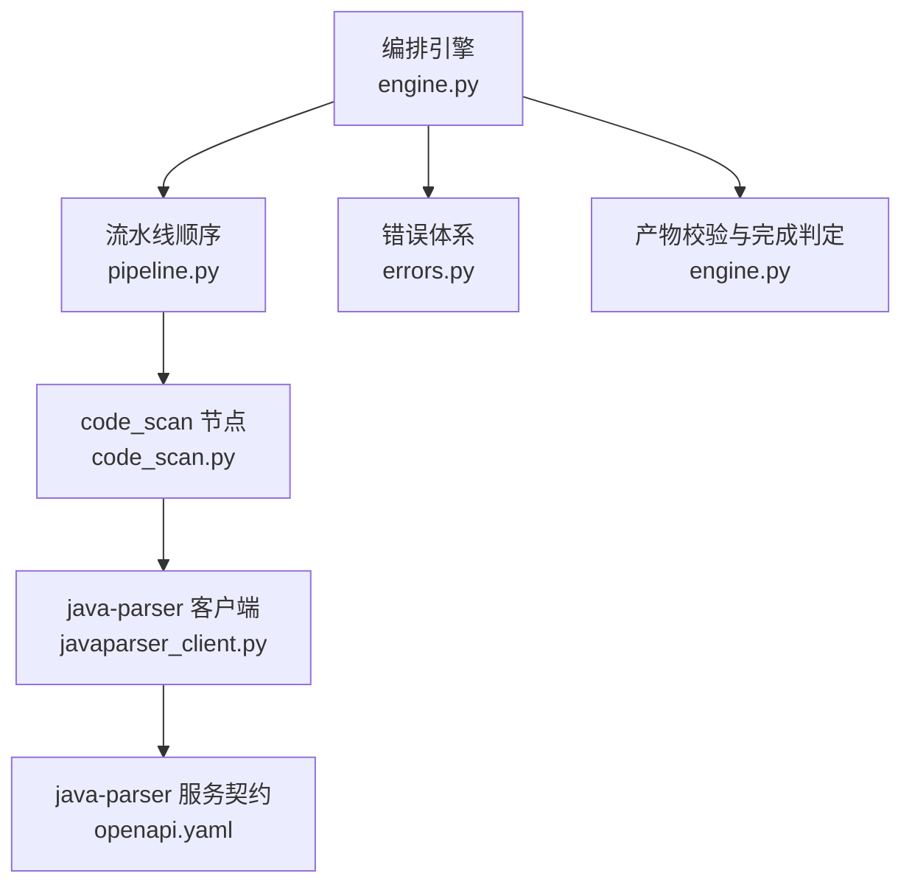
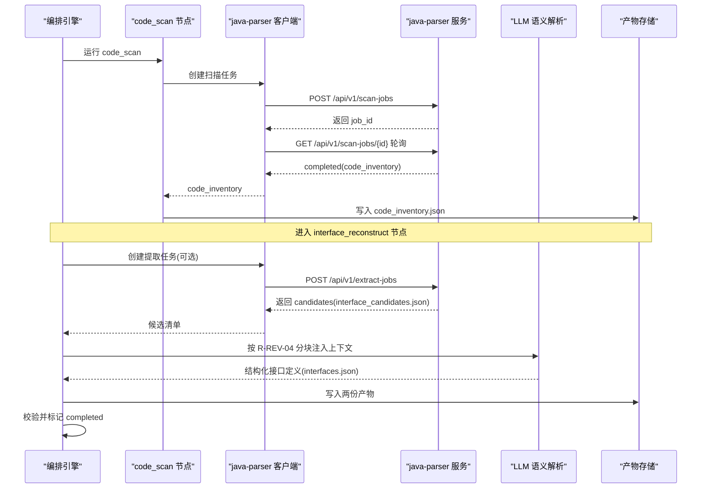
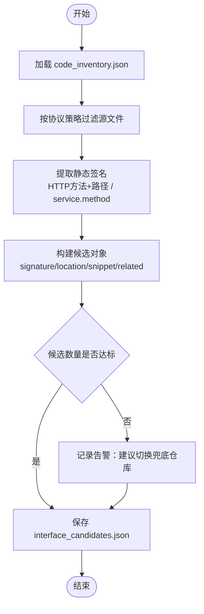
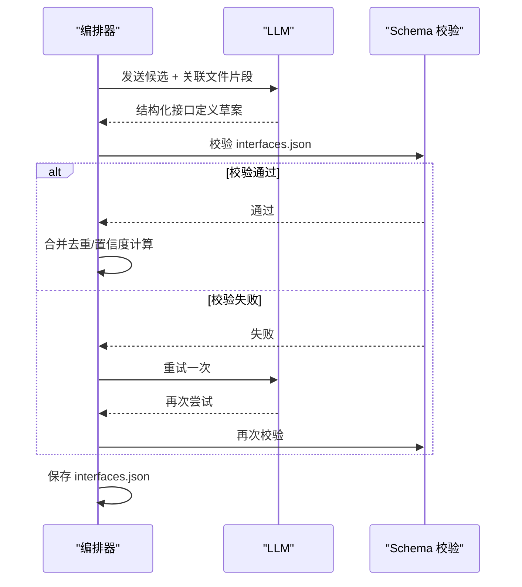
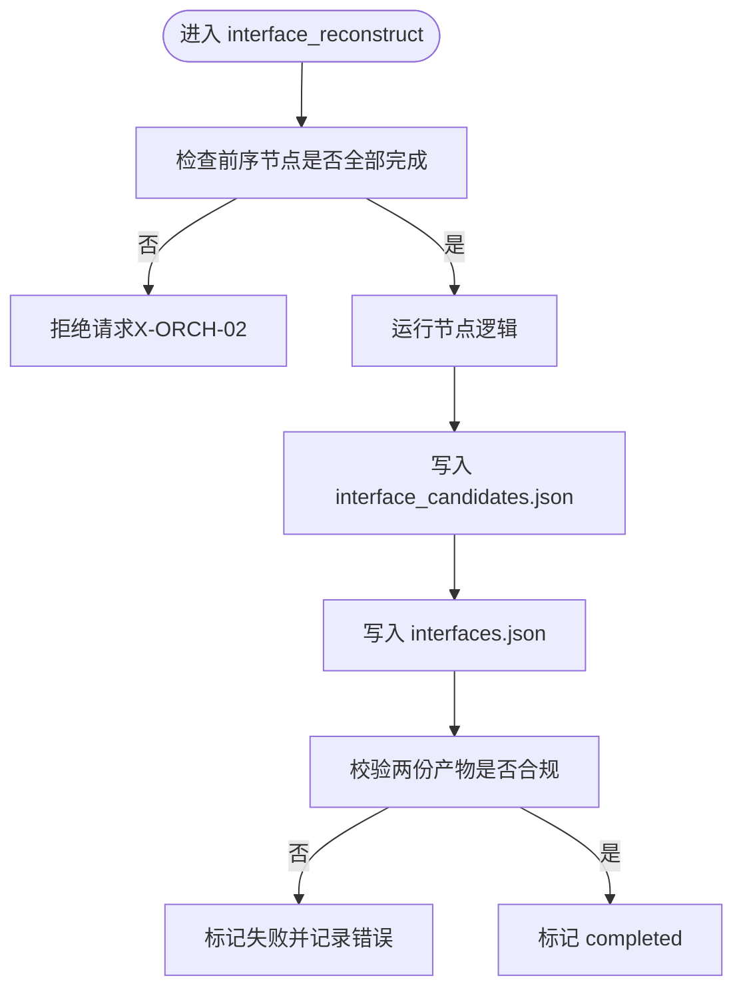
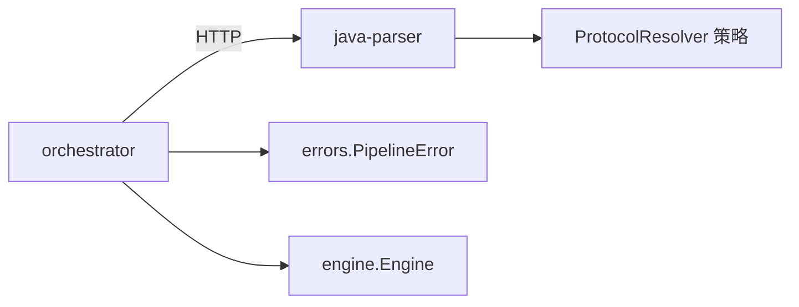

# 接口还原节点

<cite>
**本文引用的文件**
- [services/orchestrator/src/orchestrator/javaparser_client.py](file://services/orchestrator/src/orchestrator/javaparser_client.py)
- [services/orchestrator/src/orchestrator/nodes/code_scan.py](file://services/orchestrator/src/orchestrator/nodes/code_scan.py)
- [services/orchestrator/src/orchestrator/engine.py](file://services/orchestrator/src/orchestrator/engine.py)
- [services/orchestrator/src/orchestrator/pipeline.py](file://services/orchestrator/src/orchestrator/pipeline.py)
- [services/orchestrator/src/orchestrator/errors.py](file://services/orchestrator/src/orchestrator/errors.py)
- [schemas/contracts/java-parser.openapi.yaml](file://schemas/contracts/java-parser.openapi.yaml)
- [schemas/interface_candidates.json](file://schemas/interface_candidates.json)
- [schemas/interfaces.json](file://schemas/interfaces.json)
- [schemas/samples/interface_candidates.sample.json](file://schemas/samples/interface_candidates.sample.json)
- [schemas/samples/interfaces.sample.json](file://schemas/samples/interfaces.sample.json)
- [services/java-parser/src/main/java/com/llmautotest/parser/ProtocolResolver.java](file://services/java-parser/src/main/java/com/llmautotest/parser/ProtocolResolver.java)
- [docs/04_功能规格说明.md](file://docs/04_功能规格说明.md)
</cite>

## 目录
1. [简介](#简介)
2. [项目结构](#项目结构)
3. [核心组件](#核心组件)
4. [架构总览](#架构总览)
5. [详细组件分析](#详细组件分析)
6. [依赖关系分析](#依赖关系分析)
7. [性能考虑](#性能考虑)
8. [故障排查指南](#故障排查指南)
9. [结论](#结论)
10. [附录](#附录)

## 简介
本文件聚焦“接口还原节点”（pipeline 中的 interface_reconstruct），完整阐述基于 JavaParser 的静态分析与 LLM 语义理解的接口逆向工程流程。内容覆盖：
- 接口候选识别、协议推断与 OpenAPI 规范生成的端到端过程
- 支持的协议类型（REST、gRPC、GraphQL、SOAP、MQ）及各自还原策略
- 输入输出数据格式：interface_candidates.json 与 interfaces.json 的结构定义
- 准确性评估、冲突解决与版本兼容性处理机制
- 实际还原示例与质量验证方法

## 项目结构
接口还原节点位于编排引擎（orchestrator）中，作为九节点流水线之一，承接 code_scan 产出的代码清单，并产出两份关键产物：
- interface_candidates.json：静态特征定位结果（由乙负责）
- interfaces.json：经 LLM 语义补全后的接口清单（由甲负责）

图表来源
- [services/orchestrator/src/orchestrator/engine.py:24-35](file://services/orchestrator/src/orchestrator/engine.py#L24-L35)
- [services/orchestrator/src/orchestrator/pipeline.py:23-34](file://services/orchestrator/src/orchestrator/pipeline.py#L23-L34)
- [services/orchestrator/src/orchestrator/nodes/code_scan.py:1-94](file://services/orchestrator/src/orchestrator/nodes/code_scan.py#L1-L94)
- [services/orchestrator/src/orchestrator/javaparser_client.py:1-162](file://services/orchestrator/src/orchestrator/javaparser_client.py#L1-L162)
- [schemas/contracts/java-parser.openapi.yaml:1-369](file://schemas/contracts/java-parser.openapi.yaml#L1-L369)

章节来源
- [services/orchestrator/src/orchestrator/engine.py:24-35](file://services/orchestrator/src/orchestrator/engine.py#L24-L35)
- [services/orchestrator/src/orchestrator/pipeline.py:23-34](file://services/orchestrator/src/orchestrator/pipeline.py#L23-L34)

## 核心组件
- 编排引擎（Engine）：维护 state.json、断点续跑、跳序防护、降级清单；以产物为唯一事实进行对账。
- 流水线（Pipeline）：固定九节点顺序，interface_reconstruct 为第三节点，要求同时产出 interface_candidates.json 与 interfaces.json。
- java-parser 客户端：异步创建扫描/提取任务并轮询至终态，统一通信异常为 X-ORCH-03。
- 错误体系：统一 PipelineError，包含 code/message/node_id/details。
- 协议解析策略（Java 侧）：ProtocolResolver 接口支持可插拔协议实现（rest/grpc/graphql/soap/mq）。

章节来源
- [services/orchestrator/src/orchestrator/engine.py:133-302](file://services/orchestrator/src/orchestrator/engine.py#L133-L302)
- [services/orchestrator/src/orchestrator/pipeline.py:11-34](file://services/orchestrator/src/orchestrator/pipeline.py#L11-L34)
- [services/orchestrator/src/orchestrator/javaparser_client.py:52-162](file://services/orchestrator/src/orchestrator/javaparser_client.py#L52-L162)
- [services/orchestrator/src/orchestrator/errors.py:1-39](file://services/orchestrator/src/orchestrator/errors.py#L1-L39)
- [services/java-parser/src/main/java/com/llmautotest/parser/ProtocolResolver.java:1-17](file://services/java-parser/src/main/java/com/llmautotest/parser/ProtocolResolver.java#L1-L17)

## 架构总览
接口还原节点的整体工作流如下：
- 上游 code_scan 产出 code_inventory.json（仓库源码清单）
- orchestrator 调用 java-parser 的 extract-jobs（或 scan-jobs 扩展能力）执行静态特征定位，产出 interface_candidates.json
- orchestrator 侧使用 LLM 对候选进行语义补全，生成 interfaces.json
- Engine 校验两份产物均合规后，将 interface_reconstruct 标记为 completed

图表来源
- [services/orchestrator/src/orchestrator/nodes/code_scan.py:26-94](file://services/orchestrator/src/orchestrator/nodes/code_scan.py#L26-L94)
- [services/orchestrator/src/orchestrator/javaparser_client.py:70-121](file://services/orchestrator/src/orchestrator/javaparser_client.py#L70-L121)
- [schemas/contracts/java-parser.openapi.yaml:24-115](file://schemas/contracts/java-parser.openapi.yaml#L24-L115)
- [docs/04_功能规格说明.md:103-118](file://docs/04_功能规格说明.md#L103-L118)

## 详细组件分析

### 组件一：接口候选识别（静态侧）
- 目标：从源码中定位接口定义（注解/proto/WSDL 等），输出 interface_candidates.json
- 关键点：
  - 协议识别通过 ProtocolResolver 策略过滤（rest/grpc/graphql/soap/mq）
  - 每个候选包含 signature、code_location、related_files、snippet、confidence、is_fallback
  - 单文件解析失败记录告警但不中断整体（X-REV-01）
  - 候选数低于底线时提示换用兜底仓库（X-REV-04）

图表来源
- [services/java-parser/src/main/java/com/llmautotest/parser/ProtocolResolver.java:1-17](file://services/java-parser/src/main/java/com/llmautotest/parser/ProtocolResolver.java#L1-L17)
- [schemas/interface_candidates.json:1-58](file://schemas/interface_candidates.json#L1-L58)
- [schemas/contracts/java-parser.openapi.yaml:274-369](file://schemas/contracts/java-parser.openapi.yaml#L274-L369)
- [docs/04_功能规格说明.md:103-118](file://docs/04_功能规格说明.md#L103-L118)

章节来源
- [schemas/interface_candidates.json:1-58](file://schemas/interface_candidates.json#L1-L58)
- [schemas/contracts/java-parser.openapi.yaml:274-369](file://schemas/contracts/java-parser.openapi.yaml#L274-L369)
- [docs/04_功能规格说明.md:103-118](file://docs/04_功能规格说明.md#L103-L118)

### 组件二：协议推断与参数补全（LLM 语义侧）
- 目标：基于候选清单与关联文件片段，推断协议细节、参数位置与类型、返回值描述，生成 interfaces.json
- 策略要点（R-REV-04）：
  - 文件选择优先：仅送入接口定义文件及其直接关联文件（Controller→Service→DTO）
  - 分块调用：避免全文盲扫，控制 token 用量
  - 跨文件信息传递：以中间产物（候选清单）落盘，二次调用合并去重
- 边界处理：
  - 无法确定类型时标记 unknown，并提供默认值（X-REV-02）
  - LLM 输出不符合 Schema 重试一次，仍失败则丢弃该接口并记录（X-REV-03）

图表来源
- [docs/04_功能规格说明.md:103-118](file://docs/04_功能规格说明.md#L103-L118)
- [schemas/interfaces.json:1-70](file://schemas/interfaces.json#L1-L70)

章节来源
- [docs/04_功能规格说明.md:103-118](file://docs/04_功能规格说明.md#L103-L118)
- [schemas/interfaces.json:1-70](file://schemas/interfaces.json#L1-L70)

### 组件三：OpenAPI 规范生成
- 目标：将 interfaces.json 转换为 OpenAPI 文档，便于下游测试用例生成与执行
- 映射规则（REST 为例）：
  - method/path → OpenAPI path item
  - params.in 映射到 parameters（path/query/body/header）
  - returns.type/description → responses schema
- 其他协议（gRPC/SOAP/MQ）：保留 service_method 字段，用于后续适配不同协议的 OpenAPI/AsyncAPI 表达

章节来源
- [schemas/interfaces.json:1-70](file://schemas/interfaces.json#L1-L70)
- [schemas/contracts/java-parser.openapi.yaml:291-333](file://schemas/contracts/java-parser.openapi.yaml#L291-L333)

### 组件四：编排与产物校验
- 完成判据：interface_reconstruct 需同时满足 interface_candidates.json 与 interfaces.json 存在且合规
- 对账逻辑：若状态为 completed 但产物缺失或不合规，回退为 pending 并记录错误
- 跳序防护：前序节点未完成不允许请求当前节点

图表来源
- [services/orchestrator/src/orchestrator/engine.py:161-242](file://services/orchestrator/src/orchestrator/engine.py#L161-L242)
- [services/orchestrator/src/orchestrator/pipeline.py:23-34](file://services/orchestrator/src/orchestrator/pipeline.py#L23-L34)

章节来源
- [services/orchestrator/src/orchestrator/engine.py:161-242](file://services/orchestrator/src/orchestrator/engine.py#L161-L242)
- [services/orchestrator/src/orchestrator/pipeline.py:23-34](file://services/orchestrator/src/orchestrator/pipeline.py#L23-L34)

## 依赖关系分析
- orchestrator 依赖 java-parser 服务进行静态分析，通过 HTTP 异步 job 模式交互
- 协议解析在 Java 侧通过 ProtocolResolver 解耦，新增协议无需改动主流程
- 错误码统一：orchestrator 侧 X-ORCH-*，java-parser 侧 X-CODE-*，客户端透传不吞错

图表来源
- [services/orchestrator/src/orchestrator/javaparser_client.py:123-162](file://services/orchestrator/src/orchestrator/javaparser_client.py#L123-L162)
- [services/java-parser/src/main/java/com/llmautotest/parser/ProtocolResolver.java:1-17](file://services/java-parser/src/main/java/com/llmautotest/parser/ProtocolResolver.java#L1-L17)
- [services/orchestrator/src/orchestrator/errors.py:1-39](file://services/orchestrator/src/orchestrator/errors.py#L1-L39)

章节来源
- [services/orchestrator/src/orchestrator/javaparser_client.py:123-162](file://services/orchestrator/src/orchestrator/javaparser_client.py#L123-L162)
- [services/java-parser/src/main/java/com/llmautotest/parser/ProtocolResolver.java:1-17](file://services/java-parser/src/main/java/com/llmautotest/parser/ProtocolResolver.java#L1-L17)
- [services/orchestrator/src/orchestrator/errors.py:1-39](file://services/orchestrator/src/orchestrator/errors.py#L1-L39)

## 性能考虑
- 静态特征定位优先：减少 LLM 全文扫描，降低 token 消耗与延迟
- 分块注入上下文：每次仅传入接口定义与其直接关联文件，避免超大上下文
- 轮询超时与间隔可调：DEFAULT_POLL_INTERVAL_S、DEFAULT_MAX_WAIT_S 可按运维环境调优
- 兜底仓库策略：当候选数不足时切换演示仓库，保障流程可跑通

章节来源
- [docs/04_功能规格说明.md:103-118](file://docs/04_功能规格说明.md#L103-L118)
- [services/orchestrator/src/orchestrator/javaparser_client.py:21-23](file://services/orchestrator/src/orchestrator/javaparser_client.py#L21-L23)

## 故障排查指南
- 通信失败（X-ORCH-03）：java-parser 不可达/超时/HTTP异常，检查网络与服务健康
- 契约错误透传：java-parser 返回 {code,message}，客户端原样抛出，便于定位
- 产物缺失或不合规：Engine 对账失败会回退节点状态，检查 interface_candidates.json 与 interfaces.json 是否存在且符合 schema
- 单文件解析失败（X-REV-01）：记录告警，不影响整体流程
- 候选数不足（X-REV-04）：提示切换兜底仓库，确保流程可继续

章节来源
- [services/orchestrator/src/orchestrator/javaparser_client.py:139-162](file://services/orchestrator/src/orchestrator/javaparser_client.py#L139-L162)
- [services/orchestrator/src/orchestrator/engine.py:161-180](file://services/orchestrator/src/orchestrator/engine.py#L161-L180)
- [docs/04_功能规格说明.md:103-118](file://docs/04_功能规格说明.md#L103-L118)

## 结论
接口还原节点通过“静态特征定位 + LLM 语义补全”的双阶段方案，在多协议场景下实现了从源码到接口规范的自动化还原。借助可插拔协议策略、严格的产物校验与统一的错误体系，系统在可扩展性、稳定性与可观测性方面具备良好基础。后续可通过优化 LLM 上下文策略与增强协议适配层，进一步提升还原准确率与覆盖率。

## 附录

### 输入输出数据格式定义

#### interface_candidates.json
- 根字段：schema_version、job_id、candidates、warnings
- candidates 项关键字段：
  - candidate_id：候选标识
  - protocol：rest/grpc/graphql/soap/mq
  - signature：静态可确定签名（如 HTTP 方法+路径 或 service/method）
  - code_location：repo/file/start_line/end_line
  - snippet：接口定义源码片段
  - related_files：controller/service/dto/proto/wsdl/listener/other 等角色关联文件
  - is_fallback：是否来自兜底仓库
  - confidence：静态定位置信度

章节来源
- [schemas/interface_candidates.json:1-58](file://schemas/interface_candidates.json#L1-L58)
- [schemas/contracts/java-parser.openapi.yaml:323-369](file://schemas/contracts/java-parser.openapi.yaml#L323-L369)

#### interfaces.json
- 根字段：schema_version、job_id、interfaces
- interfaces 项关键字段：
  - id：IF-(REST|GRPC|GRAPHQL|SOAP|MQ)-\d{3}
  - protocol：rest/grpc/graphql/soap/mq
  - signature：method/path（REST）或 service_method（其他协议），含 summary
  - params：name/type/required/in/default（unknown 参数提供默认值）
  - returns：type/description
  - candidate_id：溯源到静态候选
  - code_location：repo/file/start_line/end_line
  - is_fallback：兜底仓库标记
  - confidence：综合置信度

章节来源
- [schemas/interfaces.json:1-70](file://schemas/interfaces.json#L1-L70)

### 实际还原示例
- 示例参考：
  - interface_candidates.sample.json：展示 REST/gRPC 候选，含 signature、related_files、confidence
  - interfaces.sample.json：展示 REST/gRPC 接口补全结果，含 params、returns、code_location

章节来源
- [schemas/samples/interface_candidates.sample.json:1-62](file://schemas/samples/interface_candidates.sample.json#L1-L62)
- [schemas/samples/interfaces.sample.json:1-75](file://schemas/samples/interfaces.sample.json#L1-L75)

### 准确性评估与冲突解决
- 准确性评估：
  - 基于 confidence 字段统计各协议还原质量
  - 结合下游用例执行结果（testcases.json/execution.json）反推接口还原准确度
- 冲突解决：
  - 多仓库同名接口：以 code_location 区分，必要时按模块名/包名前缀消歧
  - 参数类型不确定：标记 unknown 并提供默认值，交由下游 Mock/断言策略处理
- 版本兼容性：
  - schema_version 固定为 1.0，升级时需保持向后兼容
  - 协议枚举与字段扩展遵循契约先行原则

章节来源
- [schemas/interface_candidates.json:1-58](file://schemas/interface_candidates.json#L1-L58)
- [schemas/interfaces.json:1-70](file://schemas/interfaces.json#L1-L70)
- [schemas/contracts/java-parser.openapi.yaml:1-369](file://schemas/contracts/java-parser.openapi.yaml#L1-L369)

### 质量验证方法
- Schema 校验：使用 JSON Schema 校验 interface_candidates.json 与 interfaces.json
- 人工抽查：依据 code_location 定位源码片段，核对 signature/params/returns 准确性
- 端到端验证：基于 interfaces.json 生成用例并执行，观察通过/失败分布与环境问题占比

章节来源
- [schemas/interface_candidates.json:1-58](file://schemas/interface_candidates.json#L1-L58)
- [schemas/interfaces.json:1-70](file://schemas/interfaces.json#L1-L70)