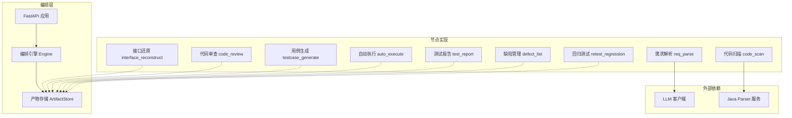
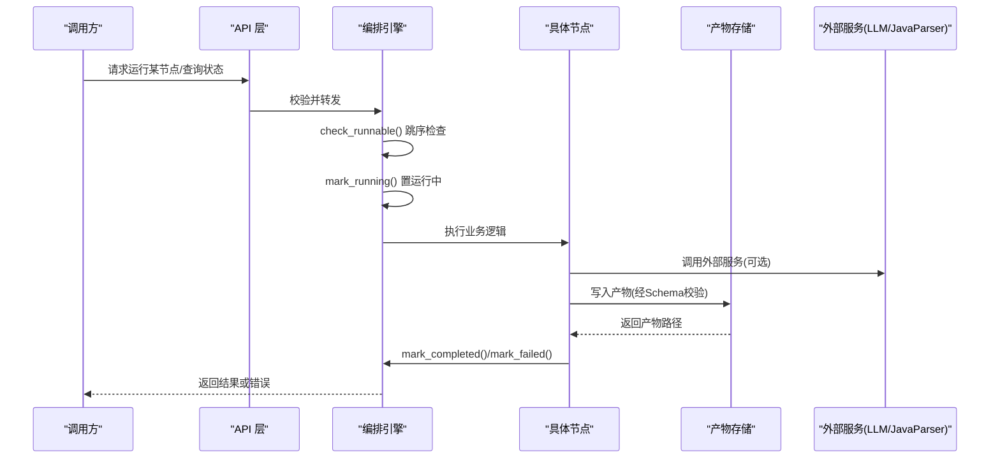
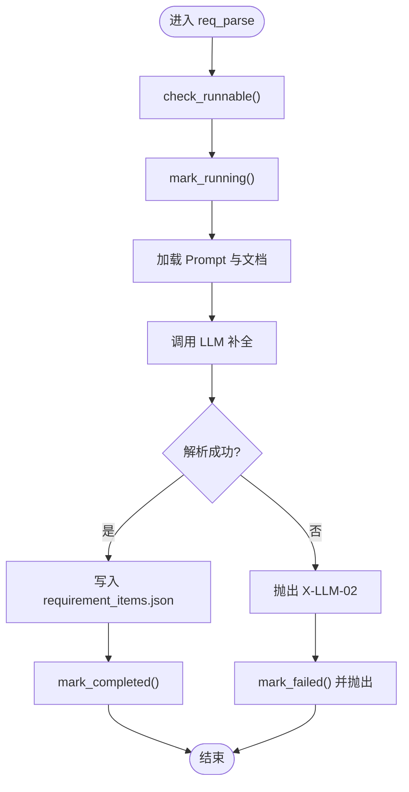
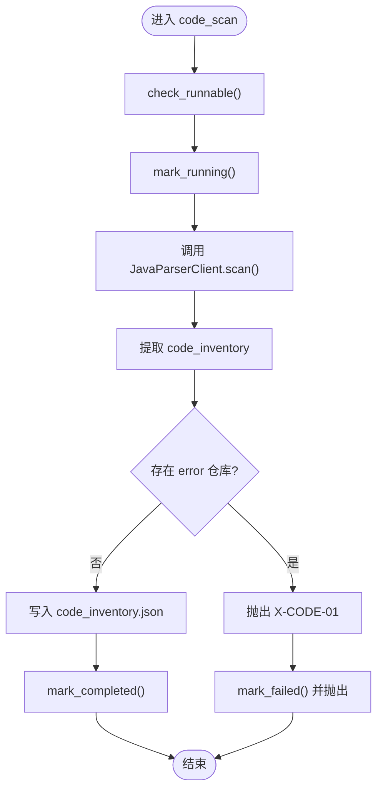
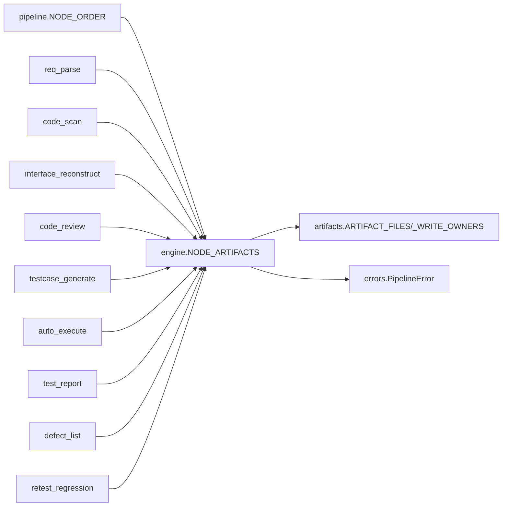

# 流水线工作流

<cite>
**本文引用的文件**
- [pipeline.py](file://services/orchestrator/src/orchestrator/pipeline.py)
- [engine.py](file://services/orchestrator/src/orchestrator/engine.py)
- [artifacts.py](file://services/orchestrator/src/orchestrator/artifacts.py)
- [errors.py](file://services/orchestrator/src/orchestrator/errors.py)
- [api.py](file://services/orchestrator/src/orchestrator/api.py)
- [req_parse.py](file://services/orchestrator/src/orchestrator/nodes/req_parse.py)
- [code_scan.py](file://services/orchestrator/src/orchestrator/nodes/code_scan.py)
- [execution.json](file://schemas/execution.json)
- [requirement_items.json](file://schemas/requirement_items.json)
- [interfaces.json](file://schemas/interfaces.json)
- [testcases.json](file://schemas/testcases.json)
- [defects.json](file://schemas/defects.json)
- [metrics.json](file://schemas/metrics.json)
- [review_mapping.json](file://schemas/review_mapping.json)
- [regression_index.json](file://schemas/regression_index.json)
- [code_inventory.json](file://schemas/code_inventory.json)
</cite>

## 目录
1. [简介](#简介)
2. [项目结构](#项目结构)
3. [核心组件](#核心组件)
4. [架构总览](#架构总览)
5. [详细组件分析](#详细组件分析)
6. [依赖关系分析](#依赖关系分析)
7. [性能考量](#性能考量)
8. [故障排查指南](#故障排查指南)
9. [结论](#结论)
10. [附录](#附录)

## 简介
本文件面向 LLM-AutoTest 的“流水线工作流”，围绕固定 9 个节点（需求解析、代码扫描、接口还原、代码审查、用例生成、自动执行、测试报告、缺陷管理、回归测试）进行系统化说明。文档覆盖：
- 每个节点的输入/输出数据格式、处理逻辑与异常处理机制
- 流水线状态管理与断点续跑、任务重试、进度跟踪
- 配置选项、自定义节点开发与扩展机制
- 实际使用示例与最佳实践建议

## 项目结构
- 编排服务 orchestrator：负责流水线调度、状态持久化、产物校验、API 暴露
- 产物与 Schema：以 JSON Schema 严格约束各阶段产物，确保跨节点契约稳定
- 外部服务：java-parser（代码扫描）、LLM 客户端（需求解析等）
- 前端与服务：提供可视化与编排入口（不在本文重点）

图表来源
- [api.py:11-27](file://services/orchestrator/src/orchestrator/api.py#L11-L27)
- [engine.py:133-302](file://services/orchestrator/src/orchestrator/engine.py#L133-L302)
- [artifacts.py:55-157](file://services/orchestrator/src/orchestrator/artifacts.py#L55-L157)
- [pipeline.py:23-34](file://services/orchestrator/src/orchestrator/pipeline.py#L23-L34)

章节来源
- [pipeline.py:23-34](file://services/orchestrator/src/orchestrator/pipeline.py#L23-L34)
- [engine.py:133-302](file://services/orchestrator/src/orchestrator/engine.py#L133-L302)
- [artifacts.py:55-157](file://services/orchestrator/src/orchestrator/artifacts.py#L55-L157)
- [api.py:11-27](file://services/orchestrator/src/orchestrator/api.py#L11-L27)

## 核心组件
- 节点顺序与四态：固定 9 节点顺序；节点状态为 completed / manual_intervention / running / pending
- 编排引擎：负责 job 生命周期、断点续跑、跳序防护、降级记录、完成判定
- 产物存储：按 Schema 校验产物、写权隔离、原子落盘、归档能力
- 统一错误：集中定义错误码与错误结构，贯穿各节点与引擎

章节来源
- [pipeline.py:11-20](file://services/orchestrator/src/orchestrator/pipeline.py#L11-L20)
- [engine.py:43-131](file://services/orchestrator/src/orchestrator/engine.py#L43-L131)
- [artifacts.py:22-50](file://services/orchestrator/src/orchestrator/artifacts.py#L22-L50)
- [errors.py:8-39](file://services/orchestrator/src/orchestrator/errors.py#L8-L39)

## 架构总览
下图展示从 API 到引擎、节点、产物存储与外部服务的调用关系，以及状态流转的关键路径。

图表来源
- [api.py:11-27](file://services/orchestrator/src/orchestrator/api.py#L11-L27)
- [engine.py:196-242](file://services/orchestrator/src/orchestrator/engine.py#L196-L242)
- [artifacts.py:75-96](file://services/orchestrator/src/orchestrator/artifacts.py#L75-L96)
- [req_parse.py:33-78](file://services/orchestrator/src/orchestrator/nodes/req_parse.py#L33-L78)
- [code_scan.py:26-49](file://services/orchestrator/src/orchestrator/nodes/code_scan.py#L26-L49)

## 详细组件分析

### 节点一：需求解析（req_parse）
- 目标：将需求文档解析为结构化条目，产出 requirement_items.json
- 输入：需求文档路径、Prompt、LLM 客户端
- 处理流程：
  - 跳序检查 → 标记运行中 → 加载 Prompt 与文档 → 调用 LLM → 提取 items → 写入产物 → 标记完成
- 输出：requirement_items.json（含 schema_version、job_id、source_file、items）
- 异常处理：
  - Prompt 缺失/不合规 → X-LLM-03
  - LLM 网络/超时 → X-LLM-01（客户端内重试）
  - LLM 输出不可解析或未过 Schema → X-LLM-02（不重试，人工介入）
  - 其他 PipelineError → 回退为 pending 并记录错误

图表来源
- [req_parse.py:33-78](file://services/orchestrator/src/orchestrator/nodes/req_parse.py#L33-L78)
- [errors.py:8-14](file://services/orchestrator/src/orchestrator/errors.py#L8-L14)
- [engine.py:196-242](file://services/orchestrator/src/orchestrator/engine.py#L196-L242)

章节来源
- [req_parse.py:1-125](file://services/orchestrator/src/orchestrator/nodes/req_parse.py#L1-L125)
- [requirement_items.json:1-44](file://schemas/requirement_items.json#L1-L44)
- [errors.py:8-14](file://services/orchestrator/src/orchestrator/errors.py#L8-L14)

### 节点二：代码扫描（code_scan）
- 目标：调用 java-parser 扫描多仓库，产出 code_inventory.json
- 输入：repositories（仓库列表）
- 处理流程：
  - 跳序检查 → 标记运行中 → 调用 JavaParserClient.scan → 提取 inventory → 校验仓库错误 → 写入产物 → 标记完成
- 输出：code_inventory.json（含 repositories，支持 ok/empty/truncated/error 四态）
- 异常处理：
  - 仓库硬错误（status=error）→ 节点失败（透传 X-CODE-01）
  - empty/truncated → 正常态，如实落盘并继续
  - 通信失败 → X-ORCH-03

图表来源
- [code_scan.py:26-49](file://services/orchestrator/src/orchestrator/nodes/code_scan.py#L26-L49)
- [code_scan.py:78-94](file://services/orchestrator/src/orchestrator/nodes/code_scan.py#L78-L94)
- [code_inventory.json:1-57](file://schemas/code_inventory.json#L1-L57)

章节来源
- [code_scan.py:1-94](file://services/orchestrator/src/orchestrator/nodes/code_scan.py#L1-L94)
- [code_inventory.json:1-57](file://schemas/code_inventory.json#L1-L57)

### 节点三：接口还原（interface_reconstruct）
- 目标：基于代码扫描结果与 LLM 补全，产出接口清单 interfaces.json 与候选 interface_candidates.json
- 输入：code_inventory.json、Prompt、LLM 客户端
- 处理逻辑：
  - 依据代码位置与签名推断接口协议与方法
  - 对未知参数标注 unknown，并给出默认值建议
  - 同时产出候选与最终接口清单，供后续审查与用例生成
- 输出：interfaces.json、interface_candidates.json
- 异常处理：
  - 产物未达标 → 拒绝标记完成（由 engine.mark_completed 校验）
  - 外部依赖失败 → 对应错误码（如 X-LLM-* 或 X-ORCH-*）

章节来源
- [interfaces.json:1-70](file://schemas/interfaces.json#L1-L70)
- [engine.py:24-35](file://services/orchestrator/src/orchestrator/engine.py#L24-L35)

### 节点四：代码审查（code_review）
- 目标：建立需求-代码映射，识别风险与遗漏功能，产出 review_mapping.json
- 输入：requirement_items.json、interfaces.json、code_inventory.json
- 处理逻辑：
  - 生成三视图：需求-接口映射、风险清单、遗漏功能清单
  - 支持人工审核记录（通过/驳回 + 回流）
- 输出：review_mapping.json
- 异常处理：
  - 产物校验失败 → X-ORCH-01
  - 外部依赖失败 → 对应错误码

章节来源
- [review_mapping.json:1-81](file://schemas/review_mapping.json#L1-L81)

### 节点五：用例生成（testcase_generate）
- 目标：基于接口规范生成用例与脚本元数据，产出 testcases.json
- 输入：interfaces.json、需求条目
- 处理逻辑：
  - 每接口三类用例（normal/boundary/exception），保证覆盖率
  - 参数仅允许来自接口定义，出现清单外参数即打回
  - 生成 pytest 脚本并校验可加载性（loadable）
- 输出：testcases.json
- 异常处理：
  - 低置信度 unknown 参数 → 标注 low_confidence
  - 产物校验失败 → X-ORCH-01

章节来源
- [testcases.json:1-35](file://schemas/testcases.json#L1-L35)

### 节点六：自动执行（auto_execute）
- 目标：执行用例并汇总结果，产出 execution.json
- 输入：testcases.json、执行环境
- 处理逻辑：
  - 逐条执行用例，记录通过/失败、原因、耗时、超时等
  - 程序化汇总 summary（total/passed/failed_assertion/failed_environment/interrupted）
  - 记录降级协议（如 Mock 演示模式）
- 输出：execution.json
- 异常处理：
  - 环境失败 → 隔离待环境确认（不入缺陷清单）
  - 服务崩溃 → 剩余用例标中断

章节来源
- [execution.json:1-59](file://schemas/execution.json#L1-L59)

### 节点七：测试报告（test_report）
- 目标：生成可读测试报告 test_report.md
- 输入：execution.json、testcases.json
- 处理逻辑：
  - 汇总通过率、失败分类、降级信息
  - 生成 Markdown 报告（仅存在性与非空作为完成判据）
- 输出：test_report.md
- 异常处理：
  - 报告为空 → 未完成

章节来源
- [artifacts.py:120-131](file://services/orchestrator/src/orchestrator/artifacts.py#L120-L131)

### 节点八：缺陷管理（defect_list）
- 目标：从执行结果中提取本地缺陷，产出 defects.json
- 输入：execution.json、testcases.json
- 处理逻辑：
  - 仅断言失败进入缺陷清单；环境失败隔离
  - 记录复现步骤、状态流转历史、是否兜底分支
- 输出：defects.json
- 异常处理：
  - 产物校验失败 → X-ORCH-01

章节来源
- [defects.json:1-54](file://schemas/defects.json#L1-L54)

### 节点九：回归测试（retest_regression）
- 目标：沉淀回归资产索引，产出 regression_index.json
- 输入：testcases.json、execution.json、defects.json
- 处理逻辑：
  - 按协议维度组织脚本，记录溯源信息（需求/接口）
  - 幂等归档与版本递增，检测回归漂移并告警
- 输出：regression_index.json
- 异常处理：
  - 漂移不一致 → 标 drift_warnings，交人工判断

章节来源
- [regression_index.json:1-50](file://schemas/regression_index.json#L1-L50)

## 依赖关系分析
- 节点顺序：NODE_ORDER 固定为 9 项，禁止增删
- 完成判据：NODE_ARTIFACTS 定义各节点产物文件名，engine.reconcile 以产物为准对账
- 写权隔离：ARTIFACT_FILES 与 _WRITE_OWNERS 规定 orchestrator/test-executor 的写权限
- 错误体系：errors.py 统一定义错误码，贯穿节点与引擎

图表来源
- [pipeline.py:23-34](file://services/orchestrator/src/orchestrator/pipeline.py#L23-L34)
- [engine.py:24-35](file://services/orchestrator/src/orchestrator/engine.py#L24-L35)
- [artifacts.py:22-50](file://services/orchestrator/src/orchestrator/artifacts.py#L22-L50)
- [errors.py:8-39](file://services/orchestrator/src/orchestrator/errors.py#L8-L39)

章节来源
- [pipeline.py:23-34](file://services/orchestrator/src/orchestrator/pipeline.py#L23-L34)
- [engine.py:24-35](file://services/orchestrator/src/orchestrator/engine.py#L24-L35)
- [artifacts.py:22-50](file://services/orchestrator/src/orchestrator/artifacts.py#L22-L50)
- [errors.py:8-39](file://services/orchestrator/src/orchestrator/errors.py#L8-L39)

## 性能考量
- 产物校验开销：每次写入均进行 JSON Schema 校验，建议在批量写入时合并校验以减少 I/O
- 并发控制：同一 job 下产物写权排他，避免并行写冲突；读取可并发
- 外部依赖：LLM/JavaParser 调用应设置超时与重试策略，避免阻塞整条流水线
- 归档优化：重跑前归档旧产物，避免重复计算与覆盖

[本节为通用指导，无需特定文件引用]

## 故障排查指南
- 常见错误码
  - X-LLM-01：LLM 调用超时/网络失败（可重试）
  - X-LLM-02：LLM 输出未过 Schema 校验（不重试，人工介入）
  - X-LLM-03：Prompt 文件缺失/元信息不合规（配置错误）
  - X-ORCH-01：产物校验失败/状态不匹配
  - X-ORCH-02：断点续跑跳序请求（前序未完成）
  - X-ORCH-03：java-parser 服务不可达/通信失败
- 排查步骤
  - 查看 state.json 中 nodes.attempts 与 error 字段定位失败节点
  - 核对产物是否存在且通过 Schema 校验（is_node_completed）
  - 检查外部服务健康与日志（LLM/JavaParser）
  - 必要时归档旧产物并重跑指定节点

章节来源
- [errors.py:8-39](file://services/orchestrator/src/orchestrator/errors.py#L8-L39)
- [engine.py:161-180](file://services/orchestrator/src/orchestrator/engine.py#L161-L180)
- [artifacts.py:120-131](file://services/orchestrator/src/orchestrator/artifacts.py#L120-L131)

## 结论
本流水线以“产物为唯一事实”为核心原则，通过严格的 Schema 校验与状态对账，确保 9 个固定节点的可观测、可恢复与可扩展。结合断点续跑、跳序防护与降级清单，既保障质量门禁，又兼顾灵活性与可维护性。

[本节为总结性内容，无需特定文件引用]

## 附录

### 流水线状态管理机制
- 断点续跑：open_job 加载 state.json 并对账 reconcile，修正状态与产物一致性
- 任务重试：mark_running 自增 attempts；失败回 pending 并记录错误
- 进度跟踪：node_statuses 返回各节点摘要；automation_rate 计算自动化率（completed/9）

章节来源
- [engine.py:153-180](file://services/orchestrator/src/orchestrator/engine.py#L153-L180)
- [engine.py:221-265](file://services/orchestrator/src/orchestrator/engine.py#L221-L265)
- [pipeline.py:61-70](file://services/orchestrator/src/orchestrator/pipeline.py#L61-L70)

### 配置选项与扩展机制
- 配置项
  - 产物根目录与 schemas 目录：ArtifactStore(root, schemas_dir)
  - 服务身份：service="orchestrator"/"test-executor"
  - 外部服务地址：LLM 客户端、JavaParser 客户端
- 自定义节点开发
  - 新增节点需遵循 NODE_ORDER 冻结口径（禁止增删）
  - 在 NODE_ARTIFACTS 中声明产物文件名
  - 实现 run_xxx 函数，遵循 check_runnable/mark_running/mark_completed/fail 流程
  - 产物必须通过对应 Schema 校验

章节来源
- [artifacts.py:55-96](file://services/orchestrator/src/orchestrator/artifacts.py#L55-L96)
- [engine.py:24-35](file://services/orchestrator/src/orchestrator/engine.py#L24-L35)
- [pipeline.py:23-34](file://services/orchestrator/src/orchestrator/pipeline.py#L23-L34)

### 实际使用示例与最佳实践
- 创建 Job：init_job(job_id) 初始化状态与目录
- 运行节点：依次调用各节点 run_xxx，引擎负责顺序与完成判定
- 查询状态：list_nodes 获取 9 节点清单与当前状态
- 最佳实践
  - 严格遵循 Schema，避免手写别名
  - 外部调用设置超时与重试，捕获 X-LLM-01/X-ORCH-03
  - 对降级节点记录 reason，便于报告分列与审计
  - 重跑前归档旧产物，避免覆盖

章节来源
- [api.py:11-27](file://services/orchestrator/src/orchestrator/api.py#L11-L27)
- [engine.py:140-159](file://services/orchestrator/src/orchestrator/engine.py#L140-L159)
- [artifacts.py:133-142](file://services/orchestrator/src/orchestrator/artifacts.py#L133-L142)