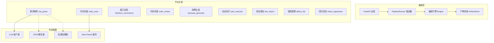
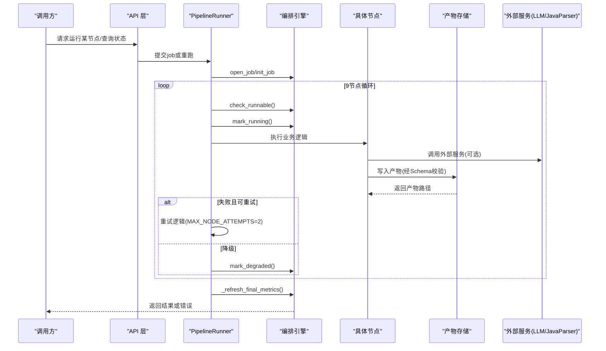
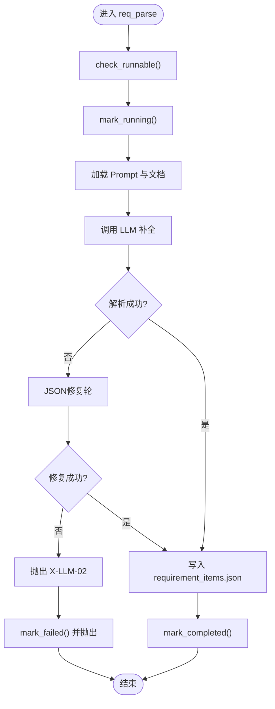
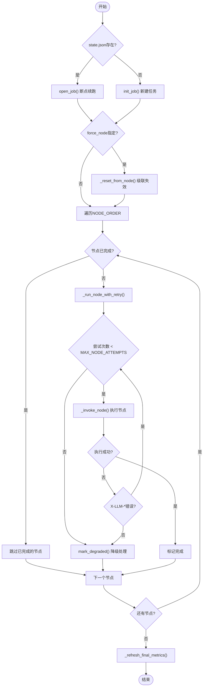
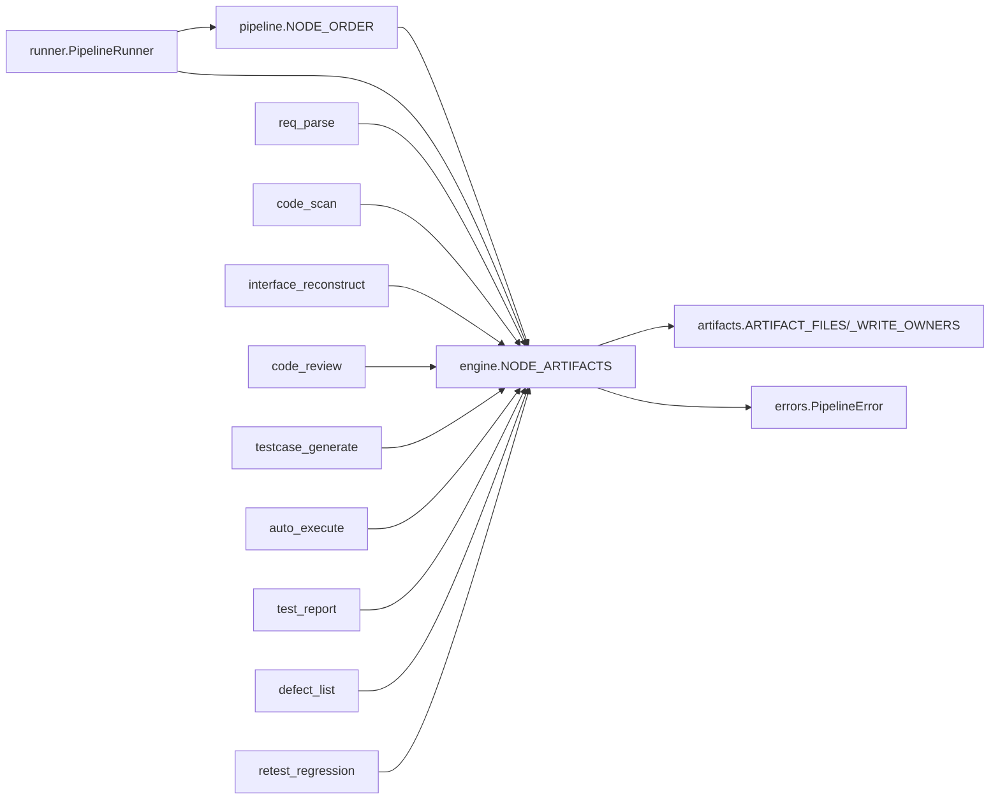

# 流水线工作流

<cite>
**本文引用的文件**
- [pipeline.py](file://services/orchestrator/src/orchestrator/pipeline.py)
- [engine.py](file://services/orchestrator/src/orchestrator/engine.py)
- [runner.py](file://services/orchestrator/src/orchestrator/runner.py)
- [artifacts.py](file://services/orchestrator/src/orchestrator/artifacts.py)
- [errors.py](file://services/orchestrator/src/orchestrator/errors.py)
- [api.py](file://services/orchestrator/src/orchestrator/api.py)
- [req_parse.py](file://services/orchestrator/src/orchestrator/nodes/req_parse.py)
- [code_scan.py](file://services/orchestrator/src/orchestrator/nodes/code_scan.py)
- [llm_repair.py](file://services/orchestrator/src/orchestrator/llm_repair.py)
- [llm_batch.py](file://services/orchestrator/src/orchestrator/llm_batch.py)
- [execution.json](file://schemas/execution.json)
- [requirement_items.json](file://schemas/requirement_items.json)
- [interfaces.json](file://schemas/interfaces.json)
- [testcases.json](file://schemas/testcases.json)
- [defects.json](file://schemas/defects.json)
- [metrics.json](file://schemas/metrics.json)
- [review_mapping.json](file://schemas/review_mapping.json)
- [regression_index.json](file://schemas/regression_index.json)
- [code_inventory.json](file://schemas/code_inventory.json)
</cite>

## 更新摘要
**所做更改**
- 新增 PipelineRunner 完整实现章节，详细说明9节点管道驱动机制
- 增强错误处理和重试逻辑说明，包含X-LLM-*错误码处理
- 更新产物管理机制，说明双身份写权隔离（orchestrator/test-executor）
- 新增批量处理和JSON修复机制章节，说明LLM输出弹性处理
- 更新状态管理，包含断点续跑、任务重试、降级处理等高级功能

## 目录
1. [简介](#简介)
2. [项目结构](#项目结构)
3. [核心组件](#核心组件)
4. [架构总览](#架构总览)
5. [详细组件分析](#详细组件分析)
6. [PipelineRunner 完整实现](#piperunner-完整实现)
7. [错误处理与重试机制](#错误处理与重试机制)
8. [批量处理与JSON修复](#批量处理与json修复)
9. [依赖关系分析](#依赖关系分析)
10. [性能考量](#性能考量)
11. [故障排查指南](#故障排查指南)
12. [结论](#结论)
13. [附录](#附录)

## 简介
本文件面向 LLM-AutoTest 的"流水线工作流"，围绕固定 9 个节点（需求解析、代码扫描、接口还原、代码审查、用例生成、自动执行、测试报告、缺陷管理、回归测试）进行系统化说明。文档覆盖：
- 每个节点的输入/输出数据格式、处理逻辑与异常处理机制
- 通过 PipelineRunner 实现的完整9节点管道驱动
- 流水线状态管理与断点续跑、任务重试、进度跟踪
- 错误处理、重试逻辑和产物管理机制
- 批量处理和JSON修复机制以确保LLM输出的弹性
- 配置选项、自定义节点开发与扩展机制
- 实际使用示例与最佳实践建议

## 项目结构
- 编排服务 orchestrator：负责流水线调度、状态持久化、产物校验、API 暴露
- PipelineRunner：完整的9节点管道驱动器，实现F-ORCH-01/F-ORCH-02规范
- 产物与 Schema：以 JSON Schema 严格约束各阶段产物，确保跨节点契约稳定
- 外部服务：java-parser（代码扫描）、LLM 客户端（需求解析等）
- 前端与服务：提供可视化与编排入口（不在本文重点）



**图表来源**
- [api.py:201-220](file://services/orchestrator/src/orchestrator/api.py#L201-L220)
- [runner.py:66-144](file://services/orchestrator/src/orchestrator/runner.py#L66-L144)
- [engine.py:134-152](file://services/orchestrator/src/orchestrator/engine.py#L134-L152)
- [artifacts.py:80-128](file://services/orchestrator/src/orchestrator/artifacts.py#L80-L128)

**章节来源**
- [pipeline.py:23-34](file://services/orchestrator/src/orchestrator/pipeline.py#L23-L34)
- [engine.py:134-152](file://services/orchestrator/src/orchestrator/engine.py#L134-L152)
- [runner.py:66-144](file://services/orchestrator/src/orchestrator/runner.py#L66-L144)
- [artifacts.py:80-128](file://services/orchestrator/src/orchestrator/artifacts.py#L80-L128)
- [api.py:201-220](file://services/orchestrator/src/orchestrator/api.py#L201-L220)

## 核心组件
- **节点顺序与四态**：固定 9 节点顺序；节点状态为 completed / manual_intervention / running / pending
- **PipelineRunner**：完整的9节点管道驱动器，实现F-ORCH-01/F-ORCH-02规范
- **编排引擎**：负责 job 生命周期、断点续跑、跳序防护、降级记录、完成判定
- **产物存储**：按 Schema 校验产物、写权隔离、原子落盘、归档能力
- **统一错误**：集中定义错误码与错误结构，贯穿各节点与引擎

**章节来源**
- [pipeline.py:11-20](file://services/orchestrator/src/orchestrator/pipeline.py#L11-L20)
- [runner.py:66-144](file://services/orchestrator/src/orchestrator/runner.py#L66-L144)
- [engine.py:134-152](file://services/orchestrator/src/orchestrator/engine.py#L134-L152)
- [artifacts.py:80-128](file://services/orchestrator/src/orchestrator/artifacts.py#L80-L128)
- [errors.py:8-39](file://services/orchestrator/src/orchestrator/errors.py#L8-L39)

## 架构总览
下图展示从 API 到 PipelineRunner、引擎、节点、产物存储与外部服务的调用关系，以及状态流转的关键路径。



**图表来源**
- [api.py:268-369](file://services/orchestrator/src/orchestrator/api.py#L268-L369)
- [runner.py:84-144](file://services/orchestrator/src/orchestrator/runner.py#L84-L144)
- [engine.py:154-180](file://services/orchestrator/src/orchestrator/engine.py#L154-L180)
- [artifacts.py:107-128](file://services/orchestrator/src/orchestrator/artifacts.py#L107-L128)

## 详细组件分析

### 节点一：需求解析（req_parse）
- **目标**：将需求文档解析为结构化条目，产出 requirement_items.json
- **输入**：需求文档路径、Prompt、LLM 客户端
- **处理流程**：
  - 跳序检查 → 标记运行中 → 加载 Prompt 与文档 → 调用 LLM → 提取 items → 写入产物 → 标记完成
  - 支持多文档合并（C-10）和版本差异分析
  - 内置JSON修复机制，对X-LLM-02错误自动重试一次
- **输出**：requirement_items.json（含 schema_version、job_id、source_file、items）
- **异常处理**：
  - Prompt 缺失/不合规 → X-LLM-03
  - LLM 网络/超时 → X-LLM-01（客户端内重试）
  - LLM 输出不可解析或未过 Schema → X-LLM-02（自动修复重试）
  - 其他 PipelineError → 回退为 pending 并记录错误



**图表来源**
- [req_parse.py:60-132](file://services/orchestrator/src/orchestrator/nodes/req_parse.py#L60-L132)
- [llm_repair.py:26-55](file://services/orchestrator/src/orchestrator/llm_repair.py#L26-L55)
- [errors.py:8-14](file://services/orchestrator/src/orchestrator/errors.py#L8-L14)

**章节来源**
- [req_parse.py:60-132](file://services/orchestrator/src/orchestrator/nodes/req_parse.py#L60-L132)
- [requirement_items.json:1-44](file://schemas/requirement_items.json#L1-L44)
- [errors.py:8-14](file://services/orchestrator/src/orchestrator/errors.py#L8-L14)

### 节点二：代码扫描（code_scan）
- **目标**：调用 java-parser 扫描多仓库，产出 code_inventory.json
- **输入**：repositories（仓库列表）
- **处理流程**：
  - 跳序检查 → 标记运行中 → 调用 JavaParserClient.scan → 提取 inventory → 校验仓库错误 → 写入产物 → 标记完成
- **输出**：code_inventory.json（含 repositories，支持 ok/empty/truncated/error 四态）
- **异常处理**：
  - 仓库硬错误（status=error）→ 节点失败（透传 X-CODE-01）
  - empty/truncated → 正常态，如实落盘并继续
  - 通信失败 → X-ORCH-03

**章节来源**
- [code_scan.py:26-49](file://services/orchestrator/src/orchestrator/nodes/code_scan.py#L26-L49)
- [code_scan.py:78-94](file://services/orchestrator/src/orchestrator/nodes/code_scan.py#L78-L94)
- [code_inventory.json:1-57](file://schemas/code_inventory.json#L1-L57)

### 节点三至九：其他节点
- **接口还原**：基于代码扫描结果与 LLM 补全，产出 interfaces.json 与 interface_candidates.json
- **代码审查**：建立需求-代码映射，识别风险与遗漏功能，产出 review_mapping.json
- **用例生成**：基于接口规范生成用例与脚本元数据，产出 testcases.json
- **自动执行**：执行用例并汇总结果，产出 execution.json
- **测试报告**：生成可读测试报告 test_report.md
- **缺陷管理**：从执行结果中提取本地缺陷，产出 defects.json
- **回归测试**：沉淀回归资产索引，产出 regression_index.json

**章节来源**
- [interfaces.json:1-70](file://schemas/interfaces.json#L1-L70)
- [review_mapping.json:1-81](file://schemas/review_mapping.json#L1-L81)
- [testcases.json:1-35](file://schemas/testcases.json#L1-L35)
- [execution.json:1-59](file://schemas/execution.json#L1-L59)
- [defects.json:1-54](file://schemas/defects.json#L1-L54)
- [regression_index.json:1-50](file://schemas/regression_index.json#L1-L50)

## PipelineRunner 完整实现

PipelineRunner 是完整的9节点管道驱动器，实现了 F-ORCH-01（单命令跑完）和 F-ORCH-02（断点续跑）规范。

### 核心特性
- **固定顺序驱动**：严格按照 NODE_ORDER 顺序执行9个节点
- **智能重试机制**：MAX_NODE_ATTEMPTS=2，仅对X-LLM-*类失败进行重试
- **降级处理**：重试耗尽后标记为 manual_intervention，不中断全流程
- **级联失效**：force_node参数支持从指定节点开始重新执行，自动归档旧产物
- **双身份产物卷**：orchestrator/test-executor写权隔离，避免并发冲突

### 执行流程


**图表来源**
- [runner.py:84-144](file://services/orchestrator/src/orchestrator/runner.py#L84-L144)
- [runner.py:169-215](file://services/orchestrator/src/orchestrator/runner.py#L169-L215)
- [runner.py:296-327](file://services/orchestrator/src/orchestrator/runner.py#L296-L327)

**章节来源**
- [runner.py:66-144](file://services/orchestrator/src/orchestrator/runner.py#L66-L144)
- [runner.py:169-215](file://services/orchestrator/src/orchestrator/runner.py#L169-L215)
- [runner.py:296-327](file://services/orchestrator/src/orchestrator/runner.py#L296-L327)

## 错误处理与重试机制

### 错误分类与处理策略
系统定义了统一的错误体系，通过 PipelineError 类集中管理：

- **X-LLM-01**：LLM 调用超时/网络失败（可重试）
- **X-LLM-02**：LLM 输出未过 Schema 校验（自动JSON修复重试）
- **X-LLM-03**：Prompt 文件缺失/元信息不合规（人工介入）
- **X-ORCH-01**：产物校验失败/状态不匹配
- **X-ORCH-02**：断点续跑跳序请求（前序未完成）
- **X-ORCH-03**：java-parser 服务不可达/通信失败

### 重试机制
PipelineRunner 实现了智能重试逻辑：

1. **节点级重试**：每个节点最多尝试 MAX_NODE_ATTEMPTS=2 次
2. **条件重试**：仅对 X-LLM-* 类错误进行自动重试
3. **降级处理**：重试耗尽后标记为 manual_intervention，记录降级原因
4. **流程继续**：降级节点不影响后续节点执行（D1口径）

### 降级清单管理
系统维护详细的降级清单，记录每个降级节点的原因和时间戳：

```python
state.degraded = (
    *state.degraded,
    {"node": node_name, "reason": reason, "marked_at": _now()},
)
```

**章节来源**
- [errors.py:8-39](file://services/orchestrator/src/orchestrator/errors.py#L8-L39)
- [runner.py:169-215](file://services/orchestrator/src/orchestrator/runner.py#L169-L215)
- [engine.py:253-262](file://services/orchestrator/src/orchestrator/engine.py#L253-L262)

## 批量处理与JSON修复

### 长文本分批处理
针对大文档处理，系统实现了智能分批机制：

- **文本切分**：chunk_text() 按标题、段落、行切分，保持语义完整性
- **JSON项分批**：chunk_json_items() 按序列化字符预算分批，单个大实体独占一批
- **上下文保留**：每批保留最近章节标题作为上下文，提高理解准确性

### JSON修复机制
complete_with_json_repair() 提供了单次受限的JSON修复轮：

1. **首次尝试**：调用LLM生成JSON输出
2. **解析验证**：尝试解析并验证JSON结构
3. **错误反馈**：如失败，将明确的错误信息反馈给模型
4. **二次尝试**：模型基于相同输入重新生成修正后的JSON
5. **最终验证**：再次解析验证，确保产物质量

### 批量处理优势
- **内存优化**：避免一次性处理超大文档导致内存溢出
- **容错性**：单批失败不影响其他批次处理
- **可追溯性**：每批都有独立的ID和状态记录
- **效率提升**：并行处理多个批次，提高整体吞吐量

**章节来源**
- [llm_batch.py:21-81](file://services/orchestrator/src/orchestrator/llm_batch.py#L21-L81)
- [llm_repair.py:26-55](file://services/orchestrator/src/orchestrator/llm_repair.py#L26-L55)
- [req_parse.py:108-118](file://services/orchestrator/src/orchestrator/nodes/req_parse.py#L108-L118)

## 依赖关系分析
- **节点顺序**：NODE_ORDER 固定为 9 项，禁止增删
- **完成判据**：NODE_ARTIFACTS 定义各节点产物文件名，engine.reconcile 以产物为准对账
- **写权隔离**：ARTIFACT_FILES 与 _WRITE_OWNERS 规定 orchestrator/test-executor 的写权限
- **错误体系**：errors.py 统一定义错误码，贯穿节点与引擎



**图表来源**
- [pipeline.py:23-34](file://services/orchestrator/src/orchestrator/pipeline.py#L23-L34)
- [engine.py:24-35](file://services/orchestrator/src/orchestrator/engine.py#L24-L35)
- [artifacts.py:29-59](file://services/orchestrator/src/orchestrator/artifacts.py#L29-L59)
- [errors.py:8-39](file://services/orchestrator/src/orchestrator/errors.py#L8-L39)

**章节来源**
- [pipeline.py:23-34](file://services/orchestrator/src/orchestrator/pipeline.py#L23-L34)
- [engine.py:24-35](file://services/orchestrator/src/orchestrator/engine.py#L24-L35)
- [artifacts.py:29-59](file://services/orchestrator/src/orchestrator/artifacts.py#L29-L59)
- [errors.py:8-39](file://services/orchestrator/src/orchestrator/errors.py#L8-L39)

## 性能考量
- **产物校验开销**：每次写入均进行 JSON Schema 校验，建议在批量写入时合并校验以减少 I/O
- **并发控制**：同一 job 下产物写权排他，避免并行写冲突；读取可并发
- **外部依赖**：LLM/JavaParser 调用应设置超时与重试策略，避免阻塞整条流水线
- **归档优化**：重跑前归档旧产物，避免重复计算与覆盖
- **内存管理**：大文档分批处理，避免内存溢出
- **重试策略**：智能重试仅针对特定错误类型，减少不必要的资源消耗

## 故障排查指南
### 常见错误码
- **X-LLM-01**：LLM 调用超时/网络失败（可重试）
- **X-LLM-02**：LLM 输出未过 Schema 校验（不重试，人工介入）
- **X-LLM-03**：Prompt 文件缺失/元信息不合规（配置错误）
- **X-ORCH-01**：产物校验失败/状态不匹配
- **X-ORCH-02**：断点续跑跳序请求（前序未完成）
- **X-ORCH-03**：java-parser 服务不可达/通信失败

### 排查步骤
1. **查看状态**：检查 state.json 中 nodes.attempts 与 error 字段定位失败节点
2. **验证产物**：核对产物是否存在且通过 Schema 校验（is_node_completed）
3. **检查依赖**：检查外部服务健康与日志（LLM/JavaParser）
4. **分析降级**：查看 degraded 清单了解降级原因
5. **重跑策略**：必要时归档旧产物并重跑指定节点

**章节来源**
- [errors.py:8-39](file://services/orchestrator/src/orchestrator/errors.py#L8-L39)
- [engine.py:161-180](file://services/orchestrator/src/orchestrator/engine.py#L161-L180)
- [artifacts.py:185-196](file://services/orchestrator/src/orchestrator/artifacts.py#L185-L196)

## 结论
本流水线以"产物为唯一事实"为核心原则，通过严格的 Schema 校验与状态对账，确保 9 个固定节点的可观测、可恢复与可扩展。PipelineRunner 的引入提供了完整的管道驱动能力，结合智能重试、降级处理和批量处理机制，既保障质量门禁，又兼顾灵活性与可维护性。JSON修复机制进一步提升了LLM输出的弹性和鲁棒性。

## 附录

### 流水线状态管理机制
- **断点续跑**：open_job 加载 state.json 并对账 reconcile，修正状态与产物一致性
- **任务重试**：mark_running 自增 attempts；失败回 pending 并记录错误
- **进度跟踪**：node_statuses 返回各节点摘要；automation_rate 计算自动化率（completed/9）
- **降级处理**：mark_degraded 标记 manual_intervention 状态，记录降级原因和时间

**章节来源**
- [engine.py:154-180](file://services/orchestrator/src/orchestrator/engine.py#L154-L180)
- [engine.py:222-262](file://services/orchestrator/src/orchestrator/engine.py#L222-L262)
- [pipeline.py:61-70](file://services/orchestrator/src/orchestrator/pipeline.py#L61-L70)

### 配置选项与扩展机制
- **配置项**
  - 产物根目录与 schemas 目录：ArtifactStore(root, schemas_dir)
  - 服务身份：service="orchestrator"/"test-executor"
  - 外部服务地址：LLM 客户端、JavaParser 客户端
  - 重试配置：MAX_NODE_ATTEMPTS=2
- **自定义节点开发**
  - 新增节点需遵循 NODE_ORDER 冻结口径（禁止增删）
  - 在 NODE_ARTIFACTS 中声明产物文件名
  - 实现 run_xxx 函数，遵循 check_runnable/mark_running/mark_completed/fail 流程
  - 产物必须通过对应 Schema 校验

**章节来源**
- [artifacts.py:80-128](file://services/orchestrator/src/orchestrator/artifacts.py#L80-L128)
- [engine.py:24-35](file://services/orchestrator/src/orchestrator/engine.py#L24-L35)
- [pipeline.py:23-34](file://services/orchestrator/src/orchestrator/pipeline.py#L23-L34)

### 实际使用示例与最佳实践
- **创建Job**：init_job(job_id) 初始化状态与目录
- **运行节点**：PipelineRunner.run() 完整驱动9节点流程
- **查询状态**：list_nodes 获取 9 节点清单与当前状态
- **重跑策略**：force_node参数支持从指定节点开始重跑
- **最佳实践**
  - 严格遵循 Schema，避免手写别名
  - 外部调用设置超时与重试，捕获 X-LLM-01/X-ORCH-03
  - 对降级节点记录 reason，便于报告分列与审计
  - 重跑前归档旧产物，避免覆盖
  - 利用批量处理优化大文档处理性能
  - 监控JSON修复成功率，优化Prompt设计

**章节来源**
- [api.py:268-369](file://services/orchestrator/src/orchestrator/api.py#L268-L369)
- [runner.py:84-144](file://services/orchestrator/src/orchestrator/runner.py#L84-L144)
- [artifacts.py:198-207](file://services/orchestrator/src/orchestrator/artifacts.py#L198-L207)