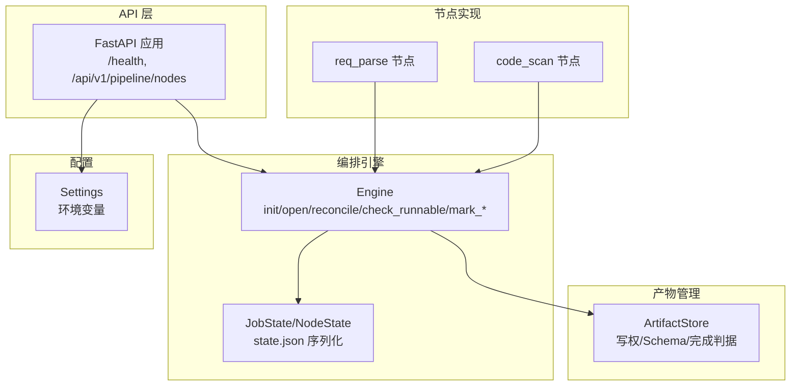
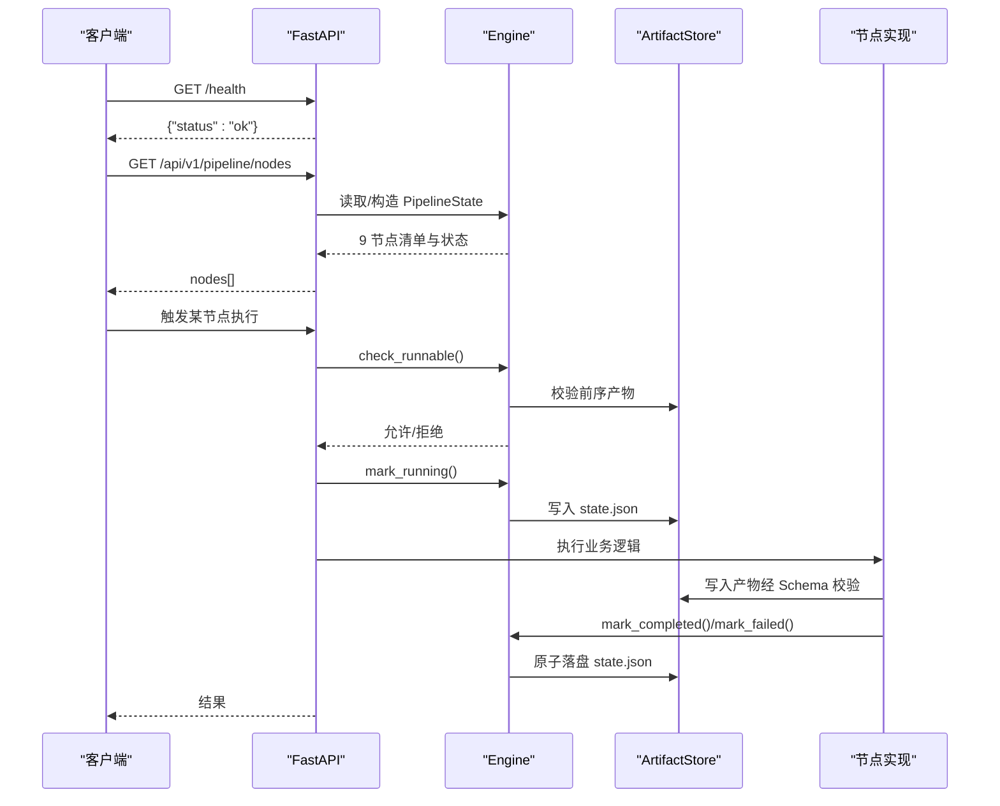
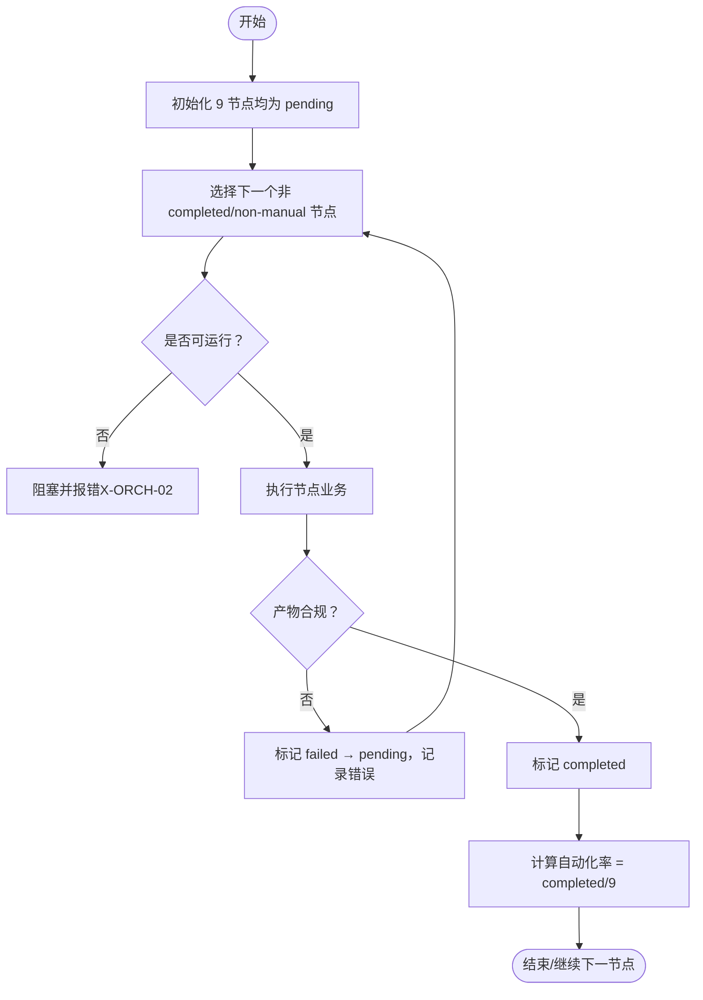
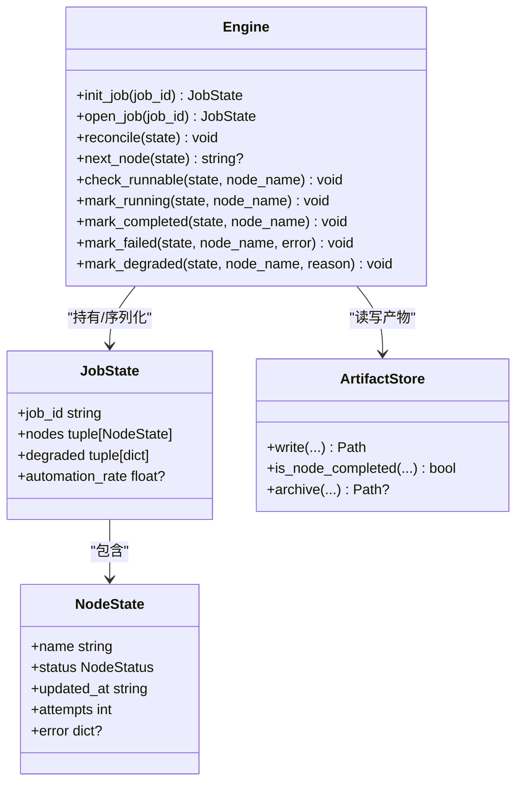
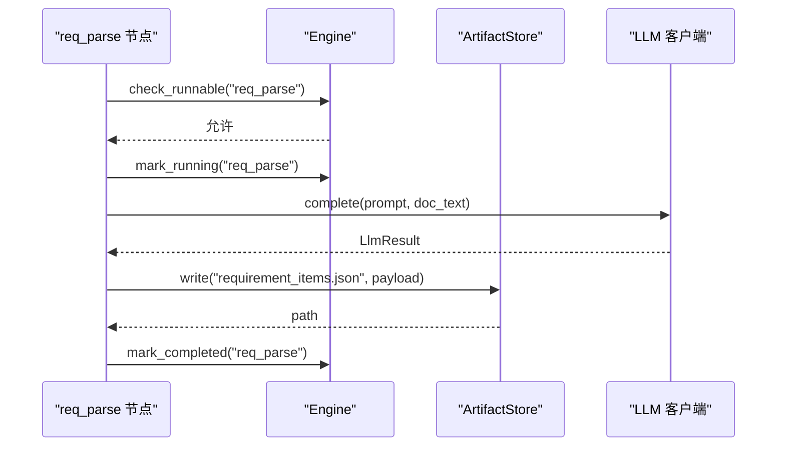
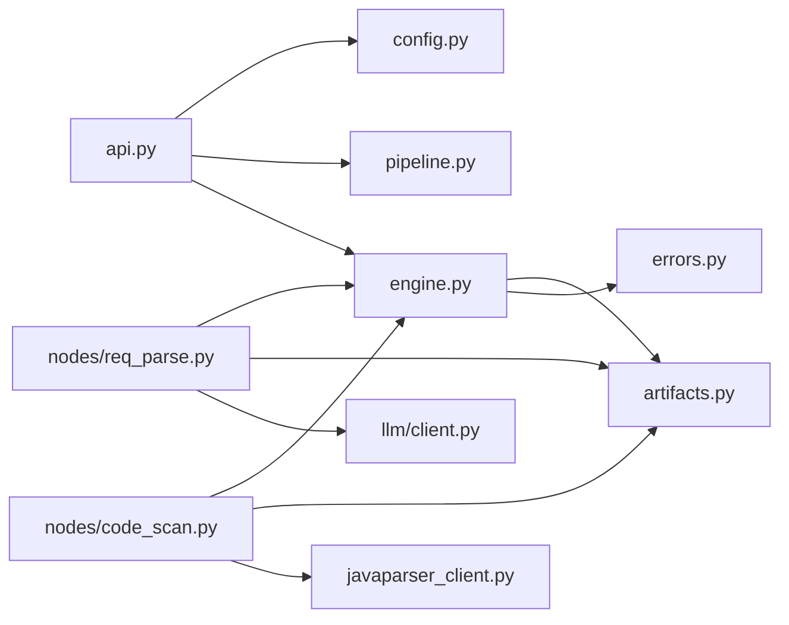

# 流水线概览

<cite>
**本文引用的文件**
- [pipeline.py](file://services/orchestrator/src/orchestrator/pipeline.py)
- [engine.py](file://services/orchestrator/src/orchestrator/engine.py)
- [api.py](file://services/orchestrator/src/orchestrator/api.py)
- [config.py](file://services/orchestrator/src/orchestrator/config.py)
- [artifacts.py](file://services/orchestrator/src/orchestrator/artifacts.py)
- [errors.py](file://services/orchestrator/src/orchestrator/errors.py)
- [__main__.py](file://services/orchestrator/src/orchestrator/__main__.py)
- [req_parse.py](file://services/orchestrator/src/orchestrator/nodes/req_parse.py)
- [code_scan.py](file://services/orchestrator/src/orchestrator/nodes/code_scan.py)
- [test_pipeline.py](file://services/orchestrator/tests/test_pipeline.py)
- [test_engine.py](file://services/orchestrator/tests/test_engine.py)
</cite>

## 目录
1. [简介](#简介)
2. [项目结构](#项目结构)
3. [核心组件](#核心组件)
4. [架构总览](#架构总览)
5. [详细组件分析](#详细组件分析)
6. [依赖关系分析](#依赖关系分析)
7. [性能与可靠性](#性能与可靠性)
8. [故障排查指南](#故障排查指南)
9. [结论](#结论)
10. [附录：配置与使用示例](#附录配置与使用示例)

## 简介
本概览文档面向 LLM-AutoTest 的编排服务（orchestrator），聚焦“9 个固定节点”的流水线工作流。内容涵盖：
- 9 节点顺序、四态标注系统（completed、manual_intervention、running、pending）
- 状态管理：NodeStatus、PipelineState、NodeRecord
- 启动流程、执行模式、监控机制
- 配置选项与基础使用示例
帮助开发者快速理解该流水线的设计理念与运行机制。

## 项目结构
orchestrator 服务采用分层组织：
- API 层：FastAPI 应用，暴露健康检查与节点清单接口
- 编排引擎：负责 state.json 持久化、断点续跑、跳序防护、降级处理
- 产物管理：统一读写产物卷，Schema 校验，完成判据
- 节点实现：按 9 节点顺序逐步实现业务逻辑（示例包含 req_parse、code_scan）
- 配置与环境：从环境变量加载运行参数
- 错误模型：统一错误码与异常结构

图表来源
- [api.py:11-27](file://services/orchestrator/src/orchestrator/api.py#L11-L27)
- [engine.py:133-302](file://services/orchestrator/src/orchestrator/engine.py#L133-L302)
- [artifacts.py:55-157](file://services/orchestrator/src/orchestrator/artifacts.py#L55-L157)
- [config.py:9-56](file://services/orchestrator/src/orchestrator/config.py#L9-L56)

章节来源
- [api.py:11-27](file://services/orchestrator/src/orchestrator/api.py#L11-L27)
- [engine.py:133-302](file://services/orchestrator/src/orchestrator/engine.py#L133-L302)
- [artifacts.py:55-157](file://services/orchestrator/src/orchestrator/artifacts.py#L55-L157)
- [config.py:9-56](file://services/orchestrator/src/orchestrator/config.py#L9-L56)

## 核心组件
- NodeStatus：四态枚举（completed、manual_intervention、running、pending）
- PipelineState：9 节点初始态与自动化率汇总（骨架阶段返回 None）
- Engine：编排引擎，负责 job 生命周期、对账、跳序防护、降级、完成判据
- ArtifactStore：产物卷访问器，负责 Schema 校验、写权排他、完成判据
- Settings：运行时配置，全部来自环境变量
- 错误模型：PipelineError 及错误码表

关键要点
- 9 节点顺序冻结，禁止增删
- 以产物为唯一事实源，state.json 仅缓存
- 降级节点计入人工介入，分母固定为 9

章节来源
- [pipeline.py:11-84](file://services/orchestrator/src/orchestrator/pipeline.py#L11-L84)
- [engine.py:22-35](file://services/orchestrator/src/orchestrator/engine.py#L22-L35)
- [engine.py:43-131](file://services/orchestrator/src/orchestrator/engine.py#L43-L131)
- [artifacts.py:24-52](file://services/orchestrator/src/orchestrator/artifacts.py#L24-L52)
- [config.py:9-56](file://services/orchestrator/src/orchestrator/config.py#L9-L56)
- [errors.py:1-39](file://services/orchestrator/src/orchestrator/errors.py#L1-L39)

## 架构总览
下图展示 orchestrator 在流水线中的角色与交互：API 接收请求，调用 Engine；Engine 通过 ArtifactStore 读写产物并维护 state.json；节点实现遵循统一的运行契约（检查可运行→标记运行→执行业务→校验产物→置完成或失败）。

图表来源
- [api.py:11-27](file://services/orchestrator/src/orchestrator/api.py#L11-L27)
- [engine.py:140-265](file://services/orchestrator/src/orchestrator/engine.py#L140-L265)
- [artifacts.py:75-131](file://services/orchestrator/src/orchestrator/artifacts.py#L75-L131)
- [req_parse.py:33-78](file://services/orchestrator/src/orchestrator/nodes/req_parse.py#L33-L78)
- [code_scan.py:26-49](file://services/orchestrator/src/orchestrator/nodes/code_scan.py#L26-L49)

## 详细组件分析

### 9 节点与四态标注
- 9 节点顺序（冻结口径）：req_parse → code_scan → interface_reconstruct → code_review → testcase_generate → auto_execute → test_report → defect_list → retest_regression
- 四态：
  - completed：产物存在且通过 Schema 校验
  - manual_intervention：降级节点，仍计入分母 9
  - running：正在执行
  - pending：待运行
- PipelineState 提供初始态与自动化率汇总（无实测时返回 None）

图表来源
- [pipeline.py:23-84](file://services/orchestrator/src/orchestrator/pipeline.py#L23-L84)
- [engine.py:161-265](file://services/orchestrator/src/orchestrator/engine.py#L161-L265)
- [artifacts.py:120-131](file://services/orchestrator/src/orchestrator/artifacts.py#L120-L131)

章节来源
- [pipeline.py:23-84](file://services/orchestrator/src/orchestrator/pipeline.py#L23-L84)
- [engine.py:161-265](file://services/orchestrator/src/orchestrator/engine.py#L161-L265)
- [artifacts.py:120-131](file://services/orchestrator/src/orchestrator/artifacts.py#L120-L131)

### 编排引擎（Engine）
职责
- 新建/打开 job，持久化 state.json
- 对账 reconcile：以产物为准修正状态（崩溃恢复、产物失效降级）
- 跳序防护：前序未完成则拒绝后续节点
- 节点状态流转：running → completed/failed/degraded
- 自动化率汇总：completed/9

关键方法
- init_job/open_job：创建或打开 job，open_job 会触发对账
- next_node：定位下一个可执行节点（跳过 completed 与 manual_intervention）
- check_runnable：校验前序节点是否全部完成（含降级视为已处理）
- mark_running/marked_completed/marked_failed/marked_degraded：状态变更与落盘

图表来源
- [engine.py:43-131](file://services/orchestrator/src/orchestrator/engine.py#L43-L131)
- [engine.py:133-302](file://services/orchestrator/src/orchestrator/engine.py#L133-L302)
- [artifacts.py:55-157](file://services/orchestrator/src/orchestrator/artifacts.py#L55-L157)

章节来源
- [engine.py:43-131](file://services/orchestrator/src/orchestrator/engine.py#L43-L131)
- [engine.py:133-302](file://services/orchestrator/src/orchestrator/engine.py#L133-L302)

### 产物管理（ArtifactStore）
职责
- 固定目录布局：<root>/<job_id>/{9 产物 + state.json + scripts/fixtures/logs/archive}
- 写权排他：不同服务只能写其负责的产物
- Schema 校验：JSON 产物必须通过对应 schema 校验；Markdown 产物仅检查存在与非空
- 完成判据：is_node_completed 判定节点是否完成

关键点
- 写操作先校验再原子落盘（tmp + replace）
- archive 用于重跑前归档旧产物，禁止原地覆盖

章节来源
- [artifacts.py:24-52](file://services/orchestrator/src/orchestrator/artifacts.py#L24-L52)
- [artifacts.py:75-131](file://services/orchestrator/src/orchestrator/artifacts.py#L75-L131)
- [artifacts.py:133-157](file://services/orchestrator/src/orchestrator/artifacts.py#L133-L157)

### 节点实现示例
- req_parse：需求解析节点
  - 流程：检查可运行 → 标记运行 → 加载 Prompt 与文档 → 调用 LLM → 提取 items → 写入 requirement_items.json → 标记完成
  - 错误映射：LLM 输出不合规映射为 X-LLM-02；网络/超时为 X-LLM-01；其他走通用失败路径
- code_scan：代码扫描节点
  - 流程：检查可运行 → 标记运行 → 调用 java-parser 扫描 → 提取 inventory → 校验仓库错误 → 写入 code_inventory.json → 标记完成
  - 错误映射：仓库硬错误透传 X-CODE-01；通信失败为 X-ORCH-03

图表来源
- [req_parse.py:33-78](file://services/orchestrator/src/orchestrator/nodes/req_parse.py#L33-L78)
- [engine.py:196-242](file://services/orchestrator/src/orchestrator/engine.py#L196-L242)
- [artifacts.py:75-96](file://services/orchestrator/src/orchestrator/artifacts.py#L75-L96)

章节来源
- [req_parse.py:33-78](file://services/orchestrator/src/orchestrator/nodes/req_parse.py#L33-L78)
- [code_scan.py:26-49](file://services/orchestrator/src/orchestrator/nodes/code_scan.py#L26-L49)

### API 与健康检查
- /health：健康检查，供容器编排依赖
- /api/v1/pipeline/nodes：返回 9 节点清单与当前状态（骨架阶段基于 PipelineState.initial）

章节来源
- [api.py:11-27](file://services/orchestrator/src/orchestrator/api.py#L11-L27)
- [test_pipeline.py:33-46](file://services/orchestrator/tests/test_pipeline.py#L33-L46)

## 依赖关系分析
- API 依赖配置与 pipeline 定义
- Engine 依赖 artifacts、pipeline、errors
- 节点实现依赖 engine、artifacts、llm/prompts/doc_loader
- 配置集中管理环境变量，避免硬编码

图表来源
- [api.py:11-27](file://services/orchestrator/src/orchestrator/api.py#L11-L27)
- [engine.py:10-21](file://services/orchestrator/src/orchestrator/engine.py#L10-L21)
- [req_parse.py:9-21](file://services/orchestrator/src/orchestrator/nodes/req_parse.py#L9-L21)
- [code_scan.py:11-20](file://services/orchestrator/src/orchestrator/nodes/code_scan.py#L11-L20)

章节来源
- [api.py:11-27](file://services/orchestrator/src/orchestrator/api.py#L11-L27)
- [engine.py:10-21](file://services/orchestrator/src/orchestrator/engine.py#L10-L21)
- [req_parse.py:9-21](file://services/orchestrator/src/orchestrator/nodes/req_parse.py#L9-L21)
- [code_scan.py:11-20](file://services/orchestrator/src/orchestrator/nodes/code_scan.py#L11-L20)

## 性能与可靠性
- 原子落盘：state.json 与产物均使用 tmp + replace，避免部分写入导致的不一致
- 对账机制：重启后以产物为准修复状态，提升鲁棒性
- 跳序防护：防止乱序执行导致的下游数据不完整
- 写权隔离：不同服务只写其负责产物，降低并发冲突风险
- 完成判据严格：只有产物存在且通过 Schema 才视为完成，避免“假完成”

[本节为通用指导，不直接分析具体文件]

## 故障排查指南
常见错误与定位
- X-ORCH-01：产物校验失败或 state.json 损坏/不匹配
  - 检查产物是否符合 schemas 定义
  - 检查 state.json 是否被外部修改或损坏
- X-ORCH-02：跳序请求（前序未完成）
  - 确认前序节点是否已完成或降级
- X-LLM-01：LLM 调用超时/网络失败
  - 检查网络与 LLM 服务可用性
- X-LLM-02：LLM 输出未过 Schema 校验
  - 检查 Prompt 与 LLM 输出格式
- X-ORCH-03：java-parser 服务不可达/通信失败
  - 检查 java-parser 服务状态与网络连通性

调试建议
- 查看 state.json 中节点的 attempts、error、updated_at
- 检查 artifacts 目录下产物是否存在且非空
- 使用 /health 与 /api/v1/pipeline/nodes 观察服务状态与节点清单

章节来源
- [errors.py:1-39](file://services/orchestrator/src/orchestrator/errors.py#L1-L39)
- [engine.py:161-265](file://services/orchestrator/src/orchestrator/engine.py#L161-L265)
- [artifacts.py:75-131](file://services/orchestrator/src/orchestrator/artifacts.py#L75-L131)

## 结论
LLM-AutoTest 编排服务以“产物为唯一事实源”为核心原则，通过严格的完成判据、对账机制与跳序防护，确保 9 节点流水线的稳定执行。四态标注与降级策略使系统在异常情况下仍可推进并保留可观测性。配合统一错误模型与配置管理，便于运维与扩展。

[本节为总结性内容，不直接分析具体文件]

## 附录：配置与使用示例
- 启动方式：通过 __main__.py 启动 FastAPI 服务，端口与行为由 Settings 控制
- 关键环境变量（来自 Settings.from_env）：
  - PORT：服务端口
  - JAVA_PARSER_URL：java-parser 服务地址
  - ARTIFACTS_ROOT：产物根目录
  - LLM_BASE_URL、LLM_MODEL_NAME、LLM_API_KEY、LLM_TEMPERATURE、LLM_TOP_P、LLM_SEED、LLM_TIMEOUT_S：LLM 调用参数
  - SCHEMAS_DIR：Schema 目录路径
- 基础使用示例（概念性步骤）：
  - 设置环境变量并启动服务
  - 调用 /health 检查服务健康
  - 调用 /api/v1/pipeline/nodes 获取 9 节点清单与状态
  - 创建 job（init_job），依次执行各节点（check_runnable → mark_running → 执行业务 → mark_completed/marked_failed）
  - 如需断点续跑，调用 open_job 进行对账并继续执行

章节来源
- [__main__.py:15-25](file://services/orchestrator/src/orchestrator/__main__.py#L15-L25)
- [config.py:35-56](file://services/orchestrator/src/orchestrator/config.py#L35-L56)
- [api.py:11-27](file://services/orchestrator/src/orchestrator/api.py#L11-L27)
- [engine.py:140-159](file://services/orchestrator/src/orchestrator/engine.py#L140-L159)