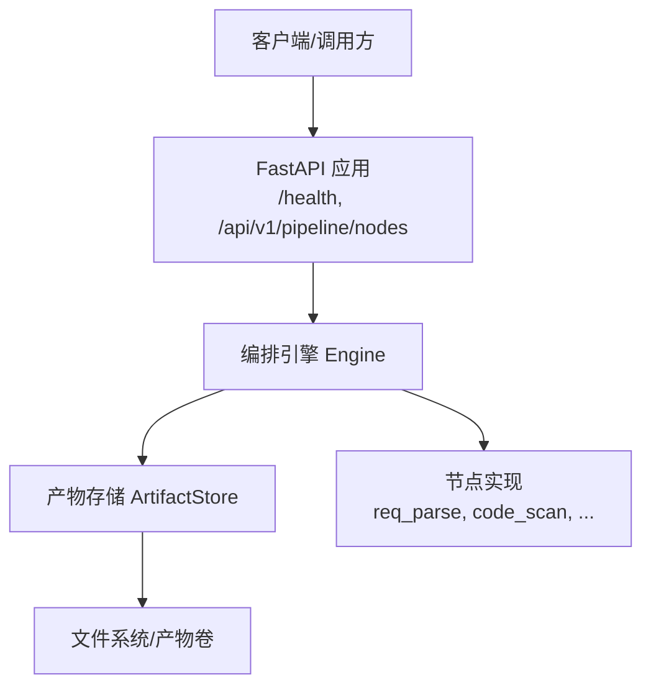
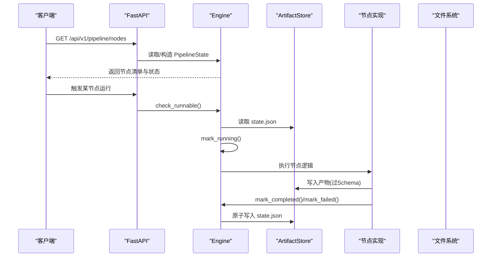
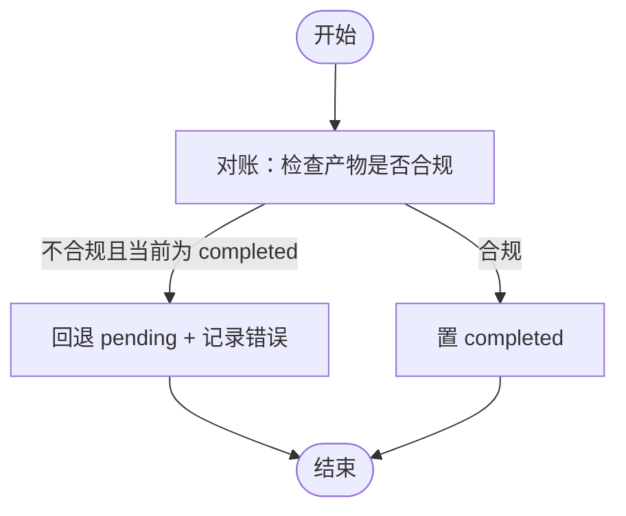
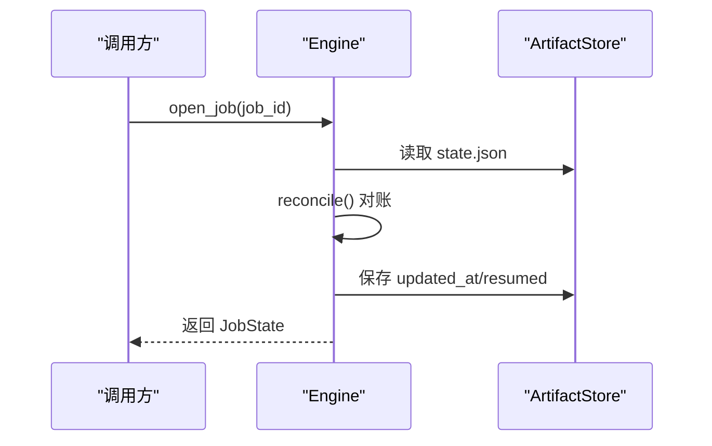
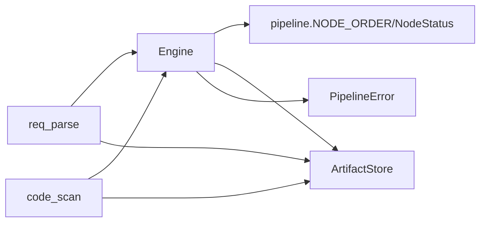

# 流水线状态管理

<cite>
**本文引用的文件**
- [pipeline.py](file://services/orchestrator/src/orchestrator/pipeline.py)
- [engine.py](file://services/orchestrator/src/orchestrator/engine.py)
- [artifacts.py](file://services/orchestrator/src/orchestrator/artifacts.py)
- [api.py](file://services/orchestrator/src/orchestrator/api.py)
- [config.py](file://services/orchestrator/src/orchestrator/config.py)
- [errors.py](file://services/orchestrator/src/orchestrator/errors.py)
- [req_parse.py](file://services/orchestrator/src/orchestrator/nodes/req_parse.py)
- [code_scan.py](file://services/orchestrator/src/orchestrator/nodes/code_scan.py)
- [test_engine.py](file://services/orchestrator/tests/test_engine.py)
- [test_pipeline.py](file://services/orchestrator/tests/test_pipeline.py)
</cite>

## 目录
1. [简介](#简介)
2. [项目结构](#项目结构)
3. [核心组件](#核心组件)
4. [架构总览](#架构总览)
5. [详细组件分析](#详细组件分析)
6. [依赖关系分析](#依赖关系分析)
7. [性能与并发特性](#性能与并发特性)
8. [故障排查指南](#故障排查指南)
9. [结论](#结论)
10. [附录：API、数据模型与示例](#附录api数据模型与示例)

## 简介
本文件聚焦 orchestrator 服务中的“流水线状态管理”，围绕 PipelineState 状态机制，系统阐述节点状态的持久化、断点续跑、任务重试、四态标注（completed、manual_intervention、running、pending）的状态转换规则与触发条件；并说明进度跟踪、自动化率计算、监控指标收集、状态数据存储格式、备份恢复与并发控制策略；最后给出状态查询 API、事件通知思路与异常恢复策略，并提供可复用的状态管理示例与故障处理指引。

## 项目结构
orchestrator 采用分层设计：
- API 层：FastAPI 路由，仅做协议转换与校验，业务下沉至 Engine。
- 编排引擎：Engine 负责 job 生命周期、状态机推进、对账与落盘。
- 产物存储：ArtifactStore 提供产物卷访问、Schema 校验、完成判据与归档。
- 节点实现：每个节点模块封装具体执行流程，统一通过 Engine 推进状态。
- 配置与错误：Settings 集中环境变量；PipelineError 统一错误码与返回结构。

图表来源
- [api.py:11-27](file://services/orchestrator/src/orchestrator/api.py#L11-L27)
- [engine.py:133-302](file://services/orchestrator/src/orchestrator/engine.py#L133-L302)
- [artifacts.py:55-157](file://services/orchestrator/src/orchestrator/artifacts.py#L55-L157)

章节来源
- [api.py:1-27](file://services/orchestrator/src/orchestrator/api.py#L1-L27)
- [engine.py:1-302](file://services/orchestrator/src/orchestrator/engine.py#L1-L302)
- [artifacts.py:1-157](file://services/orchestrator/src/orchestrator/artifacts.py#L1-L157)

## 核心组件
- PipelineState：定义九节点固定顺序与四态枚举，提供初始状态与自动化率计算（骨架口径）。
- JobState/NodeState：state.json 的根对象与节点元素，包含状态、时间戳、尝试次数、错误信息、降级清单等。
- Engine：编排引擎，负责 init/open/reconcile/next_node/check_runnable/mark_running/mark_completed/mark_failed/mark_degraded 等状态流转与持久化。
- ArtifactStore：产物卷访问器，负责 Schema 校验、原子写入、完成判据、归档与写权排他。
- API：暴露健康检查与节点清单接口。
- 节点模块：以 req_parse、code_scan 为例，展示“跳序检查→运行→落盘→置完成”的标准流程。

章节来源
- [pipeline.py:11-84](file://services/orchestrator/src/orchestrator/pipeline.py#L11-L84)
- [engine.py:43-131](file://services/orchestrator/src/orchestrator/engine.py#L43-L131)
- [engine.py:133-302](file://services/orchestrator/src/orchestrator/engine.py#L133-L302)
- [artifacts.py:55-157](file://services/orchestrator/src/orchestrator/artifacts.py#L55-L157)
- [api.py:11-27](file://services/orchestrator/src/orchestrator/api.py#L11-L27)
- [req_parse.py:33-78](file://services/orchestrator/src/orchestrator/nodes/req_parse.py#L33-L78)
- [code_scan.py:26-49](file://services/orchestrator/src/orchestrator/nodes/code_scan.py#L26-L49)

## 架构总览
下图展示了状态管理的核心交互：API 接收请求后交由 Engine 编排；Engine 通过 ArtifactStore 读写 state.json 与产物；节点模块在 Engine 的协调下推进状态。

图表来源
- [api.py:11-27](file://services/orchestrator/src/orchestrator/api.py#L11-L27)
- [engine.py:153-265](file://services/orchestrator/src/orchestrator/engine.py#L153-L265)
- [artifacts.py:75-131](file://services/orchestrator/src/orchestrator/artifacts.py#L75-L131)
- [req_parse.py:33-78](file://services/orchestrator/src/orchestrator/nodes/req_parse.py#L33-L78)

## 详细组件分析

### 四态标注与状态转换规则
- 四态枚举：completed、manual_intervention、running、pending。
- 关键转换：
  - pending → running：调用 mark_running，attempts 自增。
  - running → completed：需满足该节点的产物完成判据（存在且通过 Schema），否则拒绝。
  - running → pending：失败时回退到 pending，记录 error 与 updated_at。
  - 任意 → manual_intervention：降级标记，进入人工介入，后续自动推进跳过该节点。
  - 对账 reconcile：以产物为准，产物合规则补为 completed；若状态为 completed 但产物失效则回退 pending 并记录错误。

图表来源
- [engine.py:161-180](file://services/orchestrator/src/orchestrator/engine.py#L161-L180)

章节来源
- [pipeline.py:11-21](file://services/orchestrator/src/orchestrator/pipeline.py#L11-L21)
- [engine.py:221-265](file://services/orchestrator/src/orchestrator/engine.py#L221-L265)
- [engine.py:161-180](file://services/orchestrator/src/orchestrator/engine.py#L161-L180)

### 节点状态持久化与断点续跑
- 持久化位置：job 目录下 state.json，由 Engine._save 原子写入（tmp+replace）。
- 断点续跑入口：open_job 加载 state.json 并执行 reconcile，修正状态与产物一致性，同时 resumed 计数自增。
- 跳序防护：check_runnable 确保前序节点全部 completed（或 manual_intervention 视为已处理），否则抛出 X-ORCH-02。

图表来源
- [engine.py:153-159](file://services/orchestrator/src/orchestrator/engine.py#L153-L159)
- [engine.py:271-302](file://services/orchestrator/src/orchestrator/engine.py#L271-L302)

章节来源
- [engine.py:140-159](file://services/orchestrator/src/orchestrator/engine.py#L140-L159)
- [engine.py:196-220](file://services/orchestrator/src/orchestrator/engine.py#L196-L220)
- [engine.py:267-302](file://services/orchestrator/src/orchestrator/engine.py#L267-L302)

### 任务重试与失败处理
- 每次运行节点前 mark_running 会 attempts 自增，用于统计真实尝试次数。
- 失败路径：节点捕获 PipelineError，调用 engine.mark_failed 将状态回退到 pending，并记录 error；上层可根据错误码决定是否重试或降级。
- 重试策略建议：
  - 网络/超时类错误（如 LLM 调用）可指数退避重试。
  - Schema 校验失败（X-LLM-02）不应重试，应转人工介入。
  - 通信失败（X-ORCH-03）可短暂重试后降级。

章节来源
- [engine.py:221-250](file://services/orchestrator/src/orchestrator/engine.py#L221-L250)
- [errors.py:8-14](file://services/orchestrator/src/orchestrator/errors.py#L8-L14)
- [req_parse.py:33-78](file://services/orchestrator/src/orchestrator/nodes/req_parse.py#L33-L78)

### 进度跟踪、自动化率与监控指标
- 进度跟踪：JobState.nodes 数组按 NODE_ORDER 顺序维护各节点状态；Engine.next_node 返回首个非 completed/manual_intervention 的节点名。
- 自动化率：JobState.automation_rate = completed 数 / 9；无实测时返回 None；降级节点计入分母但不计入 completed。
- 监控指标建议（结合现有字段）：
  - 节点尝试次数 attempts（重试频率）
  - 错误分布 error.code（失败原因分类）
  - 降级清单 degraded（人工介入比例）
  - resumed 计数（断点续跑频次）
  - 自动化率 automation_rate（整体效率）

章节来源
- [engine.py:126-131](file://services/orchestrator/src/orchestrator/engine.py#L126-L131)
- [engine.py:181-194](file://services/orchestrator/src/orchestrator/engine.py#L181-L194)
- [engine.py:66-96](file://services/orchestrator/src/orchestrator/engine.py#L66-L96)

### 状态数据存储格式、备份恢复与并发控制
- 存储格式：state.json 包含 schema_version、job_id、created_at、updated_at、nodes、degraded、resumed；节点元素包含 name、status、updated_at、attempts、error。
- 备份恢复：
  - 备份：定期复制 job 目录（含 state.json 与 archive 子目录）到外部存储。
  - 恢复：将备份目录还原至 artifacts_root，使用 open_job 重新加载并对账。
- 并发控制：
  - 写权排他：ArtifactStore 根据 _WRITE_OWNERS 限制不同服务写入权限，避免多进程/多容器竞争。
  - 原子写入：state.json 与产物均采用 tmp+replace 方式落盘，保证读一致性与幂等性。
  - 归档保护：重跑前通过 archive 移动旧产物，禁止原地覆盖。

章节来源
- [engine.py:66-96](file://services/orchestrator/src/orchestrator/engine.py#L66-L96)
- [engine.py:294-302](file://services/orchestrator/src/orchestrator/engine.py#L294-L302)
- [artifacts.py:75-96](file://services/orchestrator/src/orchestrator/artifacts.py#L75-L96)
- [artifacts.py:133-142](file://services/orchestrator/src/orchestrator/artifacts.py#L133-L142)
- [artifacts.py:144-157](file://services/orchestrator/src/orchestrator/artifacts.py#L144-L157)

### 状态查询 API、事件通知与异常恢复策略
- 状态查询 API：
  - GET /health：健康检查。
  - GET /api/v1/pipeline/nodes：返回九节点清单与当前状态（骨架阶段基于 PipelineState.initial）。
- 事件通知（建议）：
  - 节点状态变更（running/completed/failed/degraded）可通过消息队列或 Webhook 推送给上游系统。
  - 事件载荷建议包含 job_id、node_name、new_status、updated_at、error（如有）。
- 异常恢复策略：
  - 损坏 state.json：open_job 抛出 X-ORCH-01，需从备份恢复。
  - 产物缺失或不合规：reconcile 将状态回退 pending 并记录错误，等待修复后再次运行。
  - 外部服务不可达（如 java-parser）：X-ORCH-03，建议重试后降级。

章节来源
- [api.py:11-27](file://services/orchestrator/src/orchestrator/api.py#L11-L27)
- [engine.py:271-292](file://services/orchestrator/src/orchestrator/engine.py#L271-L292)
- [engine.py:161-180](file://services/orchestrator/src/orchestrator/engine.py#L161-L180)
- [errors.py:8-14](file://services/orchestrator/src/orchestrator/errors.py#L8-L14)

### 实际状态管理示例与故障处理指南
- 示例一：新建 job 并运行首节点
  - 初始化：init_job 创建 job 目录并写入初始 state.json（全 pending）。
  - 运行：check_runnable → mark_running → 节点执行 → store.write → mark_completed。
  - 验证：next_node 指向下一节点；open_job 后可继续推进。
- 示例二：断点续跑与对账
  - 重启后 open_job，reconcile 以产物为准补齐 completed 或回退 pending。
  - resumed 计数自增，便于审计。
- 示例三：降级与人工介入
  - 当外部依赖不可用时，mark_degraded 将节点置为 manual_intervention，并记录 reason。
  - next_node 跳过该节点，流程继续推进后续节点。
- 故障处理：
  - 跳序请求：check_runnable 抛出 X-ORCH-02，需先完成前序节点。
  - 产物未达标：mark_completed 拒绝并提示具体缺失产物。
  - state.json 损坏：X-ORCH-01，需恢复备份。

章节来源
- [test_engine.py:39-105](file://services/orchestrator/tests/test_engine.py#L39-L105)
- [test_engine.py:107-141](file://services/orchestrator/tests/test_engine.py#L107-L141)
- [test_engine.py:144-181](file://services/orchestrator/tests/test_engine.py#L144-L181)

## 依赖关系分析
- Engine 依赖：
  - pipeline.NODE_ORDER、NodeStatus：固定节点顺序与状态枚举。
  - artifacts.ArtifactStore：产物卷访问与完成判据。
  - errors.PipelineError：统一错误码与返回结构。
- 节点模块依赖：
  - Engine：状态推进与持久化。
  - ArtifactStore：产物写入与校验。
  - 其他模块：如 llm、javaparser_client、prompts_loader、doc_loader 等。

图表来源
- [engine.py:18-21](file://services/orchestrator/src/orchestrator/engine.py#L18-L21)
- [req_parse.py:15-20](file://services/orchestrator/src/orchestrator/nodes/req_parse.py#L15-L20)
- [code_scan.py:16-19](file://services/orchestrator/src/orchestrator/nodes/code_scan.py#L16-L19)

章节来源
- [engine.py:18-21](file://services/orchestrator/src/orchestrator/engine.py#L18-L21)
- [req_parse.py:15-20](file://services/orchestrator/src/orchestrator/nodes/req_parse.py#L15-L20)
- [code_scan.py:16-19](file://services/orchestrator/src/orchestrator/nodes/code_scan.py#L16-L19)

## 性能与并发特性
- 原子写入：state.json 与产物均通过 tmp+replace 落盘，减少竞态与部分写入风险。
- 写权排他：ArtifactStore 依据 _WRITE_OWNERS 限制写方，避免多服务冲突。
- 完成判据前置：mark_completed 强制校验产物，避免“假完成”。
- 对账优化：open_job 时一次性 reconcile，批量修正状态，降低后续分支判断成本。
- 建议扩展：
  - 引入分布式锁（如 Redis）以支持多实例并发安全。
  - 对大产物进行分块校验与流式写入以降低内存占用。

[本节为通用性能讨论，不直接分析具体文件]

## 故障排查指南
- 常见错误码：
  - X-ORCH-01：产物校验失败/state.json 损坏/job 不存在等。
  - X-ORCH-02：跳序请求（前序未完成）。
  - X-ORCH-03：java-parser 服务不可达/通信失败。
  - X-LLM-01：LLM 调用超时/网络失败（可重试）。
  - X-LLM-02：LLM 输出未过 Schema 校验（不重试，人工介入）。
  - X-LLM-03：Prompt 缺失/元信息不合规（配置错误，人工介入）。
- 排查步骤：
  - 检查 state.json 是否可读且 job_id 匹配。
  - 核对产物是否存在并通过 Schema 校验。
  - 确认前序节点是否 completed 或 manual_intervention。
  - 查看节点 error 字段获取最近失败详情。
  - 必要时从备份恢复并重新 open_job 对账。

章节来源
- [errors.py:8-14](file://services/orchestrator/src/orchestrator/errors.py#L8-L14)
- [engine.py:271-292](file://services/orchestrator/src/orchestrator/engine.py#L271-L292)
- [engine.py:196-220](file://services/orchestrator/src/orchestrator/engine.py#L196-L220)
- [engine.py:229-250](file://services/orchestrator/src/orchestrator/engine.py#L229-L250)

## 结论
本方案通过 Engine 与 ArtifactStore 的协同，实现了可靠的流水线状态管理：以产物为唯一事实源，提供断点续跑、跳序防护、降级与重试能力；四态标注清晰表达节点生命周期；自动化率与监控指标便于度量与优化；原子写入与写权排保障并发安全。配合完善的错误码与恢复策略，可在复杂环境中稳定运行。

[本节为总结性内容，不直接分析具体文件]

## 附录：API、数据模型与示例

### API 定义
- GET /health：健康检查，返回 {"status": "ok"}。
- GET /api/v1/pipeline/nodes：返回九节点清单与当前状态（骨架阶段基于 PipelineState.initial）。

章节来源
- [api.py:11-27](file://services/orchestrator/src/orchestrator/api.py#L11-L27)
- [test_pipeline.py:33-47](file://services/orchestrator/tests/test_pipeline.py#L33-L47)

### 数据模型
- JobState：包含 job_id、created_at、updated_at、nodes、degraded、resumed。
- NodeState：包含 name、status、updated_at、attempts、error。
- PipelineState：包含 records（NodeRecord 列表），提供 node_summary 与 automation_rate。

章节来源
- [engine.py:43-96](file://services/orchestrator/src/orchestrator/engine.py#L43-L96)
- [pipeline.py:37-71](file://services/orchestrator/src/orchestrator/pipeline.py#L37-L71)

### 示例流程
- 新建 job：init_job → 写入初始 state.json（全 pending）。
- 运行节点：check_runnable → mark_running → 节点执行 → store.write → mark_completed。
- 断点续跑：open_job → reconcile → resumed++ → 继续推进。
- 降级：mark_degraded → 记录 reason → 跳过该节点继续后续。

章节来源
- [test_engine.py:39-105](file://services/orchestrator/tests/test_engine.py#L39-L105)
- [test_engine.py:107-141](file://services/orchestrator/tests/test_engine.py#L107-L141)