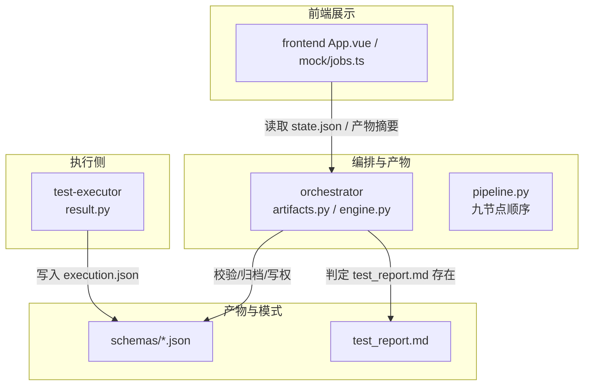
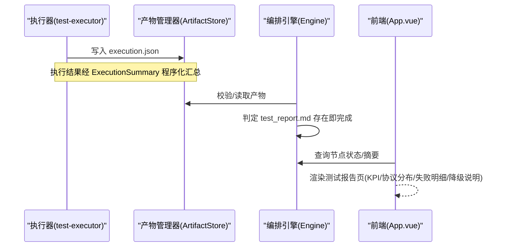
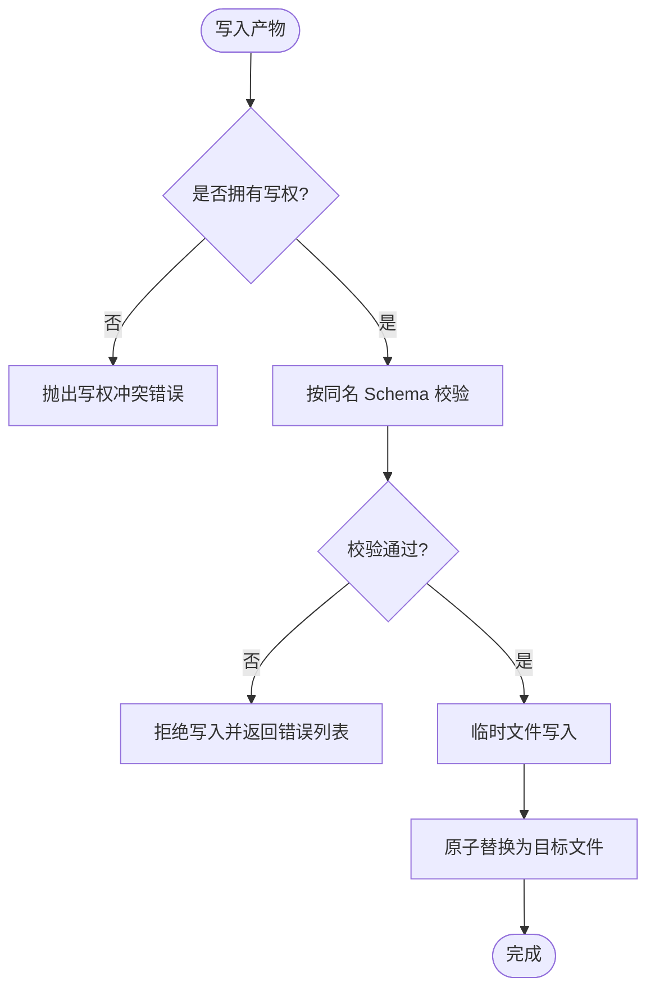
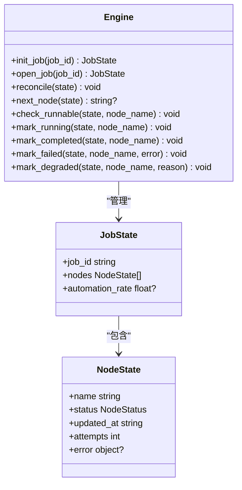
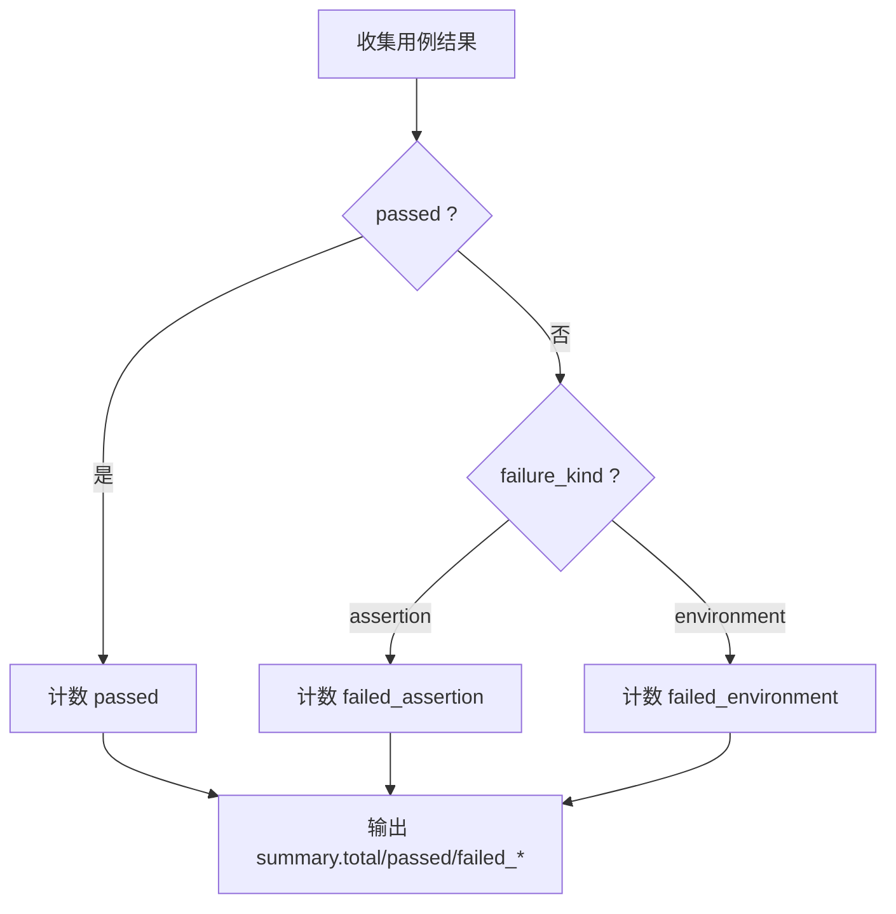
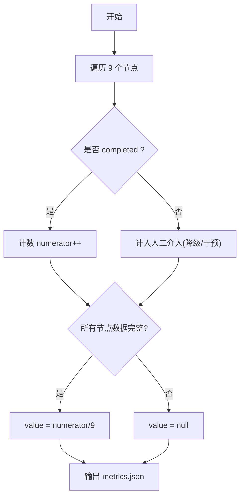
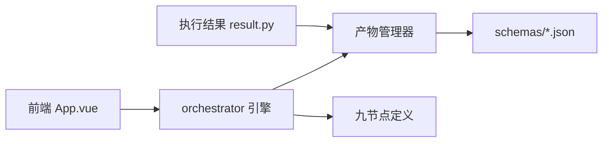

# 测试报告节点

<cite>
**本文引用的文件**
- [services/orchestrator/src/orchestrator/artifacts.py](file://services/orchestrator/src/orchestrator/artifacts.py)
- [services/orchestrator/src/orchestrator/engine.py](file://services/orchestrator/src/orchestrator/engine.py)
- [services/orchestrator/src/orchestrator/pipeline.py](file://services/orchestrator/src/orchestrator/pipeline.py)
- [services/test-executor/src/executor/result.py](file://services/test-executor/src/executor/result.py)
- [schemas/metrics.json](file://schemas/metrics.json)
- [schemas/execution.json](file://schemas/execution.json)
- [schemas/testcases.json](file://schemas/testcases.json)
- [schemas/defects.json](file://schemas/defects.json)
- [docs/04_功能规格说明.md](file://docs/04_功能规格说明.md)
- [docs/07_UI演示设计.md](file://docs/07_UI演示设计.md)
- [services/frontend/src/App.vue](file://services/frontend/src/App.vue)
- [services/frontend/src/mock/jobs.ts](file://services/frontend/src/mock/jobs.ts)
</cite>

## 目录
1. [简介](#简介)
2. [项目结构](#项目结构)
3. [核心组件](#核心组件)
4. [架构总览](#架构总览)
5. [详细组件分析](#详细组件分析)
6. [依赖关系分析](#依赖关系分析)
7. [性能与质量指标](#性能与质量指标)
8. [故障排查指南](#故障排查指南)
9. [结论](#结论)
10. [附录：数据格式与示例](#附录数据格式与示例)

## 简介
本章节聚焦“测试报告节点”的自动生成机制、结构化组织、可视化展示与导出格式，并围绕覆盖率统计、性能指标分析与质量趋势评估给出可操作的实现建议。系统以产物为唯一事实来源，通过 Schema 校验确保数据一致性；报告数值由执行结果程序化汇总，不经过 LLM，保证可审计与可复现。

## 项目结构
测试报告节点位于九节点流水线中的“自动执行”之后、“缺陷清单”之前，其完成判据为产物 test_report.md 存在且非空。编排引擎将依据产物状态推进流程，前端在“测试报告”页面呈现 KPI、协议分布、失败明细与降级说明。

图表来源
- [services/orchestrator/src/orchestrator/artifacts.py:24-50](file://services/orchestrator/src/orchestrator/artifacts.py#L24-L50)
- [services/orchestrator/src/orchestrator/engine.py:25-35](file://services/orchestrator/src/orchestrator/engine.py#L25-L35)
- [services/orchestrator/src/orchestrator/pipeline.py:23-34](file://services/orchestrator/src/orchestrator/pipeline.py#L23-L34)
- [services/test-executor/src/executor/result.py:17-61](file://services/test-executor/src/executor/result.py#L17-L61)
- [services/frontend/src/App.vue:24-41](file://services/frontend/src/App.vue#L24-L41)

章节来源
- [services/orchestrator/src/orchestrator/artifacts.py:24-50](file://services/orchestrator/src/orchestrator/artifacts.py#L24-L50)
- [services/orchestrator/src/orchestrator/engine.py:25-35](file://services/orchestrator/src/orchestrator/engine.py#L25-L35)
- [services/orchestrator/src/orchestrator/pipeline.py:23-34](file://services/orchestrator/src/orchestrator/pipeline.py#L23-L34)
- [services/frontend/src/App.vue:24-41](file://services/frontend/src/App.vue#L24-L41)

## 核心组件
- 产物管理器（ArtifactStore）：负责产物落盘、Schema 校验、写权排他、归档与“节点完成”判定。
- 编排引擎（Engine）：维护 state.json、断点续跑、跳序防护、降级处理，并以产物为准对账。
- 执行结果模型（CaseResult/ExecutionSummary）：区分断言失败与环境失败，提供程序化汇总。
- 度量模型（metrics.json）：固定 9 节点口径，计算自动化率并记录节点状态与降级原因。
- 前端展示：预留“测试报告”页，按规范展示 KPI、协议分布、失败明细与降级说明。

章节来源
- [services/orchestrator/src/orchestrator/artifacts.py:55-131](file://services/orchestrator/src/orchestrator/artifacts.py#L55-L131)
- [services/orchestrator/src/orchestrator/engine.py:133-265](file://services/orchestrator/src/orchestrator/engine.py#L133-L265)
- [services/test-executor/src/executor/result.py:17-61](file://services/test-executor/src/executor/result.py#L17-L61)
- [schemas/metrics.json:1-49](file://schemas/metrics.json#L1-L49)
- [services/frontend/src/App.vue:24-41](file://services/frontend/src/App.vue#L24-L41)

## 架构总览
测试报告节点的生成与消费链路如下：
- 自动执行节点产出 execution.json（含 results 与 summary）。
- 报告节点读取 execution.json，生成 test_report.md（Markdown 面向人工阅读），同时保留 JSON 作为下游输入。
- 编排引擎以 test_report.md 的存在性作为完成判据，推进至缺陷清单节点。
- 前端在“测试报告”页面展示 KPI、协议分布、失败明细与降级说明。

图表来源
- [services/test-executor/src/executor/result.py:32-61](file://services/test-executor/src/executor/result.py#L32-L61)
- [services/orchestrator/src/orchestrator/artifacts.py:120-131](file://services/orchestrator/src/orchestrator/artifacts.py#L120-L131)
- [services/orchestrator/src/orchestrator/engine.py:229-242](file://services/orchestrator/src/orchestrator/engine.py#L229-L242)
- [services/frontend/src/App.vue:24-41](file://services/frontend/src/App.vue#L24-L41)

## 详细组件分析

### 产物管理器（ArtifactStore）
- 职责：统一产物命名、Schema 校验、写权隔离、原子落盘、归档与完成判定。
- 关键点：
  - 产物文件名与 schemas 一一对应，禁止自造别名。
  - 写权排他：orchestrator 与 test-executor 各司其职。
  - 节点完成判据：JSON 产物需过 Schema；test_report.md 仅检查存在性与非空。

图表来源
- [services/orchestrator/src/orchestrator/artifacts.py:75-112](file://services/orchestrator/src/orchestrator/artifacts.py#L75-L112)
- [services/orchestrator/src/orchestrator/artifacts.py:144-157](file://services/orchestrator/src/orchestrator/artifacts.py#L144-L157)

章节来源
- [services/orchestrator/src/orchestrator/artifacts.py:24-50](file://services/orchestrator/src/orchestrator/artifacts.py#L24-L50)
- [services/orchestrator/src/orchestrator/artifacts.py:75-112](file://services/orchestrator/src/orchestrator/artifacts.py#L75-L112)
- [services/orchestrator/src/orchestrator/artifacts.py:120-131](file://services/orchestrator/src/orchestrator/artifacts.py#L120-L131)
- [services/orchestrator/src/orchestrator/artifacts.py:144-157](file://services/orchestrator/src/orchestrator/artifacts.py#L144-L157)

### 编排引擎（Engine）与九节点口径
- 九节点顺序固定，分母恒为 9；“已完成”的唯一判据是产物合规。
- 对账逻辑：产物在而状态未记则补齐；状态 completed 但产物失效则回退 pending。
- 降级节点标记为 manual_intervention，计入人工介入，并在 degraded 清单中记录原因。

图表来源
- [services/orchestrator/src/orchestrator/engine.py:43-131](file://services/orchestrator/src/orchestrator/engine.py#L43-L131)
- [services/orchestrator/src/orchestrator/engine.py:133-265](file://services/orchestrator/src/orchestrator/engine.py#L133-L265)
- [services/orchestrator/src/orchestrator/pipeline.py:11-34](file://services/orchestrator/src/orchestrator/pipeline.py#L11-L34)

章节来源
- [services/orchestrator/src/orchestrator/engine.py:161-194](file://services/orchestrator/src/orchestrator/engine.py#L161-L194)
- [services/orchestrator/src/orchestrator/engine.py:229-265](file://services/orchestrator/src/orchestrator/engine.py#L229-L265)
- [services/orchestrator/src/orchestrator/pipeline.py:23-34](file://services/orchestrator/src/orchestrator/pipeline.py#L23-L34)

### 执行结果与报告数值
- 执行结果区分“断言失败”与“环境失败”，后者不计入通过率分母，进入待环境确认。
- 报告数值由 execution.json 的程序化汇总字段直接读取，不经 LLM，确保一致性与可审计。

图表来源
- [services/test-executor/src/executor/result.py:17-61](file://services/test-executor/src/executor/result.py#L17-L61)
- [schemas/execution.json:32-43](file://schemas/execution.json#L32-L43)

章节来源
- [services/test-executor/src/executor/result.py:17-61](file://services/test-executor/src/executor/result.py#L17-L61)
- [schemas/execution.json:10-43](file://schemas/execution.json#L10-L43)

### 度量与自动化率
- 自动化率 = 无人工节点数 / 9（分母固定 9 不缩减）。
- 若节点数据不完整，value 可为 null，避免误导。
- 每个节点记录 name、status、degraded、degrade_reason、intervention_reason、automation_path。

图表来源
- [schemas/metrics.json:10-19](file://schemas/metrics.json#L10-L19)
- [schemas/metrics.json:21-40](file://schemas/metrics.json#L21-L40)

章节来源
- [schemas/metrics.json:1-49](file://schemas/metrics.json#L1-L49)

### 前端展示与交互
- “测试报告”页预留入口，后续对接 orchestrator REST API。
- 展示内容遵循 UI 设计：KPI、协议分布环图、失败明细（断言失败/环境失败）、降级说明章节、双产物徽标（Markdown + JSON）。

章节来源
- [services/frontend/src/App.vue:24-41](file://services/frontend/src/App.vue#L24-L41)
- [docs/07_UI演示设计.md:72-79](file://docs/07_UI演示设计.md#L72-L79)

## 依赖关系分析
- Orchestrator 依赖 ArtifactStore 进行产物读写与校验。
- Engine 依赖 pipeline 定义的九节点顺序与状态机。
- test-executor 产出 execution.json，供报告节点与度量模块消费。
- 前端依赖后端提供的状态与产物摘要进行展示。

图表来源
- [services/orchestrator/src/orchestrator/artifacts.py:24-50](file://services/orchestrator/src/orchestrator/artifacts.py#L24-L50)
- [services/orchestrator/src/orchestrator/engine.py:25-35](file://services/orchestrator/src/orchestrator/engine.py#L25-L35)
- [services/orchestrator/src/orchestrator/pipeline.py:23-34](file://services/orchestrator/src/orchestrator/pipeline.py#L23-L34)
- [services/test-executor/src/executor/result.py:17-61](file://services/test-executor/src/executor/result.py#L17-L61)
- [services/frontend/src/App.vue:24-41](file://services/frontend/src/App.vue#L24-L41)

章节来源
- [services/orchestrator/src/orchestrator/artifacts.py:24-50](file://services/orchestrator/src/orchestrator/artifacts.py#L24-L50)
- [services/orchestrator/src/orchestrator/engine.py:25-35](file://services/orchestrator/src/orchestrator/engine.py#L25-L35)
- [services/orchestrator/src/orchestrator/pipeline.py:23-34](file://services/orchestrator/src/orchestrator/pipeline.py#L23-L34)
- [services/test-executor/src/executor/result.py:17-61](file://services/test-executor/src/executor/result.py#L17-L61)
- [services/frontend/src/App.vue:24-41](file://services/frontend/src/App.vue#L24-L41)

## 性能与质量指标
- 覆盖率统计：建议在用例层引入覆盖率采集（如 pytest-cov），将覆盖率数据纳入回归沉淀与度量页面，形成趋势对比。当前仓库未包含覆盖率采集实现，可在执行阶段扩展。
- 性能指标：execution.json 已支持 duration_ms，可用于计算平均耗时、P95/P99 等性能指标，并在报告中按协议维度聚合。
- 质量趋势：结合 metrics.json 的自动化率与节点状态，构建时间序列看板，观察瓶颈节点变化与优化效果。

[本节为通用指导，无需特定文件引用]

## 故障排查指南
- 产物缺失或损坏：
  - 现象：节点无法置 completed，state.json 对账后回退 pending。
  - 排查：检查对应产物是否存在并通过 Schema 校验；查看 artifacts.validate 返回的错误列表。
- 写权冲突：
  - 现象：尝试写入不属于本服务的产物被拒绝。
  - 排查：确认服务身份（orchestrator/test-executor）与 _WRITE_OWNERS 映射。
- 全量环境失败：
  - 现象：报告标注“无可判读结果”，不输出通过率。
  - 参考：规格中对异常分支的处理约定。

章节来源
- [services/orchestrator/src/orchestrator/artifacts.py:75-112](file://services/orchestrator/src/orchestrator/artifacts.py#L75-L112)
- [services/orchestrator/src/orchestrator/artifacts.py:144-157](file://services/orchestrator/src/orchestrator/artifacts.py#L144-L157)
- [services/orchestrator/src/orchestrator/engine.py:161-179](file://services/orchestrator/src/orchestrator/engine.py#L161-L179)
- [docs/04_功能规格说明.md:228-232](file://docs/04_功能规格说明.md#L228-L232)

## 结论
测试报告节点以产物为核心，通过严格的 Schema 校验与编排对账保障数据可信；报告数值来自执行结果的程序化汇总，避免 LLM 引入的不确定性。结合 metrics.json 的自动化率与节点状态，可实现质量趋势评估与瓶颈治理。前端预留“测试报告”页，便于后续接入真实数据与可视化。

[本节为总结性内容，无需特定文件引用]

## 附录：数据格式与示例

### 输入输出数据格式
- 执行结果（execution.json）
  - 关键字段：schema_version、job_id、results（case_id、interface_id、passed、failure_kind、duration_ms、timestamp）、summary（total、passed、failed_assertion、failed_environment）、degraded_protocols。
  - 用途：报告节点读取 summary 与 results，生成 Markdown 报告与可视化数据。
- 度量（metrics.json）
  - 关键字段：schema_version、job_id、automation_rate（value、numerator、denominator=9、data_complete）、nodes（name、status、degraded、degrade_reason、intervention_reason、automation_path）、caveat、measured_at。
  - 用途：自动化率与节点级质量趋势。
- 用例元数据（testcases.json）
  - 关键字段：schema_version、job_id、cases（id、interface_id、requirement_id、category、title、expected、script_path、loadable、low_confidence）。
  - 用途：报告中的用例溯源与置信度标注。
- 缺陷记录（defects.json）
  - 关键字段：schema_version、job_id、defects（id、case_id、interface_id、failure_reason、reproduce、status、history、is_fallback）。
  - 用途：报告与缺陷闭环联动。

章节来源
- [schemas/execution.json:1-59](file://schemas/execution.json#L1-L59)
- [schemas/metrics.json:1-49](file://schemas/metrics.json#L1-L49)
- [schemas/testcases.json:1-35](file://schemas/testcases.json#L1-L35)
- [schemas/defects.json:1-54](file://schemas/defects.json#L1-L54)

### 实际报告生成示例与分析工具使用方法
- 触发方式：自动执行完成后，报告节点自动读取 execution.json 并生成 test_report.md；编排引擎以该文件存在性判定节点完成。
- 展示方式：前端“测试报告”页展示 KPI、协议分布、失败明细与降级说明；Mock 数据用于开发期展示。
- 分析工具：
  - 使用 jq 或 Python 解析 execution.json，按 protocol 维度聚合通过率与耗时。
  - 基于 metrics.json 绘制自动化率趋势图，识别瓶颈节点。
  - 结合 defects.json 与 execution.json 的 case_id 关联，定位高频失败接口。

章节来源
- [services/orchestrator/src/orchestrator/engine.py:229-242](file://services/orchestrator/src/orchestrator/engine.py#L229-L242)
- [services/frontend/src/mock/jobs.ts:1-46](file://services/frontend/src/mock/jobs.ts#L1-L46)
- [docs/07_UI演示设计.md:72-79](file://docs/07_UI演示设计.md#L72-L79)