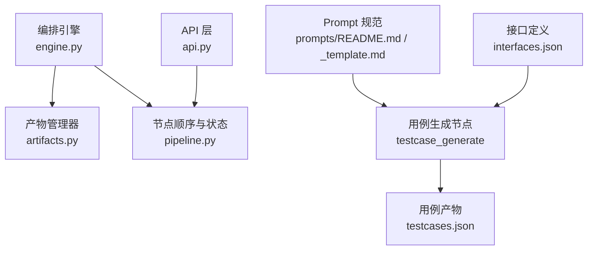
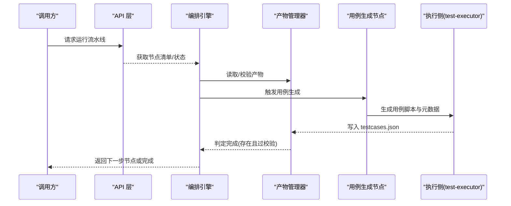
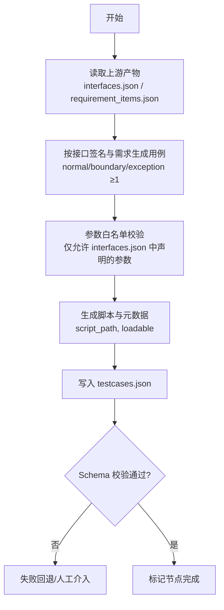
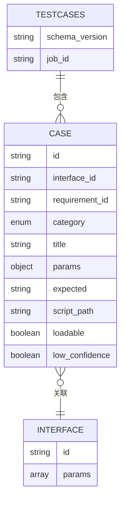
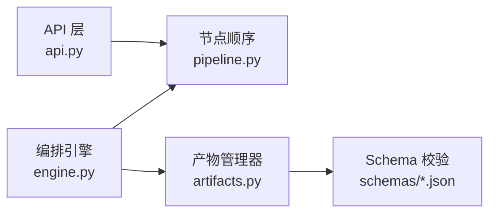

# 用例生成节点

<cite>
**本文引用的文件**
- [services/orchestrator/src/orchestrator/pipeline.py](file://services/orchestrator/src/orchestrator/pipeline.py)
- [services/orchestrator/src/orchestrator/engine.py](file://services/orchestrator/src/orchestrator/engine.py)
- [services/orchestrator/src/orchestrator/artifacts.py](file://services/orchestrator/src/orchestrator/artifacts.py)
- [services/orchestrator/src/orchestrator/api.py](file://services/orchestrator/src/orchestrator/api.py)
- [schemas/testcases.json](file://schemas/testcases.json)
- [schemas/interfaces.json](file://schemas/interfaces.json)
- [prompts/README.md](file://prompts/README.md)
- [prompts/_template.md](file://prompts/_template.md)
- [schemas/samples/execution.sample.json](file://schemas/samples/execution.sample.json)
</cite>

## 目录
1. [简介](#简介)
2. [项目结构](#项目结构)
3. [核心组件](#核心组件)
4. [架构总览](#架构总览)
5. [详细组件分析](#详细组件分析)
6. [依赖关系分析](#依赖关系分析)
7. [性能考虑](#性能考虑)
8. [故障排查指南](#故障排查指南)
9. [结论](#结论)
10. [附录](#附录)

## 简介
本章节聚焦“用例生成节点”（testcase_generate）在整体流水线中的定位、输入输出契约与质量保障机制。该节点承接上游接口还原产物，结合需求与接口定义，智能生成结构化测试用例与脚本元数据，并通过严格的 Schema 校验与编排引擎的完成判据确保产出可被下游执行环节消费。文档同时说明用例的结构化表示、参数化与数据驱动实现思路、质量评估与去重策略、模板开发与配置方法，以及执行环境适配要点。

## 项目结构
围绕用例生成节点的关键位置如下：
- 编排层：固定九节点顺序、状态机与完成判据由编排引擎管理；用例生成节点为第 5 个节点。
- 产物层：用例生成节点的产物为 testcases.json，其结构与约束由 schemas/testcases.json 定义；写方归属 test-executor 服务。
- 提示词层：LLM Prompt 统一存放于 prompts/，遵循版本化与 Schema 对齐约定。
- API 层：提供健康检查与节点清单等基础能力。

图表来源
- [services/orchestrator/src/orchestrator/engine.py:24-35](file://services/orchestrator/src/orchestrator/engine.py#L24-L35)
- [services/orchestrator/src/orchestrator/artifacts.py:24-50](file://services/orchestrator/src/orchestrator/artifacts.py#L24-L50)
- [services/orchestrator/src/orchestrator/pipeline.py:23-34](file://services/orchestrator/src/orchestrator/pipeline.py#L23-L34)
- [services/orchestrator/src/orchestrator/api.py:21-25](file://services/orchestrator/src/orchestrator/api.py#L21-L25)
- [prompts/README.md:5-14](file://prompts/README.md#L5-L14)
- [prompts/_template.md:1-22](file://prompts/_template.md#L1-L22)

章节来源
- [services/orchestrator/src/orchestrator/pipeline.py:23-34](file://services/orchestrator/src/orchestrator/pipeline.py#L23-L34)
- [services/orchestrator/src/orchestrator/engine.py:24-35](file://services/orchestrator/src/orchestrator/engine.py#L24-L35)
- [services/orchestrator/src/orchestrator/artifacts.py:24-50](file://services/orchestrator/src/orchestrator/artifacts.py#L24-L50)
- [services/orchestrator/src/orchestrator/api.py:21-25](file://services/orchestrator/src/orchestrator/api.py#L21-L25)
- [prompts/README.md:5-14](file://prompts/README.md#L5-L14)
- [prompts/_template.md:1-22](file://prompts/_template.md#L1-L22)

## 核心组件
- 编排引擎（Engine）：维护 job 状态、节点顺序、跳序防护、降级与断点续跑；用例生成节点完成后需满足产物存在且通过校验。
- 产物管理器（ArtifactStore）：负责产物目录、Schema 校验、写权排他与完成判据；testcases.json 的写方为 test-executor。
- 节点顺序（PipelineState/NODE_ORDER）：固定 9 节点顺序，用例生成节点位于 code_review 之后、auto_execute 之前。
- 用例 Schema（testcases.json）：定义用例元数据结构、必填字段、枚举值与溯源要求。
- 接口 Schema（interfaces.json）：用例参数必须来源于此，禁止出现清单外参数。
- Prompt 体系：所有 LLM 提示词版本化管理，输出必须通过对应 Schema 校验。

章节来源
- [services/orchestrator/src/orchestrator/engine.py:24-35](file://services/orchestrator/src/orchestrator/engine.py#L24-L35)
- [services/orchestrator/src/orchestrator/artifacts.py:24-50](file://services/orchestrator/src/orchestrator/artifacts.py#L24-L50)
- [services/orchestrator/src/orchestrator/pipeline.py:23-34](file://services/orchestrator/src/orchestrator/pipeline.py#L23-L34)
- [schemas/testcases.json:1-35](file://schemas/testcases.json#L1-L35)
- [schemas/interfaces.json:1-70](file://schemas/interfaces.json#L1-L70)
- [prompts/README.md:5-14](file://prompts/README.md#L5-L14)
- [prompts/_template.md:15-17](file://prompts/_template.md#L15-L17)

## 架构总览
用例生成节点处于“需求解析 → 代码扫描 → 接口还原 → 代码评审 → 用例生成 → 自动执行 → 报告 → 缺陷 → 回归复测”的固定流程中。用例生成阶段以接口定义为权威输入，结合需求条目与评审映射，生成用例元数据与脚本路径，并写入 testcases.json。编排引擎依据产物完成判据推进到下一节点。

图表来源
- [services/orchestrator/src/orchestrator/pipeline.py:23-34](file://services/orchestrator/src/orchestrator/pipeline.py#L23-L34)
- [services/orchestrator/src/orchestrator/engine.py:161-179](file://services/orchestrator/src/orchestrator/engine.py#L161-L179)
- [services/orchestrator/src/orchestrator/artifacts.py:75-96](file://services/orchestrator/src/orchestrator/artifacts.py#L75-L96)
- [services/orchestrator/src/orchestrator/artifacts.py:120-131](file://services/orchestrator/src/orchestrator/artifacts.py#L120-L131)

## 详细组件分析

### 用例生成节点（testcase_generate）
- 职责：基于需求条目与接口定义，生成覆盖正常、边界、异常三类场景的用例，并输出结构化元数据与脚本路径。
- 输入：
  - 接口清单 interfaces.json（作为参数白名单与签名来源）
  - 需求条目 requirement_items.json（来自 req_parse 节点）
  - 代码评审映射 review_mapping.json（可选，用于增强覆盖）
- 输出：testcases.json（由 test-executor 写入）
- 完成判据：testcases.json 存在且通过 Schema 校验

图表来源
- [schemas/testcases.json:10-32](file://schemas/testcases.json#L10-L32)
- [schemas/interfaces.json:30-44](file://schemas/interfaces.json#L30-L44)
- [services/orchestrator/src/orchestrator/artifacts.py:75-96](file://services/orchestrator/src/orchestrator/artifacts.py#L75-L96)
- [services/orchestrator/src/orchestrator/artifacts.py:120-131](file://services/orchestrator/src/orchestrator/artifacts.py#L120-L131)

章节来源
- [schemas/testcases.json:10-32](file://schemas/testcases.json#L10-L32)
- [schemas/interfaces.json:30-44](file://schemas/interfaces.json#L30-L44)
- [services/orchestrator/src/orchestrator/artifacts.py:75-96](file://services/orchestrator/src/orchestrator/artifacts.py#L75-L96)
- [services/orchestrator/src/orchestrator/artifacts.py:120-131](file://services/orchestrator/src/orchestrator/artifacts.py#L120-L131)

### 用例结构化表示（testcases.json）
- 顶层字段：schema_version、job_id、cases
- 用例对象关键字段：
  - id：用例编号（TC-xxx）
  - interface_id：关联接口（IF-XXX-xxx），支持溯源
  - requirement_id：需求溯源（REQ-xxx，可携带）
  - category：normal/boundary/exception（每接口三类各≥1）
  - title：用例标题
  - params：参数对象，仅允许 interfaces.json 中声明的参数名与结构
  - expected：预期结果描述（断言依据）
  - script_path：生成的 pytest 脚本相对路径
  - loadable：py_compile + 收集零 error 的校验结果
  - low_confidence：unknown 参数用例低置信度标注

图表来源
- [schemas/testcases.json:1-35](file://schemas/testcases.json#L1-L35)
- [schemas/interfaces.json:10-67](file://schemas/interfaces.json#L10-L67)

章节来源
- [schemas/testcases.json:1-35](file://schemas/testcases.json#L1-L35)
- [schemas/interfaces.json:10-67](file://schemas/interfaces.json#L10-L67)

### 参数化测试与数据驱动测试
- 参数来源：严格取自 interfaces.json 的 params 列表，禁止引入未声明参数。
- 参数化方式：
  - 将每个用例的 params 作为数据驱动输入，供执行侧以参数化框架（如 pytest 参数化）加载。
  - 对 boundary/exception 类别构造边界值与异常分支数据。
- 校验策略：
  - 生成阶段进行参数白名单校验，超纲参数直接打回。
  - 执行阶段结合 execution.json 的结果反哺用例质量。

章节来源
- [schemas/interfaces.json:30-44](file://schemas/interfaces.json#L30-L44)
- [schemas/testcases.json:21-25](file://schemas/testcases.json#L21-L25)

### 用例质量评估、去重与优化
- 质量评估：
  - loadable：脚本编译与收集零错误。
  - category 覆盖率：每个接口至少包含 normal、boundary、exception 三类用例。
  - expected 可读性：断言依据清晰可验证。
  - low_confidence：对 unknown 参数用例标注低置信度，便于后续人工复核。
- 去重机制：
  - 基于 id、interface_id、category、title 的组合键去重，避免重复生成。
  - 对 params 相近的用例进行语义合并（保留差异点）。
- 优化策略：
  - 优先保证关键路径与高风险接口的覆盖密度。
  - 对执行失败的用例进行根因分类（assertion/environment），针对性优化。

章节来源
- [schemas/testcases.json:14-30](file://schemas/testcases.json#L14-L30)
- [schemas/samples/execution.sample.json:5-62](file://schemas/samples/execution.sample.json#L5-L62)

### 自定义用例模板开发
- Prompt 管理：
  - 所有 Prompt 存放在 prompts/ 目录，采用版本化命名与头部元信息块。
  - 输出格式必须与 schemas/ 下的 JSON Schema 一致，校验失败按节点失败处理。
- 模板要点：
  - 明确输出字段、枚举值、正则约束与溯源要求。
  - 指定采样参数建议（temperature/top_p/seed），实际值以配置为准。
  - 禁止在代码中内联 Prompt 字符串。

章节来源
- [prompts/README.md:5-14](file://prompts/README.md#L5-L14)
- [prompts/_template.md:1-22](file://prompts/_template.md#L1-L22)

### 生成策略配置
- 策略维度：
  - 覆盖策略：normal/boundary/exception 三类均衡覆盖。
  - 参数策略：严格使用 interfaces.json 声明的参数集合。
  - 置信度策略：unknown 参数用例标注 low_confidence。
  - 脚本策略：确保 loadable 为真（编译与收集无错误）。
- 配置位置：
  - Prompt 头部 sampling 字段提供建议值。
  - 编排与产物规则由 engine.py 与 artifacts.py 强制约束。

章节来源
- [prompts/_template.md:9-12](file://prompts/_template.md#L9-L12)
- [services/orchestrator/src/orchestrator/engine.py:24-35](file://services/orchestrator/src/orchestrator/engine.py#L24-L35)
- [services/orchestrator/src/orchestrator/artifacts.py:75-96](file://services/orchestrator/src/orchestrator/artifacts.py#L75-L96)

### 执行环境适配
- 产物写权：testcases.json 由 test-executor 写入，orchestrator 仅做校验与状态推进。
- 目录布局：job 目录下 scripts/fixtures/logs/archive 子目录由产物管理器创建。
- 完成判据：testcases.json 存在且通过 Schema 校验即视为完成。

章节来源
- [services/orchestrator/src/orchestrator/artifacts.py:24-50](file://services/orchestrator/src/orchestrator/artifacts.py#L24-L50)
- [services/orchestrator/src/orchestrator/artifacts.py:64-69](file://services/orchestrator/src/orchestrator/artifacts.py#L64-L69)
- [services/orchestrator/src/orchestrator/artifacts.py:120-131](file://services/orchestrator/src/orchestrator/artifacts.py#L120-L131)

## 依赖关系分析
- 编排引擎依赖节点顺序与产物清单，用例生成节点依赖 upstream 产物（interfaces.json、requirement_items.json、review_mapping.json）。
- 产物管理器负责 Schema 校验与写权控制，确保用例产物的合规性与一致性。
- API 层暴露节点清单与健康检查，便于外部系统观测流水线状态。

图表来源
- [services/orchestrator/src/orchestrator/engine.py:24-35](file://services/orchestrator/src/orchestrator/engine.py#L24-L35)
- [services/orchestrator/src/orchestrator/pipeline.py:23-34](file://services/orchestrator/src/orchestrator/pipeline.py#L23-L34)
- [services/orchestrator/src/orchestrator/artifacts.py:75-112](file://services/orchestrator/src/orchestrator/artifacts.py#L75-L112)
- [services/orchestrator/src/orchestrator/api.py:21-25](file://services/orchestrator/src/orchestrator/api.py#L21-L25)

章节来源
- [services/orchestrator/src/orchestrator/engine.py:24-35](file://services/orchestrator/src/orchestrator/engine.py#L24-L35)
- [services/orchestrator/src/orchestrator/pipeline.py:23-34](file://services/orchestrator/src/orchestrator/pipeline.py#L23-L34)
- [services/orchestrator/src/orchestrator/artifacts.py:75-112](file://services/orchestrator/src/orchestrator/artifacts.py#L75-L112)
- [services/orchestrator/src/orchestrator/api.py:21-25](file://services/orchestrator/src/orchestrator/api.py#L21-L25)

## 性能考虑
- 批量生成：对多接口并行生成用例，减少端到端耗时。
- 增量更新：当接口变更时，仅对受影响接口重新生成用例，降低计算开销。
- 缓存策略：对已生成的用例元数据进行哈希缓存，避免重复生成。
- 资源隔离：用例脚本与 fixtures 分目录管理，避免 IO 竞争。

[本节为通用指导，不直接分析具体文件]

## 故障排查指南
- 常见错误：
  - 产物缺失或不合规：编排引擎在对账时将节点状态回退为待运行，并记录错误。
  - 参数越界：params 中出现 interfaces.json 未声明的参数，导致用例被打回。
  - 脚本不可加载：loadable 为 false，需修复脚本语法或依赖问题。
  - 低置信度用例：low_confidence 为 true 的用例需人工复核。
- 排查步骤：
  - 检查 testcases.json 是否通过 Schema 校验。
  - 核对 params 是否与 interfaces.json 一致。
  - 查看 execution.json 中的 failure_kind 与 failure_reason，定位环境问题或断言失败。
  - 确认 prompt 输出是否符合 schemas/ 约束。

章节来源
- [services/orchestrator/src/orchestrator/engine.py:161-179](file://services/orchestrator/src/orchestrator/engine.py#L161-L179)
- [schemas/testcases.json:21-30](file://schemas/testcases.json#L21-L30)
- [schemas/interfaces.json:30-44](file://schemas/interfaces.json#L30-L44)
- [schemas/samples/execution.sample.json:5-62](file://schemas/samples/execution.sample.json#L5-L62)

## 结论
用例生成节点通过严格的 Schema 约束、参数白名单校验与编排引擎的完成判据，确保了用例产物的规范性与可执行性。结合需求与接口定义，节点实现了三类场景的均衡覆盖，并通过低置信度标注与执行结果反馈持续优化用例质量。Prompt 的版本化与模板化使得用例生成策略可配置、可演进，适应不同项目与环境的需求。

[本节为总结性内容，不直接分析具体文件]

## 附录
- 用例生成示例：
  - 输入：interfaces.json 中的 REST 接口签名与参数定义。
  - 处理：生成 normal/boundary/exception 三类用例，构造边界值与异常数据。
  - 输出：testcases.json 中包含用例元数据与脚本路径，并由 test-executor 写入。
- 质量验证方法：
  - 使用 Schema 校验工具验证 testcases.json。
  - 执行 py_compile 与 pytest 收集，确保 loadable 为真。
  - 分析 execution.json 中的通过率与失败原因，针对性优化用例。

章节来源
- [schemas/testcases.json:1-35](file://schemas/testcases.json#L1-L35)
- [schemas/interfaces.json:10-67](file://schemas/interfaces.json#L10-L67)
- [schemas/samples/execution.sample.json:5-62](file://schemas/samples/execution.sample.json#L5-L62)