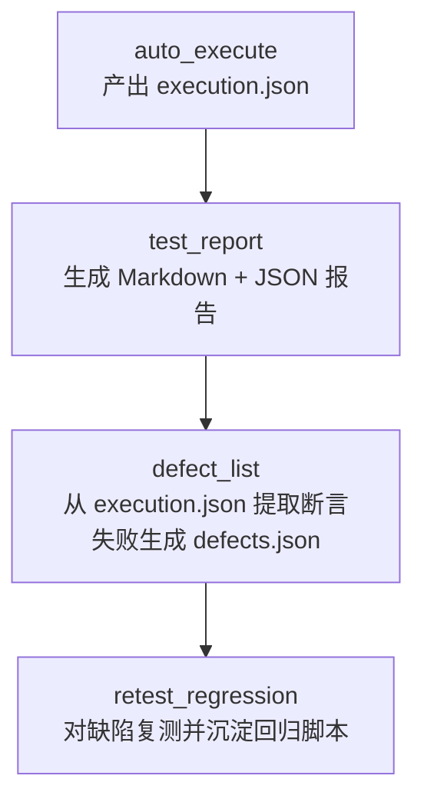
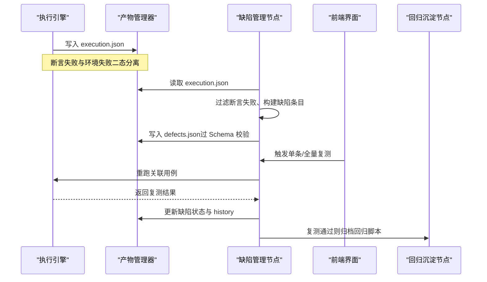
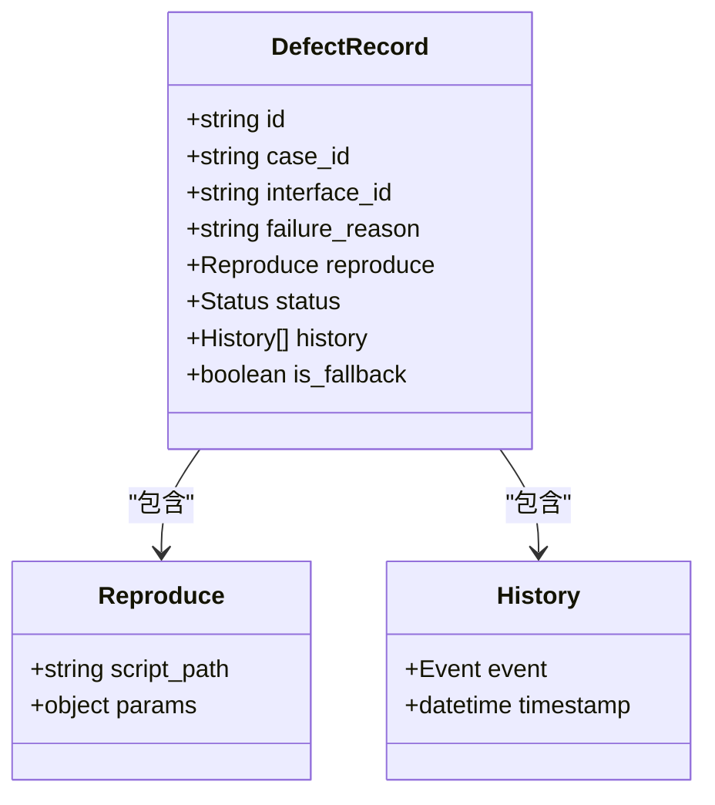
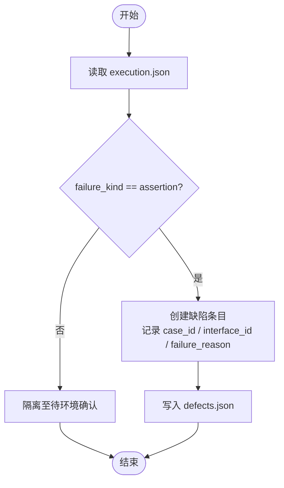
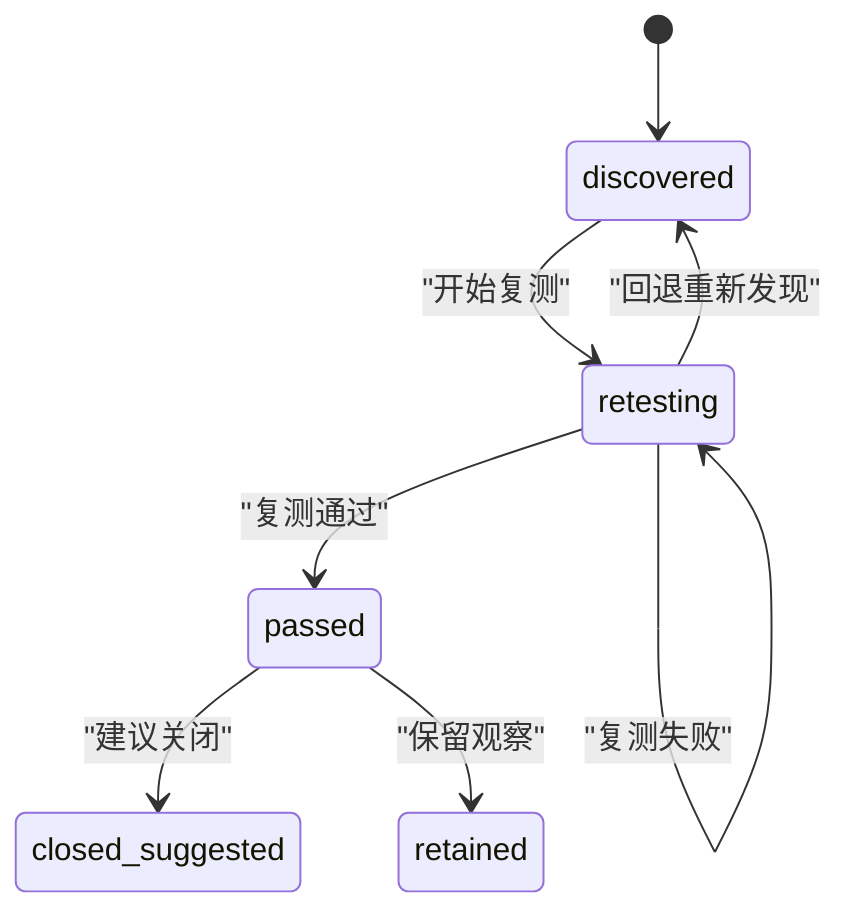
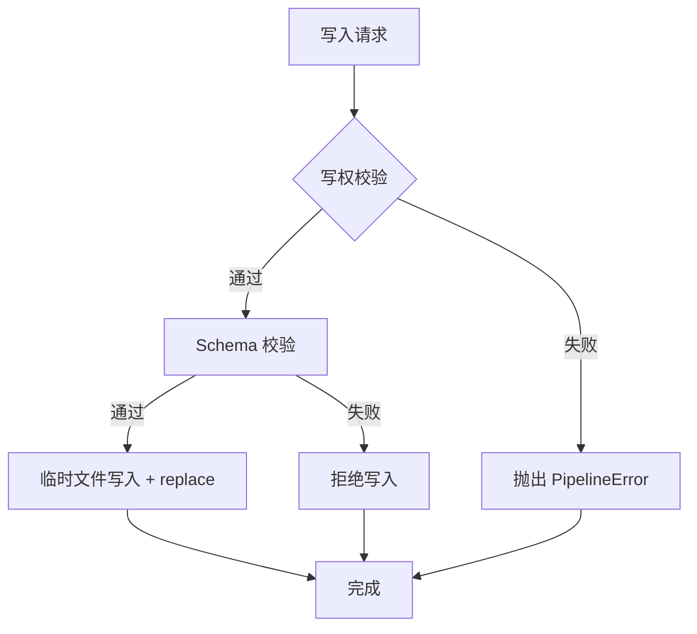
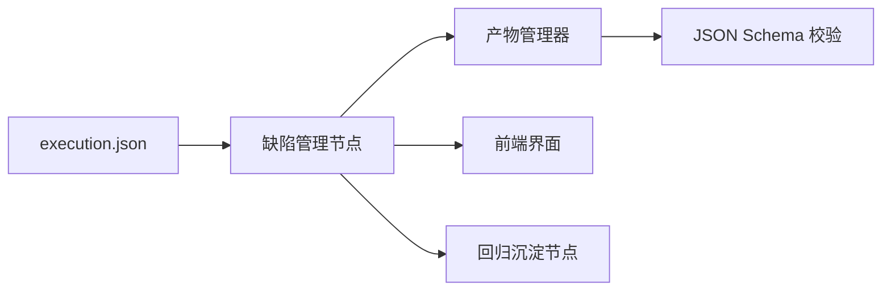

# 缺陷管理节点

<cite>
**本文引用的文件**
- [defects.json](file://schemas/defects.json)
- [execution.json](file://schemas/execution.json)
- [execution.sample.json](file://schemas/samples/execution.sample.json)
- [artifacts.py](file://services/orchestrator/src/orchestrator/artifacts.py)
- [result.py](file://services/test-executor/src/executor/result.py)
- [04_功能规格说明.md](file://docs/04_功能规格说明.md)
- [07_UI演示设计.md](file://docs/07_UI演示设计.md)
- [12_开发设计说明.md](file://docs/12_开发设计说明.md)
</cite>

## 目录
1. [简介](#简介)
2. [项目结构](#项目结构)
3. [核心组件](#核心组件)
4. [架构总览](#架构总览)
5. [详细组件分析](#详细组件分析)
6. [依赖关系分析](#依赖关系分析)
7. [性能与可靠性](#性能与可靠性)
8. [故障排查指南](#故障排查指南)
9. [结论](#结论)
10. [附录：数据模型与示例](#附录数据模型与示例)

## 简介
本章节面向“缺陷管理节点（模块 8 DEF）”，围绕缺陷的自动发现、分类、跟踪与闭环进行系统化说明。重点包括：
- 缺陷来源与过滤：仅断言失败进入缺陷清单，环境失败隔离至待环境确认。
- 标准化记录格式：基于 JSON Schema 的 defects.json，包含 ID、用例关联、接口关联、失败原因、复现步骤、状态与可审计历史。
- 状态流转与生命周期：发现 → 复测中 → 复测通过 → 关闭建议/保留，全程时间戳可审计。
- 外部系统集成：当前口径为本地文件（非 Jira），但提供可扩展的数据契约以便后续对接。
- 输入输出：以 execution.json 为上游输入，产出 defects.json；支持单条或全量复测命令。
- 统计分析与趋势：基于执行结果与缺陷清单的结构化汇总，便于看板展示与趋势观察。
- 修复建议与回归沉淀：结合复测通过用例归档至回归目录，形成持续回归资产。

## 项目结构
缺陷管理节点位于流水线第 8 个固定节点，前后衔接测试报告与回归沉淀。其关键位置与职责如下：
- 上游产物：execution.json（执行结果，含断言失败与环境失败二态）。
- 下游产物：defects.json（缺陷清单）、regression_index.json（回归索引，由后续节点使用）。
- 编排约束：节点完成判据为 artifacts 存在且通过 Schema 校验；降级与人工介入按统一口径处理。

图表来源
- [12_开发设计说明.md:17-27](file://docs/12_开发设计说明.md#L17-L27)
- [04_功能规格说明.md:235-251](file://docs/04_功能规格说明.md#L235-L251)

章节来源
- [12_开发设计说明.md:17-27](file://docs/12_开发设计说明.md#L17-L27)
- [04_功能规格说明.md:235-251](file://docs/04_功能规格说明.md#L235-L251)

## 核心组件
- 执行结果二态分离：将失败区分为“断言失败”和“环境失败”，前者进入缺陷清单，后者隔离至待环境确认。
- 产物管理器：负责缺陷清单的写入、Schema 校验与写权控制（test-executor 专属写权限）。
- 缺陷数据模型：基于 JSON Schema 定义，强制字段、ID 命名规范、状态枚举与历史记录。
- 复测与闭环：支持单条/全量复测，更新缺陷状态并记录时间戳，最终沉淀回归资产。

章节来源
- [result.py:10-61](file://services/test-executor/src/executor/result.py#L10-L61)
- [artifacts.py:38-50](file://services/orchestrator/src/orchestrator/artifacts.py#L38-L50)
- [defects.json:1-54](file://schemas/defects.json#L1-L54)
- [04_功能规格说明.md:235-251](file://docs/04_功能规格说明.md#L235-L251)

## 架构总览
缺陷管理节点在流水线中的角色与交互如下：
- 输入：execution.json（来自 auto_execute 节点），包含每条用例的执行结果与失败类型。
- 处理：
  - 过滤：仅取 failure_kind=assertion 的用例作为缺陷候选。
  - 映射：根据 case_id 与 interface_id 建立用例到接口的双向关联。
  - 记录：生成标准化的缺陷条目，包含复现步骤（script_path）与初始状态 discovered。
  - 历史：每次状态变更追加 history 事件与 UTC 时间戳。
- 输出：defects.json（供 UI 展示与后续复测使用）。
- 集成点：UI 提供“单条复测”和“一键复测全量”入口；复测后由 retest_regression 节点归档通过用例。

图表来源
- [execution.json:1-27](file://schemas/execution.json#L1-L27)
- [execution.sample.json:1-63](file://schemas/samples/execution.sample.json#L1-L63)
- [defects.json:1-54](file://schemas/defects.json#L1-L54)
- [artifacts.py:75-131](file://services/orchestrator/src/orchestrator/artifacts.py#L75-L131)
- [04_功能规格说明.md:235-251](file://docs/04_功能规格说明.md#L235-L251)

## 详细组件分析

### 缺陷数据模型（defects.json）
- 顶层字段：schema_version、job_id、defects 数组。
- 缺陷条目必填字段：id、case_id、interface_id、failure_reason、reproduce、status、history、is_fallback。
- 关键字段说明：
  - id：缺陷唯一标识，遵循 DEF-xxx 命名规范。
  - case_id：与用例 ID 双向关联，用于复测定位。
  - interface_id：关联接口，便于影响范围分析。
  - reproduce：复现步骤，必须包含 script_path，可选 params。
  - status：状态枚举，discovered → retesting → passed → closed_suggested/retained。
  - history：可审计事件列表，每个事件包含 event 与 timestamp（UTC ISO-8601）。
  - is_fallback：兜底标记透传，用于演示分支埋入缺陷场景。

图表来源
- [defects.json:10-51](file://schemas/defects.json#L10-L51)

章节来源
- [defects.json:1-54](file://schemas/defects.json#L1-L54)

### 执行结果与缺陷过滤（execution.json）
- 执行结果包含 results 数组与 summary 汇总。
- 失败类型二态：
  - assertion：断言失败，计入通过率分母，进入缺陷清单。
  - environment：环境失败，隔离至待环境确认，不计入缺陷清单。
- 汇总字段：total、passed、failed_assertion、failed_environment，以及降级协议说明。

图表来源
- [execution.json:10-27](file://schemas/execution.json#L10-L27)
- [execution.sample.json:13-31](file://schemas/samples/execution.sample.json#L13-L31)
- [result.py:10-61](file://services/test-executor/src/executor/result.py#L10-L61)

章节来源
- [execution.json:1-27](file://schemas/execution.json#L1-L27)
- [execution.sample.json:1-63](file://schemas/samples/execution.sample.json#L1-L63)
- [result.py:10-61](file://services/test-executor/src/executor/result.py#L10-L61)

### 状态流转与生命周期
- 初始状态：discovered（发现）。
- 复测流程：retesting（复测中）→ passed（复测通过）→ closed_suggested（关闭建议）或 retained（保留）。
- 可审计历史：每次状态变更追加 history 事件，包含事件类型与 UTC 时间戳。
- 边界条件：
  - X-DEF-01：复测时代码已变更，标注 based_on_new_version。
  - X-DEF-02：用例脚本缺失或修改，跳过该项并报错。
  - X-DEF-03：演示缺陷由独立分支埋入，is_fallback 透传。

图表来源
- [defects.json:30-48](file://schemas/defects.json#L30-L48)
- [04_功能规格说明.md:253-257](file://docs/04_功能规格说明.md#L253-L257)

章节来源
- [defects.json:30-48](file://schemas/defects.json#L30-L48)
- [04_功能规格说明.md:253-257](file://docs/04_功能规格说明.md#L253-L257)

### 产物管理与写权控制
- 写权排他：defects.json 由 test-executor 写入，orchestrator 无权覆盖。
- 原子落盘：先写临时文件再替换，避免部分写入导致的不一致。
- Schema 校验：写入前强制校验，不合规产物直接拒绝。
- 节点完成判据：产物存在且通过 Schema 校验即视为 completed。

图表来源
- [artifacts.py:75-131](file://services/orchestrator/src/orchestrator/artifacts.py#L75-L131)

章节来源
- [artifacts.py:75-131](file://services/orchestrator/src/orchestrator/artifacts.py#L75-L131)

### 复测与回归沉淀
- 复测入口：支持单条缺陷复测与全量缺陷一键复测。
- 复测逻辑：根据 case_id 重跑关联用例，更新缺陷状态与 history。
- 回归沉淀：复测通过的用例脚本移动至回归目录，按协议维度组织，携带需求与接口溯源信息。
- 幂等性：同一用例重复通过复测不产生重复文件。

章节来源
- [04_功能规格说明.md:261-285](file://docs/04_功能规格说明.md#L261-L285)
- [07_UI演示设计.md:81-87](file://docs/07_UI演示设计.md#L81-L87)

## 依赖关系分析
- 上游依赖：execution.json（执行结果），用于缺陷发现与过滤。
- 内部依赖：result.py（失败二态判定）、artifacts.py（产物写入与校验）。
- 下游依赖：regression_index.json（回归索引），由 retest_regression 节点消费。
- 外部集成：当前为本地文件存储，未对接 Jira；可通过扩展 defects.json 与 API 层实现后续集成。

图表来源
- [execution.json:1-27](file://schemas/execution.json#L1-L27)
- [defects.json:1-54](file://schemas/defects.json#L1-L54)
- [artifacts.py:38-50](file://services/orchestrator/src/orchestrator/artifacts.py#L38-L50)

章节来源
- [execution.json:1-27](file://schemas/execution.json#L1-L27)
- [defects.json:1-54](file://schemas/defects.json#L1-L54)
- [artifacts.py:38-50](file://services/orchestrator/src/orchestrator/artifacts.py#L38-L50)

## 性能与可靠性
- 性能特性：
  - 批量处理：缺陷清单生成基于 execution.json 的批量扫描，时间复杂度 O(n)。
  - 原子写入：避免并发写入冲突，提升可靠性。
  - Schema 校验：前置校验减少无效数据传播。
- 可靠性保障：
  - 失败隔离：环境失败不入缺陷清单，避免误报。
  - 可审计历史：每次状态变更记录时间戳，便于回溯。
  - 降级策略：节点降级按人工介入计入，不阻塞下游。

[本节为通用指导，无需特定文件引用]

## 故障排查指南
- 常见问题：
  - 产物校验失败：检查 defects.json 是否符合 Schema 定义，重点关注必填字段与枚举值。
  - 写权冲突：确认写入服务是否为 test-executor。
  - 复测失败：检查用例脚本是否存在、参数是否完整。
- 排查步骤：
  - 查看 execution.json 中的 failure_kind，确认是否为 assertion。
  - 检查 defects.json 中的 history 字段，定位状态变更时间点。
  - 核对 artifact 路径与权限，确保产物目录存在且可写。

章节来源
- [artifacts.py:75-131](file://services/orchestrator/src/orchestrator/artifacts.py#L75-L131)
- [execution.json:10-27](file://schemas/execution.json#L10-L27)
- [defects.json:30-48](file://schemas/defects.json#L30-L48)

## 结论
缺陷管理节点通过结构化数据模型与严格的状态机，实现了从缺陷发现、分类、跟踪到闭环的全流程自动化。其核心价值在于：
- 明确区分断言失败与环境失败，提高缺陷质量。
- 标准化缺陷记录格式，便于跨系统对接与分析。
- 可审计的生命周期管理，支持问题回溯与趋势分析。
- 与回归沉淀联动，形成持续改进闭环。

[本节为总结性内容，无需特定文件引用]

## 附录：数据模型与示例
- defects.json 结构定义：参考 schemas/defects.json。
- execution.json 示例：参考 schemas/samples/execution.sample.json。
- 字段说明：
  - schema_version：数据模型版本。
  - job_id：任务标识，遵循 job-xxx 格式。
  - defects：缺陷数组，每项包含完整缺陷信息。
  - history：事件历史，记录状态变更时间与类型。

章节来源
- [defects.json:1-54](file://schemas/defects.json#L1-L54)
- [execution.sample.json:1-63](file://schemas/samples/execution.sample.json#L1-L63)