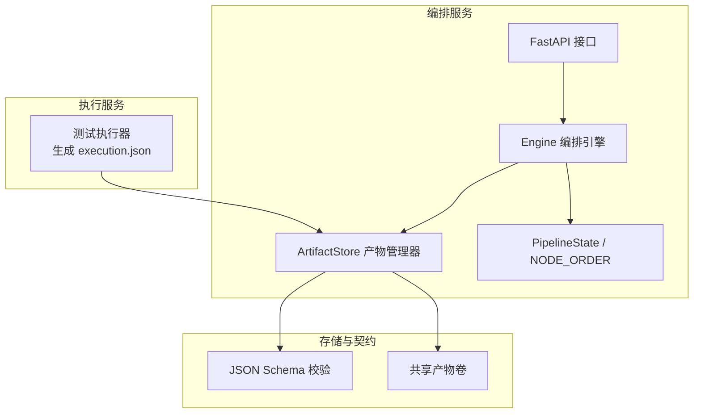
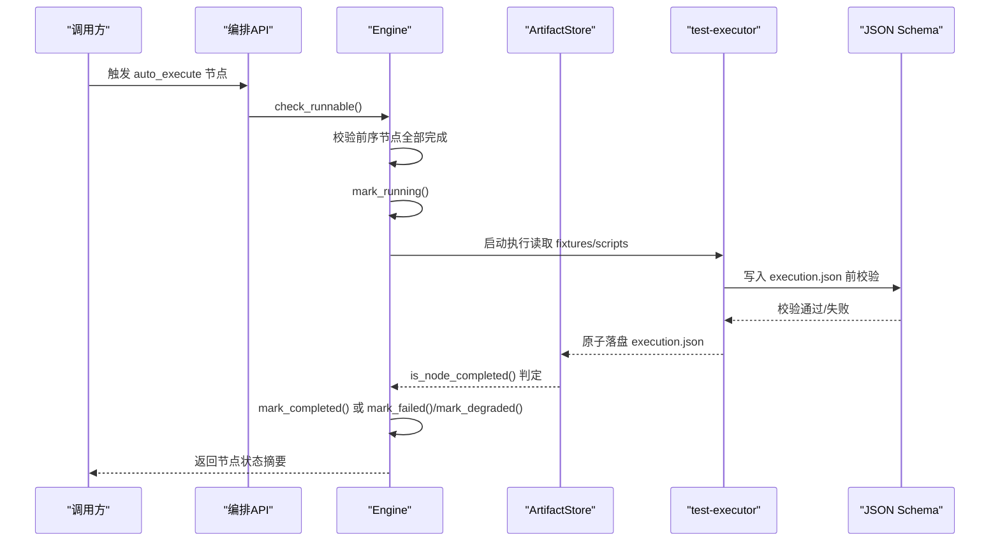
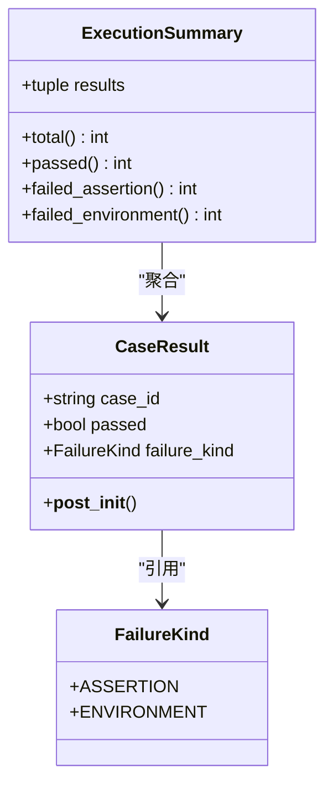
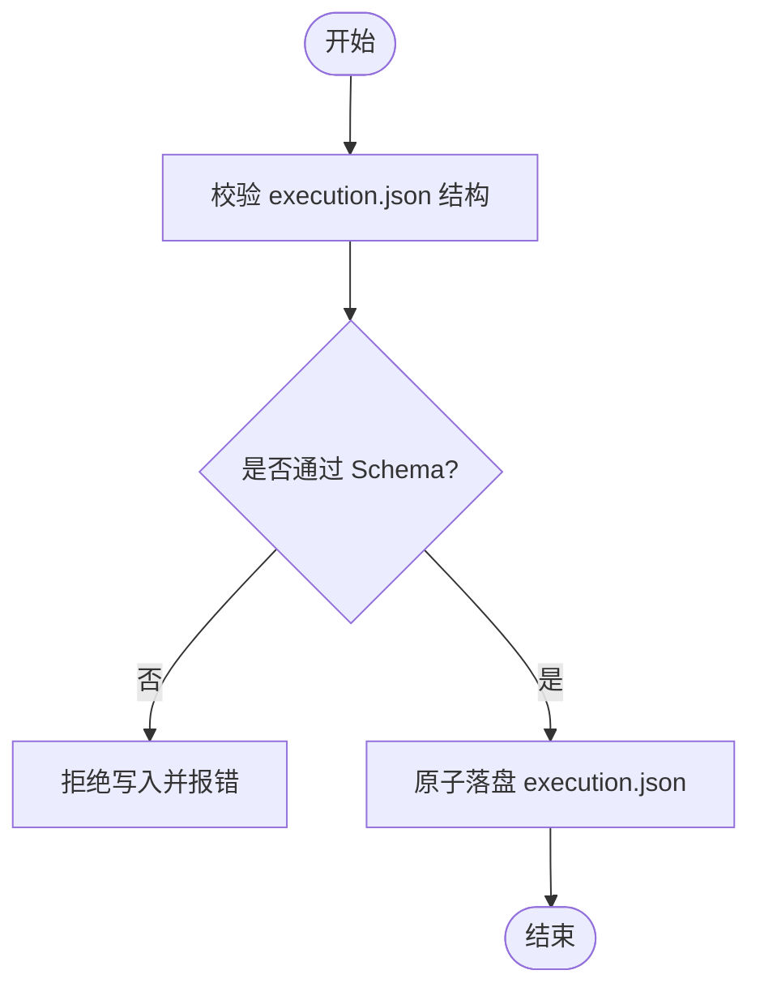
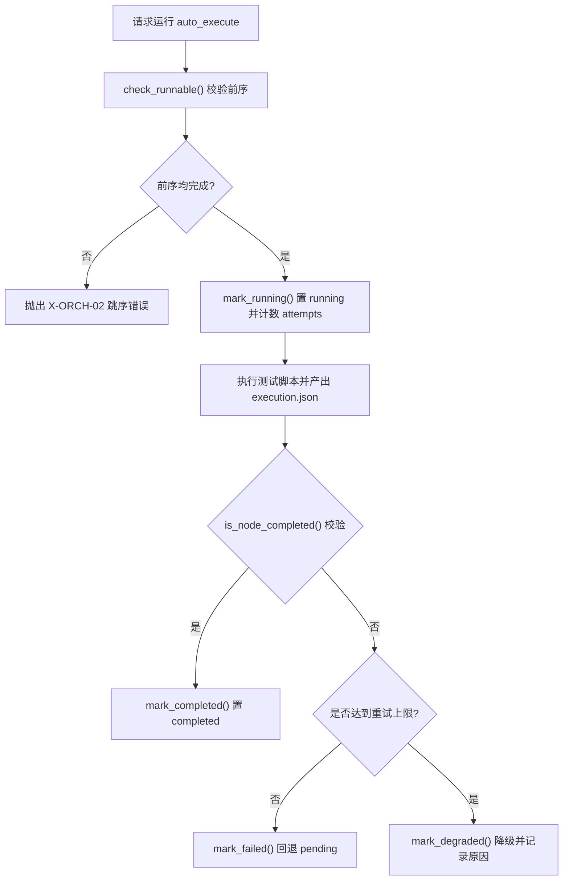
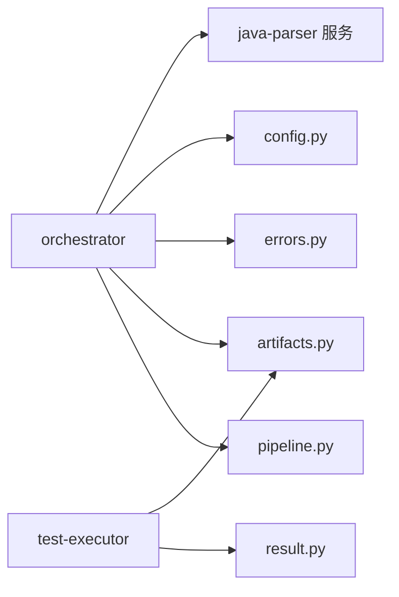

# 自动执行节点

<cite>
**本文引用的文件**
- [execution.json](file://schemas/execution.json)
- [result.py](file://services/test-executor/src/executor/result.py)
- [engine.py](file://services/orchestrator/src/orchestrator/engine.py)
- [pipeline.py](file://services/orchestrator/src/orchestrator/pipeline.py)
- [artifacts.py](file://services/orchestrator/src/orchestrator/artifacts.py)
- [config.py](file://services/orchestrator/src/orchestrator/config.py)
- [api.py](file://services/orchestrator/src/orchestrator/api.py)
- [errors.py](file://services/orchestrator/src/orchestrator/errors.py)
- [__init__.py（nodes）](file://services/orchestrator/src/orchestrator/nodes/__init__.py)
- [code_scan.py](file://services/orchestrator/src/orchestrator/nodes/code_scan.py)
- [req_parse.py](file://services/orchestrator/src/orchestrator/nodes/req_parse.py)
- [execution.sample.json](file://schemas/samples/execution.sample.json)
- [test_result.py](file://services/test-executor/tests/test_result.py)
- [ci.yml](file://.github/workflows/ci.yml)
- [docker-compose.yml](file://deploy/docker-compose.yml)
</cite>

## 目录
1. [简介](#简介)
2. [项目结构](#项目结构)
3. [核心组件](#核心组件)
4. [架构总览](#架构总览)
5. [详细组件分析](#详细组件分析)
6. [依赖关系分析](#依赖关系分析)
7. [性能与可扩展性](#性能与可扩展性)
8. [故障排查指南](#故障排查指南)
9. [结论](#结论)
10. [附录：配置与数据格式示例](#附录配置与数据格式示例)

## 简介
本文件围绕“自动执行节点”（流水线第 6 节点 auto_execute）构建系统化文档，聚焦测试脚本的自动化执行引擎、并行执行策略、资源调度、失败重试与环境隔离、依赖管理、日志收集、结果结构化记录、指标采集与性能分析、输入输出数据格式（特别是 execution.json 与 result.py 的数据模型）、执行监控与进度跟踪、异常处理策略，以及可操作的配置示例与故障排查指引。

该节点由 orchestrator 编排，test-executor 负责实际执行；两者通过共享产物卷与 JSON Schema 契约协作，确保产物唯一事实来源与强一致性校验。

## 项目结构
- 编排服务 orchestrator：提供流水线状态机、产物读写、Schema 校验、节点完成判据、降级与断点续跑能力。
- 执行服务 test-executor：加载并运行测试脚本，产出 execution.json 等执行侧产物。
- 产物与契约：schemas 目录定义所有产物的 JSON Schema；samples 提供样例。
- 部署与 CI：deploy/docker-compose.yml 编排容器；.github/workflows/ci.yml 驱动持续集成。

图表来源
- [engine.py:133-302](file://services/orchestrator/src/orchestrator/engine.py#L133-L302)
- [artifacts.py:55-157](file://services/orchestrator/src/orchestrator/artifacts.py#L55-L157)
- [pipeline.py:23-34](file://services/orchestrator/src/orchestrator/pipeline.py#L23-L34)
- [api.py:11-27](file://services/orchestrator/src/orchestrator/api.py#L11-L27)

章节来源
- [engine.py:1-302](file://services/orchestrator/src/orchestrator/engine.py#L1-L302)
- [artifacts.py:1-157](file://services/orchestrator/src/orchestrator/artifacts.py#L1-L157)
- [pipeline.py:1-84](file://services/orchestrator/src/orchestrator/pipeline.py#L1-L84)
- [api.py:1-28](file://services/orchestrator/src/orchestrator/api.py#L1-L28)

## 核心组件
- 编排引擎 Engine：维护 job 状态、节点顺序、跳序防护、降级标记、断点续跑对账、原子落盘 state.json。
- 产物管理器 ArtifactStore：统一产物目录布局、写权排他、Schema 校验、节点完成判据、归档旧产物。
- 执行结果模型 result.py：CaseResult、ExecutionSummary、FailureKind，实现“断言失败 vs 环境失败”的二态分离。
- 执行产物契约 execution.json：用例级结果数组、程序化汇总 summary、降级协议清单 degraded_protocols。
- 配置 Settings：从环境变量注入端口、LLM 参数、产物根路径、Schema 目录等。
- 流水线定义 pipeline.py：固定 9 节点顺序与四态标注。

章节来源
- [engine.py:43-131](file://services/orchestrator/src/orchestrator/engine.py#L43-L131)
- [artifacts.py:24-52](file://services/orchestrator/src/orchestrator/artifacts.py#L24-L52)
- [result.py:10-61](file://services/test-executor/src/executor/result.py#L10-L61)
- [execution.json:1-59](file://schemas/execution.json#L1-L59)
- [config.py:9-56](file://services/orchestrator/src/orchestrator/config.py#L9-L56)
- [pipeline.py:11-34](file://services/orchestrator/src/orchestrator/pipeline.py#L11-L34)

## 架构总览
auto_execute 节点在流水线中的位置与职责：
- 前置节点：需求解析、代码扫描、接口还原、代码评审、用例生成。
- 当前节点：按协议路由到对应 Runner，执行测试脚本，产出 execution.json。
- 后置节点：报告生成、缺陷清单、回归复测。

图表来源
- [engine.py:181-261](file://services/orchestrator/src/orchestrator/engine.py#L181-L261)
- [artifacts.py:75-131](file://services/orchestrator/src/orchestrator/artifacts.py#L75-L131)
- [api.py:21-25](file://services/orchestrator/src/orchestrator/api.py#L21-L25)

## 详细组件分析

### 执行结果数据结构与二态分离
- FailureKind：区分 assertion 与 environment，用于后续统计与缺陷分流。
- CaseResult：单条用例结果，包含 case_id、passed、failure_kind；构造时校验自洽（通过用例不得携带失败类型）。
- ExecutionSummary：基于 results 元组计算 total、passed、failed_assertion、failed_environment，保证数值仅经此处汇总，不经 LLM。

图表来源
- [result.py:10-61](file://services/test-executor/src/executor/result.py#L10-L61)

章节来源
- [result.py:1-61](file://services/test-executor/src/executor/result.py#L1-L61)
- [test_result.py:1-30](file://services/test-executor/tests/test_result.py#L1-L30)

### 执行产物契约 execution.json
- schema_version：固定版本标识。
- job_id：任务标识。
- results：用例级结果数组，字段包括 case_id、interface_id、passed、failure_kind、failure_reason、timeout、skipped_reason、duration_ms、timestamp。
- summary：程序化汇总 total、passed、failed_assertion、failed_environment、interrupted。
- degraded_protocols：降级协议清单，记录 protocol、mode、reason。

图表来源
- [execution.json:1-59](file://schemas/execution.json#L1-L59)
- [artifacts.py:75-112](file://services/orchestrator/src/orchestrator/artifacts.py#L75-L112)

章节来源
- [execution.json:1-59](file://schemas/execution.json#L1-L59)
- [execution.sample.json:1-63](file://schemas/samples/execution.sample.json#L1-L63)
- [artifacts.py:75-112](file://services/orchestrator/src/orchestrator/artifacts.py#L75-L112)

### 编排引擎与节点完成判据
- 节点顺序：NODE_ORDER 固定九节点，auto_execute 为第 6 个。
- 跳序防护：check_runnable 要求前序节点全部 completed（降级节点视为已处理）。
- 完成判据：is_node_completed 以产物存在且通过 Schema 校验为准（Markdown 仅检查非空）。
- 断点续跑：open_job 会 reconcile，以产物为准修正状态。
- 降级与失败：mark_degraded 置 manual_intervention 并记录原因；mark_failed 回退 pending 并记录错误。

图表来源
- [engine.py:181-261](file://services/orchestrator/src/orchestrator/engine.py#L181-L261)
- [artifacts.py:120-131](file://services/orchestrator/src/orchestrator/artifacts.py#L120-L131)
- [pipeline.py:23-34](file://services/orchestrator/src/orchestrator/pipeline.py#L23-L34)

章节来源
- [engine.py:133-302](file://services/orchestrator/src/orchestrator/engine.py#L133-L302)
- [pipeline.py:11-34](file://services/orchestrator/src/orchestrator/pipeline.py#L11-L34)

### 产物管理与写权排他
- 目录布局：job_id 下包含 scripts/fixtures/logs/archive 等子目录。
- 写权排他：每个产物指定写方（orchestrator 或 test-executor），防止多服务并发写冲突。
- Schema 校验：写入前强制校验，失败即拒绝；读取后再次校验作为完成判据。
- 归档机制：重跑前将旧产物归档至 archive，禁止原地覆盖。

章节来源
- [artifacts.py:24-52](file://services/orchestrator/src/orchestrator/artifacts.py#L24-L52)
- [artifacts.py:75-157](file://services/orchestrator/src/orchestrator/artifacts.py#L75-L157)

### 配置与环境变量
- Settings 从环境变量读取端口、Java Parser URL、产物根路径、LLM 基线参数、超时、Schema 目录等。
- 安全口径：public_summary 不含密钥，便于日志安全打印。

章节来源
- [config.py:9-56](file://services/orchestrator/src/orchestrator/config.py#L9-L56)

### 节点实现与扩展点
- nodes 包暴露 run_code_scan、run_req_parse 等节点入口，未来可扩展 run_auto_execute。
- 节点通过 Engine 编排，遵循统一的产物契约与完成判据。

章节来源
- [__init__.py（nodes）:1-7](file://services/orchestrator/src/orchestrator/nodes/__init__.py#L1-L7)
- [code_scan.py:26-...](file://services/orchestrator/src/orchestrator/nodes/code_scan.py#L26-L...)
- [req_parse.py:33-...](file://services/orchestrator/src/orchestrator/nodes/req_parse.py#L33-L...)

## 依赖关系分析
- orchestrator 依赖 pipeline（节点顺序与状态）、artifacts（产物与校验）、errors（统一错误码）、config（配置）。
- test-executor 依赖 result.py（结果模型），并通过 artifacts 的 Schema 校验约束 execution.json。
- 外部依赖：java-parser 服务（通信失败使用 X-ORCH-03）、CI/CD（GitHub Actions）、容器编排（Docker Compose）。

图表来源
- [engine.py:18-21](file://services/orchestrator/src/orchestrator/engine.py#L18-L21)
- [artifacts.py:18-21](file://services/orchestrator/src/orchestrator/artifacts.py#L18-L21)
- [errors.py:8-15](file://services/orchestrator/src/orchestrator/errors.py#L8-L15)
- [config.py:9-24](file://services/orchestrator/src/orchestrator/config.py#L9-L24)

章节来源
- [engine.py:1-302](file://services/orchestrator/src/orchestrator/engine.py#L1-L302)
- [artifacts.py:1-157](file://services/orchestrator/src/orchestrator/artifacts.py#L1-L157)
- [errors.py:1-39](file://services/orchestrator/src/orchestrator/errors.py#L1-L39)
- [config.py:1-56](file://services/orchestrator/src/orchestrator/config.py#L1-L56)

## 性能与可扩展性
- 并行执行：当前骨架未内置并行 Runner；可在 test-executor 中引入进程/线程池并行执行用例，结合 fixtures 与脚本隔离避免竞争。
- 资源调度：建议按协议分组调度（REST/gRPC/GraphQL/SOAP/MQ），限制并发度以避免被测服务过载。
- 超时控制：单用例超时上限需在执行器内实现，并在 execution.json 中标记 timeout。
- 重试机制：Engine 的 attempts 计数可用于外层重试；对网络抖动类错误可指数退避重试，对 Schema 不合规直接失败。
- 指标采集：summary.total/passed/failed_* 可作为基础指标；可进一步在 metrics.json 中记录耗时分布、协议维度通过率等。

[本节为通用指导，不直接分析具体文件]

## 故障排查指南
- 跳序请求被拒：检查前序节点是否 completed；若降级节点导致阻塞，确认其已标记为 manual_intervention。
- 产物校验失败：核对 execution.json 结构与字段枚举；查看 artifacts.validate 返回的错误列表。
- 写权冲突：确认当前服务是否为该产物的写方（test-executor 写 execution.json）。
- 节点未完成但状态为 completed：reconcile 会将状态回退为 pending；检查产物是否存在且非空。
- 服务崩溃中断：已完成用例结果保留，剩余用例标记 interrupted；检查 logs 目录定位崩溃点。
- 环境不可达：标记 environment 失败，不进入缺陷清单；优先探测环境可用性再执行。
- 超时：记录 timeout=true 与 duration_ms；调整超时阈值或优化被测服务。

章节来源
- [engine.py:196-261](file://services/orchestrator/src/orchestrator/engine.py#L196-L261)
- [artifacts.py:75-131](file://services/orchestrator/src/orchestrator/artifacts.py#L75-L131)
- [errors.py:8-39](file://services/orchestrator/src/orchestrator/errors.py#L8-L39)

## 结论
auto_execute 节点以“产物为唯一事实来源”为核心原则，通过 Engine 的状态机与 ArtifactStore 的强校验，确保执行过程可追溯、可恢复、可度量。result.py 的二态分离与 execution.json 的结构化契约，使测试结果与指标具备程序化处理能力。配合环境变量配置、容器编排与 CI 流程，可实现稳定可靠的自动化执行闭环。

[本节为总结性内容，不直接分析具体文件]

## 附录：配置与数据格式示例

### 环境变量配置（Settings）
- PORT：服务监听端口。
- JAVA_PARSER_URL：Java 解析服务地址。
- ARTIFACTS_ROOT：产物卷根路径。
- LLM_BASE_URL、LLM_MODEL_NAME、LLM_API_KEY、LLM_TEMPERATURE、LLM_TOP_P、LLM_SEED、LLM_TIMEOUT_S：LLM 调用参数。
- SCHEMAS_DIR：Schema 目录路径。

章节来源
- [config.py:9-56](file://services/orchestrator/src/orchestrator/config.py#L9-L56)

### execution.json 字段说明
- schema_version：固定字符串。
- job_id：任务标识。
- results：用例级结果数组，包含 case_id、interface_id、passed、failure_kind、failure_reason、timeout、skipped_reason、duration_ms、timestamp。
- summary：程序化汇总 total、passed、failed_assertion、failed_environment、interrupted。
- degraded_protocols：降级协议清单，包含 protocol、mode、reason。

章节来源
- [execution.json:1-59](file://schemas/execution.json#L1-L59)
- [execution.sample.json:1-63](file://schemas/samples/execution.sample.json#L1-L63)

### 执行监控与进度跟踪
- 节点状态：completed、manual_intervention、running、pending。
- 自动化率：completed / 9（分母固定为 9）。
- API 接口：/health 健康检查；/api/v1/pipeline/nodes 获取节点清单与状态。

章节来源
- [pipeline.py:11-34](file://services/orchestrator/src/orchestrator/pipeline.py#L11-L34)
- [api.py:16-25](file://services/orchestrator/src/orchestrator/api.py#L16-L25)

### 部署与 CI
- Docker Compose：编排 orchestrator、test-executor、java-parser 等服务。
- GitHub Actions：触发 CI 流程，执行测试与质量门禁。

章节来源
- [docker-compose.yml:1-...](file://deploy/docker-compose.yml#L1-L...)
- [ci.yml:1-...](file://.github/workflows/ci.yml#L1-L...)