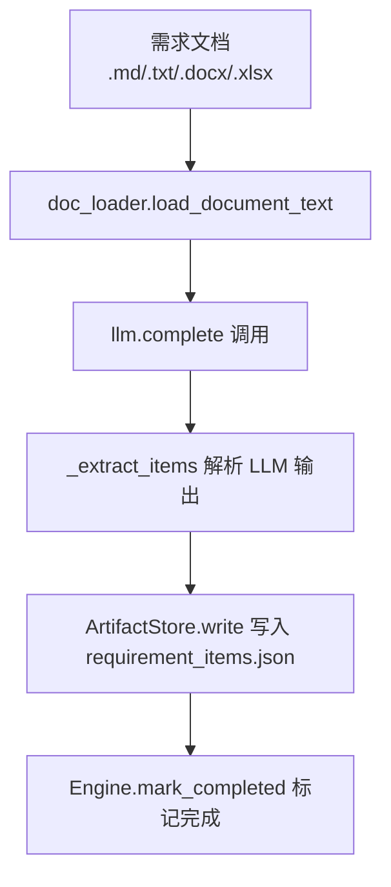
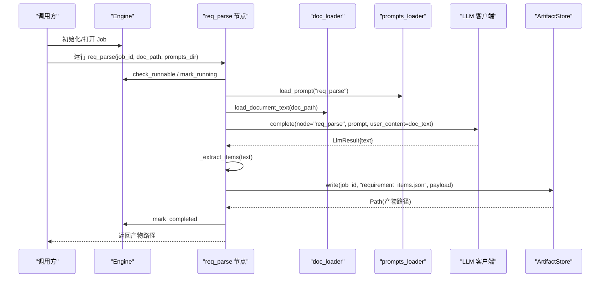
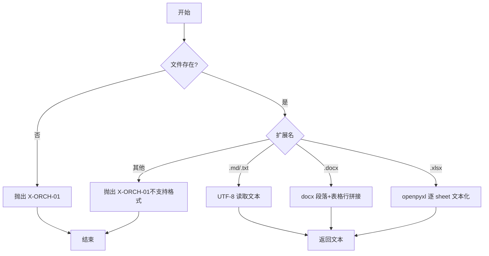
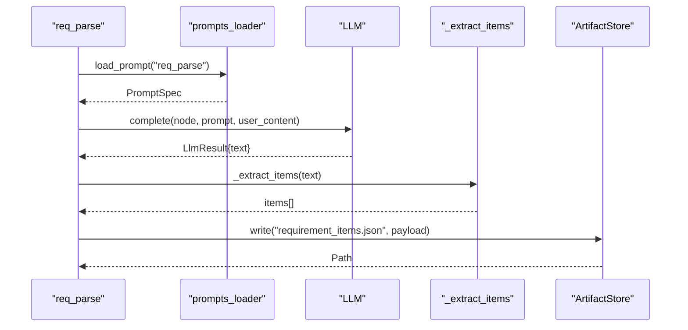
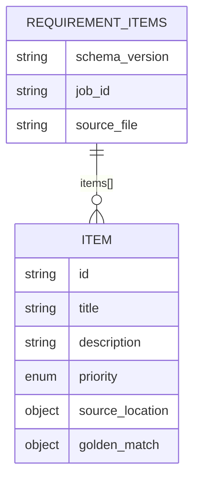
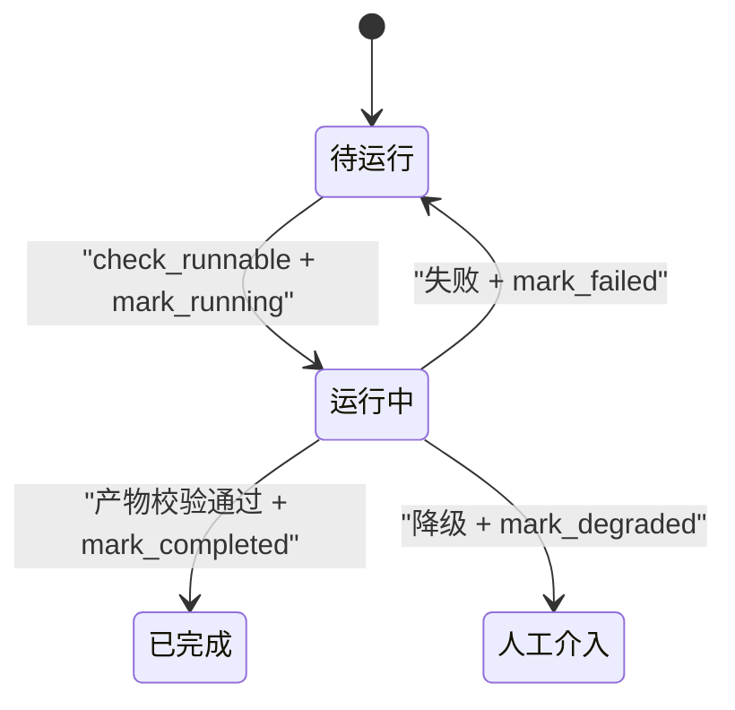
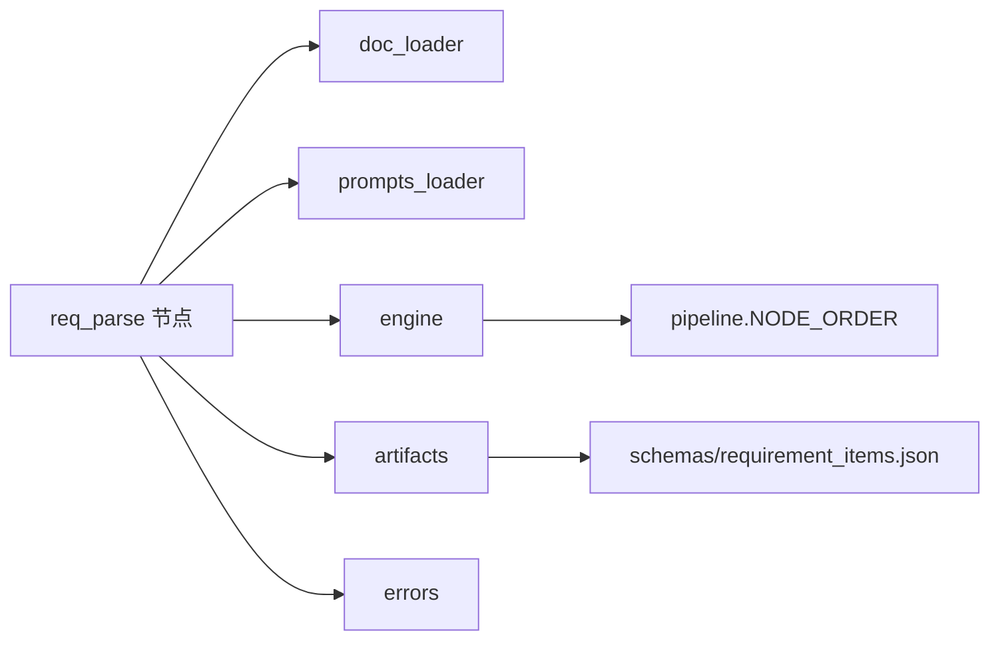

# 需求解析节点

<cite>
**本文引用的文件**
- [services/orchestrator/src/orchestrator/nodes/req_parse.py](file://services/orchestrator/src/orchestrator/nodes/req_parse.py)
- [services/orchestrator/src/orchestrator/doc_loader.py](file://services/orchestrator/src/orchestrator/doc_loader.py)
- [schemas/requirement_items.json](file://schemas/requirement_items.json)
- [services/orchestrator/src/orchestrator/engine.py](file://services/orchestrator/src/orchestrator/engine.py)
- [services/orchestrator/src/orchestrator/artifacts.py](file://services/orchestrator/src/orchestrator/artifacts.py)
- [services/orchestrator/src/orchestrator/errors.py](file://services/orchestrator/src/orchestrator/errors.py)
- [services/orchestrator/src/orchestrator/pipeline.py](file://services/orchestrator/src/orchestrator/pipeline.py)
- [services/orchestrator/src/orchestrator/prompts_loader.py](file://services/orchestrator/src/orchestrator/prompts_loader.py)
- [services/orchestrator/tests/test_req_parse.py](file://services/orchestrator/tests/test_req_parse.py)
</cite>

## 目录
1. [简介](#简介)
2. [项目结构](#项目结构)
3. [核心组件](#核心组件)
4. [架构总览](#架构总览)
5. [详细组件分析](#详细组件分析)
6. [依赖关系分析](#依赖关系分析)
7. [性能考虑](#性能考虑)
8. [故障排查指南](#故障排查指南)
9. [结论](#结论)
10. [附录](#附录)

## 简介
本章节面向“需求解析节点”，说明其职责与边界：将多种格式的需求文档（Markdown、Word、Excel）统一文本化，调用大模型进行结构化解析，输出符合 Schema 的 requirement_items.json，并纳入流水线编排与状态管理。该节点是整条自动化测试流水线的起点，负责从原始需求到可追踪、可验证的结构化条目。

## 项目结构
围绕需求解析节点的关键文件与职责如下：
- 节点实现：nodes/req_parse.py，负责串联文档加载、Prompt 加载、LLM 调用、结果提取与落盘。
- 文档加载：doc_loader.py，支持 .md/.txt/.docx/.xlsx 文本化。
- 产物与校验：artifacts.py，负责产物目录、写权、Schema 校验与完成判据。
- 编排与状态：engine.py，维护 state.json、断点续跑、跳序防护、降级记录。
- 错误体系：errors.py，定义统一错误码与异常结构。
- 流水线骨架：pipeline.py，定义九节点顺序与状态枚举。
- Prompt 加载：prompts_loader.py，从 prompts 目录加载带元信息的提示词。
- 数据模式：schemas/requirement_items.json，定义 requirement_items.json 的 JSON Schema。
- 测试用例：tests/test_req_parse.py，覆盖成功、容错、失败路径。



图表来源
- [services/orchestrator/src/orchestrator/doc_loader.py:12-33](file://services/orchestrator/src/orchestrator/doc_loader.py#L12-L33)
- [services/orchestrator/src/orchestrator/nodes/req_parse.py:33-78](file://services/orchestrator/src/orchestrator/nodes/req_parse.py#L33-L78)
- [services/orchestrator/src/orchestrator/artifacts.py:75-96](file://services/orchestrator/src/orchestrator/artifacts.py#L75-L96)
- [services/orchestrator/src/orchestrator/engine.py:229-242](file://services/orchestrator/src/orchestrator/engine.py#L229-L242)

章节来源
- [services/orchestrator/src/orchestrator/nodes/req_parse.py:1-125](file://services/orchestrator/src/orchestrator/nodes/req_parse.py#L1-L125)
- [services/orchestrator/src/orchestrator/doc_loader.py:1-65](file://services/orchestrator/src/orchestrator/doc_loader.py#L1-L65)
- [schemas/requirement_items.json:1-44](file://schemas/requirement_items.json#L1-L44)
- [services/orchestrator/src/orchestrator/engine.py:1-302](file://services/orchestrator/src/orchestrator/engine.py#L1-L302)
- [services/orchestrator/src/orchestrator/artifacts.py:1-157](file://services/orchestrator/src/orchestrator/artifacts.py#L1-L157)
- [services/orchestrator/src/orchestrator/errors.py:1-39](file://services/orchestrator/src/orchestrator/errors.py#L1-L39)
- [services/orchestrator/src/orchestrator/pipeline.py:1-84](file://services/orchestrator/src/orchestrator/pipeline.py#L1-L84)
- [services/orchestrator/src/orchestrator/prompts_loader.py:1-135](file://services/orchestrator/src/orchestrator/prompts_loader.py#L1-L135)
- [services/orchestrator/tests/test_req_parse.py:1-156](file://services/orchestrator/tests/test_req_parse.py#L1-L156)

## 核心组件
- 节点运行器 run_req_parse：执行跳序检查、置运行中、加载 Prompt、读取文档、调用 LLM、提取 items、校验并落盘、标记完成或失败。
- 文档加载器 load_document_text：按扩展名选择解析策略，统一输出为文本，保持行序以便溯源。
- 产物管理器 ArtifactStore：负责 job 目录创建、写权校验、JSON Schema 校验、原子落盘与完成判据。
- 编排引擎 Engine：维护 state.json，提供断点续跑、对账、跳序防护、节点状态变更与降级记录。
- Prompt 加载器 load_prompt：从 prompts 目录加载带元信息块的 Markdown，返回 PromptSpec。
- 错误体系 PipelineError：统一错误码与结构，贯穿各模块。

章节来源
- [services/orchestrator/src/orchestrator/nodes/req_parse.py:33-78](file://services/orchestrator/src/orchestrator/nodes/req_parse.py#L33-L78)
- [services/orchestrator/src/orchestrator/doc_loader.py:12-33](file://services/orchestrator/src/orchestrator/doc_loader.py#L12-L33)
- [services/orchestrator/src/orchestrator/artifacts.py:75-131](file://services/orchestrator/src/orchestrator/artifacts.py#L75-L131)
- [services/orchestrator/src/orchestrator/engine.py:140-261](file://services/orchestrator/src/orchestrator/engine.py#L140-L261)
- [services/orchestrator/src/orchestrator/prompts_loader.py:31-63](file://services/orchestrator/src/orchestrator/prompts_loader.py#L31-L63)
- [services/orchestrator/src/orchestrator/errors.py:17-39](file://services/orchestrator/src/orchestrator/errors.py#L17-L39)

## 架构总览
下图展示需求解析节点在流水线中的位置与交互：



图表来源
- [services/orchestrator/src/orchestrator/nodes/req_parse.py:33-78](file://services/orchestrator/src/orchestrator/nodes/req_parse.py#L33-L78)
- [services/orchestrator/src/orchestrator/doc_loader.py:12-33](file://services/orchestrator/src/orchestrator/doc_loader.py#L12-L33)
- [services/orchestrator/src/orchestrator/prompts_loader.py:31-63](file://services/orchestrator/src/orchestrator/prompts_loader.py#L31-L63)
- [services/orchestrator/src/orchestrator/artifacts.py:75-96](file://services/orchestrator/src/orchestrator/artifacts.py#L75-L96)
- [services/orchestrator/src/orchestrator/engine.py:196-242](file://services/orchestrator/src/orchestrator/engine.py#L196-L242)

## 详细组件分析

### 需求文档加载与多格式支持
- 支持的输入格式：.md、.txt、.docx、.xlsx。
- 行为要点：
  - 文件不存在或格式不支持时抛出 X-ORCH-01。
  - .docx 以段落和表格行拼接文本；.xlsx 逐 sheet 输出并以 sheet 名为节标题，行内单元格用制表符分隔。
  - 保持行序，便于后续溯源（section/line）。



图表来源
- [services/orchestrator/src/orchestrator/doc_loader.py:12-33](file://services/orchestrator/src/orchestrator/doc_loader.py#L12-L33)
- [services/orchestrator/src/orchestrator/doc_loader.py:36-64](file://services/orchestrator/src/orchestrator/doc_loader.py#L36-L64)

章节来源
- [services/orchestrator/src/orchestrator/doc_loader.py:1-65](file://services/orchestrator/src/orchestrator/doc_loader.py#L1-L65)

### LLM 调用与 Prompt 管理
- Prompt 来源：prompts 目录下同名 .md 文件，需包含元信息块（version/spec/owner/changelog/sampling），缺失或不合规会抛出 X-LLM-03。
- 调用方式：通过 SupportsComplete 协议注入 LLM 客户端，传入 node 名称、PromptSpec 与用户内容（即文档全文）。
- 输出处理：
  - 自动剥离 ```json 围栏，再尝试解析 JSON。
  - 必须包含 items 数组，且每个元素为对象；否则抛出 X-LLM-02。
  - 最终 payload 经 ArtifactStore 的 Schema 校验，不合规同样归为 X-ORCH-01，并在 req_parse 中映射为 X-LLM-02 语义。



图表来源
- [services/orchestrator/src/orchestrator/prompts_loader.py:31-63](file://services/orchestrator/src/orchestrator/prompts_loader.py#L31-L63)
- [services/orchestrator/src/orchestrator/nodes/req_parse.py:52-78](file://services/orchestrator/src/orchestrator/nodes/req_parse.py#L52-L78)
- [services/orchestrator/src/orchestrator/nodes/req_parse.py:81-125](file://services/orchestrator/src/orchestrator/nodes/req_parse.py#L81-L125)
- [services/orchestrator/src/orchestrator/artifacts.py:75-96](file://services/orchestrator/src/orchestrator/artifacts.py#L75-L96)

章节来源
- [services/orchestrator/src/orchestrator/nodes/req_parse.py:33-125](file://services/orchestrator/src/orchestrator/nodes/req_parse.py#L33-L125)
- [services/orchestrator/src/orchestrator/prompts_loader.py:1-135](file://services/orchestrator/src/orchestrator/prompts_loader.py#L1-L135)

### 需求条目结构化与 Schema 约束
- 顶层字段：
  - schema_version：固定为 "1.0"
  - job_id：字符串，必须以 "job-" 开头
  - source_file：来源文档路径与格式（docx/md/xlsx）
  - items：非空数组，每项为对象
- 条目字段：
  - id：字符串，匹配 REQ-三位数字
  - title：非空字符串
  - description：功能点结构化描述
  - priority：枚举 P0/P1/P2（优先级标记）
  - source_location：可选，包含 section 与 line（用于溯源）
  - golden_match：可选，包含 matched 与 golden_id（用于 G2 比对基准）



图表来源
- [schemas/requirement_items.json:1-44](file://schemas/requirement_items.json#L1-L44)

章节来源
- [schemas/requirement_items.json:1-44](file://schemas/requirement_items.json#L1-L44)

### 编排与状态管理
- 节点顺序：req_parse 为第一个节点，前序未完成则触发跳序保护（X-ORCH-02）。
- 状态流转：
  - 运行前：check_runnable 校验
  - 运行中：mark_running（attempts 自增）
  - 完成：mark_completed 要求产物存在且通过 Schema 校验
  - 失败：mark_failed 回退 pending 并记录 error
  - 降级：mark_degraded 标记 manual_intervention 并记录原因
- 断点续跑：open_job 会对账产物与状态，补齐或回退不一致处。



图表来源
- [services/orchestrator/src/orchestrator/engine.py:196-261](file://services/orchestrator/src/orchestrator/engine.py#L196-L261)
- [services/orchestrator/src/orchestrator/pipeline.py:11-34](file://services/orchestrator/src/orchestrator/pipeline.py#L11-L34)

章节来源
- [services/orchestrator/src/orchestrator/engine.py:140-302](file://services/orchestrator/src/orchestrator/engine.py#L140-L302)
- [services/orchestrator/src/orchestrator/pipeline.py:1-84](file://services/orchestrator/src/orchestrator/pipeline.py#L1-L84)

### 异常处理与错误恢复
- 错误码约定：
  - X-LLM-01：LLM 调用超时/网络失败（可重试）
  - X-LLM-02：LLM 输出未过 Schema 校验（不重试，人工介入）
  - X-LLM-03：Prompt 文件缺失/元信息不合规（配置错误，人工介入）
  - X-ORCH-01：产物校验失败（如文档不存在、格式不支持、Schema 不符）
  - X-ORCH-02：断点续跑跳序请求（前序未完成）
- 恢复策略：
  - 文档/格式问题：修正输入后重试（X-ORCH-01）
  - LLM 输出不可解析或未过 Schema：不自动重试，转人工介入（X-LLM-02）
  - Prompt 缺失：修复提示词文件（X-LLM-03）
  - 跳序：先完成前序节点（X-ORCH-02）
- 状态持久化：所有失败路径均通过 engine.mark_failed 写入 state.json，便于后续诊断与重跑。

章节来源
- [services/orchestrator/src/orchestrator/errors.py:1-39](file://services/orchestrator/src/orchestrator/errors.py#L1-L39)
- [services/orchestrator/src/orchestrator/nodes/req_parse.py:1-78](file://services/orchestrator/src/orchestrator/nodes/req_parse.py#L1-L78)
- [services/orchestrator/src/orchestrator/doc_loader.py:12-33](file://services/orchestrator/src/orchestrator/doc_loader.py#L12-L33)
- [services/orchestrator/src/orchestrator/engine.py:244-261](file://services/orchestrator/src/orchestrator/engine.py#L244-L261)

### 使用示例与最佳实践
- 典型流程：
  - 准备需求文档（.md/.txt/.docx/.xlsx），确保路径正确。
  - 初始化或打开 Job，确保前序节点完成。
  - 调用 run_req_parse，传入 engine、state、store、llm、prompts_dir、doc_path。
  - 成功后获取 requirement_items.json 路径，并可继续后续节点。
- 最佳实践：
  - 需求文档尽量结构化，明确章节与行号，便于 source_location 溯源。
  - 在 Prompt 中明确要求输出 JSON，避免多余解释文本；若 LLM 返回围栏，节点已内置容错。
  - 对 items 的 id、title、description、priority 等必填字段给出强约束，减少 Schema 校验失败。
  - 遇到 X-LLM-02 时优先检查 Prompt 与 LLM 输出质量，必要时引入样本或约束更强提示。
  - 利用 Engine 的对账能力进行断点续跑，避免重复工作。

章节来源
- [services/orchestrator/tests/test_req_parse.py:63-156](file://services/orchestrator/tests/test_req_parse.py#L63-L156)
- [services/orchestrator/src/orchestrator/nodes/req_parse.py:81-125](file://services/orchestrator/src/orchestrator/nodes/req_parse.py#L81-L125)

## 依赖关系分析
- 节点层依赖：
  - req_parse 依赖 doc_loader、prompts_loader、engine、artifacts、errors。
- 产物与 Schema：
  - requirement_items.json 由 orchestrator 写入，受 schemas/requirement_items.json 约束。
- 编排与状态：
  - engine 维护 state.json，依据 NODE_ORDER 控制执行顺序与完成判定。
- 外部服务：
  - LLM 客户端通过协议注入，便于测试替换与生产部署。



图表来源
- [services/orchestrator/src/orchestrator/nodes/req_parse.py:15-20](file://services/orchestrator/src/orchestrator/nodes/req_parse.py#L15-L20)
- [services/orchestrator/src/orchestrator/artifacts.py:24-50](file://services/orchestrator/src/orchestrator/artifacts.py#L24-L50)
- [services/orchestrator/src/orchestrator/pipeline.py:23-34](file://services/orchestrator/src/orchestrator/pipeline.py#L23-L34)

章节来源
- [services/orchestrator/src/orchestrator/nodes/req_parse.py:1-125](file://services/orchestrator/src/orchestrator/nodes/req_parse.py#L1-L125)
- [services/orchestrator/src/orchestrator/artifacts.py:1-157](file://services/orchestrator/src/orchestrator/artifacts.py#L1-L157)
- [services/orchestrator/src/orchestrator/pipeline.py:1-84](file://services/orchestrator/src/orchestrator/pipeline.py#L1-L84)

## 性能考虑
- 文档加载：
  - .xlsx 使用只读模式与 data_only 提升读取效率。
  - 大文档建议分片或限制最大尺寸，避免内存峰值过高。
- LLM 调用：
  - 合理设置采样参数（temperature/top_p），提高输出稳定性。
  - 对超时/网络失败采用可重试策略（X-LLM-01），但输出不合规不重试（X-LLM-02）。
- 产物落盘：
  - 使用原子写入（tmp + replace）避免部分写入导致的损坏。
  - Schema 校验前置，尽早拒绝不合规输出，减少无效 I/O。
- 编排与状态：
  - 对账机制避免重复计算；断点续跑降低整体耗时。
  - 节点完成判据基于产物存在与校验通过，保证一致性。

[本节为通用性能建议，不直接分析具体代码文件]

## 故障排查指南
- 常见错误与定位：
  - 文档不存在或格式不支持：检查 doc_path 与扩展名，确认支持列表。
  - Prompt 缺失或元信息不合规：检查 prompts/req_parse.md 是否存在及元信息块是否完整。
  - LLM 输出不是合法 JSON 或缺 items：检查 Prompt 约束与模型输出质量；必要时增加示例或更严格提示。
  - Schema 校验失败：核对 items 字段是否符合 requirement_items.json 约束（如 id 格式、priority 枚举）。
  - 跳序请求：确保前序节点已完成；使用 Engine.check_runnable 提前检测。
- 日志与状态：
  - 查看 state.json 中对应节点的 error 字段，定位最近一次失败原因。
  - 使用 Engine.reconcile 进行对账，修复状态与产物不一致问题。

章节来源
- [services/orchestrator/src/orchestrator/doc_loader.py:12-33](file://services/orchestrator/src/orchestrator/doc_loader.py#L12-L33)
- [services/orchestrator/src/orchestrator/prompts_loader.py:31-63](file://services/orchestrator/src/orchestrator/prompts_loader.py#L31-L63)
- [services/orchestrator/src/orchestrator/nodes/req_parse.py:81-125](file://services/orchestrator/src/orchestrator/nodes/req_parse.py#L81-L125)
- [services/orchestrator/src/orchestrator/engine.py:161-180](file://services/orchestrator/src/orchestrator/engine.py#L161-L180)

## 结论
需求解析节点通过统一的文档加载、严格的 Schema 校验与健壮的编排状态管理，实现了从多格式需求文档到结构化条目的稳定转换。结合 Prompt 管理与错误体系，系统具备良好的可观测性与可恢复性。建议在实践中强化 Prompt 约束与文档规范，以提升解析质量与成功率。

[本节为总结性内容，不直接分析具体代码文件]

## 附录
- requirement_items.json 结构要点：
  - 顶层：schema_version、job_id、source_file、items
  - 条目：id、title、description、priority、source_location、golden_match
- 支持文档格式：.md、.txt、.docx、.xlsx
- 关键错误码：X-LLM-01/02/03、X-ORCH-01/02

章节来源
- [schemas/requirement_items.json:1-44](file://schemas/requirement_items.json#L1-L44)
- [services/orchestrator/src/orchestrator/doc_loader.py:1-65](file://services/orchestrator/src/orchestrator/doc_loader.py#L1-L65)
- [services/orchestrator/src/orchestrator/errors.py:1-39](file://services/orchestrator/src/orchestrator/errors.py#L1-L39)