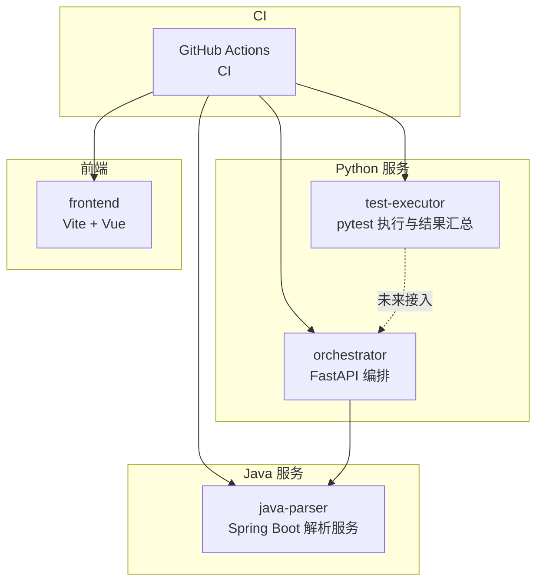
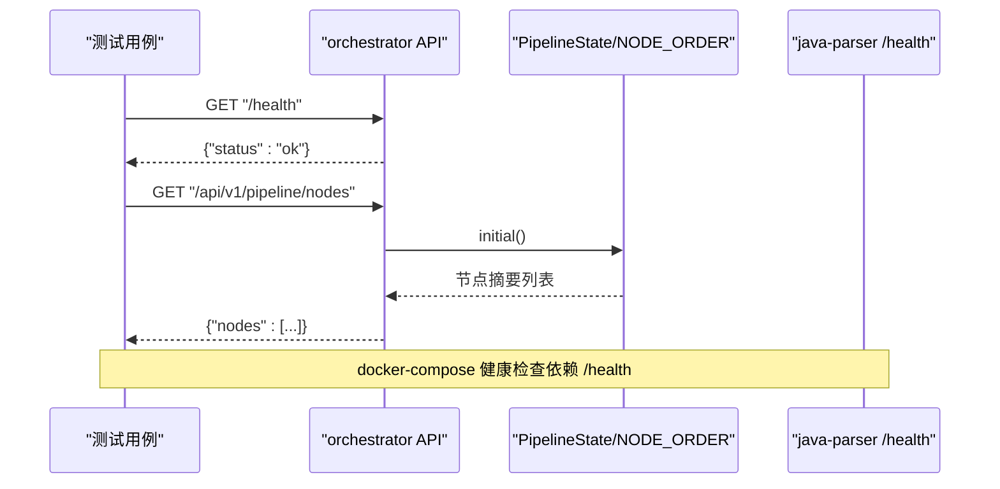
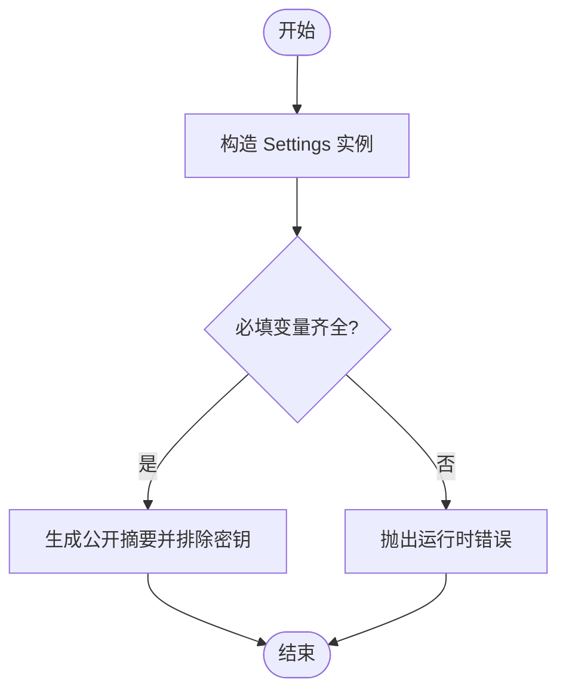
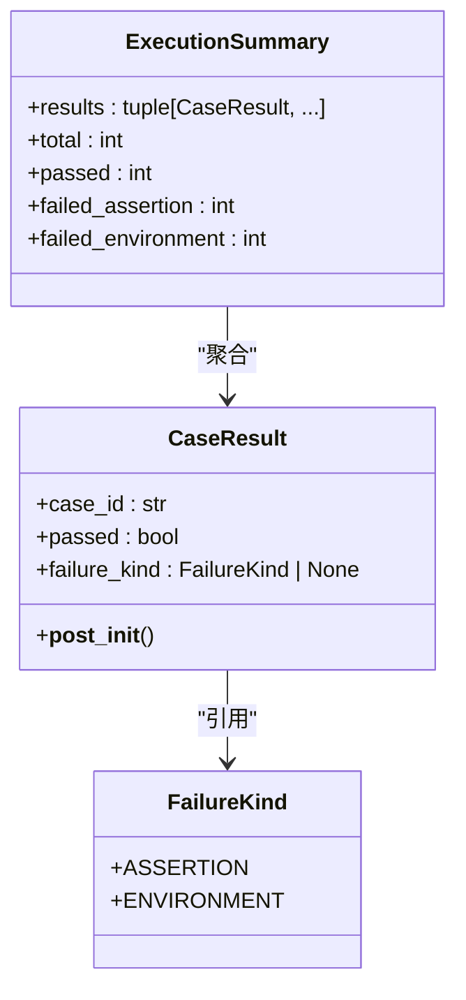
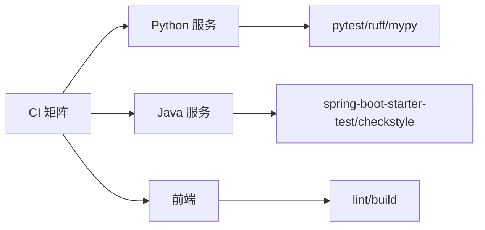

# 测试策略

<cite>
**本文引用的文件**
- [10_测试框架选型说明.md](file://docs/10_测试框架选型说明.md)
- [ci.yml](file://.github/workflows/ci.yml)
- [docker-compose.yml](file://deploy/docker-compose.yml)
- [orchestrator 配置](file://services/orchestrator/src/orchestrator/config.py)
- [orchestrator 配置测试](file://services/orchestrator/tests/test_config.py)
- [orchestrator API](file://services/orchestrator/src/orchestrator/api.py)
- [orchestrator 流水线与接口测试](file://services/orchestrator/tests/test_pipeline.py)
- [orchestrator 依赖与测试配置](file://services/orchestrator/pyproject.toml)
- [test-executor 结果模型](file://services/test-executor/src/executor/result.py)
- [test-executor 结果测试](file://services/test-executor/tests/test_result.py)
- [test-executor 依赖与测试配置](file://services/test-executor/pyproject.toml)
- [java-parser 健康控制器](file://services/java-parser/src/main/java/com/llmautotest/parser/HealthController.java)
- [java-parser 健康控制器测试](file://services/java-parser/src/test/java/com/llmautotest/parser/HealthControllerTest.java)
- [java-parser Maven 配置](file://services/java-parser/pom.xml)
</cite>

## 目录
1. [引言](#引言)
2. [项目结构](#项目结构)
3. [核心组件](#核心组件)
4. [架构总览](#架构总览)
5. [详细组件分析](#详细组件分析)
6. [依赖分析](#依赖分析)
7. [性能考虑](#性能考虑)
8. [故障排查指南](#故障排查指南)
9. [结论](#结论)
10. [附录](#附录)

## 引言
本测试策略面向 LLM-AutoTest 项目，覆盖单元测试、集成测试与端到端测试的落地方法、最佳实践与验收标准。项目采用多语言微服务架构（Python FastAPI 编排服务、Java 解析服务、前端），并通过 CI/CD 统一执行质量门禁。测试策略的核心目标是：
- 以 pytest 作为 Python 侧主测试框架，确保由 LLM 生成的脚本具备高可加载性与可维护性。
- 通过二态失败分类（断言失败与环境失败）实现更准确的通过率口径与回归判定。
- 在 CI 中固化代码质量检查、类型检查与测试执行，保障主干稳定性。
- 提供清晰的测试环境搭建、数据管理与结果分析方法，支撑无人值守执行与自动化汇总。

## 项目结构
仓库采用 monorepo 组织，按服务划分模块，每个服务独立管理依赖、构建与测试；CI 对 Python、Java、前端分别执行不同任务；容器编排定义服务间依赖与健康检查。

图示来源
- [ci.yml:1-75](file://.github/workflows/ci.yml#L1-L75)
- [docker-compose.yml:1-62](file://deploy/docker-compose.yml#L1-L62)

章节来源
- [ci.yml:1-75](file://.github/workflows/ci.yml#L1-L75)
- [docker-compose.yml:1-62](file://deploy/docker-compose.yml#L1-L62)

## 核心组件
- 测试框架选型：基于需求驱动的评估，选定 pytest 作为 Python 侧主测试框架，强调 LLM 生成脚本的可加载性、五协议客户端集成能力、结构化结果导出与无人值守执行。
- 二态失败分类：在 test-executor 中实现“断言失败”和“环境失败”的分离，保证通过率口径准确且便于隔离环境问题。
- 编排服务测试：orchestrator 暴露 /health 与节点清单接口，测试覆盖配置读取、默认值、敏感信息屏蔽以及 API 响应契约。
- Java 服务测试：java-parser 提供 /health 端点，使用 Spring WebMvc 测试验证健康检查可用性。
- CI 质量门禁：Python 服务执行 ruff、mypy、pytest；Java 服务执行 mvn verify；前端执行 lint 与 build。

章节来源
- [10_测试框架选型说明.md:1-64](file://docs/10_测试框架选型说明.md#L1-L64)
- [test-executor 结果模型:1-61](file://services/test-executor/src/executor/result.py#L1-L61)
- [orchestrator 配置测试:1-43](file://services/orchestrator/tests/test_config.py#L1-L43)
- [orchestrator 流水线与接口测试:1-47](file://services/orchestrator/tests/test_pipeline.py#L1-L47)
- [java-parser 健康控制器测试:1-27](file://services/java-parser/src/test/java/com/llmautotest/parser/HealthControllerTest.java#L1-L27)
- [ci.yml:1-75](file://.github/workflows/ci.yml#L1-L75)

## 架构总览
下图展示 orchestrator 与 java-parser 的健康检查与节点清单流程，以及测试如何验证这些关键路径。

图示来源
- [orchestrator API:1-28](file://services/orchestrator/src/orchestrator/api.py#L1-L28)
- [orchestrator 流水线与接口测试:21-47](file://services/orchestrator/tests/test_pipeline.py#L21-L47)
- [java-parser 健康控制器:1-18](file://services/java-parser/src/main/java/com/llmautotest/parser/HealthController.java#L1-L18)

## 详细组件分析

### 单元测试策略（Python：orchestrator）
- 目标：验证配置读取、默认值、敏感信息屏蔽、API 契约与业务常量（如九节点固定口径）。
- 方法：
  - 使用 pytest 编写用例，覆盖 Settings.from_env 的必填项校验与默认值行为。
  - 使用 FastAPI TestClient 调用 create_app 构造应用实例，验证 /health 与 /api/v1/pipeline/nodes 的响应结构与状态码。
  - 通过断言 NODE_ORDER 长度固定为 9，确保流水线节点清单不可随意增删。
- 最佳实践：
  - 将环境变量注入到 Settings.from_env，避免真实环境干扰。
  - 对敏感字段进行白名单过滤，确保日志安全口径。
  - 使用近似断言处理浮点数温度参数。

图示来源
- [orchestrator 配置:1-50](file://services/orchestrator/src/orchestrator/config.py#L1-L50)
- [orchestrator 配置测试:10-43](file://services/orchestrator/tests/test_config.py#L10-L43)

章节来源
- [orchestrator 配置:1-50](file://services/orchestrator/src/orchestrator/config.py#L1-L50)
- [orchestrator 配置测试:1-43](file://services/orchestrator/tests/test_config.py#L1-L43)
- [orchestrator 流水线与接口测试:21-47](file://services/orchestrator/tests/test_pipeline.py#L21-L47)
- [orchestrator 依赖与测试配置:1-53](file://services/orchestrator/pyproject.toml#L1-L53)

### 单元测试策略（Python：test-executor）
- 目标：验证执行结果的二态分离与自洽性约束。
- 方法：
  - 通过 CaseResult 与 ExecutionSummary 的数据类，断言通过用例不得携带失败类型。
  - 统计断言失败与环境失败数量，确保分母口径正确。
- 最佳实践：
  - 使用 frozen dataclass 保证结果不可变。
  - 在 __post_init__ 中做一致性校验，尽早发现不合法构造。

图示来源
- [test-executor 结果模型:1-61](file://services/test-executor/src/executor/result.py#L1-L61)

章节来源
- [test-executor 结果模型:1-61](file://services/test-executor/src/executor/result.py#L1-L61)
- [test-executor 结果测试:1-30](file://services/test-executor/tests/test_result.py#L1-L30)
- [test-executor 依赖与测试配置:1-45](file://services/test-executor/pyproject.toml#L1-L45)

### 单元测试策略（Java：java-parser）
- 目标：验证健康检查端点可用，满足容器编排健康检查要求。
- 方法：
  - 使用 Spring WebMvc 的 MockMvc 发起 GET /health，断言状态码与 JSON 字段。
- 最佳实践：
  - 使用 @WebMvcTest 仅加载控制器层，减少启动开销。
  - 保持 /health 返回稳定结构，便于编排工具判断服务就绪。

章节来源
- [java-parser 健康控制器:1-18](file://services/java-parser/src/main/java/com/llmautotest/parser/HealthController.java#L1-L18)
- [java-parser 健康控制器测试:1-27](file://services/java-parser/src/test/java/com/llmautotest/parser/HealthControllerTest.java#L1-L27)
- [java-parser Maven 配置:1-83](file://services/java-parser/pom.xml#L1-L83)

### 集成测试策略
- 编排服务集成测试：
  - 通过 TestClient 创建应用实例，调用 /health 与 /api/v1/pipeline/nodes，验证响应契约与节点数量。
  - 结合 docker-compose 健康检查，确保服务在容器中可被编排工具探测。
- Java 服务集成测试：
  - 使用 WebMvcTest 模拟 HTTP 请求，验证控制器行为，无需启动完整应用上下文。
- 建议扩展：
  - 当 test-executor 接入后，可增加端到端场景：编排触发执行、收集 execution.json、汇总通过率。

章节来源
- [orchestrator 流水线与接口测试:1-47](file://services/orchestrator/tests/test_pipeline.py#L1-L47)
- [java-parser 健康控制器测试:1-27](file://services/java-parser/src/test/java/com/llmautotest/parser/HealthControllerTest.java#L1-L27)
- [docker-compose.yml:1-62](file://deploy/docker-compose.yml#L1-L62)

### 端到端测试策略
- 当前阶段：以健康检查与接口契约为核心，确保服务可编排、可观测。
- 未来方向：
  - 在 test-executor profile 启用后，增加跨服务端到端用例：编排 -> 执行 -> 产物归档 -> 报告汇总。
  - 使用 docker-compose profiles 隔离 exec/mock 环境，避免引入不稳定外部依赖。

章节来源
- [docker-compose.yml:43-62](file://deploy/docker-compose.yml#L43-L62)

## 依赖分析
- Python 服务依赖 pytest、ruff、mypy 等开发依赖，并在 pyproject.toml 中声明测试路径与异步模式。
- Java 服务通过 spring-boot-starter-test 提供测试支持，并使用 checkstyle 插件在 verify 阶段执行规范检查。
- CI 矩阵并行执行 Python、Java、前端任务，确保各服务质量门禁一致。

图示来源
- [orchestrator 依赖与测试配置:1-53](file://services/orchestrator/pyproject.toml#L1-L53)
- [java-parser Maven 配置:1-83](file://services/java-parser/pom.xml#L1-L83)
- [ci.yml:1-75](file://.github/workflows/ci.yml#L1-L75)

章节来源
- [orchestrator 依赖与测试配置:1-53](file://services/orchestrator/pyproject.toml#L1-L53)
- [java-parser Maven 配置:1-83](file://services/java-parser/pom.xml#L1-L83)
- [ci.yml:1-75](file://.github/workflows/ci.yml#L1-L75)

## 性能考虑
- 测试执行效率：
  - Python 侧使用 pytest 的自动异步模式与最小化依赖，缩短测试启动时间。
  - Java 侧使用 @WebMvcTest 仅加载控制器，避免全量应用启动。
- 覆盖率门禁：
  - CI 已预留覆盖率门禁位置，后续逐步启用 ≥70% 的目标，确保核心逻辑有足够覆盖。
- 资源隔离：
  - 通过 docker-compose profiles 隔离 exec/mock 服务，避免不必要的网络与 I/O 开销。

[本节为通用指导，不直接分析具体文件]

## 故障排查指南
- 配置缺失报错：
  - 当必填环境变量缺失时，Settings.from_env 会抛出 RuntimeError，便于快速定位配置问题。
- 健康检查失败：
  - 若 /health 返回非 200 或非预期 JSON，检查控制器实现与容器端口映射。
- 节点清单异常：
  - 若 /api/v1/pipeline/nodes 返回节点数不为 9，检查 NODE_ORDER 是否被修改或 PipelineState.initial 的实现。
- 二态失败统计异常：
  - 若 failed_assertion 或 failed_environment 计数不符，检查 CaseResult 构造与 ExecutionSummary 的统计逻辑。

章节来源
- [orchestrator 配置:32-50](file://services/orchestrator/src/orchestrator/config.py#L32-L50)
- [orchestrator 流水线与接口测试:21-47](file://services/orchestrator/tests/test_pipeline.py#L21-L47)
- [test-executor 结果模型:17-61](file://services/test-executor/src/executor/result.py#L17-L61)

## 结论
本测试策略以 pytest 为核心，结合二态失败分类与 CI 质量门禁，构建了覆盖单元、集成与端到端的测试体系。通过明确的配置校验、健康检查与接口契约测试，保障了服务的可编排性与可观测性。后续随着 test-executor 的接入，将进一步完善端到端场景与报告汇总能力，持续提升自动化测试的效率与准确性。

[本节为总结性内容，不直接分析具体文件]

## 附录
- 测试环境搭建：
  - 使用 docker-compose 启动服务，依赖 healthcheck 确保服务就绪。
  - 通过 env_file 注入环境变量，避免硬编码敏感信息。
- 测试数据管理：
  - 使用 artifacts 卷持久化产物，便于本地调试与 CI 复用。
- 测试结果分析：
  - Python 侧可通过 pytest 输出原始报告，结合 test-executor 汇总为 execution.json。
  - Java 侧通过 surefire/failsafe 输出 XML 报告，配合 Rebot 或自定义脚本转换。

章节来源
- [docker-compose.yml:1-62](file://deploy/docker-compose.yml#L1-L62)
- [10_测试框架选型说明.md:45-54](file://docs/10_测试框架选型说明.md#L45-L54)