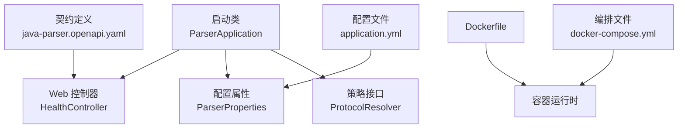
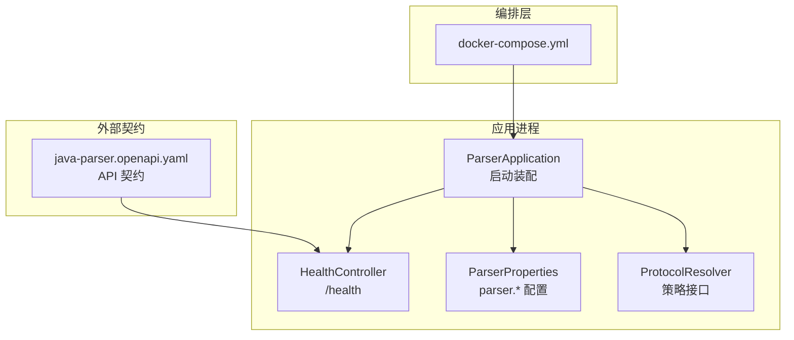
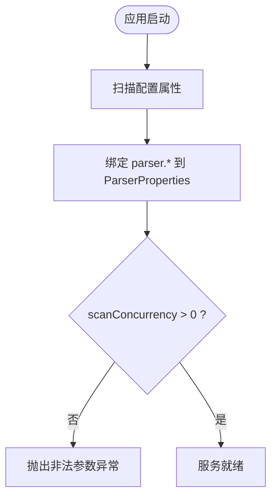
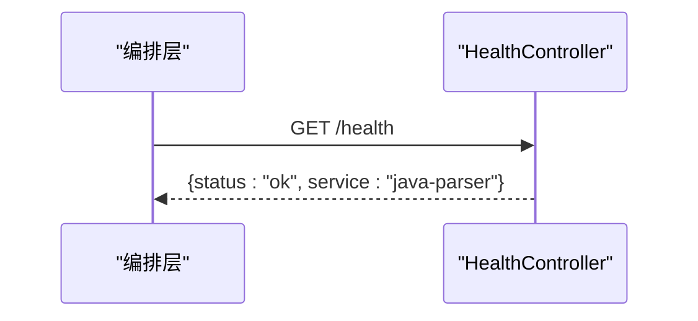
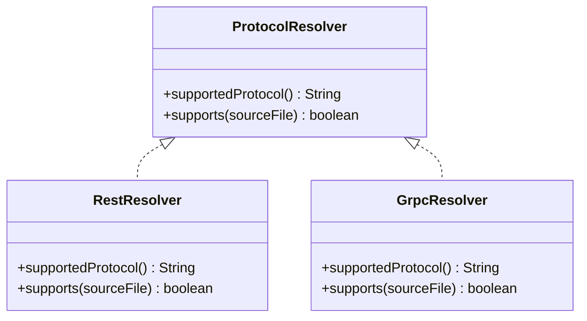
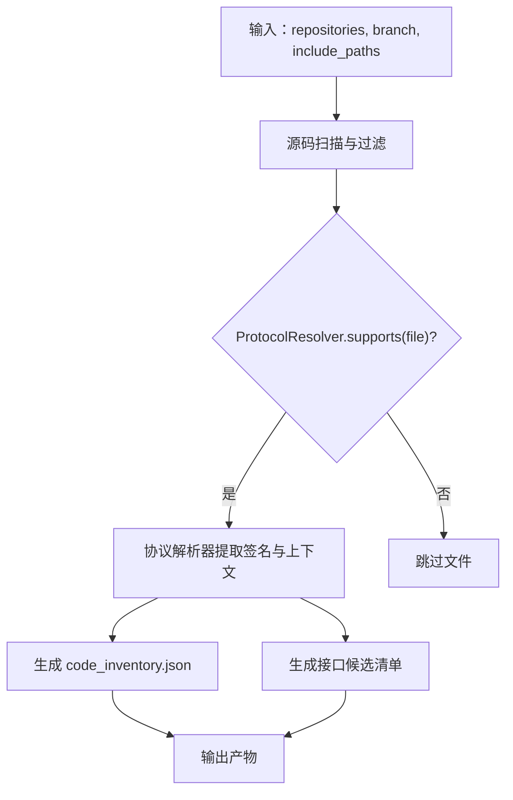
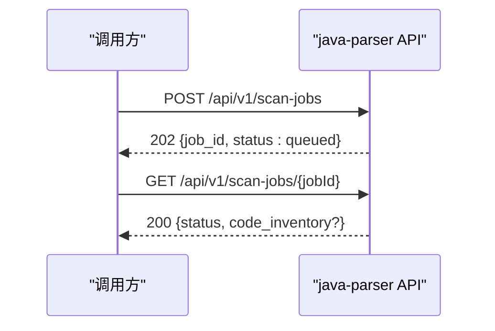
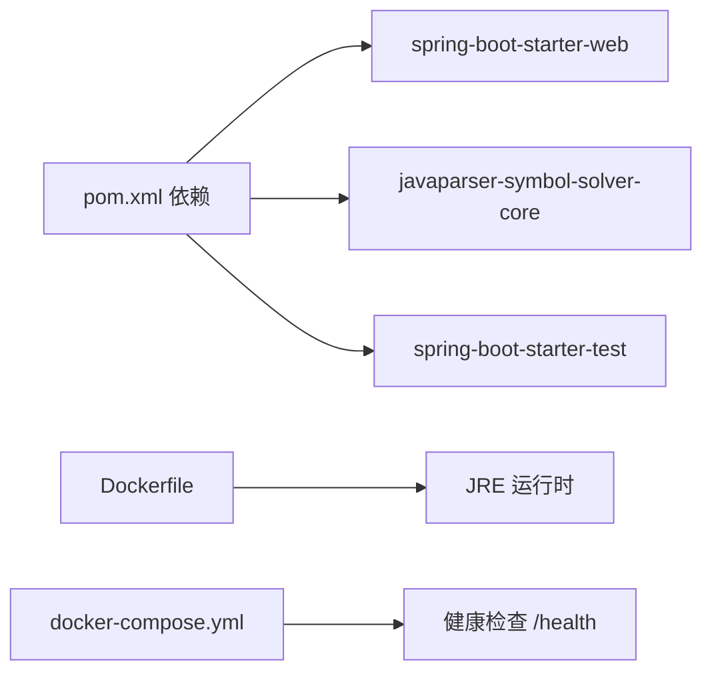

# Java解析器服务

<cite>
**本文引用的文件**
- [ParserApplication.java](file://services/java-parser/src/main/java/com/llmautotest/parser/ParserApplication.java)
- [HealthController.java](file://services/java-parser/src/main/java/com/llmautotest/parser/HealthController.java)
- [ParserProperties.java](file://services/java-parser/src/main/java/com/llmautotest/parser/ParserProperties.java)
- [ProtocolResolver.java](file://services/java-parser/src/main/java/com/llmautotest/parser/ProtocolResolver.java)
- [application.yml](file://services/java-parser/src/main/resources/application.yml)
- [pom.xml](file://services/java-parser/pom.xml)
- [Dockerfile](file://services/java-parser/Dockerfile)
- [docker-compose.yml](file://deploy/docker-compose.yml)
- [java-parser.openapi.yaml](file://schemas/contracts/java-parser.openapi.yaml)
- [HealthControllerTest.java](file://services/java-parser/src/test/java/com/llmautotest/parser/HealthControllerTest.java)
</cite>

## 目录
1. [简介](#简介)
2. [项目结构](#项目结构)
3. [核心组件](#核心组件)
4. [架构总览](#架构总览)
5. [详细组件分析](#详细组件分析)
6. [依赖关系分析](#依赖关系分析)
7. [性能考虑](#性能考虑)
8. [故障排查指南](#故障排查指南)
9. [结论](#结论)
10. [附录：扩展协议解析器的开发指南](#附录：扩展协议解析器的开发指南)

## 简介
本服务为“Java 多仓库扫描与接口逆向还原”的静态分析侧，基于 Spring Boot 提供 REST API、健康检查与配置管理；通过策略接口 ProtocolResolver 实现协议解析的可插拔扩展（REST/gRPC/GraphQL/SOAP/MQ 等）。当前代码基线已包含应用启动入口、健康端点、属性注入与契约定义，后续将接入 JavaParser 进行源码扫描与接口候选提取。

## 项目结构
- 应用入口与装配
  - 启动类使用 @SpringBootApplication 与 @ConfigurationPropertiesScan，自动发现并注册配置属性。
- 配置与运行参数
  - application.yml 暴露 server.port 与 parser.scan-concurrency；可通过环境变量覆盖。
- 健康检查
  - HealthController 提供 /health 端点，供编排系统探测存活。
- 插件化策略
  - ProtocolResolver 定义协议识别与过滤的最小接口，便于新增协议时不改动主流程。
- 构建与部署
  - pom.xml 声明 Spring Boot Starter Web 与 JavaParser Symbol Solver 依赖；Dockerfile 多阶段构建；docker-compose 编排健康检查与端口映射。

**图表来源**
- [ParserApplication.java:9-15](file://services/java-parser/src/main/java/com/llmautotest/parser/ParserApplication.java#L9-L15)
- [HealthController.java:9-16](file://services/java-parser/src/main/java/com/llmautotest/parser/HealthController.java#L9-L16)
- [ParserProperties.java:7-15](file://services/java-parser/src/main/java/com/llmautotest/parser/ParserProperties.java#L7-L15)
- [ProtocolResolver.java:7-16](file://services/java-parser/src/main/java/com/llmautotest/parser/ProtocolResolver.java#L7-L16)
- [application.yml:1-8](file://services/java-parser/src/main/resources/application.yml#L1-L8)
- [java-parser.openapi.yaml:11-22](file://schemas/contracts/java-parser.openapi.yaml#L11-L22)
- [Dockerfile:1-21](file://services/java-parser/Dockerfile#L1-L21)
- [docker-compose.yml:4-16](file://deploy/docker-compose.yml#L4-L16)

**章节来源**
- [ParserApplication.java:9-15](file://services/java-parser/src/main/java/com/llmautotest/parser/ParserApplication.java#L9-L15)
- [application.yml:1-8](file://services/java-parser/src/main/resources/application.yml#L1-L8)
- [HealthController.java:9-16](file://services/java-parser/src/main/java/com/llmautotest/parser/HealthController.java#L9-L16)
- [ProtocolResolver.java:7-16](file://services/java-parser/src/main/java/com/llmautotest/parser/ProtocolResolver.java#L7-L16)
- [pom.xml:31-47](file://services/java-parser/pom.xml#L31-L47)
- [Dockerfile:1-21](file://services/java-parser/Dockerfile#L1-L21)
- [docker-compose.yml:4-16](file://deploy/docker-compose.yml#L4-L16)

## 核心组件
- 应用启动与装配
  - 启动类启用 Spring Boot 自动装配与配置属性扫描，作为服务唯一入口。
- 健康检查
  - 返回固定状态对象，用于编排层健康探测。
- 配置属性
  - 使用 record + @ConfigurationProperties 绑定 parser.* 配置项，并在构造中校验并发度为正数。
- 协议解析策略
  - 定义 supportedProtocol() 与 supports(Path) 两个方法，作为扫描阶段的过滤器与协议标识。

**章节来源**
- [ParserApplication.java:9-15](file://services/java-parser/src/main/java/com/llmautotest/parser/ParserApplication.java#L9-L15)
- [HealthController.java:9-16](file://services/java-parser/src/main/java/com/llmautotest/parser/HealthController.java#L9-L16)
- [ParserProperties.java:7-15](file://services/java-parser/src/main/java/com/llmautotest/parser/ParserProperties.java#L7-L15)
- [ProtocolResolver.java:7-16](file://services/java-parser/src/main/java/com/llmautotest/parser/ProtocolResolver.java#L7-L16)

## 架构总览
服务以 Spring Boot 为核心，对外暴露 REST 接口与健康检查；内部通过策略接口支持多种协议的解析扩展。编排层通过 docker-compose 对服务进行健康检查与端口映射，契约文档定义了未来任务型 API 的结构。

**图表来源**
- [docker-compose.yml:4-16](file://deploy/docker-compose.yml#L4-L16)
- [ParserApplication.java:9-15](file://services/java-parser/src/main/java/com/llmautotest/parser/ParserApplication.java#L9-L15)
- [HealthController.java:9-16](file://services/java-parser/src/main/java/com/llmautotest/parser/HealthController.java#L9-L16)
- [ParserProperties.java:7-15](file://services/java-parser/src/main/java/com/llmautotest/parser/ParserProperties.java#L7-L15)
- [ProtocolResolver.java:7-16](file://services/java-parser/src/main/java/com/llmautotest/parser/ProtocolResolver.java#L7-L16)
- [java-parser.openapi.yaml:11-22](file://schemas/contracts/java-parser.openapi.yaml#L11-L22)

## 详细组件分析

### 应用启动与配置
- 启动类
  - 使用 @SpringBootApplication 开启自动装配；@ConfigurationPropertiesScan 扫描配置属性类。
- 配置属性
  - ParserProperties 使用 record 与 @ConfigurationProperties(prefix="parser") 绑定 parser.scan-concurrency，并在构造中校验必须为正数。
- 配置文件
  - application.yml 设置 server.port=8080 与 parser.scan-concurrency=4；可通过环境变量覆盖。

**图表来源**
- [ParserApplication.java:9-15](file://services/java-parser/src/main/java/com/llmautotest/parser/ParserApplication.java#L9-L15)
- [ParserProperties.java:7-15](file://services/java-parser/src/main/java/com/llmautotest/parser/ParserProperties.java#L7-L15)
- [application.yml:1-8](file://services/java-parser/src/main/resources/application.yml#L1-L8)

**章节来源**
- [ParserApplication.java:9-15](file://services/java-parser/src/main/java/com/llmautotest/parser/ParserApplication.java#L9-L15)
- [ParserProperties.java:7-15](file://services/java-parser/src/main/java/com/llmautotest/parser/ParserProperties.java#L7-L15)
- [application.yml:1-8](file://services/java-parser/src/main/resources/application.yml#L1-L8)

### 健康检查机制
- 端点设计
  - GET /health 返回包含 status 与 service 字段的 JSON 对象，用于编排健康检查。
- 测试保障
  - 单元测试通过 MockMvc 验证 /health 返回 200 且 status 为 ok。

**图表来源**
- [HealthController.java:9-16](file://services/java-parser/src/main/java/com/llmautotest/parser/HealthController.java#L9-L16)
- [java-parser.openapi.yaml:11-22](file://schemas/contracts/java-parser.openapi.yaml#L11-L22)
- [HealthControllerTest.java:20-25](file://services/java-parser/src/test/java/com/llmautotest/parser/HealthControllerTest.java#L20-L25)

**章节来源**
- [HealthController.java:9-16](file://services/java-parser/src/main/java/com/llmautotest/parser/HealthController.java#L9-L16)
- [HealthControllerTest.java:20-25](file://services/java-parser/src/test/java/com/llmautotest/parser/HealthControllerTest.java#L20-L25)
- [java-parser.openapi.yaml:11-22](file://schemas/contracts/java-parser.openapi.yaml#L11-L22)

### 协议解析策略与插件化设计
- 策略接口
  - ProtocolResolver 定义 supportedProtocol() 与 supports(Path)，用于在扫描阶段按协议过滤源码文件。
- 扩展方式
  - 新增协议只需实现该接口，并通过 Spring 容器管理；主流程通过策略集合分发调用，无需修改核心逻辑。
- 契约对齐
  - 支持的协议枚举在契约中定义为 rest/grpc/graphql/soap/mq，实现需与之保持一致。

**图表来源**
- [ProtocolResolver.java:7-16](file://services/java-parser/src/main/java/com/llmautotest/parser/ProtocolResolver.java#L7-L16)
- [java-parser.openapi.yaml:284-289](file://schemas/contracts/java-parser.openapi.yaml#L284-L289)

**章节来源**
- [ProtocolResolver.java:7-16](file://services/java-parser/src/main/java/com/llmautotest/parser/ProtocolResolver.java#L7-L16)
- [java-parser.openapi.yaml:284-289](file://schemas/contracts/java-parser.openapi.yaml#L284-L289)

### Java 代码扫描与接口逆向还原（规划）
- 技术选型
  - 通过 JavaParser Symbol Solver 进行源码解析与符号推导，定位注解、接口、DTO 等关键元素。
- 处理流程（概念性）
  - 输入：仓库路径、分支、可选 include_paths；输出：code_inventory.json 与接口候选清单。
- 与策略集成
  - 扫描阶段先按 ProtocolResolver.supports 过滤文件，再交由对应解析器提取签名与关联文件。

[本节为概念性流程说明，未直接分析具体实现文件]

### REST API 端点设计（契约先行）
- 健康检查
  - GET /health：返回服务存活信息。
- 任务型 API（待实现）
  - POST /api/v1/scan-jobs：创建多仓库扫描任务，返回 job_id 与初始状态。
  - GET /api/v1/scan-jobs/{jobId}：查询扫描任务状态与产物。
  - POST /api/v1/extract-jobs：创建接口候选提取任务。
  - GET /api/v1/extract-jobs/{jobId}：查询提取任务状态与产物。
- 错误模型
  - 统一 Error 结构，包含 code、message、node_id、details。

**图表来源**
- [java-parser.openapi.yaml:24-70](file://schemas/contracts/java-parser.openapi.yaml#L24-L70)
- [java-parser.openapi.yaml:72-115](file://schemas/contracts/java-parser.openapi.yaml#L72-L115)
- [java-parser.openapi.yaml:130-147](file://schemas/contracts/java-parser.openapi.yaml#L130-L147)

**章节来源**
- [java-parser.openapi.yaml:11-115](file://schemas/contracts/java-parser.openapi.yaml#L11-L115)

## 依赖关系分析
- 运行时依赖
  - spring-boot-starter-web：提供 Web MVC 能力。
  - javaparser-symbol-solver-core：源码解析与符号推导（后续接入）。
- 构建与质量
  - maven-checkstyle-plugin：代码风格检查。
- 部署依赖
  - Docker 多阶段构建；编排层通过 wget 探测 /health。

**图表来源**
- [pom.xml:31-47](file://services/java-parser/pom.xml#L31-L47)
- [Dockerfile:10-20](file://services/java-parser/Dockerfile#L10-L20)
- [docker-compose.yml:11-15](file://deploy/docker-compose.yml#L11-L15)

**章节来源**
- [pom.xml:31-47](file://services/java-parser/pom.xml#L31-L47)
- [Dockerfile:10-20](file://services/java-parser/Dockerfile#L10-L20)
- [docker-compose.yml:11-15](file://deploy/docker-compose.yml#L11-L15)

## 性能考虑
- 扫描并发度
  - 通过 parser.scan-concurrency 控制多仓库扫描并发，避免资源争用与内存压力。
- 大仓库截断
  - 契约支持 include_paths 指定核心模块目录，减少不必要扫描范围。
- 编码异常处理
  - 对异常编码文件记录并跳过，保证整体流程继续。

[本节为通用性能建议，结合契约与配置说明]

## 故障排查指南
- 健康检查失败
  - 确认容器内安装 wget 且 /health 可访问；检查端口映射与防火墙。
- 配置无效或启动失败
  - 检查 parser.scan-concurrency 是否为正数；确认环境变量覆盖是否生效。
- 契约不一致
  - 确保实现的协议标识与契约枚举一致（rest/grpc/graphql/soap/mq）。

**章节来源**
- [docker-compose.yml:11-15](file://deploy/docker-compose.yml#L11-L15)
- [ParserProperties.java:11-15](file://services/java-parser/src/main/java/com/llmautotest/parser/ParserProperties.java#L11-L15)
- [java-parser.openapi.yaml:284-289](file://schemas/contracts/java-parser.openapi.yaml#L284-L289)

## 结论
当前服务提供了稳定的启动装配、健康检查与配置管理机制，并通过 ProtocolResolver 奠定了协议解析的插件化基础。后续将基于 JavaParser 完成源码扫描与接口候选提取，严格遵循契约定义的 API 结构与错误模型，确保与编排层和 LLM 语义解析侧的无缝对接。

## 附录：扩展协议解析器的开发指南
- 目标
  - 在不改动主流程的前提下，新增一种协议解析器（如 GraphQL、SOAP、MQ）。
- 步骤
  - 新建实现类实现 ProtocolResolver，提供 supportedProtocol() 与 supports(Path)。
  - 将实现类纳入 Spring 容器管理（例如通过包扫描或显式 Bean 定义）。
  - 在扫描阶段，遍历所有策略实例，调用 supports(Path) 过滤文件，再调用相应解析逻辑。
  - 产出结果与契约中的 InterfaceCandidate、CodeLocation、RelatedFile 对齐。
- 示例参考（路径引用）
  - 接口定义位置：[ProtocolResolver.java:7-16](file://services/java-parser/src/main/java/com/llmautotest/parser/ProtocolResolver.java#L7-L16)
  - 协议枚举位置：[java-parser.openapi.yaml:284-289](file://schemas/contracts/java-parser.openapi.yaml#L284-L289)
  - 健康检查测试用例（可作为新端点测试模板）：[HealthControllerTest.java:20-25](file://services/java-parser/src/test/java/com/llmautotest/parser/HealthControllerTest.java#L20-L25)
- API 调用方法（契约）
  - 创建扫描任务：POST /api/v1/scan-jobs，请求体参见契约中的 ScanRequest。
  - 查询任务状态：GET /api/v1/scan-jobs/{jobId}，响应参见契约中的 ScanJob。
  - 创建提取任务：POST /api/v1/extract-jobs，请求体参见契约中的 ExtractRequest。
  - 查询提取结果：GET /api/v1/extract-jobs/{jobId}，响应参见契约中的 ExtractJob。

**章节来源**
- [ProtocolResolver.java:7-16](file://services/java-parser/src/main/java/com/llmautotest/parser/ProtocolResolver.java#L7-L16)
- [java-parser.openapi.yaml:24-115](file://schemas/contracts/java-parser.openapi.yaml#L24-L115)
- [HealthControllerTest.java:20-25](file://services/java-parser/src/test/java/com/llmautotest/parser/HealthControllerTest.java#L20-L25)