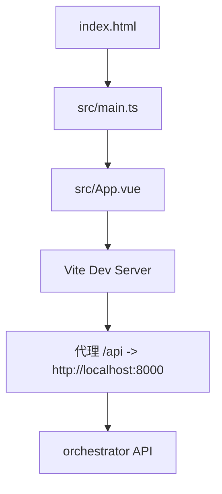
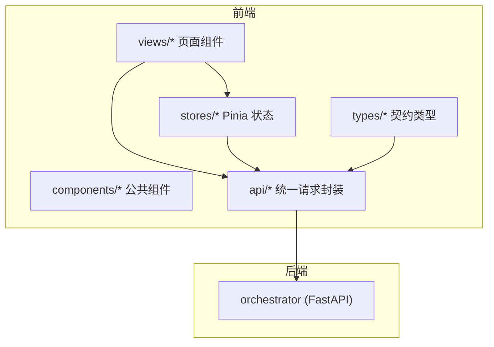
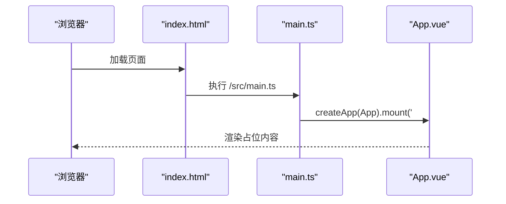
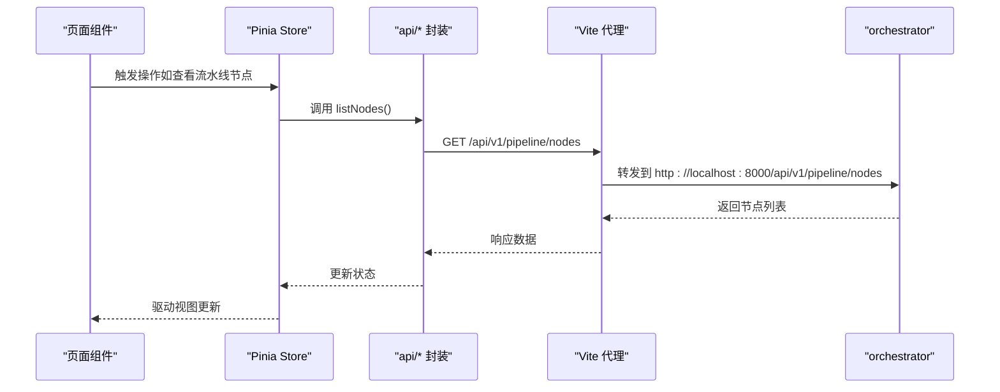
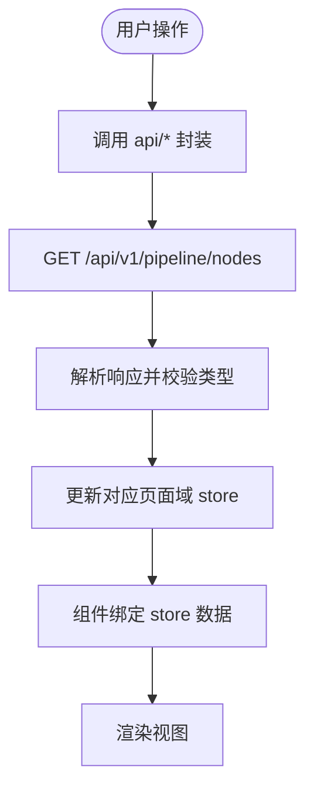
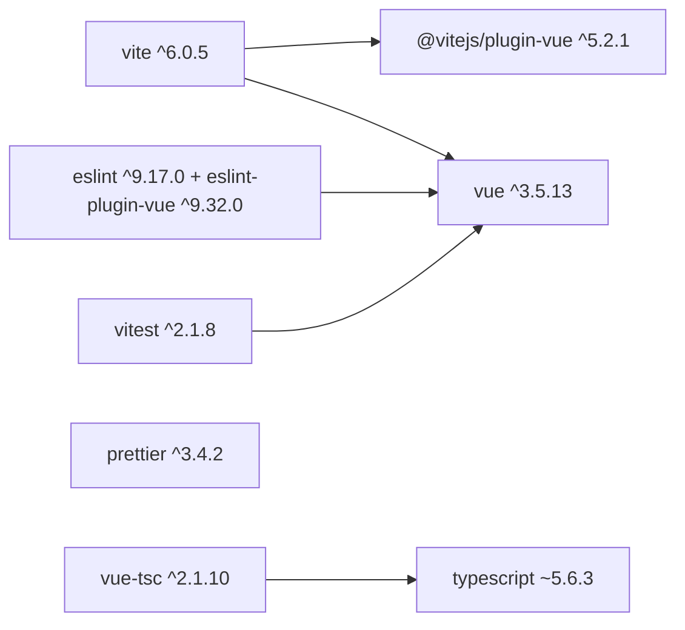

# 前端应用

<cite>
**本文引用的文件**
- [package.json](file://services/frontend/package.json)
- [tsconfig.json](file://services/frontend/tsconfig.json)
- [vite.config.ts](file://services/frontend/vite.config.ts)
- [index.html](file://services/frontend/index.html)
- [main.ts](file://services/frontend/src/main.ts)
- [App.vue](file://services/frontend/src/App.vue)
- [frontend-code-style.md](file://.rules/frontend-code-style.md)
- [开发规范说明.md](file://docs/09_开发规范说明.md)
- [UI演示设计.md](file://docs/07_UI演示设计.md)
- [api.py](file://services/orchestrator/src/orchestrator/api.py)
</cite>

## 目录
1. [简介](#简介)
2. [项目结构](#项目结构)
3. [核心组件](#核心组件)
4. [架构总览](#架构总览)
5. [详细组件分析](#详细组件分析)
6. [依赖关系分析](#依赖关系分析)
7. [性能考虑](#性能考虑)
8. [故障排查指南](#故障排查指南)
9. [结论](#结论)
10. [附录](#附录)

## 简介
本仓库的前端位于 services/frontend，采用 Vue 3 + TypeScript + Vite 的现代前端工程化方案。当前阶段为“占位实现”，用于承载后续六页业务界面（任务配置、流水线总览、Code Review 三视图、测试报告、缺陷闭环、回归沉淀与度量）。前端通过 Vite dev server 的代理将 /api 请求转发至编排器服务（默认 http://localhost:8000），以 REST API 方式获取流水线节点清单等数据。样式与主题将在后续按设计规范逐步落地；当前仅保留最小可运行骨架。

## 项目结构
前端工程遵循 Monorepo 中的约定：
- 构建工具：Vite 6，插件 @vitejs/plugin-vue
- 语言与类型：TypeScript 5.6，严格模式，模块解析为 bundler
- 包管理：pnpm（锁定版本）
- 入口：index.html 引入 src/main.ts，挂载 #app
- 应用根组件：src/App.vue（当前为占位展示）
- 开发代理：vite.config.ts 中 /api -> http://localhost:8000

图表来源
- [index.html:1-13](file://services/frontend/index.html#L1-L13)
- [main.ts:1-6](file://services/frontend/src/main.ts#L1-L6)
- [App.vue:1-12](file://services/frontend/src/App.vue#L1-L12)
- [vite.config.ts:1-16](file://services/frontend/vite.config.ts#L1-L16)
- [api.py:11-27](file://services/orchestrator/src/orchestrator/api.py#L11-L27)

章节来源
- [package.json:1-29](file://services/frontend/package.json#L1-L29)
- [tsconfig.json:1-15](file://services/frontend/tsconfig.json#L1-L15)
- [vite.config.ts:1-16](file://services/frontend/vite.config.ts#L1-L16)
- [index.html:1-13](file://services/frontend/index.html#L1-L13)
- [main.ts:1-6](file://services/frontend/src/main.ts#L1-L6)
- [App.vue:1-12](file://services/frontend/src/App.vue#L1-L12)

## 核心组件
- 应用初始化
  - main.ts 使用 createApp(App).mount('#app') 挂载根组件
  - index.html 提供 #app 容器并加载 /src/main.ts
- 根组件
  - App.vue 当前为占位文本，遵循“数值一律来自后端”的口径红线
- 构建与脚本
  - dev/build/lint/test 脚本由 package.json 定义
  - build 流程先执行 vue-tsc 类型检查再 vite build

章节来源
- [main.ts:1-6](file://services/frontend/src/main.ts#L1-L6)
- [index.html:1-13](file://services/frontend/index.html#L1-L13)
- [App.vue:1-12](file://services/frontend/src/App.vue#L1-L12)
- [package.json:1-29](file://services/frontend/package.json#L1-L29)

## 架构总览
前端采用“轻量骨架 + 统一 API 层 + 页面域状态”的分层架构：
- 表现层：Vue 3 组合式 API + <script setup>，页面级组件按 07 六页命名
- 状态层：Pinia store（按页面域拆分，避免巨型全局 store）
- 数据层：src/api/ 统一封装 fetch，集中处理认证头、错误结构与重试/取消策略
- 契约层：与 schemas/contracts/ 对齐的类型定义，保证前后端字段一致
- 构建层：Vite 提供 HMR、生产优化与代理能力

图表来源
- [vite.config.ts:1-16](file://services/frontend/vite.config.ts#L1-L16)
- [api.py:11-27](file://services/orchestrator/src/orchestrator/api.py#L11-L27)
- [frontend-code-style.md:12-42](file://.rules/frontend-code-style.md#L12-L42)
- [开发规范说明.md:64-71](file://docs/09_开发规范说明.md#L64-L71)

## 详细组件分析

### 应用初始化与路由挂载
- index.html 定义页面标题与 #app 容器，并通过 type="module" 引入 src/main.ts
- main.ts 创建 Vue 应用实例并挂载到 #app，当前为占位入口，待业务页面接入后扩展路由与布局

图表来源
- [index.html:1-13](file://services/frontend/index.html#L1-L13)
- [main.ts:1-6](file://services/frontend/src/main.ts#L1-L6)
- [App.vue:1-12](file://services/frontend/src/App.vue#L1-L12)

章节来源
- [index.html:1-13](file://services/frontend/index.html#L1-L13)
- [main.ts:1-6](file://services/frontend/src/main.ts#L1-L6)
- [App.vue:1-12](file://services/frontend/src/App.vue#L1-L12)

### 页面布局与六页方向
- 页面规划依据 UI 设计文档的六页方向：任务配置、流水线总览、Code Review 三视图、测试报告、缺陷闭环、回归沉淀与度量
- 组件命名与职责划分遵循前端代码风格规范：页面组件置于 views/，公共组件置于 components/，状态按页面域拆分至 stores/
- 当前阶段为占位实现，后续将按 M1–M5 排期逐步接入

章节来源
- [UI演示设计.md:19-31](file://docs/07_UI演示设计.md#L19-L31)
- [frontend-code-style.md:12-20](file://.rules/frontend-code-style.md#L12-L20)
- [开发规范说明.md:64-71](file://docs/09_开发规范说明.md#L64-L71)

### 与编排器服务的通信（API 集成）
- 开发环境代理：vite.config.ts 将 /api 请求代理到 http://localhost:8000
- 后端接口：orchestrator 暴露 /health 与 /api/v1/pipeline/nodes 两个接口
- 前端调用建议：在 src/api/ 中封装统一的 fetch 方法，统一处理错误结构 {code, message, node_id?, details}，并在组件中通过 Pinia store 管理状态

图表来源
- [vite.config.ts:1-16](file://services/frontend/vite.config.ts#L1-L16)
- [api.py:11-27](file://services/orchestrator/src/orchestrator/api.py#L11-L27)
- [frontend-code-style.md:35-42](file://.rules/frontend-code-style.md#L35-L42)
- [开发规范说明.md:89-94](file://docs/09_开发规范说明.md#L89-L94)

章节来源
- [vite.config.ts:1-16](file://services/frontend/vite.config.ts#L1-L16)
- [api.py:11-27](file://services/orchestrator/src/orchestrator/api.py#L11-L27)
- [frontend-code-style.md:35-42](file://.rules/frontend-code-style.md#L35-L42)
- [开发规范说明.md:89-94](file://docs/09_开发规范说明.md#L89-L94)

### 数据绑定机制与状态管理
- 数据流向：后端 API -> api/* 封装 -> Pinia store -> 页面组件
- 展示口径红线：所有度量数值必须来自后端程序化汇总结果，前端不做计算或估算
- 状态组织：按页面域拆分 store，避免全局巨型 store；组件内只负责交互与展示

图表来源
- [frontend-code-style.md:22-27](file://.rules/frontend-code-style.md#L22-L27)
- [开发规范说明.md:64-71](file://docs/09_开发规范说明.md#L64-L71)
- [api.py:21-25](file://services/orchestrator/src/orchestrator/api.py#L21-L25)

章节来源
- [frontend-code-style.md:22-27](file://.rules/frontend-code-style.md#L22-L27)
- [开发规范说明.md:64-71](file://docs/09_开发规范说明.md#L64-L71)
- [api.py:21-25](file://services/orchestrator/src/orchestrator/api.py#L21-L25)

### 样式管理与主题定制方案
- 类名规范：kebab-case，避免深层 DOM 依赖与 !important
- 设计令牌：复用现有颜色、间距、圆角、阴影与字体变量；同类值重复出现时抽取变量
- 响应式与可访问性：适配窄屏与桌面宽度；确保 hover/focus-visible/disabled/loading/error 状态清晰；尊重 prefers-reduced-motion
- 主题定制：通过 CSS 变量或预处理器变量集中管理主题色与尺寸，便于后续切换主题

章节来源
- [frontend-code-style.md:44-50](file://.rules/frontend-code-style.md#L44-L50)

### 与编排器服务通信的具体示例（模式与路径）
- 请求封装模式
  - 在 src/api/ 下建立统一请求函数，例如 listNodes()，内部使用 fetch，统一处理错误结构 {code, message, node_id?, details}
  - 对超时、网络异常、HTTP 非 2xx 进行统一捕获与提示
- 组件调用模式
  - 在页面组件中通过 Pinia store 调用 api/* 方法，并将 loading/success/error 状态绑定到 UI
  - 轮询监控需在页面离开或状态失效后停止，避免泄漏
- 参考路径
  - 请求封装位置：src/api/*.ts
  - 页面组件位置：src/views/*.vue
  - 状态管理位置：src/stores/*.ts
  - 类型定义位置：src/types/*.ts

章节来源
- [frontend-code-style.md:35-42](file://.rules/frontend-code-style.md#L35-L42)
- [开发规范说明.md:64-71](file://docs/09_开发规范说明.md#L64-L71)

## 依赖关系分析
- 运行时依赖
  - vue ^3.5.13
- 开发依赖
  - vite ^6.0.5
  - @vitejs/plugin-vue ^5.2.1
  - typescript ~5.6.3
  - vue-tsc ^2.1.10
  - eslint ^9.17.0 + eslint-plugin-vue ^9.32.0
  - prettier ^3.4.2
  - vitest ^2.1.8

图表来源
- [package.json:14-27](file://services/frontend/package.json#L14-L27)

章节来源
- [package.json:1-29](file://services/frontend/package.json#L1-L29)

## 性能考虑
- 构建优化
  - 使用 Vite 原生优化与按需编译；生产构建前执行 vue-tsc 类型检查，减少运行时错误
- 网络请求
  - 统一封装请求，支持取消与重试；避免在组件内散落 fetch
- 状态管理
  - 按页面域拆分 store，减少不必要的全局状态更新
- 渲染性能
  - 合理使用 v-if/v-show；避免不必要的重渲染；长列表虚拟化（后续实现时）
- 资源体积
  - 仅引入必要依赖；避免大体积第三方库；图片与静态资源按需加载

## 故障排查指南
- 常见问题
  - 代理未生效：检查 vite.config.ts 的 server.proxy 配置与后端服务是否启动
  - 类型错误：运行 pnpm build 会执行 vue-tsc，根据报错定位类型问题
  - 样式冲突：遵循 kebab-case 与变量复用，避免 !important 与深层选择器
  - 轮询泄漏：确保页面离开或状态失效后停止轮询
- 调试步骤
  - 打开浏览器开发者工具 Network 面板，确认 /api 请求是否正确转发
  - 检查控制台是否有类型错误或运行时异常
  - 使用 ESLint/Prettier 检查代码风格与格式问题
- 参考规范
  - 前端代码风格与构建验证流程见规则文件
  - 开发规范说明中关于异常处理与日志的建议

章节来源
- [frontend-code-style.md:51-55](file://.rules/frontend-code-style.md#L51-L55)
- [开发规范说明.md:96-101](file://docs/09_开发规范说明.md#L96-L101)

## 结论
当前前端工程已搭建完成基础骨架，采用 Vue 3 + TypeScript + Vite 的技术栈，并通过 Vite 代理与编排器服务对接。后续将依据 UI 设计文档的六页方向逐步实现页面组件、状态管理与 API 集成。请严格遵循前端代码风格与开发规范，确保代码质量、可维护性与可测试性。

## 附录
- 环境变量与代理
  - 开发环境：vite.config.ts 中 /api 代理到 http://localhost:8000
  - 生产环境：需根据部署配置调整代理或直接走反向代理
- 命令参考
  - 开发：pnpm dev
  - 构建：pnpm build
  - 检查：pnpm lint
  - 测试：pnpm test

章节来源
- [vite.config.ts:1-16](file://services/frontend/vite.config.ts#L1-L16)
- [package.json:8-12](file://services/frontend/package.json#L8-L12)