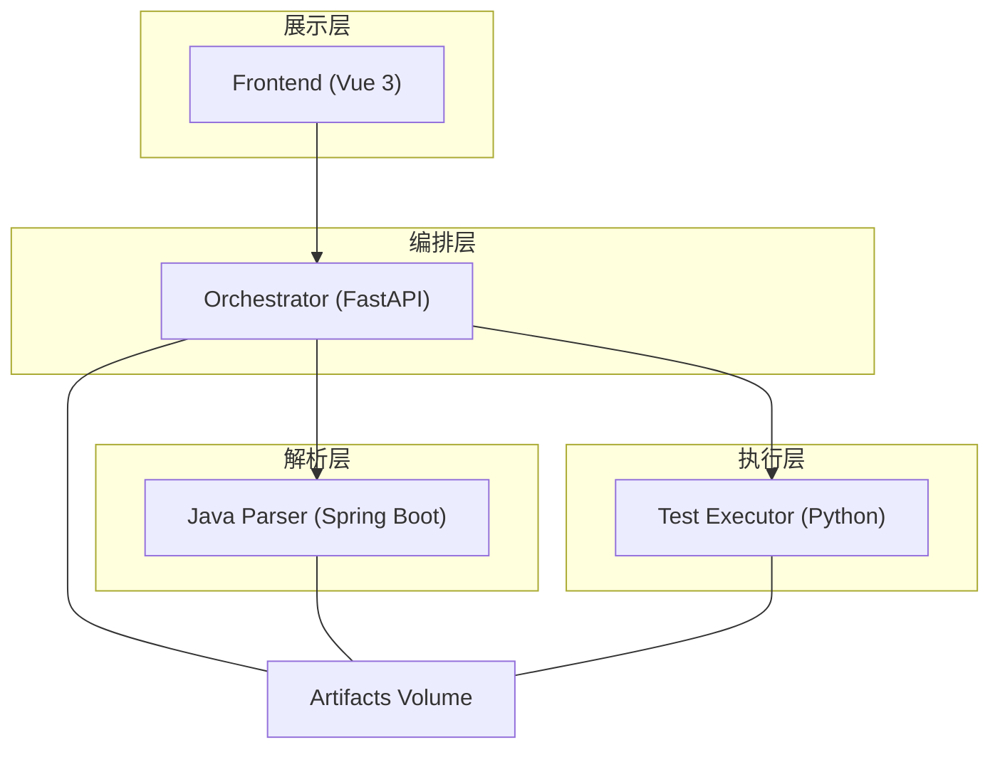
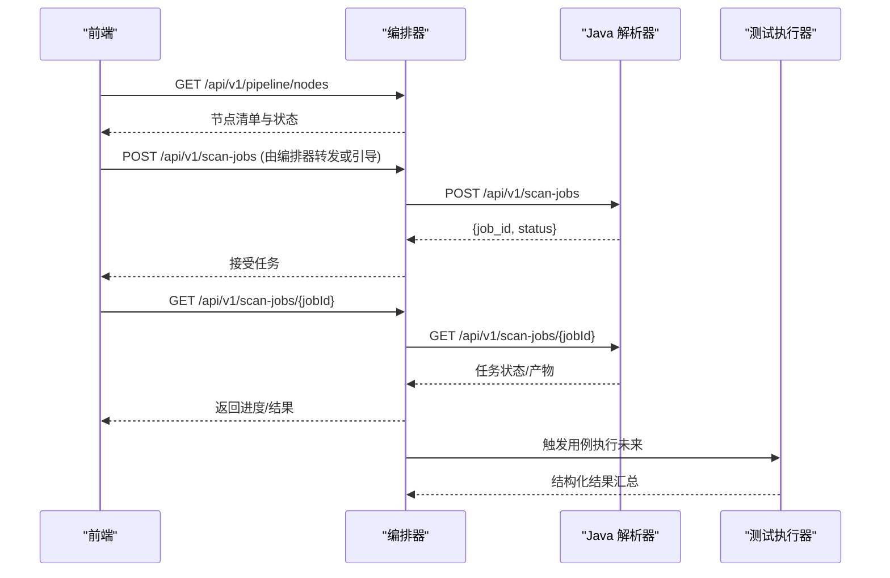
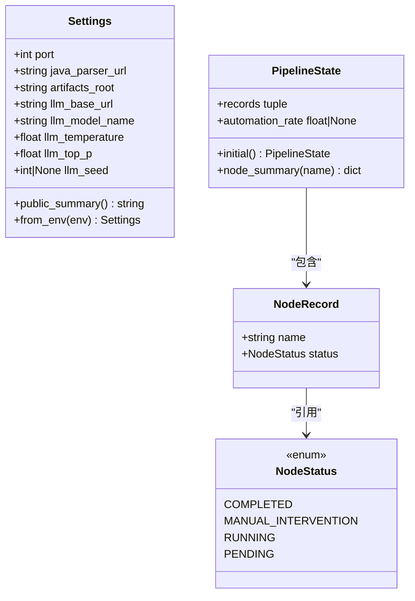
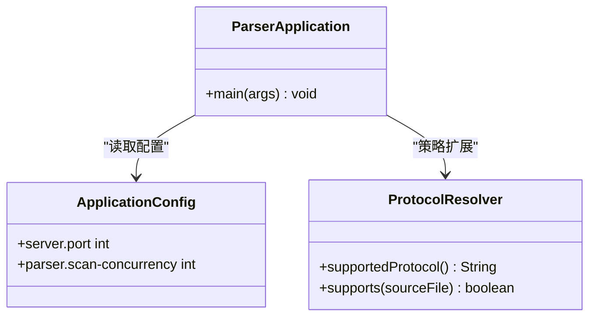
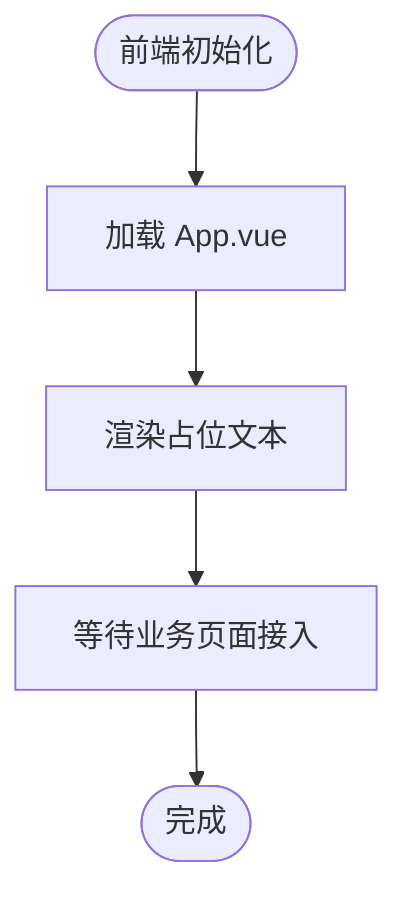
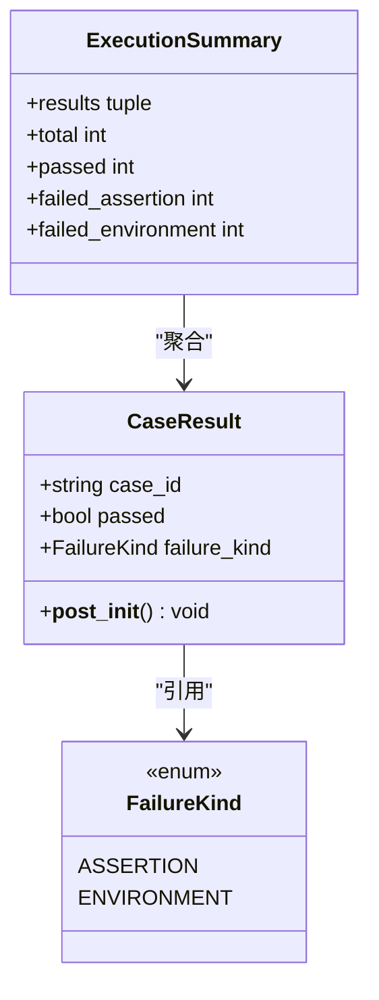
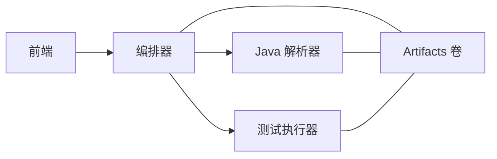

# 微服务设计

<cite>
**本文引用的文件**
- [services/orchestrator/src/orchestrator/__main__.py](file://services/orchestrator/src/orchestrator/__main__.py)
- [services/orchestrator/src/orchestrator/api.py](file://services/orchestrator/src/orchestrator/api.py)
- [services/orchestrator/src/orchestrator/pipeline.py](file://services/orchestrator/src/orchestrator/pipeline.py)
- [services/orchestrator/src/orchestrator/config.py](file://services/orchestrator/src/orchestrator/config.py)
- [services/java-parser/src/main/java/com/llmautotest/parser/ParserApplication.java](file://services/java-parser/src/main/java/com/llmautotest/parser/ParserApplication.java)
- [services/java-parser/src/main/java/com/llmautotest/parser/ProtocolResolver.java](file://services/java-parser/src/main/java/com/llmautotest/parser/ProtocolResolver.java)
- [services/java-parser/src/main/resources/application.yml](file://services/java-parser/src/main/resources/application.yml)
- [services/java-parser/pom.xml](file://services/java-parser/pom.xml)
- [schemas/contracts/java-parser.openapi.yaml](file://schemas/contracts/java-parser.openapi.yaml)
- [services/frontend/src/App.vue](file://services/frontend/src/App.vue)
- [services/frontend/package.json](file://services/frontend/package.json)
- [services/test-executor/src/executor/result.py](file://services/test-executor/src/executor/result.py)
- [deploy/docker-compose.yml](file://deploy/docker-compose.yml)
</cite>

## 目录
1. [简介](#简介)
2. [项目结构](#项目结构)
3. [核心组件](#核心组件)
4. [架构总览](#架构总览)
5. [详细组件分析](#详细组件分析)
6. [依赖关系与通信协议](#依赖关系与通信协议)
7. [性能考量](#性能考量)
8. [故障排查指南](#故障排查指南)
9. [结论](#结论)
10. [附录](#附录)

## 简介
本仓库实现了一个面向自动化测试编排的微服务系统，包含以下关键服务：
- 编排器（orchestrator）：提供统一 REST API、流水线节点定义与状态管理，协调下游解析与执行。
- Java 解析器（java-parser）：基于 Spring Boot 的静态分析与接口候选提取服务，支持多协议可插拔策略。
- 前端（frontend）：Vue 3 + Vite 构建的前端应用，当前为占位页面，后续接入六页业务界面。
- 测试执行器（test-executor）：负责用例执行结果的结构化建模与汇总，区分断言失败与环境失败。

整体采用容器化部署，通过 docker-compose 编排服务间依赖与健康检查，共享产物卷以持久化中间产物。

## 项目结构
- services/orchestrator：Python FastAPI 服务，暴露健康检查与流水线节点清单接口，承载配置与流水线状态骨架。
- services/java-parser：Spring Boot 应用，定义协议解析策略接口与运行配置，契约由 OpenAPI 描述。
- services/frontend：Vue 3 前端工程，使用 pnpm 包管理，Vite 构建。
- services/test-executor：Python 模块，定义用例结果与汇总的数据模型。
- schemas/contracts：OpenAPI 契约，定义 java-parser 的服务接口与数据结构。
- deploy/docker-compose.yml：统一编排入口，声明服务、端口映射、环境变量、卷挂载与启动顺序。

图表来源
- [deploy/docker-compose.yml:1-62](file://deploy/docker-compose.yml#L1-L62)

章节来源
- [deploy/docker-compose.yml:1-62](file://deploy/docker-compose.yml#L1-L62)

## 核心组件
- 编排器：提供 /health 与 /api/v1/pipeline/nodes 两个接口；维护九节点固定口径的流水线状态，计算自动化率。
- Java 解析器：提供扫描任务与候选提取任务的异步 Job 模式；支持 rest/dubbo/grpc/graphql/soap/mq 等协议的策略扩展。
- 前端：当前为占位页面，遵循“数值一律来自后端”的规范，后续按排期接入完整界面。
- 测试执行器：定义 CaseResult 与 ExecutionSummary，严格区分断言失败与环境失败，保证通过率统计口径一致。

章节来源
- [services/orchestrator/src/orchestrator/api.py:11-27](file://services/orchestrator/src/orchestrator/api.py#L11-L27)
- [services/orchestrator/src/orchestrator/pipeline.py:11-84](file://services/orchestrator/src/orchestrator/pipeline.py#L11-L84)
- [services/java-parser/src/main/java/com/llmautotest/parser/ProtocolResolver.java:6-16](file://services/java-parser/src/main/java/com/llmautotest/parser/ProtocolResolver.java#L6-L16)
- [services/test-executor/src/executor/result.py:10-61](file://services/test-executor/src/executor/result.py#L10-L61)

## 架构总览
系统采用分层微服务架构：
- 前端通过 HTTP 访问编排器提供的 REST API。
- 编排器根据流水线节点调度调用 Java 解析器进行静态分析与候选提取，并可能调用测试执行器执行用例。
- 所有服务共享 artifacts 卷用于持久化中间产物（如 code_inventory、报告等）。
- 服务间通过 HTTP REST 通信，契约由 OpenAPI 文档约束。

图表来源
- [schemas/contracts/java-parser.openapi.yaml:24-115](file://schemas/contracts/java-parser.openapi.yaml#L24-L115)
- [services/orchestrator/src/orchestrator/api.py:16-27](file://services/orchestrator/src/orchestrator/api.py#L16-L27)

## 详细组件分析

### 编排器服务（orchestrator）
- 职责
  - 提供健康检查与流水线节点清单接口。
  - 维护九节点固定顺序与四态标注（completed/manual_intervention/running/pending）。
  - 计算自动化率（已完成节点数/9），并在骨架阶段返回 None 表示尚未实测。
- 配置
  - 从环境变量加载配置，包括端口、java_parser_url、artifacts_root、LLM 参数等。
  - 日志输出安全摘要，不泄露密钥。
- API
  - GET /health：健康检查。
  - GET /api/v1/pipeline/nodes：返回九节点清单与当前状态。

图表来源
- [services/orchestrator/src/orchestrator/config.py:9-50](file://services/orchestrator/src/orchestrator/config.py#L9-L50)
- [services/orchestrator/src/orchestrator/pipeline.py:11-84](file://services/orchestrator/src/orchestrator/pipeline.py#L11-L84)

章节来源
- [services/orchestrator/src/orchestrator/__main__.py:15-25](file://services/orchestrator/src/orchestrator/__main__.py#L15-L25)
- [services/orchestrator/src/orchestrator/api.py:11-27](file://services/orchestrator/src/orchestrator/api.py#L11-L27)
- [services/orchestrator/src/orchestrator/config.py:9-50](file://services/orchestrator/src/orchestrator/config.py#L9-L50)
- [services/orchestrator/src/orchestrator/pipeline.py:11-84](file://services/orchestrator/src/orchestrator/pipeline.py#L11-L84)

### Java 解析器（java-parser）
- 应用结构
  - Spring Boot 主类 ParserApplication 启用自动配置与属性扫描。
  - 配置文件 application.yml 设置服务端口与扫描并发度。
  - 依赖 JavaParser 作为源码解析核心，支持多协议策略扩展。
- 协议解析策略模式
  - ProtocolResolver 接口定义 supportedProtocol、supports、以及解析方法（待契约定稿后接入）。
  - 新增协议只需实现该接口，无需修改主流程，满足 R2 风险应对要求。
- 契约与接口
  - OpenAPI 定义了扫描任务与候选提取任务的异步 Job 模式，包括请求体、响应体、错误结构与枚举。
  - 支持 rest/dubbo/grpc/graphql/soap/mq 等协议识别与处理。

图表来源
- [services/java-parser/src/main/java/com/llmautotest/parser/ParserApplication.java:8-16](file://services/java-parser/src/main/java/com/llmautotest/parser/ParserApplication.java#L8-L16)
- [services/java-parser/src/main/java/com/llmautotest/parser/ProtocolResolver.java:6-16](file://services/java-parser/src/main/java/com/llmautotest/parser/ProtocolResolver.java#L6-L16)
- [services/java-parser/src/main/resources/application.yml:1-8](file://services/java-parser/src/main/resources/application.yml#L1-L8)

章节来源
- [services/java-parser/src/main/java/com/llmautotest/parser/ParserApplication.java:8-16](file://services/java-parser/src/main/java/com/llmautotest/parser/ParserApplication.java#L8-L16)
- [services/java-parser/src/main/java/com/llmautotest/parser/ProtocolResolver.java:6-16](file://services/java-parser/src/main/java/com/llmautotest/parser/ProtocolResolver.java#L6-L16)
- [services/java-parser/src/main/resources/application.yml:1-8](file://services/java-parser/src/main/resources/application.yml#L1-L8)
- [services/java-parser/pom.xml:31-47](file://services/java-parser/pom.xml#L31-L47)
- [schemas/contracts/java-parser.openapi.yaml:24-115](file://schemas/contracts/java-parser.openapi.yaml#L24-L115)

### 前端应用（frontend）
- 技术栈
  - Vue 3 + TypeScript + Vite，使用 pnpm 管理依赖。
  - ESLint + Prettier 代码风格校验，Vitest 单元测试框架。
- 当前状态
  - App.vue 为占位页面，遵循“数值一律来自后端 API，前端不做计算”的规范。
  - 六页业务界面按 M1–M5 排期接入。

章节来源
- [services/frontend/src/App.vue:1-12](file://services/frontend/src/App.vue#L1-L12)
- [services/frontend/package.json:1-29](file://services/frontend/package.json#L1-L29)

### 测试执行器（test-executor）
- 结果模型
  - FailureKind 枚举区分断言失败与环境失败。
  - CaseResult 表示单条用例结果，并通过 __post_init__ 校验一致性（通过的用例不得携带失败类型）。
  - ExecutionSummary 提供 total、passed、failed_assertion、failed_environment 等汇总属性，确保通过率统计口径一致。
- 设计要点
  - 环境失败隔离至待环境确认，不计入通过率分母。
  - 程序化汇总，不经 LLM，保证指标可信。

图表来源
- [services/test-executor/src/executor/result.py:10-61](file://services/test-executor/src/executor/result.py#L10-L61)

章节来源
- [services/test-executor/src/executor/result.py:10-61](file://services/test-executor/src/executor/result.py#L10-L61)

## 依赖关系与通信协议
- 服务依赖
  - orchestrator 依赖 java-parser 进行静态分析与候选提取。
  - frontend 依赖 orchestrator 提供 REST API。
  - test-executor 可通过 orchestrator 触发执行，产出结构化结果。
- 通信协议
  - 全部采用 HTTP REST 通信。
  - java-parser 的接口契约由 OpenAPI 文档定义，包括健康检查、扫描任务、候选提取任务及错误结构。
- 部署与发现
  - 通过 docker-compose 编排服务，使用 depends_on 与 healthcheck 控制启动顺序与健康探测。
  - 共享 artifacts 卷用于跨服务产物传递。

图表来源
- [deploy/docker-compose.yml:1-62](file://deploy/docker-compose.yml#L1-L62)
- [schemas/contracts/java-parser.openapi.yaml:1-115](file://schemas/contracts/java-parser.openapi.yaml#L1-L115)

章节来源
- [deploy/docker-compose.yml:1-62](file://deploy/docker-compose.yml#L1-L62)
- [schemas/contracts/java-parser.openapi.yaml:1-115](file://schemas/contracts/java-parser.openapi.yaml#L1-L115)

## 性能考量
- 解析并发度：java-parser 支持 parser.scan-concurrency 配置，可调整多仓库扫描并发度以提升吞吐。
- 大仓库截断：当仓库过大时，可通过 include_paths 指定核心模块目录，减少扫描范围。
- 异步任务：扫描与提取任务采用 job 模式，避免长请求阻塞，提升用户体验。
- 资源隔离：各服务独立容器化，便于横向扩展与资源限制。

[本节为通用指导，不直接分析具体文件]

## 故障排查指南
- 健康检查
  - 编排器与解析器均提供 /health 接口，可用于 docker-compose 健康探测。
- 常见错误
  - 缺少必填环境变量：编排器在加载配置时会显式报错。
  - 路径不存在：解析器在扫描阶段会返回错误结构，包含稳定错误码与消息。
- 调试建议
  - 查看服务日志输出，关注健康检查与任务状态变更。
  - 检查 artifacts 卷中的中间产物，定位问题阶段。

章节来源
- [services/orchestrator/src/orchestrator/config.py:32-50](file://services/orchestrator/src/orchestrator/config.py#L32-L50)
- [schemas/contracts/java-parser.openapi.yaml:130-148](file://schemas/contracts/java-parser.openapi.yaml#L130-L148)

## 结论
本微服务架构通过清晰的职责划分与契约驱动的设计，实现了自动化测试流水线的编排、静态分析与执行结果的标准化。编排器提供统一的 API 与状态管理，Java 解析器支持多协议的可插拔策略，前端预留了完整的业务界面接入空间，测试执行器确保了结果统计的一致性与可信度。容器化部署与共享卷机制进一步提升了系统的可维护性与可扩展性。

[本节为总结性内容，不直接分析具体文件]

## 附录
- 环境变量参考（编排器）
  - PORT：服务端口
  - JAVA_PARSER_URL：解析器地址
  - ARTIFACTS_ROOT：产物根目录
  - LLM_BASE_URL、LLM_MODEL_NAME、LLM_TEMPERATURE、LLM_TOP_P、LLM_SEED：LLM 调用参数
- 服务端口映射
  - orchestrator：8000
  - java-parser：8080（容器内），宿主机 8081
  - frontend：8080（容器内），宿主机 8080

章节来源
- [services/orchestrator/src/orchestrator/config.py:9-50](file://services/orchestrator/src/orchestrator/config.py#L9-L50)
- [deploy/docker-compose.yml:1-62](file://deploy/docker-compose.yml#L1-L62)