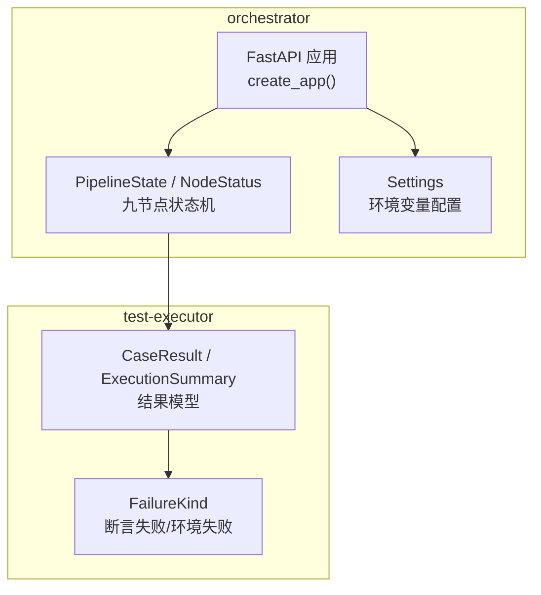
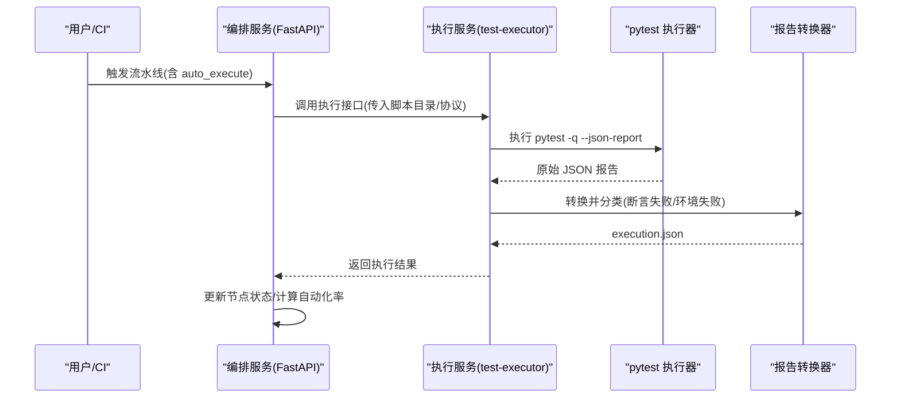
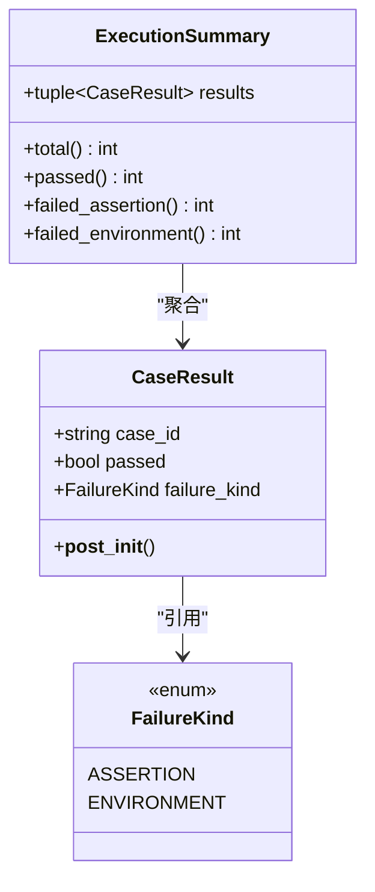
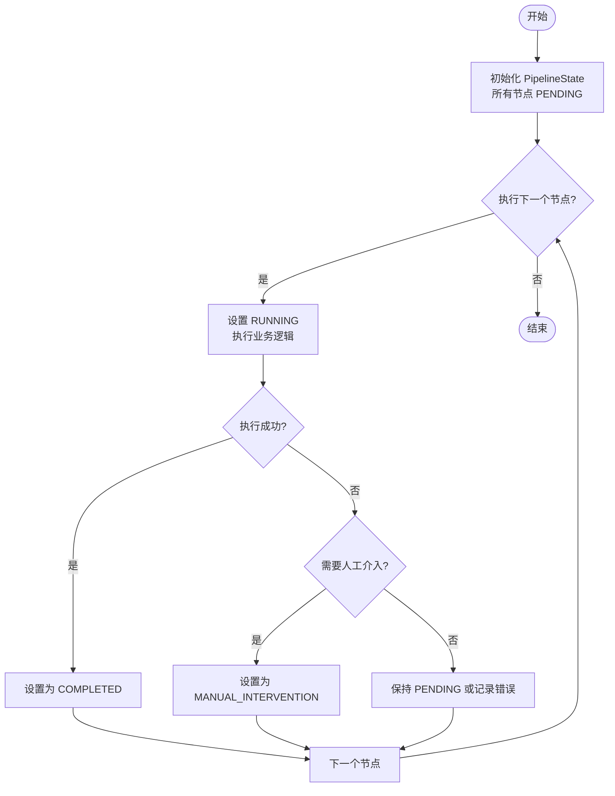
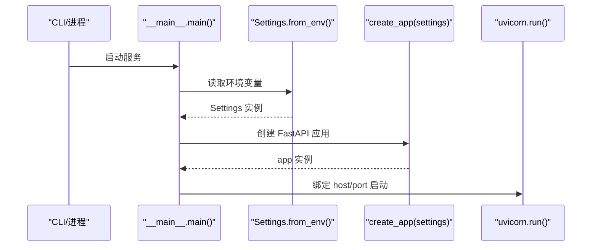
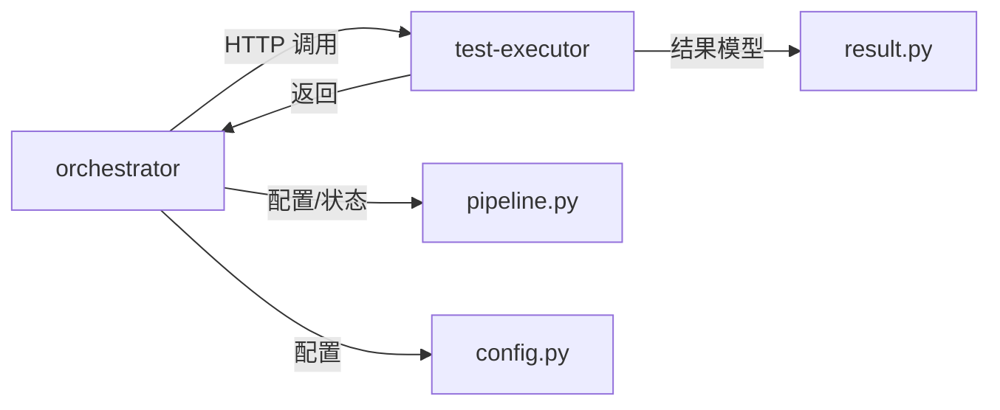

# 测试执行器服务

<cite>
**本文引用的文件**
- [services/test-executor/src/executor/__init__.py](file://services/test-executor/src/executor/__init__.py)
- [services/test-executor/src/executor/result.py](file://services/test-executor/src/executor/result.py)
- [services/test-executor/tests/test_result.py](file://services/test-executor/tests/test_result.py)
- [services/test-executor/pyproject.toml](file://services/test-executor/pyproject.toml)
- [services/orchestrator/src/orchestrator/pipeline.py](file://services/orchestrator/src/orchestrator/pipeline.py)
- [services/orchestrator/src/orchestrator/api.py](file://services/orchestrator/src/orchestrator/api.py)
- [services/orchestrator/src/orchestrator/config.py](file://services/orchestrator/src/orchestrator/config.py)
- [services/orchestrator/src/orchestrator/__main__.py](file://services/orchestrator/src/orchestrator/__main__.py)
- [docs/10_测试框架选型说明.md](file://docs/10_测试框架选型说明.md)
- [docs/04_功能规格说明.md](file://docs/04_功能规格说明.md)
- [docs/11_三人分工任务书.md](file://docs/11_三人分工任务书.md)
</cite>

## 目录
1. [简介](#简介)
2. [项目结构](#项目结构)
3. [核心组件](#核心组件)
4. [架构总览](#架构总览)
5. [详细组件分析](#详细组件分析)
6. [依赖关系分析](#依赖关系分析)
7. [性能与并发](#性能与并发)
8. [故障排查指南](#故障排查指南)
9. [结论](#结论)
10. [附录：扩展开发指南](#附录扩展开发指南)

## 简介
本文件聚焦“测试执行器服务”的执行引擎设计与结果处理逻辑，覆盖用例执行框架、并行执行机制、资源管理、测试结果数据结构与分类算法、报告生成、失败用例分析与重试机制、执行环境隔离与安全控制，并给出如何扩展支持不同测试框架与执行环境的实践指南。当前仓库已提供骨架实现与规范约束，后续可在此基础上补齐具体 Runner 与编排细节。

## 项目结构
- test-executor：测试执行服务，负责脚本加载、无人值守执行、断言二态判定（断言失败 vs 环境失败），并输出结构化执行结果。
- orchestrator：流水线编排服务，定义 9 节点固定口径与状态机，提供 REST API 暴露节点清单与状态；通过环境变量注入配置，启动 FastAPI 服务。
- docs：包含测试框架选型、功能规格、分工任务等关键设计文档，指导执行引擎与结果处理的落地方式。

图表来源
- [services/orchestrator/src/orchestrator/api.py:11-27](file://services/orchestrator/src/orchestrator/api.py#L11-L27)
- [services/orchestrator/src/orchestrator/pipeline.py:11-84](file://services/orchestrator/src/orchestrator/pipeline.py#L11-L84)
- [services/test-executor/src/executor/result.py:10-61](file://services/test-executor/src/executor/result.py#L10-L61)

章节来源
- [services/orchestrator/src/orchestrator/api.py:11-27](file://services/orchestrator/src/orchestrator/api.py#L11-L27)
- [services/orchestrator/src/orchestrator/pipeline.py:11-84](file://services/orchestrator/src/orchestrator/pipeline.py#L11-L84)
- [services/test-executor/src/executor/result.py:10-61](file://services/test-executor/src/executor/result.py#L10-L61)

## 核心组件
- 执行结果模型
  - FailureKind：失败二态枚举，区分“断言失败”和“环境失败”。
  - CaseResult：单条用例结果，包含用例 ID、是否通过、失败类型（仅失败时携带）。
  - ExecutionSummary：一次执行的汇总，提供总数、通过数、断言失败数、环境失败数的程序化统计。
- 流水线与节点状态
  - NodeStatus：四态标注（已完成、人工介入、运行中、待运行）。
  - PipelineState：维护 9 个节点的顺序与状态，计算自动化率（已完成节点数/9）。
- 服务入口与配置
  - Settings：从环境变量读取端口、LLM 参数、产物根路径等，提供不含密钥的配置摘要。
  - create_app：构建 FastAPI 应用，暴露健康检查与节点清单接口。

章节来源
- [services/test-executor/src/executor/result.py:10-61](file://services/test-executor/src/executor/result.py#L10-L61)
- [services/orchestrator/src/orchestrator/pipeline.py:11-84](file://services/orchestrator/src/orchestrator/pipeline.py#L11-L84)
- [services/orchestrator/src/orchestrator/config.py:9-56](file://services/orchestrator/src/orchestrator/config.py#L9-L56)
- [services/orchestrator/src/orchestrator/api.py:11-27](file://services/orchestrator/src/orchestrator/api.py#L11-L27)

## 架构总览
测试执行器服务与编排服务的协作关系如下：
- 编排服务（orchestrator）通过 REST API 暴露流水线节点状态，驱动“auto_execute”“test_report”等节点。
- 执行服务（test-executor）在“auto_execute”节点内执行 pytest 脚本，产出原始 JSON 报告，再按规则转换为统一的 execution.json。
- 结果分类遵循“断言失败”与“环境失败”的二态策略，确保缺陷清单只纳入断言失败，环境失败进入“待环境确认”队列。
- 报告生成阶段对数值进行程序化汇总，不经过 LLM，保证度量可信。

图表来源
- [services/orchestrator/src/orchestrator/api.py:11-27](file://services/orchestrator/src/orchestrator/api.py#L11-L27)
- [services/orchestrator/src/orchestrator/pipeline.py:23-84](file://services/orchestrator/src/orchestrator/pipeline.py#L23-L84)
- [docs/10_测试框架选型说明.md:45-53](file://docs/10_测试框架选型说明.md#L45-L53)

## 详细组件分析

### 执行结果模型与二态分类
- 数据结构
  - FailureKind：断言失败与环境失败的枚举值，用于下游分类与报告统计。
  - CaseResult：冻结数据类，构造时校验一致性（通过的用例不得携带失败类型）。
  - ExecutionSummary：冻结数据类，提供 total、passed、failed_assertion、failed_environment 的只读属性。
- 分类算法
  - 断言失败：由 pytest 插件或异常捕获标记为 assertion。
  - 环境失败：网络/连接超时、被测服务不可达等异常映射为 environment。
  - 汇总统计：ExecutionSummary 基于 results 元组逐项计数，避免 LLM 参与数值计算。

图表来源
- [services/test-executor/src/executor/result.py:10-61](file://services/test-executor/src/executor/result.py#L10-L61)

章节来源
- [services/test-executor/src/executor/result.py:10-61](file://services/test-executor/src/executor/result.py#L10-L61)
- [services/test-executor/tests/test_result.py:10-30](file://services/test-executor/tests/test_result.py#L10-L30)

### 流水线节点与状态机
- 节点顺序：req_parse → code_scan → interface_reconstruct → code_review → testcase_generate → auto_execute → test_report → defect_list → retest_regression。
- 状态四态：completed、manual_intervention、running、pending。
- 自动化率：已完成节点数除以 9，骨架阶段全部 pending，正式实现需从产物卷读取真实状态。

图表来源
- [services/orchestrator/src/orchestrator/pipeline.py:11-84](file://services/orchestrator/src/orchestrator/pipeline.py#L11-L84)

章节来源
- [services/orchestrator/src/orchestrator/pipeline.py:11-84](file://services/orchestrator/src/orchestrator/pipeline.py#L11-L84)

### 服务入口与配置
- Settings：从环境变量读取端口、Java Parser URL、产物根路径、LLM 基线参数（模型名、温度、Top-P、Seed、超时）、Schema 目录；提供不含密钥的配置摘要。
- create_app：构建 FastAPI 应用，挂载健康检查与节点清单接口；节点清单返回 9 节点及其当前状态。
- __main__：统一入口，加载配置并启动 uvicorn 服务。

图表来源
- [services/orchestrator/src/orchestrator/__main__.py:15-25](file://services/orchestrator/src/orchestrator/__main__.py#L15-L25)
- [services/orchestrator/src/orchestrator/config.py:9-56](file://services/orchestrator/src/orchestrator/config.py#L9-L56)
- [services/orchestrator/src/orchestrator/api.py:11-27](file://services/orchestrator/src/orchestrator/api.py#L11-L27)

章节来源
- [services/orchestrator/src/orchestrator/config.py:9-56](file://services/orchestrator/src/orchestrator/config.py#L9-L56)
- [services/orchestrator/src/orchestrator/api.py:11-27](file://services/orchestrator/src/orchestrator/api.py#L11-L27)
- [services/orchestrator/src/orchestrator/__main__.py:15-25](file://services/orchestrator/src/orchestrator/__main__.py#L15-L25)

## 依赖关系分析
- test-executor 依赖 pydantic、httpx；开发期依赖 pytest、ruff、mypy。
- orchestrator 依赖 fastapi、uvicorn、pydantic、httpx、jsonschema；开发期依赖 pytest-asyncio、types-jsonschema。
- 两者通过 REST API 交互：orchestrator 调用 test-executor 执行测试，test-executor 返回 execution.json。

图表来源
- [services/orchestrator/pyproject.toml:1-54](file://services/orchestrator/pyproject.toml#L1-L54)
- [services/test-executor/pyproject.toml:1-45](file://services/test-executor/pyproject.toml#L1-L45)
- [services/orchestrator/src/orchestrator/api.py:11-27](file://services/orchestrator/src/orchestrator/api.py#L11-L27)
- [services/test-executor/src/executor/result.py:10-61](file://services/test-executor/src/executor/result.py#L10-L61)

章节来源
- [services/orchestrator/pyproject.toml:1-54](file://services/orchestrator/pyproject.toml#L1-L54)
- [services/test-executor/pyproject.toml:1-45](file://services/test-executor/pyproject.toml#L1-L45)

## 性能与并发
- 执行命令：使用 pytest -q --json-report 以静默模式输出原始 JSON，便于程序化汇总。
- 并发度：可通过 pytest 插件或外部调度器（如线程池/进程池）对用例集进行分片执行；建议在 orchestrator 层对“auto_execute”节点做并发控制，避免资源争用。
- 超时与重试：结合 Settings.llm_timeout_s 的思路，为执行器增加用例级超时与失败重试策略（例如网络异常重试 N 次后降级为环境失败）。
- 资源隔离：每个执行器进程使用独立虚拟环境或容器，避免全局状态污染；产物写入 artifacts_root，便于断点续跑与归档。

[本节为通用指导，不直接分析具体文件]

## 故障排查指南
- 结果自洽性校验：CaseResult.__post_init__ 会拒绝“通过但携带失败类型”的不一致结果，若出现 ValueError，请检查二态分类逻辑。
- 环境失败识别：网络/连接类异常应映射为 environment，避免误入缺陷清单；可在 pytest hook 中捕获特定异常并标记。
- 报告缺失边界：当 execution.json 缺失或为空时，应报错而非生成空报告；在 test_report 节点加入前置校验。
- 降级场景：某协议 Runner 未就绪时，降级为“脚本生成成功 + Mock 执行演示”，并在报告中注明降级。

章节来源
- [services/test-executor/src/executor/result.py:25-30](file://services/test-executor/src/executor/result.py#L25-L30)
- [docs/04_功能规格说明.md:194-207](file://docs/04_功能规格说明.md#L194-L207)

## 结论
当前仓库提供了测试执行器的骨架实现与严格的设计约束：
- 结果模型清晰，二态分类明确，保障缺陷清单与通过率统计的可信性。
- 流水线节点固定且状态机完备，便于编排与度量。
- 服务配置与入口标准化，利于容器化部署与 CI 集成。
下一步建议补齐：
- 具体的 pytest 插件实现（二态标注、超时控制、重试策略）。
- orchestrator 中对 test-executor 的调用封装与并发调度。
- 产物管理与断点续跑的具体实现（基于 artifacts_root）。

[本节总结性内容，不直接分析具体文件]

## 附录：扩展开发指南

### 扩展支持不同的测试框架
- 选择依据：根据 docs 中的对比，pytest 在 LLM 生成可加载性、五协议客户端、结构化结果导出、无人值守等方面具备优势，适合本项目。
- 接入方式：在 test-executor 中新增 Runner，将不同框架的脚本统一转换为 pytest 可执行集合；或通过适配器将其他框架结果映射到 CaseResult/ExecutionSummary。
- 示例路径参考：
  - 执行命令与报告格式约定见 [docs/10_测试框架选型说明.md:45-53](file://docs/10_测试框架选型说明.md#L45-L53)。
  - 多协议执行覆盖要求见 [docs/03_用户故事卡片.md:127-134](file://docs/03_用户故事卡片.md#L127-L134)。

### 自定义测试执行器开发步骤
- 定义 Runner 接口：统一输入（脚本目录、协议、超时、重试次数），输出（execution.json）。
- 实现二态分类：在 pytest hook 或异常捕获中区分断言失败与环境失败，填充 FailureKind。
- 汇总与归档：基于 ExecutionSummary 计算指标，写入 artifacts_root，供 test_report 节点消费。
- 编排集成：在 orchestrator 的 pipeline 中注册新 Runner，并在 auto_execute 节点调用。

章节来源
- [docs/10_测试框架选型说明.md:45-53](file://docs/10_测试框架选型说明.md#L45-L53)
- [docs/03_用户故事卡片.md:127-134](file://docs/03_用户故事卡片.md#L127-L134)
- [docs/11_三人分工任务书.md:119-144](file://docs/11_三人分工任务书.md#L119-L144)

### 执行环境与安全控制
- 环境变量隔离：所有配置来自环境变量，避免硬编码；敏感信息（如 API Key）不入日志。
- 产物目录：artifacts_root 作为统一产物根路径，按任务 ID 组织，便于权限控制与审计。
- 超时与限流：为执行器设置用例级超时，防止长时间阻塞；对外部依赖（被测服务、Mock）进行可用性探测与降级。

章节来源
- [services/orchestrator/src/orchestrator/config.py:9-56](file://services/orchestrator/src/orchestrator/config.py#L9-L56)
- [docs/04_功能规格说明.md:194-207](file://docs/04_功能规格说明.md#L194-L207)