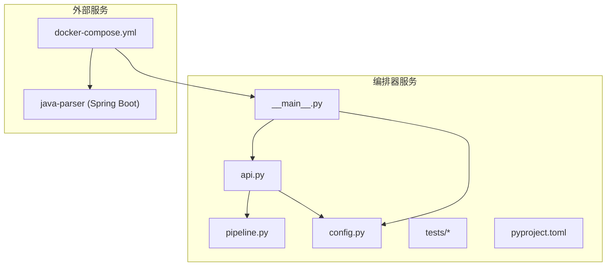
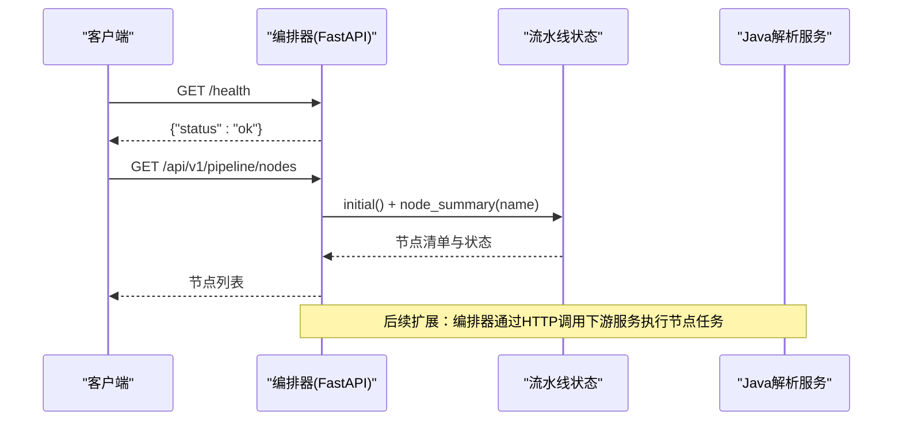
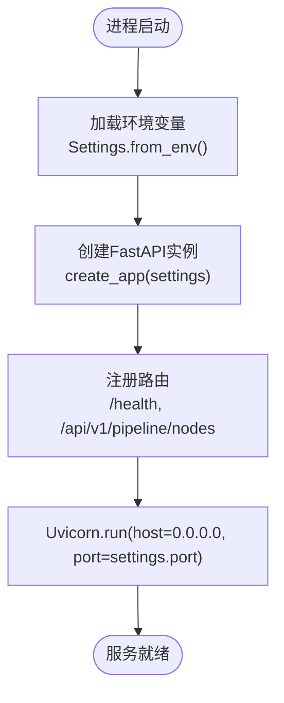
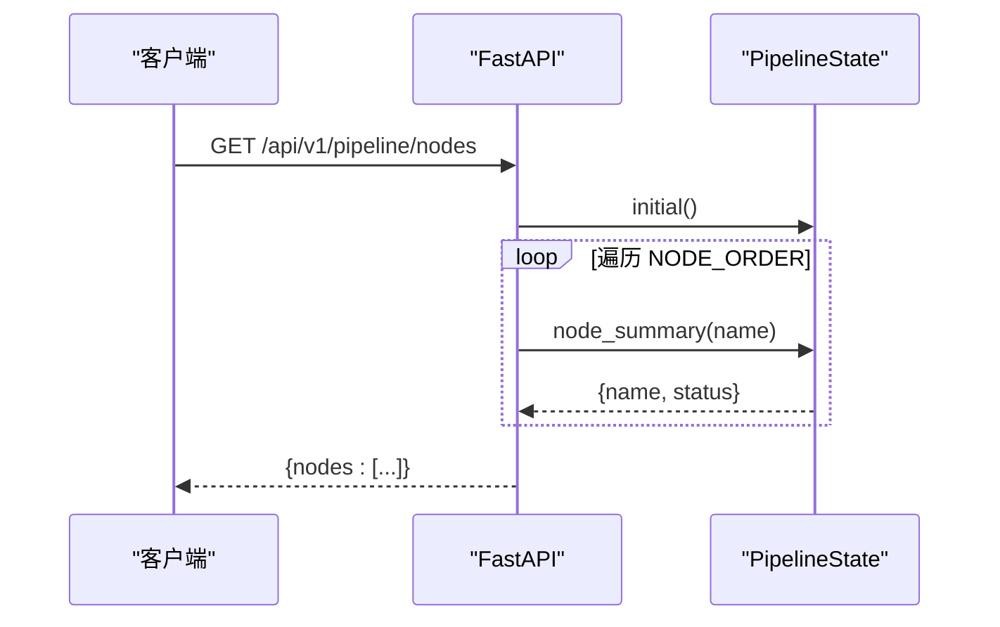
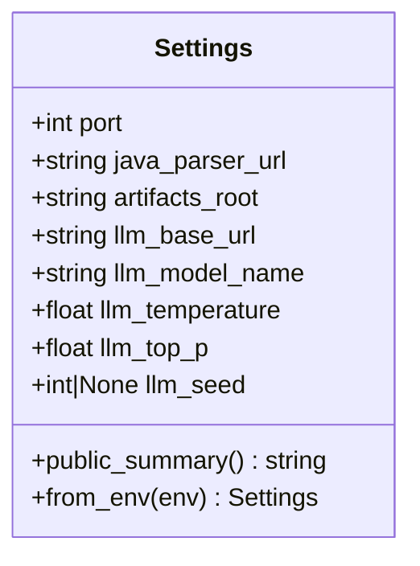
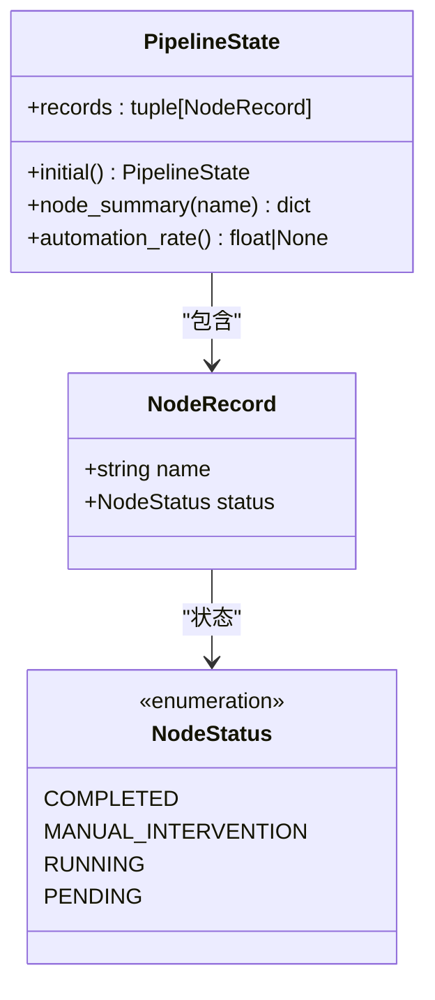
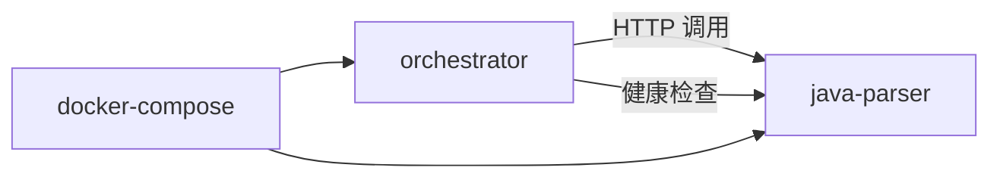
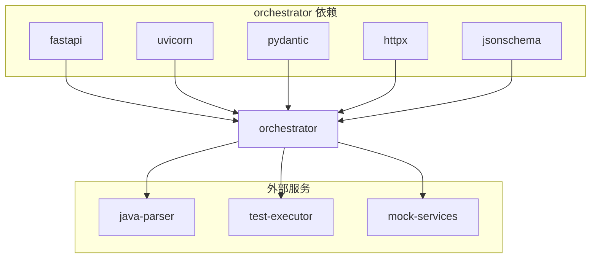
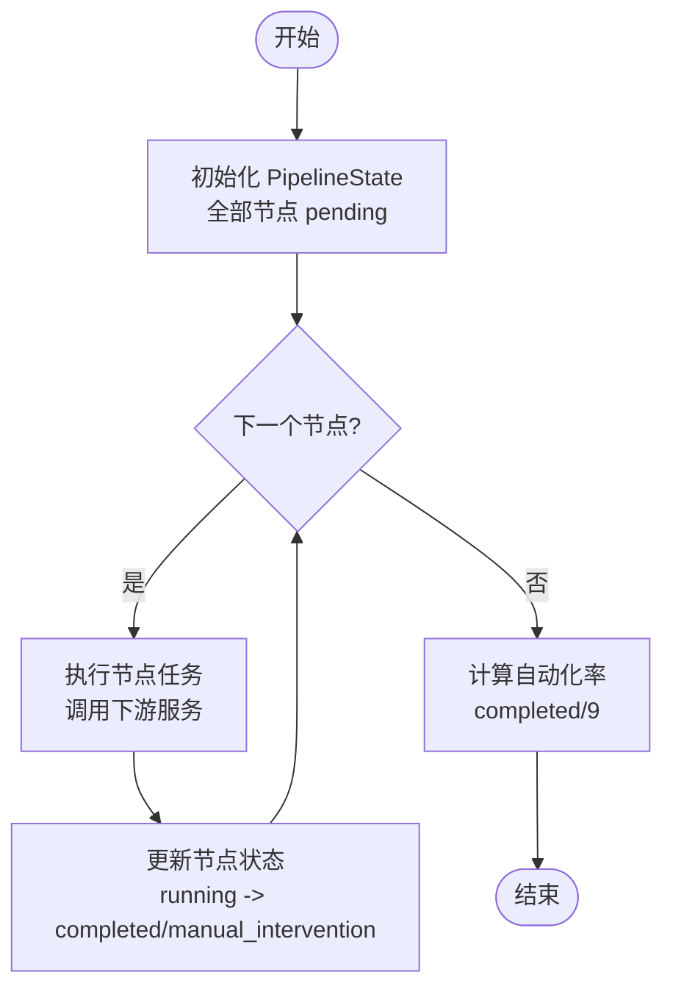

# 编排器服务

<cite>
**本文引用的文件**
- [__main__.py](file://services/orchestrator/src/orchestrator/__main__.py)
- [api.py](file://services/orchestrator/src/orchestrator/api.py)
- [config.py](file://services/orchestrator/src/orchestrator/config.py)
- [pipeline.py](file://services/orchestrator/src/orchestrator/pipeline.py)
- [pyproject.toml](file://services/orchestrator/pyproject.toml)
- [test_config.py](file://services/orchestrator/tests/test_config.py)
- [test_pipeline.py](file://services/orchestrator/tests/test_pipeline.py)
- [ParserApplication.java](file://services/java-parser/src/main/java/com/llmautotest/parser/ParserApplication.java)
- [application.yml](file://services/java-parser/src/main/resources/application.yml)
- [docker-compose.yml](file://deploy/docker-compose.yml)
</cite>

## 目录
1. [简介](#简介)
2. [项目结构](#项目结构)
3. [核心组件](#核心组件)
4. [架构总览](#架构总览)
5. [详细组件分析](#详细组件分析)
6. [依赖关系分析](#依赖关系分析)
7. [性能考量](#性能考量)
8. [故障排查指南](#故障排查指南)
9. [结论](#结论)
10. [附录：API 与流水线示例](#附录api-与流水线示例)

## 简介
本文件面向“编排器服务”的架构设计与核心实现，覆盖 FastAPI 应用启动流程、CLI 统一入口设计、REST API 接口规范、配置管理系统（Settings）与环境变量处理、九节点流水线的设计模式与状态管理、服务间通信协议与依赖管理，以及错误处理、日志记录与监控指标。文档同时提供具体调用方式与执行流程说明，帮助读者快速理解编排器如何协调其他微服务完成测试任务。

## 项目结构
编排器服务位于 services/orchestrator，采用分层组织：
- 入口层：__main__.py 负责 CLI 启动与 Uvicorn 运行
- API 层：api.py 定义 FastAPI 路由与健康检查、节点清单接口
- 领域层：pipeline.py 定义九节点顺序、节点状态枚举与流水线状态聚合
- 配置层：config.py 通过 Settings 数据类集中读取环境变量并校验必填项
- 工程配置：pyproject.toml 声明依赖、构建与工具链
- 测试：tests 下包含对配置与流水线的单元测试
- 外部依赖：java-parser 为 Java 解析服务；docker-compose.yml 描述容器编排与依赖关系

图表来源
- [__main__.py:1-26](file://services/orchestrator/src/orchestrator/__main__.py#L1-L26)
- [api.py:1-28](file://services/orchestrator/src/orchestrator/api.py#L1-L28)
- [pipeline.py:1-84](file://services/orchestrator/src/orchestrator/pipeline.py#L1-L84)
- [config.py:1-50](file://services/orchestrator/src/orchestrator/config.py#L1-L50)
- [docker-compose.yml:1-62](file://deploy/docker-compose.yml#L1-L62)

章节来源
- [__main__.py:1-26](file://services/orchestrator/src/orchestrator/__main__.py#L1-L26)
- [api.py:1-28](file://services/orchestrator/src/orchestrator/api.py#L1-L28)
- [pipeline.py:1-84](file://services/orchestrator/src/orchestrator/pipeline.py#L1-L84)
- [config.py:1-50](file://services/orchestrator/src/orchestrator/config.py#L1-L50)
- [pyproject.toml:1-53](file://services/orchestrator/pyproject.toml#L1-L53)
- [docker-compose.yml:1-62](file://deploy/docker-compose.yml#L1-L62)

## 核心组件
- 应用启动与 CLI 入口：通过 __main__.py 暴露命令行入口，加载 Settings，使用 Uvicorn 启动 FastAPI 应用
- REST API：提供健康检查与九节点清单接口，作为对外契约
- 配置管理：Settings 数据类集中读取环境变量，提供安全摘要输出
- 流水线状态：固定九节点顺序与四态标注，提供自动化率计算骨架
- 外部服务集成：通过 httpx 等 HTTP 客户端与 java-parser 等服务通信（依赖声明在 pyproject.toml）

章节来源
- [__main__.py:15-21](file://services/orchestrator/src/orchestrator/__main__.py#L15-L21)
- [api.py:11-27](file://services/orchestrator/src/orchestrator/api.py#L11-L27)
- [config.py:9-50](file://services/orchestrator/src/orchestrator/config.py#L9-L50)
- [pipeline.py:11-84](file://services/orchestrator/src/orchestrator/pipeline.py#L11-L84)
- [pyproject.toml:6-12](file://services/orchestrator/pyproject.toml#L6-L12)

## 架构总览
编排器服务以 FastAPI 为核心，承担以下职责：
- 接收外部请求（如前端或 CI），返回流水线节点状态与结果
- 协调下游服务（如 java-parser）完成代码扫描、接口还原等任务
- 维护九节点流水线状态，支持断点续跑与自动化率统计
- 通过环境变量注入运行时配置，保证可移植性与安全性

图表来源
- [api.py:16-25](file://services/orchestrator/src/orchestrator/api.py#L16-L25)
- [pipeline.py:51-59](file://services/orchestrator/src/orchestrator/pipeline.py#L51-L59)
- [ParserApplication.java:9-15](file://services/java-parser/src/main/java/com/llmautotest/parser/ParserApplication.java#L9-L15)

## 详细组件分析

### FastAPI 应用启动流程
- 入口函数 main 加载 Settings.from_env，记录公开摘要，使用 Uvicorn 启动应用
- create_app 将 Settings 挂载到 app.state，注册路由
- 健康检查 /health 用于容器编排健康探测
- 节点清单 /api/v1/pipeline/nodes 返回九节点当前状态

图表来源
- [__main__.py:15-21](file://services/orchestrator/src/orchestrator/__main__.py#L15-L21)
- [api.py:11-27](file://services/orchestrator/src/orchestrator/api.py#L11-L27)

章节来源
- [__main__.py:15-21](file://services/orchestrator/src/orchestrator/__main__.py#L15-L21)
- [api.py:11-27](file://services/orchestrator/src/orchestrator/api.py#L11-L27)

### CLI 统一入口设计
- 当前入口聚焦于 REST API 启动；未来可在同一入口接入 CLI 子命令（如触发流水线、查询进度）
- 通过 Settings 统一管理端口、模型参数与服务地址，避免硬编码
- 日志级别与格式在入口初始化，便于运维观测

章节来源
- [__main__.py:1-26](file://services/orchestrator/src/orchestrator/__main__.py#L1-L26)
- [config.py:23-30](file://services/orchestrator/src/orchestrator/config.py#L23-L30)

### REST API 接口规范
- GET /health：返回 {"status": "ok"}，用于健康检查
- GET /api/v1/pipeline/nodes：返回九节点清单与每个节点的 name、status

图表来源
- [api.py:21-25](file://services/orchestrator/src/orchestrator/api.py#L21-L25)
- [pipeline.py:24-34](file://services/orchestrator/src/orchestrator/pipeline.py#L24-L34)
- [pipeline.py:51-59](file://services/orchestrator/src/orchestrator/pipeline.py#L51-L59)

章节来源
- [api.py:16-25](file://services/orchestrator/src/orchestrator/api.py#L16-L25)
- [pipeline.py:24-34](file://services/orchestrator/src/orchestrator/pipeline.py#L24-L34)

### 配置管理系统（Settings）与环境变量处理
- Settings 为不可变数据类，字段包括端口、解析服务地址、产物根路径、LLM 调用参数等
- from_env 从环境变量读取配置，缺失必填项抛出 RuntimeError，禁止静默默认
- public_summary 提供不含密钥的配置摘要，用于日志安全输出
- 测试覆盖完整配置、缺失必填项与安全摘要

图表来源
- [config.py:9-50](file://services/orchestrator/src/orchestrator/config.py#L9-L50)

章节来源
- [config.py:9-50](file://services/orchestrator/src/orchestrator/config.py#L9-L50)
- [test_config.py:10-43](file://services/orchestrator/tests/test_config.py#L10-L43)

### 九节点流水线的设计模式与状态管理
- 固定九节点顺序 NODE_ORDER，禁止增删，确保口径一致
- 节点四态：completed、manual_intervention、running、pending
- PipelineState 维护节点记录集合，提供初始态与单节点摘要
- automation_rate 计算已完成节点数除以 9，未实测时返回 None

图表来源
- [pipeline.py:11-20](file://services/orchestrator/src/orchestrator/pipeline.py#L11-L20)
- [pipeline.py:37-43](file://services/orchestrator/src/orchestrator/pipeline.py#L37-L43)
- [pipeline.py:45-70](file://services/orchestrator/src/orchestrator/pipeline.py#L45-L70)

章节来源
- [pipeline.py:11-84](file://services/orchestrator/src/orchestrator/pipeline.py#L11-L84)
- [test_pipeline.py:21-47](file://services/orchestrator/tests/test_pipeline.py#L21-L47)

### 服务间通信协议与依赖管理
- 编排器通过 HTTP 与 java-parser 等服务通信（httpx 依赖已声明）
- docker-compose 中 orchestrator 依赖 java-parser 的健康检查，确保启动顺序
- java-parser 基于 Spring Boot，提供健康检查端点供编排器探测

图表来源
- [docker-compose.yml:18-32](file://deploy/docker-compose.yml#L18-L32)
- [ParserApplication.java:9-15](file://services/java-parser/src/main/java/com/llmautotest/parser/ParserApplication.java#L9-L15)
- [application.yml:1-8](file://services/java-parser/src/main/resources/application.yml#L1-L8)

章节来源
- [docker-compose.yml:18-32](file://deploy/docker-compose.yml#L18-L32)
- [application.yml:1-8](file://services/java-parser/src/main/resources/application.yml#L1-L8)

## 依赖关系分析
- 运行时依赖：fastapi、uvicorn、pydantic、httpx、jsonschema
- 开发依赖：pytest、pytest-asyncio、ruff、mypy
- 外部服务：java-parser（Spring Boot）、可选 test-executor、mock-services
- 容器编排：docker-compose 定义服务、端口、卷、健康检查与依赖关系

图表来源
- [pyproject.toml:6-12](file://services/orchestrator/pyproject.toml#L6-L12)
- [docker-compose.yml:4-62](file://deploy/docker-compose.yml#L4-L62)

章节来源
- [pyproject.toml:6-12](file://services/orchestrator/pyproject.toml#L6-L12)
- [docker-compose.yml:4-62](file://deploy/docker-compose.yml#L4-L62)

## 性能考量
- 并发与资源：java-parser 的 scan-concurrency 可通过配置文件调整，影响代码扫描吞吐
- 网络开销：编排器与下游服务的 HTTP 调用应控制超时与重试策略，避免级联失败
- 状态持久化：流水线状态最终落盘至产物卷，避免内存丢失，提升断点续跑能力
- 日志与监控：入口层已启用结构化日志，建议增加指标采集（如请求耗时、错误率）

## 故障排查指南
- 环境变量缺失：Settings.from_env 会抛出 RuntimeError，检查 JAVA_PARSER_URL、LLM_BASE_URL、LLM_SEED 等必填项
- 健康检查失败：确认 java-parser 服务可用且 /health 可达
- 节点清单异常：验证 NODE_ORDER 是否被误改，确保长度为 9
- 日志定位：查看入口层日志输出，关注 public_summary 中的关键配置信息

章节来源
- [config.py:32-50](file://services/orchestrator/src/orchestrator/config.py#L32-L50)
- [test_config.py:26-43](file://services/orchestrator/tests/test_config.py#L26-L43)
- [test_pipeline.py:21-47](file://services/orchestrator/tests/test_pipeline.py#L21-L47)

## 结论
编排器服务以 FastAPI 为核心，提供清晰的 API 契约与稳定的九节点流水线状态管理。通过 Settings 集中管理配置，结合 docker-compose 编排外部服务，形成可扩展的测试自动化平台。后续可在现有骨架上增强错误处理、日志与监控指标，完善与下游服务的协作流程。

## 附录：API 与流水线示例

### API 调用示例
- 健康检查
  - 方法：GET
  - 路径：/health
  - 响应：{"status": "ok"}
- 节点清单
  - 方法：GET
  - 路径：/api/v1/pipeline/nodes
  - 响应：{ "nodes": [ { "name": "...", "status": "..." }, ... ] }

章节来源
- [api.py:16-25](file://services/orchestrator/src/orchestrator/api.py#L16-L25)

### 流水线执行流程（概念图）

[此图为概念性流程图，不直接映射具体源码文件]