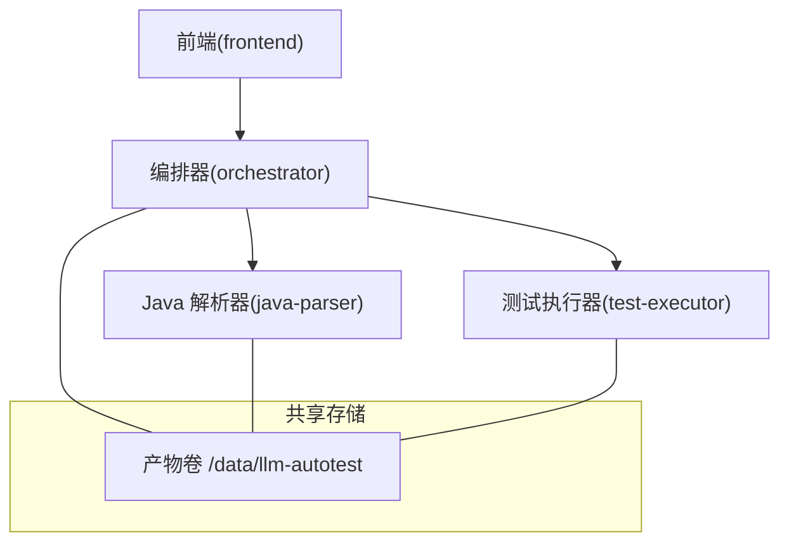
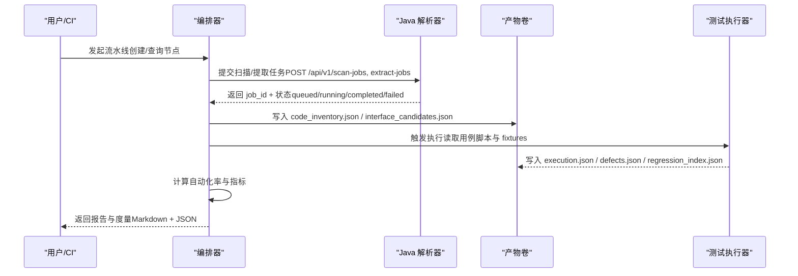
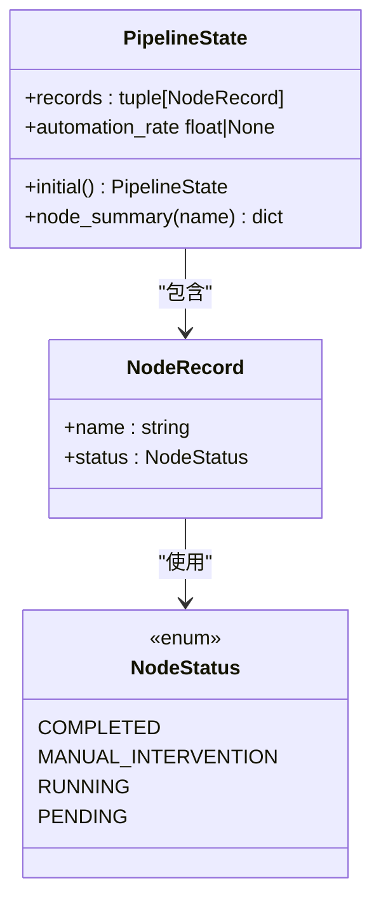
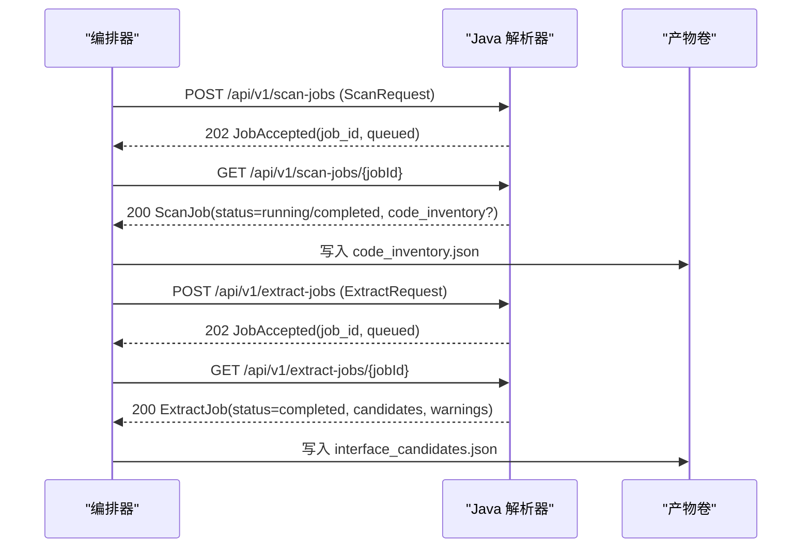
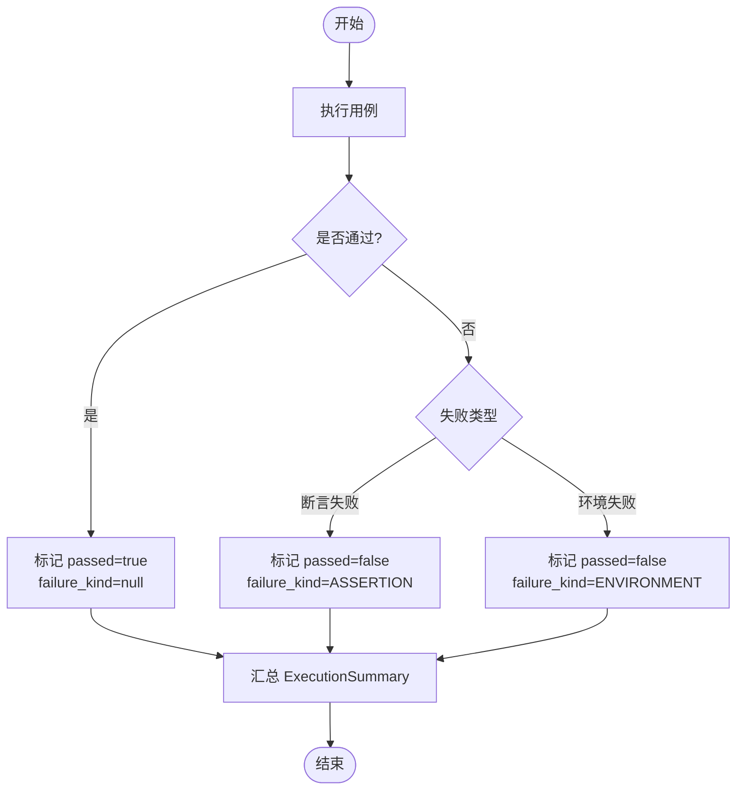
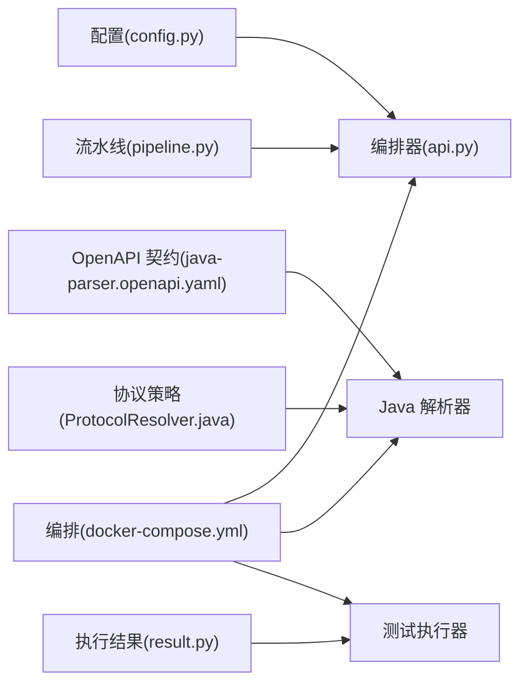
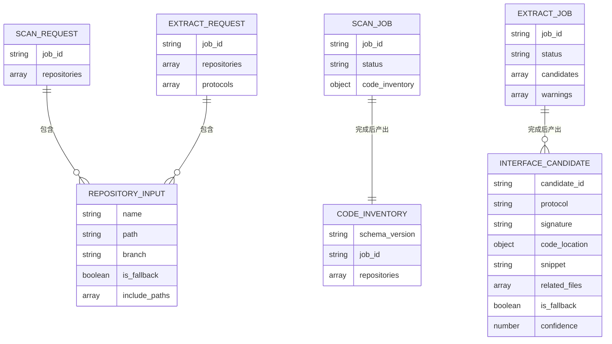

# 数据流设计

<cite>
**本文引用的文件**
- [api.py](file://services/orchestrator/src/orchestrator/api.py)
- [pipeline.py](file://services/orchestrator/src/orchestrator/pipeline.py)
- [config.py](file://services/orchestrator/src/orchestrator/config.py)
- [ProtocolResolver.java](file://services/java-parser/src/main/java/com/llmautotest/parser/ProtocolResolver.java)
- [ParserApplication.java](file://services/java-parser/src/main/java/com/llmautotest/parser/ParserApplication.java)
- [java-parser.openapi.yaml](file://schemas/contracts/java-parser.openapi.yaml)
- [result.py](file://services/test-executor/src/executor/result.py)
- [docker-compose.yml](file://deploy/docker-compose.yml)
- [README.md](file://schemas/README.md)
- [04_功能规格说明.md](file://docs/04_功能规格说明.md)
</cite>

## 目录
1. [引言](#引言)
2. [项目结构](#项目结构)
3. [核心组件](#核心组件)
4. [架构总览](#架构总览)
5. [详细组件分析](#详细组件分析)
6. [依赖关系分析](#依赖关系分析)
7. [性能与优化](#性能与优化)
8. [故障排查指南](#故障排查指南)
9. [结论](#结论)
10. [附录：数据模型与契约](#附录数据模型与契约)

## 引言
本文件聚焦于系统的数据流转机制与数据结构设计，覆盖从需求解析到测试报告生成的完整数据路径。重点说明：
- 各服务间的数据交换格式（OpenAPI 契约、JSON Schema）
- 文件产物规范与版本管理策略
- JSON Schema 验证机制与 OpenAPI 契约定义
- 数据持久化策略、缓存机制与性能优化考虑
- 通过数据流图与序列图展示端到端数据路径

## 项目结构
系统由多个微服务组成，围绕“编排器（orchestrator）”协调“Java 代码解析器（java-parser）”、“测试执行器（test-executor）”和“前端（frontend）”，并通过共享卷持久化产物。部署编排见 docker-compose，服务间通过 HTTP API 交互，产物以结构化 JSON 落盘。

**图表来源**
- [docker-compose.yml:3-62](file://deploy/docker-compose.yml#L3-L62)

**章节来源**
- [docker-compose.yml:3-62](file://deploy/docker-compose.yml#L3-L62)

## 核心组件
- 编排器（orchestrator）
  - 提供健康检查与流水线节点状态查询接口
  - 维护 9 节点固定口径的流水线状态（待运行/运行中/已完成/人工介入）
  - 通过环境变量注入配置（端口、解析器地址、LLM 参数等）
- Java 解析器（java-parser）
  - 基于 OpenAPI 契约暴露扫描与提取任务接口
  - 支持可插拔协议解析策略（REST/gRPC/GraphQL/SOAP/MQ）
- 测试执行器（test-executor）
  - 输出用例执行结果，区分断言失败与环境失败
- 前端（frontend）
  - 可视化编排与结果展示（当前阶段主要对接编排器）

**章节来源**
- [api.py:11-27](file://services/orchestrator/src/orchestrator/api.py#L11-L27)
- [pipeline.py:11-84](file://services/orchestrator/src/orchestrator/pipeline.py#L11-L84)
- [config.py:9-50](file://services/orchestrator/src/orchestrator/config.py#L9-L50)
- [ProtocolResolver.java:7-16](file://services/java-parser/src/main/java/com/llmautotest/parser/ProtocolResolver.java#L7-L16)
- [result.py:10-61](file://services/test-executor/src/executor/result.py#L10-L61)

## 架构总览
编排器作为统一入口，驱动 9 个节点的顺序执行；每个节点产出结构化 JSON 产物并落盘，下游节点消费上游产物。Java 解析器负责多仓库静态分析与接口候选提取；测试执行器负责用例执行与结果汇总；所有产物集中存放在共享卷，便于跨服务访问与审计。

**图表来源**
- [java-parser.openapi.yaml:24-115](file://schemas/contracts/java-parser.openapi.yaml#L24-L115)
- [docker-compose.yml:3-62](file://deploy/docker-compose.yml#L3-L62)
- [pipeline.py:23-84](file://services/orchestrator/src/orchestrator/pipeline.py#L23-L84)

## 详细组件分析

### 编排器（orchestrator）
- 职责
  - 暴露健康检查与节点清单接口
  - 维护 9 节点固定顺序与四态标注
  - 通过环境变量加载配置，避免硬编码
- 关键数据流
  - 节点清单：按 NODE_ORDER 生成每个节点的摘要（名称+状态）
  - 自动化率：completed 节点数 / 9（骨架实现为 None，正式实现从产物卷读取）
- 错误处理
  - 缺失必填环境变量时抛出运行时异常，确保启动失败即告警

**图表来源**
- [pipeline.py:11-84](file://services/orchestrator/src/orchestrator/pipeline.py#L11-L84)

**章节来源**
- [api.py:11-27](file://services/orchestrator/src/orchestrator/api.py#L11-L27)
- [pipeline.py:11-84](file://services/orchestrator/src/orchestrator/pipeline.py#L11-L84)
- [config.py:9-50](file://services/orchestrator/src/orchestrator/config.py#L9-L50)

### Java 解析器（java-parser）
- 职责
  - 提供多仓库扫描与接口候选提取的异步 Job API
  - 支持可插拔协议解析策略（REST/gRPC/GraphQL/SOAP/MQ）
- 契约与数据模型
  - OpenAPI v3.1 定义健康检查、扫描任务、提取任务及统一错误结构
  - 请求/响应体包含 job_id、repositories、code_inventory、candidates、warnings 等
- 数据流
  - POST /api/v1/scan-jobs → 返回 JobAccepted（job_id, status=queued）
  - GET /api/v1/scan-jobs/{jobId} → 轮询获取 ScanJob（含 code_inventory）
  - POST /api/v1/extract-jobs → 返回 JobAccepted
  - GET /api/v1/extract-jobs/{jobId} → 轮询获取 ExtractJob（含 candidates）

**图表来源**
- [java-parser.openapi.yaml:24-115](file://schemas/contracts/java-parser.openapi.yaml#L24-L115)

**章节来源**
- [ProtocolResolver.java:7-16](file://services/java-parser/src/main/java/com/llmautotest/parser/ProtocolResolver.java#L7-L16)
- [ParserApplication.java:8-16](file://services/java-parser/src/main/java/com/llmautotest/parser/ParserApplication.java#L8-L16)
- [java-parser.openapi.yaml:24-115](file://schemas/contracts/java-parser.openapi.yaml#L24-L115)

### 测试执行器（test-executor）
- 职责
  - 输出单条用例执行结果与一次执行的程序化汇总
  - 区分断言失败与环境失败，保证通过率口径正确
- 数据模型
  - CaseResult：case_id、passed、failure_kind（ASSERTION/ENVIRONMENT）
  - ExecutionSummary：results 元组，提供 total、passed、failed_assertion、failed_environment 属性

**图表来源**
- [result.py:10-61](file://services/test-executor/src/executor/result.py#L10-L61)

**章节来源**
- [result.py:10-61](file://services/test-executor/src/executor/result.py#L10-L61)

### 前端（frontend）
- 职责
  - 与编排器交互，展示流水线状态与结果（当前阶段主要调用编排器健康与节点清单接口）
- 数据流
  - GET /health：健康检查
  - GET /api/v1/pipeline/nodes：获取 9 节点清单与状态

**章节来源**
- [api.py:11-27](file://services/orchestrator/src/orchestrator/api.py#L11-L27)

## 依赖关系分析
- 编排器依赖
  - 配置：环境变量（端口、解析器地址、LLM 基线参数）
  - 流水线：NODE_ORDER 与 PipelineState 用于状态管理与自动化率计算
- Java 解析器依赖
  - 契约：OpenAPI 定义的请求/响应结构与错误模型
  - 策略：ProtocolResolver 接口支持多协议扩展
- 测试执行器依赖
  - 结果模型：CaseResult 与 ExecutionSummary 用于统计与报告
- 部署依赖
  - docker-compose 编排服务、共享卷 artifacts、健康检查与启动顺序

**图表来源**
- [config.py:9-50](file://services/orchestrator/src/orchestrator/config.py#L9-L50)
- [api.py:11-27](file://services/orchestrator/src/orchestrator/api.py#L11-L27)
- [pipeline.py:23-84](file://services/orchestrator/src/orchestrator/pipeline.py#L23-L84)
- [java-parser.openapi.yaml:24-115](file://schemas/contracts/java-parser.openapi.yaml#L24-L115)
- [ProtocolResolver.java:7-16](file://services/java-parser/src/main/java/com/llmautotest/parser/ProtocolResolver.java#L7-L16)
- [result.py:10-61](file://services/test-executor/src/executor/result.py#L10-L61)
- [docker-compose.yml:3-62](file://deploy/docker-compose.yml#L3-L62)

**章节来源**
- [docker-compose.yml:3-62](file://deploy/docker-compose.yml#L3-L62)

## 性能与优化
- 长任务异步化
  - 扫描与提取采用 Job 模式（POST 创建任务，GET 轮询），避免阻塞请求
- 大仓库截断
  - 超大仓库按 include_paths 限定扫描范围，减少 I/O 与解析开销
- 编码容错
  - 异常编码文件记录但跳过内容解析，保障流程继续
- LLM 上下文控制
  - 先静态特征定位再语义解析，分块调用，降低 token 用量与延迟
- 指标计算去 LLM
  - 自动化率与执行汇总通过程序化计算，避免 LLM 引入不确定性与额外耗时

**章节来源**
- [java-parser.openapi.yaml:162-233](file://schemas/contracts/java-parser.openapi.yaml#L162-L233)
- [04_功能规格说明.md:90-116](file://docs/04_功能规格说明.md#L90-L116)
- [pipeline.py:61-70](file://services/orchestrator/src/orchestrator/pipeline.py#L61-L70)
- [result.py:32-61](file://services/test-executor/src/executor/result.py#L32-L61)

## 故障排查指南
- 健康检查
  - 编排器与 Java 解析器均提供 /health，用于编排与健康探测
- 任务状态
  - 通过 GET /api/v1/scan-jobs/{jobId} 与 GET /api/v1/extract-jobs/{jobId} 轮询状态
- 错误结构
  - 统一 Error 模型（code、message、node_id?、details），便于跨服务一致处理
- 常见错误
  - 仓库路径不存在、空仓库、超大仓库截断、单文件解析失败、LLM 输出不符合 Schema
- 执行失败分类
  - 断言失败计入通过率；环境失败隔离至待环境确认，不直接进缺陷清单

**章节来源**
- [java-parser.openapi.yaml:117-161](file://schemas/contracts/java-parser.openapi.yaml#L117-L161)
- [04_功能规格说明.md:82-116](file://docs/04_功能规格说明.md#L82-L116)
- [result.py:10-30](file://services/test-executor/src/executor/result.py#L10-L30)

## 结论
本系统以编排器为核心，结合 Java 解析器与测试执行器，形成从需求解析到测试报告的端到端数据流。通过 OpenAPI 契约与 JSON Schema 严格约束数据模型，配合共享卷持久化与异步 Job 模式，实现高内聚、低耦合的可扩展架构。性能方面强调长任务异步化、大仓库截断与 LLM 上下文控制，确保整体吞吐与稳定性。

## 附录：数据模型与契约
- 数据模型
  - 流水线节点状态：NodeStatus（completed/manual_intervention/running/pending）
  - 流水线状态：PipelineState（records、automation_rate）
  - 执行结果：CaseResult、ExecutionSummary（total/passed/failed_assertion/failed_environment）
- 契约与产物
  - OpenAPI：java-parser 服务契约（扫描/提取任务、错误结构、仓库输入、源码清单、接口候选）
  - JSON Schema：schemas/README 约定 schema_version、横切字段（ID 命名、时间戳、协议枚举、is_fallback、错误结构）
- 版本管理策略
  - 每个 Schema 含 schema_version，结构变更必须升版本，禁止原地改语义
  - 产物 Schema 校验不通过则拒绝复用，强制重跑该节点

**图表来源**
- [java-parser.openapi.yaml:162-369](file://schemas/contracts/java-parser.openapi.yaml#L162-L369)

**章节来源**
- [README.md:1-30](file://schemas/README.md#L1-L30)
- [java-parser.openapi.yaml:117-369](file://schemas/contracts/java-parser.openapi.yaml#L117-L369)