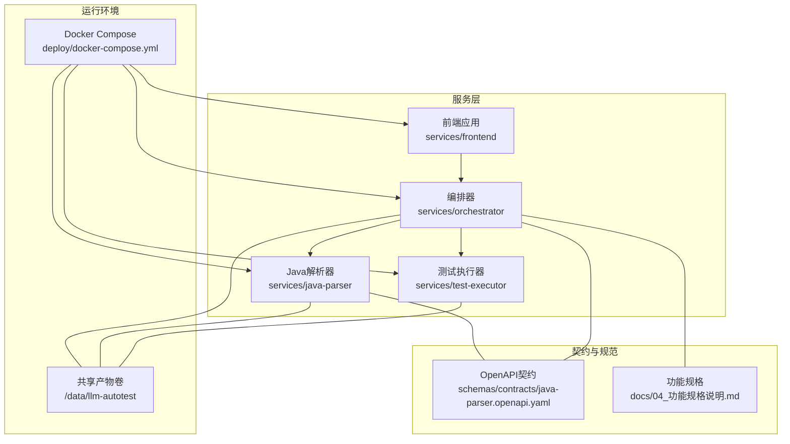
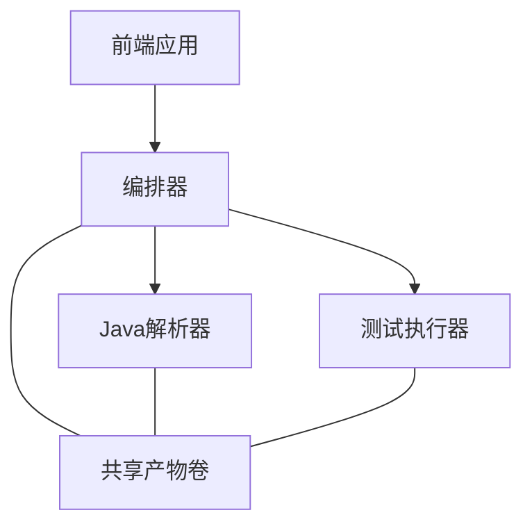
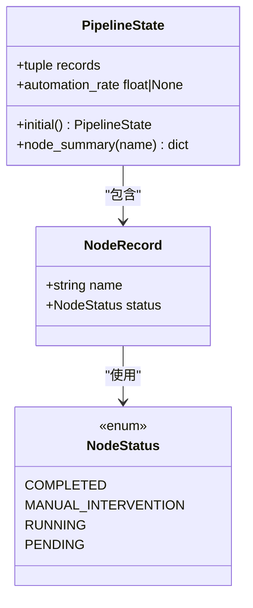
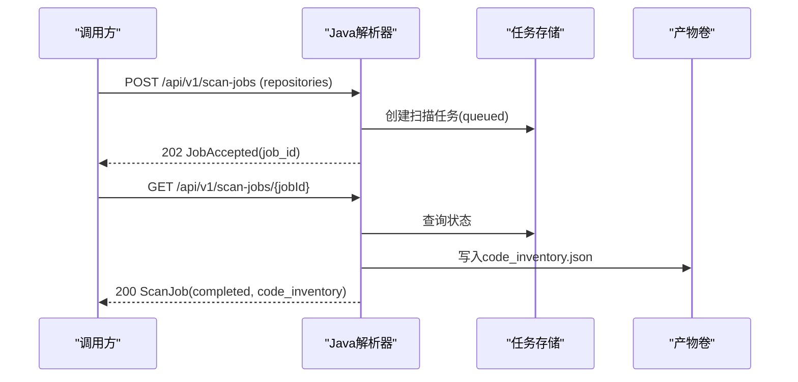
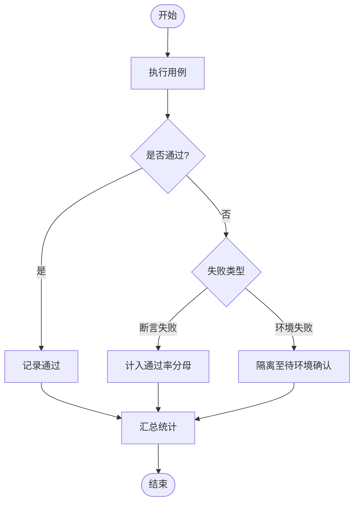
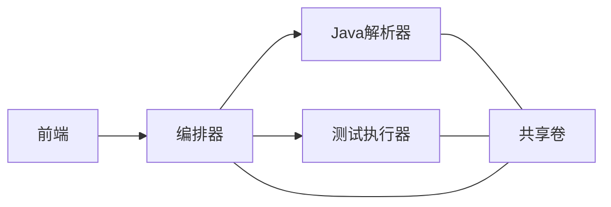

# 架构概览

<cite>
**本文引用的文件**
- [services/orchestrator/src/orchestrator/pipeline.py](file://services/orchestrator/src/orchestrator/pipeline.py)
- [services/orchestrator/src/orchestrator/api.py](file://services/orchestrator/src/orchestrator/api.py)
- [services/orchestrator/src/orchestrator/config.py](file://services/orchestrator/src/orchestrator/config.py)
- [services/java-parser/src/main/java/com/llmautotest/parser/ProtocolResolver.java](file://services/java-parser/src/main/java/com/llmautotest/parser/ProtocolResolver.java)
- [services/java-parser/src/main/java/com/llmautotest/parser/ParserApplication.java](file://services/java-parser/src/main/java/com/llmautotest/parser/ParserApplication.java)
- [schemas/contracts/java-parser.openapi.yaml](file://schemas/contracts/java-parser.openapi.yaml)
- [services/test-executor/src/executor/result.py](file://services/test-executor/src/executor/result.py)
- [deploy/docker-compose.yml](file://deploy/docker-compose.yml)
- [services/frontend/src/App.vue](file://services/frontend/src/App.vue)
- [docs/04_功能规格说明.md](file://docs/04_功能规格说明.md)
</cite>

## 目录
1. [引言](#引言)
2. [项目结构](#项目结构)
3. [核心组件](#核心组件)
4. [架构总览](#架构总览)
5. [详细组件分析](#详细组件分析)
6. [依赖关系分析](#依赖关系分析)
7. [性能与可扩展性](#性能与可扩展性)
8. [故障排查指南](#故障排查指南)
9. [结论](#结论)
10. [附录：九节点流水线与数据流](#附录九节点流水线与数据流)

## 引言
本架构概览面向LLM-AutoTest系统，聚焦整体设计理念与微服务架构模式。系统围绕“编排器 + Java解析器 + 前端应用 + 测试执行器”的职责划分，采用“契约先行、固定口径、产物落盘、异步长任务”的设计原则，构建一条九节点固定流水线，贯穿需求解析、代码扫描、接口还原、评审、用例生成、执行、报告、缺陷闭环与回归沉淀。本文提供系统上下文图与组件关系图，解释服务间通信机制与数据流向，并阐述技术选型与约束条件。

## 项目结构
仓库按服务维度组织，每个服务独立容器化部署，通过共享卷传递产物，使用OpenAPI定义服务契约，编排由docker-compose统一管控。

图表来源
- [deploy/docker-compose.yml:1-62](file://deploy/docker-compose.yml#L1-L62)
- [schemas/contracts/java-parser.openapi.yaml:1-369](file://schemas/contracts/java-parser.openapi.yaml#L1-L369)
- [docs/04_功能规格说明.md:1-337](file://docs/04_功能规格说明.md#L1-L337)

章节来源
- [deploy/docker-compose.yml:1-62](file://deploy/docker-compose.yml#L1-L62)
- [schemas/contracts/java-parser.openapi.yaml:1-369](file://schemas/contracts/java-parser.openapi.yaml#L1-L369)
- [docs/04_功能规格说明.md:1-337](file://docs/04_功能规格说明.md#L1-L337)

## 核心组件
- 编排器（Orchestrator）：负责九节点固定流水线的调度、状态管理、断点续跑与度量汇总；对外暴露REST API用于查询节点清单与健康检查。
- Java解析器（Java Parser）：基于Spring Boot的多仓库静态分析与接口候选提取服务，支持可插拔协议策略，产出code_inventory与接口候选清单。
- 前端应用（Frontend）：Web界面占位，数值展示完全来自后端API，不自行计算指标。
- 测试执行器（Test Executor）：执行测试脚本并输出结构化结果，区分“断言失败”和“环境失败”，为报告与缺陷模块提供一致的数据基础。

章节来源
- [services/orchestrator/src/orchestrator/pipeline.py:1-84](file://services/orchestrator/src/orchestrator/pipeline.py#L1-L84)
- [services/orchestrator/src/orchestrator/api.py:1-28](file://services/orchestrator/src/orchestrator/api.py#L1-L28)
- [services/java-parser/src/main/java/com/llmautotest/parser/ProtocolResolver.java:1-17](file://services/java-parser/src/main/java/com/llmautotest/parser/ProtocolResolver.java#L1-L17)
- [services/java-parser/src/main/java/com/llmautotest/parser/ParserApplication.java:1-17](file://services/java-parser/src/main/java/com/llmautotest/parser/ParserApplication.java#L1-L17)
- [services/test-executor/src/executor/result.py:1-61](file://services/test-executor/src/executor/result.py#L1-L61)
- [services/frontend/src/App.vue:1-12](file://services/frontend/src/App.vue#L1-L12)

## 架构总览
系统采用微服务模式，服务之间通过HTTP REST进行通信，并以共享卷作为持久化产物通道。编排器是控制面，解析器与执行器是工作负载面，前端是用户面。所有关键指标与状态均通过API暴露，前端仅做展示。

图表来源
- [deploy/docker-compose.yml:1-62](file://deploy/docker-compose.yml#L1-L62)
- [services/orchestrator/src/orchestrator/api.py:1-28](file://services/orchestrator/src/orchestrator/api.py#L1-L28)
- [schemas/contracts/java-parser.openapi.yaml:1-369](file://schemas/contracts/java-parser.openapi.yaml#L1-L369)

## 详细组件分析

### 编排器（Orchestrator）
- 职责：维护九节点固定顺序与四态标注（待运行、运行中、已完成、人工介入），提供健康检查与节点清单API；自动化率程序化汇总，不经LLM。
- 设计要点：
  - 固定口径：NODE_ORDER冻结为9个节点，禁止增删。
  - 状态模型：NodeRecord与PipelineState封装节点状态与汇总能力。
  - API层：FastAPI应用，仅做协议转换与校验，业务下沉至pipeline。
  - 配置：全部来自环境变量，包含端口、解析器地址、产物根路径与LLM参数。

图表来源
- [services/orchestrator/src/orchestrator/pipeline.py:11-84](file://services/orchestrator/src/orchestrator/pipeline.py#L11-L84)

章节来源
- [services/orchestrator/src/orchestrator/pipeline.py:1-84](file://services/orchestrator/src/orchestrator/pipeline.py#L1-L84)
- [services/orchestrator/src/orchestrator/api.py:1-28](file://services/orchestrator/src/orchestrator/api.py#L1-L28)
- [services/orchestrator/src/orchestrator/config.py:1-50](file://services/orchestrator/src/orchestrator/config.py#L1-L50)

### Java解析器（Java Parser）
- 职责：多仓库扫描与接口候选提取，支持REST/gRPC/GraphQL/SOAP/MQ等协议的静态特征定位，产出code_inventory与候选清单供下游LLM语义解析。
- 设计要点：
  - 可插拔协议策略：ProtocolResolver接口定义supportedProtocol、supports与解析方法，新增协议不改主流程。
  - 应用入口：Spring Boot启动类，启用配置属性扫描。
  - 契约：OpenAPI定义扫描与提取任务的创建与查询，统一错误结构与Job状态机。

图表来源
- [schemas/contracts/java-parser.openapi.yaml:24-115](file://schemas/contracts/java-parser.openapi.yaml#L24-L115)
- [schemas/contracts/java-parser.openapi.yaml:199-273](file://schemas/contracts/java-parser.openapi.yaml#L199-L273)

章节来源
- [services/java-parser/src/main/java/com/llmautotest/parser/ProtocolResolver.java:1-17](file://services/java-parser/src/main/java/com/llmautotest/parser/ProtocolResolver.java#L1-L17)
- [services/java-parser/src/main/java/com/llmautotest/parser/ParserApplication.java:1-17](file://services/java-parser/src/main/java/com/llmautotest/parser/ParserApplication.java#L1-L17)
- [schemas/contracts/java-parser.openapi.yaml:1-369](file://schemas/contracts/java-parser.openapi.yaml#L1-L369)

### 测试执行器（Test Executor）
- 职责：执行测试脚本并输出结构化结果，区分“断言失败”与“环境失败”，为报告与缺陷模块提供一致数据。
- 设计要点：
  - 失败二态：FailureKind枚举明确分类，CaseResult保证一致性（通过的用例不得携带失败类型）。
  - 汇总：ExecutionSummary程序化统计总数、通过数、断言失败与环境失败，确保指标口径稳定。

图表来源
- [services/test-executor/src/executor/result.py:10-61](file://services/test-executor/src/executor/result.py#L10-L61)

章节来源
- [services/test-executor/src/executor/result.py:1-61](file://services/test-executor/src/executor/result.py#L1-L61)

### 前端应用（Frontend）
- 职责：展示UI占位，数值一律来自后端API，不做本地计算，遵循前端代码风格红线。
- 设计要点：
  - 纯展示：App.vue仅渲染占位文本，后续六页业务按排期接入。
  - 数据源：所有指标与状态通过编排器API获取，保持前后端职责清晰。

章节来源
- [services/frontend/src/App.vue:1-12](file://services/frontend/src/App.vue#L1-L12)

## 依赖关系分析
- 服务耦合：
  - 编排器依赖Java解析器的REST API与共享产物卷。
  - 前端依赖编排器API。
  - 测试执行器依赖共享产物卷与外部被测服务或Mock服务。
- 契约边界：
  - Java解析器通过OpenAPI明确输入输出与错误结构，便于契约驱动开发。
  - 编排器以固定节点顺序与状态机约束流程，避免随意扩展。
- 部署依赖：
  - docker-compose定义服务启动顺序、健康检查与共享卷挂载。

图表来源
- [deploy/docker-compose.yml:1-62](file://deploy/docker-compose.yml#L1-L62)
- [schemas/contracts/java-parser.openapi.yaml:1-369](file://schemas/contracts/java-parser.openapi.yaml#L1-L369)

章节来源
- [deploy/docker-compose.yml:1-62](file://deploy/docker-compose.yml#L1-L62)
- [schemas/contracts/java-parser.openapi.yaml:1-369](file://schemas/contracts/java-parser.openapi.yaml#L1-L369)

## 性能与可扩展性
- 长任务异步化：Java解析器采用job模式（POST创建→GET轮询），避免阻塞请求，提升吞吐。
- 固定口径与程序化汇总：自动化率与执行结果统计均由程序计算，减少不确定性，提高稳定性。
- 可插拔协议：ProtocolResolver允许新增协议实现而不改动主流程，降低扩展成本。
- 产物落盘：节点间以文件为接口，解耦内存依赖，支持断点续跑与审计回溯。
- 资源隔离：各服务独立容器化，可按需扩缩容；共享卷集中管理产物，便于备份与迁移。

[本节为通用指导，不直接分析具体文件]

## 故障排查指南
- 健康检查：
  - 编排器与Java解析器均提供/health端点，用于docker-compose健康检查与服务发现。
- 常见错误：
  - 缺少必填环境变量：编排器配置加载时显式报错，需检查PORT、JAVA_PARSER_URL、LLM_BASE_URL、LLM_SEED等。
  - 仓库路径不存在：Java解析器返回统一错误结构，包含code与message，便于前端提示。
  - 执行环境失败：测试执行器将失败归类为环境失败，隔离至待环境确认，不影响通过率统计。
- 日志与产物：
  - 产物卷统一挂载到/data/llm-autotest，便于定位code_inventory、interfaces、execution等中间文件。
  - 节点执行日志与人工标注复核用于度量采集与瓶颈分析。

章节来源
- [services/orchestrator/src/orchestrator/config.py:32-50](file://services/orchestrator/src/orchestrator/config.py#L32-L50)
- [schemas/contracts/java-parser.openapi.yaml:130-148](file://schemas/contracts/java-parser.openapi.yaml#L130-L148)
- [services/test-executor/src/executor/result.py:10-61](file://services/test-executor/src/executor/result.py#L10-L61)
- [deploy/docker-compose.yml:11-16](file://deploy/docker-compose.yml#L11-L16)

## 结论
LLM-AutoTest采用微服务架构，以编排器为核心，结合Java解析器、前端与测试执行器，形成清晰的职责边界与稳定的数据流。九节点固定流水线确保流程可控、度量可靠；契约先行与产物落盘保障跨服务协作的稳健性。通过可插拔协议与异步任务设计，系统在可扩展性与性能方面具备良好基础。

[本节为总结性内容，不直接分析具体文件]

## 附录：九节点流水线与数据流
- 九节点顺序：需求解析、代码扫描、接口还原、Code Review、用例生成、自动执行、测试报告、缺陷清单、复测回归。
- 数据流向：
  - 编排器维护节点状态与自动化率。
  - Java解析器产出code_inventory与接口候选清单。
  - 测试执行器产出execution.json，区分断言失败与环境失败。
  - 报告与缺陷模块基于执行结果生成Markdown与JSON双产物。
- 契约与规则：
  - OpenAPI定义解析器API，统一错误结构与Job状态。
  - 功能规格明确交互规则与异常分支，确保端到端一致性。

章节来源
- [services/orchestrator/src/orchestrator/pipeline.py:23-34](file://services/orchestrator/src/orchestrator/pipeline.py#L23-L34)
- [schemas/contracts/java-parser.openapi.yaml:24-115](file://schemas/contracts/java-parser.openapi.yaml#L24-L115)
- [docs/04_功能规格说明.md:9-337](file://docs/04_功能规格说明.md#L9-L337)